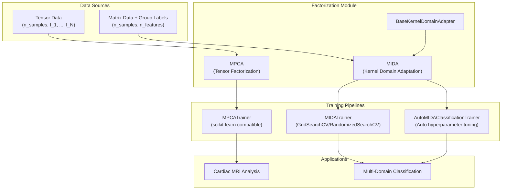
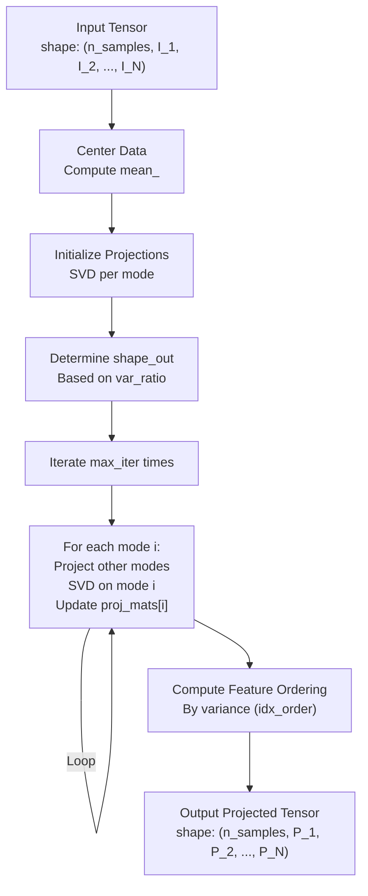
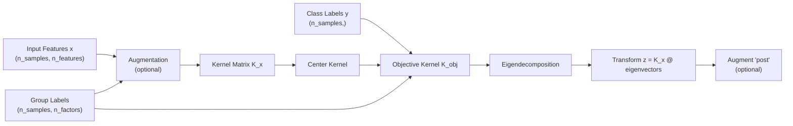
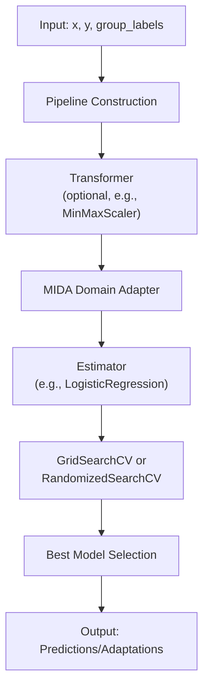
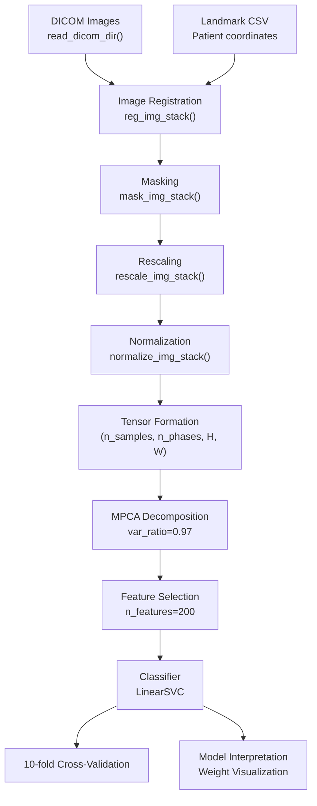

<!-- source: DeepWiki mcp.deepwiki.com · repo pykale/pykale · page 4.6 Factorization Methods · fetched 2026-10-21 -->

# Factorization Methods

<details>
<summary>Relevant source files</summary>

The following files were used as context for generating this wiki page:

- [kale/embed/factorization.py](kale/embed/factorization.py)
- [kale/interpret/model_weights.py](kale/interpret/model_weights.py)
- [kale/pipeline/mpca_trainer.py](kale/pipeline/mpca_trainer.py)
- [tests/embed/test_factorization.py](tests/embed/test_factorization.py)
- [tests/interpret/test_model_weights.py](tests/interpret/test_model_weights.py)
- [tests/interpret/test_visualize.py](tests/interpret/test_visualize.py)
- [tests/pipeline/test_mida_trainer.py](tests/pipeline/test_mida_trainer.py)
- [tests/pipeline/test_mpca_trainer.py](tests/pipeline/test_mpca_trainer.py)
- [tests/prepdata/test_tensor_reshape.py](tests/prepdata/test_tensor_reshape.py)

</details>


## Purpose and Scope

This document covers PyKale's factorization-based methods for dimensionality reduction and domain adaptation. These methods include **MPCA (Multilinear Principal Component Analysis)** for tensor decomposition and **MIDA (Maximum Independence Domain Adaptation)** for kernel-based domain adaptation. Both implementations provide scikit-learn-compatible interfaces and are designed for handling high-dimensional data with different structural properties.

For general domain adaptation techniques, see [Domain Adaptation](#3). For medical imaging applications of MPCA, see [Medical Imaging](#4.3). For multi-domain adaptation with MIDA trainers, see [Multi-Source Domain Adaptation](#3.2).

---

## Overview

PyKale provides two primary factorization methods:

| Method | Purpose | Input Type | Key Features |
|--------|---------|------------|--------------|
| **MPCA** | Tensor decomposition | Multi-way arrays (tensors) | Mode-wise projection, variance-based truncation, vectorization support |
| **MIDA** | Kernel-based domain adaptation | Feature matrices with group labels | Factor independence, multiple kernels, augmentation strategies |

Both methods implement the scikit-learn `TransformerMixin` interface, enabling seamless integration with scikit-learn pipelines and cross-validation utilities.

Sources: [kale/embed/factorization.py:1-35](), [examples/cmri_mpca/tutorial.ipynb:16-31]()

---

## Architecture Overview



**Diagram: Factorization Methods Architecture**

This diagram shows the relationship between core factorization classes, training pipelines, and applications. MPCA handles tensor data directly, while MIDA operates on matrix data with group labels for domain adaptation.

Sources: [kale/embed/factorization.py:308-822](), [kale/pipeline/mpca_trainer.py](), [kale/pipeline/multi_domain_adapter.py]()

---

## MPCA: Multilinear Principal Component Analysis

### Overview

MPCA extends traditional PCA to higher-order tensors by performing dimensionality reduction along each mode independently. This preserves the multi-way structure of tensor data while reducing dimensionality based on variance explained.

### Class Definition

The `MPCA` class is defined in [kale/embed/factorization.py:308-508]().

**Key Parameters:**
- `var_ratio` (float, default=0.97): Percentage of variance to preserve (0 to 1)
- `max_iter` (int, default=1): Maximum iterations for alternating projection optimization
- `vectorize` (bool, default=False): Whether to return flattened features
- `n_components` (int, optional): Number of features when `vectorize=True`

**Key Attributes:**
- `proj_mats` (list): Transposed projection matrices for each mode, shapes `[(P_1, I_1), ..., (P_N, I_N)]`
- `idx_order` (array): Feature ordering by decreasing variance
- `mean_` (array): Per-feature empirical mean, shape `(I_1, I_2, ..., I_N)`
- `shape_in` (tuple): Input tensor shape `(I_1, I_2, ..., I_N)`
- `shape_out` (tuple): Output tensor shape `(P_1, P_2, ..., P_N)`

Sources: [kale/embed/factorization.py:308-362]()

### Algorithm Flow



**Diagram: MPCA Algorithm Flow**

The algorithm first determines output dimensions per mode based on variance ratio, then alternates between modes to refine projection matrices. Feature ordering enables selection of most informative components when vectorized.

Sources: [kale/embed/factorization.py:377-435]()

### Core Methods

#### fit(x, y=None)

Fits MPCA model to input tensor data.

**Parameters:**
- `x` (array-like): Input tensor, shape `(n_samples, I_1, I_2, ..., I_N)`
- `y`: Ignored (for scikit-learn compatibility)

**Process:**
1. Compute mean tensor and center data [kale/embed/factorization.py:377-385]()
2. Initialize projection matrices via SVD per mode [kale/embed/factorization.py:392-404]()
3. Alternating optimization over modes for `max_iter` iterations [kale/embed/factorization.py:410-422]()
4. Compute feature importance ordering [kale/embed/factorization.py:424-428]()

Sources: [kale/embed/factorization.py:363-435]()

#### transform(x)

Projects tensor data to lower-dimensional space.

**Parameters:**
- `x` (array-like): Tensor to transform, shape `(n_samples, I_1, I_2, ..., I_N)` or `(I_1, I_2, ..., I_N)` for single sample

**Returns:**
- If `vectorize=False`: Tensor of shape `(n_samples, P_1, P_2, ..., P_N)`
- If `vectorize=True` and `n_components=None`: Matrix of shape `(n_samples, P_1 * P_2 * ... * P_N)` with features ordered by variance
- If `vectorize=True` and `n_components=k`: Matrix of shape `(n_samples, k)` with top-k features

**Implementation Details:**
- Centers data using stored mean [kale/embed/factorization.py:454]()
- Applies multi-mode dot product with projection matrices [kale/embed/factorization.py:457]()
- Optionally vectorizes and selects top components [kale/embed/factorization.py:459-469]()

Sources: [kale/embed/factorization.py:437-471]()

#### inverse_transform(x)

Reconstructs original tensor from projected representation.

**Parameters:**
- `x` (array-like): Projected data, shape `(n_samples, P_1, P_2, ..., P_N)` or vectorized

**Returns:**
- Reconstructed tensor, shape `(n_samples, I_1, I_2, ..., I_N)`

**Process:**
1. If vectorized, reshape to tensor form [kale/embed/factorization.py:487-501]()
2. Apply transposed projection matrices [kale/embed/factorization.py:503]()
3. Add back mean [kale/embed/factorization.py:505]()

Sources: [kale/embed/factorization.py:473-507]()

### Usage Example

```python
from kale.embed.factorization import MPCA
import numpy as np

# Create tensor data: 40 samples, shape (20, 25, 20) per sample
x = np.random.random((40, 20, 25, 20))

# Fit MPCA preserving 97% variance
mpca = MPCA(var_ratio=0.97, vectorize=False)
x_projected = mpca.fit_transform(x)
# Output shape: (40, P_1, P_2, P_3) where P_i <= 20, 25, 20

# Get vectorized features, top 50 components
mpca.set_params(vectorize=True, n_components=50)
x_vector = mpca.transform(x)
# Output shape: (40, 50)

# Reconstruct original data
x_reconstructed = mpca.inverse_transform(x_vector)
# Output shape: (40, 20, 25, 20)
```

Sources: [kale/embed/factorization.py:330-349](), [tests/embed/test_factorization.py:43-84]()

---

## MIDA: Maximum Independence Domain Adaptation

### Overview

MIDA is a kernel-based domain adaptation method that learns feature representations independent of domain-specific factors (e.g., dataset, gender, age group) while preserving class discriminability. It extends kernel PCA with factor independence constraints.

### Class Definition

The `MIDA` class extends `BaseKernelDomainAdapter` defined in [kale/embed/factorization.py:510-822]().

**Key Parameters:**

| Parameter | Type | Description |
|-----------|------|-------------|
| `num_components` | int | Number of components to keep (default: None, keep all) |
| `ignore_y` | bool | Whether to ignore class labels (default: False) |
| `augment` | str | Augmentation strategy: "pre", "post", or None (default: None) |
| `kernel` | str/callable | Kernel function: "linear", "rbf", "poly", "sigmoid", etc. (default: "linear") |
| `gamma` | float | Kernel coefficient (default: 1/n_features) |
| `alpha` | float | Regularization for inverse transform (default: 1.0) |
| `fit_inverse_transform` | bool | Fit inverse transform (default: False) |
| `eigen_solver` | str | Solver: "auto", "dense", "arpack", "randomized" (default: "auto") |
| `scale_components` | bool | Scale components by sqrt(eigenvalues) (default: False) |

Sources: [kale/embed/factorization.py:510-594]()

### Architecture



**Diagram: MIDA Processing Pipeline**

MIDA operates on kernel matrices derived from input features, computing an objective kernel that incorporates factor independence constraints. The eigenvectors of this objective kernel define the transformation.

Sources: [kale/embed/factorization.py:717-821]()

### Core Methods

#### fit(x, y=None, group_labels=None, **fit_params)

Fits MIDA model to data with group labels representing domains or factors.

**Parameters:**
- `x` (array-like): Input features, shape `(n_samples, n_features)`
- `y` (array-like, optional): Class labels, shape `(n_samples,)`. Use `-1` for unknown labels in semi-supervised setting
- `group_labels` (array-like): Domain/factor labels, shape `(n_samples, n_factors)`. Must be preprocessed (e.g., one-hot encoded)
- `**fit_params`: Additional parameters

**Process:**
1. Validate input data and one-hot encode class labels if provided [kale/embed/factorization.py:732-751]()
2. Validate group_labels shape [kale/embed/factorization.py:753-759]()
3. Optionally augment features with group_labels if `augment="pre"` [kale/embed/factorization.py:762-767]()
4. Compute and center kernel matrix [kale/embed/factorization.py:771-776]()
5. Create objective kernel using `_make_objective_kernel` (subclass-specific) [kale/embed/factorization.py:778]()
6. Perform eigendecomposition in-place [kale/embed/factorization.py:781]()
7. Optionally fit inverse transform [kale/embed/factorization.py:782-784]()

Sources: [kale/embed/factorization.py:717-786]()

#### transform(x, group_labels=None)

Transforms input features to factor-independent space.

**Parameters:**
- `x` (array-like): Input features, shape `(n_samples, n_features)`
- `group_labels` (array-like, optional): Domain/factor labels for augmentation

**Returns:**
- Transformed features, shape `(n_samples, num_components)` or `(n_samples, num_components + n_factors)` if `augment="post"`

**Process:**
1. Validate input [kale/embed/factorization.py:800-807]()
2. Compute kernel with training data [kale/embed/factorization.py:809]()
3. Center kernel [kale/embed/factorization.py:810]()
4. Project using eigenvectors [kale/embed/factorization.py:812-816]()
5. Optionally append group_labels if `augment="post"` [kale/embed/factorization.py:818-819]()

Sources: [kale/embed/factorization.py:788-821]()

#### inverse_transform(z)

Reconstructs original features from transformed representation (requires `fit_inverse_transform=True`).

**Parameters:**
- `z` (array-like): Transformed features, shape `(n_samples, num_components)`

**Returns:**
- Reconstructed features, shape `(n_samples, n_features)` or augmented shape

Sources: [kale/embed/factorization.py:823-840]()

### Kernel Options

MIDA supports multiple kernel functions controlled by the `kernel` parameter:

| Kernel | Description | Key Parameters |
|--------|-------------|----------------|
| `"linear"` | Linear kernel: `x @ y.T` | None |
| `"rbf"` | Radial Basis Function: `exp(-gamma * ||x-y||^2)` | `gamma` |
| `"poly"` | Polynomial: `(gamma * x @ y.T + coef0)^degree` | `gamma`, `degree`, `coef0` |
| `"sigmoid"` | Sigmoid: `tanh(gamma * x @ y.T + coef0)` | `gamma`, `coef0` |
| `"cosine"` | Cosine similarity | None |

**Linear Kernel Benefits:**
- Allows computation of `orig_coef_` property for interpretability [kale/embed/factorization.py:666-676]()
- More efficient for high-dimensional data
- Enables direct mapping to original feature space

Sources: [kale/embed/factorization.py:541-544](), [kale/embed/factorization.py:658-663](), [tests/embed/test_factorization.py:152-172]()

### Augmentation Strategies

The `augment` parameter controls how group labels are incorporated:

| Strategy | Behavior | Use Case |
|----------|----------|----------|
| `None` | No augmentation | Standard domain adaptation |
| `"pre"` | Prepend group labels to features before kernelization | Include factors in kernel computation |
| `"post"` | Append group labels to transformed features | Preserve factor information in output |

**Implementation Details:**
- `augment="pre"`: Concatenates group_labels to input before computing kernel [kale/embed/factorization.py:766-767]()
- `augment="post"`: Concatenates group_labels to transformed output [kale/embed/factorization.py:818-819]()
- Requires group_labels in both `fit()` and `transform()` when enabled [kale/embed/factorization.py:804]()

Sources: [kale/embed/factorization.py:540](), [tests/embed/test_factorization.py:174-194]()

### Usage Example

```python
from kale.embed.factorization import MIDA
from sklearn.preprocessing import OneHotEncoder
import numpy as np

# Create sample data with domain shift
x = np.random.randn(100, 20)  # 100 samples, 20 features
y = np.random.randint(0, 2, 100)  # Binary labels
domains = np.random.randint(0, 5, 100)  # 5 domains

# One-hot encode domains
factors = OneHotEncoder(sparse_output=False).fit_transform(domains.reshape(-1, 1))

# Fit MIDA with linear kernel
mida = MIDA(num_components=10, kernel='linear')
mida.fit(x, y, group_labels=factors)

# Transform data to domain-invariant space
x_transformed = mida.transform(x, group_labels=factors)
# Output shape: (100, 10)

# Access learned coefficients (linear kernel only)
coef = mida.orig_coef_
# Shape: (10, 20)
```

Sources: [tests/embed/test_factorization.py:26-48](), [tests/embed/test_factorization.py:104-131]()

---

## Training Pipelines

### MPCATrainer

The `MPCATrainer` class provides a scikit-learn-compatible pipeline combining MPCA with a classifier for tensor classification tasks.

**Location:** [kale/pipeline/mpca_trainer.py]()

**Key Features:**
- Wraps `MPCA` and a scikit-learn classifier
- Compatible with `cross_validate()` and `GridSearchCV`
- Automatic feature vectorization and selection

**Parameters:**
- `classifier` (str or estimator): Classifier type ("svc", "linear_svc", "lr") or estimator instance
- `n_features` (int): Number of top MPCA features to use
- `var_ratio` (float): Variance ratio for MPCA (default: 0.97)

**Usage Pattern:**

```python
from kale.pipeline.mpca_trainer import MPCATrainer
from sklearn.model_selection import cross_validate

# Create trainer with SVM classifier
trainer = MPCATrainer(classifier='linear_svc', n_features=200, var_ratio=0.97)

# Perform 10-fold cross-validation
cv_results = cross_validate(
    trainer, 
    x_tensor,  # Shape: (n_samples, I_1, I_2, ..., I_N)
    y_labels,  # Shape: (n_samples,)
    cv=10, 
    scoring=['accuracy', 'roc_auc']
)

# Access MPCA model after fitting
trainer.fit(x_tensor, y_labels)
mpca_model = trainer.mpca
classifier = trainer.clf
```

Sources: [examples/cmri_mpca/main.py:132-139](), [examples/cmri_mpca/tutorial.ipynb:344-347]()

### MIDATrainer

The `MIDATrainer` class provides hyperparameter tuning for MIDA-based domain adaptation pipelines.

**Location:** [kale/pipeline/multi_domain_adapter.py]()

**Architecture:**



**Diagram: MIDATrainer Pipeline Architecture**

The trainer constructs a scikit-learn pipeline with optional preprocessing, MIDA adaptation, and a final estimator. Hyperparameter search optimizes across all components.

Sources: [kale/pipeline/multi_domain_adapter.py](), [tests/pipeline/test_mida_trainer.py:62-93]()

**Key Parameters:**
- `estimator`: Base estimator (classifier or regressor)
- `transformer`: Optional preprocessing step
- `param_grid`: Hyperparameter grid for search
- `use_mida` (bool, default=True): Whether to include MIDA in pipeline
- `search_strategy`: "grid" or "random"
- `cv`: Cross-validation strategy
- `scoring`: Evaluation metrics

**Key Methods:**
- `fit(x, y, group_labels, groups=None)`: Fit with hyperparameter search
- `adapt(x, group_labels)`: Apply transformation pipeline (excluding estimator)
- `predict(x)`: Make predictions
- `predict_proba(x)`: Predict class probabilities
- `score(x, y)`: Evaluate model performance

**Attributes:**
- `best_params_`: Best hyperparameters found
- `best_mida_`: Best fitted MIDA model (if `use_mida=True`)
- `cv_results_`: Cross-validation results dictionary

Sources: [kale/pipeline/multi_domain_adapter.py](), [tests/pipeline/test_mida_trainer.py:176-245]()

### AutoMIDAClassificationTrainer

The `AutoMIDAClassificationTrainer` provides automatic classifier selection and hyperparameter tuning for MIDA-based classification.

**Key Features:**
- Automatic classifier selection from predefined options: "lr", "svm", "linear_svm", "ridge", "lda"
- Automatic MIDA hyperparameter grid generation
- Support for nonlinear kernels
- Customizable parameter grids

**Parameters:**
- `classifier`: Classifier type ("lr", "svm", "ridge", "lda", "linear_svm", "auto")
- `transformer`: Optional preprocessing
- `use_mida` (bool, default=True): Include MIDA adaptation
- `nonlinear` (bool, default=False): Enable nonlinear kernels in MIDA
- `param_grid`: Custom parameter grid (overrides automatic generation)
- `search_strategy`, `scoring`, `cv`: Search configuration
- `num_search_iter` (int): Number of random search iterations
- `num_solver_iter` (int): Maximum iterations for classifier solvers

**Predefined Parameter Grids:**

The trainer defines standard hyperparameter ranges in `CLASSIFIER_PARAMS` and `MIDA_PARAMS` dictionaries:

```python
CLASSIFIER_PARAMS = {
    "lr": {"C": [2**i for i in range(-5, 16)]},
    "svm": {"C": [2**i for i in range(-5, 16)]},
    "linear_svm": {"C": [2**i for i in range(-5, 16)]},
    "ridge": {"alpha": [2**i for i in range(-5, 16)]},
    "lda": {"solver": ["svd", "lsqr", "eigen"]},
}

MIDA_PARAMS = {
    "domain_adapter__mu": [2**i for i in range(-5, 16)],
    "domain_adapter__num_components": [None],
    # Additional params when nonlinear=True
}
```

Sources: [kale/pipeline/multi_domain_adapter.py](), [tests/pipeline/test_mida_trainer.py:247-276]()

**Property Accessors:**

The trainer provides convenient property access to nested pipeline components:

- `best_classifier_`: Best fitted classifier
- `best_transformer_`: Best fitted transformer (if used)
- `best_mida_`: Best fitted MIDA model (if `use_mida=True`)
- `coef_`: Classifier coefficients in original space (raises error if `nonlinear=True`)
- `classes_`: Class labels
- `groups_`: Group labels (if provided during fit)

Sources: [tests/pipeline/test_mida_trainer.py:301-343]()

**Usage Example:**

```python
from kale.pipeline.multi_domain_adapter import AutoMIDAClassificationTrainer
from sklearn.preprocessing import MinMaxScaler

# Automatic classifier selection and tuning
trainer = AutoMIDAClassificationTrainer(
    classifier='auto',  # Try all classifiers
    transformer=MinMaxScaler(),
    use_mida=True,
    search_strategy='random',
    scoring='accuracy',
    num_search_iter=10,
    cv=5,
    random_state=42
)

# Fit with group labels
trainer.fit(x, y, group_labels=domain_factors)

# Access best model
print(f"Best classifier: {trainer.best_classifier_}")
print(f"Best score: {trainer.best_score_}")
print(f"Best params: {trainer.best_params_}")

# Make predictions
y_pred = trainer.predict(x_test, group_labels=test_factors)

# Get adapted features
x_adapted = trainer.adapt(x_test, group_labels=test_factors)
```

Sources: [tests/pipeline/test_mida_trainer.py:414-437](), [tests/pipeline/test_mida_trainer.py:247-276]()

---

## Cardiac MRI Example

### Overview

The cardiac MRI (CMR) example demonstrates MPCA application to pulmonary arterial hypertension (PAH) diagnosis from short-axis cardiac MRI images.

**Pipeline Overview:**



**Diagram: Cardiac MRI Processing Pipeline**

The pipeline processes DICOM images through multiple preprocessing steps before applying MPCA for feature extraction and classification.

Sources: [examples/cmri_mpca/main.py:33-155](), [examples/cmri_mpca/tutorial.ipynb:9-400]()

### Data Preparation

**Loading DICOM Images:**

```python
from kale.loaddata.image_access import read_dicom_dir, dicom2arraylist

# Read DICOM directory with patient sorting
img_path = "data/SA_64x64_v2.0/DICOM"
patient_dcm_list = read_dicom_dir(
    img_path, 
    sort_instance=True,  # Sort by phase number
    sort_patient=True    # Sort by patient ID
)

# Convert to numpy arrays
images, patient_ids = dicom2arraylist(
    patient_dcm_list, 
    return_patient_id=True
)
# images: list of arrays, each shape (n_phases, H, W)
```

Sources: [examples/cmri_mpca/main.py:58-62](), [kale/loaddata/image_access.py:404-474]()

**Loading Landmarks and Labels:**

```python
import pandas as pd
import numpy as np

# Load landmark coordinates
landmark_path = "data/SA_64x64_v2.0/landmarks.csv"
landmark_df = pd.read_csv(landmark_path, index_col="Subject").loc[patient_ids]
landmarks = landmark_df.iloc[:, :-1].values  # Shape: (n_samples, n_landmarks * 2)

# Extract binary labels (PAH vs. no PH)
y = landmark_df["Group"].values
y[np.where(y != 0)] = 1  # Convert to binary
```

Sources: [examples/cmri_mpca/main.py:68-72]()

### Preprocessing Steps

**1. Image Registration:**

Aligns all images to a reference coordinate system using landmark-based similarity transforms.

```python
from kale.prepdata.image_transform import reg_img_stack

# Register to first patient's landmarks
img_reg, max_dist = reg_img_stack(
    images.copy(), 
    landmarks, 
    target_coords=landmarks[0]
)
# max_dist: registration quality metric per patient
```

Sources: [examples/cmri_mpca/main.py:103](), [kale/prepdata/image_transform.py:106-142]()

**2. Masking:**

Applies binary mask to focus on region of interest (heart).

```python
from kale.prepdata.image_transform import mask_img_stack

# Load mask from DICOM
mask_path = "data/SA_64x64_v2.0/Mask"
mask_dcm = read_dicom_dir(mask_path, sort_instance=True)
mask = dicom2arraylist(mask_dcm, return_patient_id=False)[0][0, ...]

# Apply mask
img_masked = mask_img_stack(img_reg.copy(), mask)
```

Sources: [examples/cmri_mpca/main.py:64-66](), [examples/cmri_mpca/main.py:111](), [kale/prepdata/image_transform.py:172-187]()

**3. Rescaling:**

Reduces spatial resolution to decrease computational cost.

```python
from kale.prepdata.image_transform import rescale_img_stack

# Downscale by factor of 2
img_rescaled = rescale_img_stack(img_masked.copy(), scale=1/2)
```

Sources: [examples/cmri_mpca/main.py:118](), [kale/prepdata/image_transform.py:145-169]()

**4. Normalization:**

Normalizes pixel intensities to [0, 1] range.

```python
from kale.prepdata.image_transform import normalize_img_stack

img_norm = normalize_img_stack(img_rescaled.copy())
```

Sources: [examples/cmri_mpca/main.py:125](), [kale/prepdata/image_transform.py:190-206]()

### Classification Pipeline

**MPCA Training and Evaluation:**

```python
from kale.pipeline.mpca_trainer import MPCATrainer
from sklearn.model_selection import cross_validate

# Concatenate images into tensor
x = np.concatenate([
    img_norm[i].reshape((1,) + img_norm[i].shape) 
    for i in range(n_samples)
], axis=0)
# Shape: (n_samples, n_phases, H, W)

# Create trainer
trainer = MPCATrainer(
    classifier='linear_svc',
    n_features=200,  # Use top 200 MPCA features
)

# 10-fold cross-validation
cv_results = cross_validate(
    trainer, x, y, 
    cv=10, 
    scoring=['accuracy', 'roc_auc'], 
    n_jobs=1
)

print(f"Accuracy: {np.mean(cv_results['test_accuracy']):.4f}")
print(f"AUC: {np.mean(cv_results['test_roc_auc']):.4f}")
```

Sources: [examples/cmri_mpca/main.py:132-139](), [examples/cmri_mpca/tutorial.ipynb:344-368]()

### Model Interpretation

**Weight Visualization:**

The model weights can be visualized to identify anatomically important regions for diagnosis.

```python
from kale.interpret import model_weights, visualize

# Fit model on full dataset
trainer.fit(x, y)

# Extract and process weights
weights = trainer.mpca.inverse_transform(trainer.clf.coef_) - trainer.mpca.mean_
weights = rescale_img_stack(weights, scale=2)  # Rescale to original size
weights = mask_img_stack(weights, mask)  # Apply mask

# Select top 2% weights by magnitude
top_weights = model_weights.select_top_weight(weights, select_ratio=0.02)

# Visualize on background image
fig = visualize.plot_weights(
    top_weights[0][0],
    background_img=images[0][0],  # First phase of first patient
    im_kwargs={'cmap': 'gray'},
    marker_kwargs={'markersize': 6, 'alpha': 0.7}
)
fig.savefig('weights.pdf')
```

Sources: [examples/cmri_mpca/main.py:142-154](), [examples/cmri_mpca/tutorial.ipynb:383-397]()

**Interpretation:**
- Red markers: Positive weights (associated with PAH diagnosis)
- Green markers: Negative weights (associated with healthy controls)
- Spatial distribution reveals anatomical regions discriminative for PAH

Sources: [kale/interpret/visualize.py:31-67]()

---

## Helper Functions and Utilities

### Eigendecomposition Utilities

PyKale provides robust eigendecomposition functions supporting multiple solvers:

**_eigendecompose(k, num_components, solver, ...)**

Performs eigendecomposition on kernel matrix with automatic solver selection.

**Parameters:**
- `k`: Kernel matrix or tuple `(a, b)` for generalized eigendecomposition
- `num_components`: Number of components to compute
- `solver`: "auto", "dense", "arpack", or "randomized"
- `random_state`, `max_iter`, `tol`, `iterated_power`: Solver-specific parameters

**Solver Selection Logic:**
- If `solver="auto"` and `k_size > 200` and `num_components < 10`: Use "arpack"
- Otherwise: Use "dense"

**Returns:** `(eigenvalues, eigenvectors)` tuple

Sources: [kale/embed/factorization.py:115-196]()

### Postprocessing Functions

**_postprocess_eigencomponents(eigenvalues, eigenvectors, steps, ...)**

Applies postprocessing steps to eigencomponents:

**Available Steps:**
1. `"remove_significant_negative_eigenvalues"`: Set significant negative values to zero [kale/embed/factorization.py:268-288]()
2. `"check_psd_eigenvalues"`: Validate positive semi-definiteness
3. `"svd_flip"`: Ensure deterministic sign of eigenvectors
4. `"sort_eigencomponents"`: Sort by descending eigenvalue [kale/embed/factorization.py:234-246]()
5. `"keep_positive_eigenvalues"`: Filter non-positive eigenvalues [kale/embed/factorization.py:249-265]()

Sources: [kale/embed/factorization.py:201-231]()

### Validation Functions

**Tensor Validation:**

```python
def _check_n_dim(x, n_dims):
    """Check tensor dimensionality"""
    if not x.ndim == n_dims:
        raise ValueError(f"Expected {n_dims} dimensions, got {x.ndim}")

def _check_shape(x, shape_):
    """Check tensor shape (excluding first dimension)"""
    if not x.shape[1:] == shape_:
        raise ValueError(f"Expected shape {shape_}, got {x.shape[1:]}")

def _check_tensor_dim_shape(x, n_dims, shape_):
    """Combined dimension and shape check"""
    _check_n_dim(x, n_dims)
    _check_shape(x, shape_)
```

Sources: [kale/embed/factorization.py:37-77]()

---

## Testing

### MPCA Tests

The test suite validates MPCA functionality across different configurations:

**Test Coverage:**
- Basic tensor decomposition [tests/embed/test_factorization.py:43-84]()
- Vectorization and component selection [tests/embed/test_factorization.py:63-68]()
- Single sample handling [tests/embed/test_factorization.py:72-78]()
- Reconstruction via `inverse_transform()` [tests/embed/test_factorization.py:59-60]()
- Baseline comparison with MATLAB implementation [tests/embed/test_factorization.py:86-102]()

**Key Test Patterns:**

```python
@pytest.mark.parametrize("n_components", [1, 50, 100])
@pytest.mark.parametrize("var_ratio", [0.7, 0.95])
def test_mpca(var_ratio, n_components, gait):
    x = gait['fea3D'].transpose((3, 0, 1, 2))
    mpca = MPCA(var_ratio=var_ratio, vectorize=False)
    x_proj = mpca.fit_transform(x)
    
    # Verify output shape and properties
    assert x_proj.ndim == x.ndim
    assert x_proj.shape[0] == x.shape[0]
    assert mpca.n_components <= np.prod(x.shape[1:])
    
    # Test vectorization
    mpca.set_params(vectorize=True, n_components=n_components)
    x_vector = mpca.transform(x)
    assert x_vector.shape == (x.shape[0], n_components)
```

Sources: [tests/embed/test_factorization.py:43-84]()

### MIDA Tests

The test suite validates MIDA across various configurations:

**Test Coverage:**
- Shape consistency across transformations [tests/embed/test_factorization.py:104-131]()
- Inverse transformation [tests/embed/test_factorization.py:133-150]()
- Multiple kernel support [tests/embed/test_factorization.py:152-172]()
- Augmentation strategies [tests/embed/test_factorization.py:174-194]()
- Supervised vs. unsupervised modes [tests/embed/test_factorization.py:196-210]()
- Different eigensolvers [tests/embed/test_factorization.py:212-230]()
- Component scaling [tests/embed/test_factorization.py:232-246]()

**Key Test Pattern:**

```python
@pytest.mark.parametrize("kernel", ["linear", "rbf", "cosine"])
def test_mida_support_kernel(sample_data, kernel):
    x, y, domains, factors = sample_data
    
    mida = MIDA(num_components=8, kernel=kernel)
    mida.fit(x, group_labels=factors)
    
    # Transform and verify shape
    z = mida.transform(x, group_labels=factors)
    assert z.shape[1] == 8
    
    # Check orig_coef_ availability (linear kernel only)
    if kernel == "linear":
        assert hasattr(mida, 'orig_coef_')
        assert mida.orig_coef_.shape[1] == x.shape[1]
```

Sources: [tests/embed/test_factorization.py:152-172]()

### Trainer Tests

**MIDATrainer Tests:**
- Parameter consistency [tests/pipeline/test_mida_trainer.py:62-93]()
- Multiple scoring metrics [tests/pipeline/test_mida_trainer.py:95-120]()
- Use MIDA toggle [tests/pipeline/test_mida_trainer.py:122-139]()
- Cross-validation strategies [tests/pipeline/test_mida_trainer.py:141-159]()
- Search strategies (grid/random) [tests/pipeline/test_mida_trainer.py:161-174]()
- Pipeline methods (fit, predict, adapt, etc.) [tests/pipeline/test_mida_trainer.py:176-245]()

**AutoMIDAClassificationTrainer Tests:**
- Automatic classifier selection [tests/pipeline/test_mida_trainer.py:278-299]()
- Property accessors [tests/pipeline/test_mida_trainer.py:301-343]()
- Coefficient shape validation [tests/pipeline/test_mida_trainer.py:348-384]()
- Nonlinear kernel handling [tests/pipeline/test_mida_trainer.py:386-411]()
- Custom parameter grids [tests/pipeline/test_mida_trainer.py:487-543]()

Sources: [tests/pipeline/test_mida_trainer.py]()

---

## Best Practices

### MPCA Usage

1. **Variance Ratio Selection:**
   - Start with `var_ratio=0.95` or `var_ratio=0.97` for good reconstruction
   - Lower values (0.7-0.8) for aggressive dimensionality reduction
   - Monitor `shape_out` to understand effective compression

2. **Feature Vectorization:**
   - Use `vectorize=False` when tensor structure is meaningful
   - Use `vectorize=True` with `n_components` for final classification/regression
   - Features in `idx_order` are sorted by importance (variance)

3. **Iteration Count:**
   - `max_iter=1` is often sufficient for initialization
   - Increase to 5-10 for more refined projections
   - Diminishing returns beyond 10 iterations

Sources: [kale/embed/factorization.py:308-362]()

### MIDA Usage

1. **Kernel Selection:**
   - Use `kernel="linear"` for interpretability and efficiency
   - Use `kernel="rbf"` for complex nonlinear patterns
   - Tune `gamma` via cross-validation (default: `1/n_features`)

2. **Factor Preprocessing:**
   - Always one-hot encode categorical factors
   - Standardize continuous factors (e.g., age)
   - Ensure consistent preprocessing between training and test sets

3. **Component Selection:**
   - Set `num_components=None` initially to keep all components
   - Use cross-validation to determine optimal component count
   - Balance adaptation strength with overfitting risk

4. **Augmentation Strategy:**
   - Use `augment=None` for pure domain adaptation
   - Use `augment="pre"` to include factors in kernel computation
   - Use `augment="post"` to preserve factor information downstream

Sources: [kale/embed/factorization.py:510-594](), [tests/embed/test_factorization.py:174-194]()

### Pipeline Integration

1. **Cross-Validation:**
   - Always pass `group_labels` to maintain factor information
   - Use `LeaveOneGroupOut` for domain-wise cross-validation
   - Specify multiple scoring metrics for comprehensive evaluation

2. **Hyperparameter Tuning:**
   - Use `AutoMIDAClassificationTrainer` for automatic setup
   - Combine classifier and MIDA hyperparameters in `param_grid`
   - Use `search_strategy="random"` with `num_search_iter` for large grids

3. **Model Interpretation:**
   - Access `orig_coef_` for linear models to interpret features
   - Use `inverse_transform()` to project weights back to input space
   - Visualize weights on original data for domain experts

Sources: [tests/pipeline/test_mida_trainer.py:62-93](), [examples/cmri_mpca/main.py:142-154]()

---

## Performance Considerations

### MPCA Computational Complexity

**Time Complexity:**
- Per iteration: O(max_iter × N × n_samples × prod(I_i))
  where N is number of modes, I_i are mode dimensions
- Dominated by SVD operations in each mode

**Space Complexity:**
- Input tensor: O(n_samples × prod(I_i))
- Projection matrices: O(sum(P_i × I_i))
- Typically 10-50% of input size after compression

**Optimization Tips:**
- Reduce spatial dimensions via `rescale_img_stack()` before MPCA
- Use `var_ratio` to control compression aggressiveness
- Vectorize and select top components for downstream tasks

Sources: [kale/embed/factorization.py:377-435]()

### MIDA Computational Complexity

**Time Complexity:**
- Kernel computation: O(n_samples² × n_features)
- Eigendecomposition: O(n_samples³) for dense, O(n_samples × k²) for ARPACK
- Transform: O(m × n_samples × k) for m test samples, k components

**Space Complexity:**
- Kernel matrix: O(n_samples²)
- Eigenvectors: O(n_samples × num_components)

**Solver Selection:**
| Solver | Best For | Time Complexity |
|--------|----------|-----------------|
| `"dense"` | Small datasets (< 200 samples) | O(n³) |
| `"arpack"` | Large datasets, few components | O(n × k²) |
| `"randomized"` | Very large datasets | O(n × k × log(k)) |

**Optimization Tips:**
- Use `solver="arpack"` or `"randomized"` for large datasets
- Set `num_components` to limit computation
- Use `kernel="linear"` when possible for efficiency
- Batch processing for out-of-core datasets

Sources: [kale/embed/factorization.py:115-196]()

---

## References

**MPCA:**
- Haiping Lu, K.N. Plataniotis, and A.N. Venetsanopoulos. "MPCA: Multilinear Principal Component Analysis of Tensor Objects". IEEE Transactions on Neural Networks, Vol. 19, No. 1, pp. 18-39, January 2008.
- [kale/embed/factorization.py:325-328]()

**Cardiac MRI Application:**
- Swift, A. J., Lu, H., Uthoff, J., Garg, P., Cogliano, M., Taylor, J., ... & Kiely, D. G. (2021). "A machine learning cardiac magnetic resonance approach to extract disease features and automate pulmonary arterial hypertension diagnosis". European Heart Journal-Cardiovascular Imaging, 22(2), 236-245.
- [examples/cmri_mpca/tutorial.ipynb:29-31]()

**Scikit-learn Integration:**
- Both MPCA and MIDA implement scikit-learn's `TransformerMixin` and `BaseEstimator` interfaces for pipeline compatibility.
- [kale/embed/factorization.py:18](), [kale/embed/factorization.py:308]()

---

## Summary

PyKale's factorization methods provide powerful tools for dimensionality reduction and domain adaptation:

- **MPCA** preserves tensor structure while reducing dimensionality based on variance, ideal for multi-dimensional medical imaging and video data
- **MIDA** learns factor-independent representations through kernel-based adaptation, enabling robust multi-domain classification
- **Scikit-learn compatibility** allows seamless integration with existing ML workflows
- **Training pipelines** (`MPCATrainer`, `MIDATrainer`, `AutoMIDAClassificationTrainer`) simplify hyperparameter tuning and model selection
- **Comprehensive testing** ensures reliability across various configurations and use cases

For implementation details, see [kale/embed/factorization.py:1-1717](). For usage examples, see [examples/cmri_mpca/]().

---

