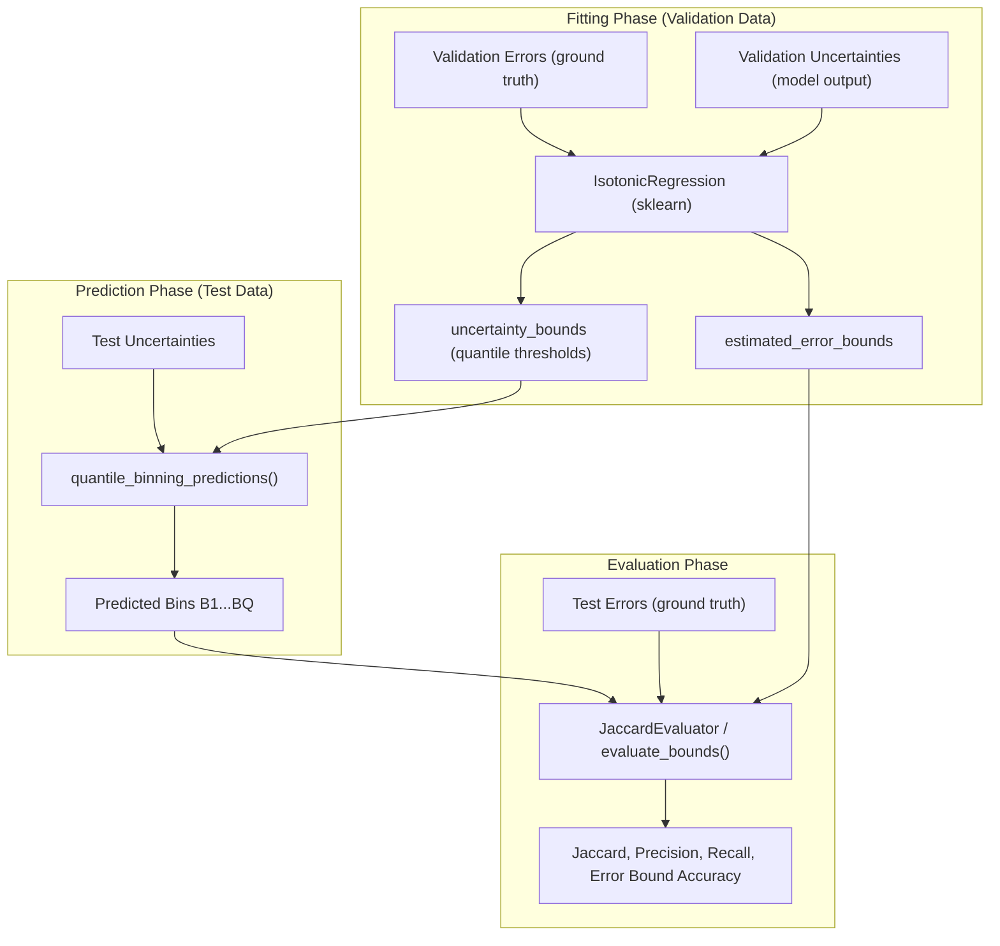
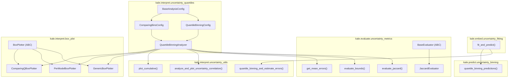
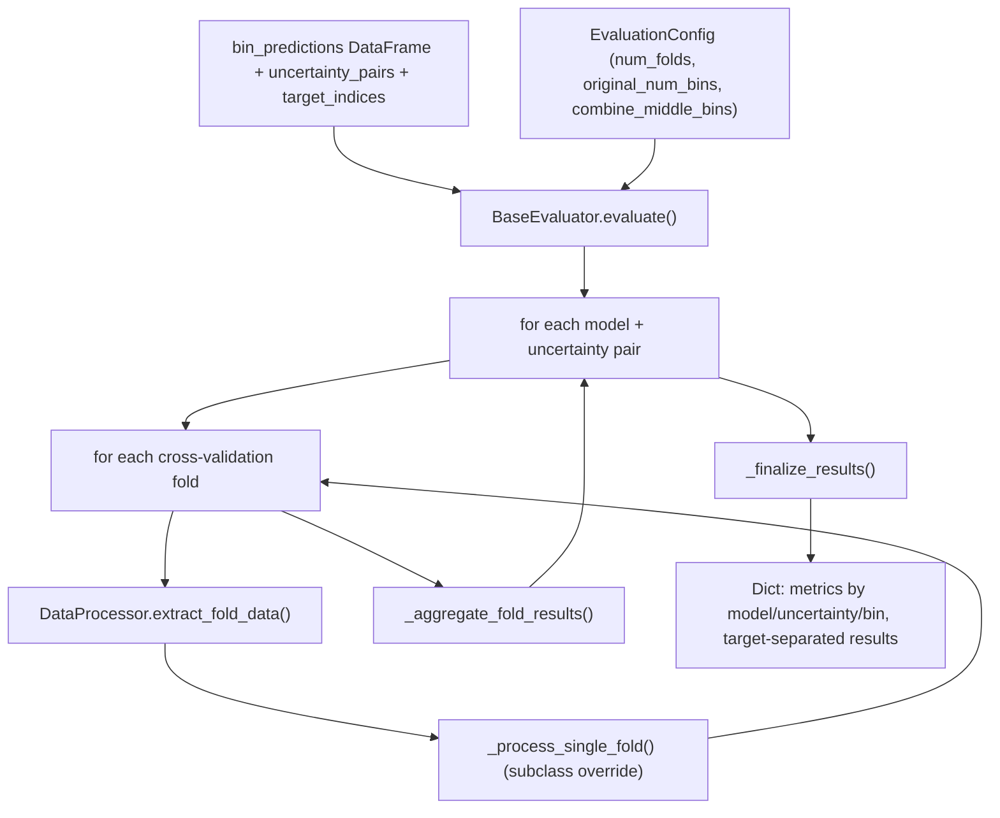
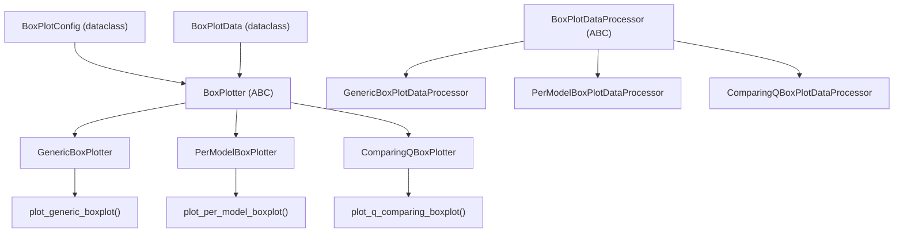
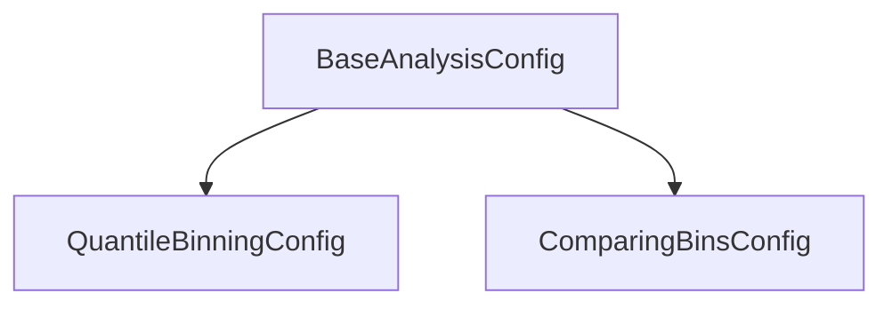
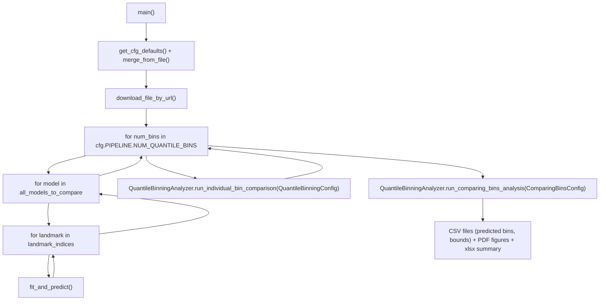

<!-- source: DeepWiki mcp.deepwiki.com · repo pykale/pykale · page 4.7 Uncertainty Quantification · fetched 2026-10-21 -->

# Uncertainty Quantification

<details>
<summary>Relevant source files</summary>

The following files were used as context for generating this wiki page:

- [examples/landmark_uncertainty/config.py](examples/landmark_uncertainty/config.py)
- [examples/landmark_uncertainty/main.py](examples/landmark_uncertainty/main.py)
- [kale/evaluate/uncertainty_metrics.py](kale/evaluate/uncertainty_metrics.py)
- [kale/interpret/box_plot.py](kale/interpret/box_plot.py)
- [kale/interpret/uncertainty_quantiles.py](kale/interpret/uncertainty_quantiles.py)
- [kale/interpret/uncertainty_utils.py](kale/interpret/uncertainty_utils.py)
- [kale/predict/uncertainty_binning.py](kale/predict/uncertainty_binning.py)
- [kale/prepdata/tabular_transform.py](kale/prepdata/tabular_transform.py)
- [tests/conftest.py](tests/conftest.py)
- [tests/evaluate/test_uncertainty_metrics.py](tests/evaluate/test_uncertainty_metrics.py)
- [tests/interpret/test_box_plot.py](tests/interpret/test_box_plot.py)
- [tests/interpret/test_uncertainty_quantiles.py](tests/interpret/test_uncertainty_quantiles.py)
- [tests/interpret/test_uncertainty_utils.py](tests/interpret/test_uncertainty_utils.py)
- [tests/loaddata/test_tabular_access.py](tests/loaddata/test_tabular_access.py)
- [tests/pipeline/test_uncertainty_qbin_pipeline.py](tests/pipeline/test_uncertainty_qbin_pipeline.py)
- [tests/predict/test_uncertainty_binning.py](tests/predict/test_uncertainty_binning.py)
- [tests/prepdata/test_tabular_transform.py](tests/prepdata/test_tabular_transform.py)

</details>


## Purpose and Scope

This document describes PyKale's uncertainty quantification (UQ) system, which provides tools for assessing and calibrating the reliability of model predictions. The system implements **quantile binning methods** to stratify predictions by uncertainty levels and evaluate the quality of uncertainty estimates through statistical metrics and visualizations.

The UQ system is primarily designed for medical imaging applications (especially landmark localization) but applies to any regression or classification task requiring confidence calibration. It addresses the question: "Given a model's uncertainty estimate, how reliable is its prediction?"

For general model evaluation metrics beyond uncertainty quantification, see [Evaluation and Interpretation](#2.6). For medical imaging applications that use this UQ system, see [Medical Imaging](#4.3).

**Sources:** [kale/interpret/uncertainty_quantiles.py:1-20](), [kale/evaluate/uncertainty_metrics.py:1-25](), [examples/landmark_uncertainty/main.py:1-12]()

---

## Core Concepts

### Quantile Binning Method

The quantile binning approach partitions predictions into bins based on their uncertainty levels, enabling calibration analysis. The workflow follows three phases:

1. **Fitting Phase**: Use validation data to learn quantile thresholds that map uncertainty values to error bounds via isotonic regression
2. **Prediction Phase**: Assign test predictions to uncertainty bins based on learned thresholds
3. **Evaluation Phase**: Measure how well uncertainty bins correlate with actual prediction errors

The system organizes predictions into **Q bins** (typically 3-25), ordered from lowest to highest uncertainty (B1 to BQ). Predictions in B1 should have lower errors than those in BQ if uncertainty estimates are well-calibrated.

**Quantile Binning Pipeline**



Sources: [kale/interpret/uncertainty_utils.py:274-330](), [examples/landmark_uncertainty/main.py:107-143]()

### Isotonic Regression for Error Estimation

The `quantile_binning_and_estimate_errors` function in `kale.interpret.uncertainty_utils` performs isotonic regression to learn monotonic relationships between uncertainty and error:

- **Input**: Paired lists of errors and uncertainties from validation data
- **Process**: Fit `IsotonicRegression(out_of_bounds="clip", increasing=True)` to enforce monotonicity
- **Output**: Uncertainty thresholds and predicted error bounds for each quantile

The `threshold_type` parameter supports two modes:
- `"quantile"` (recommended): Thresholds based on uncertainty quantiles
- `"error-wise"`: Not yet implemented; raises `NotImplementedError`

The `combine_middle_bins` option reduces Q bins to 3 by keeping only the first and last threshold, simplifying analysis into low/medium/high uncertainty categories.

Sources: [kale/interpret/uncertainty_utils.py:274-330]()

---

## Architecture Overview

The UQ system follows a modular design with clear separation between fitting, prediction, evaluation, and visualization.

**Module and Class Relationships**



Sources: [kale/evaluate/uncertainty_metrics.py:25-292](), [kale/interpret/uncertainty_quantiles.py:299-382](), [kale/interpret/box_plot.py:482-524]()

---

## Quantile Binning and Fitting

### The `quantile_binning_and_estimate_errors` Function

Located in `kale.interpret.uncertainty_utils`, this is the core calibration function that learns uncertainty-to-error mappings:

**Key Parameters:**

| Parameter | Type | Default | Description |
|---|---|---|---|
| `errors` | `List[float]` | — | Prediction errors from validation set |
| `uncertainties` | `List[float]` | — | Corresponding uncertainty estimates |
| `num_bins` | `int` | — | Number of quantile bins Q |
| `threshold_type` | `str` | `"quantile"` | `"quantile"` or `"error-wise"` (not implemented) |
| `combine_middle_bins` | `bool` | `False` | Merge middle bins into one |

**Returns:** `Tuple[List[float], List[float]]` — uncertainty boundaries and estimated error bounds.

The function fits `IsotonicRegression(out_of_bounds="clip", increasing=True)` on the validation data, then evaluates it at each quantile position to obtain estimated error bounds per bin. The isotonic constraint ensures that higher uncertainty never predicts lower error.

Sources: [kale/interpret/uncertainty_utils.py:274-330]()

### The `fit_and_predict` Workflow

The `fit_and_predict` function in `kale.embed.uncertainty_fitting` orchestrates the complete fitting and prediction process:

1. **Load validation data**: Read uncertainty and error pairs
2. **Fit quantile thresholds**: Call `quantile_binning_and_estimate_errors` for each uncertainty type
3. **Load test data**: Read test uncertainties
4. **Predict bins**: Call `quantile_binning_predictions` to assign test samples to bins
5. **Save outputs**: Write predicted bins, uncertainty bounds, and estimated errors to CSV files

The function signature accepts `landmark`, `uncertainty_error_pairs`, validation and test paths, `num_bins`, the cfg object, `groundtruth_test_errors`, and `save_folder`.

Sources: [examples/landmark_uncertainty/main.py:126-135](), [tests/pipeline/test_uncertainty_qbin_pipeline.py:459-514]()

---

## Prediction and Bin Assignment

### The `quantile_binning_predictions` Function

Once thresholds are learned, this function assigns new predictions to uncertainty bins:

**Key Parameters:**
- `uncertainties_test`: Dictionary mapping prediction IDs (str) to uncertainty values (float/int)
- `uncert_thresh`: Learned thresholds as List[List[float]] (shape: [Q-1, 1])
- `save_pred_path`: Optional path to save predictions

**Returns:**
- Dictionary mapping prediction IDs to bin indices (0 to Q)

**Binning Logic:**
- Bin 0: uncertainty ≤ threshold[0]
- Bin i: threshold[i-1] < uncertainty ≤ threshold[i]
- Bin Q: uncertainty > threshold[Q-1]

**Example:**
```python
# From kale/predict/uncertainty_binning.py:14-68
uncertainties = {"pred1": 0.1, "pred2": 0.5, "pred3": 0.9}
thresholds = [[0.3], [0.7]]  # For 3 bins
bins = quantile_binning_predictions(uncertainties, thresholds)
# Result: {"pred1": 0, "pred2": 1, "pred3": 2}
```

**Sources:** [kale/predict/uncertainty_binning.py:14-68]()

---

## Evaluation Metrics

The evaluation system uses the **Template Method Pattern** with `BaseEvaluator` as the abstract base class and `JaccardEvaluator` as the primary concrete implementation.

**BaseEvaluator Template Method Flow**



Sources: [kale/evaluate/uncertainty_metrics.py:686-803]()

### Configuration and Data Classes

The following dataclasses are defined in `kale.evaluate.uncertainty_metrics`:

| Class | Key Fields | Purpose |
|---|---|---|
| `EvaluationConfig` | `num_folds=8`, `original_num_bins=10`, `error_scaling_factor=1.0`, `combine_middle_bins=False`, `combined_num_bins=3` | Evaluation parameters |
| `FoldData` | `errors: pd.DataFrame`, `bins: pd.DataFrame`, `bounds: Optional[List]` | Single fold data |
| `BinResults` | `mean_all_targets`, `mean_all_bins`, `all_bins`, `all_bins_concat_targets_sep` | Per-fold results |
| `JaccardBinResults` | Extends `BinResults` with `mean_all_targets_recall`, `all_bins_recall`, `mean_all_targets_precision`, `all_bins_precision` | Jaccard-specific results |

Sources: [kale/evaluate/uncertainty_metrics.py:82-226]()

### Jaccard Similarity Evaluation

The `JaccardEvaluator` measures overlap between predicted uncertainty bins and ground truth error quantiles:

**Metrics Computed:**
1. **Jaccard Index**: |predicted ∩ ground_truth| / |predicted ∪ ground_truth|
2. **Recall**: How many actual high-error cases were caught
3. **Precision**: How many predicted high-uncertainty cases were actually high-error

**Implementation Strategy:**
1. Compute ground truth error quantiles using `QuantileCalculator`
2. For each bin, compare predicted membership vs. ground truth membership
3. Calculate binary Jaccard using `BinaryJaccardIndex` from torchmetrics
4. Compute recall and precision manually

**Key Methods:**
- `_process_single_fold_for_target()`: Evaluate single target in one fold
- `MetricsCalculator.calculate_jaccard_metrics()`: Compute all three metrics

**Sources:** [kale/evaluate/uncertainty_metrics.py:805-1010](), [kale/evaluate/uncertainty_metrics.py:568-624]()

### Error Bound Accuracy

The `evaluate_bounds` function checks whether actual errors fall within predicted confidence intervals:

**Logic:**
- For each bin i with estimated error bound E_i
- Check if actual errors in bin i satisfy: error ≤ E_i
- Compute percentage of errors within bounds

**Formula:**
```
Bound Accuracy (%) = (# errors within bound / total predictions in bin) × 100
```

Ideally, lower uncertainty bins should have tighter bounds with higher accuracy.

**Sources:** [kale/evaluate/uncertainty_metrics.py:1060-1196]()

### Bin-wise Error Analysis

The `get_mean_errors` function provides detailed error statistics:

**Output Structure:**
- `"all mean error bins nosep"`: Mean error per bin, averaged across targets
- `"all mean error bins targets sep"`: Mean error per bin, separated by target
- `"all error concat bins targets nosep"`: All errors concatenated by bin
- `"all error concat bins targets sep foldwise"`: Errors organized by target and fold
- `"all error concat bins targets sep all"`: Errors organized by target, folds flattened

This enables both aggregate analysis and fine-grained per-target investigation.

**Sources:** [kale/evaluate/uncertainty_metrics.py:1198-1378]()

---

## Visualization and Interpretation

### Plotting Architecture

The visualization system in `kale.interpret.box_plot` uses an OOP class hierarchy:

**Boxplot Class Hierarchy**



**Configuration and Data Classes:**

| Class | Purpose | Factory Function |
|---|---|---|
| `BoxPlotConfig` | Display parameters (labels, limits, fonts, colors, save paths) | `create_boxplot_config()` |
| `BoxPlotData` | Evaluation data container (models, categories, bin labels) | `create_boxplot_data()` |
| `SampleInfoMode` | Enum: `NONE`, `ALL`, `AVERAGE` — controls sample count display | — |

Sources: [kale/interpret/box_plot.py:54-479]()

### Plot Types and Use Cases

| Plot Function | Plotter Class | Purpose | Key `BoxPlotConfig` Fields |
|---|---|---|---|
| `plot_generic_boxplot()` | `GenericBoxPlotter` | Multi-model, multi-uncertainty comparison across bins | `colormap`, `y_lim_top`, `convert_to_percent` |
| `plot_per_model_boxplot()` | `PerModelBoxPlotter` | Per-model analysis with individual data point overlay | `to_log`, `show_individual_dots`, `show_sample_info` |
| `plot_q_comparing_boxplot()` | `ComparingQBoxPlotter` | Comparing model performance across different Q values | `hatch_type`, `category_labels` |

Additionally, `plot_cumulative()` in `kale.interpret.uncertainty_utils` generates cumulative error distribution curves. It accepts `bins` (which bins to plot), `compare_to_all` (overlay full dataset), `colormap`, and optional `save_path`.

Sources: [kale/interpret/box_plot.py:482-525](), [kale/interpret/uncertainty_utils.py:333-420]()

### Cumulative Error Plots

The `plot_cumulative` function visualizes error distributions as cumulative curves:

**Key Features:**
- Logarithmic x-axis for error values
- Multiple models/uncertainty types with different line styles
- Optional comparison to full dataset (`compare_to_all=True`)
- Vertical line at clinical threshold (e.g., 5mm)

**Interpretation:**
- Steep curves indicate most predictions have low error
- Curves shifted left indicate better overall performance
- Separation between B1 and BQ curves shows uncertainty calibration

**Sources:** [kale/interpret/uncertainty_quantiles.py:274-383]()

### High-Level Analysis: `QuantileBinningAnalyzer`

The `QuantileBinningAnalyzer` class in `kale.interpret.uncertainty_quantiles` is the primary entry point for analysis and visualization. It provides two core analysis methods:

**`run_individual_bin_comparison(config: QuantileBinningConfig)`**
- Compares different models and uncertainty types at a fixed Q value
- Generates: error boxplots, error bound accuracy, Jaccard/recall/precision plots, cumulative error curves, correlation plots
- Respects `display_settings` dict keys: `"errors"`, `"error_bounds"`, `"jaccard"`, `"cumulative_error"`, `"correlation"`

**`run_comparing_bins_analysis(config: ComparingBinsConfig)`**
- Compares performance across different Q values for one model + uncertainty type
- Iterates over `config.q_values` and `config.fitted_save_paths` in parallel
- Generates Q-comparison boxplots showing impact of bin count selection

Both methods check `self.interpret` and return immediately if `False`.

**Configuration Dataclass Hierarchy**



| Dataclass | Key Fields (beyond `BaseAnalysisConfig`) |
|---|---|
| `BaseAnalysisConfig` | `combine_middle_bins`, `num_folds`, `error_scaling_factor`, `save_folder`, `save_file_preamble`, `save_figures`, `plot_samples_as_dots`, `show_sample_info`, `boxplot_error_lim`, `colormap`, `interpret` |
| `QuantileBinningConfig` | `uncertainty_error_pairs: List[Tuple[str,str,str]]`, `models`, `dataset`, `target_indices`, `num_bins`, `confidence_invert` |
| `ComparingBinsConfig` | `uncertainty_error_pair: Tuple[str,str]`, `model`, `dataset`, `targets`, `q_values`, `fitted_save_paths` |

The `uncertainty_error_pairs` field uses 3-tuples of `(display_name, error_column_name, uncertainty_column_name)`.

Sources: [kale/interpret/uncertainty_quantiles.py:151-241](), [kale/interpret/uncertainty_quantiles.py:299-710]()

---

## Complete Workflow Example

### Landmark Uncertainty Estimation Pipeline

The `examples/landmark_uncertainty/main.py` demonstrates end-to-end uncertainty quantification for cardiac landmark localization.

**End-to-End Pipeline (`main.py`)**



**Configuration Structure** (`examples/landmark_uncertainty/config.py`):

| Section | Key Parameters | Purpose |
|---|---|---|
| `DATASET` | `SOURCE`, `LANDMARKS`, `NUM_FOLDS`, `CONFIDENCE_INVERT`, `UE_PAIRS_VAL`, `UE_PAIRS_TEST` | Data source and structure |
| `PIPELINE` | `NUM_QUANTILE_BINS`, `INDIVIDUAL_Q_MODELS`, `INDIVIDUAL_Q_UNCERTAINTY_ERROR_PAIRS`, `COMPARE_Q_VALUES`, `COMBINE_MIDDLE_BINS`, `PIXEL_TO_MM_SCALE` | Binning configurations |
| `BOXPLOT` | `SAMPLES_AS_DOTS`, `ERROR_LIM`, `SHOW_SAMPLE_INFO_MODE` | Visualization settings |
| `OUTPUT` | `OUT_DIR`, `SAVE_PREPEND`, `SAVE_FIGURES` | Output control |

The analyzer is constructed with a `display_settings` dict that controls which plot types are generated for each analysis run:

```python
display_settings = {
    "cumulative_error": True,
    "errors": True,
    "jaccard": True,
    "error_bounds": True,
    "correlation": True,
    "hatch": "o",
}
analyzer = QuantileBinningAnalyzer(config=analyzer_config, display_settings=display_settings)
analyzer.run_individual_bin_comparison(config)
```

Sources: [examples/landmark_uncertainty/main.py:44-279](), [examples/landmark_uncertainty/config.py:1-116]()

### Expected Outputs

For a dataset with 2 models, 2 uncertainty types, 3 landmarks, and Q=[3, 5], the pipeline generates:

**Per Q value / per model / per landmark (CSV files):**
- `res_predicted_bins_t{landmark}.csv`
- `estimated_error_bounds_t{landmark}.csv`
- `uncertainty_bounds_t{landmark}.csv`

**Per Q value (PDF figures via `run_individual_bin_comparison`):**
- `all_predictions_cumulative_error.pdf`
- `b1_predictions_cumulative_error.pdf`
- `{model}_b1_vs_all_cumulative_error.pdf`
- `{preamble}_error_all_targets.pdf` / `_error_target_{n}.pdf`
- `{preamble}_errorbound_all_targets.pdf`
- `{preamble}_jaccard_all_targets.pdf`, `_recall_jaccard_all_targets.pdf`, `_precision_jaccard_all_targets.pdf`
- `target_errors.xlsx`

**Across Q values (PDF figures via `run_comparing_bins_analysis`):**
- `{preamble}_compQ_..._errorbound_all_targets.pdf`
- `{preamble}_compQ_..._jaccard_all_targets.pdf` (plus recall, precision variants)

Sources: [tests/pipeline/test_uncertainty_qbin_pipeline.py:65-159]()

---

## Data Structure Requirements

### Input DataFrame Format

The system expects standardized DataFrame structures with specific column naming conventions:

**Required Columns:**
- `"uid"`: Unique prediction identifier (str)
- `"Target Index"`: Anatomical target/landmark index (int)
- `"Testing Fold"`: Cross-validation fold (int)
- `"{uncertainty_type} Error"`: Prediction error (float)
- `"{uncertainty_type} Uncertainty"`: Uncertainty estimate (float)
- `"{uncertainty_type} Uncertainty bins"`: Predicted bin (int, 0 to Q)

**Example:**
```python
# Structure for epistemic uncertainty
df = pd.DataFrame({
    'uid': ['sample_001', 'sample_002', ...],
    'Target Index': [0, 0, ...],
    'Testing Fold': [0, 1, ...],
    'epistemic Error': [2.3, 5.1, ...],
    'epistemic Uncertainty': [0.15, 0.42, ...],
    'epistemic Uncertainty bins': [0, 2, ...]
})
```

**Column Name Constants:**
- Defined in `ColumnNames` class [kale/evaluate/uncertainty_metrics.py:39-48]()
- Accessed via attributes like `ColumnNames.ERROR_SUFFIX = " Error"`

**Sources:** [kale/evaluate/uncertainty_metrics.py:39-48](), [kale/loaddata/tabular_access.py:13-44]()

### Loading Tabular Data

The `load_csv_columns` function provides convenient data loading:

```python
# From kale/loaddata/tabular_access.py:13-44
data = load_csv_columns(
    datapath="path/to/results",
    split="Testing Fold",
    fold=[0, 1, 2],  # Load folds 0, 1, 2
    cols_to_return=["uid", "Target Index", "epistemic Error", "epistemic Uncertainty"]
)
```

**Sources:** [kale/loaddata/tabular_access.py:13-44]()

---

## Utility Classes and Helpers

All utilities below are in `kale.evaluate.uncertainty_metrics`.

### `DataProcessor`

Static utility methods for fold-level data management:

| Method | Description |
|---|---|
| `extract_fold_data(data_structs, fold, uncertainty_type)` | Filter DataFrame to one fold; returns `FoldData` |
| `group_data_by_bins(errors_dict, bins_dict, num_bins)` | Partition predictions into per-bin lists |

Sources: [kale/evaluate/uncertainty_metrics.py:311-418]()

### `QuantileCalculator`

Static utility methods for computing ground-truth error quantiles:

| Method | Description |
|---|---|
| `calculate_error_quantiles(errors_dict, num_bins, combine_middle_bins)` | Returns `(thresholds, error_groups, key_groups)` ordered worst-to-best |
| `_group_by_quantiles(errors_dict, thresholds)` | Partition by threshold boundaries |
| `_is_in_quantile_range(error, quantile_idx, thresholds)` | Membership check |

Sources: [kale/evaluate/uncertainty_metrics.py:421-559]()

### `MetricsCalculator`

Static utility methods for metric computation:

| Method | Description |
|---|---|
| `calculate_jaccard_metrics(predicted_keys, ground_truth_keys)` | Returns `(jaccard, recall, precision)` using `BinaryJaccardIndex` from torchmetrics |
| `calculate_bound_accuracy(error, bin_idx, bounds)` | Checks if error falls within `(bounds[i-1], bounds[i]]` |

Sources: [kale/evaluate/uncertainty_metrics.py:562-683]()

### `ResultsContainer`

Organizes complex nested evaluation results across models, uncertainty types, bins, targets, and folds.

| Attribute | Description |
|---|---|
| `main_results` | Aggregated results across all targets |
| `target_separated_results` | Per-target breakdown |
| `target_sep_foldwise` | Per-target, per-fold lists |
| `recall_results`, `precision_results` | Jaccard-specific containers |
| `additional_containers` | Evaluation-specific extra results |

Sources: [kale/evaluate/uncertainty_metrics.py:229-309]()

---

## Testing

The test suite verifies the complete UQ pipeline with cardiac landmark data downloaded from GitHub.

**Test Files:**

| File | Coverage |
|---|---|
| `tests/pipeline/test_uncertainty_qbin_pipeline.py` | Full end-to-end pipeline: fitting, individual bin comparison, Q-value comparison, file output verification |
| `tests/evaluate/test_uncertainty_metrics.py` | Unit tests for `EvaluationConfig`, `ResultsContainer`, `DataProcessor`, `QuantileCalculator`, `MetricsCalculator`, `JaccardEvaluator`, `evaluate_jaccard`, `evaluate_bounds` |
| `tests/interpret/test_uncertainty_quantiles.py` | Tests for `plot_generic_boxplot`, `plot_per_model_boxplot`, `plot_q_comparing_boxplot` |
| `tests/interpret/test_uncertainty_utils.py` | Tests for `quantile_binning_and_estimate_errors`, `analyze_and_plot_uncertainty_correlation`, `plot_cumulative` |
| `tests/predict/test_uncertainty_binning.py` | Tests for `quantile_binning_predictions` input validation and bin assignment |
| `tests/prepdata/test_tabular_transform.py` | Tests for `generate_struct_for_qbin` DataFrame structure |

**Key pipeline test functions:**
- `test_qbin_pipeline()` — full integration test with file existence checks [tests/pipeline/test_uncertainty_qbin_pipeline.py:379-420]()
- `helper_test_qbin_fit()` — validates `fit_and_predict` CSV outputs against ground truth [tests/pipeline/test_uncertainty_qbin_pipeline.py:459-555]()
- `_run_individual_bin_comparison()` — creates `QuantileBinningAnalyzer` and calls `run_individual_bin_comparison()` [tests/pipeline/test_uncertainty_qbin_pipeline.py:246-306]()
- `_run_comparing_bins_analysis()` — creates analyzer and calls `run_comparing_bins_analysis()` [tests/pipeline/test_uncertainty_qbin_pipeline.py:309-376]()

Expected output file sets are defined as module-level constants: `EXPECTED_FILES_INDIVIDUAL_3`, `EXPECTED_FILES_INDIVIDUAL_5`, `EXPECED_FILES_FIT`, `EXPECTED_FILES_COMP`.

Sources: [tests/pipeline/test_uncertainty_qbin_pipeline.py:1-421]()

---

## Key References

**Primary Implementation:**
- L. A. Schobs, A. J. Swift and H. Lu, "Uncertainty Estimation for Heatmap-Based Landmark Localization," IEEE Transactions on Medical Imaging, vol. 42, no. 4, pp. 1021-1034, April 2023, doi: 10.1109/TMI.2022.3222730
- Paper link: https://arxiv.org/abs/2203.02351

**Related PyKale Components:**
- Feature embedding with uncertainty: `kale.embed.uncertainty_fitting`
- Box plot utilities: `kale.interpret.box_plot`
- Tabular preprocessing: `kale.prepdata.tabular_transform.generate_struct_for_qbin`
- Summary generation: `kale.utils.save_xlsx.generate_summary_df`

**Sources:** [kale/interpret/uncertainty_quantiles.py:7-10](), [kale/evaluate/uncertainty_metrics.py:6-7]()

---

