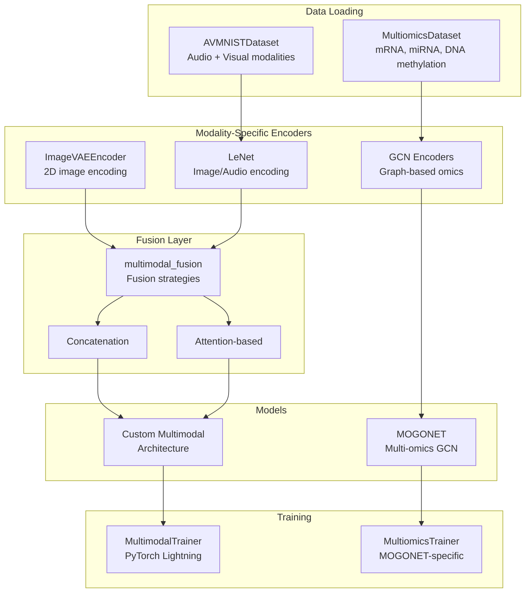
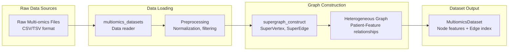
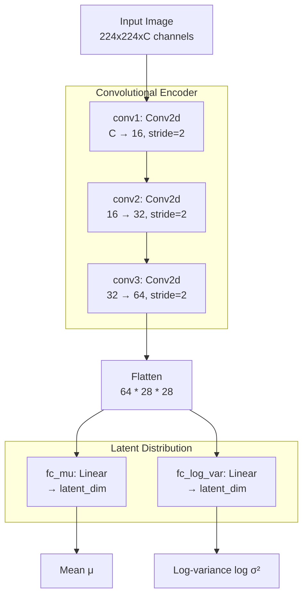
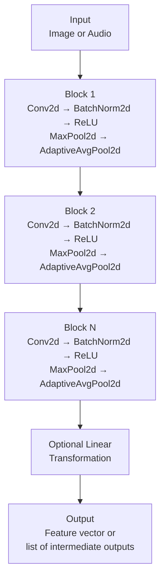
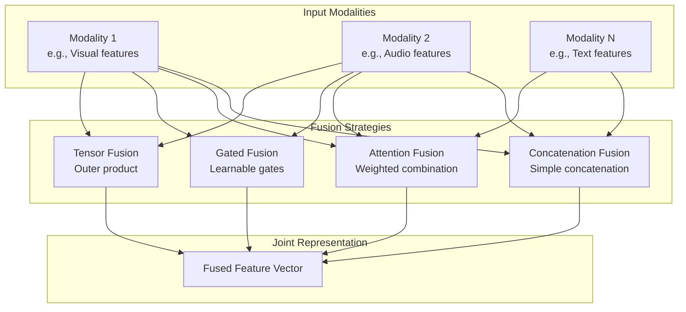
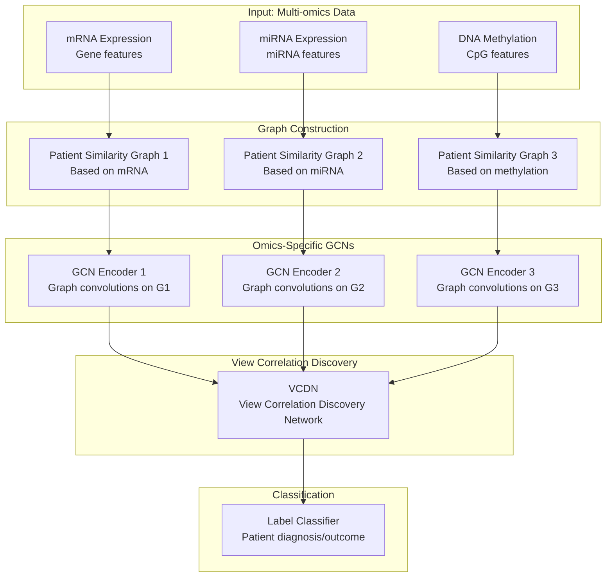
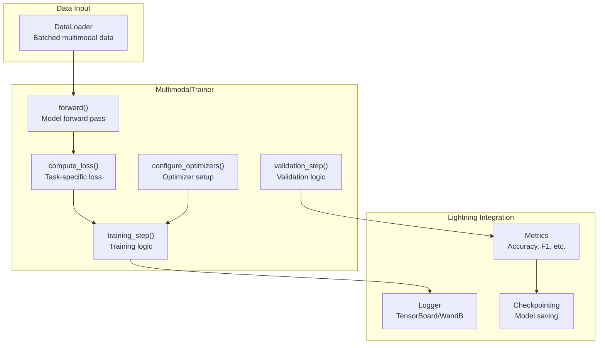
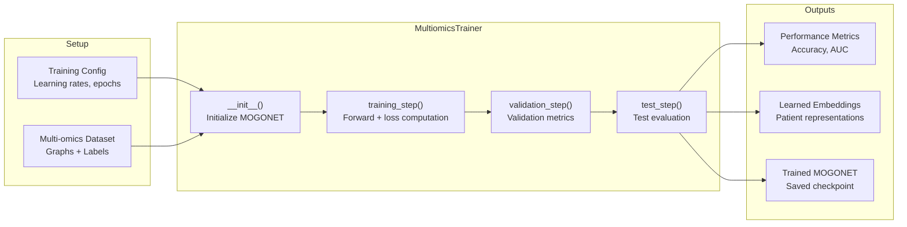
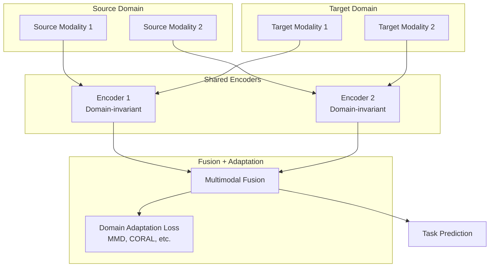

<!-- source: DeepWiki mcp.deepwiki.com · repo pykale/pykale · page 4.8 Multimodal and Multi-omics Learning · fetched 2026-10-21 -->

# Multimodal and Multi-omics Learning

Relevant source files

The following files were used as context for generating this wiki page:

- [examples/bindingdb_deepdta/tutorial.ipynb](examples/bindingdb_deepdta/tutorial.ipynb)
- [examples/multiomics_mogonet/main.py](examples/multiomics_mogonet/main.py)
- [examples/multiomics_mogonet/model.py](examples/multiomics_mogonet/model.py)
- [examples/toy_domain_adaptation/main.py](examples/toy_domain_adaptation/main.py)
- [examples/toy_domain_adaptation/tutorial.ipynb](examples/toy_domain_adaptation/tutorial.ipynb)
- [kale/evaluate/metrics.py](kale/evaluate/metrics.py)
- [kale/loaddata/multiomics_datasets.py](kale/loaddata/multiomics_datasets.py)
- [kale/pipeline/multiomics_trainer.py](kale/pipeline/multiomics_trainer.py)
- [kale/predict/decode.py](kale/predict/decode.py)
- [kale/prepdata/graph_negative_sampling.py](kale/prepdata/graph_negative_sampling.py)
- [tests/loaddata/test_multiomics_datasets.py](tests/loaddata/test_multiomics_datasets.py)
- [tests/pipeline/test_multiomics_trainer.py](tests/pipeline/test_multiomics_trainer.py)
- [tests/predict/test_decode.py](tests/predict/test_decode.py)
- [tests/utils/test_initialize_nn.py](tests/utils/test_initialize_nn.py)

## Purpose and Scope

This page documents PyKale's capabilities for **multimodal learning** (learning from multiple data types such as images, audio, text) and **multi-omics learning** (integrating genomics, transcriptomics, proteomics, etc.). The page covers data loading mechanisms, encoder architectures, fusion strategies, and specialized training pipelines for these scenarios.

For multi-source domain adaptation (learning from multiple source domains), see [Multi-Source Domain Adaptation](#3.2). For graph neural networks used in multi-omics analysis, see [Graph Neural Networks](#4.5).

---

## System Overview

PyKale provides a comprehensive pipeline for multimodal and multi-omics learning consisting of:

**Multimodal Data Processing Pipeline**

**Sources:** [docs/source/index.rst:41-48](), [docs/source/kale.embed.rst:67-89](), [docs/source/kale.pipeline.rst:50-72]()

---

## Multimodal Data Loading

### AVMNIST Dataset

The `AVMNISTDataset` provides access to the Audio-Visual MNIST dataset, which combines audio recordings of spoken digits with corresponding visual MNIST images.

| Component | Module | Description |
|-----------|--------|-------------|
| Dataset Class | `kale.loaddata.avmnist_datasets` | Handles synchronized audio-visual data loading |
| Modalities | Audio + Visual | 10 spoken digit classes with corresponding images |
| Use Case | Cross-modal learning | Learning joint representations across modalities |

**Sources:** [docs/source/kale.loaddata.rst:9-15](), [docs/source/index.rst:41]()

### Multi-omics Datasets

The `multiomics_datasets` module provides access to multi-omics cancer datasets integrating multiple genomic data types.

| Omics Type | Data Source | Typical Features |
|------------|-------------|------------------|
| mRNA | Gene expression | ~20,000 genes |
| miRNA | MicroRNA expression | ~500-2,000 miRNAs |
| DNA Methylation | Epigenetic markers | CpG sites |

**Architecture for Multi-omics Data Access**

**Sources:** [docs/source/kale.loaddata.rst:57-63](), [docs/source/kale.prepdata.rst:49-55]()

---

## Multimodal Encoders

### ImageVAEEncoder

The `ImageVAEEncoder` encodes 2D images into a latent representation for Variational Autoencoder (VAE) architectures, commonly used in multimodal fusion scenarios.

**Architecture:**

**Key Implementation Details:**

- **Location:** [kale/embed/image_cnn.py:391-448]()
- **Input:** Images of shape `(batch_size, input_channels, 224, 224)`
- **Output:** Latent mean `μ` and log-variance `log σ²`, both of shape `(batch_size, latent_dim)`
- **Default Configuration:** `input_channels=1`, `latent_dim=256`
- **Note:** Architecture is fixed for 224×224 images; different sizes require modification

**Sources:** [kale/embed/image_cnn.py:391-448]()

### LeNet for Multimodal Learning

The `LeNet` class provides a flexible CNN architecture for both image and audio modalities, with configurable depth and optional linear transformation layers.

**Configuration Options:**

| Parameter | Type | Description |
|-----------|------|-------------|
| `input_channels` | int | Number of input channels (e.g., 1 for grayscale, 3 for RGB) |
| `output_channels` | int | Base number of filters in first convolutional block |
| `additional_layers` | int | Number of additional convolutional blocks beyond the first |
| `output_each_layer` | bool | Whether to return intermediate layer outputs |
| `linear` | tuple | Optional `(input_dim, output_dim)` for final linear transformation |
| `squeeze_output` | bool | Whether to remove singleton dimensions from output |

**Architecture Pattern:**

**Implementation Details:**

- **Location:** [kale/embed/image_cnn.py:306-389]()
- Each convolutional block doubles the number of channels
- Global average pooling after each block enables multi-scale features
- Kaiming uniform initialization for convolution and linear layers
- When `output_each_layer=True`, returns list of all intermediate pooled representations

**Sources:** [kale/embed/image_cnn.py:306-389]()

---

## Multimodal Fusion Strategies

The `multimodal_fusion` module provides strategies for combining representations from different modalities.

**Common Fusion Approaches**

**Module Reference:**

- **Location:** [docs/source/kale.embed.rst:83-89]()
- **Purpose:** Implements various fusion operations for combining modality-specific representations
- **Integration:** Used in conjunction with multimodal encoders to create unified representations

**Sources:** [docs/source/kale.embed.rst:83-89]()

---

## MOGONET Architecture

MOGONET (Multi-Omics Graph cOnvolutional NETworks) is a specialized architecture for multi-omics data integration using graph convolutional networks.

**MOGONET System Architecture**

**Key Components:**

| Component | Module | Function |
|-----------|--------|----------|
| MOGONET Model | `kale.embed.model_lib.mogonet` | Main architecture implementation |
| Graph Construction | `kale.prepdata.supergraph_construct` | Builds patient similarity graphs from omics data |
| Training Pipeline | `kale.pipeline.multiomics_trainer` | PyTorch Lightning trainer for MOGONET |
| Data Loading | `kale.loaddata.multiomics_datasets` | Multi-omics dataset access |

**Training Objectives:**

1. **Classification Loss:** Standard cross-entropy for patient label prediction
2. **View Correlation Discovery:** Learn complementary information across omics views
3. **Graph Regularization:** Enforce smoothness of predictions over patient similarity graphs

**Sources:** [docs/source/kale.embed.rst:67-73](), [docs/source/kale.pipeline.rst:66-72](), [docs/source/index.rst:48]()

---

## Multimodal Training Pipelines

### MultimodalTrainer

The `MultimodalTrainer` provides a PyTorch Lightning-based training framework for general multimodal learning tasks.

**Training Pipeline Structure:**

**Key Methods:**

- **Location:** [docs/source/kale.pipeline.rst:50-56]()
- **Base Class:** `pytorch_lightning.LightningModule`
- **Configuration:** Uses YACS config nodes for hyperparameters
- **Logging:** Integrates with PyTorch Lightning loggers

**Sources:** [docs/source/kale.pipeline.rst:50-56]()

### MultiomicsTrainer

The `MultiomicsTrainer` is a specialized trainer for MOGONET, handling multi-omics graph-based learning.

**Multiomics Training Workflow:**

**Specific Features:**

- **Graph-aware batching:** Handles patient similarity graphs for each omics view
- **Multi-view learning:** Coordinates training across different omics modalities
- **Regularization:** Implements graph-based regularization terms
- **Evaluation:** Provides metrics specific to multi-omics classification

**Sources:** [docs/source/kale.pipeline.rst:66-72]()

---

## Integration with Domain Adaptation

Multimodal learning in PyKale can be combined with domain adaptation techniques for scenarios where multimodal data comes from different distributions or domains.

**Multimodal Domain Adaptation Pattern:**

**Example Use Cases:**

1. **Cross-dataset medical imaging:** Training on one hospital's multimodal scans, adapting to another
2. **Multi-omics transfer learning:** Adapting models across different sequencing platforms
3. **Audio-visual adaptation:** Adapting from synthetic to real-world audio-visual data

**Sources:** [docs/source/index.rst:39-51](), [kale/pipeline/multi_domain_adapter.py:1-65]()

---

## Example Applications

### AVMNIST Multimodal Learning

**Example Location:** Listed in [docs/source/index.rst:41]()

This example demonstrates joint learning from audio and visual modalities using the AVMNIST dataset. The pipeline trains encoders for both modalities and fuses them for digit classification.

### Multiomics MOGONET

**Example Location:** Listed in [docs/source/index.rst:48]()

This example showcases multi-omics integration for cancer classification using MOGONET. It demonstrates:
- Loading multi-omics datasets
- Constructing patient similarity graphs
- Training MOGONET with view correlation discovery
- Evaluating on held-out test patients

**Sources:** [docs/source/index.rst:41-48]()

---

