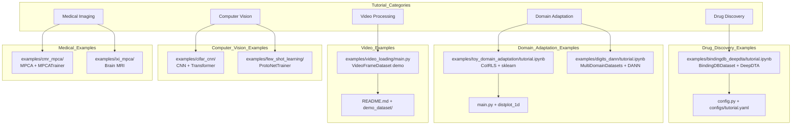
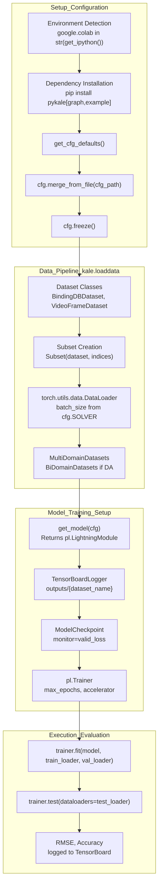
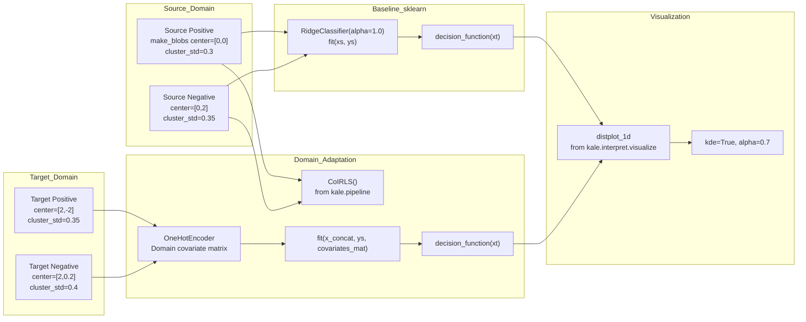
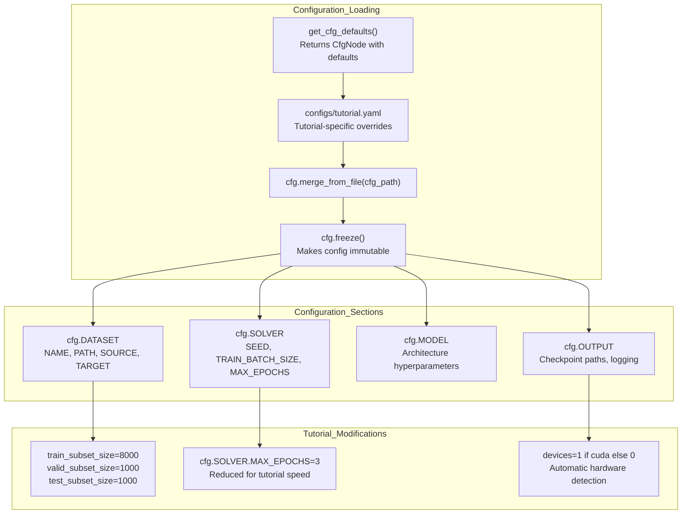

<!-- source: DeepWiki mcp.deepwiki.com · repo pykale/pykale · page 5 Examples and Tutorials · fetched 2026-10-21 -->

# Examples and Tutorials

<details>
<summary>Relevant source files</summary>

The following files were used as context for generating this wiki page:

- [.github/ISSUE_TEMPLATE/action-fail.md](.github/ISSUE_TEMPLATE/action-fail.md)
- [.github/workflows/test.yml](.github/workflows/test.yml)
- [README.md](README.md)
- [docs/source/installation.md](docs/source/installation.md)
- [examples/video_loading/README.md](examples/video_loading/README.md)
- [setup.py](setup.py)

</details>


This page provides comprehensive documentation of PyKale's example applications and interactive tutorials. These materials demonstrate practical usage patterns across different machine learning domains including drug discovery, computer vision, domain adaptation, and medical imaging. Each tutorial is designed as a self-contained Jupyter notebook that can be executed in Google Colab or local environments.

For detailed API reference of the underlying PyKale modules used in these tutorials, see [Pipeline API Reference](#2). For domain adaptation theory and implementation details, see [Domain Adaptation](#3).

## Tutorial Organization and Coverage

PyKale's tutorials are organized by application domain, with each tutorial demonstrating specific PyKale capabilities through complete end-to-end workflows. Interactive Jupyter notebooks (`.ipynb`) provide step-by-step execution in Google Colab or local environments, while command-line scripts (`main.py`) demonstrate production-ready implementations.



Sources: [examples/bindingdb_deepdta/tutorial.ipynb:1-350](), [examples/toy_domain_adaptation/tutorial.ipynb:1-218](), [examples/toy_domain_adaptation/main.py:1-100](), [examples/video_loading/README.md:1-205]()

## Tutorial Execution Workflow

All PyKale tutorials follow a standardized workflow pattern that demonstrates the complete machine learning pipeline from data loading to evaluation. This pattern aligns with PyKale's pipeline-based API architecture.



Sources: [examples/bindingdb_deepdta/tutorial.ipynb:50-135](), [examples/bindingdb_deepdta/tutorial.ipynb:172-256](), [examples/toy_domain_adaptation/tutorial.ipynb:34-191]()

## CI/CD Testing of Examples

PyKale's GitHub Actions workflow automatically tests all tutorials and examples to ensure reproducibility. The test configuration provides a template for local execution.

### Test Workflow Configuration

The CI/CD pipeline defined in `.github/workflows/test.yml` executes all Jupyter notebooks using `pytest` with the `--nbmake` plugin.

| Test Configuration | Value | Purpose |
|-------------------|-------|---------|
| **Python Versions** | 3.10, 3.11, 3.12 | Multi-version compatibility |
| **Operating System** | ubuntu-latest | Standardized Linux environment |
| **Test Command** | `pytest --nbmake --nbmake-timeout=3000 --cov=kale` | Notebook execution + coverage |
| **Thread Limits** | `OMP_NUM_THREADS=1` | Prevent resource contention |

Dependency caching strategy:
```yaml
- name: Cache pip dependencies
  uses: actions/cache@v4
  with:
    path: ~/.cache/pip
    key: ${{ runner.os }}-python${{ matrix.python-version }}-pip-20250302-${{ hashFiles('**/setup.py') }}
```

Test data caching:
```yaml
- name: Cache downloaded test data
  uses: actions/cache@v4
  with:
    path: tests/test_data
    key: ${{ runner.os }}-python${{ matrix.python-version }}-data-${{ hashFiles('tests/download_test_data.py') }}
```

PyTorch and PyG installation follows the same pattern as tutorials:
```bash
pip install torch==2.6.0 torchvision==0.21.0 --index-url https://download.pytorch.org/whl/cpu
pip install torch_scatter==2.1.2 -f https://data.pyg.org/whl/torch-2.6.0+cpu.html
pip install torch_geometric==2.6.0
```

The workflow runs on three triggers:
1. Push to `main` branch
2. Pull requests targeting `main`
3. Daily cron schedule (`0 0 * * *`)

Coverage reports are uploaded to Codecov for tracking test completeness across examples.

Sources: [.github/workflows/test.yml:1-110](), [setup.py:17-66]()

## Drug Discovery Tutorials

### DeepDTA Tutorial

The BindingDB DeepDTA tutorial demonstrates drug-target interaction prediction using convolutional neural networks on molecular sequences and protein representations. Data is acquired from Therapeutics Data Commons (TDC).

| Component | Implementation | Configuration |
|-----------|---------------|---------------|
| **Dataset** | `BindingDBDataset` from `kale.loaddata.tdc_datasets` | Kd affinity metric, 52,284 pairs |
| **Architecture** | `CNNEncoder` + `MLPDecoder` from `kale.embed` | Dual CNN for SMILES/protein sequences |
| **Training** | `pytorch_lightning.Trainer` | 3 epochs for tutorial (100 for full) |
| **Evaluation** | RMSE on binding affinity (log space) | Tutorial: ~7.3, Full: < 1.0 |

Dataset configuration:
```python
train_dataset = BindingDBDataset(
    name=cfg.DATASET.NAME,  # "BindingDB_Kd"
    split="train",
    path=cfg.DATASET.PATH
)
```

Model architecture consists of two `CNNEncoder` modules (one for drugs, one for targets) followed by an `MLPDecoder` for regression:
- Drug encoder: Embedding(65, 128) + 3 Conv1d layers (32, 64, 96 filters)
- Protein encoder: Embedding(26, 128) + 3 Conv1d layers (32, 64, 96 filters)
- Decoder: Linear layers (192 → 1024 → 1024 → 512 → 1)
- Total parameters: 2,244,609

Tutorial-specific optimizations:
- Reduced dataset: 8,000 train / 1,000 valid / 1,000 test samples via `torch.utils.data.Subset`
- Max epochs: 3 (vs 100 for production)
- Checkpoint monitoring: `ModelCheckpoint(monitor="valid_loss", mode="min")`

Key code components:
- Dataset loading: [examples/bindingdb_deepdta/tutorial.ipynb:172-197]()
- Model architecture specification: [examples/bindingdb_deepdta/tutorial.ipynb:313-346]()
- Trainer configuration: [examples/bindingdb_deepdta/tutorial.ipynb:251-256]()

Sources: [examples/bindingdb_deepdta/tutorial.ipynb:20-46](), [examples/bindingdb_deepdta/tutorial.ipynb:126-197](), [examples/bindingdb_deepdta/tutorial.ipynb:215-297]()

## Domain Adaptation Tutorials

### Toy Domain Adaptation

The toy domain adaptation tutorial provides an accessible introduction to domain adaptation concepts using synthetic blob datasets and the `CoIRLS` (Covariate-Informed Ridge Regression with Least Squares) algorithm from `kale.pipeline.multi_domain_adapter`.



Synthetic data generation with `sklearn.datasets.make_blobs`:
```python
n_samples = 1000
xs, ys = make_blobs(n_samples, centers=[[0, 0], [0, 2]], 
                    cluster_std=[0.3, 0.35])
xt, yt = make_blobs(n_samples, centers=[[2, -2], [2, 0.2]], 
                    cluster_std=[0.35, 0.4])
```

CoIRLS domain adaptation with one-hot encoded domain covariates:
```python
from kale.pipeline.multi_domain_adapter import CoIRLS
from sklearn.preprocessing import OneHotEncoder

clf_ = CoIRLS()
covariates = np.zeros(n_samples * 2)
covariates[:n_samples] = 1  # Source domain indicator
enc = OneHotEncoder(handle_unknown="ignore")
covariates_mat = enc.fit_transform(covariates.reshape(-1, 1)).toarray()

x = np.concatenate((xs, xt))
clf_.fit(x, ys, covariates_mat)
yt_pred_ = clf_.predict(xt)
```

Decision score visualization using `kale.interpret.visualize.distplot_1d`:
- Compares source/target score distributions
- KDE overlay for smooth distribution estimation
- Demonstrates domain shift correction via CoIRLS

Key implementation details:
- Synthetic data generation: [examples/toy_domain_adaptation/tutorial.ipynb:71-74]()
- CoIRLS adapter: [examples/toy_domain_adaptation/tutorial.ipynb:174-189]()
- Visualization: [examples/toy_domain_adaptation/tutorial.ipynb:144-158]()
- Command-line version: [examples/toy_domain_adaptation/main.py:13-96]()

Sources: [examples/toy_domain_adaptation/tutorial.ipynb:51-95](), [examples/toy_domain_adaptation/tutorial.ipynb:167-211](), [examples/toy_domain_adaptation/main.py:1-100]()

### DANN Digits Tutorial

The digits DANN tutorial demonstrates adversarial domain adaptation using the Domain-Adversarial Neural Network (DANN) approach on digit recognition datasets. This tutorial showcases `MultiDomainDatasets` and `BaseAdaptTrainer` integration.

| Configuration | Value | Purpose |
|---------------|-------|---------|
| **Source Dataset** | `cfg.DATASET.SOURCE` | MNIST/SVHN/USPS digits |
| **Target Dataset** | `cfg.DATASET.TARGET` | MNIST/SVHN/USPS digits |  
| **Class Subset** | `[1, 3, 8]` | Reduced classes for faster training |
| **Architecture** | `get_model(cfg, dataset, num_channels)` | DANN with `GradReverse` layer |
| **Training** | `BaseAdaptTrainer` via PyTorch Lightning | Domain + task loss |

Core workflow components:
- Multi-domain dataset setup with `MultiDomainDatasets`: Creates source/target pairs with domain labels
- Model configuration: DANN architecture with gradient reversal layer for adversarial domain confusion
- Training loop: `trainer.fit()` executes warm-up phase and lambda scheduling

The tutorial produces three key metrics:
- `test_domain_acc`: Domain classification accuracy (target ~50% indicates good domain confusion)
- `test_source_acc`: Source domain task performance baseline
- `test_target_acc`: Target domain task performance (primary adaptation metric)

Sources: [examples/digits_dann/tutorial.ipynb:139-152](), [examples/digits_dann/tutorial.ipynb:189-297]()

## Tutorial Configuration System

All tutorials use PyKale's hierarchical configuration system based on `yacs.config.CfgNode` and YAML files. Configuration files follow a standardized structure with defaults in `config.py` and overrides in YAML files.



Configuration loading pattern used across tutorials:
```python
from config import get_cfg_defaults
cfg = get_cfg_defaults()
cfg.merge_from_file("./configs/tutorial.yaml")
cfg.freeze()
set_seed(cfg.SOLVER.SEED)
```

Sources: [examples/bindingdb_deepdta/tutorial.ipynb:126-134](), [examples/bindingdb_deepdta/tutorial.ipynb:96-106]()

## Running Tutorials

### Environment Setup

All tutorials include automatic environment detection and dependency installation for Google Colab compatibility:

| Platform | Detection | Installation Commands |
|----------|-----------|---------------------|
| **Google Colab** | `'google.colab' in str(get_ipython())` | Clone repo, install PyKale with extras |
| **Local** | Default case | Assumes PyKale already installed |
| **Binder** | MyBinder.org links provided | Automatic environment setup |

Colab setup pattern:
```python
if 'google.colab' in str(get_ipython()):
    !git clone https://github.com/pykale/pykale.git
    %cd pykale
    !pip install .[image,example]
```

### Hardware Detection

Tutorials automatically detect and configure GPU usage:

```python
device = "cuda" if torch.cuda.is_available() else "cpu"
devices = 1 if device == "cuda" else 0
trainer = pl.Trainer(accelerator="gpu" if devices != 0 else "cpu")
```

### Execution Links

Each tutorial provides direct execution links:
- **Google Colab**: One-click execution with `Runtime → Run all (Ctrl+F9)`
- **MyBinder**: Browser-based execution with `Run → Run All Cells`
- **Local**: Download and run with PyKale installation

Sources: [examples/bindingdb_deepdta/tutorial.ipynb:53-63](), [examples/digits_dann/tutorial.ipynb:35-45](), [examples/digits_dann/tutorial.ipynb:119-122]()

---

