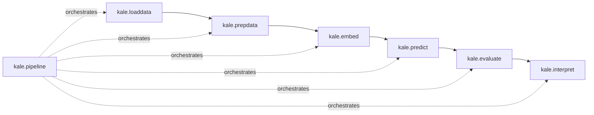
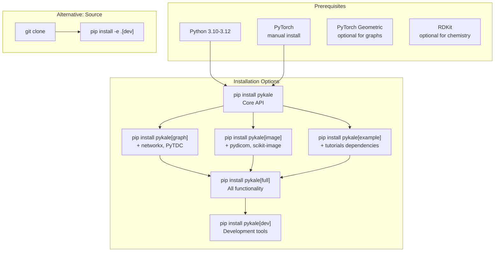
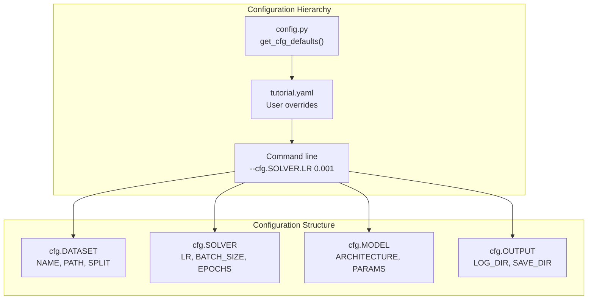
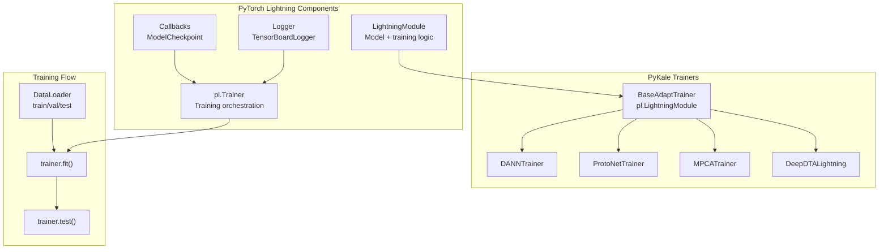
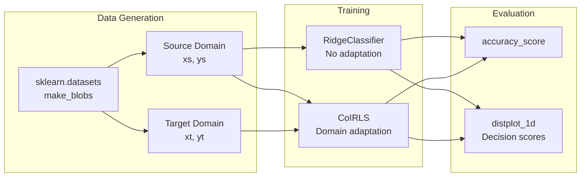
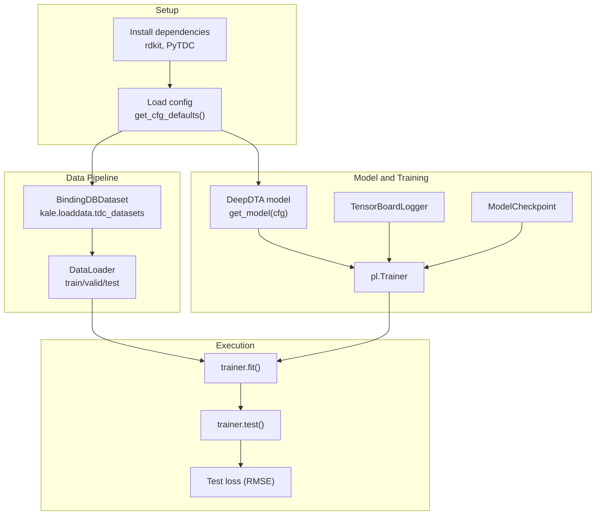
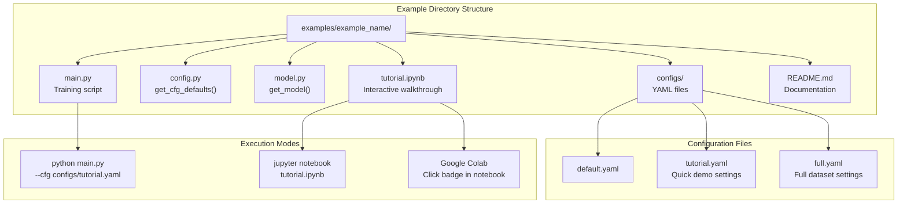
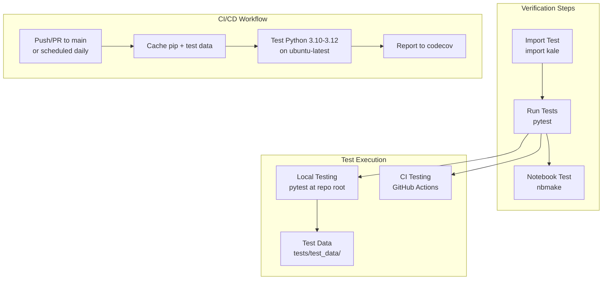

<!-- source: DeepWiki mcp.deepwiki.com · repo pykale/pykale · page 5.1 Getting Started Tutorials · fetched 2026-10-21 -->

# Getting Started Tutorials

<details>
<summary>Relevant source files</summary>

The following files were used as context for generating this wiki page:

- [.github/ISSUE_TEMPLATE/action-fail.md](.github/ISSUE_TEMPLATE/action-fail.md)
- [.github/workflows/test.yml](.github/workflows/test.yml)
- [README.md](README.md)
- [docs/source/installation.md](docs/source/installation.md)
- [examples/bindingdb_deepdta/tutorial.ipynb](examples/bindingdb_deepdta/tutorial.ipynb)
- [examples/cifar_cnntransformer/main.py](examples/cifar_cnntransformer/main.py)
- [examples/toy_domain_adaptation/main.py](examples/toy_domain_adaptation/main.py)
- [examples/toy_domain_adaptation/tutorial.ipynb](examples/toy_domain_adaptation/tutorial.ipynb)
- [examples/video_loading/README.md](examples/video_loading/README.md)
- [setup.py](setup.py)

</details>


## Purpose and Scope

This page provides introductory tutorials for new PyKale users, covering essential concepts and practical steps to start using the library. You will learn how to install PyKale, understand the pipeline-based API, configure experiments using YACS, integrate with PyTorch Lightning, and run your first examples.

For specific application examples beyond the basics, see [Domain Adaptation Examples](#5.2), [Drug Discovery Applications](#5.3), [Medical Imaging Applications](#5.4), or [Few-Shot Learning Examples](#5.5). For detailed API documentation, see [Pipeline API Reference](#2). For contributing to the project, see [Development Guide](#6).

## PyKale Pipeline-Based API

PyKale organizes machine learning workflows into a standardized pipeline with seven core modules that represent the typical stages of an ML workflow.



**Pipeline Module Responsibilities**

| Module | Purpose | Key Components |
|--------|---------|----------------|
| `kale.loaddata` | Load data from disk or online resources | `DatasetAccess`, `MultiDomainDataset`, `VideoFrameDataset`, `BindingDBDataset` |
| `kale.prepdata` | Preprocess and transform data | `image_transform`, `video_transform`, `ImglistToTensor` |
| `kale.embed` | Extract features or learn representations | `image_cnn`, `video.i3d`, `gcn`, `MPCA`, `MIDA` |
| `kale.predict` | Generate predictions | `ClassNet`, `DomainNet`, `SoftmaxNet` |
| `kale.evaluate` | Evaluate model performance | `metrics`, `cross_val_score`, `uncertainty_metrics` |
| `kale.interpret` | Visualize and interpret results | `visualize`, `plot_multi_images`, `plot_weights` |
| `kale.pipeline` | Orchestrate complete workflows | `BaseAdaptTrainer`, `ProtoNetTrainer`, `MPCATrainer` |

Sources: [README.md:40-49](), [README.md:28-29]()

## Installation and Environment Setup

### Installation Options

PyKale provides modular installation options based on your needs. All installations require Python 3.10, 3.11, or 3.12.



**Installation Commands**

```bash
# Step 1: Install PyTorch (required first)
pip install torch torchvision

# Step 2: Install PyKale with desired options
pip install pykale                    # Core functionality only
pip install pykale[graph]             # Add graph support (TDC, networkx)
pip install pykale[image]             # Add image support (DICOM, scikit-image)
pip install pykale[example]           # Add tutorial dependencies
pip install pykale[graph,example]     # Multiple options (no spaces!)
pip install pykale[full]              # Everything except dev tools
pip install pykale[dev]               # Full development environment

# Alternative: Install from source
git clone https://github.com/pykale/pykale
cd pykale
pip install -e .[dev]  # Editable install for development
```

**Key Dependencies by Installation Option**

| Option | Additional Packages |
|--------|---------------------|
| `graph` | `networkx`, `PyTDC<=0.3.6` |
| `image` | `glob2`, `pydicom`, `pylibjpeg`, `python-gdcm`, `scikit-image>=0.24.0` |
| `example` | `ipykernel`, `matplotlib`, `seaborn`, `yacs>=0.1.7`, `comet_ml`, `rdkit` |
| `dev` | `pytest`, `pytest-cov`, `nbmake`, `black`, `flake8`, `sphinx`, `nbsphinx` |

Sources: [setup.py:16-92](), [docs/source/installation.md:1-58](), [README.md:56-66]()

### Verifying Installation

After installation, verify PyKale is working correctly:

```python
import kale
print(kale.__version__)

# Verify core modules are accessible
from kale.loaddata import DatasetAccess
from kale.prepdata import image_transform
from kale.embed import image_cnn
from kale.pipeline import BaseAdaptTrainer
```

Sources: [README.md:56-66]()

## Configuration with YACS

PyKale uses YACS (Yet Another Configuration System) for managing experiment configurations. This provides a hierarchical configuration structure with default values that can be overridden by YAML files or command-line arguments.



**Configuration Usage Pattern**

The typical pattern for using YACS configuration in PyKale examples:

```python
# 1. Define defaults in config.py
from yacs.config import CfgNode as CN

def get_cfg_defaults():
    cfg = CN()
    cfg.DATASET = CN()
    cfg.DATASET.NAME = "BindingDB_Kd"
    cfg.DATASET.PATH = "./data"
    
    cfg.SOLVER = CN()
    cfg.SOLVER.SEED = 2020
    cfg.SOLVER.TRAIN_BATCH_SIZE = 256
    cfg.SOLVER.MAX_EPOCHS = 100
    cfg.SOLVER.LR = 0.0005
    
    return cfg

# 2. Load and merge configuration
cfg = get_cfg_defaults()
cfg.merge_from_file("./configs/tutorial.yaml")  # Override from file
cfg.freeze()  # Make immutable

# 3. Use configuration throughout code
train_loader = DataLoader(
    dataset=train_dataset,
    batch_size=cfg.SOLVER.TRAIN_BATCH_SIZE
)
```

**Example Configuration File (tutorial.yaml)**

```yaml
DATASET:
  NAME: "BindingDB_Kd"
  PATH: "./data/bindingdb"

SOLVER:
  SEED: 2020
  TRAIN_BATCH_SIZE: 256
  TEST_BATCH_SIZE: 256
  MIN_EPOCHS: 1
  MAX_EPOCHS: 3
  LR: 0.0005
  WEIGHT_DECAY: 0.00001
```

Sources: [examples/bindingdb_deepdta/tutorial.ipynb:126-135]()

## PyTorch Lightning Integration

PyKale integrates with PyTorch Lightning to standardize training loops, logging, checkpointing, and multi-GPU support. Most PyKale trainers inherit from `pytorch_lightning.LightningModule`.



**Complete PyTorch Lightning Training Example**

This example from the BindingDB DeepDTA tutorial demonstrates the full integration:

```python
import pytorch_lightning as pl
from pytorch_lightning.callbacks import ModelCheckpoint
from pytorch_lightning.loggers import TensorBoardLogger

# 1. Setup model (inherits from pl.LightningModule)
model = get_model(cfg)  # Returns a LightningModule

# 2. Setup logger
tb_logger = TensorBoardLogger(
    save_dir="outputs",
    name=cfg.DATASET.NAME
)

# 3. Setup checkpoint callback
checkpoint_callback = ModelCheckpoint(
    filename="{epoch}-{step}-{valid_loss:.4f}",
    monitor="valid_loss",
    mode="min"
)

# 4. Create trainer
trainer = pl.Trainer(
    min_epochs=cfg.SOLVER.MIN_EPOCHS,
    max_epochs=cfg.SOLVER.MAX_EPOCHS,
    accelerator="gpu" if torch.cuda.is_available() else "cpu",
    logger=tb_logger,
    callbacks=[checkpoint_callback]
)

# 5. Train
trainer.fit(
    model,
    train_dataloaders=train_loader,
    val_dataloaders=valid_loader
)

# 6. Test
trainer.test(dataloaders=test_loader)
```

**Key PyTorch Lightning Methods in PyKale Trainers**

| Method | Purpose | Typical Implementation |
|--------|---------|------------------------|
| `__init__()` | Initialize model, hyperparameters | Store `cfg`, create networks |
| `forward()` | Forward pass | Return model predictions |
| `training_step()` | Single training iteration | Compute loss, log metrics |
| `validation_step()` | Single validation iteration | Compute val loss, log metrics |
| `test_step()` | Single test iteration | Compute test metrics |
| `configure_optimizers()` | Setup optimizer and scheduler | Return optimizer (and optional scheduler) |

Sources: [examples/bindingdb_deepdta/tutorial.ipynb:97-106](), [examples/bindingdb_deepdta/tutorial.ipynb:233-256](), [examples/bindingdb_deepdta/tutorial.ipynb:274](), [examples/bindingdb_deepdta/tutorial.ipynb:292]()

## Running Your First Example

### Example 1: Toy Domain Adaptation

This is the simplest example to understand PyKale's domain adaptation capabilities without heavy computational requirements.



**Step-by-Step Walkthrough**

```python
# 1. Generate toy data (two-class blobs from different distributions)
from sklearn.datasets import make_blobs
import numpy as np

n_samples = 1000
xs, ys = make_blobs(n_samples, centers=[[0, 0], [0, 2]], 
                    cluster_std=[0.3, 0.35])
xt, yt = make_blobs(n_samples, centers=[[2, -2], [2, 0.2]], 
                    cluster_std=[0.35, 0.4])

# 2. Train baseline classifier (no domain adaptation)
from sklearn.linear_model import RidgeClassifier
from sklearn.metrics import accuracy_score

clf = RidgeClassifier(alpha=1.0)
clf.fit(xs, ys)
yt_pred = clf.predict(xt)
print(f'Baseline accuracy: {accuracy_score(yt, yt_pred):.2f}')

# 3. Train domain adaptation classifier
from kale.pipeline.multi_domain_adapter import CoIRLS
from sklearn.preprocessing import OneHotEncoder

clf_da = CoIRLS()

# Encode domain covariate matrix (source=1, target=0)
covariates = np.zeros(n_samples * 2)
covariates[:n_samples] = 1
enc = OneHotEncoder(handle_unknown="ignore")
covariates_mat = enc.fit_transform(covariates.reshape(-1, 1)).toarray()

# Fit with unlabeled target data
x = np.concatenate((xs, xt))
clf_da.fit(x, ys, covariates_mat)
yt_pred_da = clf_da.predict(xt)
print(f'DA accuracy: {accuracy_score(yt, yt_pred_da):.2f}')

# 4. Visualize decision score distributions
from kale.interpret.visualize import distplot_1d

ys_score = clf.decision_function(xs)
yt_score = clf.decision_function(xt)

distplot_1d(
    [ys_score, yt_score],
    title="Decision score distribution",
    xlabel="Decision Scores",
    labels=["Source", "Target"],
    hist_kwargs={"kde": True, "alpha": 0.7}
).show()
```

Sources: [examples/toy_domain_adaptation/tutorial.ipynb:71-211]()

### Example 2: Drug-Target Interaction Prediction

This example demonstrates a complete deep learning workflow with PyTorch Lightning integration.



**Quick Start Commands**

```bash
# 1. Navigate to example directory
cd examples/bindingdb_deepdta

# 2. Install dependencies
pip install pykale[graph,example]
pip install rdkit

# 3. Run tutorial notebook
jupyter notebook tutorial.ipynb
# Or open in Google Colab (link in notebook header)
```

**Key Code Sections**

The tutorial notebook demonstrates:

1. **Installation Check** (Colab-specific):
```python
if 'google.colab' in str(get_ipython()):
    print('Running on CoLab')
    !pip install rdkit
    !pip install numpy>=2.0.0
    !git clone https://github.com/pykale/pykale.git
    %cd pykale
    !pip install .[graph,example]
```

2. **Configuration Loading**:
```python
from config import get_cfg_defaults
cfg = get_cfg_defaults()
cfg.merge_from_file("./configs/tutorial.yaml")
cfg.freeze()
```

3. **Dataset Loading**:
```python
from kale.loaddata.tdc_datasets import BindingDBDataset
from torch.utils.data import DataLoader

train_dataset = BindingDBDataset(
    name=cfg.DATASET.NAME, 
    split="train", 
    path=cfg.DATASET.PATH
)
train_loader = DataLoader(
    dataset=train_dataset,
    shuffle=True,
    batch_size=cfg.SOLVER.TRAIN_BATCH_SIZE
)
```

4. **Training with PyTorch Lightning**:
```python
trainer = pl.Trainer(
    min_epochs=cfg.SOLVER.MIN_EPOCHS,
    max_epochs=cfg.SOLVER.MAX_EPOCHS,
    accelerator="gpu" if torch.cuda.is_available() else "cpu",
    logger=tb_logger,
    callbacks=[checkpoint_callback]
)
trainer.fit(model, train_dataloaders=train_loader, 
           val_dataloaders=valid_loader)
```

Sources: [examples/bindingdb_deepdta/tutorial.ipynb:1-351]()

## Understanding Example Structure

PyKale examples follow a standardized structure to promote consistency and reusability.



**Common File Purposes**

| File | Purpose | Key Functions/Classes |
|------|---------|----------------------|
| `main.py` | Command-line training script | `main()`, argument parsing |
| `config.py` | Configuration defaults | `get_cfg_defaults()`, `CfgNode` structure |
| `model.py` | Model architecture and trainer | `get_model()`, `LightningModule` subclass |
| `tutorial.ipynb` | Interactive Jupyter notebook | Step-by-step walkthrough with explanations |
| `configs/*.yaml` | Configuration overrides | `tutorial.yaml` (small/fast), `default.yaml` (standard) |
| `README.md` | Example documentation | Overview, requirements, usage |

**Example Execution Methods**

```bash
# Method 1: Run main script with default config
cd examples/bindingdb_deepdta
python main.py

# Method 2: Run with custom config
python main.py --cfg configs/tutorial.yaml

# Method 3: Run Jupyter notebook locally
jupyter notebook tutorial.ipynb

# Method 4: Run in Google Colab
# Click the Colab badge in the notebook header
# Or visit: https://colab.research.google.com/github/pykale/pykale/blob/main/examples/...
```

Sources: [examples/bindingdb_deepdta/tutorial.ipynb:1-351](), [README.md:74-76]()

## Testing Your Setup

After installation and running examples, verify your setup is working correctly.



**Local Testing Commands**

```bash
# 1. Install development dependencies
pip install pykale[dev]

# 2. Run all tests
pytest

# 3. Run tests with coverage
pytest --cov=kale

# 4. Run notebook tests
pytest --nbmake --nbmake-timeout=3000

# 5. Run tests for specific module
pytest tests/loaddata/test_dataset_access.py

# 6. Run tests with verbose output
pytest -v
```

**CI/CD Testing**

PyKale uses GitHub Actions for continuous integration. The test workflow:

1. Triggers on push/PR to `main` or daily schedule
2. Tests Python 3.10, 3.11, and 3.12 on Ubuntu
3. Caches pip dependencies and test data
4. Runs pytest with notebook testing via `nbmake`
5. Reports coverage to codecov.io

The test workflow configuration:

| Step | Purpose | Key Settings |
|------|---------|-------------|
| Setup Python | Install Python via Miniconda | Python versions: 3.10, 3.11, 3.12 |
| Cache pip | Speed up dependency installation | Key includes Python version and setup.py hash |
| Install PyTorch + PyG | Install deep learning frameworks | CPU-only versions for CI |
| Install project | Install pykale in dev mode | `pip install -e .[dev]` |
| Cache test data | Reuse downloaded test data | Key based on download script hash |
| Run tests | Execute pytest suite | `pytest --nbmake --cov=kale` |
| Report coverage | Upload to codecov | Requires `CODECOV_TOKEN` secret |

Sources: [.github/workflows/test.yml:1-110](), [docs/source/installation.md:49-58]()

## Next Steps

After completing these getting started tutorials, you can:

1. **Explore Domain Adaptation**: See [Domain Adaptation Examples](#5.2) for MNIST/USPS digits, video action recognition, and autism detection applications.

2. **Try Specialized Applications**:
   - [Drug Discovery Applications](#5.3) for advanced drug-target interaction prediction
   - [Medical Imaging Applications](#5.4) for cardiac MRI analysis with MPCA
   - [Few-Shot Learning Examples](#5.5) for Prototypical Networks on Omniglot and CIFAR

3. **Learn the API in Depth**: Review [Pipeline API Reference](#2) for detailed documentation of each module.

4. **Build Your Own Projects**: Follow the [Development Guide](#6) to contribute new modules or create custom applications.

5. **Join the Community**: 
   - Ask questions on [GitHub Discussions](https://github.com/pykale/pykale/discussions)
   - Report bugs or request features via [GitHub Issues](https://github.com/pykale/pykale/issues)
   - Contribute via pull requests (see [Contributing Guidelines](#6.4))

Sources: [README.md:22-88]()

---

