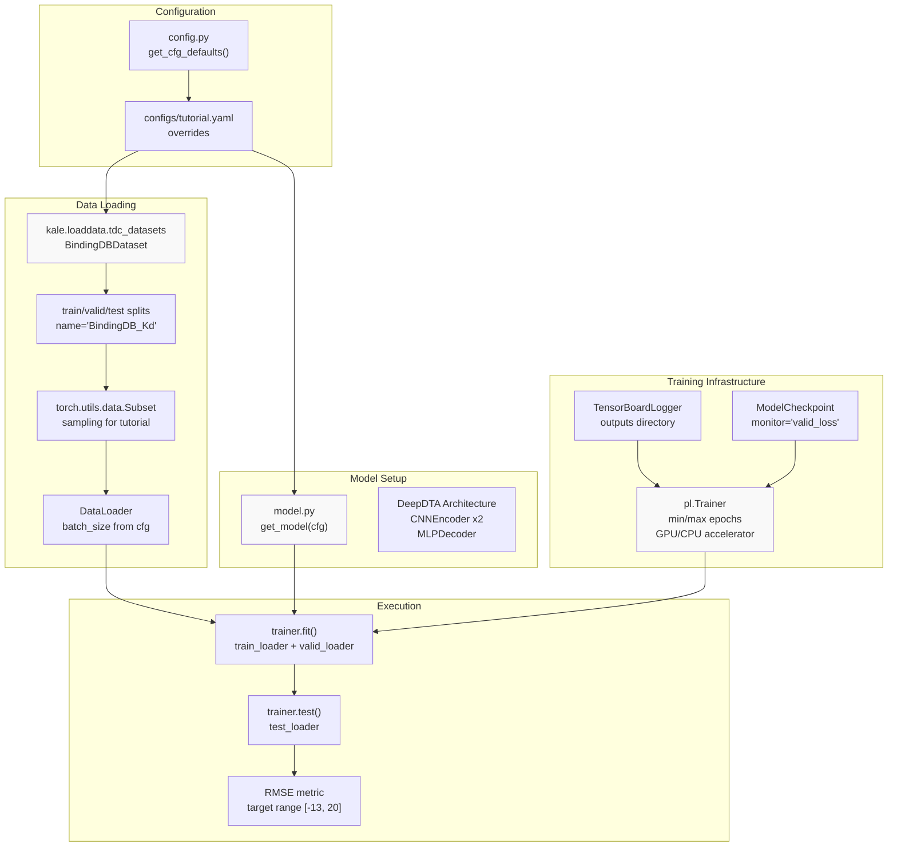
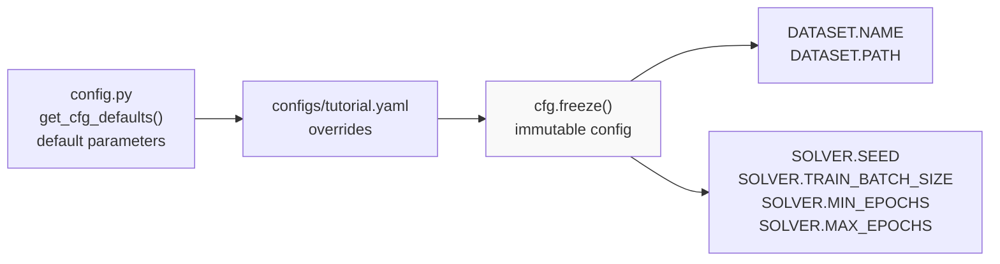
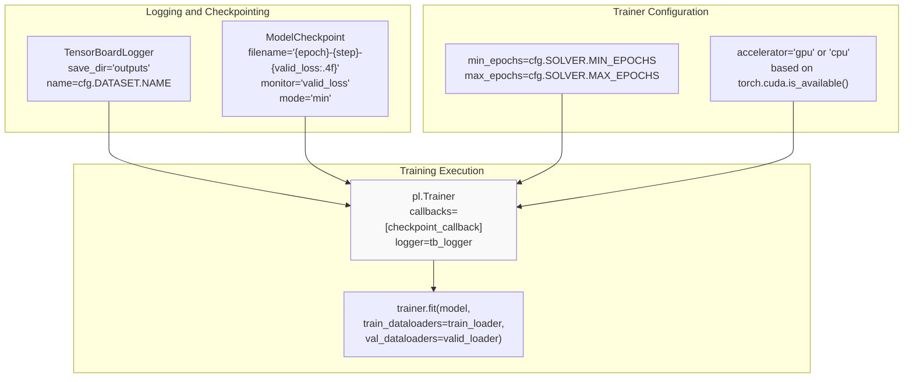
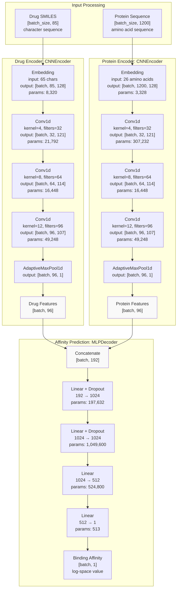

<!-- source: DeepWiki mcp.deepwiki.com · repo pykale/pykale · page 5.3 Drug Discovery Applications · fetched 2026-10-21 -->

# Drug Discovery Applications

<details>
<summary>Relevant source files</summary>

The following files were used as context for generating this wiki page:

- [examples/bindingdb_deepdta/tutorial.ipynb](examples/bindingdb_deepdta/tutorial.ipynb)
- [examples/bindingdb_drugban/README.md](examples/bindingdb_drugban/README.md)
- [examples/bindingdb_drugban/configs.py](examples/bindingdb_drugban/configs.py)
- [examples/bindingdb_drugban/configs/DA_cross_domain.yaml](examples/bindingdb_drugban/configs/DA_cross_domain.yaml)
- [examples/bindingdb_drugban/configs/non_DA_cross_domain.yaml](examples/bindingdb_drugban/configs/non_DA_cross_domain.yaml)
- [examples/bindingdb_drugban/configs/non_DA_in_domain.yaml](examples/bindingdb_drugban/configs/non_DA_in_domain.yaml)
- [examples/bindingdb_drugban/main.py](examples/bindingdb_drugban/main.py)
- [examples/bindingdb_drugban/model.py](examples/bindingdb_drugban/model.py)
- [examples/bindingdb_drugban/test.py](examples/bindingdb_drugban/test.py)
- [examples/polypharmacy_gripnet/README.md](examples/polypharmacy_gripnet/README.md)
- [examples/polypharmacy_gripnet/__init__.py](examples/polypharmacy_gripnet/__init__.py)
- [examples/polypharmacy_gripnet/config.py](examples/polypharmacy_gripnet/config.py)
- [examples/polypharmacy_gripnet/configs/PoSE_MINI-GripNet.yaml](examples/polypharmacy_gripnet/configs/PoSE_MINI-GripNet.yaml)
- [examples/polypharmacy_gripnet/main.py](examples/polypharmacy_gripnet/main.py)
- [examples/polypharmacy_gripnet/model.py](examples/polypharmacy_gripnet/model.py)
- [examples/toy_domain_adaptation/main.py](examples/toy_domain_adaptation/main.py)
- [examples/toy_domain_adaptation/tutorial.ipynb](examples/toy_domain_adaptation/tutorial.ipynb)
- [kale/loaddata/molecular_datasets.py](kale/loaddata/molecular_datasets.py)
- [kale/loaddata/polypharmacy_datasets.py](kale/loaddata/polypharmacy_datasets.py)
- [kale/pipeline/drugban_trainer.py](kale/pipeline/drugban_trainer.py)
- [tests/embed/test_drugban.py](tests/embed/test_drugban.py)
- [tests/embed/test_multimodal_fusion.py](tests/embed/test_multimodal_fusion.py)
- [tests/loaddata/test_molecular_datasets.py](tests/loaddata/test_molecular_datasets.py)
- [tests/pipeline/test_drugban_trainer.py](tests/pipeline/test_drugban_trainer.py)

</details>


## Purpose and Scope

This page documents the drug discovery example applications in PyKale, specifically the **BindingDB DeepDTA tutorial** for drug-target interaction prediction. The tutorial demonstrates how to predict binding affinity between chemical compounds and protein targets using the DeepDTA architecture and the BindingDB dataset.

For theoretical details on the drug discovery models and architectures, see [Drug Discovery Models](#4.2). For general data loading patterns, see [Data Loading](#2.1). For other introductory examples, see [Getting Started Tutorials](#5.1).

**Sources:** [examples/bindingdb_deepdta/tutorial.ipynb:1-350]()

---

## Tutorial Overview

The BindingDB DeepDTA tutorial provides a complete end-to-end example of drug-target affinity prediction. The tutorial uses:

- **Dataset**: BindingDB with Kd (dissociation constant) measurements
- **Model**: DeepDTA - dual CNN encoders for drugs (SMILES) and proteins (sequences)
- **Task**: Regression to predict binding affinity in log space
- **Framework**: PyTorch Lightning for training orchestration
- **Logging**: TensorBoard for experiment tracking

The tutorial is designed to run in both local environments and Google Colab, with automatic dependency installation and GPU detection.

**Sources:** [examples/bindingdb_deepdta/tutorial.ipynb:8-46]()

---

## Drug Discovery Pipeline Workflow

The following diagram illustrates the complete pipeline from data loading to model evaluation:



**Sources:** [examples/bindingdb_deepdta/tutorial.ipynb:96-297]()

---

## Data Loading and Preprocessing

### BindingDB Dataset Access

The tutorial uses `BindingDBDataset` from PyKale's TDC (Therapeutics Data Commons) integration. The dataset provides three variants distinguished by affinity measurement metrics:

| Metric | Drugs | Targets | Pairs | Description |
|--------|-------|---------|-------|-------------|
| **Kd** | 10,655 | 1,413 | 52,284 | Dissociation constant (used in tutorial) |
| **IC50** | 549,205 | 5,078 | 991,486 | Half-maximal inhibitory concentration |
| **Ki** | 174,662 | 3,070 | 375,032 | Inhibition constant |

The dataset is loaded with three splits:

```python
# From tutorial.ipynb
train_dataset = BindingDBDataset(name=cfg.DATASET.NAME, split="train", path=cfg.DATASET.PATH)
valid_dataset = BindingDBDataset(name=cfg.DATASET.NAME, split="valid", path=cfg.DATASET.PATH)
test_dataset = BindingDBDataset(name=cfg.DATASET.NAME, split="test", path=cfg.DATASET.PATH)
```

**Sources:** [examples/bindingdb_deepdta/tutorial.ipynb:28-40](), [examples/bindingdb_deepdta/tutorial.ipynb:170-177]()

### Tutorial Data Sampling

For rapid experimentation, the tutorial creates smaller subsets using `torch.utils.data.Subset`:

- **Training subset**: 8,000 samples
- **Validation subset**: 1,000 samples  
- **Test subset**: 1,000 samples

This reduces training time while demonstrating the complete pipeline. The full dataset (52,284 samples) can be used by removing the subsetting step.

**Sources:** [examples/bindingdb_deepdta/tutorial.ipynb:119-127](), [examples/bindingdb_deepdta/tutorial.ipynb:176-177]()

### DataLoader Configuration

The data is batched using PyTorch's `DataLoader`:

```python
train_loader = DataLoader(dataset=train_dataset, shuffle=True, batch_size=cfg.SOLVER.TRAIN_BATCH_SIZE)
valid_loader = DataLoader(dataset=valid_dataset, shuffle=True, batch_size=cfg.SOLVER.TEST_BATCH_SIZE)
test_loader = DataLoader(dataset=test_dataset, shuffle=True, batch_size=cfg.SOLVER.TEST_BATCH_SIZE)
```

Batch sizes are controlled via configuration, typically 256 for training and testing.

**Sources:** [examples/bindingdb_deepdta/tutorial.ipynb:195-197]()

---

## Model Configuration and Setup

### Configuration System

The tutorial uses YACS (Yet Another Configuration System) for hierarchical configuration management:



The configuration is loaded and merged:

```python
cfg = get_cfg_defaults()
cfg.merge_from_file(cfg_path)
cfg.freeze()
```

**Sources:** [examples/bindingdb_deepdta/tutorial.ipynb:115-134]()

### Model Instantiation

The DeepDTA model is created via the `get_model()` factory function, which configures the architecture based on the provided configuration:

```python
model = get_model(cfg)
```

The model consists of:
1. **CNNEncoder** for drug SMILES (embedding + 3 Conv1D layers)
2. **CNNEncoder** for protein sequences (embedding + 3 Conv1D layers)
3. **MLPDecoder** with 3 fully-connected layers for affinity prediction

**Sources:** [examples/bindingdb_deepdta/tutorial.ipynb:96-100](), [examples/bindingdb_deepdta/tutorial.ipynb:215]()

---

## Training Pipeline

### PyTorch Lightning Trainer Setup

The training infrastructure is built using PyTorch Lightning's `Trainer`:



**Sources:** [examples/bindingdb_deepdta/tutorial.ipynb:224-256]()

### Device Detection

The tutorial automatically detects available hardware:

```python
device = "cuda" if torch.cuda.is_available() else "cpu"
print("Using: " + device)
devices = 1 if device == "cuda" else 0
```

This enables GPU acceleration when available while maintaining CPU compatibility.

**Sources:** [examples/bindingdb_deepdta/tutorial.ipynb:150-154]()

### Training Execution

Model training is initiated with:

```python
%time trainer.fit(model, train_dataloaders=train_loader, val_dataloaders=valid_loader)
```

The `%time` magic command measures execution time, useful for performance benchmarking.

**Sources:** [examples/bindingdb_deepdta/tutorial.ipynb:265-274]()

---

## Evaluation and Results

### Test Set Evaluation

After training, the model is evaluated on held-out test data:

```python
trainer.test(dataloaders=test_loader)
```

**Sources:** [examples/bindingdb_deepdta/tutorial.ipynb:283-293]()

### Performance Metrics

The tutorial reports **Root Mean Square Error (RMSE)** as the primary metric:

- **Expected result** (3 epochs, 8K training samples): RMSE ≈ 7.3
- **Target value range**: [-13, 20] in log space
- **Optimized result** (100 epochs, full dataset): RMSE < 1

The RMSE of 7.3 over a range of 33 units demonstrates reasonable performance with minimal training. Extended training on the full dataset achieves much better results.

**Sources:** [examples/bindingdb_deepdta/tutorial.ipynb:301-303]()

### TensorBoard Logging

Training progress is logged to TensorBoard:

```python
tb_logger = TensorBoardLogger("outputs", name=cfg.DATASET.NAME)
```

Logs are saved to the `outputs/` directory and include:
- Training loss per epoch
- Validation loss per epoch
- Model checkpoints (saved based on validation loss)

**Sources:** [examples/bindingdb_deepdta/tutorial.ipynb:233]()

---

## DeepDTA Architecture Details

### Model Architecture Diagram

The following diagram shows the DeepDTA architecture with data flow and layer specifications:



### Architecture Statistics

| Component | Total Parameters | Input Size | Output Size |
|-----------|-----------------|------------|-------------|
| **Total Model** | 2,244,609 | 1.32 MB | [batch, 1] |
| Drug CNNEncoder | 95,808 | [batch, 85] | [batch, 96] |
| Protein CNNEncoder | 376,256 | [batch, 1200] | [batch, 96] |
| MLPDecoder | 1,772,545 | [batch, 192] | [batch, 1] |

**Key characteristics:**
- **Trainable parameters**: 2,244,609 (all trainable)
- **Forward/backward pass size**: 429.92 MB
- **Model parameter size**: 8.98 MB
- **Total mult-adds**: 58.08 M

**Sources:** [examples/bindingdb_deepdta/tutorial.ipynb:310-346]()

---

## Running the Tutorial

### Environment Setup

The tutorial supports both local execution and Google Colab:

1. **Google Colab**: Automatically installs dependencies
   - Uninstalls conflicting packages (imgaug, albumentations)
   - Installs RDKit for molecular processing
   - Clones PyKale repository
   - Installs PyKale with graph and example dependencies

2. **Local Environment**: Requires pre-installation of PyKale

**Sources:** [examples/bindingdb_deepdta/tutorial.ipynb:42-63]()

### Dependency Installation

The tutorial explicitly installs PyTorch and related packages:

```bash
pip install torch==2.6.0 --index-url https://download.pytorch.org/whl/cpu
pip install torch_scatter==2.1.2 -f https://data.pyg.org/whl/torch-2.6.0+cpu.html
pip install torch_sparse==0.6.18 -f https://data.pyg.org/whl/torch-2.6.0+cpu.html
pip install -q torch-geometric==2.6.0
pip install tensorboard
```

These versions ensure compatibility with PyKale's graph processing and drug discovery features.

**Sources:** [examples/bindingdb_deepdta/tutorial.ipynb:70-81]()

### Required Imports

```python
import pytorch_lightning as pl
import torch
from config import get_cfg_defaults
from model import get_model
from pytorch_lightning.callbacks import ModelCheckpoint
from pytorch_lightning.loggers import TensorBoardLogger
from torch.utils.data import DataLoader, Subset

from kale.loaddata.tdc_datasets import BindingDBDataset
from kale.utils.seed import set_seed
```

**Sources:** [examples/bindingdb_deepdta/tutorial.ipynb:96-106]()

### Key File Locations

| File | Purpose |
|------|---------|
| `examples/bindingdb_deepdta/tutorial.ipynb` | Main tutorial notebook |
| `examples/bindingdb_deepdta/config.py` | Default configuration definitions |
| `examples/bindingdb_deepdta/configs/tutorial.yaml` | Tutorial-specific overrides |
| `examples/bindingdb_deepdta/model.py` | Model factory function |
| `kale/loaddata/tdc_datasets.py` | BindingDB dataset implementation |

---

## Configuration Parameters

### Dataset Configuration

The tutorial uses the following dataset parameters:

```yaml
DATASET:
  NAME: "BindingDB_Kd"
  PATH: "./data"
```

- `NAME`: Specifies which BindingDB variant (Kd, IC50, or Ki)
- `PATH`: Directory for cached dataset files

**Sources:** [examples/bindingdb_deepdta/tutorial.ipynb:117]()

### Solver Configuration

Training hyperparameters are controlled via the `SOLVER` configuration group:

| Parameter | Tutorial Value | Production Value |
|-----------|---------------|------------------|
| `SEED` | Set via `set_seed()` | Varies |
| `TRAIN_BATCH_SIZE` | 256 (typical) | 256 |
| `TEST_BATCH_SIZE` | 256 (typical) | 256 |
| `MIN_EPOCHS` | 3 | 10+ |
| `MAX_EPOCHS` | 3 | 100 |

The tutorial uses 3 epochs for demonstration purposes. Production runs typically use 100 epochs for optimal performance.

**Sources:** [examples/bindingdb_deepdta/tutorial.ipynb:129-134](), [examples/bindingdb_deepdta/tutorial.ipynb:252]()

---

## Summary

The BindingDB DeepDTA tutorial demonstrates:

1. **Dataset Access**: Using `BindingDBDataset` from `kale.loaddata.tdc_datasets` for drug-target binding data
2. **Configuration Management**: YACS-based configuration with default values and YAML overrides
3. **Model Setup**: DeepDTA architecture with dual CNN encoders and MLP decoder
4. **Training Infrastructure**: PyTorch Lightning with TensorBoard logging and checkpoint management
5. **Evaluation**: RMSE metrics on held-out test data

The tutorial is designed for rapid experimentation with subset sampling, while the full configuration supports production-quality training. The modular design allows easy adaptation to other drug discovery datasets and architectures.

**Sources:** [examples/bindingdb_deepdta/tutorial.ipynb:1-350]()

---

