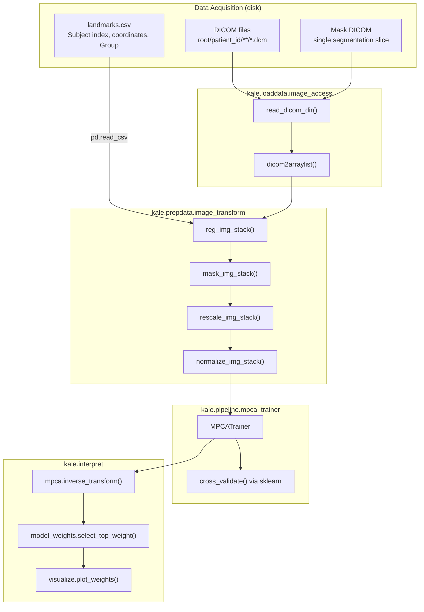
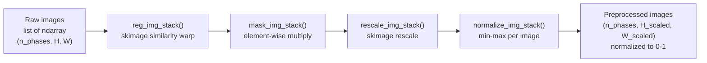
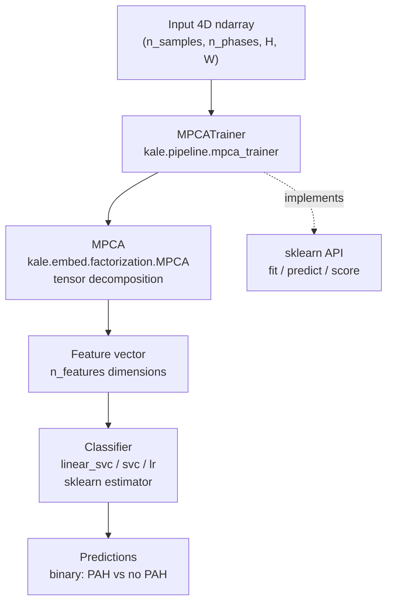
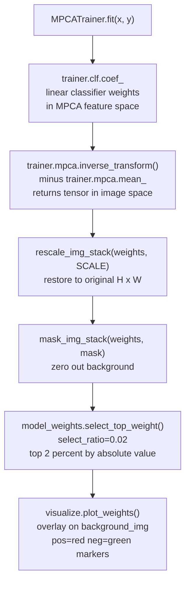
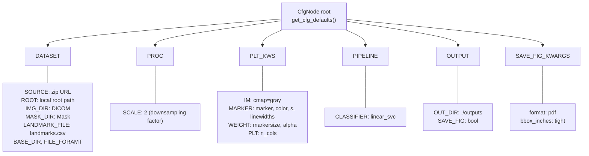

<!-- source: DeepWiki mcp.deepwiki.com · repo pykale/pykale · page 5.4 Medical Imaging Applications · fetched 2026-10-21 -->

# Medical Imaging Applications

<details>
<summary>Relevant source files</summary>

The following files were used as context for generating this wiki page:

- [examples/cmri_mpca/__init__.py](examples/cmri_mpca/__init__.py)
- [examples/cmri_mpca/config.py](examples/cmri_mpca/config.py)
- [examples/cmri_mpca/main.py](examples/cmri_mpca/main.py)
- [examples/cmri_mpca/tutorial.ipynb](examples/cmri_mpca/tutorial.ipynb)
- [kale/interpret/visualize.py](kale/interpret/visualize.py)
- [kale/loaddata/image_access.py](kale/loaddata/image_access.py)
- [kale/prepdata/image_transform.py](kale/prepdata/image_transform.py)
- [tests/prepdata/test_image_transform.py](tests/prepdata/test_image_transform.py)

</details>


This page documents PyKale's medical imaging applications, specifically the cardiac magnetic resonance imaging (CMRI) pulmonary arterial hypertension (PAH) diagnosis example using multilinear principal component analysis (MPCA). This tutorial demonstrates end-to-end medical image processing: DICOM data loading, landmark-based registration, image preprocessing, feature extraction via MPCA, and model interpretation.

For drug discovery applications, see [Drug Discovery Applications](#5.3). For domain adaptation approaches, see [Domain Adaptation Examples](#5.2). For uncertainty quantification methods applicable to medical imaging, see [Uncertainty Quantification](#4.7).

## Overview

The CMRI MPCA example implements the machine learning pipeline described in Swift et al. (2021) for automated PAH diagnosis from cardiac MRI. The pipeline processes 4D cardiac MRI data (patients × phases × height × width) through registration, masking, rescaling, and normalization, followed by MPCA-based dimensionality reduction and linear classification.

**Key Components:**
- **DICOM Data Loading**: Functions to read multi-phase cardiac MRI from DICOM files
- **Image Registration**: Landmark-based similarity transformation for spatial alignment
- **Preprocessing**: Masking, rescaling, and normalization of image stacks
- **MPCA Pipeline**: Multilinear PCA for tensor decomposition and feature extraction
- **Model Interpretation**: Visualization of model weights to identify discriminative regions

Sources: [examples/cmri_mpca/tutorial.ipynb:9-31](), [examples/cmri_mpca/main.py:1-8]()

## Workflow Architecture

The following diagram maps the end-to-end workflow from raw DICOM data to model interpretation, using the function and class names as they appear in the codebase.

**End-to-end cmri_mpca pipeline**



Sources: [examples/cmri_mpca/tutorial.ipynb:88-401](), [examples/cmri_mpca/main.py:33-158]()

## DICOM Data Loading

PyKale provides specialized functions for loading medical imaging data in DICOM format, handling multi-patient, multi-phase cardiac MRI datasets.

### DICOM Reading Functions

The DICOM loading infrastructure supports hierarchical directory structures with automatic sorting and series UID checking:

| Function | Purpose | Returns |
|----------|---------|---------|
| `read_dicom_phases()` | Read all DICOM files for one patient | List of pydicom dataset objects |
| `read_dicom_dir()` | Read DICOM files for multiple patients | List of lists (patients × phases) |
| `dicom2arraylist()` | Convert DICOM datasets to numpy arrays | List of numpy arrays (n_samples) |
| `check_dicom_series_uid()` | Validate series consistency | Grouped DICOM lists by series UID |

### Data Organization

The expected directory structure for CMRI data:

```
data/
└── SA_64x64_v2.0/
    ├── DICOM/
    │   ├── patient_001/
    │   │   ├── phase_01.dcm
    │   │   ├── phase_02.dcm
    │   │   └── ...
    │   ├── patient_002/
    │   └── ...
    ├── Mask/
    │   └── mask.dcm
    └── landmarks.csv
```

### Loading Sequence

In both `tutorial.ipynb` and `main.py`, the loading sequence proceeds as follows:

1. `read_dicom_dir()` is called with `sort_instance=True, sort_patient=True` to produce a patient-ordered list of DICOM phase lists.
2. `dicom2arraylist()` is called with `return_patient_id=True`, returning both the image arrays and patient ID strings.
3. Landmark coordinates and group labels are loaded from `landmarks.csv` indexed by `"Subject"`, and labels are binarized: any non-zero group becomes `1` (PAH), zero remains `0` (no PH).
4. The mask is loaded via a second `read_dicom_dir()` and `dicom2arraylist()` call on the `Mask` directory.

Sources: [kale/loaddata/image_access.py:353-475](), [examples/cmri_mpca/tutorial.ipynb:124-167](), [examples/cmri_mpca/main.py:58-72]()

## Image Preprocessing Pipeline

The preprocessing pipeline transforms raw DICOM images into normalized tensors suitable for machine learning, addressing spatial misalignment, field-of-view differences, and intensity variations.

### Preprocessing Components

**Preprocessing function chain (kale.prepdata.image_transform)**



### Registration

**Function**: `reg_img_stack(images, coords, target_coords)` [kale/prepdata/image_transform.py:106-142]()

Performs landmark-based image registration using similarity transformations (translation, rotation, scaling) to align all images to a reference coordinate system.

**Key Parameters:**
- `images`: List of image stacks, each in shape (n_phases, dim1, dim2)
- `coords`: Source landmark coordinates (n_samples, n_landmarks × 2)
- `target_coords`: Target landmark coordinates for alignment

**Implementation Details:**
- Uses `skimage.transform.estimate_transform` with `ttype="similarity"`
- Applies forward transform to landmarks to compute alignment error
- Applies inverse transform via `warp()` to transform images
- Returns maximum landmark displacement for quality control

In `main.py`, registration is applied as `reg_img_stack(images.copy(), landmarks, landmarks[0])`, using the first patient's landmarks as the target reference frame. The returned `max_dist` array gives the worst-case landmark displacement per patient in pixels, which can be used as a registration quality metric.

Sources: [kale/prepdata/image_transform.py:106-142](), [examples/cmri_mpca/main.py:103-108]()

### Masking

**Function**: `mask_img_stack(images, mask)` [kale/prepdata/image_transform.py:172-187]()

Applies a binary segmentation mask to focus on the region of interest (e.g., heart tissue), zeroing out background pixels.

**Parameters:**
- `images`: List of image stacks
- `mask`: 2D binary mask (dim1, dim2) where 1 = region of interest

Internally, `mask_img_stack` applies element-wise multiplication of each phase slice with the 2D binary mask, zeroing out background pixels across all patients and phases in a single pass.

Sources: [kale/prepdata/image_transform.py:172-187](), [examples/cmri_mpca/main.py:111-115]()

### Rescaling

**Function**: `rescale_img_stack(images, scale)` [kale/prepdata/image_transform.py:145-169]()

Downsamples images by a scale factor to reduce computational cost while preserving spatial structure.

**Parameters:**
- `images`: List of image stacks
- `scale`: Rescaling factor (e.g., 0.5 for 2× downsampling)

**Implementation:**
- Uses `skimage.transform.rescale()` with `preserve_range=True`
- Maintains pixel value range (prevents automatic normalization)
- Processes each phase independently

In the CMRI example, `PROC.SCALE = 2` in the config means downsampling by `1/2` at preprocessing time and upsampling by `2` when reconstructing weights. This halves both spatial dimensions, reducing MPCA computation cost while preserving relative spatial structure.

Sources: [kale/prepdata/image_transform.py:145-169](), [examples/cmri_mpca/main.py:118-122](), [examples/cmri_mpca/config.py:28-29]()

### Normalization

**Function**: `normalize_img_stack(images)` [kale/prepdata/image_transform.py:190-206]()

Normalizes pixel intensities to [0, 1] range using min-max scaling for each image independently.

**Formula**: `normalized = (img - min(img)) / (max(img) - min(img))`

**Purpose:**
- Removes intensity variations across patients
- Ensures consistent input scale for machine learning models
- Maintains relative intensity patterns within each image

Sources: [kale/prepdata/image_transform.py:190-206](), [examples/cmri_mpca/main.py:125]()

## MPCA Classification Pipeline

The MPCA (Multilinear Principal Component Analysis) trainer implements tensor decomposition-based feature extraction followed by linear classification.

### Pipeline Architecture

**MPCATrainer internals and sklearn interface**



### MPCATrainer Class

**Location**: [kale/pipeline/mpca_trainer.py]()

**Constructor Parameters:**
- `classifier`: Type of classifier ("svc", "linear_svc", "lr")
- `n_features`: Number of MPCA features to extract (default: 200)

**Key Methods:**
| Method | Purpose |
|--------|---------|
| `fit(X, y)` | Train MPCA decomposition and classifier |
| `predict(X)` | Predict class labels |
| `score(X, y)` | Compute accuracy |

### Usage in the CMRI Example

The normalized image list is first stacked into a 4D numpy array of shape `(n_samples, n_phases, height, width)`. An `MPCATrainer` is then constructed with `classifier="linear_svc"` and `n_features=200`. Scikit-learn's `cross_validate()` is called with `cv=10` and `scoring=["accuracy", "roc_auc"]`, treating `MPCATrainer` as a standard sklearn estimator. The `cv_results` dict contains `test_accuracy` and `test_roc_auc` arrays over folds, which are averaged for reporting.

Sources: [examples/cmri_mpca/tutorial.ipynb:334-368](), [examples/cmri_mpca/main.py:131-139]()

## Model Interpretation

PyKale provides tools to visualize which anatomical regions contribute most to the classification decision.

### Weight Reconstruction Workflow

**Weight reconstruction: from clf.coef_ to visualize.plot_weights()**



### Implementation

The weight reconstruction in `main.py` follows four steps:

**Step 1 — Inverse Transform**: `trainer.mpca.inverse_transform(trainer.clf.coef_)` maps the classifier's linear coefficients back into the original tensor space, and `trainer.mpca.mean_` is subtracted to center the weights. See [examples/cmri_mpca/main.py:144]().

**Step 2 — Restore Original Resolution**: `rescale_img_stack(weights, cfg.PROC.SCALE)` upsamples the weights back to the original image dimensions (using the stored `SCALE` factor), then `mask_img_stack(weights, mask)` restricts weights to the heart ROI. See [examples/cmri_mpca/main.py:145-146]().

**Step 3 — Select Top Weights**: `model_weights.select_top_weight(weights, select_ratio=0.02)` selects the top 2% of weights by absolute value, reducing visual noise. See [examples/cmri_mpca/main.py:147]().

**Step 4 — Visualization**: `visualize.plot_weights()` overlays the selected positive and negative weights as scatter points on the original anatomical image. See [examples/cmri_mpca/main.py:149-153]().

### Visualization Functions

**Function**: `plot_weights(weight_img, background_img, ...)` [kale/interpret/visualize.py:31-67]()

**Parameters:**
- `weight_img`: 2D model weight matrix
- `background_img`: Background anatomical image (optional)
- `color_marker_pos`: Color/marker for positive weights (default: "rs" = red squares)
- `color_marker_neg`: Color/marker for negative weights (default: "gs" = green squares)
- `im_kwargs`: Keyword arguments for imshow (e.g., cmap="gray")
- `marker_kwargs`: Keyword arguments for scatter plot (e.g., markersize, alpha)

**Function**: `plot_multi_images(images, ...)` [kale/interpret/visualize.py:70-153]()

Plots multiple images with optional landmark overlays in a grid layout.

**Key Parameters:**
- `images`: List or array of 2D images
- `n_cols`: Number of columns in grid
- `marker_locs`: Landmark coordinates (n_samples, 2 × n_markers)
- `marker_titles`: Names for each landmark type
- `marker_cmap`: Colormap for marker colors (e.g., "Set1")
- `image_titles`: Title for each subplot

Sources: [kale/interpret/visualize.py:31-153](), [examples/cmri_mpca/main.py:141-154]()

## Configuration Management

The CMRI example uses YACS (Yet Another Configuration System) for hierarchical configuration management.

### Configuration Structure

**CfgNode hierarchy in config.py**



### Configuration File Structure

**Location**: [examples/cmri_mpca/config.py:1-72]()

**Key Sections:**

| Section | Parameters | Purpose |
|---------|------------|---------|
| `DATASET` | `SOURCE`, `ROOT`, `IMG_DIR`, `MASK_DIR`, `LANDMARK_FILE` | Data paths and structure |
| `PROC` | `SCALE` | Rescaling factor (2 = 2× downsampling) |
| `PLT_KWS.IM` | `cmap` | Image display settings (e.g., "gray") |
| `PLT_KWS.MARKER` | `marker`, `color`, `s`, `linewidths` | Landmark marker appearance |
| `PLT_KWS.WEIGHT` | `markersize`, `alpha` | Model weight marker appearance |
| `PIPELINE` | `CLASSIFIER` | Classifier type ("svc", "linear_svc", "lr") |
| `OUTPUT` | `OUT_DIR`, `SAVE_FIG` | Output directory and save options |

### Usage

Both `main.py` and `tutorial.ipynb` follow the same pattern: `get_cfg_defaults()` returns a clone of the base `CfgNode`, `cfg.merge_from_file(args.cfg)` overlays the YAML, and `cfg.freeze()` makes the object immutable for the rest of the run. Config values are accessed as attributes, e.g. `cfg.PROC.SCALE` or `cfg.PIPELINE.CLASSIFIER`.

Sources: [examples/cmri_mpca/config.py:1-72](), [examples/cmri_mpca/tutorial.ipynb:95-100](), [examples/cmri_mpca/main.py:34-40]()

## Complete Code Example

The following table maps the tutorial workflow to specific code locations:

| Step | Function/Class | File | Lines |
|------|---------------|------|-------|
| Download data | `download_file_by_url()` | examples/cmri_mpca/tutorial.ipynb | 116-118 |
| Read DICOM | `read_dicom_dir()`, `dicom2arraylist()` | examples/cmri_mpca/tutorial.ipynb | 134-142 |
| Load landmarks | `pd.read_csv()` | examples/cmri_mpca/tutorial.ipynb | 158-162 |
| Visualize data | `plot_multi_images()` | examples/cmri_mpca/tutorial.ipynb | 199-208 |
| Registration | `reg_img_stack()` | examples/cmri_mpca/tutorial.ipynb | 240 |
| Masking | `mask_img_stack()` | examples/cmri_mpca/tutorial.ipynb | 266 |
| Rescaling | `rescale_img_stack()` | examples/cmri_mpca/tutorial.ipynb | 291 |
| Normalization | `normalize_img_stack()` | examples/cmri_mpca/tutorial.ipynb | 316 |
| Classification | `MPCATrainer`, `cross_validate()` | examples/cmri_mpca/tutorial.ipynb | 344-346 |
| Interpretation | `inverse_transform()`, `select_top_weight()`, `plot_weights()` | examples/cmri_mpca/tutorial.ipynb | 385-396 |

### Running the Tutorial

**Interactive Notebook**: [examples/cmri_mpca/tutorial.ipynb]()

Open in Google Colab or Jupyter. The notebook installs PyKale with `[image,example]` dependencies, downloads the ShefPAH-179 dataset automatically via `download_file_by_url`, and generates visualization figures inline.

**Python Script**: [examples/cmri_mpca/main.py]()

Invoked with `--cfg` pointing to a YAML config file (e.g. `configs/tutorial_svc.yaml`). When `cfg.OUTPUT.SAVE_FIG` is `True`, all intermediate figures are saved to `cfg.OUTPUT.OUT_DIR` in the format specified by `cfg.SAVE_FIG_KWARGS.format`. Cross-validation metrics are printed to stdout. Suitable for batch processing and reproducible experiments.

Sources: [examples/cmri_mpca/tutorial.ipynb:1-57](), [examples/cmri_mpca/main.py:24-55]()

## Testing and Validation

PyKale includes comprehensive tests for all image processing functions.

**Test File**: [tests/prepdata/test_image_transform.py]()

| Test Function | What It Validates |
|---|---|
| `test_reg()` | Landmark alignment correctness; checks that `max_dist` is within tolerance and output shapes match |
| `test_rescale()` | Output shape scales by the given factor; `n_phases` dimension is unchanged |
| `test_masking()` | Masked pixels are zero; non-masked pixels are identical to input |
| `test_normalize()` | All pixel values in `[0, 1]` after normalization |
| `test_prepare_image_tensor_branches()` | Grayscale/RGB conversion paths in `prepare_image_tensor()` |
| `test_prepare_image_tensor_hw1_to_hw3()` | Handles `(H, W, 1)` input shape correctly |
| `test_prepare_image_tensor_invalid_channels()` | Raises `ValueError` for unsupported channel count |

**Fixtures** ([tests/prepdata/test_image_transform.py:23-48]()):
- `images`: Loads 5-patient CMRI DICOM data from the ShefPAH dataset via `read_dicom_dir()` and `dicom2arraylist()`
- `coords`: Hardcoded landmark coordinate arrays for the 5 test patients

Sources: [tests/prepdata/test_image_transform.py:1-182]()

## Reference

Swift, A. J., Lu, H., Uthoff, J., Garg, P., Cogliano, M., Taylor, J., ... & Kiely, D. G. (2021). [A machine learning cardiac magnetic resonance approach to extract disease features and automate pulmonary arterial hypertension diagnosis](https://academic.oup.com/ehjcimaging/article/22/2/236/5717931). European Heart Journal-Cardiovascular Imaging, 22(2), 236-245.

---

