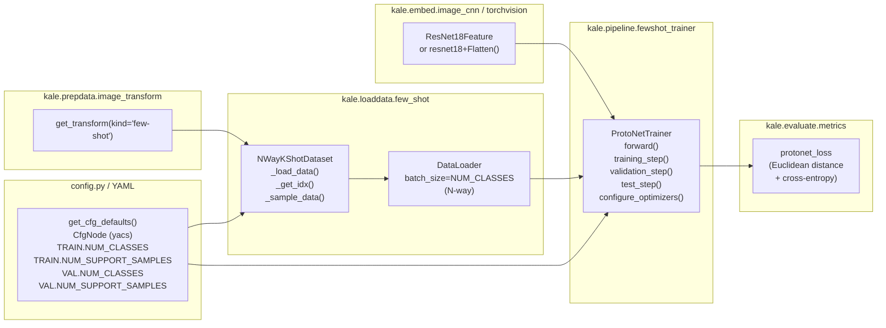
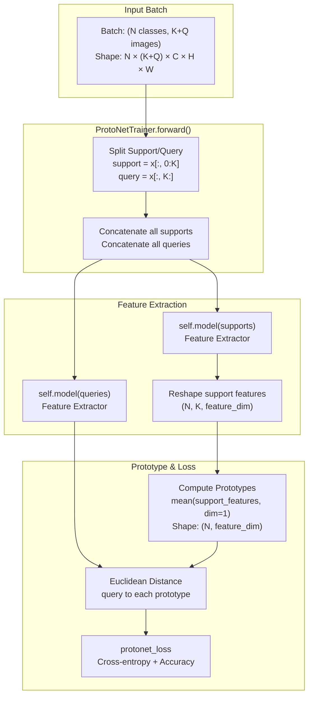
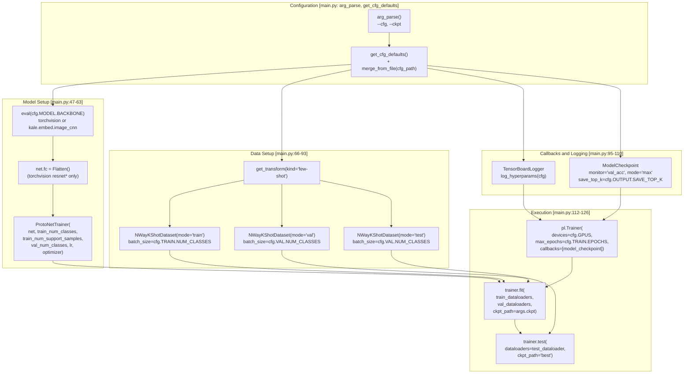
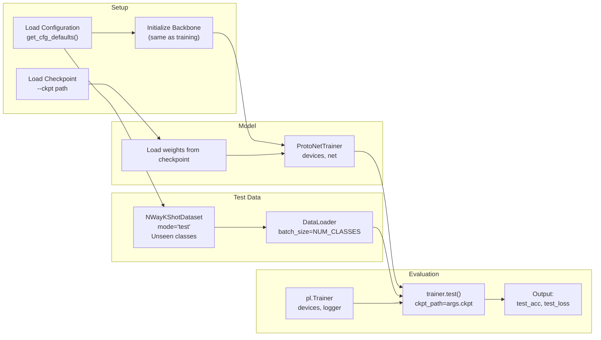

<!-- source: DeepWiki mcp.deepwiki.com · repo pykale/pykale · page 5.5 Few-Shot Learning Examples · fetched 2026-10-21 -->

# Few-Shot Learning Examples

<details>
<summary>Relevant source files</summary>

The following files were used as context for generating this wiki page:

- [examples/cifar_cnntransformer/main.py](examples/cifar_cnntransformer/main.py)
- [examples/fewshot_protonet/README.md](examples/fewshot_protonet/README.md)
- [examples/fewshot_protonet/__init__.py](examples/fewshot_protonet/__init__.py)
- [examples/fewshot_protonet/config.py](examples/fewshot_protonet/config.py)
- [examples/fewshot_protonet/configs/demo.yaml](examples/fewshot_protonet/configs/demo.yaml)
- [examples/fewshot_protonet/configs/template.yaml](examples/fewshot_protonet/configs/template.yaml)
- [examples/fewshot_protonet/eval_unseen_classes.py](examples/fewshot_protonet/eval_unseen_classes.py)
- [examples/fewshot_protonet/main.py](examples/fewshot_protonet/main.py)
- [kale/loaddata/few_shot.py](kale/loaddata/few_shot.py)
- [kale/pipeline/fewshot_trainer.py](kale/pipeline/fewshot_trainer.py)

</details>


This page documents PyKale's few-shot learning examples, focusing on the implementation of Prototypical Networks (ProtoNet) for N-way K-shot classification tasks. The examples demonstrate episodic training on datasets like Omniglot and miniImageNet, where models learn to classify new classes from just a few labeled samples.

For general few-shot learning architecture details, see [4.1](#4.1). For other machine learning examples, see [5.1](#5.1) for getting started tutorials and [5.2](#5.2) for domain adaptation examples.

## Overview

PyKale implements few-shot learning through an episodic training paradigm where:

- **N-way**: The number of classes in each episode (e.g., 5-way = classify among 5 classes)
- **K-shot**: The number of labeled support samples per class (e.g., 5-shot = 5 examples per class)
- **Support set**: Small labeled set of N×K samples used to compute class prototypes
- **Query set**: Unlabeled samples from the same N classes used for evaluation

The ProtoNet implementation treats classification as a distance-based clustering problem in an embedding space, where class prototypes are computed as the mean of support set embeddings, and query samples are classified based on their nearest prototype.

Sources: [examples/fewshot_protonet/README.md:1-18](), [kale/loaddata/few_shot.py:1-28]()

## Few-Shot Learning Pipeline Architecture

**Diagram: End-to-end pipeline from config to loss — module and class names**



Sources: [kale/loaddata/few_shot.py:16-131](), [kale/pipeline/fewshot_trainer.py:25-151](), [examples/fewshot_protonet/main.py:37-126]()

## Dataset Organization and Loading

### Required Directory Structure

Few-shot learning datasets must follow a specific organization where each class has its own subdirectory containing image files:

```
root/
├── train/
│   ├── class_1/
│   │   ├── image_001.png
│   │   ├── image_002.png
│   │   └── ...
│   ├── class_2/
│   │   └── ...
│   └── class_n/
│       └── ...
├── val/
│   ├── class_n+1/
│   │   └── ...
│   └── ...
└── test/
    ├── class_m/
    │   └── ...
    └── ...
```

**Important**: Training, validation, and test splits should contain **disjoint sets of classes**. This ensures the model is evaluated on its ability to recognize entirely new classes, not just new instances of seen classes.

Sources: [examples/fewshot_protonet/README.md:24-58](), [kale/loaddata/few_shot.py:30-64]()

### NWayKShotDataset Class

The `NWayKShotDataset` class implements episodic sampling for few-shot learning:

| Method | Purpose | Key Operations |
|--------|---------|----------------|
| `__init__()` | Initialize dataset | Load image paths, set support/query sizes |
| `__len__()` | Return dataset size | Returns number of classes (not images) |
| `__getitem__(idx)` | Sample episode | Returns N×(K+Q) images and labels for class `idx` |
| `_get_idx(idx)` | Select image indices | Random sampling without replacement |
| `_load_data()` | Load dataset structure | Parse directory tree, build class list |

**Key Implementation Detail**: The `__getitem__()` method returns a batch of images from a **single class**, containing both support and query samples. The DataLoader's batch size should equal the number of classes (N-way), so each batch contains images from N classes.

Sources: [kale/loaddata/few_shot.py:73-131]()

### Episodic Sampling Process

```mermaid
flowchart LR
    subgraph "Dataset Initialization"
        INIT["NWayKShotDataset.__init__<br/>num_support_samples=K<br/>num_query_samples=Q"]
        LOAD["_load_data()"]
        CLASSES["self.classes list<br/>self.images list<br/>self.labels list"]
    end
    
    subgraph "DataLoader Batching"
        DL["DataLoader<br/>batch_size=N (num_classes)<br/>shuffle=True"]
        SAMPLE_N["Sample N classes"]
    end
    
    subgraph "Per-Class Sampling"
        GET["__getitem__(class_idx)"]
        GET_IDX["_get_idx(class_idx)<br/>Random select K+Q images<br/>without replacement"]
        SAMPLE_DATA["_sample_data(image_idx)<br/>Load and transform images"]
    end
    
    subgraph "Episode Batch"
        BATCH["Batch Shape:<br/>(N, K+Q, C, H, W)<br/>N classes<br/>K+Q images per class"]
        SPLIT["Split into:<br/>Support (N×K)<br/>Query (N×Q)"]
    end
    
    INIT --> LOAD
    LOAD --> CLASSES
    CLASSES --> DL
    
    DL --> SAMPLE_N
    SAMPLE_N --> GET
    GET --> GET_IDX
    GET_IDX --> SAMPLE_DATA
    SAMPLE_DATA --> BATCH
    BATCH --> SPLIT
```



**Diagram: Episodic Sampling Mechanism** - This diagram details how `NWayKShotDataset` creates episodes by sampling images from N classes, with K support and Q query samples per class.

Sources: [kale/loaddata/few_shot.py:92-116](), [examples/fewshot_protonet/main.py:68-84]()

## ProtoNetTrainer Configuration

The `ProtoNetTrainer` class from `kale.pipeline.fewshot_trainer` orchestrates the training process using PyTorch Lightning:

### Key Parameters

| Parameter | Training | Validation/Test | Description |
|-----------|----------|-----------------|-------------|
| `train_num_classes` | 30 (default) | N/A | Number of classes per training episode |
| `train_num_support_samples` | 5 (default) | N/A | K in N-way-K-shot for training |
| `train_num_query_samples` | 15 (default) | N/A | Query samples per class in training |
| `val_num_classes` | 5 (default) | 5 (default) | N in N-way-K-shot for val/test |
| `val_num_support_samples` | 5 (default) | 5 (default) | K in N-way-K-shot for val/test |
| `val_num_query_samples` | 15 (default) | 15 (default) | Query samples per class in val/test |

**Important Distinction**: Training typically uses **more classes** (e.g., 30-way) with the same K-shot to expose the model to diverse classification tasks. Evaluation uses the target N-way setting (e.g., 5-way-5-shot) to measure performance on the intended task difficulty.

Sources: [kale/pipeline/fewshot_trainer.py:40-76](), [examples/fewshot_protonet/config.py:26-40]()

### Feature Extraction and Prototype Computation



**Diagram: Forward Pass and Prototype Computation** - This diagram shows how `ProtoNetTrainer.forward()` processes an episode batch to compute class prototypes and classify query samples.

Sources: [kale/pipeline/fewshot_trainer.py:89-116]()

## Training Workflow

### Complete Training Example

The main training script at `examples/fewshot_protonet/main.py` demonstrates the full workflow:

**Diagram: `main.py` Training Pipeline — code entities and their connections**



Sources: [examples/fewshot_protonet/main.py:29-130]()

### Training Steps Implementation

The `ProtoNetTrainer` implements the standard PyTorch Lightning training loop:

| Method | Purpose | Logging Behavior |
|--------|---------|------------------|
| `training_step()` | Compute loss for one episode | Log on step and epoch (`on_step=True, on_epoch=True`) |
| `validation_step()` | Validate on one episode | Log on epoch only (`on_step=False, on_epoch=True`) |
| `test_step()` | Test on one episode | Reuses `self.loss_val`; metrics appear as `val_acc`/`val_loss` |
| `configure_optimizers()` | Setup optimizer | Dynamically resolves `torch.optim.<OPTIMIZER>` from config |

**Note on `test_step`**: It calls `compute_loss(..., mode="val")` because there is no separate `self.loss_test` — the trainer only instantiates `self.loss_train` and `self.loss_val`. During a test run the logged metric keys will therefore be `val_acc` and `val_loss`. [kale/pipeline/fewshot_trainer.py:138-143]()

**Loss Computation**: The `compute_loss()` method uses `protonet_loss()` from `kale.evaluate.metrics`, which:
1. Computes prototypes as mean of support embeddings
2. Calculates Euclidean distances from query embeddings to prototypes
3. Applies log-softmax to negative distances
4. Returns cross-entropy loss and classification accuracy

Sources: [kale/pipeline/fewshot_trainer.py:100-150]()

## Evaluation on Unseen Classes

The evaluation script `eval_unseen_classes.py` demonstrates testing pretrained models on entirely new classes:

### Evaluation Process



**Diagram: Unseen Class Evaluation Workflow** - This diagram shows how pretrained ProtoNet models are evaluated on test classes that were never seen during training.

Sources: [examples/fewshot_protonet/eval_unseen_classes.py:30-77]()

### Key Differences from Training

The evaluation script differs from training in several ways:

1. **No model training**: Uses `trainer.test()` directly without `trainer.fit()`
2. **Test set only**: Loads only the test split with unseen classes
3. **Checkpoint required**: Must specify `--ckpt` path to pretrained weights
4. **Same N-way K-shot**: Uses `VAL.NUM_CLASSES` and `VAL.NUM_SUPPORT_SAMPLES` from config

**Important Note**: If the dataset lacks a test folder, users can either:
- Copy the `val` folder and rename it to `test`
- Change `mode="test"` to `mode="val"` in the `NWayKShotDataset` constructor inside `eval_unseen_classes.py`

Sources: [examples/fewshot_protonet/eval_unseen_classes.py:48-56](), [examples/fewshot_protonet/README.md:88-91]()

## Configuration Options

### YAML Configuration Structure

PyKale uses the `yacs` library to manage configurations. The template configuration provides all customizable hyperparameters:

| Config Section | Key Parameters | Purpose |
|----------------|----------------|---------|
| `DATASET` | `ROOT`, `IMG_SIZE` | Dataset path and image dimensions |
| `MODEL` | `BACKBONE`, `PRETRAIN_WEIGHTS` | Architecture selection (ResNet18, etc.) |
| `TRAIN` | `EPOCHS`, `OPTIMIZER`, `LEARNING_RATE` | Training hyperparameters |
| `TRAIN` | `NUM_CLASSES`, `NUM_SUPPORT_SAMPLES`, `NUM_QUERY_SAMPLES` | Training episode configuration |
| `VAL` | `NUM_CLASSES`, `NUM_SUPPORT_SAMPLES`, `NUM_QUERY_SAMPLES` | Validation/test episode configuration |
| `OUTPUT` | `OUT_DIR`, `SAVE_TOP_K`, `SAVE_LAST` | Logging and checkpoint management |

Sources: [examples/fewshot_protonet/config.py:1-55](), [examples/fewshot_protonet/configs/template.yaml:1-29]()

### Typical Configuration Patterns

**5-way-1-shot Training:**
```yaml
TRAIN:
  NUM_CLASSES: 30        # Expose to many classes during training
  NUM_SUPPORT_SAMPLES: 1  # 1-shot
  NUM_QUERY_SAMPLES: 15
VAL:
  NUM_CLASSES: 5          # Evaluate on 5-way task
  NUM_SUPPORT_SAMPLES: 1  # 1-shot
  NUM_QUERY_SAMPLES: 15
```

**5-way-5-shot Training:**
```yaml
TRAIN:
  NUM_CLASSES: 30
  NUM_SUPPORT_SAMPLES: 5  # 5-shot
  NUM_QUERY_SAMPLES: 15
VAL:
  NUM_CLASSES: 5
  NUM_SUPPORT_SAMPLES: 5  # 5-shot
  NUM_QUERY_SAMPLES: 15
```

Sources: [examples/fewshot_protonet/configs/template.yaml:9-19]()

## Supported Datasets

PyKale's ProtoNet implementation supports several popular few-shot learning benchmarks:

| Dataset | Classes | Images per Class | Download Link | Format |
|---------|---------|------------------|---------------|--------|
| **Omniglot** | 1,623 characters | ~20 | [Official](https://github.com/brendenlake/omniglot) / [Kaggle](https://www.kaggle.com/datasets/watesoyan/omniglot) | 28×28 grayscale |
| **miniImageNet** | 100 classes (64/16/20 split) | 600 | [Official](https://drive.google.com/file/d/1iBu_Iqt49opXHSUNcTRU2WQas1WICLwQ/view) / [Kaggle](https://www.kaggle.com/datasets/arjunashok33/miniimagenet) | 84×84 RGB |
| **tiered-ImageNet** | 608 classes | ~1,300 | [Tool](https://github.com/yaoyao-liu/tiered-imagenet-tools) / [Kaggle](https://www.kaggle.com/datasets/arjun2000ashok/tieredimagenet) | 84×84 RGB |

All datasets must follow the directory structure described in the Dataset Organization section.

Sources: [examples/fewshot_protonet/README.md:22-24]()

## Backbone Architecture Options

The ProtoNet framework supports flexible feature extractors specified via the `MODEL.BACKBONE` configuration:

### Available Backbones

1. **PyKale Custom CNNs** (from `kale.embed.image_cnn`):
   - `ResNet18Feature`, `ResNet34Feature`, `ResNet50Feature`
   - Pre-configured for feature extraction (no classification head)

2. **TorchVision Models** (from `torchvision.models`):
   - `resnet18`, `resnet34`, `resnet50`, `resnet101`, `resnet152`
   - Requires replacing the final FC layer with `Flatten()`

**Implementation Detail**: When using TorchVision ResNet models (e.g. `resnet18`), the final fully-connected layer is replaced with a `Flatten()` layer to output feature vectors instead of class logits. The check is case-sensitive — the lowercase prefix `"resnet"` matches torchvision names but not the kale `ResNet18Feature` class, which already produces feature-only output:

[examples/fewshot_protonet/main.py:48-50]()

The same logic applies in `eval_unseen_classes.py`: [examples/fewshot_protonet/eval_unseen_classes.py:42-44]()

Sources: [examples/fewshot_protonet/main.py:48-63](), [examples/fewshot_protonet/eval_unseen_classes.py:40-46](), [examples/fewshot_protonet/README.md:74]()

## Command-Line Usage

The argument parsers in both `main.py` and `eval_unseen_classes.py` expose only two flags: `--cfg` and `--ckpt`. GPU/device configuration is read from the `GPUS` key in the YAML config file.

### Training a Model

**Basic Training (5-way-5-shot on Omniglot, demo config):**
```bash
python main.py --cfg configs/demo.yaml
```

**Custom Configuration:**
```bash
python main.py --cfg configs/template.yaml
```

**Resume from Checkpoint:**
```bash
python main.py --cfg configs/template.yaml --ckpt path/to/checkpoint.ckpt
```

To run on GPU, set `GPUS: 1` in the YAML config (or any positive integer for the device count). Setting `GPUS: 0` selects CPU. [examples/fewshot_protonet/main.py:113-120]()

### Evaluating on Unseen Classes

**Test Pretrained Model:**
```bash
python eval_unseen_classes.py --cfg configs/demo.yaml --ckpt path/to/best_model.ckpt
```

The test script uses the same `VAL.NUM_CLASSES` and `VAL.NUM_SUPPORT_SAMPLES` settings as validation, but evaluates on the test split containing entirely unseen classes.

Sources: [examples/fewshot_protonet/README.md:62-86](), [examples/fewshot_protonet/main.py:29-33](), [examples/fewshot_protonet/eval_unseen_classes.py:22-26]()

## Related PyKale APIs

The few-shot learning examples leverage several PyKale modules:

| Module | Key Components | Purpose |
|--------|----------------|---------|
| `kale.loaddata.few_shot` | `NWayKShotDataset` | Episodic data loading with support/query splits |
| `kale.pipeline.fewshot_trainer` | `ProtoNetTrainer` | PyTorch Lightning trainer for ProtoNet |
| `kale.evaluate.metrics` | `protonet_loss` | Distance-based loss computation and accuracy |
| `kale.embed.image_cnn` | `ResNet18Feature`, etc. | Feature extraction backbones |
| `kale.prepdata.image_transform` | `get_transform(kind='few-shot')` | Image preprocessing for few-shot tasks |

For implementation details of these components, see [4.1](#4.1) for the architectural overview and [2.1](#2.1) for data loading details.

Sources: [examples/fewshot_protonet/README.md:93-98]()

---

