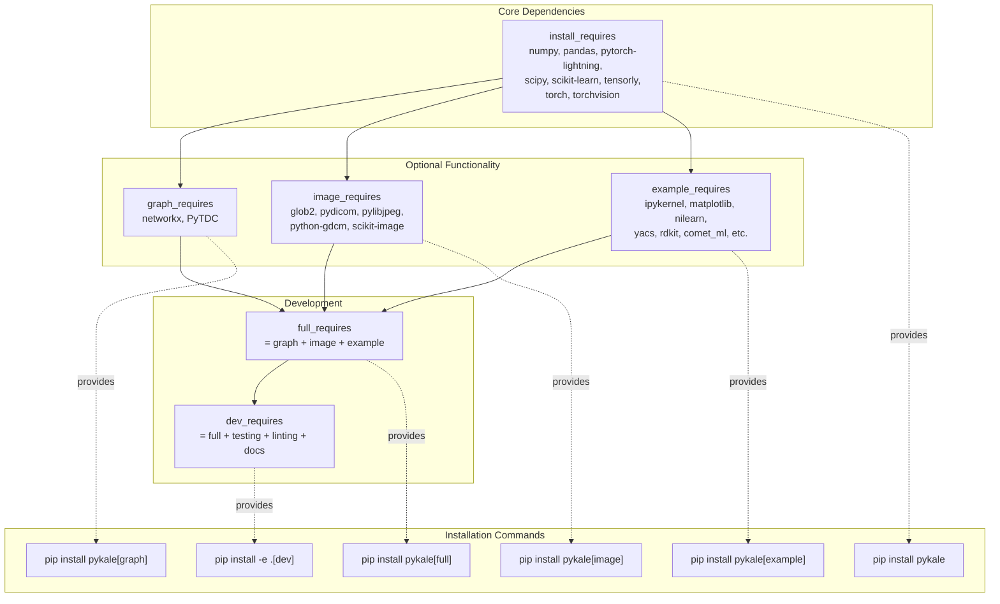
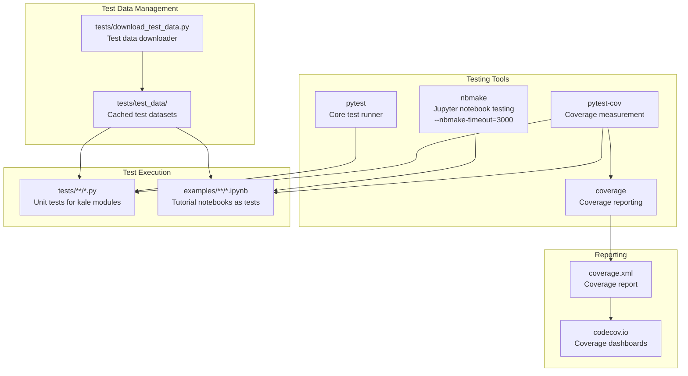
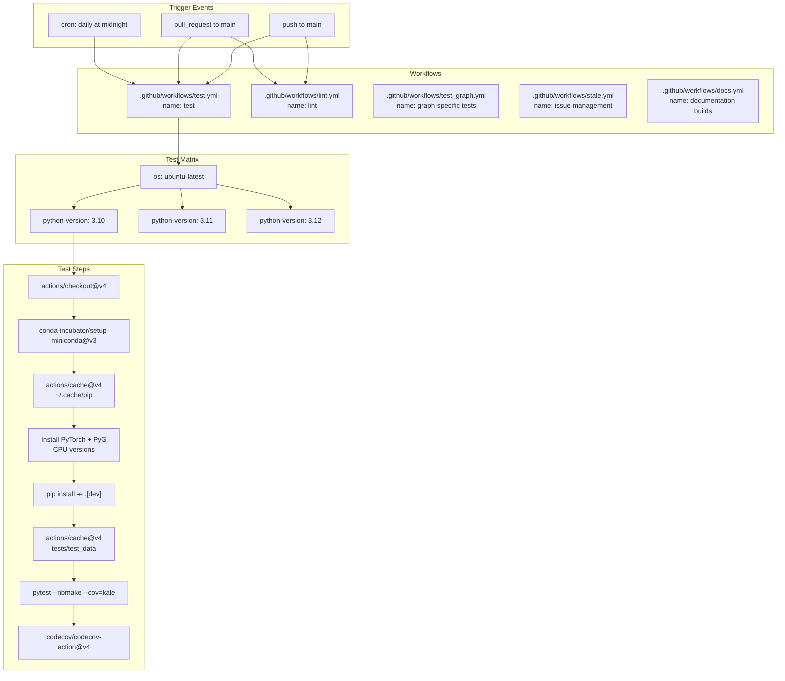
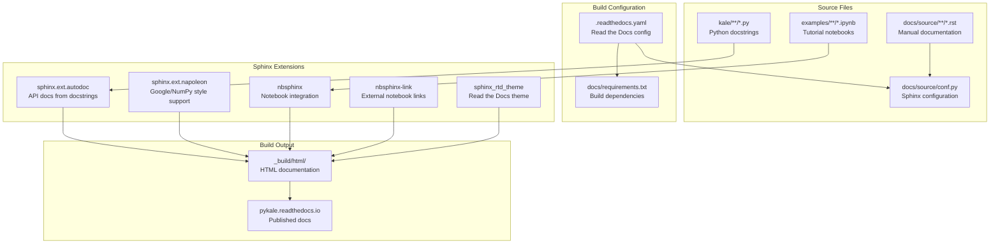
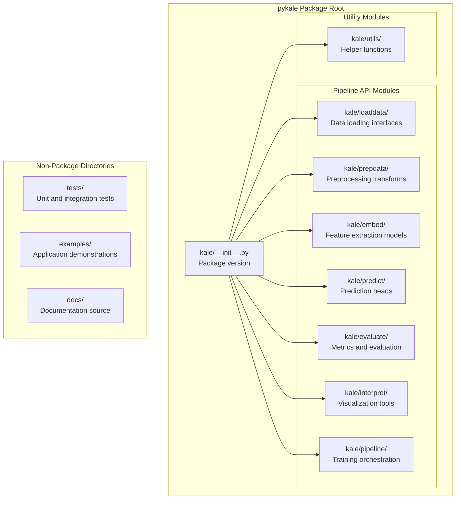

<!-- source: DeepWiki mcp.deepwiki.com · repo pykale/pykale · page 6 Development Guide · fetched 2026-10-21 -->

# Development Guide

<details>
<summary>Relevant source files</summary>

The following files were used as context for generating this wiki page:

- [.github/ISSUE_TEMPLATE/action-fail.md](.github/ISSUE_TEMPLATE/action-fail.md)
- [.github/workflows/test.yml](.github/workflows/test.yml)
- [README.md](README.md)
- [docs/source/installation.md](docs/source/installation.md)
- [examples/video_loading/README.md](examples/video_loading/README.md)
- [setup.py](setup.py)

</details>


This page provides technical guidance for contributors to the PyKale codebase. It covers the testing framework, CI/CD pipelines, documentation system, and development workflows. For general contribution guidelines including code style and pull request processes, see the [contributing guidelines](https://github.com/pykale/pykale/blob/main/.github/CONTRIBUTING.md). For information on using PyKale's core API, see [Pipeline API Reference](#2). For building applications with PyKale, see [Examples and Tutorials](#5).

## Development Environment Setup

PyKale supports development on Python 3.10, 3.11, and 3.12. The development installation includes all functionality, examples, tutorials, and testing tools.

### Installation for Development

Install PyKale in editable mode with all development dependencies:

```bash
git clone https://github.com/pykale/pykale
cd pykale
pip install -e .[dev]
```

This installs the package in editable mode (`-e`), meaning code changes are immediately reflected without reinstallation. The `[dev]` extra includes all optional dependencies plus development tools.

**Development Dependencies Overview**

| Category | Packages | Purpose |
|----------|----------|---------|
| Testing | `pytest`, `pytest-cov`, `nbmake`, `nbval`, `coverage` | Unit tests, notebook tests, coverage reporting |
| Code Quality | `black`, `flake8`, `flake8-print`, `isort`, `mypy`, `pre-commit` | Linting, formatting, type checking |
| Documentation | `sphinx`, `sphinx-rtd-theme`, `nbsphinx`, `nbsphinx-link`, `m2r`, `recommonmark` | API docs, notebook integration |
| Functionality | All `graph`, `image`, and `example` extras | Complete feature set for testing |

Sources: [setup.py:72-92]()

### Dependency Management Structure



Sources: [setup.py:16-92]()

## Testing Framework

PyKale uses `pytest` as its primary testing framework with extensions for notebook testing and coverage reporting.

### Test Execution

Run all tests locally:

```bash
pytest
```

Run tests with coverage reporting:

```bash
pytest --cov=kale
coverage xml  # Generate XML report for codecov
```

Run notebook tests:

```bash
pytest --nbmake --nbmake-timeout=3000
```

Test individual modules:

```bash
pytest tests/embed/test_image_cnn.py
pytest tests/loaddata/
```

Sources: [docs/source/installation.md:49-57]()

### Test Infrastructure Components



Sources: [.github/workflows/test.yml:92-110](), [setup.py:72-92]()

### Test Data Caching

Test data is downloaded once and cached to avoid redundant downloads. The `download_test_data.py` script manages test dataset retrieval.

**Caching Strategy:**
- Cache key based on hash of `download_test_data.py` 
- Strict matching ensures cache updates when download script changes
- Data stored in `tests/test_data/` directory
- Cache persists across CI runs unless script modified

Sources: [.github/workflows/test.yml:76-90]()

### Thread Limits for Testing

Tests run with restricted thread counts to ensure deterministic behavior and prevent resource contention:

```bash
export OMP_NUM_THREADS=1
export MKL_NUM_THREADS=1
export NUMEXPR_NUM_THREADS=1
```

These environment variables limit parallel computation in numerical libraries during test execution.

Sources: [.github/workflows/test.yml:94-98]()

## CI/CD Pipeline

PyKale uses GitHub Actions for continuous integration and deployment. The CI/CD system runs on push to `main`, pull requests, and daily scheduled runs.

### GitHub Actions Workflows



Sources: [.github/workflows/test.yml:1-110]()

### Main Testing Workflow (test.yml)

The `test.yml` workflow is the primary CI pipeline that runs comprehensive tests across Python versions.

**Workflow Configuration:**
- **Name:** `test`
- **Matrix:** Ubuntu-latest with Python 3.10, 3.11, 3.12
- **Triggers:** Push to main, pull requests, daily cron
- **Key Steps:** See diagram above

**Dependency Installation Strategy:**

The workflow installs dependencies in a specific order to ensure compatibility:

1. **RDKit, gdown, pyparsing, numpy** (prerequisite packages)
2. **PyTorch 2.6.0 + torchvision + torchaudio** (CPU versions from official index)
3. **PyTorch Geometric extensions** (torch_scatter, torch_sparse, torch_cluster, torch_spline_conv, torch_geometric)
4. **PyKale with dev dependencies** (`pip install -e .[dev]`)

This installation order is critical because PyTorch Geometric extensions must match the PyTorch version exactly.

Sources: [.github/workflows/test.yml:57-74]()

### Caching Strategy

The CI pipeline implements two-level caching to reduce build times:

**1. Pip Dependency Cache:**
- **Path:** `~/.cache/pip` (Ubuntu)
- **Key:** `{os}-python{version}-pip-20250302-{hash(setup.py)}`
- **Restore Keys:** Soft matching with date prefix
- **Strategy:** Uses softer matching to avoid cache updates on every `setup.py` change
- **Date Tag:** `20250302` updated manually after major dependency changes

**2. Test Data Cache:**
- **Path:** `tests/test_data`
- **Key:** `{os}-python{version}-data-{hash(download_test_data.py)}`
- **Restore Keys:** Strict matching on download script hash
- **Strategy:** Updates only when download script changes

Sources: [.github/workflows/test.yml:42-90]()

### Cross-Version Testing Matrix

| Operating System | Python Versions | Status |
|-----------------|-----------------|---------|
| ubuntu-latest | 3.10, 3.11, 3.12 | ✓ Active |
| windows-latest | 3.10, 3.11, 3.12 | ✗ Commented out |

Windows testing is currently disabled but infrastructure remains in place for future re-enablement. The commented-out configuration shows the intended cross-platform support.

Sources: [.github/workflows/test.yml:19-31]()

### Coverage Reporting

Test coverage is measured by `pytest-cov` and reported to Codecov:

```bash
pytest --cov=kale  # Measure coverage during tests
coverage xml       # Generate XML report
codecov            # Upload to codecov.io
```

The `CODECOV_TOKEN` secret must be configured in the repository settings for uploads to succeed.

Sources: [.github/workflows/test.yml:101-110]()

## Documentation System

PyKale uses Sphinx to generate documentation from docstrings, RST files, and Jupyter notebooks. The documentation is hosted on Read the Docs.

### Documentation Build Process



Sources: [setup.py:72-92]()

### Documentation Dependencies

Documentation builds require specific dependencies beyond the core package:

| Package | Purpose |
|---------|---------|
| `sphinx` | Documentation generator |
| `sphinx-rtd-theme` | Read the Docs visual theme |
| `nbsphinx` | Jupyter notebook integration |
| `nbsphinx-link` | Link external notebooks |
| `m2r`, `recommonmark` | Markdown support in RST |
| `nbconvert` | Notebook conversion |

These are included in the `dev_requires` installation option.

Sources: [setup.py:79-92]()

### Building Documentation Locally

Build documentation on your local machine:

```bash
cd docs
make html
```

The generated documentation will be in `docs/_build/html/`. Open `index.html` in a browser to view.

Clean previous builds:

```bash
make clean
```

### Notebook Testing as Documentation

Jupyter notebooks in the `examples/` directory serve dual purposes:
1. Interactive tutorials for users
2. Integration tests ensuring examples remain functional

The `nbmake` pytest plugin executes notebooks during testing with a 3000-second timeout:

```bash
pytest --nbmake --nbmake-timeout=3000 examples/
```

This ensures documentation examples stay synchronized with the codebase.

Sources: [.github/workflows/test.yml:98]()

## Contribution Workflow

```mermaid
graph LR
    subgraph "Local Development"
        FORK["Fork pykale/pykale"]
        CLONE["git clone your-fork"]
        BRANCH["git checkout -b feature-name"]
        DEVELOP["Make changes<br/>Write tests<br/>Update docs"]
        TEST_LOCAL["pytest<br/>Run tests locally"]
    end
    
    subgraph "Code Quality"
        LINT["Run linting<br/>flake8, black, isort"]
        FORMAT["Format code<br/>black kale/"]
        TYPE_CHECK["mypy kale/<br/>Type checking"]
    end
    
    subgraph "Submission"
        COMMIT["git commit -m 'description'"]
        PUSH["git push origin feature-name"]
        PR["Open Pull Request<br/>to pykale/pykale:main"]
    end
    
    subgraph "CI Validation"
        AUTO_TEST["test.yml runs<br/>All Python versions"]
        AUTO_LINT["lint.yml runs<br/>Code quality checks"]
        COVERAGE["Coverage report<br/>to Codecov"]
    end
    
    subgraph "Review and Merge"
        REVIEW["Code review<br/>by maintainers"]
        REVISE["Address feedback<br/>Update PR"]
        MERGE["Merge to main"]
    end
    
    FORK --> CLONE
    CLONE --> BRANCH
    BRANCH --> DEVELOP
    DEVELOP --> TEST_LOCAL
    TEST_LOCAL --> LINT
    LINT --> FORMAT
    FORMAT --> TYPE_CHECK
    TYPE_CHECK --> COMMIT
    COMMIT --> PUSH
    PUSH --> PR
    
    PR --> AUTO_TEST
    PR --> AUTO_LINT
    AUTO_TEST --> COVERAGE
    COVERAGE --> REVIEW
    AUTO_LINT --> REVIEW
    REVIEW --> REVISE
    REVIEW --> MERGE
    REVISE --> REVIEW
```



Sources: [README.md:78-88]()

### Development Setup Steps

1. **Fork and Clone:**
   ```bash
   git clone https://github.com/YOUR_USERNAME/pykale
   cd pykale
   ```

2. **Install in Development Mode:**
   ```bash
   pip install -e .[dev]
   ```

3. **Create Feature Branch:**
   ```bash
   git checkout -b feature-descriptive-name
   ```

4. **Make Changes:**
   - Write/modify code in `kale/` modules
   - Add tests in `tests/` matching module structure
   - Update documentation in docstrings and `docs/source/`

5. **Test Locally:**
   ```bash
   pytest
   pytest tests/your_module/test_your_feature.py
   ```

6. **Check Code Quality:**
   ```bash
   flake8 kale/
   black --check kale/
   isort --check kale/
   ```

7. **Commit and Push:**
   ```bash
   git add .
   git commit -m "Add feature: description"
   git push origin feature-descriptive-name
   ```

8. **Open Pull Request:**
   - Navigate to your fork on GitHub
   - Click "Pull Request" targeting `pykale/pykale:main`
   - Describe changes, reference issues if applicable

Sources: [README.md:78-88]()

### Pre-commit Hooks

PyKale includes `pre-commit` configuration for automated code quality checks. Install pre-commit hooks:

```bash
pre-commit install
```

Hooks run automatically before each commit to check:
- Code formatting (black)
- Import sorting (isort)
- Linting (flake8)
- Type checking (mypy)

Sources: [setup.py:86]()

## Package Structure and Module Organization

Understanding PyKale's package structure helps contributors locate relevant code for modifications or additions.

### Core Package Layout



**Package Discovery:**
The `setup.py` uses `find_packages(exclude=("docs", "examples", "tests"))` to automatically include all Python packages under `kale/` while excluding non-package directories.

Sources: [setup.py:127]()

### Test Directory Structure

Tests mirror the package structure for easy navigation:

```
tests/
├── loaddata/
│   ├── test_dataset_access.py
│   ├── test_multi_domain.py
│   └── test_video_datasets.py
├── prepdata/
│   ├── test_image_transform.py
│   └── test_video_transform.py
├── embed/
│   ├── test_image_cnn.py
│   └── test_gcn.py
├── pipeline/
│   ├── test_domain_adapter.py
│   └── test_mpca_trainer.py
└── download_test_data.py
```

This structure allows contributors to quickly find relevant tests when modifying code.

### Adding New Functionality

**To add a new module:**

1. Create Python file(s) in appropriate `kale/` subdirectory
2. Implement functionality following existing patterns
3. Add corresponding tests in `tests/` subdirectory
4. Update docstrings for automatic API documentation
5. Add example usage in `examples/` if applicable

**To add a new example:**

1. Create directory in `examples/`
2. Include implementation script(s)
3. Add `README.md` explaining the example
4. Optionally create tutorial notebook (`.ipynb`)
5. Ensure example runs with `pytest --nbmake` if notebook included

Sources: [setup.py:127](), [README.md:74-86]()

## Python Version Support

PyKale officially supports Python 3.10, 3.11, and 3.12. All three versions are tested in CI.

**Version Constraint:**
```python
python_requires=">=3.10,<3.13"
```

This constraint is enforced in `setup.py` and must be satisfied for installation. Contributors should ensure code compatibility across all supported versions.

**Testing Across Versions:**
The CI matrix tests all supported versions on every pull request, preventing version-specific bugs from merging.

Sources: [setup.py:128](), [.github/workflows/test.yml:23]()

## Issue Management

PyKale uses GitHub Issues for bug tracking, feature requests, and discussions. An automated workflow manages stale issues.

### Issue Templates

The repository provides issue templates for common scenarios:

**Action Failed Template:**
- Automatically created when scheduled CI runs fail
- Template: `.github/ISSUE_TEMPLATE/action-fail.md`
- Labels: `action failed`
- Contains timestamp of failure

This ensures CI failures are tracked and addressed promptly.

Sources: [.github/ISSUE_TEMPLATE/action-fail.md:1-11]()

### Reporting Bugs

When reporting bugs, include:
- PyKale version (`import kale; print(kale.__version__)`)
- Python version
- Operating system
- Minimal reproducible example
- Expected vs. actual behavior
- Error messages and stack traces

### Requesting Features

Feature requests should describe:
- Use case and motivation
- Proposed API or interface
- Example usage code
- Relation to existing functionality
- Willingness to contribute implementation

Sources: [README.md:84-86]()

## Code Quality Standards

PyKale enforces code quality through automated tools integrated into the development workflow.

### Linting Tools

| Tool | Purpose | Configuration |
|------|---------|---------------|
| `flake8` | Style guide enforcement (PEP 8) | Default settings |
| `flake8-print` | Detect print statements | Plugin for flake8 |
| `black` | Code formatter (version 19.10b0) | Line length and style |
| `isort` | Import statement sorting | Alphabetical ordering |
| `mypy` | Static type checking | Gradual typing |

Run quality checks before committing:

```bash
flake8 kale/ tests/
black kale/ tests/
isort kale/ tests/
mypy kale/
```

Sources: [setup.py:73-80]()

### Code Formatting with Black

PyKale uses Black version 19.10b0 for consistent code formatting:

```bash
black kale/ tests/  # Format code
black --check kale/ tests/  # Check formatting without changes
```

Black's automatic formatting eliminates style debates and ensures consistency across contributors.

### Import Sorting with isort

Use `isort` to organize imports:

```bash
isort kale/ tests/  # Sort imports
isort --check kale/ tests/  # Check sorting without changes
```

Standard import order:
1. Standard library imports
2. Third-party imports (e.g., torch, numpy)
3. Local application imports (e.g., kale.loaddata)

Sources: [setup.py:78]()

## Summary

This guide covers the essential development infrastructure for PyKale contributors:

- **Development Setup:** Install with `pip install -e .[dev]` for full development environment
- **Testing:** Use `pytest` with `nbmake` for notebooks, with comprehensive caching and coverage reporting
- **CI/CD:** GitHub Actions workflows (`test.yml`, `lint.yml`) run on push, PR, and daily schedule
- **Documentation:** Sphinx-based system with Read the Docs integration, includes notebook documentation
- **Contribution:** Fork, branch, develop, test locally, open PR with automatic CI validation
- **Code Quality:** Enforced via `flake8`, `black`, `isort`, and `mypy`

For detailed API documentation, see [Pipeline API Reference](#2). For building applications, see [Examples and Tutorials](#5). For specific module documentation, refer to the appropriate section in [Specialized Models and Tasks](#4) or [Domain Adaptation](#3).

Sources: [setup.py:1-153](), [.github/workflows/test.yml:1-110](), [README.md:1-117]()

---

