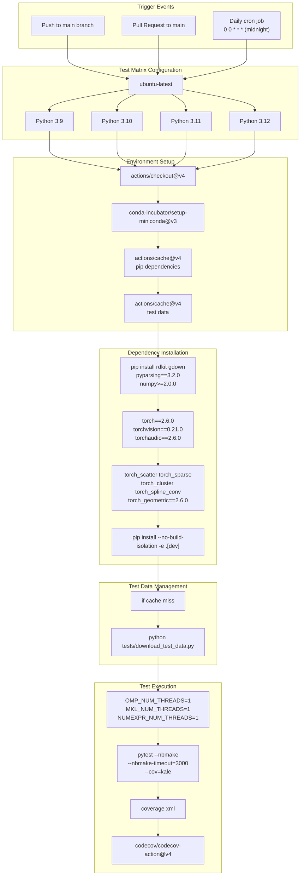
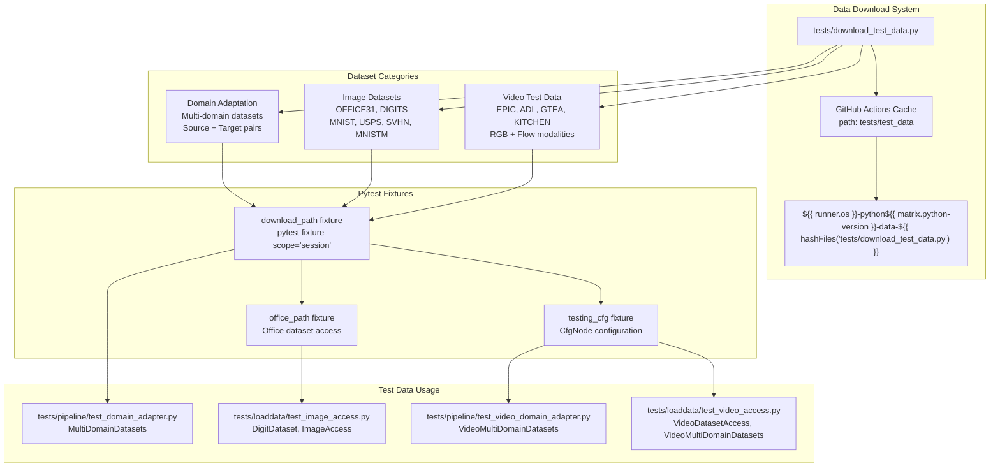

<!-- source: DeepWiki mcp.deepwiki.com · repo pykale/pykale · page 6.1 Testing Framework · fetched 2026-10-21 -->

# Testing Framework

<details>
<summary>Relevant source files</summary>

The following files were used as context for generating this wiki page:

- [.pre-commit-config.yaml](.pre-commit-config.yaml)
- [examples/cifar_isonet/README.md](examples/cifar_isonet/README.md)
- [kale/utils/print.py](kale/utils/print.py)
- [pyproject.toml](pyproject.toml)
- [setup.cfg](setup.cfg)
- [tests/README.md](tests/README.md)
- [tests/__init__.py](tests/__init__.py)
- [tests/utils/test_print.py](tests/utils/test_print.py)

</details>


## Purpose and Scope

This document describes PyKale's comprehensive testing framework, including the automated CI/CD pipeline, test data management, and test structure organization. The testing framework ensures code quality, functionality verification, and continuous integration across multiple Python versions and platforms.

For information about the CI/CD pipeline deployment and GitHub Actions workflows, see [CI/CD Pipeline](#6.2). For guidelines on contributing tests and following development practices, see [Contributing](#6.3).

## Test Automation Pipeline

PyKale implements a comprehensive GitHub Actions-based testing pipeline that validates code across multiple Python versions and manages dependencies efficiently.

### GitHub Actions Test Workflow



The pipeline uses a strategic caching approach with cache keys based on OS, Python version, and dependency file hashes. The cache includes both pip dependencies and downloaded test data to optimize build times.

Sources: [.github/workflows/test.yml:1-112]()

## Test Data Management

PyKale uses a centralized test data management system with pytest fixtures and GitHub Actions caching to efficiently handle domain adaptation datasets, video datasets, and other specialized data.

### Test Data Infrastructure



The system uses conditional downloading based on cache hits, with strict cache invalidation when the download script changes. Test fixtures are scoped appropriately to minimize setup overhead across test runs.

Sources: [.github/workflows/test.yml:78-92](), [tests/loaddata/test_video_access.py:36-43](), [tests/pipeline/test_domain_adapter.py:26-41](), [tests/loaddata/test_image_access.py:143-159]()

## Test Structure Organization

PyKale's test suite mirrors the main codebase structure with specialized testing patterns for domain adaptation, video processing, and multi-modal data handling.

| Test Module | Purpose | Key Test Functions |
|-------------|---------|-------------------|
| `tests/loaddata/` | Data access and loading | `test_get_source_target`, `test_multi_domain_datasets` |
| `tests/pipeline/` | Domain adaptation training | `test_domain_adaptor`, `test_video_domain_adapter` |
| `tests/helpers/` | Test utilities | `ModelTestHelper`, `VideoBoringModel` |

### Domain Adaptation Testing Architecture

```mermaid
graph TB
    subgraph "Domain Adaptation Test Flow"
        SOURCE_TARGET_SETUP["DigitDataset.get_source_target()<br/>VideoDataset.get_source_target()"]
        MULTI_DOMAIN_DS["MultiDomainDatasets<br/>VideoMultiDomainDatasets"]
        FEATURE_NETWORKS["SmallCNNFeature<br/>VideoBoringModel"]
        CLASSIFIER_NETWORKS["ClassNetSmallImage<br/>ClassNetVideo"]
        CRITIC_NETWORKS["DomainNetSmallImage<br/>DomainNetVideo"]
    end
    
    subgraph "DA Method Testing"
        DA_METHODS["DANN, CDAN, CDAN-E<br/>WDGRL, WDGRLMod<br/>DAN, JAN, FSDANN, MME"]
        MMD_METHODS["create_mmd_based()<br/>create_mmd_based_video()"]
        DANN_METHODS["create_dann_like()<br/>create_dann_like_video()"]
        METHOD_PARAMS["use_random, adapt_lambda<br/>lambda_init, nb_epochs"]
    end
    
    subgraph "Video-Specific Testing"
        IMAGE_MODALITIES["rgb, flow, joint"]
        VIDEO_SOURCES["EPIC, ADL, GTEA, KITCHEN<br/>train.pkl, test.pkl"]
        WEIGHT_TYPES["natural, balanced, preset0"]
        SIZE_TYPES["max, source"]
    end
    
    subgraph "Test Execution Patterns"
        PARAMETRIZE_DECORATOR["@pytest.mark.parametrize"]
        MODEL_TEST_HELPER["ModelTestHelper.test_model()"]
        FIXTURE_SCOPING["scope='module'"]
        SEED_MANAGEMENT["set_seed(36)"]
    end
    
    SOURCE_TARGET_SETUP --> MULTI_DOMAIN_DS
    MULTI_DOMAIN_DS --> FEATURE_NETWORKS
    FEATURE_NETWORKS --> CLASSIFIER_NETWORKS
    CLASSIFIER_NETWORKS --> CRITIC_NETWORKS
    
    DA_METHODS --> MMD_METHODS
    DA_METHODS --> DANN_METHODS
    MMD_METHODS --> METHOD_PARAMS
    DANN_METHODS --> METHOD_PARAMS
    
    IMAGE_MODALITIES --> VIDEO_SOURCES
    VIDEO_SOURCES --> WEIGHT_TYPES
    WEIGHT_TYPES --> SIZE_TYPES
    
    PARAMETRIZE_DECORATOR --> MODEL_TEST_HELPER
    MODEL_TEST_HELPER --> FIXTURE_SCOPING
    FIXTURE_SCOPING --> SEED_MANAGEMENT
```



### Test Parametrization Patterns

The testing framework uses extensive parametrization to cover multiple configurations:

```python
# Domain Adaptation Methods
DA_METHODS = ["DANN", "CDAN", "CDAN-E", "WDGRL", "WDGRLMod", "DAN", "JAN", "FSDANN", "MME", "Source"]

# Video Dataset Sources  
SOURCES = ["EPIC;8;epic_D1_train.pkl;epic_D1_test.pkl", "ADL;7;adl_P_11_train.pkl;adl_P_11_test.pkl"]

# Image Modalities
IMAGE_MODALITY = ["rgb", "flow", "joint"]
```

Sources: [tests/pipeline/test_domain_adapter.py:12-22](), [tests/pipeline/test_video_domain_adapter.py:14-27](), [tests/loaddata/test_video_access.py:13-33](), [tests/loaddata/test_image_access.py:48-56]()

## Test Execution Configuration

PyKale's test execution is optimized for performance and reliability with specific configuration settings and resource management.

### Runtime Configuration

The test execution environment is configured with thread limits to prevent resource contention and ensure consistent behavior across different hardware configurations:

```
OMP_NUM_THREADS=1
MKL_NUM_THREADS=1  
NUMEXPR_NUM_THREADS=1
```

### Test Runner Configuration

PyKale uses pytest with specialized plugins and configuration:

- **nbmake**: Tests Jupyter notebooks with 3000-second timeout
- **coverage**: Generates code coverage reports for the `kale` package
- **parametrization**: Extensive use of `@pytest.mark.parametrize` for test variations

### Dependency Management

The test environment includes comprehensive dependency installation:

| Dependency Category | Components |
|-------------------|------------|
| Core ML Libraries | `torch==2.6.0`, `torchvision==0.21.0`, `torchaudio==2.6.0` |
| Graph Libraries | `torch_geometric==2.6.0`, `torch_scatter`, `torch_sparse`, `torch_cluster` |
| Chemistry Libraries | `rdkit` |
| Utilities | `gdown`, `pyparsing==3.2.0`, `numpy>=2.0.0` |

Sources: [.github/workflows/test.yml:94-101](), [.github/workflows/test.yml:59-71]()

## Test Categories and Coverage

PyKale's test suite focuses on domain adaptation, multi-modal data processing, and video analysis capabilities with comprehensive parametrized testing.

### Core Testing Areas

```mermaid
graph TB
    subgraph "Data Loading Tests"
        IMAGE_ACCESS["test_image_access.py<br/>test_get_source_target()<br/>test_multi_domain_datasets()"]
        VIDEO_ACCESS["test_video_access.py<br/>test_get_source_target()<br/>test_get_image_modality()"]
        DATASET_TYPES["DigitDataset, VideoDataset<br/>MultiDomainDatasets<br/>VideoMultiDomainDatasets"]
        CLASS_SUBSETS["get_class_subset()<br/>class_ids parameter testing"]
    end
    
    subgraph "Domain Adaptation Tests"
        DOMAIN_ADAPTER["test_domain_adapter.py<br/>test_domain_adaptor()"]
        VIDEO_DOMAIN_ADAPTER["test_video_domain_adapter.py<br/>test_video_domain_adapter()"]
        DA_METHOD_TESTING["DANN, CDAN, CDAN-E<br/>WDGRL, DAN, JAN<br/>FSDANN, MME, Source"]
        FACTORY_FUNCTIONS["create_mmd_based()<br/>create_dann_like()"]
    end
    
    subgraph "Video Processing Tests"
        MODALITY_TESTING["RGB, Flow, Joint<br/>get_image_modality()"]
        VIDEO_DATASETS["EPIC, ADL, GTEA, KITCHEN<br/>train.pkl, test.pkl files"]
        VIDEO_TRANSFORMS["VideoBoringModel<br/>multi-modal feature extraction"]
        TEMPORAL_SAMPLING["frames_per_segment<br/>VideoFrameDataset testing"]
    end
    
    subgraph "Network Architecture Tests"
        FEATURE_NETWORKS["SmallCNNFeature<br/>VideoBoringModel<br/>feature extraction testing"]
        CLASSIFIER_NETWORKS["ClassNetSmallImage<br/>ClassNetVideo<br/>task classification"]
        DOMAIN_NETWORKS["DomainNetSmallImage<br/>DomainNetVideo<br/>domain discrimination"]
        ARCHITECTURE_VALIDATION["input_size, output_size<br/>network initialization"]
    end
    
    subgraph "Training Pipeline Tests"
        MODEL_TEST_HELPER["ModelTestHelper.test_model()<br/>training validation"]
        TRAINING_PARAMS["batch_size, num_workers<br/>optimizer configuration<br/>learning rate scheduling"]
        FEW_SHOT_TESTING["n_fewshot parameter<br/>semi-supervised scenarios"]
        WEIGHT_SAMPLING["natural, balanced, preset0<br/>sampling configurations"]
    end
    
    IMAGE_ACCESS --> DATASET_TYPES
    VIDEO_ACCESS --> DATASET_TYPES
    DATASET_TYPES --> CLASS_SUBSETS
    
    DOMAIN_ADAPTER --> DA_METHOD_TESTING
    VIDEO_DOMAIN_ADAPTER --> DA_METHOD_TESTING
    DA_METHOD_TESTING --> FACTORY_FUNCTIONS
    
    MODALITY_TESTING --> VIDEO_DATASETS
    VIDEO_DATASETS --> VIDEO_TRANSFORMS
    VIDEO_TRANSFORMS --> TEMPORAL_SAMPLING
    
    FEATURE_NETWORKS --> CLASSIFIER_NETWORKS
    CLASSIFIER_NETWORKS --> DOMAIN_NETWORKS
    DOMAIN_NETWORKS --> ARCHITECTURE_VALIDATION
    
    MODEL_TEST_HELPER --> TRAINING_PARAMS
    TRAINING_PARAMS --> FEW_SHOT_TESTING
    FEW_SHOT_TESTING --> WEIGHT_SAMPLING
```



### Test Coverage Metrics

| Test Category | Test Files | Key Functions | Parameter Coverage |
|---------------|------------|---------------|-------------------|
| Data Loading | `test_image_access.py`, `test_video_access.py` | `get_source_target`, `get_train_test` | 4+ datasets, 3+ weight types |
| Domain Adaptation | `test_domain_adapter.py`, `test_video_domain_adapter.py` | `test_domain_adaptor` | 10 DA methods, 2 few-shot configs |
| Video Processing | `test_video_access.py`, `test_video_domain_adapter.py` | `test_video_domain_adapter` | 3 modalities, 4 video datasets |

Sources: [tests/loaddata/test_image_access.py:48-127](), [tests/loaddata/test_video_access.py:46-141](), [tests/pipeline/test_domain_adapter.py:15-99](), [tests/pipeline/test_video_domain_adapter.py:22-149]()

## Test Utilities and Helpers

PyKale provides utility functions and helper classes to support consistent testing patterns across the codebase.

### Seed Management

All tests use consistent random seed setting for reproducibility:

```python
seed = 36
set_seed(seed)
```

### Neural Network Initialization Testing

The testing framework includes utilities for testing neural network initialization patterns, supporting both weight and bias initialization verification.

### Logging Integration

Tests integrate with Python's logging system for debugging and test execution monitoring:

```python
LOGGER = logging.getLogger(__name__)
```

Sources: [tests/prepdata/test_tabular_transform.py:65-66](), [tests/loaddata/test_tabular_access.py:14-15](), [kale/utils/initialize_nn.py:1-30]()

---

