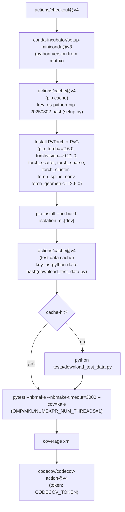
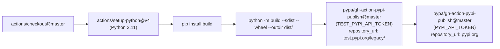
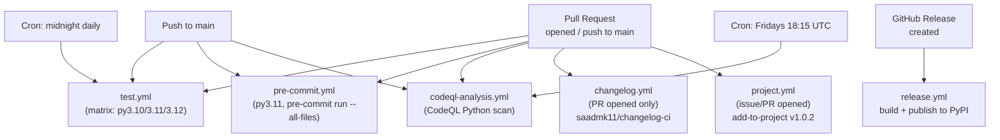

<!-- source: DeepWiki mcp.deepwiki.com · repo pykale/pykale · page 6.2 CI/CD Pipeline · fetched 2026-10-21 -->

# CI/CD Pipeline

<details>
<summary>Relevant source files</summary>

The following files were used as context for generating this wiki page:

- [.github/CHANGELOG.md](.github/CHANGELOG.md)
- [.github/ISSUE_TEMPLATE/action-fail.md](.github/ISSUE_TEMPLATE/action-fail.md)
- [.github/changelog-ci-config.json](.github/changelog-ci-config.json)
- [.github/workflows/changelog.yml](.github/workflows/changelog.yml)
- [.github/workflows/codeql-analysis.yml](.github/workflows/codeql-analysis.yml)
- [.github/workflows/pre-commit.yml](.github/workflows/pre-commit.yml)
- [.github/workflows/project.yml](.github/workflows/project.yml)
- [.github/workflows/release.yml](.github/workflows/release.yml)
- [.github/workflows/test.yml](.github/workflows/test.yml)
- [README.md](README.md)
- [docs/source/installation.md](docs/source/installation.md)
- [examples/video_loading/README.md](examples/video_loading/README.md)
- [kale/__init__.py](kale/__init__.py)
- [setup.py](setup.py)

</details>


This page documents all GitHub Actions workflows in the PyKale repository, covering their trigger conditions, jobs, and secrets. The focus is on the automation layer — what runs automatically and when. For information about running tests locally, see [Testing Framework](#6.1). For documentation build automation, see [Documentation System](#6.3).

---

## Workflow Overview

All workflow files live in [.github/workflows/]() and are triggered by GitHub events or cron schedules.

**Workflow summary table:**

| File | Workflow Name | Trigger | Primary Purpose |
|---|---|---|---|
| `test.yml` | `test` | push/PR to `main`, nightly cron | Run pytest across Python versions, report coverage |
| `pre-commit.yml` | `pre-commit-check` | push/PR to `main` | Run linting and pre-commit hooks |
| `release.yml` | `release` | GitHub Release created | Publish package to PyPI |
| `changelog.yml` | `changelog` | PR opened | Generate `CHANGELOG.md` from PR labels |
| `project.yml` | `assign-project` | Issue/PR opened or labeled | Add items to GitHub Projects board |
| `codeql-analysis.yml` | `codeql-analysis` | push/PR to `main`, weekly cron | Static security analysis |

---

## Test Workflow (`test.yml`)

**File:** [.github/workflows/test.yml]()

This is the primary CI workflow. It installs all dependencies, downloads test data, runs the full test suite including notebooks, and reports coverage to Codecov.

### Triggers

[.github/workflows/test.yml:6-13]()

| Event | Condition |
|---|---|
| `push` | Targeting `main` branch |
| `pull_request` | Targeting `main` branch |
| `schedule` | Every midnight UTC (`0 0 * * *`) |

### Build Matrix

[.github/workflows/test.yml:19-31]()

| Dimension | Values |
|---|---|
| OS | `ubuntu-latest` |
| Python versions | `3.10`, `3.11`, `3.12` |

Windows is commented out in the matrix definition. Three parallel jobs run, one per Python version.

### Job Steps

**Diagram: test.yml Job Step Sequence**



Sources: [.github/workflows/test.yml:33-110]()

### Dependency Installation Detail

PyTorch and PyTorch Geometric are installed separately before the project package because they require specific index URLs:

[.github/workflows/test.yml:57-74]()

- `rdkit` and `gdown` are installed first as standalone packages.
- `torch==2.6.0`, `torchvision==0.21.0`, `torchaudio==2.6.0` are pulled from the PyTorch CPU wheel index.
- `torch_scatter`, `torch_sparse`, `torch_cluster`, `torch_spline_conv` are pulled from the PyG wheel index, pinned to match `torch-2.6.0+cpu`.
- `torch_geometric==2.6.0` is then installed from PyPI.
- Finally, `pip install --no-build-isolation -e .[dev]` installs PyKale and all development dependencies defined in [setup.py:72-92]().

### Caching Strategy

Two separate caches are maintained:

[.github/workflows/test.yml:42-90]()

| Cache | Key Pattern | Restore Strategy |
|---|---|---|
| `~/.cache/pip` | `{os}-python{version}-pip-20250302-{hash(setup.py)}` | Soft-match: restores on prefix match, avoids full rebuild on every `setup.py` change |
| `tests/test_data` | `{os}-python{version}-data-{hash(download_test_data.py)}` | Strict-match: cache is invalidated whenever `download_test_data.py` changes |

### Test Execution

[.github/workflows/test.yml:92-99]()

```
pytest --nbmake --nbmake-timeout=3000 --cov=kale
```

- `--nbmake` runs all Jupyter notebooks as tests (with a 3000-second timeout).
- `--cov=kale` collects coverage for the `kale` package.
- Thread limits (`OMP_NUM_THREADS=1`, `MKL_NUM_THREADS=1`, `NUMEXPR_NUM_THREADS=1`) prevent resource contention in CI.

### Secrets Used

| Secret | Used By |
|---|---|
| `CODECOV_TOKEN` | `codecov/codecov-action@v4` for authenticated coverage uploads |

---

## Pre-commit Workflow (`pre-commit.yml`)

**File:** [.github/workflows/pre-commit.yml]()

Runs linting and all pre-commit hooks on every push and PR to `main`. Uses Python 3.11.

[.github/workflows/pre-commit.yml:1-29]()

### Triggers

| Event | Condition |
|---|---|
| `push` | Targeting `main` branch |
| `pull_request` | Targeting `main` branch |

### Steps

1. Checkout repository.
2. Set up Python 3.11.
3. Install `pre-commit` and `isort`.
4. Run `pre-commit install` then `pre-commit run --all-files`.

This enforces the hooks defined in `.pre-commit-config.yaml`, which include `black`, `isort`, `flake8`, and `mypy`. See [Contributing Guidelines](#6.4) for the full list of enforced hooks.

---

## Release Workflow (`release.yml`)

**File:** [.github/workflows/release.yml]()

Publishes the package to both Test PyPI and PyPI when a GitHub Release is created.

[.github/workflows/release.yml:1-43]()

### Trigger

```
on:
  release:
    types: [created]
```

### Steps

**Diagram: release.yml Job**



Sources: [.github/workflows/release.yml:14-43]()

### Secrets Used

| Secret | Purpose |
|---|---|
| `TEST_PYPI_API_TOKEN` | Authenticate upload to Test PyPI |
| `PYPI_API_TOKEN` | Authenticate upload to PyPI |

The package version is read from `kale/__init__.py` at build time via the `find_version` function in [setup.py:101-106]().

---

## Changelog Workflow (`changelog.yml`)

**File:** [.github/workflows/changelog.yml]()

Automatically updates [.github/CHANGELOG.md]() when a PR is opened. Uses the `saadmk11/changelog-ci` action.

[.github/workflows/changelog.yml:1-23]()

### Trigger

```
on:
  pull_request:
    types: [opened]
```

### Configuration

The changelog format is controlled by [.github/changelog-ci-config.json]():

| Field | Value |
|---|---|
| `changelog_type` | `pull_request` |
| `changelog_filename` | `.github/CHANGELOG.md` |
| `header_prefix` | `Version ` |
| `commit_changelog` | `true` |
| `comment_changelog` | `true` |
| `pull_request_title_regex` | `^Release` |

**Label-to-Section mapping:**

[.github/changelog-ci-config.json:8-29]()

| PR Label | CHANGELOG Section |
|---|---|
| `new feature` | New Features |
| `bug`, `dependencies` | Bug Fixes |
| `refactor`, `enhancement` | Code Improvements |
| `tests` | Tests |
| `documentation` | Documentation Updates |

### Secrets Used

| Secret | Purpose |
|---|---|
| `GITHUB_TOKEN` | Built-in token; grants write access to commit and comment on the PR |

---

## Project Board Workflow (`project.yml`)

**File:** [.github/workflows/project.yml]()

Automatically adds newly opened issues and PRs to the GitHub Projects board.

[.github/workflows/project.yml:1-39]()

### Trigger

```
on:
  issues:
    types: [opened, labeled]
  pull_request:
    types: [opened, labeled]
```

### Jobs

| Job | Condition | Action |
|---|---|---|
| `add-issue-to-project` | Event is `issues` AND action is `opened` | `actions/add-to-project@v1.0.2` targeting `orgs/pykale/projects/4` |
| `add-pull-request-to-project` | Event is `pull_request` AND action is `opened` AND PR is from the `pykale` repo (not a fork) | `actions/add-to-project@v1.0.2` targeting `orgs/pykale/projects/4` |

The fork check on the PR job (`github.event.pull_request.head.repo.full_name == github.repository`) is required because forks do not have access to the `ADD_TO_PROJECT_PAT` secret.

### Secrets Used

| Secret | Purpose |
|---|---|
| `ADD_TO_PROJECT_PAT` | Personal Access Token with project-write scope |

---

## CodeQL Analysis Workflow (`codeql-analysis.yml`)

**File:** [.github/workflows/codeql-analysis.yml]()

Runs GitHub's CodeQL static analysis engine to scan for security vulnerabilities in the Python codebase.

[.github/workflows/codeql-analysis.yml:14-70]()

### Triggers

| Event | Condition |
|---|---|
| `push` | Targeting `main` branch |
| `pull_request` | Targeting `main` branch |
| `schedule` | Weekly on Fridays at 18:15 UTC (`15 18 * * 5`) |

### Configuration

- **Language matrix:** `python` only.
- **Permissions:** `actions: read`, `contents: read`, `security-events: write`.
- Uses `github/codeql-action/init@v2`, `github/codeql-action/autobuild@v2`, and `github/codeql-action/analyze@v2`.
- Results are written to the repository's Security tab as code scanning alerts.

---

## Full Workflow Trigger Map

**Diagram: All Workflows and Their Triggers**



Sources: [.github/workflows/test.yml:6-13](), [.github/workflows/pre-commit.yml:8-11](), [.github/workflows/release.yml:7-8](), [.github/workflows/changelog.yml:7-8](), [.github/workflows/project.yml:9-13](), [.github/workflows/codeql-analysis.yml:14-21]()

---

## Secrets Reference

| Secret Name | Workflow | Description |
|---|---|---|
| `CODECOV_TOKEN` | `test.yml` | Authenticates coverage uploads to Codecov |
| `PYPI_API_TOKEN` | `release.yml` | Authenticates uploads to PyPI |
| `TEST_PYPI_API_TOKEN` | `release.yml` | Authenticates uploads to Test PyPI |
| `ADD_TO_PROJECT_PAT` | `project.yml` | PAT for adding issues/PRs to GitHub Projects board |
| `GITHUB_TOKEN` | `changelog.yml` | Built-in token; no configuration needed |

---

