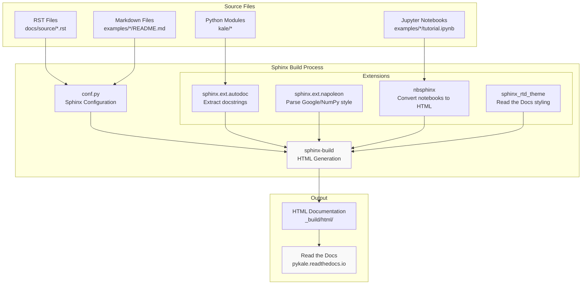
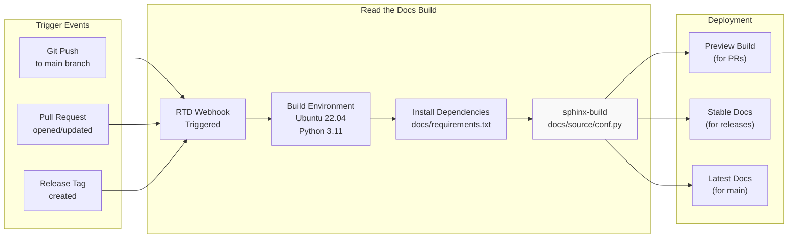
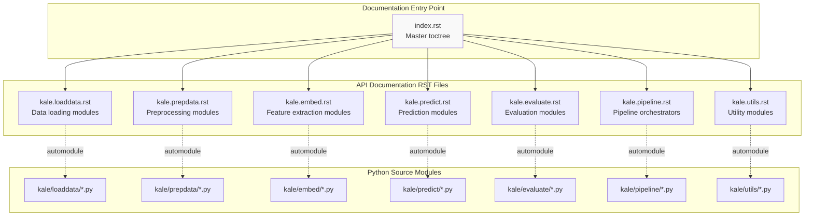
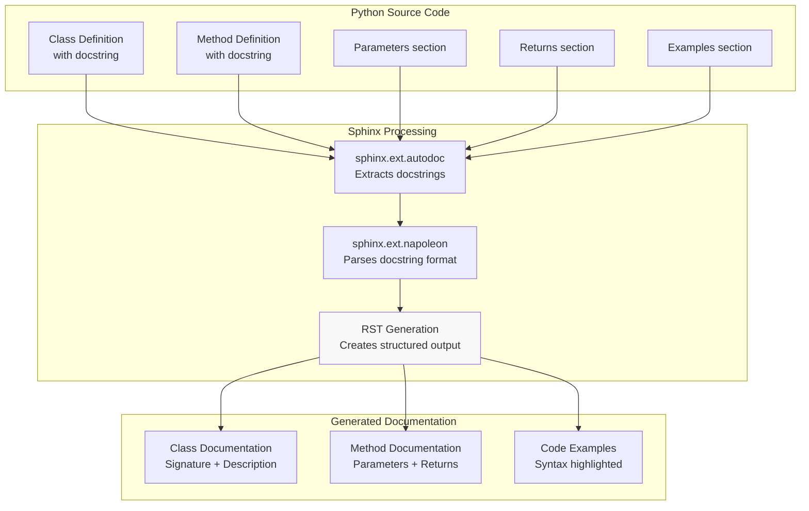
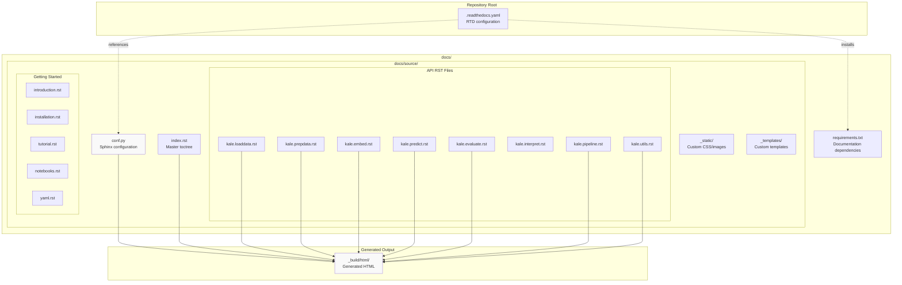

<!-- source: DeepWiki mcp.deepwiki.com · repo pykale/pykale · page 6.3 Documentation System · fetched 2026-10-21 -->

# Documentation System

<details>
<summary>Relevant source files</summary>

The following files were used as context for generating this wiki page:

- [.github/workflows/stale.yml](.github/workflows/stale.yml)
- [.readthedocs.yaml](.readthedocs.yaml)
- [docs/requirements.txt](docs/requirements.txt)
- [docs/source/conf.py](docs/source/conf.py)
- [docs/source/index.rst](docs/source/index.rst)
- [docs/source/kale.embed.rst](docs/source/kale.embed.rst)
- [docs/source/kale.evaluate.rst](docs/source/kale.evaluate.rst)
- [docs/source/kale.loaddata.rst](docs/source/kale.loaddata.rst)
- [docs/source/kale.pipeline.rst](docs/source/kale.pipeline.rst)
- [docs/source/kale.predict.rst](docs/source/kale.predict.rst)
- [docs/source/kale.prepdata.rst](docs/source/kale.prepdata.rst)
- [docs/source/kale.utils.rst](docs/source/kale.utils.rst)

</details>


## Purpose and Scope

This page documents PyKale's Sphinx-based documentation system, including configuration, API documentation generation, Jupyter notebook integration, and Read the Docs deployment. For information about CI/CD workflows that validate documentation builds, see [CI/CD Pipeline](#6.2). For contributing guidelines related to documentation, see [Contributing Guidelines](#6.4).

## Overview

PyKale uses **Sphinx 8.1.3** as its documentation generator, with automatic deployment to Read the Docs. The system automatically generates API documentation from Python docstrings and integrates executable Jupyter notebooks as tutorials. The documentation follows the library's pipeline structure (loaddata → prepdata → embed → predict → evaluate) for intuitive navigation.



**Sources:** [docs/source/conf.py:1-94](), [docs/requirements.txt:1-39](), [.readthedocs.yaml:1-26]()

## Sphinx Configuration

The Sphinx configuration is defined in [docs/source/conf.py:1-94](). Key configuration aspects include:

### Project Metadata

The documentation dynamically extracts the version number from the main package:

[docs/source/conf.py:21-35]()

| Configuration | Value | Purpose |
|--------------|-------|---------|
| `project` | "PyKale" | Project name displayed in documentation |
| `copyright` | "2020 - 2025 PyKale Contributors" | Copyright notice |
| `version`/`release` | Extracted from `kale/__init__.py` | Automatic version synchronization |

### Extension Configuration

[docs/source/conf.py:54-65]()

| Extension | Purpose |
|-----------|---------|
| `sphinx.ext.autodoc` | Automatically generates documentation from docstrings |
| `sphinx.ext.napoleon` | Parses Google and NumPy style docstrings |
| `sphinx.ext.autosummary` | Generates summary tables for modules |
| `sphinx.ext.intersphinx` | Links to other Sphinx documentation (e.g., PyTorch) |
| `sphinx.ext.mathjax` | Renders mathematical equations |
| `nbsphinx` | Converts Jupyter notebooks to documentation pages |
| `nbsphinx_link` | Links to external notebook files |
| `sphinx_rtd_theme` | Applies Read the Docs theme |
| `recommonmark` | Parses Markdown files |
| `sphinx_markdown_tables` | Renders Markdown tables |

### Autodoc Settings

[docs/source/conf.py:85-88]()

- `autodoc_member_order = "bysource"`: Members are documented in source code order rather than alphabetically
- `autodoc_inherit_docstrings = False`: Disables automatic docstring inheritance from parent classes

**Sources:** [docs/source/conf.py:1-94]()

## Read the Docs Integration

PyKale's documentation is automatically built and hosted on Read the Docs using the configuration in [.readthedocs.yaml:1-26]().



### Build Configuration

[.readthedocs.yaml:12-15]()

- **Operating System**: Ubuntu 22.04
- **Python Version**: 3.11 (matches CI/CD testing matrix)
- **Configuration File**: [docs/source/conf.py:9]()

### Dependency Installation

[.readthedocs.yaml:23-25]()

Dependencies are installed from [docs/requirements.txt:1-39](), which includes:

**Core Documentation Tools:**
- `sphinx==8.1.3` - Fixed version for stability
- `sphinx-rtd-theme` - Read the Docs theme
- `nbsphinx` - Jupyter notebook integration
- `nbsphinx-link` - External notebook linking
- `recommonmark` - Markdown parsing
- `sphinx-markdown-tables` - Markdown table support

**PyKale Dependencies:**
- PyTorch 2.6.0+cpu (Linux wheel)
- PyTorch Geometric 2.6.0 (torch-scatter, torch-sparse)
- Scientific computing: `numpy`, `pandas`, `scikit-learn`, `scikit-image`
- Domain-specific: `rdkit`, `pydicom`, `PyTDC`, `pytorch-lightning`

**Special Considerations:**
[docs/requirements.txt:7-9]()

PyTorch Geometric extensions are installed from specific wheel URLs to ensure compatibility with the CPU-only PyTorch build.

**Sources:** [.readthedocs.yaml:1-26](), [docs/requirements.txt:1-39]()

## API Documentation Structure

The API documentation is organized following PyKale's pipeline architecture, with one RST file per top-level module.



### Master Index Structure

[docs/source/index.rst:1-78]()

The master index organizes documentation into three main sections:

1. **Getting Started** (lines 11-18): Introduction, installation, tutorials, notebooks, YAML configuration
2. **Kale API** (lines 20-31): Seven core API modules in pipeline order
3. **Example Projects** (lines 36-51): Links to 12+ example applications on GitHub

### Module Documentation Pattern

Each module RST file follows a consistent pattern. Example from [docs/source/kale.embed.rst:1-171]():

```
Embed
==================

Submodules
----------

kale.embed.attention module
--------------------------------

.. automodule:: kale.embed.attention
   :members:
   :undoc-members:
   :show-inheritance:
```

The `automodule` directive generates documentation from Python docstrings with options:
- `:members:` - Include all public members
- `:undoc-members:` - Include members without docstrings
- `:show-inheritance:` - Show base classes

### Selective Documentation

Some modules exclude specific members to avoid cluttering the documentation:

[docs/source/kale.embed.rst:40]()
```rst
:exclude-members: message, update
```

This excludes PyTorch Geometric's internal `message` and `update` methods from GCN documentation.

**Sources:** [docs/source/index.rst:1-78](), [docs/source/kale.embed.rst:1-171](), [docs/source/kale.loaddata.rst:1-170](), [docs/source/kale.prepdata.rst:1-88](), [docs/source/kale.pipeline.rst:1-97](), [docs/source/kale.predict.rst:1-49](), [docs/source/kale.evaluate.rst:1-48](), [docs/source/kale.utils.rst:1-73]()

## Autodoc Integration with Python Code

The `autodoc` extension automatically extracts documentation from Python docstrings. The system uses Napoleon to support both Google and NumPy style docstrings.



### Example: Module Documentation

A typical module RST file like [docs/source/kale.embed.rst:42-48]() documents the `image_cnn` module:

```rst
kale.embed.image\_cnn module
----------------------------

.. automodule:: kale.embed.image_cnn
   :members:
   :undoc-members:
   :show-inheritance:
```

This generates documentation for all classes in `kale/embed/image_cnn.py`, including:
- `SmallCNNBase`
- `SmallCNN`
- `SmallCNNFeature`
- `LeNetBase`
- `LeNetFeature`
- Function `get_resnet()`

### Example: Complex Module with Submodules

The video embedding module demonstrates hierarchical documentation [docs/source/kale.embed.rst:116-162]():

```rst
kale.embed.video.feature\_extractor module
-------------------------------------------

.. automodule:: kale.embed.video.feature_extractor
   :members:
   :undoc-members:
   :show-inheritance:

kale.embed.video.i3d module
----------------------------

.. automodule:: kale.embed.video.i3d
   :members:
   :undoc-members:
   :show-inheritance:
```

This documents the entire `kale/embed/video/` package with separate sections for each submodule.

**Sources:** [docs/source/conf.py:54-65](), [docs/source/kale.embed.rst:1-171]()

## Jupyter Notebook Integration

PyKale integrates Jupyter notebooks into the documentation using `nbsphinx` and `nbsphinx-link`. Notebooks serve as executable tutorials that demonstrate library functionality.

### Notebook Linking Strategy

The master index links to notebook examples on GitHub rather than embedding them directly:

[docs/source/index.rst:36-51]()

```rst
.. toctree::
   :maxdepth: 1
   :caption: Example Projects

   Action Video - Domain Adaptation <https://github.com/pykale/pykale/tree/main/examples/action_dann>
   BindingDB - DeepDTA <https://github.com/pykale/pykale/tree/main/examples/bindingdb_deepdta>
   CardiacMRI - MPCA <https://github.com/pykale/pykale/tree/main/examples/cmri_mpca>
```

This approach provides:
- Direct access to runnable code
- Reduced documentation build time
- Up-to-date examples (no sync issues)
- Access to associated configuration files and data

### Nbsphinx Configuration

[docs/source/conf.py:60-61]()

The `nbsphinx` and `nbsphinx_link` extensions enable notebook processing. Additional configuration:

[docs/source/conf.py:73]()
```python
exclude_patterns = ["_build", "**.ipynb_checkpoints"]
```

This prevents Jupyter checkpoint files from being processed during builds.

### Notebook Requirements

Notebooks can be executed during documentation builds. Dependencies required for notebook execution are included in [docs/requirements.txt:1-39]():

- `ipython` - IPython kernel
- `nbsphinx` - Notebook to HTML conversion
- All PyKale dependencies needed by examples

**Sources:** [docs/source/conf.py:60-61](), [docs/source/conf.py:73](), [docs/source/index.rst:36-51](), [docs/requirements.txt:11-14]()

## Documentation File Organization



### Directory Structure

| Path | Purpose |
|------|---------|
| `.readthedocs.yaml` | Read the Docs configuration |
| `docs/requirements.txt` | Documentation build dependencies |
| `docs/source/conf.py` | Sphinx configuration |
| `docs/source/index.rst` | Master table of contents |
| `docs/source/kale.*.rst` | API documentation for each module |
| `docs/source/_static/` | Custom CSS, images, static assets |
| `docs/source/_templates/` | Custom Jinja2 templates |
| `docs/source/_build/` | Generated HTML output (not committed) |

### API Documentation Files

Each RST file corresponds to a top-level PyKale module:

| RST File | Python Package | Line Count |
|----------|---------------|------------|
| `kale.loaddata.rst` | `kale/loaddata/` | 170 lines |
| `kale.prepdata.rst` | `kale/prepdata/` | 88 lines |
| `kale.embed.rst` | `kale/embed/` | 171 lines |
| `kale.predict.rst` | `kale/predict/` | 49 lines |
| `kale.evaluate.rst` | `kale/evaluate/` | 48 lines |
| `kale.pipeline.rst` | `kale/pipeline/` | 97 lines |
| `kale.utils.rst` | `kale/utils/` | 73 lines |

**Sources:** [.readthedocs.yaml:1-26](), [docs/source/conf.py:1-94](), [docs/source/index.rst:1-78]()

## Building Documentation Locally

Developers can build documentation locally to preview changes before committing.

### Prerequisites

Install documentation dependencies:

```bash
pip install -r docs/requirements.txt
```

This installs Sphinx 8.1.3, theme, extensions, and all PyKale dependencies needed for autodoc.

### Build Commands

From the repository root:

```bash
# Build HTML documentation
cd docs
make html

# View built documentation
open _build/html/index.html  # macOS
xdg-open _build/html/index.html  # Linux
start _build/html/index.html  # Windows
```

### Clean Build

To rebuild documentation from scratch:

```bash
cd docs
make clean
make html
```

This removes the `_build/` directory and regenerates all documentation files.

### Common Build Issues

| Issue | Solution |
|-------|----------|
| Import errors for `kale` modules | Install PyKale in development mode: `pip install -e .` |
| Missing PyTorch Geometric | Install PyG: `pip install torch-geometric` |
| Sphinx version mismatch | Use exact version: `pip install sphinx==8.1.3` |
| Notebook execution errors | Ensure all notebook dependencies are installed |

### Continuous Documentation Development

For rapid iteration during documentation writing:

```bash
# Use sphinx-autobuild for live reloading
pip install sphinx-autobuild
cd docs
sphinx-autobuild source _build/html
```

This starts a local server that automatically rebuilds and refreshes when RST files change.

**Sources:** [docs/requirements.txt:1-39](), [docs/source/conf.py:1-94]()

## Documentation Testing in CI/CD

Documentation builds are not explicitly tested in the CI/CD pipeline, but the dependencies and environment match the Read the Docs build:

| Configuration | CI/CD (Testing) | Read the Docs |
|--------------|----------------|---------------|
| Python Version | 3.10, 3.11, 3.12 | 3.11 |
| OS | Ubuntu 22.04 | Ubuntu 22.04 |
| PyTorch | 2.6.0+cpu | 2.6.0+cpu |
| PyG | 2.6.0 | 2.6.0 |
| Sphinx | Not tested | 8.1.3 |

The CI/CD pipeline validates that:
1. Python code can be imported (required for autodoc)
2. Docstrings are syntactically valid
3. Example notebooks execute without errors (via `pytest --nbmake`)

These checks ensure that documentation generation will succeed on Read the Docs.

**Sources:** [.readthedocs.yaml:12-15](), [docs/requirements.txt:7-10]()

## Maintenance Considerations

### Sphinx Version Pinning

[docs/requirements.txt:27]()
```
sphinx==8.1.3 # 8.1.3 works with nbsphinx and should be updated when nbsphinx is updated.
```

Sphinx is pinned to version 8.1.3 for compatibility with `nbsphinx`. This should be updated carefully to ensure notebook rendering continues to work correctly.

### Dependency Wheel URLs

[docs/requirements.txt:7-9]()

PyTorch Geometric extensions use specific wheel URLs. These URLs must be updated when:
- PyTorch version changes
- PyG version changes
- Python version changes
- Build platform changes

### Adding New Modules

When adding a new top-level module to PyKale:

1. Create a new RST file in `docs/source/` (e.g., `kale.newmodule.rst`)
2. Add `automodule` directives for each submodule
3. Add the RST file to the master index [docs/source/index.rst:20-31]()
4. Rebuild documentation to verify

### Example Projects

Example projects are linked rather than embedded. When adding new examples:

1. Add a link in [docs/source/index.rst:36-51]()
2. Ensure the example has a README.md explaining usage
3. Optionally include a tutorial notebook
4. Verify the link works on Read the Docs

**Sources:** [docs/requirements.txt:27](), [docs/requirements.txt:7-9](), [docs/source/index.rst:20-51]()

---

