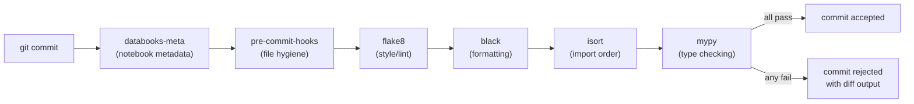
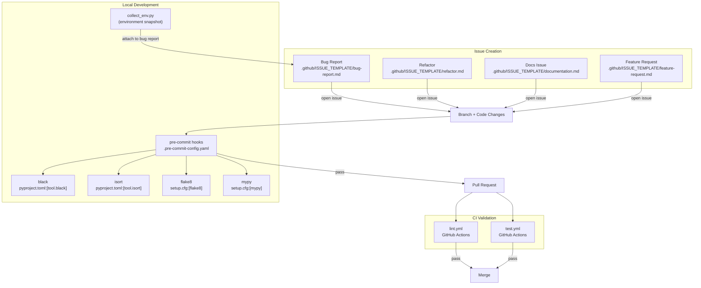

<!-- source: DeepWiki mcp.deepwiki.com · repo pykale/pykale · page 6.4 Contributing Guidelines · fetched 2026-10-21 -->

# Contributing Guidelines

<details>
<summary>Relevant source files</summary>

The following files were used as context for generating this wiki page:

- [.github/ISSUE_TEMPLATE/bug-report.md](.github/ISSUE_TEMPLATE/bug-report.md)
- [.github/ISSUE_TEMPLATE/documentation.md](.github/ISSUE_TEMPLATE/documentation.md)
- [.github/ISSUE_TEMPLATE/feature-request.md](.github/ISSUE_TEMPLATE/feature-request.md)
- [.github/ISSUE_TEMPLATE/refactor.md](.github/ISSUE_TEMPLATE/refactor.md)
- [.pre-commit-config.yaml](.pre-commit-config.yaml)
- [kale/utils/print.py](kale/utils/print.py)
- [pyproject.toml](pyproject.toml)
- [setup.cfg](setup.cfg)
- [tests/__init__.py](tests/__init__.py)
- [tests/utils/test_print.py](tests/utils/test_print.py)

</details>


This page documents the contribution workflow for PyKale: how to report issues, what environment information to collect, and what code quality standards contributions must meet. For information about the automated CI/CD pipelines that validate contributions after they are submitted, see [CI/CD Pipeline](#6.2). For information about how to build documentation, see [Documentation System](#6.3). For information about writing and running tests, see [Testing Framework](#6.1).

---

## Issue Templates

PyKale provides four structured issue templates under `.github/ISSUE_TEMPLATE/`. Each template pre-fills a label and title prefix so issues are triaged automatically.

| Template File | Label | Title Prefix | Purpose |
|---|---|---|---|
| `bug-report.md` | `bug` | `[Bug]` | Report a defect or unexpected behavior |
| `refactor.md` | `refactor` | `[Refactor]` | Propose an internal improvement or speedup |
| `documentation.md` | `documentation` | `[Docs]` | Report missing, wrong, or incomplete docs |
| `feature-request.md` | `enhancement` | `[Feature Request]` | Propose a new capability |

Sources: [.github/ISSUE_TEMPLATE/bug-report.md:1-8](), [.github/ISSUE_TEMPLATE/refactor.md:1-8](), [.github/ISSUE_TEMPLATE/documentation.md:1-8](), [.github/ISSUE_TEMPLATE/feature-request.md:1-8]()

---

### Bug Report Template

The bug report template ([.github/ISSUE_TEMPLATE/bug-report.md:1-63]()) requires the following sections:

| Section | Content |
|---|---|
| **Bug description** | Clear, concise description of what is wrong |
| **To reproduce** | Numbered steps or a self-contained Python snippet |
| **Stack trace/error message** | Verbatim terminal output |
| **Expected Behaviour** | What should happen instead |
| **Environment** | Output of `collect_env.py` or manual checklist |
| **Additional context** | Screenshots, related issues, etc. |

#### Environment Collection with `collect_env.py`

The bug template instructs reporters to run PyTorch's `collect_env.py` script:

```
wget https://raw.githubusercontent.com/pytorch/pytorch/main/torch/utils/collect_env.py
python collect_env.py
```

This script reports the following fields automatically:

| Field | Example |
|---|---|
| PyTorch version | `2.1.0` |
| OS | `Linux` |
| PyTorch install method | `pip` |
| Python version | `3.11` |
| CUDA / cuDNN version | `11.8 / 8.7` |
| GPU model | `NVIDIA A100` |

If the script cannot be run, reporters fill the same fields manually in the template checklist at [.github/ISSUE_TEMPLATE/bug-report.md:51-59]().

Sources: [.github/ISSUE_TEMPLATE/bug-report.md:39-59]()

---

### Refactor Template

The refactor template ([.github/ISSUE_TEMPLATE/refactor.md:1-16]()) is intentionally minimal. It asks the proposer to address four bullet points:

- Which modules will be modified
- Impact on code structure
- Impact on speed
- Whether the change is breaking

Sources: [.github/ISSUE_TEMPLATE/refactor.md:10-16]()

---

### Documentation Template

The documentation template ([.github/ISSUE_TEMPLATE/documentation.md:1-24]()) prompts reporters to identify:

- Missing or incomplete module documentation
- Incorrect documentation
- Features that need example code

It links to the live `pykale.readthedocs.io` site and encourages pull requests.

Sources: [.github/ISSUE_TEMPLATE/documentation.md:1-24]()

---

### Feature Request Template

The feature request template ([.github/ISSUE_TEMPLATE/feature-request.md:1-31]()) requires:

| Section | Content |
|---|---|
| **Motivation** | The problem the feature solves; links to related issues or PRs |
| **Pitch** | The desired solution |
| **Alternatives** | Other approaches considered |
| **Willingness to PR** | Whether the requester will open a pull request |

Sources: [.github/ISSUE_TEMPLATE/feature-request.md:1-31]()

---

## Pre-commit Hooks

All code contributions must pass the pre-commit hooks defined in `.pre-commit-config.yaml`. The hooks run automatically before each commit when pre-commit is installed, and they are also enforced by the `lint` GitHub Actions workflow (see [CI/CD Pipeline](#6.2)).

**Pre-commit Hook Execution Flow**



Sources: [.pre-commit-config.yaml:1-48]()

---

### Hook Details

The following table lists every hook configured in [.pre-commit-config.yaml:1-48]():

| Hook ID | Source Repo | Version | What It Checks |
|---|---|---|---|
| `databooks-meta` | `datarootsio/databooks` | `1.3.7` | Cleans Jupyter notebook metadata |
| `check-added-large-files` | `pre-commit/pre-commit-hooks` | `v3.4.0` | Rejects files over 300 KB |
| `check-byte-order-marker` | `pre-commit/pre-commit-hooks` | `v3.4.0` | No BOM in text files |
| `check-case-conflict` | `pre-commit/pre-commit-hooks` | `v3.4.0` | Case-insensitive filename conflicts |
| `check-merge-conflict` | `pre-commit/pre-commit-hooks` | `v3.4.0` | No unresolved merge markers |
| `end-of-file-fixer` | `pre-commit/pre-commit-hooks` | `v3.4.0` | Ensures files end with a newline |
| `forbid-new-submodules` | `pre-commit/pre-commit-hooks` | `v3.4.0` | Blocks adding git submodules |
| `mixed-line-ending` | `pre-commit/pre-commit-hooks` | `v3.4.0` | Normalizes line endings |
| `trailing-whitespace` | `pre-commit/pre-commit-hooks` | `v3.4.0` | Removes trailing spaces |
| `debug-statements` | `pre-commit/pre-commit-hooks` | `v3.4.0` | Rejects `pdb`, `breakpoint()` |
| `check-yaml` | `pre-commit/pre-commit-hooks` | `v3.4.0` | Validates YAML (excludes `.conda/meta.yaml`) |
| `requirements-txt-fixer` | `pre-commit/pre-commit-hooks` | `v3.4.0` | Sorts `requirements.txt` |
| `flake8` | `pycqa/flake8` | `6.1.0` | PEP 8 lint (excludes `examples/`) |
| `black` | `psf/black` | `23.11.0` | Opinionated code formatting |
| `isort` | `pycqa/isort` | `5.11.2` | Import statement ordering |
| `mypy` | `pre-commit/mirrors-mypy` | `v1.5.0` | Static type checking |

Sources: [.pre-commit-config.yaml:1-48]()

---

### Tool Configuration

Each formatting and linting tool is configured in `pyproject.toml` or `setup.cfg`.

**Black** ([pyproject.toml:9-12]())

| Setting | Value |
|---|---|
| `line-length` | `120` |
| `target-version` | `py311` |

**isort** ([pyproject.toml:14-30]())

| Setting | Value |
|---|---|
| `profile` | `black` (compatible with Black's import style) |
| `line_length` | `120` |
| `known_first_party` | `docs`, `examples`, `kale`, `tests` |
| `force_sort_within_sections` | `False` |
| `order_by_type` | `False` |

**flake8** ([setup.cfg:7-13]())

| Setting | Value |
|---|---|
| `max-line-length` | `120` |
| `exclude` | `build`, `examples` |
| `ignore` | `E203`, `E501`, `W503` |

- `E203`: whitespace before `:` — conflicts with Black
- `E501`: line too long — long docstring lines are acceptable
- `W503`: line break before binary operator — incompatible with PEP 8

**mypy** ([setup.cfg:15-17]())

| Setting | Value |
|---|---|
| `ignore_missing_imports` | `True` |

Sources: [pyproject.toml:9-30](), [setup.cfg:7-17]()

---

### Installing Pre-commit Hooks

To enable hooks locally, install the `pre-commit` package (included in the `dev` dependency group) and run:

```
pre-commit install
```

After installation, all hooks run automatically on `git commit`. To run all hooks manually against the entire codebase:

```
pre-commit run --all-files
```

---

## Contribution Workflow

The diagram below maps the full lifecycle of a contribution from initial idea to merged code, noting which files govern each step.

**Contribution Workflow: Issues → Code → Review**



Sources: [.pre-commit-config.yaml:1-48](), [pyproject.toml:9-30](), [setup.cfg:7-17](), [.github/ISSUE_TEMPLATE/bug-report.md:1-63](), [.github/ISSUE_TEMPLATE/feature-request.md:1-31]()

---

## Code Quality Standards Summary

The following standards are enforced automatically and are not optional:

| Standard | Tool | Config Location | Scope |
|---|---|---|---|
| Code formatting | `black 23.11.0` | `pyproject.toml` | All `*.py` except examples |
| Import ordering | `isort 5.11.2` | `pyproject.toml` | All `*.py` |
| Style lint | `flake8 6.1.0` | `setup.cfg` | All `*.py` except `examples/` |
| Type checking | `mypy v1.5.0` | `setup.cfg` | All `*.py` |
| Notebook metadata | `databooks 1.3.7` | `.pre-commit-config.yaml` | `*.ipynb` |
| File size | `check-added-large-files` | `.pre-commit-config.yaml` | All files (max 300 KB) |
| No debug code | `debug-statements` | `.pre-commit-config.yaml` | All `*.py` |

Sources: [.pre-commit-config.yaml:1-48](), [pyproject.toml:9-30](), [setup.cfg:1-23]()