# Page: Overview

# Overview

<details>
<summary>Relevant source files</summary>

The following files were used as context for generating this wiki page:

- [.github/ISSUE_TEMPLATE/action-fail.md](.github/ISSUE_TEMPLATE/action-fail.md)
- [.github/workflows/test.yml](.github/workflows/test.yml)
- [README.md](README.md)
- [docs/source/index.rst](docs/source/index.rst)
- [docs/source/installation.md](docs/source/installation.md)
- [docs/source/kale.embed.rst](docs/source/kale.embed.rst)
- [docs/source/kale.evaluate.rst](docs/source/kale.evaluate.rst)
- [docs/source/kale.loaddata.rst](docs/source/kale.loaddata.rst)
- [docs/source/kale.pipeline.rst](docs/source/kale.pipeline.rst)
- [docs/source/kale.predict.rst](docs/source/kale.predict.rst)
- [docs/source/kale.prepdata.rst](docs/source/kale.prepdata.rst)
- [docs/source/kale.utils.rst](docs/source/kale.utils.rst)
- [examples/video_loading/README.md](examples/video_loading/README.md)
- [setup.py](setup.py)

</details>


This page introduces PyKale: its purpose, design principles, supported application domains, and repository structure. It is the entry point for this wiki. For installation steps, see [Installation and Setup](#1.1). For a detailed description of the seven-module pipeline API, see [Core Pipeline Architecture](#1.2).

---

## What Is PyKale

PyKale (`pykale` on PyPI) is a Python library in the PyTorch ecosystem for **multimodal learning** and **transfer learning** on graphs, images, and videos. It targets interdisciplinary research by providing a unified, pipeline-based API that reduces boilerplate and encourages reuse of components across problem domains.

The library is described in the `setup.py` metadata as:

> "Knowledge-aware machine learning from multiple sources in Python"

PyKale supports Python 3.10, 3.11, and 3.12, and depends on PyTorch, PyTorch Lightning, scikit-learn, and scipy as core runtime dependencies. See [setup.py:17-26]() for the full `install_requires` list.

Sources: [README.md:1-35](), [setup.py:113-152]()

---

## Design Philosophy

PyKale is guided by three "green ML" principles applied to software:

| Principle | Meaning in PyKale |
|-----------|-------------------|
| **Reduce** | Eliminate repetitive boilerplate across ML workflows |
| **Reuse** | Share modules across tasks and modalities via a common API |
| **Recycle** | Transfer learned models and components across application areas |

These principles are enforced structurally through the pipeline-based API: every application maps onto the same sequence of stages (`loaddata → prepdata → embed → predict → evaluate → interpret`), with `kale.pipeline` providing pre-built trainer classes that combine these stages using PyTorch Lightning.

Sources: [README.md:28-48]()

---

## Supported Application Domains

| Domain | Key Algorithms / Tasks |
|--------|------------------------|
| Domain Adaptation (images) | DANN, CDAN, WDGRL, DAN, JAN, M3SDA, MFSAN |
| Domain Adaptation (video) | DANN/MMD variants for RGB + optical flow |
| Few-Shot Learning | Prototypical Networks |
| Drug Discovery | DeepDTA, DrugBAN (bilinear attention), GripNet |
| Medical Imaging | Cardiac MRI classification via MPCA |
| Multi-omics | MOGONET (GCN + VCDN) |
| Graph Analysis | GripNet on polypharmacy side-effect graphs |
| Uncertainty Quantification | Landmark localization with Jaccard binning |
| Multimodal / AV | AVMNIST, multimodal VAE |

Sources: [docs/source/index.rst:39-51](), [README.md:28-48]()

---

## Repository Structure

The top-level repository is organized as follows:

```
pykale/
├── kale/              # Core library (the pip-installable package)
│   ├── loaddata/      # Data loading
│   ├── prepdata/      # Preprocessing / transforms
│   ├── embed/         # Feature extraction / encoders
│   ├── predict/       # Prediction heads / decoders
│   ├── evaluate/      # Metrics and cross-validation
│   ├── interpret/     # Visualization and weight analysis
│   ├── pipeline/      # End-to-end trainer classes
│   └── utils/         # Shared utilities (download, seed, logging)
├── examples/          # Runnable example scripts and notebooks
├── tests/             # pytest test suite
└── docs/              # Sphinx documentation source
```

The `kale/` package is what gets installed. `examples/` contains standalone applications that import from `kale/`. `tests/` mirrors the `kale/` structure with files named `test_<module>.py`.

Sources: [setup.py:127-128](), [docs/source/index.rst:1-70]()

---

## The Seven-Module Pipeline

**Module pipeline — ordered data flow with `kale.pipeline` as orchestrator**

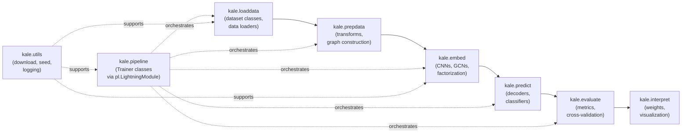

Each module in `kale/` corresponds directly to one stage of an ML pipeline:

| Module | Directory | Primary Responsibility |
|--------|-----------|------------------------|
| `kale.loaddata` | `kale/loaddata/` | Load raw data from disk or remote sources |
| `kale.prepdata` | `kale/prepdata/` | Apply transforms to prepare data for models |
| `kale.embed` | `kale/embed/` | Extract or learn feature representations |
| `kale.predict` | `kale/predict/` | Map embeddings to predictions |
| `kale.evaluate` | `kale/evaluate/` | Compute performance metrics |
| `kale.interpret` | `kale/interpret/` | Visualize and explain model outputs |
| `kale.pipeline` | `kale/pipeline/` | Assemble stages into trainable workflows |
| `kale.utils` | `kale/utils/` | Cross-cutting utilities (no ML logic) |

Sources: [README.md:40-48](), [docs/source/index.rst:21-32]()

---

## Module–File Mapping

**Key source files per module**

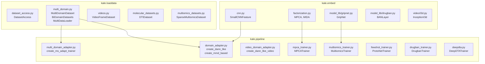

Sources: [docs/source/kale.loaddata.rst:1-170](), [docs/source/kale.embed.rst:1-171](), [docs/source/kale.pipeline.rst:1-97]()

---

## Dependency Groups

PyKale uses optional dependency groups in `setup.py` to keep the base install lightweight:

| Install Option | Command | What It Adds |
|----------------|---------|--------------|
| core | `pip install pykale` | NumPy, pandas, PyTorch, scikit-learn, scipy, tensorly, pytorch-lightning |
| graph | `pip install pykale[graph]` | networkx, PyTDC |
| image | `pip install pykale[image]` | pydicom, scikit-image, pylibjpeg, python-gdcm |
| example | `pip install pykale[example]` | matplotlib, seaborn, yacs, nilearn, rdkit, captum, and others |
| full | `pip install pykale[full]` | graph + image + example |
| dev | `pip install pykale[dev]` | full + pytest, Sphinx, black, flake8, mypy, nbmake |

Two dependencies must be installed **manually before** installing PyKale:
- [PyTorch](https://pytorch.org/get-started/locally/) — to match your hardware (CPU/GPU/CUDA version)
- [PyTorch Geometric](https://github.com/pyg-team/pytorch_geometric) — required for any graph-based functionality

Sources: [setup.py:17-92](), [docs/source/installation.md:1-57]()

---

## Example Projects

The `examples/` directory contains self-contained applications. Each example follows a consistent pattern: a `main.py` entry point, a YAML configuration file loaded via `yacs`, and optional Jupyter notebook tutorials.

| Example Directory | Task | Key PyKale Modules |
|-------------------|------|--------------------|
| `examples/digits_dann/` | Image domain adaptation | `loaddata.multi_domain`, `pipeline.domain_adapter` |
| `examples/action_dann/` | Video domain adaptation | `loaddata.video_multi_domain`, `pipeline.video_domain_adapter` |
| `examples/cmri_mpca/` | Cardiac MRI classification | `loaddata.image_access`, `embed.factorization`, `pipeline.mpca_trainer` |
| `examples/multiomics_mogonet/` | Multi-omics classification | `loaddata.multiomics_datasets`, `pipeline.multiomics_trainer` |
| `examples/polypharmacy_gripnet/` | Drug side-effect prediction | `prepdata.supergraph_construct`, `embed.model_lib.gripnet` |
| `examples/bindingdb_deepdta/` | Drug-target interaction | `loaddata.tdc_datasets`, `pipeline.deepdta` |
| `examples/fewshot_protonet/` | Few-shot classification | `loaddata.few_shot`, `pipeline.fewshot_trainer` |
| `examples/office_multisource_adapt/` | Multi-source DA | `loaddata.multi_domain`, `pipeline.multi_domain_adapter` |

Sources: [docs/source/index.rst:39-51]()

---

## Related Wiki Pages

- **[Installation and Setup](#1.1)** — pip and source install instructions, optional dependency groups, PyTorch/PyG prerequisites.
- **[Core Pipeline Architecture](#1.2)** — detailed description of how the seven modules interact, including the `kale.pipeline` orchestration layer.
- **[Pipeline API Reference](#2)** — full API reference for all `kale` submodules.
- **[Domain Adaptation](#3)** — the most developed area; covers single-source, multi-source, and video DA.
- **[Examples and Tutorials](#5)** — walkthroughs of runnable examples including configuration patterns.
- **[Development Guide](#6)** — contributing, testing, CI/CD, and documentation build instructions.

---

# Page: Installation and Setup

# Installation and Setup

<details>
<summary>Relevant source files</summary>

The following files were used as context for generating this wiki page:

- [.github/ISSUE_TEMPLATE/action-fail.md](.github/ISSUE_TEMPLATE/action-fail.md)
- [.github/workflows/stale.yml](.github/workflows/stale.yml)
- [.github/workflows/test.yml](.github/workflows/test.yml)
- [.readthedocs.yaml](.readthedocs.yaml)
- [README.md](README.md)
- [docs/requirements.txt](docs/requirements.txt)
- [docs/source/conf.py](docs/source/conf.py)
- [docs/source/installation.md](docs/source/installation.md)
- [examples/video_loading/README.md](examples/video_loading/README.md)
- [setup.py](setup.py)

</details>


This page documents the installation procedures, prerequisites, and environment configuration for PyKale. It covers the six installation options (core, graph, image, example, full, dev), manual prerequisite installation requirements, and environment setup for both users and developers.

For information about using PyKale's pipeline API after installation, see [Core Pipeline Architecture](#1.2). For development workflow and testing, see [Testing Framework](#6.1) and [CI/CD Pipeline](#6.2).

---

## Prerequisites

PyKale requires **Python 3.10, 3.11, or 3.12** as specified in [setup.py:128](). The following dependencies must be installed **manually before** installing PyKale, as they require hardware-specific configurations:

### Required Manual Installations

1. **PyTorch**: Must be installed first to match your hardware (CPU/CUDA). See [PyTorch installation guide](https://pytorch.org/get-started/locally/).

2. **PyTorch Geometric** (if using graph functionality): Required for graph neural network modules in `kale.embed` and `kale.loaddata`. Follow [PyG installation instructions](https://github.com/pyg-team/pytorch_geometric#installation) matching your PyTorch version.

3. **RDKit** (if using molecular data): Required for drug discovery applications. Install via:
   ```bash
   pip install rdkit
   ```

**Rationale**: These packages have binary dependencies that vary by platform and CUDA version. Manual installation ensures compatibility with your specific hardware configuration.

Sources: [docs/source/installation.md:5-9](), [setup.py:11-14](), [README.md:58]()

---

## Installation Options

PyKale provides six installation modes defined in [setup.py:130-136]() as `extras_require` groups. Each mode installs a different set of dependencies:

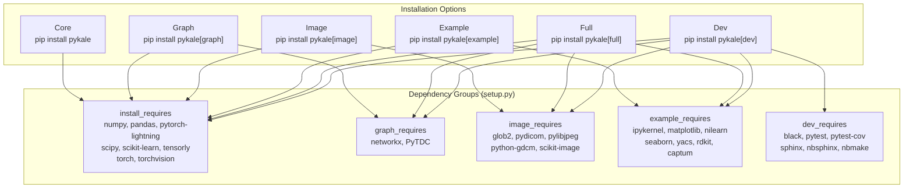

### Dependency Group Details

| Option | Command | Use Case | Key Dependencies |
|--------|---------|----------|------------------|
| **core** | `pip install pykale` | Essential PyKale functionality | numpy≥2.0.0, pytorch-lightning≥2.3.2, torch≤2.6.0, scikit-learn≥1.6.1 |
| **graph** | `pip install pykale[graph]` | Graph neural networks, drug discovery | networkx, PyTDC≤0.3.6 |
| **image** | `pip install pykale[image]` | Medical imaging (DICOM), image processing | pydicom, scikit-image≥0.24.0, python-gdcm |
| **example** | `pip install pykale[example]` | Running tutorials and examples | matplotlib≤3.10.0, yacs≥0.1.7, rdkit≥2025.3.1, captum |
| **full** | `pip install pykale[full]` | All functionality except dev tools | graph + image + example dependencies |
| **dev** | `pip install pykale[dev]` | Development and testing | full + pytest, black, sphinx, nbmake≥0.8 |

**Multiple options** can be combined with commas (no spaces):
```bash
pip install pykale[graph,image]
pip install pykale[graph,example]
```

Sources: [setup.py:16-92](), [docs/source/installation.md:32-46]()

---

## Installation Methods

### Method 1: PyPI (Stable Release)

Install the latest stable version from [PyPI](https://pypi.org/project/pykale/):

```bash
pip install pykale  # Core only
pip install pykale[graph]  # Core + graph functionality
pip install pykale[full]  # All features
```

### Method 2: From Source (Development)

Install from the GitHub repository for the latest features or development:

```bash
git clone https://github.com/pykale/pykale
cd pykale
pip install .  # Core only
pip install -e .[dev]  # Editable install with all dependencies
```

The `-e` flag creates an **editable install**, allowing code changes to take effect without reinstallation. This is essential for development.

Sources: [docs/source/installation.md:11-28](), [README.md:60-66]()

---

## Core Dependency Architecture

The following diagram maps PyKale's dependency structure from [setup.py:17-92]() to their usage in the codebase:

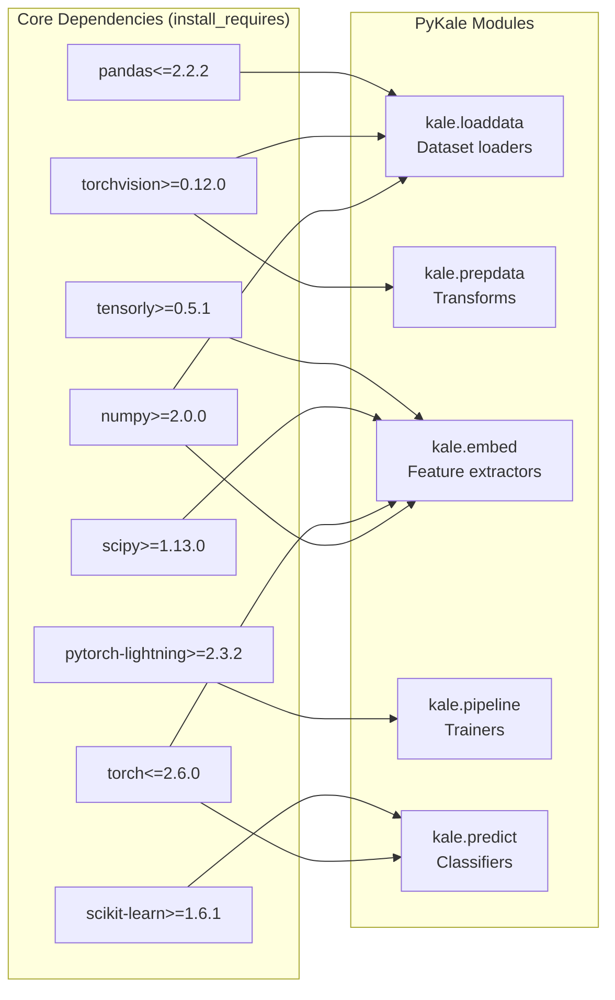

### Version Constraints

Key version constraints are defined in [setup.py:18-25]():

- **numpy≥2.0.0**: Required for NumPy 2.0+ compatibility
- **pandas≤2.2.2**: Compatibility constraint for Google Colab 1.0.0 and Torch 2.3.0
- **torch≤2.6.0**: Upper bound to ensure compatibility; update requires CI/CD changes
- **scipy≥1.13.0**: scipy 1.14.0+ requires Python 3.10+
- **matplotlib≤3.10.0**: Version 3.10.1 causes build errors in tests

Sources: [setup.py:17-26]()

---

## CI/CD Environment Setup

The GitHub Actions test workflow in [.github/workflows/test.yml]() demonstrates a reproducible installation procedure used for automated testing. This serves as a reference for setting up development environments.

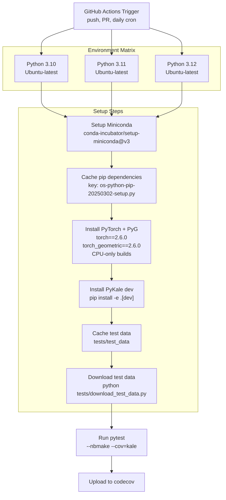

### CI/CD Installation Steps

The test workflow [.github/workflows/test.yml:57-74]() installs dependencies in this order:

1. **RDKit and utilities** (lines 59-61):
   ```bash
   pip install rdkit
   pip install gdown
   pip install pyparsing==3.2.0
   pip install numpy>=2.0.0
   ```

2. **PyTorch 2.6.0 CPU** (line 63):
   ```bash
   pip install torch==2.6.0 torchvision==0.21.0 torchaudio==2.6.0 --index-url https://download.pytorch.org/whl/cpu
   ```

3. **PyTorch Geometric 2.6.0** (lines 64-68):
   ```bash
   pip install torch_scatter==2.1.2 -f https://data.pyg.org/whl/torch-2.6.0+cpu.html
   pip install torch_sparse==0.6.18 -f https://data.pyg.org/whl/torch-2.6.0+cpu.html
   pip install torch_cluster==1.6.3 -f https://data.pyg.org/whl/torch-2.6.0+cpu.html
   pip install torch_spline_conv==1.2.2 -f https://data.pyg.org/whl/torch-2.6.0+cpu.html
   pip install torch_geometric==2.6.0
   ```

4. **PyKale with dev dependencies** (line 73):
   ```bash
   pip install --no-build-isolation -e .[dev]
   ```

### Caching Strategy

The workflow uses two caching mechanisms to reduce build time:

1. **Pip cache** [.github/workflows/test.yml:42-55]():
   - Key: `${{ runner.os }}-python${{ matrix.python-version }}-pip-20250302-${{ hashFiles('**/setup.py') }}`
   - Soft matching: Restores cache even if `setup.py` changed, then updates incrementally
   - Date tag (`20250302`): Updated manually after major dependency changes

2. **Test data cache** [.github/workflows/test.yml:76-84]():
   - Key: `${{ runner.os }}-python${{ matrix.python-version }}-data-${{ hashFiles('tests/download_test_data.py') }}`
   - Strict matching: Updates only when download script changes

Sources: [.github/workflows/test.yml:1-110]()

---

## Documentation Build Environment

Read the Docs uses a separate configuration defined in [.readthedocs.yaml:1-26]():

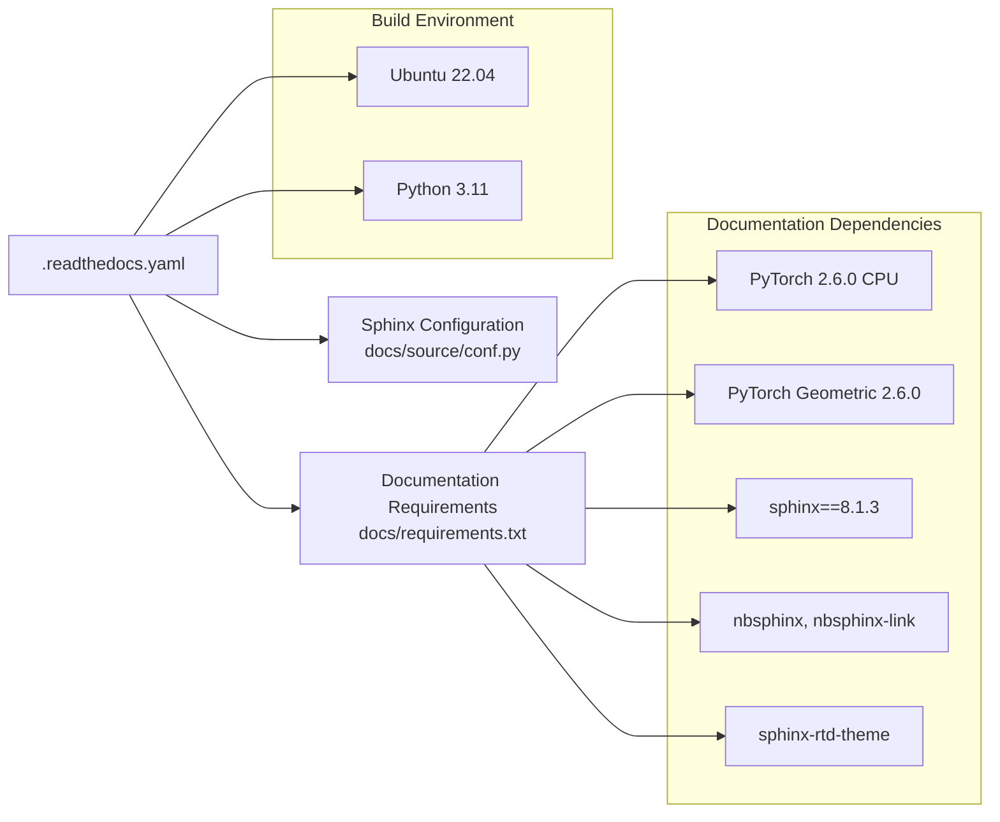

### Documentation-Specific Dependencies

[docs/requirements.txt:1-39]() specifies documentation build dependencies:

- **Sphinx 8.1.3**: Specific version for compatibility with nbsphinx
- **PyTorch/PyG CPU wheels**: Direct URLs to CPU-only builds for faster documentation builds
- **Documentation tools**: nbsphinx (Jupyter notebook integration), recommonmark (Markdown support)

**Note**: Documentation builds use **Python 3.11 specifically** [.readthedocs.yaml:15]() and **Ubuntu 22.04** [.readthedocs.yaml:13]() for consistency.

Sources: [.readthedocs.yaml:1-26](), [docs/requirements.txt:1-39]()

---

## Installation Verification

### Running Tests

After installation, verify the setup by running tests [docs/source/installation.md:49-57]():

```bash
pytest  # Run all tests
pytest tests/test_specific_module.py  # Run specific module tests
```

**Requirements for testing**:
- PyTorch installed (matching hardware)
- PyTorch Geometric installed
- RDKit installed
- Dev dependencies: `pip install -e .[dev]`

### Test Execution Configuration

The CI/CD workflow [.github/workflows/test.yml:92-99]() runs tests with thread limits to prevent resource contention:

```bash
export OMP_NUM_THREADS=1
export MKL_NUM_THREADS=1
export NUMEXPR_NUM_THREADS=1
pytest --nbmake --nbmake-timeout=3000 --cov=kale
```

**Test flags**:
- `--nbmake`: Validates Jupyter notebooks by executing them
- `--nbmake-timeout=3000`: 3000-second timeout per notebook
- `--cov=kale`: Generates coverage report for the `kale` package

Coverage results are uploaded to [Codecov](https://codecov.io/gh/pykale/pykale) via [.github/workflows/test.yml:106-109]().

Sources: [.github/workflows/test.yml:92-109](), [docs/source/installation.md:49-57]()

---

## Installation Troubleshooting

### Common Issues

**Issue 1: PyTorch/PyG Version Mismatch**
- **Symptom**: Import errors when loading `kale.embed` modules
- **Solution**: Ensure PyTorch and PyG versions match. Check [PyG installation guide](https://github.com/pyg-team/pytorch_geometric#installation) for compatible versions.

**Issue 2: NumPy 2.0+ Compatibility**
- **Symptom**: NumPy-related errors
- **Solution**: PyKale requires numpy≥2.0.0 [setup.py:18](). Upgrade: `pip install "numpy>=2.0.0"`

**Issue 3: Matplotlib Build Failure**
- **Symptom**: Build errors with matplotlib 3.10.1
- **Solution**: Use matplotlib≤3.10.0 [setup.py:51]()

**Issue 4: Missing RDKit**
- **Symptom**: Import errors in drug discovery examples
- **Solution**: Install RDKit manually: `pip install rdkit>=2025.3.1` [setup.py:65]()

### Platform-Specific Notes

**Windows**: The CI/CD pipeline currently only tests on Ubuntu [.github/workflows/test.yml:21-22](). Windows support is experimental. Use WSL2 or conda for best compatibility.

**macOS**: Install PyTorch from official sources. For M1/M2 Macs, use the MPS-accelerated builds.

**CUDA**: For GPU support, install PyTorch with CUDA toolkit matching your GPU driver version before installing PyKale.

Sources: [.github/workflows/test.yml:21-31](), [setup.py:18-65]()

---

# Page: Core Pipeline Architecture

# Core Pipeline Architecture

<details>
<summary>Relevant source files</summary>

The following files were used as context for generating this wiki page:

- [.github/ISSUE_TEMPLATE/action-fail.md](.github/ISSUE_TEMPLATE/action-fail.md)
- [.github/workflows/test.yml](.github/workflows/test.yml)
- [README.md](README.md)
- [docs/source/index.rst](docs/source/index.rst)
- [docs/source/installation.md](docs/source/installation.md)
- [docs/source/kale.embed.rst](docs/source/kale.embed.rst)
- [docs/source/kale.evaluate.rst](docs/source/kale.evaluate.rst)
- [docs/source/kale.loaddata.rst](docs/source/kale.loaddata.rst)
- [docs/source/kale.pipeline.rst](docs/source/kale.pipeline.rst)
- [docs/source/kale.predict.rst](docs/source/kale.predict.rst)
- [docs/source/kale.prepdata.rst](docs/source/kale.prepdata.rst)
- [docs/source/kale.utils.rst](docs/source/kale.utils.rst)
- [examples/video_loading/README.md](examples/video_loading/README.md)
- [setup.py](setup.py)

</details>


This page describes the structural design of the `kale` library: the seven API modules that form the machine learning pipeline, the `kale.pipeline` module that orchestrates them, and `kale.utils` which provides shared infrastructure. It focuses on the *layout and relationships* of the modules, not the detailed API of any single module. For detailed API documentation on individual modules, see the Pipeline API Reference section (page [2](#2)).

---

## The Seven-Module Pipeline

PyKale is organized around a sequential pipeline that maps raw data to a final interpreted result. Each of the seven modules handles one stage of this process. The ordering is not arbitrary — data flows through the modules in the sequence shown below, and `kale.pipeline` composes subsets of these stages into end-to-end trainable workflows.

**Pipeline stage diagram — module names to `kale` package paths**

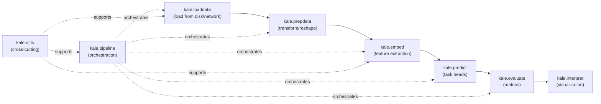

Sources: [README.md:42-48](), [docs/source/index.rst:23-33]()

---

## Module Responsibilities

The table below maps each module to its filesystem path and primary responsibilities.

| Module | Path | Responsibility |
|---|---|---|
| `kale.loaddata` | `kale/loaddata/` | Load data from disk or remote. Provides `DatasetAccess` base class and specialized dataset classes. |
| `kale.prepdata` | `kale/prepdata/` | Transform raw data into ML-ready tensors: image/video transforms, graph construction, tensor reshape. |
| `kale.embed` | `kale/embed/` | Feature extraction via CNNs, GCNs, factorization, attention networks, and video encoders. |
| `kale.predict` | `kale/predict/` | Task-specific prediction heads: classifiers, decoders, domain discriminators. |
| `kale.evaluate` | `kale/evaluate/` | Compute metrics, perform cross-validation, and measure uncertainty. |
| `kale.interpret` | `kale/interpret/` | Visualize model weights and prediction outputs. |
| `kale.pipeline` | `kale/pipeline/` | PyTorch Lightning `LightningModule` trainers that combine the stages above. |
| `kale.utils` | `kale/utils/` | Shared utilities: file download, random seeding, logging, model initialization. |

Sources: [docs/source/index.rst:23-33](), [README.md:42-48]()

---

## Module-to-Submodule Map

Each top-level module contains several submodules. The diagram below maps modules to their concrete submodule files.

**Submodule structure diagram**

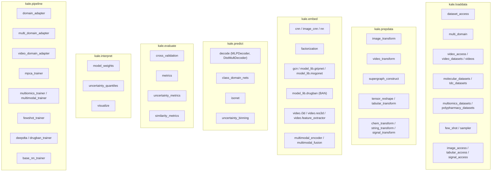

Sources: [docs/source/kale.loaddata.rst](), [docs/source/kale.prepdata.rst](), [docs/source/kale.embed.rst](), [docs/source/kale.predict.rst](), [docs/source/kale.evaluate.rst](), [docs/source/kale.pipeline.rst](), [docs/source/kale.utils.rst]()

---

## kale.pipeline: The Orchestration Layer

`kale.pipeline` does not introduce new ML algorithms — it wires together components from `loaddata`, `prepdata`, `embed`, and `predict` into complete training workflows implemented as PyTorch Lightning `LightningModule` subclasses.

**Trainer class to domain diagram**

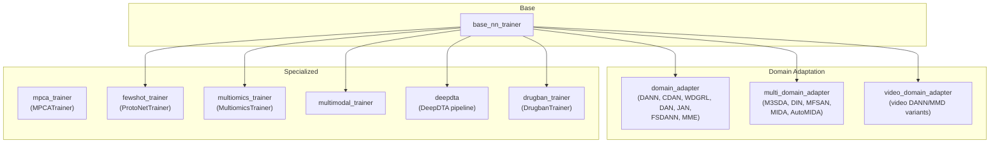

Sources: [docs/source/kale.pipeline.rst]()

Each trainer class implements the PyTorch Lightning lifecycle: `configure_optimizers`, `training_step`, `validation_step`, and `test_step`. The `BaseAdaptTrainer` found in `domain_adapter` adds domain adaptation specifics such as warmup scheduling and lambda annealing. For full details, see [Training Pipelines (kale.pipeline)](#2.5).

---

## kale.utils: Cross-Cutting Support

`kale.utils` does not belong to the main data flow pipeline. It provides shared infrastructure that any module may call.

| Submodule | Key responsibility |
|---|---|
| `kale.utils.download` | Fetch data files and model weights from remote URLs |
| `kale.utils.seed` | Set global random seeds for reproducibility |
| `kale.utils.logger` | Structured logging helpers used across trainers |
| `kale.utils.initialize_nn` | Neural network weight initialization utilities |
| `kale.utils.print` | Formatted console output for training summaries |
| `kale.utils.save_xlsx` | Export results to Excel files |
| `kale.utils.remap_model_parameters` | Map parameter names between model checkpoints |

Sources: [docs/source/kale.utils.rst]()

---

## Data Flow Through a Typical Training Run

The sequence below shows how control and data flow through the modules during a standard training run. The trainer (`kale.pipeline`) drives the process; the other modules are called as needed.

**Sequence diagram: a training run using a pipeline trainer**

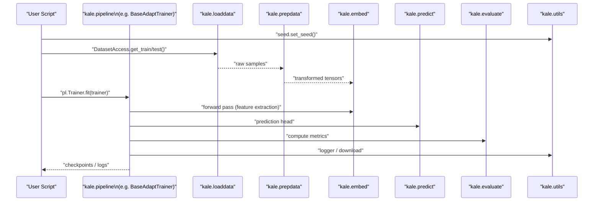

Sources: [README.md:42-48](), [docs/source/kale.pipeline.rst]()

---

## Dependency Rules

The pipeline imposes a loose layering discipline: modules earlier in the pipeline may not import from modules later in the pipeline. `kale.utils` is the only module with no restriction — any other module may import from it.

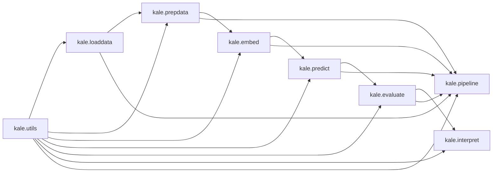

Sources: [README.md:42-48](), [docs/source/index.rst:33]()

---

## Core Dependencies

The runtime dependencies in `setup.py` reflect the pipeline design: PyTorch and `pytorch-lightning` underpin the pipeline and embed layers, while `scikit-learn`, `scipy`, and `tensorly` support the factorization and evaluation layers.

| Dependency | Used primarily in |
|---|---|
| `torch` | `kale.embed`, `kale.predict`, `kale.pipeline` |
| `pytorch-lightning` | `kale.pipeline` |
| `torchvision` | `kale.loaddata`, `kale.prepdata`, `kale.embed` |
| `scikit-learn` | `kale.evaluate`, `kale.pipeline` (MPCATrainer, MIDATrainer) |
| `scipy` | `kale.evaluate`, `kale.embed.factorization` |
| `tensorly` | `kale.embed.factorization`, `kale.interpret.model_weights` |
| `numpy` | Throughout |
| `pandas` | `kale.loaddata`, `kale.evaluate` |

Sources: [setup.py:17-26]()

---

# Page: Pipeline API Reference

# Pipeline API Reference

<details>
<summary>Relevant source files</summary>

The following files were used as context for generating this wiki page:

- [docs/source/index.rst](docs/source/index.rst)
- [docs/source/kale.embed.rst](docs/source/kale.embed.rst)
- [docs/source/kale.evaluate.rst](docs/source/kale.evaluate.rst)
- [docs/source/kale.loaddata.rst](docs/source/kale.loaddata.rst)
- [docs/source/kale.pipeline.rst](docs/source/kale.pipeline.rst)
- [docs/source/kale.predict.rst](docs/source/kale.predict.rst)
- [docs/source/kale.prepdata.rst](docs/source/kale.prepdata.rst)
- [docs/source/kale.utils.rst](docs/source/kale.utils.rst)

</details>


This document provides comprehensive documentation of PyKale's core pipeline modules and their interfaces. The Pipeline API implements PyKale's knowledge-aware machine learning philosophy through a standardized, modular architecture that supports multimodal learning and transfer learning workflows.

For specific domain applications and examples, see [Examples and Tutorials](#5). For development guidelines and testing infrastructure, see [Development Guide](#6). For detailed implementation of domain adaptation techniques that utilize these pipeline components, see [Domain Adaptation](#3).

## Core Pipeline Architecture

PyKale's pipeline-based API follows a systematic approach to machine learning workflows, organizing functionality into six core modules that can be combined flexibly while maintaining standardization and reusability.

### Pipeline Flow Overview

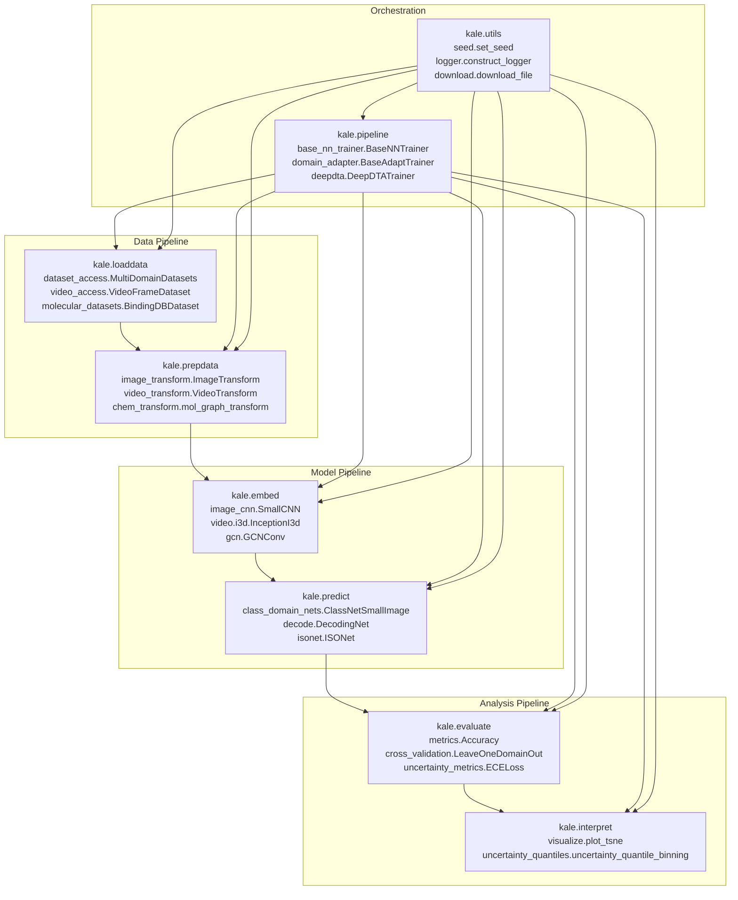

**Sources:** [README.md:35-43](), [docs/source/index.rst:22-31]()

### Module Dependencies and Integration

```mermaid
graph TB
    subgraph "Core Dependencies"
        PYTORCH["torch<br/>PyTorch Framework"]
        LIGHTNING["pytorch_lightning<br/>Training Infrastructure"]
        NUMPY["numpy<br/>Numerical Computing"]
        SKLEARN["scikit_learn<br/>ML Utilities"]
    end
    
    subgraph "Optional Dependencies"
        PYGEOMETRIC["torch_geometric<br/>Graph Neural Networks"]
        TDC["PyTDC<br/>Drug Discovery"]
        RDKIT["rdkit<br/>Chemical Informatics"]
        DICOM["pydicom<br/>Medical Imaging"]
    end
    
    subgraph "kale.loaddata"
        DATASET_ACCESS["dataset_access"]
        VIDEO_ACCESS["video_access"]
        MOLECULAR_DATASETS["molecular_datasets"]
        MULTI_DOMAIN["multi_domain"]
        SAMPLER["sampler"]
    end
    
    subgraph "kale.embed"
        IMAGE_CNN["image_cnn"]
        VIDEO_I3D["video_i3d"]
        GCN["gcn"]
        GRIPNET["gripnet"]
        FEATURE_FUSION["feature_fusion"]
    end
    
    subgraph "kale.pipeline"
        BASE_TRAINER["base_nn_trainer"]
        DOMAIN_ADAPTER["domain_adapter"]
        MULTI_DOMAIN_ADAPTER["multi_domain_adapter"]
        VIDEO_DOMAIN_ADAPTER["video_domain_adapter"]
    end
    
    PYTORCH --> BASE_TRAINER
    LIGHTNING --> BASE_TRAINER
    PYGEOMETRIC --> GCN
    PYGEOMETRIC --> GRIPNET
    TDC --> MOLECULAR_DATASETS
    RDKIT --> MOLECULAR_DATASETS
    
    BASE_TRAINER --> DOMAIN_ADAPTER
    BASE_TRAINER --> MULTI_DOMAIN_ADAPTER
    BASE_TRAINER --> VIDEO_DOMAIN_ADAPTER
    
    DATASET_ACCESS --> MULTI_DOMAIN
    VIDEO_ACCESS --> VIDEO_I3D
    IMAGE_CNN --> FEATURE_FUSION
    GCN --> FEATURE_FUSION
```

**Sources:** [setup.py:16-26](), [setup.py:30-46]()

## Data Loading Module (kale.loaddata)

The `kale.loaddata` module provides unified interfaces for accessing diverse data sources including images, videos, molecular data, and multimodal datasets. It implements standardized dataset access patterns and sampling strategies.

### Key Components

| Component | Purpose | Key Classes |
|-----------|---------|-------------|
| `dataset_access` | Core dataset access interface | `DatasetAccess`, `MultiDomainDatasets` |
| `video_access` | Video dataset loading | `VideoFrameDataset`, `VideoDataset` |
| `molecular_datasets` | Drug discovery datasets | `BindingDBDataset`, `TDCDataset` |
| `multi_domain` | Multi-source domain datasets | `MultiDomainDatasets` |
| `sampler` | Sampling strategies | `ImbalancedDatasetSampler`, `RandomMultiDomainSampler` |

### Dataset Access Pattern

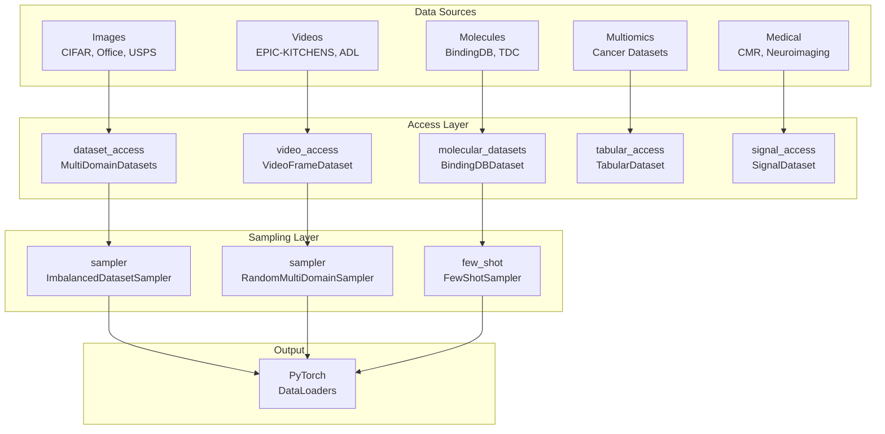

**Sources:** [docs/source/kale.loaddata.rst:1-169](), [examples/video_loading/README.md:9-25]()

## Feature Embedding Module (kale.embed)

The `kale.embed` module implements feature extraction and representation learning across multiple modalities. It provides CNN architectures, video models, graph neural networks, and multimodal fusion techniques.

### Architecture Components

| Component | Purpose | Key Classes |
|-----------|---------|-------------|
| `image_cnn` | CNN feature extraction | `SmallCNN`, `ResNet18`, `ResNet50` |
| `video_i3d` | Video feature extraction | `InceptionI3d`, `I3DBackbone` |
| `gcn` | Graph convolution | `GCNConv`, `GCNNet` |
| `gripnet` | Heterogeneous graphs | `GripNet`, `HeteroGCN` |
| `feature_fusion` | Multimodal fusion | `ConcateFusion`, `AttentionFusion` |

### Embedding Architecture

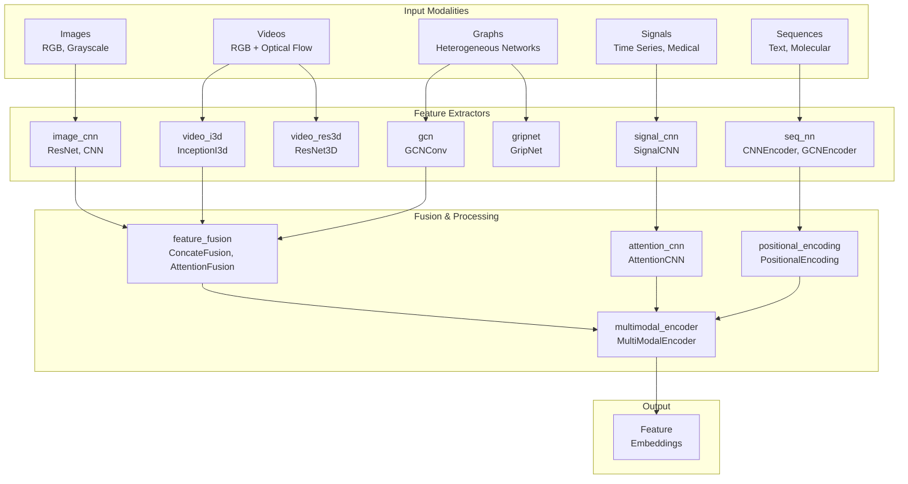

**Sources:** [docs/source/kale.embed.rst:1-172](), [tests/embed/test_seq_nn.py:1-49]()

## Training Pipeline Module (kale.pipeline)

The `kale.pipeline` module orchestrates training workflows through specialized trainers built on PyTorch Lightning. It provides domain adaptation, multimodal learning, and application-specific training pipelines.

### Trainer Architecture

| Component | Purpose | Key Classes |
|-----------|---------|-------------|
| `base_nn_trainer` | Base training infrastructure | `BaseNNTrainer`, `LightningModule` |
| `domain_adapter` | Domain adaptation training | `BaseAdaptTrainer`, `DANNTrainer` |
| `multi_domain_adapter` | Multi-source DA training | `MultiDomainAdaptTrainer` |
| `video_domain_adapter` | Video DA training | `VideoDANNTrainer` |
| `deepdta` | Drug-target interaction | `DeepDTATrainer` |
| `multiomics_trainer` | Multiomics analysis | `MultiomicsTrainer` |

### Training Pipeline Flow

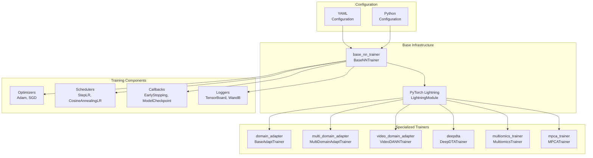

**Sources:** [docs/source/kale.pipeline.rst:1-96](), [setup.py:20]()

## Data Preprocessing Module (kale.prepdata)

The `kale.prepdata` module provides data transformation and preprocessing functionality for different modalities including images, videos, signals, and molecular data.

### Preprocessing Components

| Component | Purpose | Key Classes |
|-----------|---------|-------------|
| `image_transform` | Image preprocessing | `ImageTransform`, `Resize`, `Normalize` |
| `video_transform` | Video preprocessing | `VideoTransform`, `ImglistToTensor` |
| `signal_transform` | Signal preprocessing | `SignalTransform`, `Standardize` |
| `chem_transform` | Chemical preprocessing | `ChemTransform`, `MoleculeTransform` |
| `tabular_transform` | Tabular preprocessing | `TabularTransform`, `StandardScaler` |

**Sources:** [docs/source/kale.prepdata.rst:1-87]()

## Prediction Module (kale.predict)

The `kale.predict` module implements prediction models and classification networks, including domain adaptation networks and uncertainty quantification.

### Prediction Components

| Component | Purpose | Key Classes |
|-----------|---------|-------------|
| `class_domain_nets` | Classification networks | `ClassNetSmallImage`, `DomainNetSmallImage` |
| `decode` | Decoding networks | `DecodingNet`, `FeatureDecoder` |
| `isonet` | Isometric networks | `ISONet`, `ISONetClassifier` |
| `uncertainty_binning` | Uncertainty quantification | `UncertaintyBinning`, `QuantileBinning` |

**Sources:** [docs/source/kale.predict.rst:1-48]()

## Evaluation Module (kale.evaluate)

The `kale.evaluate` module provides performance evaluation metrics, cross-validation strategies, and similarity measures for various machine learning tasks.

### Evaluation Components

| Component | Purpose | Key Classes |
|-----------|---------|-------------|
| `metrics` | Performance metrics | `Accuracy`, `F1Score`, `AUC` |
| `cross_validation` | CV strategies | `StratifiedKFold`, `GroupKFold` |
| `similarity_metrics` | Similarity measures | `MMD`, `HSIC`, `CKA` |
| `uncertainty_metrics` | Uncertainty evaluation | `CalibrationError`, `Reliability` |

**Sources:** [docs/source/kale.evaluate.rst:1-47]()

## Interpretation Module (kale.interpret)

The `kale.interpret` module provides model interpretation and visualization tools for understanding model behavior and predictions.

### Interpretation Components

| Component | Purpose | Key Classes |
|-----------|---------|-------------|
| `model_weights` | Weight analysis | `WeightAnalysis`, `ModelInspection` |
| `visualize` | Visualization tools | `PlotUtils`, `TensorboardUtils` |
| `uncertainty_quantiles` | Uncertainty analysis | `QuantileAnalysis`, `UncertaintyPlot` |
| `signal_image_attribution` | Attribution methods | `GradCAM`, `IntegratedGradients` |

**Sources:** [docs/source/kale.interpret.rst:1-49]()

## Utilities Module (kale.utils)

The `kale.utils` module provides supporting utilities for logging, initialization, data handling, and other common operations across the pipeline.

### Utility Components

| Component | Purpose | Key Classes |
|-----------|---------|-------------|
| `logger` | Logging utilities | `Logger`, `LoggerConfig` |
| `seed` | Reproducibility | `set_seed`, `seed_everything` |
| `download` | Data downloading | `download_file`, `extract_archive` |
| `initialize_nn` | Network initialization | `init_weights`, `init_modules` |

**Sources:** [docs/source/kale.utils.rst:1-72]()

## Pipeline Integration Patterns

### Standard Pipeline Workflow

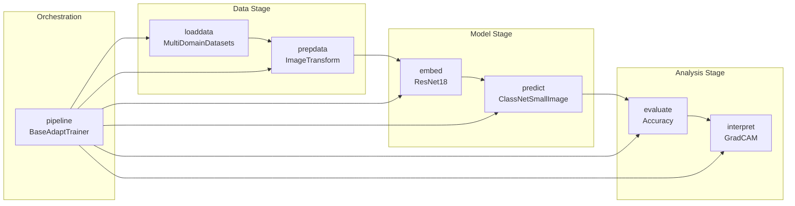

**Sources:** [README.md:35-43](), [docs/source/index.rst:33]()

---

# Page: Data Loading (kale.loaddata)

# Data Loading (kale.loaddata)

<details>
<summary>Relevant source files</summary>

The following files were used as context for generating this wiki page:

- [.gitignore](.gitignore)
- [examples/fewshot_protonet/README.md](examples/fewshot_protonet/README.md)
- [examples/fewshot_protonet/__init__.py](examples/fewshot_protonet/__init__.py)
- [examples/fewshot_protonet/config.py](examples/fewshot_protonet/config.py)
- [examples/fewshot_protonet/configs/demo.yaml](examples/fewshot_protonet/configs/demo.yaml)
- [examples/fewshot_protonet/configs/template.yaml](examples/fewshot_protonet/configs/template.yaml)
- [examples/fewshot_protonet/eval_unseen_classes.py](examples/fewshot_protonet/eval_unseen_classes.py)
- [examples/fewshot_protonet/main.py](examples/fewshot_protonet/main.py)
- [examples/multiomics_mogonet/main.py](examples/multiomics_mogonet/main.py)
- [examples/multiomics_mogonet/model.py](examples/multiomics_mogonet/model.py)
- [examples/video_loading/main.py](examples/video_loading/main.py)
- [kale/loaddata/dataset_access.py](kale/loaddata/dataset_access.py)
- [kale/loaddata/few_shot.py](kale/loaddata/few_shot.py)
- [kale/loaddata/mnistm.py](kale/loaddata/mnistm.py)
- [kale/loaddata/multi_domain.py](kale/loaddata/multi_domain.py)
- [kale/loaddata/multiomics_datasets.py](kale/loaddata/multiomics_datasets.py)
- [kale/loaddata/sampler.py](kale/loaddata/sampler.py)
- [kale/loaddata/usps.py](kale/loaddata/usps.py)
- [kale/loaddata/video_access.py](kale/loaddata/video_access.py)
- [kale/loaddata/video_datasets.py](kale/loaddata/video_datasets.py)
- [kale/loaddata/video_multi_domain.py](kale/loaddata/video_multi_domain.py)
- [kale/loaddata/videos.py](kale/loaddata/videos.py)
- [kale/pipeline/domain_adapter.py](kale/pipeline/domain_adapter.py)
- [kale/pipeline/fewshot_trainer.py](kale/pipeline/fewshot_trainer.py)
- [kale/pipeline/multiomics_trainer.py](kale/pipeline/multiomics_trainer.py)
- [kale/pipeline/video_domain_adapter.py](kale/pipeline/video_domain_adapter.py)
- [kale/predict/isonet.py](kale/predict/isonet.py)
- [kale/prepdata/video_transform.py](kale/prepdata/video_transform.py)
- [tests/loaddata/test_image_access.py](tests/loaddata/test_image_access.py)
- [tests/loaddata/test_sampler.py](tests/loaddata/test_sampler.py)
- [tests/loaddata/test_video_access.py](tests/loaddata/test_video_access.py)
- [tests/pipeline/test_domain_adapter.py](tests/pipeline/test_domain_adapter.py)
- [tests/pipeline/test_video_domain_adapter.py](tests/pipeline/test_video_domain_adapter.py)

</details>


## Purpose and Scope

The `kale.loaddata` module provides data loading interfaces and utilities as the first stage in PyKale's ML pipeline. It implements standardized patterns for loading datasets from multiple domains, supporting various data modalities including images, videos, graphs, tabular data, and molecular data. This module is specifically designed to facilitate domain adaptation research by providing consistent APIs for multi-domain scenarios.

For data preprocessing and transformations applied after loading, see [Data Preprocessing (kale.prepdata)](#2.2). For training pipelines that use these data loaders, see [Training Pipelines (kale.pipeline)](#2.5).

## Core Architecture

The `kale.loaddata` module is built around the **DatasetAccess Pattern**, which provides a unified interface for accessing training, validation, and test splits across different datasets. This abstraction enables seamless integration with domain adaptation pipelines.

### DatasetAccess Pattern

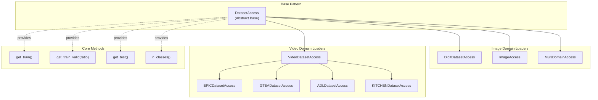

**Sources:** [kale/loaddata/dataset_access.py:9-48](), [kale/loaddata/video_access.py:200-237]()

The `DatasetAccess` class [kale/loaddata/dataset_access.py:9-23]() defines the core interface:

| Method | Return Type | Description |
|--------|-------------|-------------|
| `get_train()` | `torch.utils.data.Dataset` | Returns training dataset |
| `get_train_valid(valid_ratio)` | `tuple[Dataset, Dataset]` | Splits training data into train/validation |
| `get_test()` | `torch.utils.data.Dataset` | Returns test dataset |
| `n_classes()` | `int` | Returns number of classes |

**Sources:** [kale/loaddata/dataset_access.py:9-48]()

### Dataset Loading Flow

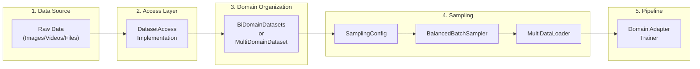

**Sources:** [kale/loaddata/dataset_access.py:9-48](), [kale/loaddata/multi_domain.py:102-241](), [kale/loaddata/sampler.py:23-83]()

## Multi-Domain Datasets

Multi-domain datasets are central to PyKale's domain adaptation capabilities. They organize data from multiple domains (e.g., different sensors, datasets, or conditions) while maintaining consistent batch sampling across domains.

### Architecture Overview

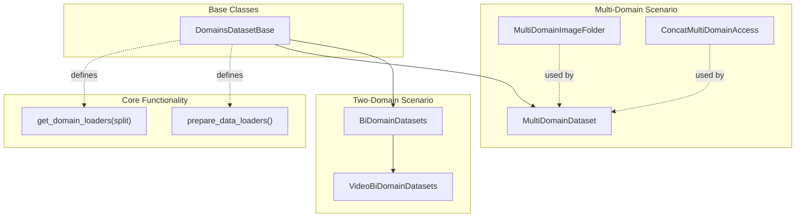

**Sources:** [kale/loaddata/multi_domain.py:80-100](), [kale/loaddata/multi_domain.py:102-250](), [kale/loaddata/multi_domain.py:553-730]()

### BiDomainDatasets

`BiDomainDatasets` [kale/loaddata/multi_domain.py:102-250]() manages source and target domain datasets for unsupervised or semi-supervised domain adaptation.

**Key Parameters:**

| Parameter | Type | Description |
|-----------|------|-------------|
| `source_access` | `DatasetAccess` | Accessor for source domain |
| `target_access` | `DatasetAccess` | Accessor for target domain |
| `config_weight_type` | `WeightingType` | Sampling weights: "natural", "balanced", "preset0" |
| `config_size_type` | `DatasetSizeType` | Epoch size: "max" or "source" |
| `valid_split_ratio` | `float` | Validation split ratio (default: 0.1) |
| `n_fewshot` | `int` | Number of labeled target samples for semi-supervised DA |
| `class_ids` | `list` | Subset of class IDs to use |

**Sources:** [kale/loaddata/multi_domain.py:103-176]()

**Usage Example:**
```python
# Create source and target accessors
source = DigitDatasetAccess(...)
target = DigitDatasetAccess(...)

# Create bi-domain dataset
dataset = BiDomainDatasets(
    source_access=source,
    target_access=target,
    config_weight_type="balanced",
    valid_split_ratio=0.1
)

# Prepare data loaders
dataset.prepare_data_loaders()

# Get domain-specific loaders
train_loader = dataset.get_domain_loaders(split="train", batch_size=32)
```

**Sources:** [tests/pipeline/test_domain_adapter.py:55-62]()

### MultiDomainDataset

`MultiDomainDataset` [kale/loaddata/multi_domain.py:553-730]() handles scenarios with multiple source domains and one target domain. Each batch contains samples from all domains with domain labels.

**Batch Structure:**
- Returns: `(X, y, domain_labels)` where `domain_labels` indicate which domain each sample belongs to
- Supports domain-stratified splitting via `_domain_stratified_split()` [kale/loaddata/multi_domain.py:252-278]()

```mermaid
graph LR
    subgraph "MultiDomainDataset Workflow"
        INIT["Initialize<br/>with MultiDomainAccess"]
        PREP["prepare_data_loaders()<br/>target_domain"]
        SPLIT["Domain-Stratified<br/>Splitting"]
        FEWSHOT["Apply Semi-Supervised<br/>(if n_fewshot > 0)"]
        LOAD["get_domain_loaders()<br/>returns MultiDataLoader"]
    end
    
    INIT --> PREP
    PREP --> SPLIT
    SPLIT --> FEWSHOT
    FEWSHOT --> LOAD
```

**Sources:** [kale/loaddata/multi_domain.py:553-730]()

### MultiDomainImageFolder

`MultiDomainImageFolder` [kale/loaddata/multi_domain.py:281-430]() extends PyTorch's `VisionDataset` for image datasets organized in domain/class folder structure:

```
root/
├── domain_a/
│   ├── class_1/
│   │   ├── xxx.jpg
│   │   └── yyy.jpg
│   └── class_2/
│       └── zzz.jpg
├── domain_b/
│   ├── class_1/
│   └── class_2/
```

**Key Features:**
- Domain label extraction: `domain_labels` attribute [kale/loaddata/multi_domain.py:366]()
- Optional train/test splitting: `split_train_test` parameter [kale/loaddata/multi_domain.py:331-374]()
- Domain and class filtering: `sub_domain_set`, `sub_class_set` [kale/loaddata/multi_domain.py:327-349]()

**Sources:** [kale/loaddata/multi_domain.py:281-430]()

## Sampling Strategies

Sampling strategies control how batches are constructed from datasets, particularly important for balanced class representation and domain adaptation.

### SamplingConfig

```mermaid
graph TB
    subgraph "SamplingConfig Factory"
        SC["SamplingConfig"]
        FSC["FixedSeedSamplingConfig"]
    end
    
    subgraph "Configuration Options"
        BAL["balance=True<br/>Equal samples per class"]
        CW["class_weights<br/>Weighted sampling"]
        BD["balance_domain=True<br/>Equal samples per domain"]
        NAT["natural (default)<br/>Random sampling"]
    end
    
    subgraph "Sampler Types"
        BBS["BalancedBatchSampler"]
        RBS["ReweightedBatchSampler"]
        DBS["DomainBalancedBatchSampler"]
        RS["RandomSampler"]
    end
    
    SC --> BAL
    SC --> CW
    SC --> BD
    SC --> NAT
    
    BAL --> BBS
    CW --> RBS
    BD --> DBS
    NAT --> RS
    
    FSC -.extends.-> SC
```

**Sources:** [kale/loaddata/sampler.py:23-113]()

### Key Sampler Classes

| Sampler | Purpose | Usage |
|---------|---------|-------|
| `BalancedBatchSampler` | Samples equal number of samples per class | Imbalanced datasets [kale/loaddata/sampler.py:154-193]() |
| `ReweightedBatchSampler` | Samples according to class weights | Custom class distributions [kale/loaddata/sampler.py:196-262]() |
| `DomainBalancedBatchSampler` | Samples equal number per domain | Multi-domain scenarios [kale/loaddata/sampler.py:364-400]() |
| `MultiDataLoader` | Iterates over multiple dataloaders in parallel | Domain adaptation [kale/loaddata/sampler.py:116-152]() |

**Sources:** [kale/loaddata/sampler.py:23-400]()

### MultiDataLoader

The `MultiDataLoader` [kale/loaddata/sampler.py:116-152]() is critical for domain adaptation. It synchronously iterates over multiple dataloaders, yielding batches from each domain simultaneously.

```mermaid
graph LR
    subgraph "Input Dataloaders"
        DL1["Source Dataloader"]
        DL2["Target Dataloader"]
        DL3["Additional Domains..."]
    end
    
    subgraph "MultiDataLoader"
        MDL["Parallel Iterator"]
        REINIT["Auto-reinit on<br/>StopIteration"]
    end
    
    subgraph "Output Batch"
        B1["(x_source, y_source)"]
        B2["(x_target, y_target)"]
        BN["..."]
    end
    
    DL1 --> MDL
    DL2 --> MDL
    DL3 --> MDL
    
    MDL --> REINIT
    REINIT --> B1
    REINIT --> B2
    REINIT --> BN
```

**Usage Pattern:**
```python
# From BiDomainDatasets.get_domain_loaders()
source_loader = source_sampling_config.create_loader(source_ds, batch_size)
target_loader = target_sampling_config.create_loader(target_ds, batch_size)

return MultiDataLoader(
    dataloaders=[source_loader, target_loader],
    n_batches=max(n_dataset // batch_size, 1)
)
```

**Sources:** [kale/loaddata/sampler.py:116-152](), [kale/loaddata/multi_domain.py:214-240]()

## Video Data Loading

Video data loading in PyKale supports sparse temporal sampling and multi-modality (RGB + optical flow) for action recognition and domain adaptation.

### Video Loading Architecture

```mermaid
graph TB
    subgraph "Core Video Dataset"
        VFD["VideoFrameDataset"]
        VR["VideoRecord"]
    end
    
    subgraph "Dataset Implementations"
        BVD["BasicVideoDataset"]
        EPIC["EPIC"]
    end
    
    subgraph "Access Layer"
        VDA["VideoDatasetAccess"]
        EVDA["EPICDatasetAccess"]
        GVDA["GTEADatasetAccess"]
        AVDA["ADLDatasetAccess"]
        KVDA["KITCHENDatasetAccess"]
    end
    
    subgraph "Domain Organization"
        VBDD["VideoBiDomainDatasets"]
    end
    
    subgraph "Multi-Modality Support"
        RGB["RGB Frames"]
        FLOW["Optical Flow"]
        JOINT["Joint (RGB + Flow)"]
    end
    
    VFD --> BVD
    VFD --> EPIC
    VFD -.uses.-> VR
    
    BVD --> GVDA
    BVD --> AVDA
    BVD --> KVDA
    EPIC --> EVDA
    
    VDA --> EVDA
    VDA --> GVDA
    VDA --> AVDA
    VDA --> KVDA
    
    EVDA --> VBDD
    GVDA --> VBDD
    
    VBDD --> RGB
    VBDD --> FLOW
    VBDD --> JOINT
```

**Sources:** [kale/loaddata/videos.py:58-237](), [kale/loaddata/video_datasets.py:12-154](), [kale/loaddata/video_access.py:200-372](), [kale/loaddata/video_multi_domain.py:19-213]()

### VideoFrameDataset

`VideoFrameDataset` [kale/loaddata/videos.py:58-237]() implements sparse temporal sampling, dividing videos into segments and sampling frames from each segment.

**Key Parameters:**

| Parameter | Type | Description |
|-----------|------|-------------|
| `root_path` | `str` | Root directory containing video folders |
| `annotationfile_path` | `str` | Path to annotation file (one video per line) |
| `num_segments` | `int` | Number of segments to divide video into |
| `frames_per_segment` | `int` | Frames to sample from each segment |
| `image_modality` | `str` | "rgb" or "flow" |
| `imagefile_template` | `str` | Frame filename template (e.g., "img_{:05d}.jpg") |
| `random_shift` | `bool` | Random or center frame selection per segment |
| `test_mode` | `bool` | Deterministic sampling for testing |

**Sources:** [kale/loaddata/videos.py:98-148]()

**Sparse Temporal Sampling:**

```mermaid
graph LR
    subgraph "Video Timeline"
        START["Start Frame"]
        SEG1["Segment 1"]
        SEG2["Segment 2"]
        SEG3["Segment 3"]
        END["End Frame"]
    end
    
    subgraph "Sampling Strategy"
        S1["Sample frames_per_segment<br/>from Segment 1"]
        S2["Sample frames_per_segment<br/>from Segment 2"]
        S3["Sample frames_per_segment<br/>from Segment 3"]
    end
    
    START --> SEG1
    SEG1 --> SEG2
    SEG2 --> SEG3
    SEG3 --> END
    
    SEG1 --> S1
    SEG2 --> S2
    SEG3 --> S3
```

**Sources:** [kale/loaddata/videos.py:165-198](), [docs/source/index.rst:51]()

### VideoDataset and VideoDatasetAccess

`VideoDataset` [kale/loaddata/video_access.py:87-197]() is an enum providing factory methods for supported video datasets:

```python
class VideoDataset(Enum):
    EPIC = "EPIC"
    ADL = "ADL"
    GTEA = "GTEA"
    KITCHEN = "KITCHEN"
    
    @staticmethod
    def get_source_target(source, target, seed, params):
        # Returns (source_dict, target_dict, num_classes)
        # where dicts contain {'rgb': VideoDatasetAccess, 'flow': VideoDatasetAccess}
```

**Sources:** [kale/loaddata/video_access.py:87-197]()

### VideoBiDomainDatasets

`VideoBiDomainDatasets` [kale/loaddata/video_multi_domain.py:19-213]() extends `BiDomainDatasets` for video data with multi-modality support.

**Multi-Modality Handling:**

```mermaid
graph TB
    subgraph "Image Modality Selection"
        IM["image_modality"]
    end
    
    subgraph "RGB Path"
        RGB_SRC["RGB Source Loader"]
        RGB_TGT["RGB Target Loader"]
    end
    
    subgraph "Flow Path"
        FLOW_SRC["Flow Source Loader"]
        FLOW_TGT["Flow Target Loader"]
    end
    
    subgraph "Joint Path"
        JOINT["MultiDataLoader<br/>[rgb_src, flow_src,<br/>rgb_tgt, flow_tgt]"]
    end
    
    IM -->|"rgb"| RGB_SRC
    IM -->|"rgb"| RGB_TGT
    IM -->|"flow"| FLOW_SRC
    IM -->|"flow"| FLOW_TGT
    IM -->|"joint"| JOINT
    
    RGB_SRC --> JOINT
    RGB_TGT --> JOINT
    FLOW_SRC --> JOINT
    FLOW_TGT --> JOINT
```

**Sources:** [kale/loaddata/video_multi_domain.py:90-189](), [kale/loaddata/video_access.py:22-32]()

**Batch Structure for Joint Modality:**
- Returns 4 tuples: `(x_s_rgb, y_s), (x_s_flow, y_s_flow), (x_tu_rgb, y_tu), (x_tu_flow, y_tu_flow)`
- Used by video domain adaptation trainers [kale/pipeline/video_domain_adapter.py:148-163]()

**Sources:** [kale/loaddata/video_multi_domain.py:158-189]()

## Domain-Specific Loaders

PyKale provides specialized loaders for various data modalities beyond images and videos.

### Image Datasets

```mermaid
graph TB
    subgraph "Digit Datasets"
        MNIST["MNIST"]
        USPS["USPS"]
        SVHN["SVHN"]
        MNISTM["MNIST-M"]
    end
    
    subgraph "Office Datasets"
        OFF31["OFFICE31<br/>(Amazon, DSLR, Webcam)"]
        OFFCAL["OFFICE_CALTECH<br/>(+Caltech10)"]
    end
    
    subgraph "CIFAR"
        C10["CIFAR10"]
        C100["CIFAR100"]
    end
    
    subgraph "Access Methods"
        DDA["DigitDataset.get_access()"]
        IA["ImageAccess.get_multi_domain_images()"]
        CIFAR["get_cifar()"]
    end
    
    MNIST --> DDA
    USPS --> DDA
    SVHN --> DDA
    MNISTM --> DDA
    
    OFF31 --> IA
    OFFCAL --> IA
    
    C10 --> CIFAR
    C100 --> CIFAR
```

**Sources:** [kale/loaddata/image_access.py](), [docs/source/kale.loaddata.rst:25-31](), [tests/loaddata/test_image_access.py:12-46]()

### Video Datasets

| Dataset | Classes | Description |
|---------|---------|-------------|
| EPIC-Kitchens | 8 | Egocentric kitchen actions |
| GTEA | 6 | Georgia Tech Egocentric Activities |
| ADL | 7 | Activities of Daily Living |
| KITCHEN | 6 | Kitchen activities |

**Dataset Structure Requirements:**
```
root/
├── dataset_name/
│   ├── frames_rgb_flow/
│   │   ├── rgb/
│   │   │   └── video_folders/
│   │   └── flow/
│   │       └── video_folders/
│   └── annotations/
│       └── labels_train_test/
│           ├── train.pkl
│           └── test.pkl
```

**Sources:** [kale/loaddata/video_access.py:66-84](), [kale/loaddata/video_datasets.py:12-154]()

### Other Loaders

| Module | Data Type | Key Classes |
|--------|-----------|-------------|
| `molecular_datasets` | Drug-target data | `BindingDBDataset` |
| `tdc_datasets` | Therapeutics Data Commons | TDC integration |
| `polypharmacy_datasets` | Drug-drug interactions | `PolypharmacyDataset` |
| `multiomics_datasets` | Multi-omics data | Multi-omics loaders |
| `tabular_access` | CSV/tabular data | `load_csv_columns()` |
| `signal_access` | Time series signals | Signal loaders |
| `few_shot` | Few-shot learning | `NWayKShotDataset` |

**Sources:** [docs/source/kale.loaddata.rst:9-162]()

## Integration with Domain Adaptation

The data loading module integrates tightly with PyKale's domain adaptation pipeline through standardized interfaces.

### Usage in Domain Adapters

```mermaid
graph TB
    subgraph "Data Loading"
        DA["DatasetAccess"]
        BDD["BiDomainDatasets<br/>or<br/>MultiDomainDataset"]
    end
    
    subgraph "Adapter Initialization"
        BAT["BaseAdaptTrainer.__init__()"]
        PDL["dataset.prepare_data_loaders()"]
    end
    
    subgraph "Training Loop"
        TDL["train_dataloader()"]
        VDL["val_dataloader()"]
        TSTDL["test_dataloader()"]
    end
    
    subgraph "Batch Processing"
        TS["training_step(batch)"]
        CL["compute_loss(batch)"]
    end
    
    DA --> BDD
    BDD --> BAT
    BAT --> PDL
    PDL --> TDL
    PDL --> VDL
    PDL --> TSTDL
    
    TDL --> TS
    VDL --> TS
    TSTDL --> TS
    TS --> CL
```

**Example from BaseAdaptTrainer:**
```python
# Initialization
def __init__(self, dataset, feature_extractor, task_classifier, ...):
    self._dataset = dataset
    self._dataset.prepare_data_loaders(target_domain=self.target_domain)

# Dataloader methods
def train_dataloader(self):
    return self._dataset.get_domain_loaders(
        split="train", batch_size=self._batch_size, num_workers=self._num_workers
    )
```

**Sources:** [kale/pipeline/domain_adapter.py:242-460](), [kale/loaddata/multi_domain.py:180-185]()

### Semi-Supervised Domain Adaptation

For few-shot or semi-supervised scenarios, `n_fewshot` parameter controls labeled target samples:

```mermaid
graph LR
    subgraph "Target Domain Split"
        TALL["All Target Samples"]
        TLAB["Labeled Target<br/>(n_fewshot samples)"]
        TUNLAB["Unlabeled Target<br/>(remaining samples)"]
    end
    
    subgraph "DataLoader Structure"
        SRC["Source Loader"]
        TLABL["Target Labeled Loader<br/>(balanced)"]
        TUNLABL["Target Unlabeled Loader"]
    end
    
    subgraph "Training Batch"
        BATCH["[(x_s, y_s),<br/>(x_t_lab, y_t_lab),<br/>(x_t_unlab, y_t_unlab)]"]
    end
    
    TALL --> TLAB
    TALL --> TUNLAB
    
    TLAB --> TLABL
    TUNLAB --> TUNLABL
    SRC --> BATCH
    TLABL --> BATCH
    TUNLABL --> BATCH
```

**Sources:** [kale/loaddata/multi_domain.py:228-240](), [kale/pipeline/domain_adapter.py:172-192]()

## Utility Functions

### Helper Functions

| Function | Location | Purpose |
|----------|----------|---------|
| `get_class_subset()` | [kale/loaddata/dataset_access.py:51-60]() | Filter dataset by class IDs |
| `split_by_ratios()` | [kale/loaddata/dataset_access.py:63-105]() | Split dataset by ratios |
| `get_labels()` | [kale/loaddata/sampler.py:308-329]() | Extract labels from various dataset types |
| `get_auto_num_workers()` | [kale/loaddata/sampler.py:15-20]() | Auto-determine optimal workers (75% cores) |
| `_domain_stratified_split()` | [kale/loaddata/multi_domain.py:252-278]() | Domain-stratified splitting |

**Sources:** [kale/loaddata/dataset_access.py:51-105](), [kale/loaddata/sampler.py:15-20](), [kale/loaddata/sampler.py:308-329](), [kale/loaddata/multi_domain.py:252-278]()

### Random State Management

PyKale provides consistent random state handling for reproducibility:

```python
# From multi_domain.py
def _seed_from_random_state(random_state):
    """Normalize different RNG providers to a torch-compatible seed."""
    if isinstance(random_state, (int, np.integer)):
        return int(random_state)
    if isinstance(random_state, np.random.RandomState):
        return int(random_state.randint(0, _MAX_TORCH_SEED))
    if isinstance(random_state, np.random.Generator):
        return int(random_state.integers(0, _MAX_TORCH_SEED))
```

**Sources:** [kale/loaddata/multi_domain.py:23-57]()

## Best Practices

1. **Use DatasetAccess Pattern**: Always implement custom datasets through `DatasetAccess` for consistency with PyKale's pipeline.

2. **Domain Label Consistency**: When using multi-domain datasets, ensure `return_domain_label=True` is set consistently across all dataset constructors.

3. **Balanced Sampling**: For imbalanced datasets, use `SamplingConfig(balance=True)` to ensure equal representation per class.

4. **Video Memory Management**: For video datasets, adjust `num_segments` and `frames_per_segment` to control memory usage while maintaining temporal coverage.

5. **Reproducibility**: Always set `random_state` parameter when splitting datasets to ensure reproducible experiments.

6. **Class Subsets**: Use `class_ids` parameter in `BiDomainDatasets` or `MultiDomainDataset` to restrict experiments to specific classes without modifying the underlying data.

**Sources:** [kale/loaddata/dataset_access.py:9-48](), [kale/loaddata/multi_domain.py:102-176](), [kale/loaddata/sampler.py:23-83](), [kale/loaddata/videos.py:98-148]()

---

# Page: Data Preprocessing (kale.prepdata)

# Data Preprocessing (kale.prepdata)

<details>
<summary>Relevant source files</summary>

The following files were used as context for generating this wiki page:

- [examples/cmri_mpca/__init__.py](examples/cmri_mpca/__init__.py)
- [examples/cmri_mpca/config.py](examples/cmri_mpca/config.py)
- [examples/cmri_mpca/main.py](examples/cmri_mpca/main.py)
- [examples/cmri_mpca/tutorial.ipynb](examples/cmri_mpca/tutorial.ipynb)
- [examples/video_loading/main.py](examples/video_loading/main.py)
- [kale/evaluate/uncertainty_metrics.py](kale/evaluate/uncertainty_metrics.py)
- [kale/interpret/visualize.py](kale/interpret/visualize.py)
- [kale/loaddata/image_access.py](kale/loaddata/image_access.py)
- [kale/loaddata/video_access.py](kale/loaddata/video_access.py)
- [kale/loaddata/video_datasets.py](kale/loaddata/video_datasets.py)
- [kale/loaddata/videos.py](kale/loaddata/videos.py)
- [kale/prepdata/image_transform.py](kale/prepdata/image_transform.py)
- [kale/prepdata/supergraph_construct.py](kale/prepdata/supergraph_construct.py)
- [kale/prepdata/tabular_transform.py](kale/prepdata/tabular_transform.py)
- [kale/prepdata/video_transform.py](kale/prepdata/video_transform.py)
- [tests/conftest.py](tests/conftest.py)
- [tests/embed/test_gripnet.py](tests/embed/test_gripnet.py)
- [tests/evaluate/test_uncertainty_metrics.py](tests/evaluate/test_uncertainty_metrics.py)
- [tests/loaddata/test_tabular_access.py](tests/loaddata/test_tabular_access.py)
- [tests/prepdata/test_image_transform.py](tests/prepdata/test_image_transform.py)
- [tests/prepdata/test_tabular_transform.py](tests/prepdata/test_tabular_transform.py)

</details>


## Purpose and Scope

The `kale.prepdata` module provides preprocessing and transformation utilities that prepare raw data for feature extraction and model training. This module sits between data loading ([Data Loading](#2.1)) and feature embedding ([Feature Embedding](#2.3)) in PyKale's pipeline architecture. It supports multiple data modalities including images, videos, chemical structures, graphs, tabular data, and signals.

This page documents the core preprocessing transformations, with emphasis on image and video preprocessing which are the most extensively developed. For chemical preprocessing used in drug discovery applications, see [Drug Discovery Models](#4.2). For graph preprocessing used with GripNet, see [Graph Neural Networks](#4.5).

## Preprocessing Architecture

The preprocessing layer transforms loaded data into formats suitable for neural network training or traditional machine learning pipelines. The architecture follows a modular design where each data modality has dedicated transformation utilities.

**Architecture Overview**

```mermaid
graph TB
    subgraph "Input: kale.loaddata"
        IMG_LOAD["DICOM Images<br/>(read_dicom_dir)"]
        VIDEO_LOAD["Video Frames<br/>(VideoFrameDataset)"]
        GRAPH_LOAD["Graph Data"]
        CHEM_LOAD["SMILES Strings"]
        TAB_LOAD["Tabular Data"]
    end
    
    subgraph "kale.prepdata Transformations"
        subgraph "Image: image_transform"
            IMG_GET["get_transform()<br/>Transform Pipelines"]
            IMG_REG["reg_img_stack()<br/>Registration"]
            IMG_MASK["mask_img_stack()<br/>Masking"]
            IMG_RESCALE["rescale_img_stack()<br/>Rescaling"]
            IMG_NORM["normalize_img_stack()<br/>Normalization"]
            IMG_PREP["prepare_image_tensor()<br/>Single Image"]
        end
        
        subgraph "Video: video_transform"
            VID_GET["get_transform()<br/>Video Pipelines"]
            VID_TO_TENSOR["ImglistToTensor<br/>PIL to Tensor"]
            VID_PERMUTE["TensorPermute<br/>Dimension Reordering"]
        end
        
        subgraph "Other Modalities"
            CHEM["chem_transform<br/>SMILES Processing"]
            GRAPH_NEG["graph_negative_sampling"]
            TAB["tabular_transform"]
            SIGNAL["signal_transform"]
            TENSOR["tensor_reshape"]
        end
    end
    
    subgraph "Output: kale.embed"
        IMG_CNN["Image CNNs<br/>(ResNet, etc.)"]
        VIDEO_CNN["Video Models<br/>(I3D, Res3D)"]
        GCN["Graph Networks"]
    end
    
    IMG_LOAD --> IMG_GET
    IMG_LOAD --> IMG_REG
    IMG_LOAD --> IMG_MASK
    IMG_LOAD --> IMG_RESCALE
    IMG_LOAD --> IMG_NORM
    IMG_LOAD --> IMG_PREP
    
    VIDEO_LOAD --> VID_GET
    VIDEO_LOAD --> VID_TO_TENSOR
    
    CHEM_LOAD --> CHEM
    GRAPH_LOAD --> GRAPH_NEG
    TAB_LOAD --> TAB
    
    IMG_GET --> IMG_CNN
    IMG_REG --> IMG_CNN
    IMG_MASK --> IMG_CNN
    IMG_RESCALE --> IMG_CNN
    IMG_NORM --> IMG_CNN
    IMG_PREP --> IMG_CNN
    
    VID_TO_TENSOR --> VID_PERMUTE
    VID_PERMUTE --> VIDEO_CNN
    
    CHEM --> GCN
    GRAPH_NEG --> GCN
```

**Sources:** [kale/prepdata/image_transform.py:1-263](), [kale/prepdata/video_transform.py:1-125](), [kale/prepdata/supergraph_construct.py:1-269](), [kale/prepdata/tabular_transform.py:1-174]()

## Image Preprocessing (kale.prepdata.image_transform)

The `image_transform` module provides comprehensive image preprocessing capabilities, particularly for medical imaging workflows. It supports both standard transform pipelines (for digits, CIFAR, Office datasets) and specialized operations for stacked image data (e.g., cardiac MRI time series).

### Transform Pipeline Factory

**Function: `get_transform(kind, augment=False)`**

Returns pre-configured transformation pipelines for commonly used datasets. The `kind` parameter specifies the dataset type, and `augment` enables data augmentation for training.

| Dataset Kind | Image Size | Channels | Normalization | Augmentation Options |
|--------------|------------|----------|---------------|---------------------|
| `"mnist32"` | 32×32 | 1 | mean=0.5, std=0.5 | Not implemented |
| `"mnist32rgb"` | 32×32 | 3 | mean=(0.5,0.5,0.5) | Not implemented |
| `"usps32"` | 32×32 | 1 | mean=0.5, std=0.5 | Not implemented |
| `"usps32rgb"` | 32×32 | 3 | mean=(0.5,0.5,0.5) | Not implemented |
| `"mnistm"` | 32×32 | 3 | mean=(0.5,0.5,0.5) | Not implemented |
| `"svhn"` | 32×32 | 3 | mean=(0.5,0.5,0.5) | Not implemented |
| `"cifar"` | 32×32 | 3 | ImageNet-style | RandomCrop, HorizontalFlip |
| `"office"` | 224×224 | 3 | ImageNet-style | RandomResizedCrop, HorizontalFlip |
| `"few-shot"` | 224×224 | 3 | ImageNet-style | None |

The transforms compose torchvision operations into standardized pipelines. For example, the Office dataset transform:

```python
# When augment=True
transforms.Compose([
    transforms.Resize(256),
    transforms.RandomResizedCrop(224),
    transforms.RandomHorizontalFlip(),
    transforms.ToTensor(),
    transforms.Normalize(mean=[0.485, 0.456, 0.406], 
                       std=[0.229, 0.224, 0.225])
])
```

**Sources:** [kale/prepdata/image_transform.py:19-103](), [kale/loaddata/image_access.py:42-54]()

### Stacked Image Operations

The module provides specialized functions for processing stacked images (3D arrays where the first dimension represents time or different instances). These are particularly important for medical imaging applications like cardiac MRI analysis.

**Stacked Image Processing Pipeline**

```mermaid
graph LR
    subgraph "Input"
        RAW["List of Arrays<br/>Each: (n_phases, height, width)"]
        COORDS["Landmark Coordinates<br/>(n_samples, n_landmarks*2)"]
        MASK["Binary Mask<br/>(height, width)"]
    end
    
    subgraph "Processing Functions"
        REG["reg_img_stack()<br/>Registration to Target"]
        MASK_OP["mask_img_stack()<br/>Apply Binary Mask"]
        RESCALE["rescale_img_stack()<br/>Spatial Rescaling"]
        NORM["normalize_img_stack()<br/>Normalize to [0,1]"]
    end
    
    subgraph "Output"
        PROCESSED["Preprocessed Stack<br/>Ready for MPCA/ML"]
    end
    
    RAW --> REG
    COORDS --> REG
    REG --> MASK_OP
    MASK --> MASK_OP
    MASK_OP --> RESCALE
    RESCALE --> NORM
    NORM --> PROCESSED
```

**Sources:** [examples/cmri_mpca/tutorial.ipynb:217-330](), [examples/cmri_mpca/main.py:101-129]()

#### Registration: `reg_img_stack(images, coords, target_coords)`

Performs similarity transformation (rotation, scaling, translation) to align images based on landmark coordinates. Returns registered images and maximum transformation distance for each sample.

**Input:**
- `images`: List where each element is `(n_phases, height, width)` array
- `coords`: Array of shape `(n_samples, n_landmarks*2)` with flattened (x,y) coordinates
- `target_coords`: Array of shape `(n_landmarks*2,)` for alignment target

**Algorithm:**
1. Reshape flattened coordinates to `(n_landmarks, 2)`
2. Estimate similarity transform using `skimage.transform.estimate_transform(ttype='similarity')`
3. Apply inverse transform with `skimage.transform.warp()` to each phase
4. Track maximum distance between transformed and target coordinates

**Output:**
- Modified `images` list (in-place)
- `max_dist`: Array of shape `(n_samples,)` with maximum alignment error

**Sources:** [kale/prepdata/image_transform.py:106-142](), [tests/prepdata/test_image_transform.py:51-78]()

#### Masking: `mask_img_stack(images, mask)`

Applies a binary mask to zero out background regions in all phases of all samples.

**Input:**
- `images`: List of arrays, each `(n_phases, height, width)`
- `mask`: Array of shape `(height, width)` with 0s and 1s

**Operation:** Element-wise multiplication: `images[i][j] = images[i][j] * mask`

**Sources:** [kale/prepdata/image_transform.py:172-187](), [tests/prepdata/test_image_transform.py:94-107]()

#### Rescaling: `rescale_img_stack(images, scale=0.5)`

Resizes images spatially by a scaling factor, typically used to reduce computational cost or match target dimensions.

**Input:**
- `images`: List of arrays, each `(n_phases, height, width)`
- `scale`: Float scaling factor (e.g., 0.5 for half size, 2.0 for double)

**Output:** New list with each array of shape `(n_phases, height*scale, width*scale)`

**Implementation:** Uses `skimage.transform.rescale()` with `preserve_range=True` to maintain original intensity values.

**Sources:** [kale/prepdata/image_transform.py:145-169](), [tests/prepdata/test_image_transform.py:81-91]()

#### Normalization: `normalize_img_stack(images)`

Normalizes pixel intensities to [0, 1] range using min-max scaling independently for each phase of each sample.

**Formula:** `normalized[i][j] = (img[i][j] - min) / (max - min)`

where min and max are computed per-phase.

**Sources:** [kale/prepdata/image_transform.py:190-206](), [tests/prepdata/test_image_transform.py:110-114]()

### Single Image Processing

#### Function: `prepare_image_tensor(image_path, resize_dim=(224,224), channels=1)`

Loads, preprocesses, and converts a single image file to a PyTorch tensor suitable for neural network input. This function handles various input formats and performs necessary conversions.

**Processing Steps:**
1. Load image using `skimage.io.imread()`
2. Convert colorspace:
   - If `channels=1`: Convert RGB to grayscale if needed
   - If `channels=3`: Convert grayscale to RGB by replication if needed
3. Resize to `resize_dim` using `skimage.transform.resize()`
4. Convert to uint8 range [0, 255]
5. Apply torchvision transforms: ToPILImage → ToTensor → Normalize
6. Return tensor of shape `(channels, height, width)`

**Normalization:**
- 1 channel: `mean=[0.5], std=[0.5]`
- 3 channels: `mean=[0.5, 0.5, 0.5], std=[0.5, 0.5, 0.5]`

**Sources:** [kale/prepdata/image_transform.py:209-262](), [tests/prepdata/test_image_transform.py:123-181]()

## Video Preprocessing (kale.prepdata.video_transform)

The `video_transform` module provides specialized transformations for video data, particularly for action recognition tasks. It integrates with PyKale's `VideoFrameDataset` ([kale/loaddata/videos.py:58-283]()) to convert lists of video frames into tensor formats suitable for 3D CNNs.

### Transform Pipeline Factory for Videos

**Function: `get_transform(kind, image_modality)`**

Returns dataset-specific and modality-specific transform pipelines for video data.

**Supported Datasets:**
- `"epic"`: EPIC-Kitchens
- `"gtea"`: Georgia Tech Egocentric Activities
- `"adl"`: Activities of Daily Living
- `"kitchen"`: Kitchen dataset

**Supported Modalities:**
- `"rgb"`: 3-channel RGB frames (normalization: mean/std = 0.5)
- `"flow"`: 2-channel optical flow (u, v components, normalization: mean/std = 0.5)

**RGB Transform Pipeline (Training):**

```mermaid
graph LR
    PIL["List of PIL Images"] --> IMGLIST["ImglistToTensor<br/>→ (N,C,H,W)"]
    IMGLIST --> RESIZE["Resize(256)"]
    RESIZE --> CROP["RandomCrop(224)"]
    CROP --> NORM["Normalize<br/>mean=[0.5,0.5,0.5]<br/>std=[0.5,0.5,0.5]"]
    NORM --> PERM["TensorPermute<br/>→ (C,N,H,W)"]
    PERM --> OUT["Output Tensor"]
```

**Flow Transform Pipeline (Training):**

```mermaid
graph LR
    PIL["List of PIL Images<br/>(Grayscale pairs)"] --> IMGLIST["ImglistToTensor<br/>Pairs → (N,2,H,W)"]
    IMGLIST --> RESIZE["Resize(256)"]
    RESIZE --> CROP["RandomCrop(224)"]
    CROP --> NORM["Normalize<br/>mean=[0.5,0.5]<br/>std=[0.5,0.5]"]
    NORM --> PERM["TensorPermute<br/>→ (2,N,H,W)"]
    PERM --> OUT["Output Tensor"]
```

**Test/Validation Difference:** Uses `CenterCrop(224)` instead of `RandomCrop(224)` for deterministic evaluation.

**Sources:** [kale/prepdata/video_transform.py:5-84](), [kale/loaddata/video_access.py:22-32]()

### Tensor Conversion Classes

#### Class: `ImglistToTensor`

Converts a list of PIL images to a PyTorch tensor. Handles both RGB and optical flow (grayscale) images.

**RGB Mode:** Stacks images directly.
```
Input:  [PIL_RGB_1, PIL_RGB_2, ..., PIL_RGB_N]
Output: Tensor of shape (N, 3, H, W)
```

**Flow Mode:** Pairs consecutive grayscale images as (u, v) components.
```
Input:  [PIL_L_1_u, PIL_L_1_v, PIL_L_2_u, PIL_L_2_v, ..., PIL_L_N_u, PIL_L_N_v]
        (2N grayscale images)
Output: Tensor of shape (N, 2, H, W)
```

**Implementation Detail:** Uses `transforms.functional.to_tensor()` to convert each PIL image to tensor in [0, 1] range.

**Sources:** [kale/prepdata/video_transform.py:87-114](), [examples/video_loading/main.py:104]()

#### Class: `TensorPermute`

Reorders tensor dimensions from `(NUM_FRAMES, CHANNELS, HEIGHT, WIDTH)` to `(CHANNELS, NUM_FRAMES, HEIGHT, WIDTH)` to match the expected input format for 3D CNNs (e.g., I3D, 3D ResNet).

**Operation:** Applies `tensor.permute(1, 0, 2, 3).contiguous()`

**Rationale:** 3D convolutional networks expect the channel dimension first, then the temporal dimension.

**Sources:** [kale/prepdata/video_transform.py:117-124]()

### Integration with Video Loading

The video transforms are tightly integrated with `VideoDatasetAccess` classes in [kale/loaddata/video_access.py:200-372]():

```python
class VideoDatasetAccess(DatasetAccess):
    def __init__(self, ..., transform_kind, ...):
        # Get modality-specific transforms
        self._transform = video_transform.get_transform(
            transform_kind, 
            self._image_modality
        )
```

The complete pipeline for video action recognition:

1. `VideoDataset.get_source_target()` creates dataset access objects
2. Dataset loads sparse temporal samples as PIL image lists
3. `ImglistToTensor` converts to `(N, C, H, W)` tensor
4. Standard torchvision transforms (Resize, Crop, Normalize) applied
5. `TensorPermute` reorders to `(C, N, H, W)` for 3D CNN input

**Sources:** [kale/loaddata/video_access.py:214-236](), [examples/video_loading/main.py:97-120]()

## Other Preprocessing Modules

The `kale.prepdata` package includes additional preprocessing modules for specialized data types:

| Module | Purpose | Key Functions/Classes |
|--------|---------|----------------------|
| `chem_transform` | Chemical structure preprocessing | SMILES string processing for drug-target interaction models |
| `graph_negative_sampling` | Graph augmentation | Negative edge sampling for graph neural networks |
| `tabular_transform` | Tabular data preprocessing | `ToTensor`, `ToOneHotEncoding`, `apply_confidence_inversion`, `generate_struct_for_qbin` |
| `signal_transform` | Signal processing | Time-series and signal transformations |
| `supergraph_construct` | Heterogeneous graph construction | `SuperVertex`, `SuperEdge`, `SuperGraph`, `SuperVertexParaSetting` |
| `string_transform` | String processing | General string preprocessing utilities |
| `tensor_reshape` | Tensor manipulation | `normalize_tensor()`, dimension reshaping utilities |

### Supergraph Construction (kale.prepdata.supergraph_construct)

The `supergraph_construct` module defines the data structures used by GripNet for heterogeneous graph learning (see [Graph Neural Networks](#4.5)). A **supergraph** is a directed acyclic graph (DAG) where each node is a `SuperVertex` (a subgraph of semantically-related nodes) and each edge is a `SuperEdge` (a bipartite subgraph connecting two supervertices).

**Supergraph Class Relationships**

```mermaid
flowchart TD
    SV["SuperVertex\n(name, node_feat, edge_index,\nedge_type, edge_weight)"]
    SE["SuperEdge\n(source_supervertex, target_supervertex,\nedge_index, edge_weight)"]
    SVP["SuperVertexParaSetting\n(supervertex_name, inter_feat_channels,\ninter_agg_channels_list, exter_agg_channels_dict,\nmode, num_bases, concat_output)"]
    SG["SuperGraph\n(supervertex_dict, superedge_dict,\ntopological_order)"]

    SV -->|"stored in supervertex_dict"| SG
    SE -->|"stored in superedge_dict"| SG
    SVP -->|"set_supergraph_para_setting()"| SG
```

Sources: [kale/prepdata/supergraph_construct.py:1-269](), [tests/embed/test_gripnet.py:1-65]()

#### SuperVertex

Defined in [kale/prepdata/supergraph_construct.py:18-121](). Represents a subgraph of same-category nodes. Homogeneous (no `edge_type`) or heterogeneous (with `edge_type`).

| Parameter | Type | Description |
|-----------|------|-------------|
| `name` | `str` | Unique identifier for the supervertex |
| `node_feat` | `Tensor` | Node features, shape `(num_nodes, num_features)`. Accepts sparse tensors. |
| `edge_index` | `Tensor` | COO edge indices, shape `(2, num_edges)` |
| `edge_type` | `Tensor` (optional) | 0-indexed, continuous relation type per edge |
| `edge_weight` | `Tensor` (optional) | Scalar weight per edge |

When `edge_type` is provided:
- Edges are sorted by type; `range_list` is computed for type-wise access
- `edge_type` must be continuous and start from 0; a `ValueError` is raised otherwise

Key attributes set during `__init__`: `num_node`, `num_node_feat`, `num_edge`, `num_edge_type`, `in_supervertex_list`, `out_supervertex_list`, `start_supervertex`.

#### SuperEdge

Defined in [kale/prepdata/supergraph_construct.py:123-154](). Represents a bipartite subgraph connecting two supervertices.

| Parameter | Type | Description |
|-----------|------|-------------|
| `source_supervertex` | `str` | Name of the source `SuperVertex` |
| `target_supervertex` | `str` | Name of the target `SuperVertex` |
| `edge_index` | `Tensor` | COO cross-supervertex edges, shape `(2, num_edges)` |
| `edge_weight` | `Tensor` (optional) | Scalar weight per edge |

#### SuperVertexParaSetting

Defined in [kale/prepdata/supergraph_construct.py:157-194](). Configures the GripNet layer architecture for one supervertex. Passed to `SuperGraph.set_supergraph_para_setting()`.

| Parameter | Type | Default | Description |
|-----------|------|---------|-------------|
| `supervertex_name` | `str` | — | Name of the supervertex to configure |
| `inter_feat_channels` | `int` | — | Output dimension of internal feature layer |
| `inter_agg_channels_list` | `List[int]` | — | Output dims of internal aggregation layers (one entry per layer) |
| `exter_agg_channels_dict` | `Dict[str, int]` | `None` | Message vector dimension from each parent supervertex |
| `mode` | `str` | `None` | `"cat"` (concatenate) or `"add"` (sum) for external message aggregation |
| `num_bases` | `int` | `32` | Bases for basis decomposition in multi-relational supervertices |
| `concat_output` | `bool` | `True` | Whether to concatenate outputs across internal aggregation layers |

Raises `ValueError` if `mode` is not `None`, `"cat"`, or `"add"`.

#### SuperGraph

Defined in [kale/prepdata/supergraph_construct.py:197-268](). Top-level DAG container. Validates acyclicity and computes topological order via `networkx.topological_sort`.

| Parameter | Type | Description |
|-----------|------|-------------|
| `supervertex_list` | `List[SuperVertex]` | All supervertices in the graph |
| `superedge_list` | `List[SuperEdge]` | All superedges in the graph |
| `supervertex_setting_dict` | `Dict[str, SuperVertexParaSetting]` (optional) | Pre-assigned parameter settings |

**Key behaviors on construction:**
- Raises `TypeError` if the induced graph is not a DAG
- Populates `in_supervertex_list` and `out_supervertex_list` on each `SuperVertex`
- Sets `start_supervertex = False` on any vertex with at least one incoming superedge

**Key method:** `set_supergraph_para_setting(supervertex_setting_list)` — assigns parameter settings from a list of `SuperVertexParaSetting` objects, keyed by `supervertex_name`.

See [tests/embed/test_gripnet.py:11-34]() for the canonical construction pattern.

Sources: [kale/prepdata/supergraph_construct.py:197-268](), [tests/embed/test_gripnet.py:1-65]()

---

### Tabular Transforms (kale.prepdata.tabular_transform)

The `tabular_transform` module provides callable transform classes for structured data and utilities for the uncertainty quantification pipeline.

#### Transform Classes

**`ToTensor`** ([kale/prepdata/tabular_transform.py:18-45]())

Callable wrapper around `torch.tensor`. Constructed with optional `dtype` and `device`; calling it on any array-like returns a `torch.Tensor` with those settings.

---

**`ToOneHotEncoding`** ([kale/prepdata/tabular_transform.py:48-89]())

Callable wrapper around `torch.nn.functional.one_hot`. Converts class index arrays of shape `(*)` to one-hot tensors of shape `(*, num_classes)`.

| Parameter | Default | Description |
|-----------|---------|-------------|
| `num_classes` | `-1` | Number of classes; -1 infers from the max value in the input |
| `dtype` | `None` | Output tensor dtype |
| `device` | `None` | Output tensor device |

---

**`apply_confidence_inversion(data, uncertainty_measure)`** ([kale/prepdata/tabular_transform.py:92-110]())

Inverts values in a DataFrame column: `result = 1 / value + ε`. Values at or below zero are clamped to the minimum positive value before inversion. Used to convert confidence scores to uncertainty scores before binning.

#### generate_struct_for_qbin

**`generate_struct_for_qbin(models_to_compare, targets, saved_bins_path_pre, dataset)`** ([kale/prepdata/tabular_transform.py:113-173]())

Reads per-target, per-model CSV files from disk and organizes them into four dictionaries of DataFrames for use with the uncertainty quantification evaluation pipeline (see [Uncertainty Quantification](#4.7)).

**Data Flow**

```mermaid
flowchart LR
    subgraph "CSV files per model and target"
        B["res_predicted_bins_tN.csv"]
        E["estimated_error_bounds_tN.csv"]
    end
    subgraph "Outputs of generate_struct_for_qbin"
        D1["data_structs\n{model: DataFrame}"]
        D2["data_struct_sep\n{model L_idx: DataFrame}"]
        D3["data_struct_bounds\n{model Error Bounds: DataFrame}"]
        D4["data_struct_bounds_sep\n{model Error Bounds L_idx: DataFrame}"]
    end
    B -->|"pd.concat all targets"| D1
    B -->|"per-target slice"| D2
    E -->|"pd.concat all targets"| D3
    E -->|"per-target slice"| D4
```

| Argument | Type | Description |
|----------|------|-------------|
| `models_to_compare` | `List[str]` | Model name strings (used to construct file paths) |
| `targets` | `List[int]` | Target landmark indices to include |
| `saved_bins_path_pre` | `str` | Root path prefix for bin prediction CSV directories |
| `dataset` | `str` | Dataset name string (e.g., `"SA"`) used in path construction |

**Return values:**

| Dict | Key format | Contents |
|------|-----------|----------|
| `data_structs` | `"<model>"` | All targets concatenated; columns include UID, fold, errors, uncertainty bins, `Target Index` |
| `data_struct_sep` | `"<model> L<idx>"` | Single-target DataFrame for a given model |
| `data_struct_bounds` | `"<model> Error Bounds"` | Estimated error bounds, all targets concatenated |
| `data_struct_bounds_sep` | `"<model>Error Bounds L<idx>"` | Estimated error bounds, single target |

The path to each target's data is constructed as `saved_bins_path_pre/<model>/<dataset>/res_predicted_bins_t<idx>.csv`.

Sources: [kale/prepdata/tabular_transform.py:1-174](), [tests/prepdata/test_tabular_transform.py:1-112](), [tests/evaluate/test_uncertainty_metrics.py:37-42]()

---

### Chemical Transforms (kale.prepdata.chem_transform)

Used in drug discovery applications (see [Drug Discovery Models](#4.2)), particularly for DeepDTA and DrugBAN models. Processes SMILES strings into formats suitable for molecular encoders.

### Tensor Reshaping Utilities (kale.prepdata.tensor_reshape)

Provides general tensor manipulation utilities used across various PyKale components.

**Key Function:** `normalize_tensor()` — normalizes a tensor to the [0, 1] range. Used in `kale.interpret.visualize` for normalizing attention weights before molecular visualization ([kale/interpret/visualize.py:295]()).

Sources: [kale/interpret/visualize.py:20]()

## Complete Medical Imaging Example

The cardiac MRI preprocessing pipeline demonstrates the complete workflow from DICOM images to ML-ready tensors.

**CMR Preprocessing Pipeline**

```mermaid
graph TB
    subgraph "Data Loading"
        DICOM["DICOM Files<br/>(read_dicom_dir)"]
        LANDMARKS["CSV Landmarks<br/>pandas.read_csv"]
        MASK["Mask DICOM<br/>(read_dicom_dir)"]
    end
    
    subgraph "Image Preprocessing"
        CONVERT["dicom2arraylist()<br/>→ List of (n_phases, H, W)"]
        REG["reg_img_stack()<br/>Align to reference"]
        MASK_OP["mask_img_stack()<br/>Apply heart mask"]
        RESCALE["rescale_img_stack()<br/>Reduce size by scale=2"]
        NORM["normalize_img_stack()<br/>Normalize to [0,1]"]
    end
    
    subgraph "ML Pipeline"
        CONCAT["np.concatenate()<br/>→ (n_samples, n_phases, H, W)"]
        MPCA["MPCATrainer<br/>Tensor Factorization"]
        CV["cross_validate()<br/>10-fold CV"]
    end
    
    subgraph "Interpretation"
        WEIGHTS["trainer.clf.coef_"]
        INV["mpca.inverse_transform()"]
        VIZ["Visualize Weights<br/>on Original Images"]
    end
    
    DICOM --> CONVERT
    CONVERT --> REG
    LANDMARKS --> REG
    REG --> MASK_OP
    MASK --> MASK_OP
    MASK_OP --> RESCALE
    RESCALE --> NORM
    NORM --> CONCAT
    CONCAT --> MPCA
    MPCA --> CV
    MPCA --> WEIGHTS
    WEIGHTS --> INV
    INV --> RESCALE
    RESCALE --> MASK_OP
    MASK_OP --> VIZ
```

**Code Example:**
```python
# Load data
images, patient_ids = dicom2arraylist(patient_dcm_list, return_patient_id=True)
landmarks = landmark_df.iloc[:, :-1].values
mask = dicom2arraylist(mask_dcm, return_patient_id=False)[0][0, ...]

# Preprocessing pipeline
img_reg, max_dist = reg_img_stack(images.copy(), landmarks, landmarks[0])
img_masked = mask_img_stack(img_reg.copy(), mask)
img_rescaled = rescale_img_stack(img_masked.copy(), scale=1/2)
img_norm = normalize_img_stack(img_rescaled.copy())

# Prepare for ML
x = np.concatenate([img_norm[i].reshape((1,) + img_norm[i].shape) 
                    for i in range(n_samples)], axis=0)

# Train MPCA classifier
trainer = MPCATrainer(classifier='linear_svc', n_features=200)
cv_results = cross_validate(trainer, x, y, cv=10, 
                            scoring=['accuracy', 'roc_auc'])
```

**Sources:** [examples/cmri_mpca/tutorial.ipynb:217-367](), [examples/cmri_mpca/main.py:101-154]()

## Usage Patterns

### Pattern 1: Standard Dataset Transforms

For standard datasets (MNIST, CIFAR, Office), use the transform factory:

```python
from kale.prepdata.image_transform import get_transform

# Get transform for specific dataset
transform = get_transform('cifar', augment=True)  # Training with augmentation
test_transform = get_transform('cifar', augment=False)  # Testing without augmentation

# Use with PyTorch Dataset
train_set = datasets.CIFAR10(root, train=True, transform=transform)
```

**Sources:** [kale/prepdata/image_transform.py:19-103](), [kale/loaddata/image_access.py:303-349]()

### Pattern 2: Medical Image Stack Processing

For medical imaging with temporal or multi-phase data:

```python
from kale.prepdata.image_transform import (
    reg_img_stack, mask_img_stack, rescale_img_stack, normalize_img_stack
)

# Sequential preprocessing
images = reg_img_stack(images, coords, target_coords)[0]
images = mask_img_stack(images, mask)
images = rescale_img_stack(images, scale=0.5)
images = normalize_img_stack(images)
```

**Sources:** [examples/cmri_mpca/main.py:102-129]()

### Pattern 3: Video Frame Transformation

For video action recognition:

```python
from kale.prepdata.video_transform import get_transform, ImglistToTensor, TensorPermute
from torchvision import transforms

# Get dataset-specific video transform
transform = get_transform('epic', 'rgb')  # or 'flow'

# Or build custom transform
custom_transform = transforms.Compose([
    ImglistToTensor(),
    transforms.Resize(256),
    transforms.CenterCrop(224),
    transforms.Normalize(mean=[0.5, 0.5, 0.5], std=[0.5, 0.5, 0.5]),
    TensorPermute()
])

# Use with VideoFrameDataset
dataset = VideoFrameDataset(
    root_path=video_root,
    annotationfile_path=annotation_file,
    transform=custom_transform
)
```

**Sources:** [kale/prepdata/video_transform.py:5-84](), [kale/loaddata/video_access.py:214-236](), [examples/video_loading/main.py:97-120]()

### Pattern 4: Single Image Loading

For loading individual images (e.g., from CSV file listing):

```python
from kale.prepdata.image_transform import prepare_image_tensor
import torch

# Load and preprocess single image
image_tensor = prepare_image_tensor(
    image_path='path/to/image.png',
    resize_dim=(224, 224),
    channels=3  # or 1 for grayscale
)

# Batch multiple images
images = [prepare_image_tensor(path, (224, 224), 3) for path in image_paths]
batch = torch.stack(images)  # Shape: (N, 3, 224, 224)
```

**Sources:** [kale/prepdata/image_transform.py:209-262](), [kale/loaddata/image_access.py:477-499]()

## Summary of Key Functions

| Function/Class | Module | Input | Output | Primary Use Case |
|----------------|--------|-------|--------|------------------|
| `get_transform()` | `image_transform` | `kind`, `augment` | torchvision.Compose | Standard dataset transforms |
| `reg_img_stack()` | `image_transform` | images, coords | Aligned images | Medical image registration |
| `mask_img_stack()` | `image_transform` | images, mask | Masked images | Background removal |
| `rescale_img_stack()` | `image_transform` | images, scale | Resized images | Dimensionality reduction |
| `normalize_img_stack()` | `image_transform` | images | Normalized images | Intensity normalization |
| `prepare_image_tensor()` | `image_transform` | image_path, resize_dim, channels | Tensor | Single image loading |
| `get_transform()` | `video_transform` | `kind`, `image_modality` | Dict of transforms | Video dataset transforms |
| `ImglistToTensor` | `video_transform` | List[PIL.Image] | Tensor (N,C,H,W) | Frame list to tensor |
| `TensorPermute` | `video_transform` | Tensor (N,C,H,W) | Tensor (C,N,H,W) | 3D CNN input format |

**Sources:** [kale/prepdata/image_transform.py:1-263](), [kale/prepdata/video_transform.py:1-125]()

---

# Page: Feature Embedding (kale.embed)

# Feature Embedding (kale.embed)

<details>
<summary>Relevant source files</summary>

The following files were used as context for generating this wiki page:

- [docs/source/index.rst](docs/source/index.rst)
- [docs/source/kale.embed.rst](docs/source/kale.embed.rst)
- [docs/source/kale.evaluate.rst](docs/source/kale.evaluate.rst)
- [docs/source/kale.loaddata.rst](docs/source/kale.loaddata.rst)
- [docs/source/kale.pipeline.rst](docs/source/kale.pipeline.rst)
- [docs/source/kale.predict.rst](docs/source/kale.predict.rst)
- [docs/source/kale.prepdata.rst](docs/source/kale.prepdata.rst)
- [docs/source/kale.utils.rst](docs/source/kale.utils.rst)
- [examples/bindingdb_drugban/README.md](examples/bindingdb_drugban/README.md)
- [examples/bindingdb_drugban/configs.py](examples/bindingdb_drugban/configs.py)
- [examples/bindingdb_drugban/configs/DA_cross_domain.yaml](examples/bindingdb_drugban/configs/DA_cross_domain.yaml)
- [examples/bindingdb_drugban/configs/non_DA_cross_domain.yaml](examples/bindingdb_drugban/configs/non_DA_cross_domain.yaml)
- [examples/bindingdb_drugban/configs/non_DA_in_domain.yaml](examples/bindingdb_drugban/configs/non_DA_in_domain.yaml)
- [examples/bindingdb_drugban/main.py](examples/bindingdb_drugban/main.py)
- [examples/bindingdb_drugban/model.py](examples/bindingdb_drugban/model.py)
- [examples/bindingdb_drugban/test.py](examples/bindingdb_drugban/test.py)
- [kale/embed/factorization.py](kale/embed/factorization.py)
- [kale/embed/image_cnn.py](kale/embed/image_cnn.py)
- [kale/loaddata/molecular_datasets.py](kale/loaddata/molecular_datasets.py)
- [kale/pipeline/drugban_trainer.py](kale/pipeline/drugban_trainer.py)
- [kale/pipeline/multi_domain_adapter.py](kale/pipeline/multi_domain_adapter.py)
- [kale/predict/class_domain_nets.py](kale/predict/class_domain_nets.py)
- [kale/prepdata/supergraph_construct.py](kale/prepdata/supergraph_construct.py)
- [tests/embed/test_drugban.py](tests/embed/test_drugban.py)
- [tests/embed/test_factorization.py](tests/embed/test_factorization.py)
- [tests/embed/test_gripnet.py](tests/embed/test_gripnet.py)
- [tests/embed/test_multimodal_fusion.py](tests/embed/test_multimodal_fusion.py)
- [tests/loaddata/test_molecular_datasets.py](tests/loaddata/test_molecular_datasets.py)
- [tests/pipeline/test_drugban_trainer.py](tests/pipeline/test_drugban_trainer.py)
- [tests/pipeline/test_mida_trainer.py](tests/pipeline/test_mida_trainer.py)
- [tests/pipeline/test_multi_domain_adapter.py](tests/pipeline/test_multi_domain_adapter.py)

</details>


The `kale.embed` module provides neural network architectures and components for feature extraction and embedding across multiple data modalities including images, video, graphs, signals, and structured data. This module is the core feature extraction stage in PyKale's pipeline API, transforming raw input data into meaningful representations for downstream tasks.

For training pipelines and model orchestration using these embeddings, see [Training Pipelines (kale.pipeline)](2.5). For data loading that feeds into these embedding models, see [Data Loading (kale.loaddata)](2.1). For prediction heads that consume these embeddings, see [Prediction Heads (kale.predict)](2.4).

## Module Overview

The `kale.embed` package is organized into submodules by data modality and method family:

| Submodule | Key Classes / Functions | Primary Use Case |
|-----------|------------------------|-----------------|
| `kale.embed.image_cnn` | `SmallCNNFeature`, `ResNet*Feature`, `LeNet`, `ImageVAEEncoder`, `_Bottleneck` | Image feature extraction |
| `kale.embed.cnn` | CNN utilities | General CNN architectures |
| `kale.embed.signal_cnn` | Signal CNN encoders | 1D signal / EEG data |
| `kale.embed.factorization` | `MPCA`, `MIDA`, `BaseKernelDomainAdapter` | Tensor / matrix factorization |
| `kale.embed.gcn` | GCN layers | Graph node embedding |
| `kale.embed.model_lib.gripnet` | `GripNet` | Heterogeneous graph embedding |
| `kale.embed.model_lib.mogonet` | `MogonetGCN` | Multi-omics GCN |
| `kale.embed.model_lib.drugban` | `DrugBAN` | Drug-target interaction |
| `kale.embed.attention` | `BANLayer`, `PositionalEncoding` | Bilinear attention, transformers |
| `kale.embed.multimodal_encoder` | Encoder family | Multimodal VAE encoding |
| `kale.embed.multimodal_fusion` | `Concat`, `LowRankTensorFusion`, `BimodalInteractionFusion`, `ProductOfExperts` | Multimodal feature fusion |
| `kale.embed.nn` | `FCNet`, `RandomLayer` | MLP building blocks |
| `kale.embed.video.*` | `I3D`, `Res3D`, `SE_I3D`, `SE_Res3D` | Video feature extraction |
| `kale.embed.uncertainty_fitting` | Uncertainty fitting utilities | Landmark localization |

**Module-to-data-type mapping diagram:**

```mermaid
flowchart LR
    subgraph "Input Modalities"
        IMG["Images\n(32x32 or 224x224)"]
        VID["Video\n(RGB / optical flow)"]
        SIG["1D Signals"]
        TENS["Tensors\n(n-dimensional)"]
        GRAPH["Graphs\n(hetero / multi-relational)"]
        SEQ["Sequences\n(drug SMILES, protein)"]
    end

    subgraph "kale.embed Submodules"
        ICNN["image_cnn\nSmallCNNFeature\nResNet*Feature\nLeNet\nImageVAEEncoder"]
        VCNN["video.*\nI3D\nRes3D\nSE_I3D\nSE_Res3D"]
        SCNN["signal_cnn\nSignalEncoder"]
        FACT["factorization\nMPCA\nMIDA\nBaseKernelDomainAdapter"]
        GCN["gcn\nmodel_lib.gripnet.GripNet\nmodel_lib.mogonet.MogonetGCN"]
        ATTN["attention\nBANLayer\nPositionalEncoding"]
        MMFUS["multimodal_fusion\nConcat\nLowRankTensorFusion\nProductOfExperts"]
        NN["nn\nFCNet\nRandomLayer"]
    end

    IMG --> ICNN
    VID --> VCNN
    SIG --> SCNN
    TENS --> FACT
    GRAPH --> GCN
    SEQ --> ATTN
    ICNN --> MMFUS
    SCNN --> MMFUS
    GCN --> ATTN
    NN --> ATTN
    NN --> MMFUS
```

Sources: [docs/source/kale.embed.rst:1-171](), [kale/embed/image_cnn.py:1-10](), [kale/embed/factorization.py:1-10](), [kale/prepdata/supergraph_construct.py:1-10]()

## Image Feature Extractors

PyKale provides comprehensive CNN architectures for extracting features from images of various sizes and types. The image feature extractors are designed to handle both small images (32x32) and regular images (224x224).

### Small Image CNNs

For small images like CIFAR-10 and MNIST, PyKale offers specialized lightweight architectures:

| Class | Input Size | Output Features | Use Case |
|-------|------------|----------------|----------|
| `SmallCNNFeature` | 32x32 | 128 | CIFAR, MNIST feature extraction |
| `SimpleCNNBuilder` | Configurable | Configurable | Experimental CNN architectures |

The `SmallCNNFeature` class implements a 3-layer CNN with batch normalization and max pooling:

```mermaid
graph LR
    INPUT["Input<br/>32x32x3"] --> CONV1["Conv2d(3,64)<br/>BatchNorm<br/>MaxPool"] 
    CONV1 --> CONV2["Conv2d(64,64)<br/>BatchNorm<br/>MaxPool"]
    CONV2 --> CONV3["Conv2d(64,128)<br/>Sigmoid<br/>Flatten"]
    CONV3 --> OUTPUT["Output<br/>128 features"]
```

### ResNet Feature Extractors

For standard ImageNet-sized images, PyKale provides pre-trained ResNet-based feature extractors:

| Class | Architecture | Output Features | Weights |
|-------|-------------|----------------|---------|
| `ResNet18Feature` | ResNet-18 | 512 | ImageNet pre-trained |
| `ResNet34Feature` | ResNet-34 | 512 | ImageNet pre-trained |
| `ResNet50Feature` | ResNet-50 | 2048 | ImageNet pre-trained |
| `ResNet101Feature` | ResNet-101 | 2048 | ImageNet pre-trained |
| `ResNet152Feature` | ResNet-152 | 2048 | ImageNet pre-trained |

### Specialized Architectures

#### LeNet for Multi-Modal Learning
The `LeNet` class provides a customizable CNN based on the LeNet architecture, supporting additional layers and optional linear transformations:

```mermaid
graph TB
    subgraph "LeNet Architecture"
        INPUT["Input Channels"] --> CONV1["Conv2d Block 1<br/>BatchNorm + ReLU<br/>MaxPool + AdaptiveAvgPool"]
        CONV1 --> CONV2["Conv2d Block 2<br/>BatchNorm + ReLU<br/>MaxPool + AdaptiveAvgPool"]
        CONV2 --> DOTS["..."]
        DOTS --> CONVN["Conv2d Block N<br/>BatchNorm + ReLU<br/>MaxPool + AdaptiveAvgPool"]
        CONVN --> LINEAR["Optional Linear<br/>Transformation"]
        LINEAR --> OUTPUT["Feature Output<br/>(squeezed or full)"]
    end
```

#### Variational Autoencoder Encoder
The `ImageVAEEncoder` provides latent space encoding for 224x224 images:

```mermaid
graph LR
    IMG["224x224<br/>Image"] --> CONV1["Conv2d(in,16)<br/>stride=2"] 
    CONV1 --> CONV2["Conv2d(16,32)<br/>stride=2"]
    CONV2 --> CONV3["Conv2d(32,64)<br/>stride=2"]
    CONV3 --> FLAT["Flatten<br/>64x28x28"]
    FLAT --> MU["fc_mu<br/>latent_dim"]
    FLAT --> LOGVAR["fc_log_var<br/>latent_dim"]
```

Sources: [kale/embed/image_cnn.py:50-88](), [kale/embed/image_cnn.py:191-303](), [kale/embed/image_cnn.py:306-389](), [kale/embed/image_cnn.py:391-449]()

## Factorization Methods

`kale.embed.factorization` implements scikit-learn-compatible dimensionality reduction and kernel-based domain adaptation via matrix / tensor factorization.

### MPCA

`MPCA` (Multilinear Principal Component Analysis) reduces the dimensionality of tensor-valued data (e.g., 3D image stacks) without first vectorizing them.

| Attribute / Parameter | Description |
|-----------------------|-------------|
| `var_ratio` | Fraction of variance to preserve (default `0.97`) |
| `max_iter` | Number of MPCA iterations (default `1`) |
| `vectorize` | Return flattened vector if `True` |
| `n_components` | Number of features to keep after vectorization |
| `proj_mats` | Learned projection matrices, one per tensor mode |
| `idx_order` | Feature ordering by explained variance |
| `shape_in` / `shape_out` | Input and output tensor shapes per sample |

`MPCA.fit(x)` performs SVD on each mode-unfolding of the training tensor and iteratively refines projection matrices. `MPCA.transform(x)` applies `multi_mode_dot` from `tensorly`. `MPCA.inverse_transform(x)` reconstructs approximate tensors from projected features.

**MPCA data flow:**

```mermaid
flowchart LR
    INPUT["x\n(n_samples, I1, I2, ..., IN)"] --> MEAN["Subtract mean_"]
    MEAN --> SVD["Mode-wise SVD\nper iteration"]
    SVD --> PROJ["multi_mode_dot\nwith proj_mats"]
    PROJ --> UNFOLD["Unfold + sort\nby idx_order"]
    UNFOLD --> OUTPUT["x_projected\n(n_samples, n_components)"]
```

Sources: [kale/embed/factorization.py:308-507]()

### BaseKernelDomainAdapter and MIDA

`BaseKernelDomainAdapter` is the base class for kernel-based domain adaptation. `MIDA` (Maximum Independence Domain Adaptation) extends it to project features into a domain-invariant subspace by minimizing the Hilbert–Schmidt Independence Criterion (HSIC) between the projected data and domain labels.

| Parameter | Description |
|-----------|-------------|
| `num_components` | Output dimensionality (default: keep all) |
| `kernel` | Kernel function: `"linear"`, `"rbf"`, `"poly"`, etc. |
| `mu` | MIDA regularization weight for domain independence |
| `eta` | MIDA regularization weight for label preservation |
| `ignore_y` | Whether to ignore class labels during fitting |
| `augment` | Append / prepend domain factors to output (`"pre"`, `"post"`, or `None`) |
| `eigen_solver` | Eigendecomposition backend: `"auto"`, `"dense"`, `"arpack"`, `"randomized"` |
| `fit_inverse_transform` | Whether to enable `inverse_transform` |

`MIDA.fit(x, y, group_labels)` constructs the kernel matrix, applies centering, and performs eigendecomposition via `_eigendecompose`. `MIDA.transform(x, group_labels)` projects new data. When `kernel="linear"`, an `orig_coef_` attribute holds the explicit projection matrix in input feature space.

The `_eigendecompose` helper selects a backend (ARPACK, randomized, or dense `scipy.linalg.eigh`) based on data size and `num_components`.

Sources: [kale/embed/factorization.py:510-900](), [kale/embed/factorization.py:133-196]()

## Neural Network Components

The `kale.embed.nn` module provides fundamental neural network building blocks used throughout the embedding architectures.

### Fully Connected Networks

The `FCNet` class creates multi-layer fully connected networks with weight normalization:

```python
# Example usage from tests
dims = [64, 128, 64]  # input_dim, hidden_dim, output_dim
model = FCNet(dims, activation="ReLU", dropout=0.2)
```

### Random Layer for Domain Adaptation

The `RandomLayer` applies random matrix transformations for multi-source domain adaptation:

```mermaid
graph LR
    subgraph "RandomLayer Architecture"
        INPUT1["Input 1<br/>dim1"] --> MATRIX1["Random Matrix 1<br/>dim1 x output_dim"]
        INPUT2["Input 2<br/>dim2"] --> MATRIX2["Random Matrix 2<br/>dim2 x output_dim"] 
        INPUTN["Input N<br/>dimN"] --> MATRIXN["Random Matrix N<br/>dimN x output_dim"]
        
        MATRIX1 --> MUL["Element-wise<br/>Multiplication"]
        MATRIX2 --> MUL
        MATRIXN --> MUL
        
        MUL --> OUTPUT["Output<br/>output_dim"]
    end
```

### Utility Layers

| Class | Purpose | Usage |
|-------|---------|-------|
| `Flatten` | Flatten tensors to 2D | Replace final FC layers |
| `Identity` | Pass-through layer | Replace unwanted layers |
| `_Bottleneck` | Domain-specific feature extraction | MFSAN multi-source DA |

Sources: [kale/embed/nn.py:8-36](), [kale/embed/nn.py:38-79](), [kale/embed/image_cnn.py:10-47](), [kale/embed/image_cnn.py:137-189]()

## Attention Mechanisms

PyKale implements attention mechanisms for sequential data and multimodal fusion.

### Transformer Positional Encoding

The `PositionalEncoding` class adds temporal position information to sequence embeddings:

```mermaid
graph TB
    subgraph "Positional Encoding Process"
        INPUT["Input Sequence<br/>(seq_len, batch, d_model)"] --> SCALE["Scale by sqrt(d_model)"]
        PE["Sinusoidal<br/>Positional Encoding<br/>(max_len, d_model)"] --> SLICE["Slice to seq_len"]
        SCALE --> ADD["Element-wise<br/>Addition"]
        SLICE --> ADD
        ADD --> OUTPUT["Encoded Sequence<br/>(seq_len, batch, d_model)"]
    end
```

### Bilinear Attention Network (BAN)

The `BANLayer` implements bilinear attention for multimodal feature fusion, particularly useful for drug-protein interaction prediction:

```mermaid
graph TB
    subgraph "BANLayer Architecture"
        V["Value Features (v)<br/>input_v_dim"] --> VNET["v_net<br/>FCNet"]
        Q["Query Features (q)<br/>input_q_dim"] --> QNET["q_net<br/>FCNet"] 
        
        VNET --> EMBED_V["Embedded V<br/>hidden_dim * num_att_maps"]
        QNET --> EMBED_Q["Embedded Q<br/>hidden_dim * num_att_maps"]
        
        EMBED_V --> ATTENTION["Bilinear Attention<br/>Computation"]
        EMBED_Q --> ATTENTION
        
        ATTENTION --> POOL["Attention Pooling<br/>Multiple Heads"]
        POOL --> BN["BatchNorm1d"]
        BN --> LOGITS["Final Logits<br/>hidden_dim"]
    end
```

Sources: [kale/embed/attention.py:12-52](), [kale/embed/attention.py:54-130]()

## Graph Neural Networks

PyKale implements GripNet, a sophisticated graph neural network for heterogeneous graphs using a supergraph abstraction.

### Supergraph Construction

The supergraph framework provides a higher-level abstraction for heterogeneous graphs:

```mermaid
graph TB
    subgraph "Supergraph Components"
        subgraph "SuperVertex Structure"
            SV1["SuperVertex 1<br/>name, node_feat<br/>edge_index, edge_type"]
            SV2["SuperVertex 2<br/>name, node_feat<br/>edge_index, edge_type"]
            SV3["SuperVertex 3<br/>name, node_feat<br/>edge_index, edge_type"]
        end
        
        subgraph "SuperEdge Connections"
            SE1["SuperEdge<br/>SV1 -> SV3<br/>edge_index"]
            SE2["SuperEdge<br/>SV2 -> SV3<br/>edge_index"]
        end
        
        subgraph "SuperGraph"
            DAG["Directed Acyclic Graph<br/>Topological Order"]
        end
    end
    
    SV1 -.-> SE1
    SV2 -.-> SE2
    SE1 -.-> SV3
    SE2 -.-> SV3
    
    SE1 --> DAG
    SE2 --> DAG
```

### GripNet Architecture

The `GripNet` model processes supergraphs using internal and external aggregation:

| Component | Purpose | Configuration |
|-----------|---------|--------------|
| `SuperVertex` | Subgraph with same node type | `node_feat`, `edge_index`, `edge_type` |
| `SuperEdge` | Bipartite connections | `source_supervertex`, `target_supervertex` |
| `SuperVertexParaSetting` | Layer parameters | `inter_feat_channels`, `inter_agg_channels_list` |
| `SuperGraph` | DAG of supervertices | Topological ordering, parameter settings |

Sources: [kale/prepdata/supergraph_construct.py:18-121](), [kale/prepdata/supergraph_construct.py:123-155](), [kale/prepdata/supergraph_construct.py:197-269](), [tests/embed/test_gripnet.py:9-44]()

### MogonetGCN

`MogonetGCN` (from `kale.embed.model_lib.mogonet`) implements a GCN encoder for unimodal omics data within the MOGONET multi-omics framework. Each omics modality gets its own `MogonetGCN` instance during the pre-training and joint-training phases in `MultiomicsTrainer`. See section [4.8](4.8) for the full multi-omics pipeline.

Sources: [docs/source/kale.embed.rst:67-74]()

## Code Entity Mapping

The following diagram maps high-level concepts to specific code entities in the `kale.embed` module:

```mermaid
graph TB
    subgraph "Feature Extraction Concepts -> Code Entities"
        concept1["Small Image<br/>Feature Extraction"] --> code1["SmallCNNFeature<br/>kale/embed/image_cnn.py:50"]
        concept2["Large Image<br/>Feature Extraction"] --> code2["ResNet18Feature<br/>ResNet50Feature<br/>kale/embed/image_cnn.py:191-258"]
        concept3["Configurable<br/>CNN Architecture"] --> code3["SimpleCNNBuilder<br/>kale/embed/image_cnn.py:90"]
        concept4["Variational<br/>Encoding"] --> code4["ImageVAEEncoder<br/>kale/embed/image_cnn.py:391"]
        concept5["Fully Connected<br/>Networks"] --> code5["FCNet<br/>kale/embed/nn.py:38"]
        concept6["Random<br/>Projections"] --> code6["RandomLayer<br/>kale/embed/nn.py:8"]
    end
    
    subgraph "Advanced Concepts -> Code Entities"
        concept7["Transformer<br/>Positional Encoding"] --> code7["PositionalEncoding<br/>kale/embed/attention.py:12"]
        concept8["Bilinear<br/>Attention"] --> code8["BANLayer<br/>kale/embed/attention.py:54"]
        concept9["Heterogeneous<br/>Graph Processing"] --> code9["GripNet<br/>kale.embed.model_lib.gripnet"]
        concept10["Graph<br/>Structure Definition"] --> code10["SuperVertex<br/>SuperEdge<br/>SuperGraph<br/>kale/prepdata/supergraph_construct.py"]
    end
```

### Usage Pattern Mapping

```mermaid
graph LR
    subgraph "Common Usage Patterns -> Implementation"
        pattern1["Image Classification<br/>Feature Extraction"] --> impl1["ResNet*Feature +<br/>Flatten layer"]
        pattern2["Domain Adaptation<br/>Small Images"] --> impl2["SmallCNNFeature +<br/>ClassNetSmallImage"]
        pattern3["Multimodal<br/>Fusion"] --> impl3["BANLayer +<br/>FCNet"]
        pattern4["Sequential Data<br/>Processing"] --> impl4["PositionalEncoding +<br/>Transformer layers"]
        pattern5["Heterogeneous Graph<br/>Learning"] --> impl5["SuperGraph +<br/>GripNet"]
        pattern6["Multi-source Domain<br/>Adaptation"] --> impl6["RandomLayer +<br/>_Bottleneck"]
    end
```

Sources: [kale/embed/image_cnn.py:1-449](), [kale/embed/nn.py:1-79](), [kale/embed/attention.py:1-130](), [kale/prepdata/supergraph_construct.py:1-269]()

---

# Page: Prediction Heads (kale.predict)

# Prediction Heads (kale.predict)

<details>
<summary>Relevant source files</summary>

The following files were used as context for generating this wiki page:

- [.gitignore](.gitignore)
- [kale/embed/image_cnn.py](kale/embed/image_cnn.py)
- [kale/evaluate/metrics.py](kale/evaluate/metrics.py)
- [kale/loaddata/mnistm.py](kale/loaddata/mnistm.py)
- [kale/pipeline/multi_domain_adapter.py](kale/pipeline/multi_domain_adapter.py)
- [kale/predict/class_domain_nets.py](kale/predict/class_domain_nets.py)
- [kale/predict/decode.py](kale/predict/decode.py)
- [kale/predict/isonet.py](kale/predict/isonet.py)
- [kale/prepdata/graph_negative_sampling.py](kale/prepdata/graph_negative_sampling.py)
- [tests/pipeline/test_multi_domain_adapter.py](tests/pipeline/test_multi_domain_adapter.py)

</details>


The `kale.predict` module provides prediction head networks that transform learned feature embeddings into task-specific outputs. These heads include classification networks, domain discrimination networks for adversarial training, and uncertainty quantification utilities for medical imaging applications.

For information about feature extraction that precedes prediction heads, see [Feature Embedding (kale.embed)](#2.3). For information about training pipelines that use these prediction heads, see [Training Pipelines (kale.pipeline)](#2.5).

## Purpose and Scope

The prediction head layer sits between feature embeddings and loss computation in the PyKale pipeline. This module addresses three primary use cases:

1. **Task Classification**: Predicting class labels from learned features across image, video, and tabular modalities
2. **Domain Discrimination**: Adversarial domain classification for transfer learning methods (DANN, CDAN, WDGRL)
3. **Uncertainty Quantification**: Binning predictions by uncertainty estimates for medical imaging safety-critical applications

The module supports multi-scale architectures (small 32×32 images through 224×224 ImageNet-scale images), temporal data (video action recognition), and specialized medical imaging workflows.

**Sources**: [kale/predict/class_domain_nets.py:1-239](), [kale/predict/uncertainty_binning.py:1-69]()

## Prediction Head Architecture

```mermaid
graph TB
    subgraph "Feature Embeddings (from kale.embed)"
        E1["SmallCNNFeature<br/>128-dim output"]
        E2["ResNet50Feature<br/>2048-dim output"]
        E3["I3D Video<br/>1024-dim output"]
    end
    
    subgraph "Prediction Heads (kale.predict)"
        P1["SoftmaxNet<br/>Configurable hidden layers"]
        P2["ClassNetSmallImage<br/>FC layers + BatchNorm"]
        P3["ClassNet<br/>AvgPool + Linear"]
        P4["ClassNetVideo<br/>Video-specific FC"]
        P5["ClassNetVideoConv<br/>3D Conv head"]
        P6["DomainNetSmallImage<br/>Binary domain classifier"]
        P7["DomainNetVideo<br/>Video domain classifier"]
    end
    
    subgraph "Loss Computation"
        L1["NLLLoss / CrossEntropy"]
        L2["Adversarial Loss"]
    end
    
    E1 --> P1
    E1 --> P2
    E1 --> P6
    E2 --> P1
    E2 --> P3
    E3 --> P4
    E3 --> P5
    E3 --> P7
    
    P1 --> L1
    P2 --> L1
    P3 --> L1
    P4 --> L1
    P5 --> L1
    P6 --> L2
    P7 --> L2
    
    style P1 fill:#e1f5ff,stroke:#333
    style P6 fill:#ffe1e1,stroke:#333
```

**Diagram**: Prediction head architecture showing the flow from feature embeddings through task-specific prediction heads to loss computation.

**Sources**: [kale/predict/class_domain_nets.py:18-239](), [kale/embed/image_cnn.py:50-88]()

## Classification Prediction Heads

PyKale provides multiple classification head architectures optimized for different input characteristics and computational requirements.

### SoftmaxNet

`SoftmaxNet` is a flexible fully-connected classifier with configurable hidden layers and activation functions. It serves as the standard prediction head for tabular features and flattened CNN outputs.

**Architecture**:
- Input: Feature vector of dimension `input_dim`
- Hidden layers: Optional tuple of layer sizes (e.g., `(100, 50)`)
- Output: LogSoftmax over `n_classes`
- Loss: NLLLoss (negative log-likelihood)

**Key Parameters**:
- `input_dim` (int): Dimension of input feature vector
- `n_classes` (int): Number of output classes
- `hidden` (tuple): Hidden layer dimensions (empty tuple for linear classifier)
- `activation_fn` (nn.Module): Activation function (default: `nn.ReLU`)

```python
# Example from tests/predict/test_class_domain_nets.py:28-32
model = SoftmaxNet(input_dim=128, n_classes=8)
output = model(input_batch)  # Shape: (batch_size, 8)
```

**Sources**: [kale/predict/class_domain_nets.py:19-65](), [tests/predict/test_class_domain_nets.py:28-32]()

### ClassNet

`ClassNet` handles 4D convolutional feature maps (batch, channels, height, width) by applying average pooling followed by a linear layer. This is the standard head for connecting CNNs to classification outputs.

**Architecture**:
```
Input: (batch, 64, 8, 8)
  ↓ AvgPool2d(kernel_size=8)
(batch, 64, 1, 1)
  ↓ Flatten
(batch, 64)
  ↓ Linear(64, n_classes)
(batch, n_classes)
```

**Key Parameters**:
- `n_class` (int): Number of output classes (default: 10)
- `input_shape` (tuple): Expected input shape `(batch, channels, height, width)` (default: `(-1, 64, 8, 8)`)

**Sources**: [kale/predict/class_domain_nets.py:67-86](), [tests/predict/test_class_domain_nets.py:35-39]()

### ClassNetSmallImage

`ClassNetSmallImage` is optimized for small 32×32 images (MNIST, CIFAR) with dedicated batch normalization and dropout for improved regularization.

**Architecture**:
```
Input (128-dim)
  ↓ Linear(128 → 100) + BatchNorm + ReLU + Dropout
  ↓ Linear(100 → 100) + BatchNorm + ReLU
  ↓ Linear(100 → n_classes)
Output (n_classes)
```

This architecture provides strong regularization for small-scale image classification tasks where overfitting is a concern.

**Sources**: [kale/predict/class_domain_nets.py:88-116](), [tests/predict/test_class_domain_nets.py:42-47]()

### Video Classification Heads

PyKale provides two video classification heads for temporal action recognition:

#### ClassNetVideo

Standard video classifier using fully-connected layers with dropout:

- Input: 512-dim feature vector (default)
- Architecture: `Linear(512→100) → BatchNorm → ReLU → Dropout → Linear(100→n_classes)`
- Parameters: `input_size`, `n_channel`, `dropout_keep_prob`, `n_class`

#### ClassNetVideoConv

Convolutional video classifier compatible with I3D temporal outputs:

- Input: 5D tensor `(batch, 1024, 1, 1, 1)` from I3D average pooling
- Architecture: `Dropout → Unit3D(1024→n_classes, kernel=1×1×1)`
- No batch normalization or activation in final layer
- Uses `Unit3D` from [kale.embed.video.i3d](#2.3)

**Sources**: [kale/predict/class_domain_nets.py:160-216](), [tests/predict/test_class_domain_nets.py:50-54]()

## Domain Discrimination Heads

Domain discrimination networks are used in adversarial domain adaptation methods (DANN, CDAN, WDGRL) to distinguish between source and target domain features. The gradient reversal layer (implemented in training pipelines) ensures that the feature extractor learns domain-invariant representations.

### DomainNetSmallImage

Binary domain classifier for small image features with configurable depth:

**Shallow Configuration** (`bigger_discrim=False`):
```
Input (128-dim)
  ↓ Linear(128 → 100) + BatchNorm + ReLU
  ↓ Linear(100 → 2)
Output (2 classes: source/target)
```

**Deep Configuration** (`bigger_discrim=True`):
```
Input (128-dim)
  ↓ Linear(128 → 500) + BatchNorm + ReLU
  ↓ Linear(500 → 100) + BatchNorm + ReLU
  ↓ Linear(100 → 2)
Output (2 classes: source/target)
```

**Key Parameters**:
- `input_size` (int): Input feature dimension (default: 128)
- `hidden_size` (int): Hidden layer size for shallow network (default: 100)
- `deep_hidden_size` (int): First hidden layer size for deep network (default: 500)
- `num_classes` (int): Output dimension (default: 2 for binary domain classification)
- `bigger_discrim` (bool): Whether to use deep configuration (default: False)

**Sources**: [kale/predict/class_domain_nets.py:118-157](), [tests/predict/test_class_domain_nets.py:57-66]()

### DomainNetVideo

Video-specific domain classifier for temporal domain adaptation:

```
Input (128-dim video features)
  ↓ Linear(128 → 100) + BatchNorm + ReLU
  ↓ Linear(100 → 2)
Output (2 classes: source/target)
```

This architecture is used in video domain adaptation methods for action recognition across different video datasets (e.g., UCF101 → HMDB51).

**Sources**: [kale/predict/class_domain_nets.py:218-239]()

## Domain Adaptation Integration

```mermaid
graph LR
    subgraph "Source Domain"
        S1["Source Images"]
        S2["CNN Feature<br/>Extractor"]
        S3["Task Classifier<br/>(ClassNet)"]
    end
    
    subgraph "Target Domain"
        T1["Target Images"]
        T2["CNN Feature<br/>Extractor<br/>(shared)"]
        T3["Task Classifier<br/>(shared)"]
    end
    
    subgraph "Adversarial Component"
        D1["Domain Classifier<br/>(DomainNet)"]
        D2["Gradient Reversal<br/>Layer (GRL)"]
    end
    
    S1 --> S2
    S2 --> S3
    S2 --> D2
    
    T1 --> T2
    T2 --> T3
    T2 --> D2
    
    D2 --> D1
    
    style D1 fill:#ffe1e1,stroke:#333
    style D2 fill:#fff9e1,stroke:#333
```

**Diagram**: Domain adaptation architecture showing how `DomainNet` prediction heads enable adversarial training. The gradient reversal layer (GRL) is implemented in `kale.pipeline` trainers.

**Usage in DANN-like Methods**:
1. **Feature Extractor**: Shared CNN (e.g., `ResNet50Feature`) processes both domains
2. **Task Classifier**: `ClassNet` or `SoftmaxNet` predicts class labels
3. **Domain Classifier**: `DomainNet` predicts domain labels (source=0, target=1)
4. **Gradient Reversal**: During backpropagation, gradients from domain loss are reversed before updating feature extractor
5. **Result**: Feature extractor learns domain-invariant representations

**Sources**: [kale/predict/class_domain_nets.py:118-157](), [High-Level Architecture Diagrams]()

## Uncertainty Quantification for Medical Imaging

The `kale.predict.uncertainty_binning` module provides quantile-based uncertainty binning for landmark localization in medical imaging. This enables clinicians to assess prediction reliability and identify high-uncertainty cases requiring manual review.

### quantile_binning_predictions

Bins test predictions into quantile-based uncertainty groups using thresholds learned from validation data.

**Function Signature**:
```python
def quantile_binning_predictions(
    uncertainties_test: Dict[str, Union[int, float]],
    uncert_thresh: List[List[float]],
    save_pred_path: Optional[str] = None,
) -> Dict[str, int]
```

**Parameters**:
- `uncertainties_test`: Dictionary mapping prediction IDs (strings) to uncertainty values (floats)
- `uncert_thresh`: List of quantile thresholds `[[thresh1], [thresh2], ...]` from isotonic regression on validation set
- `save_pred_path`: Optional path to save predicted bin assignments

**Returns**:
- Dictionary mapping prediction IDs to bin indices (0 = most confident, higher = less confident)

**Binning Logic**:
```
Bin 0: uncertainty ≤ thresh[0]
Bin 1: thresh[0] < uncertainty ≤ thresh[1]
...
Bin Q-1: uncertainty > thresh[Q-2]
```

**Example Usage**:
```python
# From validation phase (using kale.interpret.uncertainty_quantiles)
uncert_boundaries, estimated_errors = quantile_binning_and_est_errors(
    errors=validation_errors,
    uncertainties=validation_uncertainties,
    num_bins=5
)

# Test phase prediction
test_bins = quantile_binning_predictions(
    uncertainties_test={'pred_001': 0.23, 'pred_002': 0.87, ...},
    uncert_thresh=uncert_boundaries
)
# Returns: {'pred_001': 0, 'pred_002': 3, ...}
```

**Sources**: [kale/predict/uncertainty_binning.py:14-68](), [kale/interpret/uncertainty_quantiles.py:47-115]()

## Uncertainty Binning Pipeline

```mermaid
graph TB
    subgraph "Validation Phase"
        V1["Validation Set<br/>Predictions"]
        V2["Compute Errors<br/>& Uncertainties"]
        V3["Isotonic<br/>Regression"]
        V4["Quantile<br/>Thresholds"]
    end
    
    subgraph "Test Phase"
        T1["Test Set<br/>Predictions"]
        T2["Extract<br/>Uncertainties"]
        T3["quantile_binning_predictions"]
        T4["Bin Assignments<br/>(0 to Q-1)"]
    end
    
    subgraph "Evaluation & Visualization"
        E1["Error Analysis<br/>per Bin"]
        E2["Jaccard Index<br/>Evaluation"]
        E3["Box Plots<br/>& Cumulative Plots"]
    end
    
    V1 --> V2
    V2 --> V3
    V3 --> V4
    
    V4 --> T3
    T1 --> T2
    T2 --> T3
    T3 --> T4
    
    T4 --> E1
    T4 --> E2
    E1 --> E3
    E2 --> E3
    
    style T3 fill:#e1f5ff,stroke:#333
    style V3 fill:#ffe1e1,stroke:#333
```

**Diagram**: Uncertainty binning workflow from validation-phase threshold learning through test-phase prediction to evaluation. The `quantile_binning_predictions` function implements the test phase binning.

**Integration with Medical Imaging Pipeline**:
1. **Training**: Train landmark localization model with uncertainty estimation (e.g., using heatmap variance)
2. **Validation**: Compute uncertainty quantile thresholds using isotonic regression ([kale.interpret.uncertainty_quantiles:47-115]())
3. **Testing**: Bin test predictions using `quantile_binning_predictions` with learned thresholds
4. **Evaluation**: Analyze error distributions, Jaccard similarity, and calibration ([kale.evaluate.uncertainty_metrics](#2.6))
5. **Clinical Use**: Flag high-uncertainty predictions (high bin indices) for manual review

**Sources**: [kale/predict/uncertainty_binning.py:14-68](), [examples/landmark_uncertainty/main.py:1-256](), [kale/interpret/uncertainty_quantiles.py:47-115]()

## Prediction Head Selection Guide

| **Scenario** | **Recommended Head** | **Key Characteristics** |
|-------------|---------------------|------------------------|
| Small images (MNIST, CIFAR) | `ClassNetSmallImage` | BatchNorm + Dropout, 128→100→100→classes |
| Regular images (ImageNet) | `ClassNet` | AvgPool + Linear, minimal parameters |
| Video action recognition | `ClassNetVideo` or `ClassNetVideoConv` | Temporal features, I3D compatible |
| Transfer learning (general) | `SoftmaxNet` | Flexible hidden layers, any input dimension |
| Domain adaptation (image) | `DomainNetSmallImage` | Binary classification, configurable depth |
| Domain adaptation (video) | `DomainNetVideo` | Temporal domain discrimination |
| Medical imaging with uncertainty | `ClassNet` + `quantile_binning_predictions` | Post-processing for safety-critical applications |

**Sources**: [kale/predict/class_domain_nets.py:1-239](), [tests/predict/test_class_domain_nets.py:1-67]()

## Implementation Details

### Common Design Patterns

**1. Output Compatibility**:
- Classification heads output raw logits (no softmax in forward pass)
- `SoftmaxNet` applies `LogSoftmax` but pairs with `NLLLoss` (equivalent to CrossEntropyLoss on logits)
- Domain networks output logits for gradient reversal layer compatibility

**2. Batch Normalization Placement**:
- `ClassNetSmallImage`, `DomainNetSmallImage`: BatchNorm after each Linear layer
- `ClassNetVideo`: BatchNorm after first Linear layer only
- `ClassNet`, `SoftmaxNet`: No BatchNorm (relies on feature extractor normalization)

**3. Dimensionality Handling**:
```python
# ClassNet expects 4D input (batch, channels, height, width)
x = avgpool(x)  # → (batch, channels, 1, 1)
x = torch.flatten(x, 1)  # → (batch, channels)
x = linear(x)  # → (batch, n_classes)

# SoftmaxNet expects 2D input (batch, features)
x = feature_extractor(input)  # Already flattened
x = classifier(x)  # → (batch, n_classes)
```

**4. Activation Functions**:
- Hidden layers: ReLU (default), configurable in `SoftmaxNet`
- Output layers: No activation (raw logits for loss functions)
- `ClassNetVideoConv`: No activation in `Unit3D` final layer (`activation_fn=None`)

**Sources**: [kale/predict/class_domain_nets.py:18-239](), [tests/predict/test_class_domain_nets.py:1-67]()

### Connection to Training Pipelines

Prediction heads are instantiated and managed by training pipeline classes in `kale.pipeline`:

```mermaid
graph LR
    subgraph "Pipeline Factories"
        F1["create_dann_like"]
        F2["create_mmd_based"]
    end
    
    subgraph "Trainers"
        T1["BaseDANNLike"]
        T2["BaseMMDLike"]
    end
    
    subgraph "Model Components"
        M1["feature_extractor<br/>(CNN)"]
        M2["task_classifier<br/>(ClassNet)"]
        M3["domain_classifier<br/>(DomainNet)"]
    end
    
    F1 --> T1
    F2 --> T2
    T1 --> M1
    T1 --> M2
    T1 --> M3
    T2 --> M1
    T2 --> M2
    
    style M2 fill:#e1f5ff,stroke:#333
    style M3 fill:#ffe1e1,stroke:#333
```

**Diagram**: Prediction heads are instantiated within training pipelines. Task classifiers (blue) predict class labels, while domain classifiers (red) enable adversarial training.

**Example from DANN Pipeline**:
```python
# From kale.pipeline.domain_adapter (conceptual)
feature_network = SmallCNNFeature(num_channels=3)  # kale.embed
classifier = ClassNetSmallImage(input_size=128, n_class=10)  # kale.predict
domain_classifier = DomainNetSmallImage(input_size=128, bigger_discrim=False)  # kale.predict

# Training loop uses gradient reversal layer with domain_classifier
```

For complete details on how prediction heads integrate with training workflows, see [Training Pipelines (kale.pipeline)](#2.5) and [Domain Adaptation](#3).

**Sources**: [kale/predict/class_domain_nets.py:1-239](), [High-Level Architecture Diagrams]()

## Testing and Validation

The module includes comprehensive tests validating shape transformations and numerical correctness:

**Shape Tests** ([tests/predict/test_class_domain_nets.py:28-66]()):
- `SoftmaxNet`: `(batch, 128)` → `(batch, 8)`
- `ClassNet`: `(batch, 64, 8, 8)` → `(batch, 10)`
- `ClassNetSmallImage`: `(batch, 128)` → `(batch, 8)`
- `ClassNetVideo`: `(batch, 128)` → `(batch, 8)`
- `ClassNetVideoConv`: `(batch, 1024, 1, 1, 1)` → `(batch, 8, 1, 1, 1)`
- `DomainNetSmallImage`: `(batch, 128)` → `(batch, 2)` (both shallow and deep)
- `DomainNetVideo`: `(batch, 128)` → `(batch, 2)`

**Uncertainty Binning Tests** ([tests/pipeline/test_uncertainty_qbin_pipeline.py:170-375]()):
- End-to-end validation of quantile binning workflow
- Tests isotonic regression threshold learning
- Validates bin assignment correctness
- Confirms generated visualization files

**Sources**: [tests/predict/test_class_domain_nets.py:1-67](), [tests/pipeline/test_uncertainty_qbin_pipeline.py:170-375]()

---

# Page: Training Pipelines (kale.pipeline)

# Training Pipelines (kale.pipeline)

<details>
<summary>Relevant source files</summary>

The following files were used as context for generating this wiki page:

- [examples/bindingdb_drugban/README.md](examples/bindingdb_drugban/README.md)
- [examples/bindingdb_drugban/configs.py](examples/bindingdb_drugban/configs.py)
- [examples/bindingdb_drugban/configs/DA_cross_domain.yaml](examples/bindingdb_drugban/configs/DA_cross_domain.yaml)
- [examples/bindingdb_drugban/configs/non_DA_cross_domain.yaml](examples/bindingdb_drugban/configs/non_DA_cross_domain.yaml)
- [examples/bindingdb_drugban/configs/non_DA_in_domain.yaml](examples/bindingdb_drugban/configs/non_DA_in_domain.yaml)
- [examples/bindingdb_drugban/main.py](examples/bindingdb_drugban/main.py)
- [examples/bindingdb_drugban/model.py](examples/bindingdb_drugban/model.py)
- [examples/bindingdb_drugban/test.py](examples/bindingdb_drugban/test.py)
- [examples/fewshot_protonet/README.md](examples/fewshot_protonet/README.md)
- [examples/fewshot_protonet/__init__.py](examples/fewshot_protonet/__init__.py)
- [examples/fewshot_protonet/config.py](examples/fewshot_protonet/config.py)
- [examples/fewshot_protonet/configs/demo.yaml](examples/fewshot_protonet/configs/demo.yaml)
- [examples/fewshot_protonet/configs/template.yaml](examples/fewshot_protonet/configs/template.yaml)
- [examples/fewshot_protonet/eval_unseen_classes.py](examples/fewshot_protonet/eval_unseen_classes.py)
- [examples/fewshot_protonet/main.py](examples/fewshot_protonet/main.py)
- [examples/multiomics_mogonet/main.py](examples/multiomics_mogonet/main.py)
- [examples/multiomics_mogonet/model.py](examples/multiomics_mogonet/model.py)
- [examples/video_loading/main.py](examples/video_loading/main.py)
- [kale/embed/image_cnn.py](kale/embed/image_cnn.py)
- [kale/interpret/model_weights.py](kale/interpret/model_weights.py)
- [kale/loaddata/dataset_access.py](kale/loaddata/dataset_access.py)
- [kale/loaddata/few_shot.py](kale/loaddata/few_shot.py)
- [kale/loaddata/molecular_datasets.py](kale/loaddata/molecular_datasets.py)
- [kale/loaddata/multi_domain.py](kale/loaddata/multi_domain.py)
- [kale/loaddata/multiomics_datasets.py](kale/loaddata/multiomics_datasets.py)
- [kale/loaddata/sampler.py](kale/loaddata/sampler.py)
- [kale/loaddata/video_access.py](kale/loaddata/video_access.py)
- [kale/loaddata/video_datasets.py](kale/loaddata/video_datasets.py)
- [kale/loaddata/video_multi_domain.py](kale/loaddata/video_multi_domain.py)
- [kale/loaddata/videos.py](kale/loaddata/videos.py)
- [kale/pipeline/domain_adapter.py](kale/pipeline/domain_adapter.py)
- [kale/pipeline/drugban_trainer.py](kale/pipeline/drugban_trainer.py)
- [kale/pipeline/fewshot_trainer.py](kale/pipeline/fewshot_trainer.py)
- [kale/pipeline/mpca_trainer.py](kale/pipeline/mpca_trainer.py)
- [kale/pipeline/multi_domain_adapter.py](kale/pipeline/multi_domain_adapter.py)
- [kale/pipeline/multiomics_trainer.py](kale/pipeline/multiomics_trainer.py)
- [kale/pipeline/video_domain_adapter.py](kale/pipeline/video_domain_adapter.py)
- [kale/predict/class_domain_nets.py](kale/predict/class_domain_nets.py)
- [kale/prepdata/video_transform.py](kale/prepdata/video_transform.py)
- [tests/embed/test_drugban.py](tests/embed/test_drugban.py)
- [tests/embed/test_multimodal_fusion.py](tests/embed/test_multimodal_fusion.py)
- [tests/interpret/test_model_weights.py](tests/interpret/test_model_weights.py)
- [tests/interpret/test_visualize.py](tests/interpret/test_visualize.py)
- [tests/loaddata/test_image_access.py](tests/loaddata/test_image_access.py)
- [tests/loaddata/test_molecular_datasets.py](tests/loaddata/test_molecular_datasets.py)
- [tests/loaddata/test_sampler.py](tests/loaddata/test_sampler.py)
- [tests/loaddata/test_video_access.py](tests/loaddata/test_video_access.py)
- [tests/pipeline/test_domain_adapter.py](tests/pipeline/test_domain_adapter.py)
- [tests/pipeline/test_drugban_trainer.py](tests/pipeline/test_drugban_trainer.py)
- [tests/pipeline/test_mpca_trainer.py](tests/pipeline/test_mpca_trainer.py)
- [tests/pipeline/test_multi_domain_adapter.py](tests/pipeline/test_multi_domain_adapter.py)
- [tests/pipeline/test_video_domain_adapter.py](tests/pipeline/test_video_domain_adapter.py)
- [tests/prepdata/test_tensor_reshape.py](tests/prepdata/test_tensor_reshape.py)

</details>


## Purpose and Scope

`kale.pipeline` contains trainer classes that assemble feature extractors, task classifiers, domain critics, and loss functions into complete, runnable training pipelines. Two families of trainers are provided:

- **PyTorch Lightning trainers** (`pl.LightningModule` subclasses) — implement `training_step`, `validation_step`, `test_step`, and `configure_optimizers` to drive deep learning training loops.
- **Scikit-learn compatible trainers** (`sklearn.base.BaseEstimator` subclasses) — wrap classical ML pipelines (MPCA, MIDA) with optional domain adaptation, usable with scikit-learn's cross-validation utilities.

This page documents the API of every trainer class. For how these trainers are assembled in practice, see Domain Adaptation ([3](#3)), Few-Shot Learning ([4.1](#4.1)), Medical Imaging ([4.3](#4.3)), or the Examples section ([5](#5)). For the embedding modules trainers operate on, see Feature Embedding ([2.3](#2.3)) and Prediction Heads ([2.4](#2.4)).

---

## Module File Map

| File | Primary Classes | Framework |
|------|----------------|-----------|
| `kale/pipeline/domain_adapter.py` | `BaseAdaptTrainer`, `DANNTrainer`, `CDANTrainer`, `WDGRLTrainer`, `WDGRLTrainerMod`, `DANTrainer`, `JANTrainer`, `FewShotDANNTrainer` | PyTorch Lightning |
| `kale/pipeline/multi_domain_adapter.py` | `BaseMultiSourceTrainer`, `M3SDATrainer`, `_DINTrainer`, `MFSANTrainer`, `CoIRLS`, `MIDATrainer`, `AutoMIDAClassificationTrainer` | PL + Scikit-learn |
| `kale/pipeline/video_domain_adapter.py` | `DANNTrainerVideo`, `CDANTrainerVideo`, `WDGRLTrainerVideo`, `DANTrainerVideo`, `JANTrainerVideo` | PyTorch Lightning |
| `kale/pipeline/fewshot_trainer.py` | `ProtoNetTrainer` | PyTorch Lightning |
| `kale/pipeline/mpca_trainer.py` | `MPCATrainer` | Scikit-learn |
| `kale/pipeline/multiomics_trainer.py` | `MultiomicsTrainer` | PyTorch Lightning |
| `kale/pipeline/drugban_trainer.py` | `DrugbanTrainer` | PyTorch Lightning |

---

## Trainer Class Hierarchy

**Diagram: Trainer Inheritance and Module Locations**

```mermaid
flowchart TD
    PL["pl.LightningModule"]
    SK["sklearn BaseEstimator"]

    PL --> BAT["BaseAdaptTrainer\n(domain_adapter.py)"]
    BAT --> BDAL["BaseDANNLike\n(domain_adapter.py)"]
    BDAL --> DANN["DANNTrainer"]
    BDAL --> CDAN["CDANTrainer"]
    BDAL --> WDGRL["WDGRLTrainer"]
    WDGRL --> WDGRLMod["WDGRLTrainerMod"]
    BDAL --> FSDANN["FewShotDANNTrainer"]
    BAT --> BMMD["BaseMMDLike\n(domain_adapter.py)"]
    BMMD --> DAN["DANTrainer"]
    BMMD --> JAN["JANTrainer"]
    BAT --> BMST["BaseMultiSourceTrainer\n(multi_domain_adapter.py)"]
    BMST --> M3SDA["M3SDATrainer"]
    BMST --> DIN["_DINTrainer"]
    BMST --> MFSAN["MFSANTrainer"]

    DANN --> DANNv["DANNTrainerVideo\n(video_domain_adapter.py)"]
    CDAN --> CDANv["CDANTrainerVideo"]
    WDGRL --> WDGRLv["WDGRLTrainerVideo"]
    BMMD --> BMMDv["BaseMMDLikeVideo"]
    BMMDv --> DANv["DANTrainerVideo"]
    BMMDv --> JANv["JANTrainerVideo"]

    PL --> PNT["ProtoNetTrainer\n(fewshot_trainer.py)"]
    PL --> MOT["MultiomicsTrainer\n(multiomics_trainer.py)"]
    PL --> DBT["DrugbanTrainer\n(drugban_trainer.py)"]

    SK --> MPCA["MPCATrainer\n(mpca_trainer.py)"]
    SK --> CoIRLS["CoIRLS\n(multi_domain_adapter.py)"]
    SK --> MIDA["MIDATrainer\n(multi_domain_adapter.py)"]
```

Sources: [kale/pipeline/domain_adapter.py:195-461](), [kale/pipeline/multi_domain_adapter.py:73-355](), [kale/pipeline/video_domain_adapter.py:101-400](), [kale/pipeline/fewshot_trainer.py:25-151](), [kale/pipeline/mpca_trainer.py:1-30](), [kale/pipeline/multiomics_trainer.py:1-30](), [kale/pipeline/drugban_trainer.py:27-100]()

---

## Factory Function → Trainer Mapping

For domain adaptation, trainer instances are created through factory functions rather than constructing classes directly.

**Diagram: Factory Functions and Trainer Construction**

```mermaid
flowchart LR
    subgraph "domain_adapter.py"
        F1["create_dann_like(method, ...)"]
        F2["create_mmd_based(method, ...)"]
        F3["create_fewshot_trainer(method, ...)"]
        F1 -->|"Method.DANN / .Source"| DANN["DANNTrainer"]
        F1 -->|"Method.CDAN / .CDAN_E"| CDAN["CDANTrainer"]
        F1 -->|"Method.WDGRL"| WDGRL["WDGRLTrainer"]
        F1 -->|"Method.WDGRLMod"| WDGRLMod["WDGRLTrainerMod"]
        F1 -->|"dataset.is_semi_supervised()"| F3
        F2 -->|"Method.DAN"| DAN["DANTrainer"]
        F2 -->|"Method.JAN"| JAN["JANTrainer"]
        F3 -->|"Method.FSDANN / .MME / .Source"| FSDAN["FewShotDANNTrainer"]
    end

    subgraph "multi_domain_adapter.py"
        F4["create_ms_adapt_trainer(method, ...)"]
        F4 -->|"M3SDA"| M3SDA["M3SDATrainer"]
        F4 -->|"DIN"| DIN["_DINTrainer"]
        F4 -->|"MFSAN"| MFSAN["MFSANTrainer"]
    end

    subgraph "video_domain_adapter.py"
        F5["create_dann_like_video(method, ...)"]
        F6["create_mmd_based_video(method, ...)"]
        F5 -->|"Method.DANN"| DANNv["DANNTrainerVideo"]
        F5 -->|"Method.CDAN"| CDANv["CDANTrainerVideo"]
        F5 -->|"Method.WDGRL"| WDGRLv["WDGRLTrainerVideo"]
        F6 -->|"Method.DAN"| DANv["DANTrainerVideo"]
        F6 -->|"Method.JAN"| JANv["JANTrainerVideo"]
    end
```

Sources: [kale/pipeline/domain_adapter.py:87-193](), [kale/pipeline/multi_domain_adapter.py:46-65](), [kale/pipeline/video_domain_adapter.py:25-98]()

---

## The `Method` Enum

`Method` ([kale/pipeline/domain_adapter.py:54-84]()) is a string-valued enum that identifies which DA algorithm to run. It also exposes type-checking predicates used by factory functions and trainers.

| Enum Value | Algorithm | Group Predicate |
|---|---|---|
| `Method.Source` | Source-only (no adaptation) | `is_dann_method()`, `is_fewshot_method()` |
| `Method.DANN` | Domain-Adversarial NN | `is_dann_method()` |
| `Method.CDAN` | Conditional DA | `is_cdan_method()` |
| `Method.CDAN_E` | CDAN with entropy weighting | `is_cdan_method()` |
| `Method.FSDANN` | Few-Shot DANN | `is_fewshot_method()` |
| `Method.MME` | Minimax Entropy | `is_fewshot_method()` |
| `Method.WDGRL` | Wasserstein-guided RL | — |
| `Method.WDGRLMod` | Modified WDGRL | — |
| `Method.DAN` | Deep Adaptation Network | `is_mmd_method()` |
| `Method.JAN` | Joint Adaptation Network | `is_mmd_method()` |

---

## `BaseAdaptTrainer` — Core Domain Adaptation Trainer

`BaseAdaptTrainer` ([kale/pipeline/domain_adapter.py:195-461]()) is the `pl.LightningModule` base class for all deep DA trainers. Subclasses must implement `forward` and `compute_loss`.

### Constructor Parameters

| Parameter | Type | Default | Description |
|---|---|---|---|
| `dataset` | `BiDomainDatasets` or `MultiDomainDataset` | required | Multi-domain data container |
| `feature_extractor` | `nn.Module` | required | Backbone network (stored as `self.feat`) |
| `task_classifier` | `nn.Module` | required | Prediction head (stored as `self.classifier`) |
| `target_domain` | `str` | `None` | Name of the target domain |
| `nb_init_epochs` | `int` | `10` | Warmup epochs (task loss only) |
| `nb_adapt_epochs` | `int` | `50` | Total training epochs |
| `lambda_init` | `float` | `1.0` | Initial weight of adaptation loss |
| `adapt_lambda` | `bool` | `True` | Enable DANN λ schedule |
| `adapt_lr` | `bool` | `True` | Enable DANN LR schedule |
| `batch_size` | `int` | `32` | Batch size per domain loader |
| `init_lr` | `float` | `1e-3` | Initial learning rate |
| `optimizer` | `dict` | `None` | Dict with keys `"type"` and `"optim_params"` |

### Training Loop and Scheduling

**Diagram: BaseAdaptTrainer Training Step**

```mermaid
flowchart TD
    A["training_step(batch, batch_nb)"]
    A --> B["_update_batch_epoch_factors(batch_nb)"]
    B --> C{"current_epoch < nb_init_epochs?"}
    C -->|"Yes (warmup)"| D["loss = task_loss"]
    C -->|"No (adaptation)"| E["Compute p = batch_progress / total_batches\n_grow_fact = 2/(1+exp(-10p)) - 1\n_lr_fact = 1/(1+10p)^0.75\nlamb_da = lambda_init * _grow_fact"]
    E --> F["loss = task_loss + lamb_da * domain_div_loss"]
    D --> G["log_dict(metrics)"]
    F --> G
    G --> H["return loss"]
```

Sources: [kale/pipeline/domain_adapter.py:298-393]()

The `compute_loss` method must return a 3-tuple: `(task_loss, adaptation_loss, log_metrics_dict)`. The training step logs:
- `train_task_loss`, `train_domain_div_loss`, `train_total_loss` per step
- `alpha` and `lambda` per epoch (where applicable)

### Data Loading

`BaseAdaptTrainer` implements `train_dataloader`, `val_dataloader`, and `test_dataloader` by calling `self._dataset.get_domain_loaders(split=..., batch_size=..., num_workers=...)`. This returns a `MultiDataLoader` that yields synchronized batches from all domains.

The batch format is:
- **Unsupervised DA**: `(x, y, domain_labels)` — a merged tensor from source and target, with integer `domain_labels` identifying origin.
- **Semi-supervised DA**: three-tuple batches `(src_batch, labeled_tgt_batch, unlabeled_tgt_batch)`.

### Optimizer Configuration

`_configure_optimizer` ([kale/pipeline/domain_adapter.py:411-440]()) supports `"Adam"`, `"SGD"`, and `"AdamW"`. When `adapt_lr=True` and SGD is used, a `LambdaLR` scheduler wrapping `_lr_fact` is returned alongside the optimizer.

---

## Domain Adaptation Trainers (`domain_adapter.py`)

### Gradient Reversal Layer

`GradReverse` ([kale/pipeline/domain_adapter.py:23-43]()) is a `torch.autograd.Function` implementing the GRL from the DANN paper. Its `forward` pass is the identity; its `backward` pass negates the gradient and scales it by `alpha`. This is applied in `DANNTrainer.forward` as `GradReverse.apply(feature, self.alpha)`.

### DANN-Like Trainers

All DANN variants inherit from `BaseDANNLike` ([kale/pipeline/domain_adapter.py:463-567]()), which adds a `domain_classifier` attribute (the critic network) and implements the common `_uda_batch_forward` method.

| Class | Key Behavior | `compute_loss` inputs |
|---|---|---|
| `DANNTrainer` | GRL applied to features before critic | features + reversed features → critic |
| `CDANTrainer` | Critic receives outer-product of softmax × reversed features | Multilinear conditioning |
| `WDGRLTrainer` | Wasserstein loss; critic updated `k_critic` steps per training step | Critic cost = −W + γ·GP |
| `WDGRLTrainerMod` | WDGRL with `automatic_optimization=False`; manually steps critic and task optimizers | Same as WDGRL |
| `FewShotDANNTrainer` | Semi-supervised; uses labeled target data in classification loss | Requires `dataset.is_semi_supervised() == True` |

`WDGRLTrainer.configure_optimizers` ([kale/pipeline/domain_adapter.py:774-791]()) creates two separate optimizers: one for `feat + classifier` and one for `domain_classifier`. `WDGRLTrainerMod` uses `automatic_optimization=False` and steps them manually in `training_step`.

### MMD-Like Trainers

`DANTrainer` and `JANTrainer` inherit from `BaseMMDLike` (in `domain_adapter.py`). Instead of an adversarial critic, they minimize Maximum Mean Discrepancy between source and target feature distributions using Gaussian kernels.

- **DAN**: single-kernel MMD on feature layer outputs.
- **JAN**: joint kernel on features and softmax outputs simultaneously (two kernel sets with parameters `kernel_mul=[2.0, 2.0]`, `kernel_num=[5, 1]`).

---

## Multi-Source Domain Adaptation (`multi_domain_adapter.py`)

### `BaseMultiSourceTrainer`

`BaseMultiSourceTrainer` ([kale/pipeline/multi_domain_adapter.py:73-107]()) extends `BaseAdaptTrainer` and adds `n_classes` and `feature_dim` attributes. It expects a `MultiDomainDataset` with domain labels and uses the last domain as the target.

### Deep Trainers

| Class | Algorithm | Domain Loss |
|---|---|---|
| `M3SDATrainer` | Moment Matching for Multi-Source DA (ICCV 2019) | Sum of k-th order moments across domain pairs |
| `_DINTrainer` | Domain Independent Network | HSIC between features and one-hot domain labels |
| `MFSANTrainer` | Multiple Feature Spaces Adaptation Network (AAAI 2019) | MMD + classifier output discrepancy |

`M3SDATrainer` ([kale/pipeline/multi_domain_adapter.py:109-197]()) maintains a separate `nn.ModuleDict` of per-source classifiers. At inference on the target domain it averages their predictions via `_average_cls_output`.

`MFSANTrainer` ([kale/pipeline/multi_domain_adapter.py:255-355]()) adds per-source domain-specific bottleneck networks (`_Bottleneck` from `kale/embed/image_cnn.py`) in addition to per-source classifiers. The `cls_discrepancy` method penalizes disagreement among source classifiers on target data.

### `CoIRLS`

`CoIRLS` ([kale/pipeline/multi_domain_adapter.py:358-470]()) is a scikit-learn `BaseEstimator` implementing Covariate-Independence Regularized Least Squares. It solves a kernel regression problem with a regularization term penalizing covariate dependence (HSIC).

**Key API:**
- `fit(x, y, covariates)` — solves the linear system `(J·K + αI + λ·C·Kcov·C·K) · coef = y`
- `predict(x)` — computes `kernel(x, x_train) · coef`
- `decision_function(x)` — raw scores before thresholding

`CoIRLS` is used with `cross_validate` and `leave_one_group_out` for neuroimaging classification. See ([3.2](#3.2)).

### `MIDATrainer`

`MIDATrainer` ([kale/pipeline/multi_domain_adapter.py:509-750+]()) extends both `sklearn.model_selection._search.BaseSearchCV` and `TransformerMixin`. It constructs and searches a three-stage pipeline:

```
[transformer (optional)] → [MIDA] → [estimator]
```

**Diagram: MIDATrainer Pipeline and Parameter Namespacing**

```mermaid
flowchart LR
    X["Input X"] --> T["transformer\n(e.g. StandardScaler)\nparams: 'transformer__*'"]
    T --> M["MIDA domain adapter\n(kale.embed.factorization.MIDA)\nparams: 'domain_adapter__*'"]
    M --> E["estimator\n(e.g. SVC, LDA)\nparams: 'estimator__*'"]
    E --> Y["Predictions"]
```

Sources: [kale/pipeline/multi_domain_adapter.py:509-630]()

**Key Constructor Parameters:**

| Parameter | Description |
|---|---|
| `estimator` | Any sklearn-compatible classifier |
| `param_grid` | Dict with `transformer__`, `domain_adapter__`, `estimator__` prefixed keys |
| `use_mida` | If `False`, skips the MIDA step |
| `transformer` | Optional pre-processing step |
| `search_strategy` | `"grid"` or `"random"` |
| `num_iter` | Iterations for random search |
| `cv` | Cross-validation splitter |

After `fit`, the best configuration is stored in `best_transformer_` and `best_mida_`. The `adapt(x, group_labels)` method applies the fitted transformer and MIDA to new data.

Predefined hyperparameter grids are available as module-level constants:
- `CLASSIFIERS` — maps name strings to sklearn estimator instances
- `CLASSIFIER_PARAMS` — per-classifier parameter ranges
- `MIDA_PARAMS` — `mu`, `eta`, `ignore_y`, `augment` search ranges
- `INV_REG_COEF` — log-space regularization values

([kale/pipeline/multi_domain_adapter.py:483-506]())

---

## Video Domain Adaptation (`video_domain_adapter.py`)

Video trainers extend their image-domain counterparts and add an `image_modality` parameter (`"rgb"`, `"flow"`, or `"joint"`).

**Diagram: Video Trainer Inheritance and Modality Handling**

```mermaid
flowchart TD
    subgraph "image trainers (domain_adapter.py)"
        DANNimg["DANNTrainer"]
        CDANimg["CDANTrainer"]
        WDGRLimg["WDGRLTrainer"]
        BMMDimg["BaseMMDLike"]
    end

    subgraph "video trainers (video_domain_adapter.py)"
        DANNv["DANNTrainerVideo"]
        CDANv["CDANTrainerVideo"]
        WDGRLv["WDGRLTrainerVideo"]
        BMMDv["BaseMMDLikeVideo"]
        DANv["DANTrainerVideo"]
        JANv["JANTrainerVideo"]
    end

    DANNimg --> DANNv
    CDANimg --> CDANv
    WDGRLimg --> WDGRLv
    BMMDimg --> BMMDv
    BMMDv --> DANv
    BMMDv --> JANv

    mod["image_modality\n'rgb' / 'flow' / 'joint'"] --> DANNv
    mod --> CDANv
    mod --> BMMDv
```

Sources: [kale/pipeline/video_domain_adapter.py:101-400]()

When `image_modality="joint"`, video trainers extract features from both `self.rgb_feat` and `self.flow_feat` (from `self.feat["rgb"]` and `self.feat["flow"]`) and concatenate them before classification. Batch structure in joint mode expects four sub-batches: `(x_s_rgb, y_s)`, `(x_s_flow, y_s_flow)`, `(x_tu_rgb, y_tu)`, `(x_tu_flow, y_tu_flow)`.

Factory functions:
- `create_dann_like_video(method, dataset, image_modality, feature_extractor, task_classifier, critic, **train_params)`
- `create_mmd_based_video(method, dataset, image_modality, feature_extractor, task_classifier, **train_params)`

([kale/pipeline/video_domain_adapter.py:25-98]())

---

## Few-Shot Learning: `ProtoNetTrainer`

`ProtoNetTrainer` ([kale/pipeline/fewshot_trainer.py:25-151]()) implements Prototypical Networks (Snell et al. 2017) as a `pl.LightningModule`.

**Diagram: ProtoNetTrainer Forward Pass**

```mermaid
flowchart LR
    B["Batch: N classes x (K+Q) images"]
    B --> S["supports = x[:K] per class\nreshaped to (N, K, feat_dim)"]
    B --> Q["queries = x[K:] per class\nflattened to (N*Q, feat_dim)"]
    S --> FE["self.model (feature extractor)"]
    Q --> FE
    FE --> L["protonet_loss(feature_support, feature_query)\n→ Euclidean distance to class prototypes"]
    L --> OUT["loss, accuracy"]
```

Sources: [kale/pipeline/fewshot_trainer.py:89-116]()

**Constructor Parameters:**

| Parameter | Description |
|---|---|
| `net` | Feature extractor (outputs a 1-D feature vector) |
| `train_num_classes` | N for training episodes |
| `train_num_support_samples` | K for training |
| `train_num_query_samples` | Query samples per class in training |
| `val_num_classes` | N for validation/test |
| `val_num_support_samples` | K for validation/test |
| `optimizer` | String name from `torch.optim` (e.g. `"SGD"`) |
| `lr` | Learning rate |

The training and validation loss functions are separate `protonet_loss` instances initialized with their respective `num_classes` and `num_query_samples`. `test_step` reuses the validation-mode loss.

---

## MPCA Pipeline: `MPCATrainer`

`MPCATrainer` ([kale/pipeline/mpca_trainer.py]()) is a scikit-learn `BaseEstimator` implementing a three-stage pipeline: MPCA dimensionality reduction → feature selection → linear classifier.

**Diagram: MPCATrainer Inference Pipeline**

```mermaid
flowchart LR
    X["Input tensors\n(n_samples, d1, d2, ...)"]
    X --> MPCA["MPCA.transform()\n(kale.embed.factorization.MPCA)\n→ proj_mats, var_ratio"]
    MPCA --> FS["Feature selection\n(select top n_features by variance)"]
    FS --> CLF["Classifier\n'svc' | 'linear_svc' | 'lr'"]
    CLF --> Y["Predictions"]
```

Sources: [kale/pipeline/mpca_trainer.py:1-50]()

Key parameters include `classifier` (string name), `classifier_params`, `mpca_params` (dict passed to `MPCA`), `n_features`, and `search_params` for hyperparameter search. Used in the cardiac MRI PAH diagnosis pipeline — see ([4.3](#4.3)).

---

## Multiomics Trainer: `MultiomicsTrainer`

`MultiomicsTrainer` ([kale/pipeline/multiomics_trainer.py]()) is a `pl.LightningModule` implementing the MOGONET framework for multi-omics cancer classification.

**Diagram: MultiomicsTrainer Architecture**

```mermaid
flowchart TD
    subgraph "Per-modality (repeated x num_modalities)"
        GCN["unimodal_encoder\n(MogonetGCN)"]
        DEC["unimodal_decoder\n(LinearClassifier)"]
        GCN --> DEC
    end
    DEC --> VCD["multimodal_decoder\n(VCDN)"]
    VCD --> OUT["Classification output"]

    subgraph "Training phases"
        P1["Pre-training phase:\ntrain unimodal encoder + decoder only"]
        P2["Training phase:\ntrain all components jointly"]
    end
```

Sources: [kale/pipeline/multiomics_trainer.py:1-50](), [examples/multiomics_mogonet/model.py:1-50]()

The trainer manages a pre-training phase (unimodal GCN + classifier heads only) followed by joint training including the `VCDN` cross-modal fusion decoder. It operates on `SparseMultiomicsDataset` graph data objects from `kale.loaddata.multiomics_datasets`.

---

## DrugBAN Trainer: `DrugbanTrainer`

`DrugbanTrainer` ([kale/pipeline/drugban_trainer.py:27-300]()) is a `pl.LightningModule` for drug-target interaction (DTI) prediction using the DrugBAN bilinear attention network.

**Diagram: DrugbanTrainer Forward and DA Mode**

```mermaid
flowchart TD
    D["Drug graph input"] --> M["DrugBAN model\n(kale.embed.model_lib.drugban.DrugBAN)"]
    P["Protein sequence input"] --> M
    M --> F["Interaction features f\n+ BAN attention weights"]
    F --> CLS["DTI score (binary prediction)"]

    subgraph "DA mode (is_da=True)"
        F --> RL["RandomLayer\n(kale.embed.nn.RandomLayer)"]
        RL --> GR["GradReverse.apply(feat, alpha)"]
        GR --> DN["DomainNetSmallImage\n(domain classifier)"]
        DN --> DL["domain loss (cross-entropy)"]
    end

    CLS --> BCE["binary_cross_entropy loss"]
    BCE --> TOTAL["total_loss = BCE + da_lambda * domain_loss"]
```

Sources: [kale/pipeline/drugban_trainer.py:27-200](), [examples/bindingdb_drugban/model.py:1-80]()

**Key Constructor Parameters:**

| Parameter | Description |
|---|---|
| `model` | `DrugBAN` network |
| `solver_lr` | Learning rate |
| `num_classes` | Number of output classes |
| `is_da` | Enable domain adaptation via CDAN-like GRL |
| `solver_da_lr` | Learning rate for domain classifier |
| `da_lambda` | Weight of domain adaptation loss |

Metrics tracked: `AUROC`, `F1Score`, `Accuracy`, `Recall`, `Specificity` (via `torchmetrics.MetricCollection`). The domain adaptation path uses `GradReverse` from `kale.pipeline.domain_adapter` and `DomainNetSmallImage` from `kale.predict.class_domain_nets`.

---

## Cross-Cutting Patterns

### Logging Convention

All PyTorch Lightning trainers in `kale.pipeline` use `self.log_dict(metrics, on_step=..., on_epoch=...)`. Domain adaptation trainers log metrics prefixed with the split name: `train_source_acc`, `valid_target_acc`, `test_domain_acc`, etc.

### Optimizer Configuration Dispatch

`BaseAdaptTrainer._configure_optimizer` ([kale/pipeline/domain_adapter.py:411-440]()) reads the `optimizer` dict argument:
- `None` → `Adam(lr=init_lr, betas=(0.8, 0.999), weight_decay=1e-5)`
- `{"type": "Adam", "optim_params": {...}}` → Adam with custom params
- `{"type": "SGD", "optim_params": {...}}` → SGD, optionally with `LambdaLR`

Invalid keys in `optim_params` are silently dropped via `validate_kwargs` from `kale.utils.validate`.

### Dataset Contract

All domain adaptation trainers expect their `dataset` argument to implement the `DomainsDatasetBase` interface from `kale/loaddata/multi_domain.py`:
- `prepare_data_loaders(target_domain=...)` — called in `BaseAdaptTrainer.__init__`
- `get_domain_loaders(split, batch_size, num_workers)` — returns a `MultiDataLoader`
- `is_semi_supervised()` — gates few-shot trainer creation in `create_dann_like`

Sources: [kale/loaddata/multi_domain.py:80-100](), [kale/pipeline/domain_adapter.py:242-292]()

---

# Page: Evaluation and Interpretation (kale.evaluate, kale.interpret)

# Evaluation and Interpretation (kale.evaluate, kale.interpret)

<details>
<summary>Relevant source files</summary>

The following files were used as context for generating this wiki page:

- [examples/landmark_uncertainty/config.py](examples/landmark_uncertainty/config.py)
- [examples/landmark_uncertainty/main.py](examples/landmark_uncertainty/main.py)
- [examples/multisite_neuroimg_adapt/README.md](examples/multisite_neuroimg_adapt/README.md)
- [examples/multisite_neuroimg_adapt/config.py](examples/multisite_neuroimg_adapt/config.py)
- [examples/multisite_neuroimg_adapt/main.py](examples/multisite_neuroimg_adapt/main.py)
- [examples/multisite_neuroimg_adapt/tutorial.ipynb](examples/multisite_neuroimg_adapt/tutorial.ipynb)
- [kale/evaluate/cross_validation.py](kale/evaluate/cross_validation.py)
- [kale/evaluate/metrics.py](kale/evaluate/metrics.py)
- [kale/evaluate/uncertainty_metrics.py](kale/evaluate/uncertainty_metrics.py)
- [kale/interpret/box_plot.py](kale/interpret/box_plot.py)
- [kale/interpret/model_weights.py](kale/interpret/model_weights.py)
- [kale/interpret/uncertainty_quantiles.py](kale/interpret/uncertainty_quantiles.py)
- [kale/interpret/uncertainty_utils.py](kale/interpret/uncertainty_utils.py)
- [kale/pipeline/mpca_trainer.py](kale/pipeline/mpca_trainer.py)
- [kale/predict/decode.py](kale/predict/decode.py)
- [kale/predict/uncertainty_binning.py](kale/predict/uncertainty_binning.py)
- [kale/prepdata/graph_negative_sampling.py](kale/prepdata/graph_negative_sampling.py)
- [kale/prepdata/tabular_transform.py](kale/prepdata/tabular_transform.py)
- [tests/conftest.py](tests/conftest.py)
- [tests/evaluate/test_cross_validation.py](tests/evaluate/test_cross_validation.py)
- [tests/evaluate/test_uncertainty_metrics.py](tests/evaluate/test_uncertainty_metrics.py)
- [tests/interpret/test_box_plot.py](tests/interpret/test_box_plot.py)
- [tests/interpret/test_model_weights.py](tests/interpret/test_model_weights.py)
- [tests/interpret/test_uncertainty_quantiles.py](tests/interpret/test_uncertainty_quantiles.py)
- [tests/interpret/test_uncertainty_utils.py](tests/interpret/test_uncertainty_utils.py)
- [tests/interpret/test_visualize.py](tests/interpret/test_visualize.py)
- [tests/loaddata/test_tabular_access.py](tests/loaddata/test_tabular_access.py)
- [tests/pipeline/test_mpca_trainer.py](tests/pipeline/test_mpca_trainer.py)
- [tests/pipeline/test_uncertainty_qbin_pipeline.py](tests/pipeline/test_uncertainty_qbin_pipeline.py)
- [tests/predict/test_uncertainty_binning.py](tests/predict/test_uncertainty_binning.py)
- [tests/prepdata/test_tabular_transform.py](tests/prepdata/test_tabular_transform.py)
- [tests/prepdata/test_tensor_reshape.py](tests/prepdata/test_tensor_reshape.py)

</details>


## Purpose and Scope

This page documents PyKale's evaluation and interpretation modules (`kale.evaluate` and `kale.interpret`), which provide tools for assessing model performance and visualizing results. The primary focus is on **uncertainty quantification for medical imaging** applications, particularly landmark localization tasks, though the evaluation framework is extensible to other domains.

**Scope:**
- Uncertainty metrics evaluation (Jaccard similarity, error bounds, bin-wise analysis)
- Quantile binning methodology for uncertainty estimation
- Visualization tools for model weights, images, and uncertainty analysis
- Boxplot generation system for comparative analysis

For prediction head components that generate uncertainty values, see [Prediction Heads (kale.predict)](#2.4). For training pipelines that integrate evaluation, see [Training Pipelines (kale.pipeline)](#2.5). For complete medical imaging workflows, see [Medical Imaging Applications](#4.3).

Sources: [kale/evaluate/uncertainty_metrics.py:1-26](), [kale/interpret/uncertainty_quantiles.py:7-20]()

## Module Organization

The evaluation and interpretation functionality is organized into two main modules:

| Module | Purpose | Key Components |
|--------|---------|----------------|
| `kale.evaluate` | Metrics computation and evaluation | `BaseEvaluator`, `JaccardEvaluator`, `uncertainty_metrics`, `similarity_metrics` |
| `kale.interpret` | Results interpretation and visualization | `uncertainty_quantiles`, `visualize`, `box_plot`, `model_weights` |

**Supporting modules:**
- `kale.predict.uncertainty_binning` - Bin assignment for test predictions
- `kale.prepdata.tabular_transform` - Data structure generation for quantile binning
- `kale.utils.save_xlsx` - Results export to Excel format

Sources: [kale/evaluate/uncertainty_metrics.py:1-50](), [kale/interpret/uncertainty_quantiles.py:1-45]()

## Uncertainty Evaluation System (kale.evaluate)

### Architecture Overview

```mermaid
graph TB
    subgraph "Configuration Layer"
        EvalConfig["EvaluationConfig<br/>num_folds, original_num_bins<br/>error_scaling_factor"]
    end
    
    subgraph "Abstract Base Pattern"
        BaseEval["BaseEvaluator<br/>(ABC Template Method)"]
        BaseEval -->|"defines workflow"| Evaluate["evaluate()"]
        BaseEval -->|"abstract methods"| ProcessFold["_process_single_fold()"]
        BaseEval -->|"abstract methods"| AggregateFolds["_aggregate_fold_results()"]
        BaseEval -->|"abstract methods"| Finalize["_finalize_results()"]
    end
    
    subgraph "Concrete Implementations"
        JaccardEval["JaccardEvaluator<br/>Jaccard, Precision, Recall"]
        BoundEval["(Future: BoundEvaluator)"]
    end
    
    subgraph "Data Containers"
        FoldData["FoldData<br/>errors, bins, bounds"]
        BinResults["BinResults<br/>mean_all_targets, all_bins"]
        JaccardBinResults["JaccardBinResults<br/>+ recall, precision metrics"]
        ResultsContainer["ResultsContainer<br/>main_results, target_separated_results"]
    end
    
    subgraph "Utility Classes"
        DataProcessor["DataProcessor<br/>extract_fold_data, group_data_by_bins"]
        QuantileCalc["QuantileCalculator<br/>calculate_error_quantiles"]
        MetricsCalc["MetricsCalculator<br/>calculate_jaccard_metrics<br/>calculate_bound_accuracy"]
    end
    
    EvalConfig -->|"configures"| BaseEval
    BaseEval -->|"subclass"| JaccardEval
    BaseEval -->|"subclass"| BoundEval
    JaccardEval -->|"uses"| DataProcessor
    JaccardEval -->|"uses"| QuantileCalc
    JaccardEval -->|"uses"| MetricsCalc
    JaccardEval -->|"produces"| JaccardBinResults
    BaseEval -->|"manages"| ResultsContainer
    DataProcessor -->|"creates"| FoldData
    ResultsContainer -->|"contains"| BinResults
    BinResults -->|"extends to"| JaccardBinResults
```

Sources: [kale/evaluate/uncertainty_metrics.py:82-625](), [kale/evaluate/uncertainty_metrics.py:659-695]()

### BaseEvaluator Template Method Pattern

The `BaseEvaluator` abstract base class implements the Template Method design pattern, providing a consistent evaluation workflow while allowing specialized implementations for different metrics.

**Workflow Steps:**

```mermaid
flowchart TD
    Start["evaluate(bin_predictions, uncertainty_pairs, targets)"] --> LoopModels["For each model-uncertainty combination"]
    LoopModels --> InitContainer["Initialize ResultsContainer"]
    InitContainer --> LoopFolds["For each cross-validation fold"]
    LoopFolds --> ExtractData["Extract fold data<br/>(DataProcessor.extract_fold_data)"]
    ExtractData --> ProcessFold["_process_single_fold()<br/>(Subclass-specific)"]
    ProcessFold --> StoreFold["Store fold results"]
    StoreFold --> NextFold{More folds?}
    NextFold -->|Yes| LoopFolds
    NextFold -->|No| Aggregate["_aggregate_fold_results()<br/>(Subclass-specific)"]
    Aggregate --> Finalize["_finalize_results()<br/>(Subclass-specific)"]
    Finalize --> NextModel{More models?}
    NextModel -->|Yes| LoopModels
    NextModel -->|No| ReturnResults["Return comprehensive results dict"]
```

**Key methods in BaseEvaluator:**

| Method | Type | Purpose |
|--------|------|---------|
| `evaluate()` | Concrete | Main entry point, orchestrates evaluation workflow |
| `_process_single_fold()` | Abstract | Compute metrics for a single fold (subclass implements) |
| `_aggregate_fold_results()` | Abstract | Aggregate results across folds (subclass implements) |
| `_finalize_results()` | Abstract | Format final output dictionary (subclass implements) |

Sources: [kale/evaluate/uncertainty_metrics.py:659-750]()

### JaccardEvaluator Implementation

The `JaccardEvaluator` provides comprehensive uncertainty quantification assessment using Jaccard similarity, precision, and recall metrics.

**Core Evaluation Process:**

1. **Quantile Calculation**: For each fold, compute error quantiles to establish ground truth bins using `QuantileCalculator.calculate_error_quantiles()`
2. **Bin-wise Grouping**: Group predictions by uncertainty bins using `DataProcessor.group_data_by_bins()`
3. **Metrics Computation**: Calculate Jaccard, recall, and precision for each bin using `MetricsCalculator.calculate_jaccard_metrics()`
4. **Aggregation**: Average metrics across folds and organize by targets

**Key metrics:**

```python
# Jaccard Similarity (Intersection over Union)
jaccard = |predicted_bin ∩ ground_truth_bin| / |predicted_bin ∪ ground_truth_bin|

# Recall (Coverage of actual positives)
recall = |predicted_bin ∩ ground_truth_bin| / |ground_truth_bin|

# Precision (Accuracy of predictions)
precision = |predicted_bin ∩ ground_truth_bin| / |predicted_bin|
```

**Usage example:**

```python
from kale.evaluate.uncertainty_metrics import JaccardEvaluator, EvaluationConfig

# Configure evaluation
config = EvaluationConfig(
    num_folds=8,
    original_num_bins=10,
    combine_middle_bins=False,
    error_scaling_factor=1.0
)

# Create evaluator
evaluator = JaccardEvaluator(config)

# Evaluate
results = evaluator.evaluate(
    bin_predictions=bins_all_targets,
    uncertainty_pairs=[["epistemic", "epistemic Error", "epistemic Uncertainty"]],
    targets=[0, 1, 2]
)
```

Sources: [kale/evaluate/uncertainty_metrics.py:751-950](), [kale/evaluate/uncertainty_metrics.py:568-624]()

### Evaluation Metrics Functions

High-level convenience functions wrap the evaluator classes for common use cases:

**`evaluate_jaccard()`** - [kale/evaluate/uncertainty_metrics.py:952-1050]()
- Computes Jaccard similarity, recall, and precision across bins and targets
- Returns structured dictionary with keys: `"Jaccard All"`, `"Recall All"`, `"Precision All"`, `"Jaccard targets seperated"`, etc.
- Handles fold-wise and target-separated aggregation

**`evaluate_bounds()`** - [kale/evaluate/uncertainty_metrics.py:1053-1150]()
- Assesses whether predicted errors fall within expected bounds for each bin
- Uses `MetricsCalculator.calculate_bound_accuracy()` to check bin ranges
- Returns percentage of predictions within bounds for each bin

**`get_mean_errors()`** - [kale/evaluate/uncertainty_metrics.py:1153-1250]()
- Computes mean errors and concatenated error lists for each bin
- Supports error scaling via `error_scaling_factor` parameter
- Returns both bin-wise means and raw error lists for downstream analysis

Sources: [kale/evaluate/uncertainty_metrics.py:952-1250]()

## Interpretation and Visualization (kale.interpret)

### Quantile Binning Analysis

The quantile binning methodology enables uncertainty-aware error prediction by partitioning predictions into bins based on uncertainty thresholds.

**Core Function: `quantile_binning_and_est_errors()`**

```mermaid
flowchart LR
    Inputs["errors: List[float]<br/>uncertainties: List[float]<br/>num_bins: int"] --> IsotonicReg["Isotonic Regression<br/>ir.fit_transform(uncertainties, errors)"]
    IsotonicReg --> CalcQuantiles["Calculate Quantiles<br/>np.arange(1/num_bins, 1, 1/num_bins)"]
    CalcQuantiles --> EstimateBounds["For each quantile:<br/>q_conf = quantile(uncertainties, q)<br/>q_error = ir.predict(q_conf)"]
    EstimateBounds --> OptionalCombine{combine_middle_bins?}
    OptionalCombine -->|Yes| CombineBins["Keep only first and last bins"]
    OptionalCombine -->|No| KeepAll["Keep all bins"]
    CombineBins --> Return["Return:<br/>uncert_boundaries,<br/>estimated_errors"]
    KeepAll --> Return
```

**Key features:**
- Uses `sklearn.isotonic.IsotonicRegression` with `out_of_bounds="clip"` and `increasing=True`
- Supports two modes: `type="quantile"` (recommended) and `type="error-wise"` (not implemented)
- Optional `combine_middle_bins` reduces bins to 3 (low, medium, high uncertainty)

Sources: [kale/interpret/uncertainty_quantiles.py:47-115]()

### Boxplot System Architecture

PyKale provides a modern, configuration-based boxplot system for uncertainty quantification visualization.

```mermaid
graph TB
    subgraph "Configuration Classes"
        BoxPlotData["BoxPlotData<br/>evaluation_data_by_bins<br/>uncertainty_categories<br/>models, category_labels<br/>num_bins, colormap"]
        BoxPlotConfig["BoxPlotConfig<br/>x_label, y_label<br/>save_path, show_individual_dots<br/>y_lim_top, y_lim_bottom<br/>font_size_label, font_size_tick<br/>to_log, hatch_type"]
    end
    
    subgraph "Factory Functions"
        CreateData["create_boxplot_data()"]
        CreateConfig["create_boxplot_config()"]
    end
    
    subgraph "Plotter Classes"
        GenericPlotter["GenericBoxPlotter<br/>Multi-model comparison"]
        PerModelPlotter["PerModelBoxPlotter<br/>Single model analysis"]
        ComparingQPlotter["ComparingQBoxPlotter<br/>Q-value comparison"]
    end
    
    subgraph "Public API Functions"
        PlotGeneric["plot_generic_boxplot()"]
        PlotPerModel["plot_per_model_boxplot()"]
        PlotComparingQ["plot_comparing_q_boxplot()"]
    end
    
    CreateData -->|creates| BoxPlotData
    CreateConfig -->|creates| BoxPlotConfig
    BoxPlotData --> PlotGeneric
    BoxPlotConfig --> PlotGeneric
    PlotGeneric -->|instantiates| GenericPlotter
    BoxPlotData --> PlotPerModel
    BoxPlotConfig --> PlotPerModel
    PlotPerModel -->|instantiates| PerModelPlotter
    BoxPlotData --> PlotComparingQ
    BoxPlotConfig --> PlotComparingQ
    PlotComparingQ -->|instantiates| ComparingQPlotter
```

**Boxplot Types:**

| Function | Use Case | Key Features |
|----------|----------|--------------|
| `plot_generic_boxplot()` | Compare multiple models across bins | Multi-model, color-coded, optional dots |
| `plot_per_model_boxplot()` | Analyze single model in detail | Log scale support, sample size display |
| `plot_comparing_q_boxplot()` | Compare different Q (bin count) values | Hatching patterns, Q-value labels |

**Configuration Example:**

```python
from kale.interpret.box_plot import create_boxplot_data, create_boxplot_config
from kale.interpret.uncertainty_quantiles import plot_generic_boxplot

# Create data container
data = create_boxplot_data(
    evaluation_data_by_bins=error_data_dict,
    uncertainty_categories=[['epistemic'], ['aleatoric']],
    models=['ResNet50', 'VGG16'],
    category_labels=['B5', 'B4', 'B3', 'B2', 'B1'],
    num_bins=5
)

# Create configuration
config = create_boxplot_config(
    colormap='Set1',
    x_label="Uncertainty Thresholded Bin",
    y_label="Localization Error (mm)",
    save_path="results/comparison.pdf",
    show_individual_dots=True,
    y_lim_top=20.0,
    to_log=True
)

# Generate plot
plot_generic_boxplot(data, config)
```

Sources: [kale/interpret/uncertainty_quantiles.py:118-272](), [kale/interpret/box_plot.py:1-50]() (inferred from imports)

### Visualization Functions

**Model Weight Visualization**

`plot_weights()` - [kale/interpret/visualize.py:31-67]()
- Displays model coefficients/weights overlaid on background images
- Supports separate colors for positive/negative weights
- Used for interpreting MPCA-based cardiac MRI classifiers

**Multi-Image Display**

`plot_multi_images()` - [kale/interpret/visualize.py:70-153]()
- Plots multiple images with optional markers (landmarks, keypoints)
- Configurable grid layout via `n_cols` and `n_rows`
- Color-coded markers using matplotlib colormaps
- Used in CMR preprocessing visualization

**Connectome Visualization**

`visualize_connectome()` - [kale/interpret/visualize.py:222-277]()
- Generates brain connectivity plots using `nilearn.plotting.plot_connectome`
- Selects top-p weighted ROI connections
- Supports custom colormaps and marker sizes
- Useful for fMRI and brain network analysis

**Distribution Plotting**

`distplot_1d()` - [kale/interpret/visualize.py:156-207]()
- Creates histogram distributions with seaborn
- Multi-dataset comparison support
- Customizable labels and colors

**Cumulative Error Plots**

`plot_cumulative()` - [kale/interpret/uncertainty_quantiles.py:274-382]()
- Generates cumulative distribution functions for localization errors
- Logarithmic x-axis scaling
- Supports bin filtering and comparison modes
- Multiple line styles for different models/uncertainty types

Sources: [kale/interpret/visualize.py:31-290](), [kale/interpret/uncertainty_quantiles.py:274-382]()

### High-Level Analysis Functions

**`generate_fig_individual_bin_comparison()`** - [kale/interpret/uncertainty_quantiles.py:385-870]()

Comprehensive analysis function that generates multiple figures comparing localization errors, error bounds accuracy, and Jaccard index across uncertainty bins.

**Inputs:**
- `data`: Tuple containing uncertainty pairs, models, dataset name, target indices, num_bins, colormap, paths, flags
- `display_settings`: Dict controlling which figures to generate (`correlation`, `cumulative_error`, `errors`, `error_bounds`, `jaccard`)

**Workflow:**

```mermaid
flowchart TD
    Start["generate_fig_individual_bin_comparison(data, display_settings)"] --> GenerateStruct["generate_struct_for_qbin()<br/>Load bin and bound data"]
    GenerateStruct --> GetMeanErrors["get_mean_errors()<br/>Compute bin-wise means"]
    GetMeanErrors --> GetJaccard["evaluate_jaccard()<br/>Compute Jaccard metrics"]
    GetJaccard --> GetBounds["evaluate_bounds()<br/>Check error bound accuracy"]
    GetBounds --> SaveSummary["generate_summary_df()<br/>Export to Excel"]
    SaveSummary --> CheckCorr{correlation enabled?}
    CheckCorr -->|Yes| PlotCorr["evaluate_correlations()<br/>Piecewise linear regression"]
    CheckCorr -->|No| CheckCumul
    PlotCorr --> CheckCumul{cumulative_error enabled?}
    CheckCumul -->|Yes| PlotCumul["plot_cumulative()<br/>For all bins, B1 only, comparison"]
    CheckCumul -->|No| CheckErrors
    PlotCumul --> CheckErrors{errors enabled?}
    CheckErrors -->|Yes| PlotErrors["plot_per_model_boxplot()<br/>Mean errors, individual targets"]
    CheckErrors -->|No| CheckBounds
    PlotErrors --> CheckBounds{error_bounds enabled?}
    CheckBounds -->|Yes| PlotBounds["plot_generic_boxplot()<br/>Bound accuracy all/per target"]
    CheckBounds -->|No| CheckJacc
    PlotBounds --> CheckJacc{jaccard enabled?}
    CheckJacc -->|Yes| PlotJacc["plot_generic_boxplot()<br/>Jaccard, recall, precision"]
    CheckJacc -->|No| End
    PlotJacc --> End["Save/display all figures"]
```

**`generate_fig_comparing_bins()`** - [kale/interpret/uncertainty_quantiles.py:873-1088]()

Generates comparison figures across different Q (bin count) values for a single model and uncertainty type.

**Purpose:** Optimize the number of quantile bins by comparing performance metrics across Q=5, Q=10, Q=15, etc.

Sources: [kale/interpret/uncertainty_quantiles.py:385-1088]()

## Complete Workflow Example

The following diagram shows how evaluation and interpretation components integrate in a typical uncertainty quantification pipeline:

```mermaid
flowchart TD
    subgraph "1. Data Preparation"
        LoadVal["Load validation data<br/>load_csv_columns()"]
        LoadTest["Load test data<br/>load_csv_columns()"]
    end
    
    subgraph "2. Fitting Phase"
        FitPredict["fit_and_predict()<br/>kale.embed.uncertainty_fitting"]
        FitPredict -->|validation data| QBinEst["quantile_binning_and_est_errors()<br/>Isotonic regression"]
        QBinEst -->|test data| QBinPred["quantile_binning_predictions()<br/>kale.predict.uncertainty_binning"]
        QBinPred --> SaveBins["Save predicted bins<br/>estimated errors<br/>uncertainty bounds"]
    end
    
    subgraph "3. Evaluation Phase"
        LoadBins["Load all folds<br/>generate_struct_for_qbin()"]
        LoadBins --> EvalJacc["evaluate_jaccard()<br/>JaccardEvaluator"]
        LoadBins --> EvalBounds["evaluate_bounds()"]
        LoadBins --> GetErrors["get_mean_errors()"]
        EvalJacc --> ResultsDict["Comprehensive results dict"]
        EvalBounds --> ResultsDict
        GetErrors --> ResultsDict
    end
    
    subgraph "4. Interpretation Phase"
        ResultsDict --> GenFigInd["generate_fig_individual_bin_comparison()"]
        GenFigInd --> BoxplotsErr["Boxplots: Errors per bin<br/>plot_per_model_boxplot()"]
        GenFigInd --> BoxplotsBounds["Boxplots: Bound accuracy<br/>plot_generic_boxplot()"]
        GenFigInd --> BoxplotsJacc["Boxplots: Jaccard index<br/>plot_generic_boxplot()"]
        GenFigInd --> CumulPlots["Cumulative error plots<br/>plot_cumulative()"]
        ResultsDict --> GenFigComp["generate_fig_comparing_bins()"]
        GenFigComp --> CompareQ["Compare Q values<br/>plot_comparing_q_boxplot()"]
    end
    
    LoadVal --> FitPredict
    LoadTest --> FitPredict
    SaveBins --> LoadBins
    BoxplotsErr --> SaveFigs["Save PDF figures"]
    BoxplotsBounds --> SaveFigs
    BoxplotsJacc --> SaveFigs
    CumulPlots --> SaveFigs
    CompareQ --> SaveFigs
```

**Complete code example from landmark uncertainty workflow:**

```python
# From examples/landmark_uncertainty/main.py
import numpy as np
from kale.embed.uncertainty_fitting import fit_and_predict
from kale.interpret.uncertainty_quantiles import (
    generate_fig_individual_bin_comparison,
    generate_fig_comparing_bins
)

# 1. Fit quantile binning on validation data
for model in models_to_compare:
    for landmark in landmarks:
        fit_and_predict(
            landmark,
            uncertainty_error_pairs,
            landmark_results_path_val,
            landmark_results_path_test,
            num_bins,
            cfg,
            groundtruth_test_errors=True,
            save_folder=output_dir
        )

# 2. Evaluate and generate individual bin comparison figures
generate_fig_individual_bin_comparison(
    data=[
        uncertainty_error_pairs,
        models_to_compare,
        dataset,
        landmarks,
        num_bins,
        colormap,
        save_folder,
        save_file_preamble,
        combine_middle_bins,
        save_figures_bool,
        confidence_invert,
        samples_as_dots_bool,
        show_sample_info_mode,
        box_plot_error_lim,
        show_individual_landmark_plots,
        interpret,
        num_folds,
        ind_landmarks_to_show,
        pixel_to_mm_scale,
    ],
    display_settings={
        "cumulative_error": True,
        "errors": True,
        "jaccard": True,
        "error_bounds": True,
        "correlation": True,
        "hatch": "o",
    }
)

# 3. Compare different Q values for optimization
generate_fig_comparing_bins(
    data=[
        uncertainty_pair,
        model,
        dataset,
        landmarks,
        num_quantile_bins,  # [5, 10, 15, 20]
        colormap,
        quantile_binning_dirs,
        save_folder_comparison,
        save_file_preamble,
        combine_middle_bins,
        save_figures_bool,
        samples_as_dots_bool,
        show_sample_info_mode,
        box_plot_error_lim,
        show_individual_landmark_plots,
        interpret,
        num_folds,
        ind_landmarks_to_show,
        pixel_to_mm_scale,
    ],
    display_settings={
        "errors": True,
        "jaccard": True,
        "error_bounds": True,
        "hatch": "///",
    }
)
```

Sources: [examples/landmark_uncertainty/main.py:44-252](), [tests/pipeline/test_uncertainty_qbin_pipeline.py:170-375]()

## Key Classes and Data Structures

### EvaluationConfig

Dataclass for evaluation parameters - [kale/evaluate/uncertainty_metrics.py:82-122]()

| Attribute | Type | Default | Description |
|-----------|------|---------|-------------|
| `num_folds` | int | 8 | Number of cross-validation folds |
| `original_num_bins` | int | 10 | Number of quantile bins |
| `error_scaling_factor` | float | 1.0 | Scaling factor for errors (e.g., pixel to mm) |
| `combine_middle_bins` | bool | False | Whether to merge middle bins |
| `combined_num_bins` | int | 3 | Bins when combined (low, medium, high) |

### FoldData

Container for single fold data - [kale/evaluate/uncertainty_metrics.py:124-152]()

| Attribute | Type | Description |
|-----------|------|-------------|
| `errors` | pd.DataFrame | Prediction errors for the fold |
| `bins` | pd.DataFrame | Uncertainty bin assignments |
| `bounds` | Optional[List] | Error bound information |

### BinResults and JaccardBinResults

Results containers - [kale/evaluate/uncertainty_metrics.py:154-221]()

`BinResults` stores base metrics:
- `mean_all_targets`: Mean metric across all targets
- `mean_all_bins`: Mean metric per bin
- `all_bins`: Raw metrics for each bin and target
- `all_bins_concat_targets_sep`: Target-separated metrics

`JaccardBinResults` extends with:
- `mean_all_targets_recall`, `mean_all_bins_recall`, `all_bins_recall`
- `mean_all_targets_precision`, `mean_all_bins_precision`, `all_bins_precision`

### ResultsContainer

Organizes nested evaluation results - [kale/evaluate/uncertainty_metrics.py:223-300]()

| Attribute | Description |
|-----------|-------------|
| `main_results` | Aggregated results across targets |
| `target_separated_results` | Results separated by individual targets |
| `target_sep_foldwise` | Target-separated results per fold |
| `target_sep_all` | Target-separated aggregated across folds |
| `recall_results`, `precision_results` | Jaccard-specific containers |

Sources: [kale/evaluate/uncertainty_metrics.py:82-300]()

## Integration with Other Modules

The evaluation and interpretation modules integrate closely with other PyKale components:

**Data Flow:**

```mermaid
flowchart LR
    Load["kale.loaddata<br/>image_access<br/>tabular_access"] --> Prep["kale.prepdata<br/>image_transform<br/>tabular_transform"]
    Prep --> Embed["kale.embed<br/>uncertainty_fitting"]
    Embed --> Predict["kale.predict<br/>uncertainty_binning"]
    Predict --> Evaluate["kale.evaluate<br/>uncertainty_metrics"]
    Evaluate --> Interpret["kale.interpret<br/>uncertainty_quantiles<br/>visualize"]
    Interpret --> Utils["kale.utils<br/>save_xlsx<br/>logger"]
```

**Module Dependencies:**

- **kale.loaddata.tabular_access**: `load_csv_columns()` loads prediction CSVs
- **kale.prepdata.tabular_transform**: `generate_struct_for_qbin()` prepares data structures
- **kale.predict.uncertainty_binning**: `quantile_binning_predictions()` assigns bins
- **kale.embed.uncertainty_fitting**: `fit_and_predict()` orchestrates fitting/prediction
- **kale.utils.save_xlsx**: `generate_summary_df()` exports results to Excel
- **kale.utils.logger**: `logging.construct_logger()` for pipeline logging

Sources: [kale/interpret/uncertainty_quantiles.py:32-44](), [kale/evaluate/uncertainty_metrics.py:32-36]()

## Configuration Examples

### CMR MPCA Tutorial Configuration

From cardiac MRI weight visualization - [examples/cmri_mpca/config.py:1-72]()

```python
_C.PLT_KWS.WEIGHT = CfgNode()
_C.PLT_KWS.WEIGHT.markersize = 6
_C.PLT_KWS.WEIGHT.alpha = 0.7

_C.PLT_KWS.MARKER = CfgNode()
_C.PLT_KWS.MARKER.marker = "+"
_C.PLT_KWS.MARKER.color = "r"
_C.PLT_KWS.MARKER.s = 100
```

### Landmark Uncertainty Configuration

From uncertainty quantification example - [examples/landmark_uncertainty/config.py:1-116]()

```python
_C.BOXPLOT = CfgNode()
_C.BOXPLOT.SAMPLES_AS_DOTS = True
_C.BOXPLOT.ERROR_LIM = 64
_C.BOXPLOT.SHOW_SAMPLE_INFO_MODE = "Average"  # "None", "All", "Average"

_C.IM_KWARGS = CfgNode()
_C.IM_KWARGS.colormap = "Set1"  # Options: 'Pastel1', 'Paired', 'Set1', 'tab10'

_C.PIPELINE.NUM_QUANTILE_BINS = [5, 10, 25]
_C.PIPELINE.COMBINE_MIDDLE_BINS = False
_C.PIPELINE.PIXEL_TO_MM_SCALE = 1.0
```

Sources: [examples/cmri_mpca/config.py:48-50](), [examples/landmark_uncertainty/config.py:82-100]()

---

# Page: Domain Adaptation

# Domain Adaptation

<details>
<summary>Relevant source files</summary>

The following files were used as context for generating this wiki page:

- [kale/embed/image_cnn.py](kale/embed/image_cnn.py)
- [kale/loaddata/dataset_access.py](kale/loaddata/dataset_access.py)
- [kale/loaddata/multi_domain.py](kale/loaddata/multi_domain.py)
- [kale/loaddata/sampler.py](kale/loaddata/sampler.py)
- [kale/loaddata/video_multi_domain.py](kale/loaddata/video_multi_domain.py)
- [kale/pipeline/domain_adapter.py](kale/pipeline/domain_adapter.py)
- [kale/pipeline/multi_domain_adapter.py](kale/pipeline/multi_domain_adapter.py)
- [kale/pipeline/video_domain_adapter.py](kale/pipeline/video_domain_adapter.py)
- [kale/predict/class_domain_nets.py](kale/predict/class_domain_nets.py)
- [tests/loaddata/test_image_access.py](tests/loaddata/test_image_access.py)
- [tests/loaddata/test_sampler.py](tests/loaddata/test_sampler.py)
- [tests/loaddata/test_video_access.py](tests/loaddata/test_video_access.py)
- [tests/pipeline/test_domain_adapter.py](tests/pipeline/test_domain_adapter.py)
- [tests/pipeline/test_multi_domain_adapter.py](tests/pipeline/test_multi_domain_adapter.py)
- [tests/pipeline/test_video_domain_adapter.py](tests/pipeline/test_video_domain_adapter.py)

</details>


## Purpose and Scope

This document covers PyKale's domain adaptation (DA) capabilities, which represent the library's primary research focus and highest-importance components. Domain adaptation addresses the challenge of transferring knowledge learned from a source domain (where labeled training data is available) to a target domain (where little or no labeled data exists). 

This page covers:
- Single-source and multi-source domain adaptation methods
- Video-specific domain adaptation for action recognition
- Few-shot/semi-supervised domain adaptation
- Data loading and sampling strategies for multi-domain scenarios
- Factory functions and trainer implementations

For general pipeline architecture, see [Core Pipeline Architecture](#1.2). For data loading APIs, see [Data Loading (kale.loaddata)](#2.1). For few-shot learning with Prototypical Networks, see [Few-Shot Learning](#4.1).

Sources: [kale/pipeline/domain_adapter.py:1-10]()

---

## System Architecture Overview

The domain adaptation system in PyKale follows a modular, extensible architecture with three main layers: data management, training orchestration, and method implementations.

### High-Level Architecture

```mermaid
graph TB
    subgraph "Data Layer"
        MDD[MultiDomainDataset]
        BDD[BiDomainDatasets]
        VBDD[VideoBiDomainDatasets]
        MDIF[MultiDomainImageFolder]
        SAMP[SamplingConfig<br/>BalancedBatchSampler]
    end
    
    subgraph "Orchestration Layer"
        BASE[BaseAdaptTrainer<br/>PyTorch Lightning]
        FACTORY1["create_mmd_based()"]
        FACTORY2["create_dann_like()"]
        FACTORY3["create_ms_adapt_trainer()"]
        FACTORY4["create_mmd_based_video()"]
        METHOD[Method Enum<br/>DANN, CDAN, DAN, JAN, etc.]
    end
    
    subgraph "Single-Source Methods"
        DAN[DANTrainer<br/>Deep Adaptation Networks]
        JAN[JANTrainer<br/>Joint Adaptation Networks]
        DANN[DANNTrainer<br/>Domain-Adversarial NN]
        CDAN[CDANTrainer<br/>Conditional DA]
        WDGRL[WDGRLTrainer<br/>Wasserstein Distance]
        FSDANN[FewShotDANNTrainer<br/>Semi-supervised]
    end
    
    subgraph "Multi-Source Methods"
        M3SDA[M3SDATrainer<br/>Moment Matching]
        DIN[DINTrainer<br/>Domain Independent Net]
        MFSAN[MFSANTrainer<br/>Multi Feature Spaces]
        MIDA[MIDATrainer<br/>sklearn-compatible]
    end
    
    subgraph "Video Methods"
        DANV[DANNTrainerVideo]
        CDANV[CDANTrainerVideo]
        DANVID[DANTrainerVideo]
        JANVID[JANTrainerVideo]
    end
    
    subgraph "Network Components"
        FEAT[Feature Extractors<br/>ResNet18/34/50<br/>SmallCNNFeature<br/>I3D, Res3D]
        CLS[Task Classifiers<br/>SoftmaxNet<br/>ClassNetSmallImage<br/>ClassNetVideo]
        CRITIC[Domain Discriminators<br/>DomainNetSmallImage<br/>DomainNetVideo]
    end
    
    MDD --> BASE
    BDD --> BASE
    VBDD --> DANV
    
    BASE --> DAN
    BASE --> JAN
    BASE --> DANN
    BASE --> CDAN
    BASE --> WDGRL
    BASE --> FSDANN
    BASE --> M3SDA
    BASE --> DIN
    BASE --> MFSAN
    
    FACTORY1 --> DAN
    FACTORY1 --> JAN
    FACTORY2 --> DANN
    FACTORY2 --> CDAN
    FACTORY2 --> WDGRL
    FACTORY2 --> FSDANN
    FACTORY3 --> M3SDA
    FACTORY3 --> DIN
    FACTORY3 --> MFSAN
    FACTORY4 --> DANV
    FACTORY4 --> DANVID
    
    METHOD --> FACTORY1
    METHOD --> FACTORY2
    METHOD --> FACTORY3
    
    FEAT --> BASE
    CLS --> BASE
    CRITIC --> DANN
    CRITIC --> CDAN
```

**Domain Adaptation Architecture**

The architecture is organized into four layers:

1. **Data Layer**: Manages multi-domain datasets with sophisticated sampling strategies
2. **Orchestration Layer**: Factory functions and base trainers coordinate method selection
3. **Method Implementations**: Specific DA algorithms (MMD-based, adversarial, multi-source, video)
4. **Network Components**: Reusable feature extractors and classifiers

Sources: [kale/pipeline/domain_adapter.py:1-193](), [kale/pipeline/multi_domain_adapter.py:46-64](), [kale/pipeline/video_domain_adapter.py:25-99]()

---

## Core Components

### Base Trainer Architecture

All domain adaptation methods inherit from `BaseAdaptTrainer`, which provides a standardized PyTorch Lightning-based training framework with adaptive learning rates and domain adaptation loss weighting.

```mermaid
graph TB
    PL[pytorch_lightning.LightningModule]
    BASE[BaseAdaptTrainer]
    DANNLIKE[BaseDANNLike]
    MMDLIKE[BaseMMDLike]
    MSBASE[BaseMultiSourceTrainer]
    
    PL --> BASE
    BASE --> DANNLIKE
    BASE --> MMDLIKE
    BASE --> MSBASE
    
    DANNLIKE --> DANN[DANNTrainer]
    DANNLIKE --> CDAN[CDANTrainer]
    DANNLIKE --> WDGRL[WDGRLTrainer]
    DANNLIKE --> FSDANN[FewShotDANNTrainer]
    
    MMDLIKE --> DAN[DANTrainer]
    MMDLIKE --> JAN[JANTrainer]
    
    MSBASE --> M3SDA[M3SDATrainer]
    MSBASE --> DIN[DINTrainer]
    MSBASE --> MFSAN[MFSANTrainer]
    
    BASE --> VIDEOMMD[BaseMMDLikeVideo]
    VIDEOMMD --> DANV[DANTrainerVideo]
    VIDEOMMD --> JANV[JANTrainerVideo]
    
    DANNLIKE --> DANNV[DANNTrainerVideo]
    DANNLIKE --> CDANV[CDANTrainerVideo]
    DANNLIKE --> WDGRLV[WDGRLTrainerVideo]
```

**Domain Adaptation Class Hierarchy**

#### Key Base Class Methods

The `BaseAdaptTrainer` class provides the following core functionality:

| Method | Purpose | Key Parameters |
|--------|---------|----------------|
| `__init__()` | Initialize trainer with dataset, networks, hyperparameters | `dataset`, `feature_extractor`, `task_classifier`, `target_domain`, `lambda_init`, `adapt_lambda`, `adapt_lr`, `nb_init_epochs`, `nb_adapt_epochs` |
| `training_step()` | Training loop with warmup and adaptation phases | Uses `lamb_da` for loss weighting |
| `_update_batch_epoch_factors()` | Updates λ and learning rate schedule | Implements DANN paper schedule: λ_p = 2/(1+exp(-10p)) - 1 |
| `compute_loss()` | Abstract method for loss computation | Returns `task_loss`, `domain_div_loss`, `log_metrics` |
| `configure_optimizers()` | Setup optimizers (Adam or SGD) | Supports adaptive learning rate schedules |

**Training Schedule**: The trainer uses a warmup phase (`nb_init_epochs`) where only task loss is optimized, followed by an adaptation phase where both task and domain adaptation losses are combined: **L = L_c + λL_a**

Sources: [kale/pipeline/domain_adapter.py:195-461]()

---

### Method Enumeration and Factory Functions

PyKale uses an enum-based method selection system with factory functions for creating trainers.

```mermaid
graph LR
    METHOD["Method(Enum)"]
    
    METHOD --> SOURCE[Source]
    METHOD --> DANN[DANN]
    METHOD --> CDAN["CDAN / CDAN-E"]
    METHOD --> FSDANN[FSDANN]
    METHOD --> MME[MME]
    METHOD --> WDGRL["WDGRL / WDGRLMod"]
    METHOD --> DAN[DAN]
    METHOD --> JAN[JAN]
    
    DANN --> FACTORY1["create_dann_like()"]
    CDAN --> FACTORY1
    WDGRL --> FACTORY1
    FSDANN --> FACTORY1
    SOURCE --> FACTORY1
    
    DAN --> FACTORY2["create_mmd_based()"]
    JAN --> FACTORY2
    
    FSDANN --> FACTORY3["create_fewshot_trainer()"]
    
    FACTORY1 --> OUTPUT1["Returns appropriate<br/>DANNLike trainer"]
    FACTORY2 --> OUTPUT2["Returns appropriate<br/>MMD-based trainer"]
    FACTORY3 --> OUTPUT3["Returns<br/>FewShotDANNTrainer"]
```

**Method Selection Flow**

#### Available Methods

The `Method` enum defines all supported domain adaptation approaches:

| Method | Type | Description | Reference |
|--------|------|-------------|-----------|
| `Source` | Baseline | Source-only training (no adaptation) | N/A |
| `DANN` | Adversarial | Domain-Adversarial Neural Networks | Ganin et al. (2016) |
| `CDAN` | Adversarial | Conditional Domain Adversarial Networks | Long et al. (2018) |
| `CDAN_E` | Adversarial | CDAN with entropy weighting | Long et al. (2018) |
| `FSDANN` | Semi-supervised | Few-shot DANN | N/A |
| `MME` | Semi-supervised | Minimax Entropy | Saito et al. (2019) |
| `WDGRL` | Adversarial | Wasserstein Distance Guided Representation Learning | Shen et al. (2018) |
| `WDGRLMod` | Adversarial | Modified WDGRL with staged optimization | Modified version |
| `DAN` | MMD-based | Deep Adaptation Networks | Long et al. (2015) |
| `JAN` | MMD-based | Joint Adaptation Networks | Long et al. (2017) |

#### Helper Methods

The `Method` enum provides utility methods for method categorization:

```python
# Example usage from code
method = Method("DANN")
if method.is_dann_method():  # Returns True for DANN, Source
    # Create DANN-like trainer
if method.is_cdan_method():  # Returns True for CDAN, CDAN-E
    # Create CDAN-like trainer
if method.is_mmd_method():   # Returns True for DAN, JAN
    # Create MMD-based trainer
```

Sources: [kale/pipeline/domain_adapter.py:54-108](), [kale/pipeline/domain_adapter.py:110-193]()

---

### Data Management

Domain adaptation requires specialized data loading that handles multiple domains simultaneously with balanced sampling.

```mermaid
graph TB
    subgraph "Dataset Hierarchy"
        DBASE[DomainsDatasetBase<br/>Abstract Interface]
        BDD[BiDomainDatasets<br/>Source + Target]
        MDD[MultiDomainDataset<br/>Multiple Domains]
        VBDD[VideoBiDomainDatasets<br/>Video Data]
    end
    
    subgraph "Data Sources"
        MDIF[MultiDomainImageFolder<br/>domain/class/image.jpg]
        MDACC[MultiDomainAccess<br/>Concatenates DatasetAccess]
        CONCAT[ConcatMultiDomainAccess<br/>Returns x, y, domain_label]
    end
    
    subgraph "Sampling Strategies"
        SCONF[SamplingConfig]
        FSCONF[FixedSeedSamplingConfig]
        BBS[BalancedBatchSampler<br/>Equal samples per class]
        RBS[ReweightedBatchSampler<br/>Weighted sampling]
        DBS[DomainBalancedBatchSampler<br/>Equal samples per domain]
    end
    
    subgraph "Data Loading"
        MDL[MultiDataLoader<br/>Parallel domain iteration]
        DL[torch.utils.data.DataLoader]
    end
    
    DBASE --> BDD
    DBASE --> MDD
    BDD --> VBDD
    
    MDIF --> MDD
    MDACC --> MDD
    MDACC --> CONCAT
    
    SCONF --> BBS
    SCONF --> RBS
    SCONF --> DBS
    FSCONF --> BBS
    FSCONF --> DBS
    
    BDD --> MDL
    MDD --> MDL
    VBDD --> MDL
    SCONF --> MDL
    MDL --> DL
```

**Data Management Components**

#### BiDomainDatasets

Manages source and target domain datasets for standard domain adaptation:

**Key Parameters**:
- `source_access`: DatasetAccess for source domain
- `target_access`: DatasetAccess for target domain
- `config_weight_type`: Weighting strategy (`"natural"`, `"balanced"`, `"preset0"`)
- `config_size_type`: Epoch size determination (`DatasetSizeType.Max` or `DatasetSizeType.Source`)
- `valid_split_ratio`: Validation split ratio (default: 0.1)
- `n_fewshot`: Number of labeled target samples for semi-supervised DA

**Data Flow**:
1. `prepare_data_loaders()`: Splits datasets into train/valid/test
2. `get_domain_loaders()`: Returns `MultiDataLoader` yielding `[(x_s, y_s), (x_t, y_t)]` batches

Sources: [kale/loaddata/multi_domain.py:102-250]()

#### MultiDomainDataset

Handles multiple source/target domains with domain labels:

**Key Features**:
- Returns batches as `(X, y, domain_label)` tuples
- Domain-stratified splitting with `_domain_stratified_split()`
- Semi-supervised support via `n_fewshot` parameter
- Automatic target domain registration for few-shot scenarios

**Example Structure**:
```python
# Domain labels assigned automatically
domain_to_idx = {
    "source1": 0,
    "source2": 1,
    "target": 2,
    "target_labeled": 2,      # Same label as target
    "target_unlabeled": 3     # New label for unlabeled target
}
```

Sources: [kale/loaddata/multi_domain.py:553-762]()

#### MultiDomainImageFolder

PyTorch-style ImageFolder for multi-domain datasets with folder structure:
```
root/
  domain_a/
    class_1/
      xxx.jpg
    class_2/
      yyy.jpg
  domain_b/
    class_1/
      zzz.jpg
```

**Key Attributes**:
- `domain_to_idx`: Mapping from domain names to indices
- `class_to_idx`: Mapping from class names to indices
- `domain_labels`: Tensor of domain labels for each sample
- `return_domain_label`: Whether to return domain labels in `__getitem__`

Sources: [kale/loaddata/multi_domain.py:281-430]()

#### Sampling Strategies

| Sampler | Purpose | Usage |
|---------|---------|-------|
| `BalancedBatchSampler` | Equal samples per class | Class-balanced training |
| `ReweightedBatchSampler` | Weighted class sampling | Custom class distributions |
| `DomainBalancedBatchSampler` | Equal samples per domain | Domain-balanced training |
| `FixedSeedSamplingConfig` | Deterministic sampling | Reproducible experiments |

**MultiDataLoader**: Iterates over multiple dataloaders in parallel, yielding batches from all domains simultaneously. Automatically reinitializes exhausted dataloaders to ensure continuous iteration.

Sources: [kale/loaddata/sampler.py:23-84](), [kale/loaddata/sampler.py:116-152](), [kale/loaddata/sampler.py:154-263](), [kale/loaddata/sampler.py:364-400]()

---

## Single-Source Domain Adaptation Methods

### MMD-Based Methods

Maximum Mean Discrepancy (MMD) methods minimize distribution distance in the feature space using kernel-based metrics.

```mermaid
graph TB
    INPUT["Input: (x_s, y_s), (x_t, y_t)"]
    
    subgraph "Feature Extraction"
        FEAT[Feature Extractor φ]
        PHI_S["φ(x_s)"]
        PHI_T["φ(x_t)"]
    end
    
    subgraph "Task Prediction"
        CLS[Task Classifier C]
        Y_S_HAT["ŷ_s = C(φ(x_s))"]
        Y_T_HAT["ŷ_t = C(φ(x_t))"]
    end
    
    subgraph "MMD Computation"
        DAN_MMD["DAN: MMD(φ(x_s), φ(x_t))"]
        JAN_MMD["JAN: MMD([φ(x_s), ŷ_s], [φ(x_t), ŷ_t])"]
    end
    
    subgraph "Loss Computation"
        TASK_LOSS["L_task = CE(ŷ_s, y_s)"]
        MMD_LOSS["L_mmd = MMD distance"]
        TOTAL["L = L_task + λ·L_mmd"]
    end
    
    INPUT --> FEAT
    FEAT --> PHI_S
    FEAT --> PHI_T
    
    PHI_S --> CLS
    PHI_T --> CLS
    CLS --> Y_S_HAT
    CLS --> Y_T_HAT
    
    PHI_S --> DAN_MMD
    PHI_T --> DAN_MMD
    
    PHI_S --> JAN_MMD
    PHI_T --> JAN_MMD
    Y_S_HAT --> JAN_MMD
    Y_T_HAT --> JAN_MMD
    
    Y_S_HAT --> TASK_LOSS
    DAN_MMD --> MMD_LOSS
    JAN_MMD --> MMD_LOSS
    
    TASK_LOSS --> TOTAL
    MMD_LOSS --> TOTAL
```

**MMD-Based Method Architecture**

#### DANTrainer (Deep Adaptation Networks)

Minimizes MMD between source and target feature distributions using Gaussian kernels.

**Loss Computation**:
```python
# Feature-level MMD
kernels = gaussian_kernel(phi_s, phi_t, kernel_mul=2.0, kernel_num=5)
mmd_loss = compute_mmd_loss(kernels, batch_size)
total_loss = task_loss + lambda * mmd_loss
```

**Key Parameters**:
- `kernel_mul`: Multiplicative factor for kernel bandwidth (default: 2.0)
- `kernel_num`: Number of kernel bandwidths (default: 5)
- Computes MMD only on feature representations

Sources: [kale/pipeline/domain_adapter.py:87-108](), [kale/evaluate/metrics.py]() (referenced for `gaussian_kernel` and `compute_mmd_loss`)

#### JANTrainer (Joint Adaptation Networks)

Extends DAN by jointly matching distributions of features AND predictions.

**Loss Computation**:
```python
# Joint MMD over features and softmax outputs
source_list = [phi_s, softmax(y_hat_s)]
target_list = [phi_t, softmax(y_hat_t)]

# Compute joint kernels (product of feature and prediction kernels)
joint_kernels = feature_kernels * prediction_kernels
mmd_loss = compute_mmd_loss(joint_kernels, batch_size)
```

**Key Parameters**:
- `kernel_mul`: List of kernel multipliers for [features, predictions] (default: [2.0, 2.0])
- `kernel_num`: List of kernel numbers for [features, predictions] (default: [5, 1])
- Jointly aligns both feature and label distributions

Sources: [kale/pipeline/domain_adapter.py:87-108]()

#### Factory Function

```python
# Usage example
from kale.pipeline.domain_adapter import create_mmd_based, Method

model = create_mmd_based(
    method=Method.DAN,  # or Method.JAN
    dataset=dataset,
    feature_extractor=feature_network,
    task_classifier=classifier_network,
    target_domain="target",
    kernel_mul=2.0,
    kernel_num=5,
    **train_params
)
```

Sources: [kale/pipeline/domain_adapter.py:87-108]()

---

### Adversarial Methods

Adversarial domain adaptation uses a domain discriminator to encourage domain-invariant features via gradient reversal.

```mermaid
graph TB
    INPUT["Input: (x_s, y_s), (x_t, y_t)"]
    
    subgraph "Feature Extraction"
        FEAT["Feature Extractor<br/>φ (trainable)"]
        PHI_S["φ(x_s)"]
        PHI_T["φ(x_t)"]
    end
    
    subgraph "Gradient Reversal"
        GRL_S["GradReverse(φ(x_s), α)"]
        GRL_T["GradReverse(φ(x_t), α)"]
    end
    
    subgraph "Task Classification"
        CLS["Task Classifier<br/>C (trainable)"]
        Y_HAT["ŷ_s, ŷ_t"]
    end
    
    subgraph "Domain Discrimination"
        CRITIC["Domain Discriminator<br/>D (trainable)"]
        D_HAT_S["d̂_s (should be 0)"]
        D_HAT_T["d̂_t (should be 1)"]
    end
    
    subgraph "Loss Computation"
        L_TASK["L_task = CE(ŷ_s, y_s)"]
        L_DOM_S["L_dom_s = CE(d̂_s, 0)"]
        L_DOM_T["L_dom_t = CE(d̂_t, 1)"]
        L_DOM["L_domain = L_dom_s + L_dom_t"]
        L_TOTAL["L = L_task + λ·L_domain"]
    end
    
    INPUT --> FEAT
    FEAT --> PHI_S
    FEAT --> PHI_T
    
    PHI_S --> GRL_S
    PHI_T --> GRL_T
    
    GRL_S --> CRITIC
    GRL_T --> CRITIC
    
    CRITIC --> D_HAT_S
    CRITIC --> D_HAT_T
    
    PHI_S --> CLS
    PHI_T --> CLS
    CLS --> Y_HAT
    
    Y_HAT --> L_TASK
    D_HAT_S --> L_DOM_S
    D_HAT_T --> L_DOM_T
    L_DOM_S --> L_DOM
    L_DOM_T --> L_DOM
    
    L_TASK --> L_TOTAL
    L_DOM --> L_TOTAL
```

**Adversarial Domain Adaptation Architecture**

#### Gradient Reversal Layer

The `GradReverse` function is central to adversarial DA:

**Forward**: Identity transformation `f(x) = x`

**Backward**: Flips gradient sign `∂L/∂x → -α·∂L/∂x`

This creates an adversarial game where:
- Feature extractor φ tries to fool the discriminator (via gradient reversal)
- Discriminator D tries to distinguish domains
- Result: Domain-invariant features

Sources: [kale/pipeline/domain_adapter.py:23-44]()

#### DANNTrainer (Domain-Adversarial Neural Networks)

**Architecture**:
```python
# Forward pass
feature = feature_extractor(x)
reverse_feature = GradReverse.apply(feature, alpha)
class_output = task_classifier(feature)
domain_output = domain_classifier(reverse_feature)
```

**Key Parameters**:
- `alpha`: Gradient reversal strength (0.0 for source-only, 1.0 for full adaptation)
- `div_loss`: Loss type (default: `"adversarial"`)

**Training Schedule**: `alpha` and `lambda` adapt during training according to the DANN paper schedule.

Sources: [kale/pipeline/domain_adapter.py:570-604]()

#### CDANTrainer (Conditional Domain Adversarial Networks)

Conditions domain discriminator on both features AND task predictions using multilinear conditioning.

**Architecture**:
```python
# Multilinear conditioning
softmax_output = Softmax(class_output)
reverse_out = GradReverse.apply(softmax_output, alpha)
reverse_feature = GradReverse.apply(feature, alpha)

# Outer product: (batch, classes) ⊗ (batch, features)
conditioned = bmm(reverse_out.unsqueeze(2), reverse_feature.unsqueeze(1))
conditioned = conditioned.view(-1, classes * features)

# Optional random projection for dimensionality reduction
if use_random:
    conditioned = random_layer(conditioned)

domain_output = domain_classifier(conditioned)
```

**Key Parameters**:
- `use_entropy_weight`: Apply entropy-based weighting to discriminator loss
- `use_random`: Use random projection layer (projects to fixed dimension, e.g., 1024)
- `random_dim`: Dimensionality after random projection (default: 1024)

Sources: [kale/pipeline/domain_adapter.py:606-654]()

#### WDGRLTrainer (Wasserstein Distance Guided Representation Learning)

Uses Wasserstein distance instead of standard cross-entropy for domain discrimination.

**Training Procedure**:
1. **Critic Update Phase**: Train domain discriminator for `k_critic` steps with gradient penalty
2. **Feature Update Phase**: Update feature extractor and task classifier

**Loss Computation**:
```python
# Wasserstein distance (instead of binary cross-entropy)
critic_s = domain_classifier(h_s)
critic_t = domain_classifier(h_t)
wasserstein_distance = critic_s.mean() - (1 + beta_ratio) * critic_t.mean()

# Gradient penalty for Lipschitz constraint
gp = gradient_penalty(domain_classifier, h_s, h_t)
critic_cost = -wasserstein_distance + gamma * gp
```

**Key Parameters**:
- `k_critic`: Number of critic updates per feature update (default: 5)
- `gamma`: Gradient penalty coefficient (default: 10)
- `beta_ratio`: Asymmetric relaxation parameter (default: 0)

**WDGRLTrainerMod**: Modified version with staged optimization using `automatic_optimization=False` and manual optimizer stepping, compatible with PyTorch Lightning 2.0+.

Sources: [kale/pipeline/domain_adapter.py:656-792](), [kale/pipeline/domain_adapter.py:794-941]()

#### Factory Functions

```python
# Create adversarial DA trainer
from kale.pipeline.domain_adapter import create_dann_like, Method

# DANN
model = create_dann_like(
    method=Method.DANN,
    dataset=dataset,
    feature_extractor=feature_network,
    task_classifier=classifier_network,
    critic=domain_discriminator,
    target_domain="target",
    alpha=1.0,
    **train_params
)

# CDAN with random projection
model = create_dann_like(
    method=Method.CDAN,
    dataset=dataset,
    feature_extractor=feature_network,
    task_classifier=classifier_network,
    critic=domain_discriminator,
    target_domain="target",
    use_random=True,
    **train_params
)
```

Sources: [kale/pipeline/domain_adapter.py:110-170]()

---

## Multi-Source Domain Adaptation

Multi-source DA leverages multiple source domains to improve adaptation to a target domain. PyKale implements three neural network-based methods and one kernel-based method.

```mermaid
graph TB
    subgraph "Input Data"
        XS1["Source 1: (x_s1, y_s1, d=0)"]
        XS2["Source 2: (x_s2, y_s2, d=1)"]
        XSN["Source N: (x_sn, y_sn, d=n-1)"]
        XT["Target: (x_t, y_t, d=target)"]
    end
    
    subgraph "M3SDA Approach"
        M3_FEAT["Shared Feature<br/>Extractor φ"]
        M3_CLS1["Classifier C1<br/>for Source 1"]
        M3_CLS2["Classifier C2<br/>for Source 2"]
        M3_CLSN["Classifier Cn<br/>for Source N"]
        M3_MOMENT["Moment Matching<br/>k-th order MMD"]
        M3_AVG["Average predictions<br/>on target"]
    end
    
    subgraph "MFSAN Approach"
        MF_FEAT["Shared Feature<br/>Extractor φ"]
        MF_DOM1["Domain-specific<br/>Bottleneck B1"]
        MF_DOM2["Domain-specific<br/>Bottleneck B2"]
        MF_DOMN["Domain-specific<br/>Bottleneck Bn"]
        MF_CLS1["Classifier C1"]
        MF_CLS2["Classifier C2"]
        MF_CLSN["Classifier Cn"]
        MF_MMD["MMD per<br/>source-target pair"]
        MF_DISC["Classifier<br/>Discrepancy"]
    end
    
    subgraph "DIN Approach"
        DIN_FEAT["Shared Feature<br/>Extractor φ"]
        DIN_CLS["Single Shared<br/>Classifier C"]
        DIN_HSIC["HSIC(features,<br/>domain labels)"]
    end
    
    XS1 --> M3_FEAT
    XS2 --> M3_FEAT
    XSN --> M3_FEAT
    XT --> M3_FEAT
    
    M3_FEAT --> M3_MOMENT
    M3_FEAT --> M3_CLS1
    M3_FEAT --> M3_CLS2
    M3_FEAT --> M3_CLSN
    M3_CLS1 --> M3_AVG
    M3_CLS2 --> M3_AVG
    M3_CLSN --> M3_AVG
    
    XS1 --> MF_FEAT
    XS2 --> MF_FEAT
    XT --> MF_FEAT
    
    MF_FEAT --> MF_DOM1
    MF_FEAT --> MF_DOM2
    MF_FEAT --> MF_DOMN
    MF_DOM1 --> MF_CLS1
    MF_DOM2 --> MF_CLS2
    MF_DOMN --> MF_CLSN
    MF_DOM1 --> MF_MMD
    MF_DOM2 --> MF_MMD
    MF_DOMN --> MF_MMD
    MF_CLS1 --> MF_DISC
    MF_CLS2 --> MF_DISC
    MF_CLSN --> MF_DISC
    
    XS1 --> DIN_FEAT
    XS2 --> DIN_FEAT
    XT --> DIN_FEAT
    DIN_FEAT --> DIN_CLS
    DIN_FEAT --> DIN_HSIC
```

**Multi-Source Domain Adaptation Approaches**

### M3SDATrainer (Moment Matching for Multi-Source DA)

Minimizes k-th order moment divergence between all domains while maintaining source-specific classifiers.

**Architecture**:
- **Shared feature extractor** φ for all domains
- **Per-source classifiers** C_i for each source domain i
- **Moment matching** across all domain features
- **Prediction averaging** on target domain

**Loss Computation**:
```python
# k-th order moment matching (default k=3)
moment_loss = 0
for i in range(k_moment):
    moment_loss += moment_k(phi_x, domain_labels, k=i+1)

# Per-source classification losses
cls_loss = 0
for source_domain in source_domains:
    cls_loss += CE(C_i(phi_x[source_i]), y[source_i])
cls_loss /= num_sources

# Target prediction: average over all classifiers
y_t_hat = mean([C_1(phi_x_t), ..., C_n(phi_x_t)])

# Total loss
total_loss = cls_loss + lambda * moment_loss
```

**Key Parameters**:
- `k_moment`: Order of moment matching (default: 3)
- Each source domain has its own classifier in `nn.ModuleDict`

Sources: [kale/pipeline/multi_domain_adapter.py:109-198]()

### MFSANTrainer (Multiple Feature Spaces Adaptation Network)

Adapts multiple source domains using domain-specific feature spaces and enforces classifier consistency.

**Architecture**:
- **Shared feature extractor** φ
- **Domain-specific bottlenecks** B_i for each source (using `_Bottleneck` layers)
- **Domain-specific classifiers** C_i per source
- **MMD alignment** between each source-target pair in domain-specific spaces
- **Classifier discrepancy** minimization on target

**Loss Computation**:
```python
# Per-source MMD in domain-specific spaces
domain_dist = 0
for source_domain in source_domains:
    phi_src_i = B_i(phi_x[source_i])
    phi_tgt_i = B_i(phi_x[target])
    kernels = gaussian_kernel(phi_src_i, phi_tgt_i)
    domain_dist += compute_mmd_loss(kernels, batch_size)

# Classifier discrepancy on target
discrepancy = 0
for i, j in all_pairs(classifiers):
    soft_i = softmax(C_i(B_i(phi_x_t)))
    soft_j = softmax(C_j(B_j(phi_x_t)))
    discrepancy += mean(abs(soft_i - soft_j))
discrepancy *= 2 / (n_sources * (n_sources - 1))

domain_dist += discrepancy

# Per-source classification
cls_loss = 0
for source_domain in source_domains:
    cls_loss += CE(C_i(B_i(phi_x[source_i])), y[source_i])
cls_loss /= num_sources
```

**Key Parameters**:
- `domain_feat_dim`: Bottleneck feature dimension (default: 100)
- `kernel_mul`: MMD kernel multiplier (default: 2.0)
- `kernel_num`: Number of MMD kernels (default: 5)
- `input_dimension`: 1D or 2D input for bottleneck (default: 2)

Sources: [kale/pipeline/multi_domain_adapter.py:255-356](), [kale/embed/image_cnn.py:137-189]()

### DINTrainer (Domain Independent Network)

Learns domain-independent features by minimizing Hilbert-Schmidt Independence Criterion (HSIC) between features and domain labels.

**Architecture**:
- **Shared feature extractor** φ
- **Single shared classifier** C for all domains
- **HSIC regularization** to decorrelate features from domain labels

**Loss Computation**:
```python
# Feature-domain independence via HSIC
k_x = kernel(phi_x, phi_x)  # Feature kernel
k_d = one_hot(domain_labels) @ one_hot(domain_labels).T  # Domain kernel
hsic_loss = hsic(k_x, k_d)

# Standard classification on sources
cls_loss = CE(C(phi_x[sources]), y[sources])

total_loss = cls_loss + lambda * hsic_loss
```

**Key Parameters**:
- `kernel`: Kernel type (currently supports `"linear"`)
- Single classifier shared across all domains

Sources: [kale/pipeline/multi_domain_adapter.py:200-253]()

### Factory Function

```python
from kale.pipeline.multi_domain_adapter import create_ms_adapt_trainer

model = create_ms_adapt_trainer(
    method="M3SDA",  # or "MFSAN", "DIN"
    dataset=multi_domain_dataset,
    feature_extractor=feature_network,
    task_classifier=classifier_class,  # Class, not instance
    n_classes=10,
    target_domain="target",
    **train_params
)
```

Sources: [kale/pipeline/multi_domain_adapter.py:46-64]()

---

### MIDA and CoIRLS (sklearn-compatible Methods)

PyKale provides sklearn-compatible kernel-based DA methods for traditional ML pipelines.

#### MIDATrainer Pipeline

Integrates transformer → MIDA → estimator into a unified hyperparameter search pipeline.

```mermaid
graph LR
    INPUT["Input:<br/>X, y, group_labels"]
    
    subgraph "Optional Transform"
        TRANS["Transformer<br/>(e.g., StandardScaler, PCA)"]
    end
    
    subgraph "Domain Adaptation"
        MIDA["MIDA<br/>Maximum Independence<br/>Domain Adaptation"]
        PARAMS["Hyperparameters:<br/>mu, eta, num_components<br/>ignore_y, augment"]
    end
    
    subgraph "Estimator"
        EST["Estimator<br/>(e.g., LogisticRegression,<br/>SVM, RandomForest)"]
    end
    
    subgraph "Search Strategy"
        SEARCH["Grid Search or<br/>Random Search"]
        CV["Cross-Validation"]
    end
    
    INPUT --> TRANS
    TRANS --> MIDA
    MIDA --> EST
    EST --> SEARCH
    SEARCH --> CV
    PARAMS --> MIDA
```

**MIDATrainer Architecture**

**Pipeline Flow**:
1. **Optional Transformer**: Preprocessing (e.g., scaling, PCA)
2. **MIDA**: Kernel-based domain adaptation to domain-invariant subspace
3. **Estimator**: Standard classifier (LDA, LR, SVM, etc.)
4. **Hyperparameter Search**: Grid or random search with cross-validation

**Key Methods**:
| Method | Purpose | Parameters |
|--------|---------|------------|
| `fit(X, y, group_labels)` | Train pipeline with domain adaptation | `group_labels` for domain information |
| `adapt(X, group_labels)` | Transform data to adapted space | Returns adapted features |
| `predict(X, group_labels)` | Predict with domain adaptation | Applies full pipeline |
| `score(X, y, group_labels)` | Evaluate with domain adaptation | Standard scoring metrics |

**Hyperparameter Grid**:
```python
param_grid = {
    "transformer__with_mean": [True, False],
    "domain_adapter__mu": 1 / (2 * np.logspace(-15, 15, 11, base=2)),
    "domain_adapter__eta": 1 / (2 * np.logspace(-15, 15, 11, base=2)),
    "domain_adapter__num_components": [2, 5, 10],
    "domain_adapter__ignore_y": [True, False],
    "domain_adapter__augment": ["pre", "post", None],
    "estimator__C": np.logspace(-15, 15, 11, base=2)
}
```

**Usage Example**:
```python
from sklearn.preprocessing import StandardScaler
from sklearn.svm import SVC
from kale.pipeline.multi_domain_adapter import MIDATrainer

trainer = MIDATrainer(
    estimator=SVC(),
    param_grid=param_grid,
    transformer=StandardScaler(),
    use_mida=True,
    search_strategy="grid",  # or "random"
    cv=5,
    n_jobs=-1
)

trainer.fit(X, y, group_labels=domains)
predictions = trainer.predict(X_test, group_labels=domains_test)
```

Sources: [kale/pipeline/multi_domain_adapter.py:509-867]()

#### CoIRLS (Covariate-Independence Regularized Least Squares)

Kernel-based DA method that regularizes predictions to be independent of domain covariates.

**Objective**:
Minimize: `||Y - K_X α||² + α||α||² + λ·tr(α^T K_X C K_cov C K_X α)`

Where:
- **K_X**: Feature kernel matrix
- **K_cov**: Covariate (domain) kernel matrix
- **C**: Centering matrix
- **α, λ**: Regularization parameters

**Key Features**:
- Scikit-learn compatible (`fit`, `predict`, `decision_function`)
- Supports various kernels: `"linear"`, `"rbf"`, `"poly"`
- Multi-class via one-vs-rest with `LabelBinarizer`

**Usage Example**:
```python
from kale.pipeline.multi_domain_adapter import CoIRLS

clf = CoIRLS(
    kernel="linear",
    alpha=1.0,      # L2 regularization
    lambda_=1.0     # Covariate independence strength
)

clf.fit(X_train, y_train, covariates=domains_train)
y_pred = clf.predict(X_test)
scores = clf.decision_function(X_test)
```

Sources: [kale/pipeline/multi_domain_adapter.py:358-471]()

---

## Video Domain Adaptation

Video DA extends standard methods to handle temporal data and multiple modalities (RGB, optical flow).

```mermaid
graph TB
    subgraph "Input Modalities"
        RGB_S["RGB Source<br/>(x_rgb_s, y_s)"]
        FLOW_S["Flow Source<br/>(x_flow_s, y_s)"]
        RGB_T["RGB Target<br/>(x_rgb_t, y_t)"]
        FLOW_T["Flow Target<br/>(x_flow_t, y_t)"]
    end
    
    subgraph "Feature Extraction"
        RGB_FEAT["RGB Feature Extractor<br/>(e.g., I3D, ResNet3D)"]
        FLOW_FEAT["Flow Feature Extractor<br/>(e.g., I3D, ResNet3D)"]
        PHI_RGB_S["φ_rgb(x_rgb_s)"]
        PHI_FLOW_S["φ_flow(x_flow_s)"]
        PHI_RGB_T["φ_rgb(x_rgb_t)"]
        PHI_FLOW_T["φ_flow(x_flow_t)"]
    end
    
    subgraph "Fusion"
        CONCAT["Concatenate<br/>[φ_rgb, φ_flow]"]
    end
    
    subgraph "Task Classification"
        CLS["Task Classifier<br/>(ClassNetVideo)"]
        Y_HAT["Predictions"]
    end
    
    subgraph "Domain Adaptation"
        DA_RGB["DA on RGB<br/>MMD or Adversarial"]
        DA_FLOW["DA on Flow<br/>MMD or Adversarial"]
        DA_LOSS["L_da = L_da_rgb + L_da_flow"]
    end
    
    RGB_S --> RGB_FEAT
    FLOW_S --> FLOW_FEAT
    RGB_T --> RGB_FEAT
    FLOW_T --> FLOW_FEAT
    
    RGB_FEAT --> PHI_RGB_S
    RGB_FEAT --> PHI_RGB_T
    FLOW_FEAT --> PHI_FLOW_S
    FLOW_FEAT --> PHI_FLOW_T
    
    PHI_RGB_S --> CONCAT
    PHI_FLOW_S --> CONCAT
    PHI_RGB_T --> CONCAT
    PHI_FLOW_T --> CONCAT
    
    CONCAT --> CLS
    CLS --> Y_HAT
    
    PHI_RGB_S --> DA_RGB
    PHI_RGB_T --> DA_RGB
    PHI_FLOW_S --> DA_FLOW
    PHI_FLOW_T --> DA_FLOW
    
    DA_RGB --> DA_LOSS
    DA_FLOW --> DA_LOSS
```

**Video Domain Adaptation Architecture**

### Image Modality Support

Video DA supports three modes via `image_modality` parameter:

| Mode | Description | Features Used |
|------|-------------|---------------|
| `"rgb"` | RGB frames only | Appearance information |
| `"flow"` | Optical flow only | Motion information |
| `"joint"` | Both RGB and flow | Combined appearance + motion |

**Modality Determination**:
```python
def get_image_modality(image_modality):
    """Returns (use_rgb, use_flow) boolean flags"""
    if image_modality == "rgb":
        return True, False
    elif image_modality == "flow":
        return False, True
    elif image_modality == "joint":
        return True, True
```

Sources: [kale/loaddata/video_access.py]() (referenced)

### Video-Specific Trainers

#### DANNTrainerVideo

Adversarial DA for video with per-modality gradient reversal.

**Key Differences from Image DANN**:
- Separate feature extractors for RGB and flow: `feat["rgb"]`, `feat["flow"]`
- Per-modality domain discriminators
- Concatenated features for classification
- Batch structure: `[(x_s_rgb, y_s), (x_s_flow, y_s_flow), (x_tu_rgb, y_tu), (x_tu_flow, y_tu_flow)]` for joint mode

**Forward Pass**:
```python
def forward(self, x):
    # Extract features per modality
    if self.rgb:
        x_rgb = self.rgb_feat(x["rgb"])
        reverse_rgb = GradReverse.apply(x_rgb, self.alpha)
        adversarial_rgb = self.domain_classifier(reverse_rgb)
    
    if self.flow:
        x_flow = self.flow_feat(x["flow"])
        reverse_flow = GradReverse.apply(x_flow, self.alpha)
        adversarial_flow = self.domain_classifier(reverse_flow)
    
    # Concatenate for classification
    x = torch.cat((x_rgb, x_flow), dim=1) if joint else x_rgb or x_flow
    class_output = self.classifier(x)
    
    return [x_rgb, x_flow], class_output, [adversarial_rgb, adversarial_flow]
```

Sources: [kale/pipeline/video_domain_adapter.py:245-359]()

#### DANTrainerVideo & JANTrainerVideo

MMD-based methods extended for video with per-modality MMD computation.

**Loss Computation**:
```python
# For joint modality
[phi_s_rgb, phi_s_flow], y_hat = self.forward({"rgb": x_s_rgb, "flow": x_s_flow})
[phi_t_rgb, phi_t_flow], y_t_hat = self.forward({"rgb": x_tu_rgb, "flow": x_tu_flow})

mmd_rgb = compute_mmd(phi_s_rgb, phi_t_rgb, y_hat, y_t_hat)
mmd_flow = compute_mmd(phi_s_flow, phi_t_flow, y_hat, y_t_hat)
mmd = mmd_rgb + mmd_flow

total_loss = task_loss + lambda * mmd
```

Sources: [kale/pipeline/video_domain_adapter.py:101-243]()

#### CDANTrainerVideo & WDGRLTrainerVideo

Video versions of CDAN and WDGRL with multi-modality support, inheriting from their image counterparts.

Sources: [kale/pipeline/video_domain_adapter.py]()

### VideoBiDomainDatasets

Specialized dataset class for video DA with modality-aware data loading.

**Key Features**:
- Separate RGB and flow dataset accessors: `source_access_dict["rgb"]`, `source_access_dict["flow"]`
- Modality-aware splitting: `_rgb_source_by_split`, `_flow_source_by_split`
- Returns modality-specific batches via `MultiDataLoader`

**Data Loader Structure**:
- **RGB only**: `[(x_s_rgb, y_s), (x_t_rgb, y_t)]`
- **Flow only**: `[(x_s_flow, y_s), (x_t_flow, y_t)]`
- **Joint**: `[(x_s_rgb, y_s), (x_s_flow, y_s), (x_t_rgb, y_t), (x_t_flow, y_t)]`

Sources: [kale/loaddata/video_multi_domain.py:19-245]()

### Factory Functions

```python
from kale.pipeline.video_domain_adapter import create_dann_like_video, create_mmd_based_video
from kale.pipeline.domain_adapter import Method

# MMD-based video DA
model = create_mmd_based_video(
    method=Method.DAN,
    dataset=video_dataset,
    image_modality="joint",  # "rgb", "flow", or "joint"
    feature_extractor={"rgb": rgb_i3d, "flow": flow_i3d},
    task_classifier=classifier_network,
    **train_params
)

# Adversarial video DA
model = create_dann_like_video(
    method=Method.DANN,
    dataset=video_dataset,
    image_modality="joint",
    feature_extractor={"rgb": rgb_i3d, "flow": flow_i3d},
    task_classifier=classifier_network,
    critic=domain_discriminator,
    **train_params
)
```

Sources: [kale/pipeline/video_domain_adapter.py:25-99]()

---

## Few-Shot Domain Adaptation

Few-shot (semi-supervised) DA leverages a small number of labeled target samples to improve adaptation.

```mermaid
graph TB
    subgraph "Data Split"
        SRC["Source Data<br/>(x_s, y_s, d=source)"]
        TGT_L["Target Labeled<br/>(x_t_l, y_t_l, d=target_labeled)<br/>n_fewshot samples"]
        TGT_U["Target Unlabeled<br/>(x_t_u, _, d=target_unlabeled)"]
    end
    
    subgraph "Domain Registration"
        REG["Domain Mapping:<br/>target → [target_labeled, target_unlabeled]"]
        LABEL["target_labeled: same domain_id as target<br/>target_unlabeled: new domain_id"]
    end
    
    subgraph "Feature Extraction"
        FEAT["Feature Extractor φ"]
        PHI_S["φ(x_s)"]
        PHI_TL["φ(x_t_l)"]
        PHI_TU["φ(x_t_u)"]
    end
    
    subgraph "Domain Discrimination"
        GRL_S["GradReverse(φ(x_s))"]
        GRL_TL["GradReverse(φ(x_t_l))"]
        GRL_TU["GradReverse(φ(x_t_u))"]
        CRITIC["Domain Discriminator"]
    end
    
    subgraph "Task Classification"
        CLS["Task Classifier C"]
        Y_HAT_S["ŷ_s"]
        Y_HAT_TL["ŷ_t_l (supervised)"]
        Y_HAT_TU["ŷ_t_u (unsupervised)"]
    end
    
    subgraph "Loss Computation"
        L_SRC["L_src = CE(ŷ_s, y_s)"]
        L_TGT["L_tgt = CE(ŷ_t_l, y_t_l)"]
        L_TASK["L_task = L_src + L_tgt"]
        
        L_DOM["L_domain = domain<br/>discrimination loss"]
        
        L_TOTAL["L = L_task + λ·L_domain"]
    end
    
    SRC --> REG
    TGT_L --> REG
    TGT_U --> REG
    
    REG --> FEAT
    
    FEAT --> PHI_S
    FEAT --> PHI_TL
    FEAT --> PHI_TU
    
    PHI_S --> GRL_S
    PHI_TL --> GRL_TL
    PHI_TU --> GRL_TU
    
    GRL_S --> CRITIC
    GRL_TL --> CRITIC
    GRL_TU --> CRITIC
    
    PHI_S --> CLS
    PHI_TL --> CLS
    PHI_TU --> CLS
    
    CLS --> Y_HAT_S
    CLS --> Y_HAT_TL
    CLS --> Y_HAT_TU
    
    Y_HAT_S --> L_SRC
    Y_HAT_TL --> L_TGT
    L_SRC --> L_TASK
    L_TGT --> L_TASK
    
    CRITIC --> L_DOM
    
    L_TASK --> L_TOTAL
    L_DOM --> L_TOTAL
```

**Few-Shot Domain Adaptation Architecture**

### FewShotDANNTrainer

Extends DANN to semi-supervised setting with labeled target samples.

**Key Features**:
- Trains task classifier on both source AND labeled target data
- Uses balanced sampling for labeled target data (regardless of class distribution)
- Maintains domain adversarial training on all data

**Data Structure**:
```python
# Batch structure for few-shot DA
batch = [
    (x_source, y_source),           # Source data
    (x_target_labeled, y_target_labeled),  # Labeled target
    (x_target_unlabeled, _)         # Unlabeled target
]
```

**Loss Computation**:
```python
# Task loss on source + labeled target
loss_cls_src = CE(y_hat_src, y_src)
loss_cls_tgt = CE(y_hat_tgt_labeled, y_tgt_labeled)
task_loss = loss_cls_src + loss_cls_tgt

# Domain adversarial loss on all data
domain_loss = domain_discrimination_loss(all_samples)

total_loss = task_loss + lambda * domain_loss
```

**Supported Methods**:
- `Method.FSDANN`: Few-shot DANN
- `Method.MME`: Minimax Entropy (Saito et al., 2019)
- `Method.Source`: Source + labeled target only (no DA)

Sources: [kale/pipeline/domain_adapter.py:943-1036]()

### Few-Shot Dataset Configuration

Configured via `MultiDomainDataset` or `BiDomainDatasets` with `n_fewshot` parameter.

**Setting Up Few-Shot Learning**:

| Parameter | Type | Description |
|-----------|------|-------------|
| `n_fewshot` | int or float | If int: exact number of labeled target samples. If float: ratio of target samples (0 < n_fewshot < 1) |

**Few-Shot Data Selection**:
```python
def _get_few_shot_labeled_idx(labels, domain_labels, target_domain_label, n_fewshot, random_state):
    """Select n_fewshot labeled samples from target domain"""
    target_idx = torch.where(domain_labels == target_domain_label)[0]
    target_labels = labels[target_idx]
    
    # Select balanced samples across classes
    labeled_idx = []
    for class_label in unique_classes:
        class_idx = torch.where(target_labels == class_label)[0]
        n_samples = min(n_fewshot_per_class, len(class_idx))
        selected = random_state.choice(class_idx, n_samples, replace=False)
        labeled_idx.append(selected)
    
    return concatenate(labeled_idx)
```

**Domain Label Registration**:
When `n_fewshot > 0`, the system automatically:
1. Splits target domain into labeled and unlabeled subsets
2. Registers new domain labels:
   - `"target_labeled"`: Same domain_id as original target
   - `"target_unlabeled"`: New domain_id

Sources: [kale/loaddata/multi_domain.py:594-762]()

### Usage Example

```python
from kale.loaddata.multi_domain import MultiDomainDataset
from kale.pipeline.domain_adapter import create_dann_like, Method

# Setup dataset with 20 labeled target samples
dataset = MultiDomainDataset(
    data_access=multi_domain_access,
    n_fewshot=20  # or 0.1 for 10% of target samples
)

# Create few-shot DANN trainer
model = create_dann_like(
    method=Method.FSDANN,
    dataset=dataset,
    feature_extractor=feature_network,
    task_classifier=classifier_network,
    critic=domain_discriminator,
    target_domain="target",
    **train_params
)
```

Sources: [kale/pipeline/domain_adapter.py:172-193]()

---

## Network Components

Domain adaptation methods require three types of networks: feature extractors, task classifiers, and domain discriminators.

### Feature Extractors

#### For Small Images (32×32)

| Class | Output Size | Architecture | Use Case |
|-------|-------------|--------------|----------|
| `SmallCNNFeature` | 128 | 3 Conv layers + BN + MaxPool | MNIST, USPS, SVHN |
| `SimpleCNNBuilder` | Variable | Configurable Conv layers | Custom architectures |

**SmallCNNFeature**:
```python
from kale.embed.image_cnn import SmallCNNFeature

feature_network = SmallCNNFeature(num_channels=3, kernel_size=5)
# Output: 128-dimensional feature vector
```

Sources: [kale/embed/image_cnn.py:50-88]()

#### For Regular Images (224×224)

| Class | Output Size | Pretrained | Use Case |
|-------|-------------|------------|----------|
| `ResNet18Feature` | 512 | Yes (ImageNet) | Office-31, Office-Caltech |
| `ResNet34Feature` | 512 | Yes | Medium-scale datasets |
| `ResNet50Feature` | 2048 | Yes | Large-scale datasets |
| `ResNet101Feature` | 2048 | Yes | High-capacity needs |
| `ResNet152Feature` | 2048 | Yes | Maximum capacity |

**ResNet Feature Extractors**:
```python
from kale.embed.image_cnn import ResNet18Feature
from torchvision.models import ResNet18_Weights

# With default pretrained weights
feature_network = ResNet18Feature(weights=ResNet18_Weights.DEFAULT)

# Without pretraining
feature_network = ResNet18Feature(weights=None)
```

Sources: [kale/embed/image_cnn.py:191-304]()

#### For Video Data

| Class | Output Size | Input | Use Case |
|-------|-------------|-------|----------|
| `I3D` | 1024 | 3D tensor (C, T, H, W) | EPIC-Kitchens, GTEA |
| `Res3D` | Variable | 3D tensor | Action recognition |

Sources: [kale/embed/video/i3d.py](), [kale/embed/video/res3d.py]() (referenced)

#### For MFSAN (Domain-Specific Bottleneck)

```python
from kale.embed.image_cnn import _Bottleneck

# Used internally by MFSANTrainer
bottleneck = _Bottleneck(
    inplanes=2048,    # Input feature dimension
    planes=100,       # Output feature dimension
    input_dimension=2 # 2D (images) or 1D (vectors)
)
```

Sources: [kale/embed/image_cnn.py:137-189]()

### Task Classifiers

#### For Small Images

**ClassNetSmallImage**: Simple MLP classifier for digit recognition tasks.

```python
from kale.predict.class_domain_nets import ClassNetSmallImage

classifier = ClassNetSmallImage(input_size=128, n_class=10)
# Architecture: FC(128→100) → BN → ReLU → Dropout → FC(100→100) → BN → ReLU → FC(100→10)
```

Sources: [kale/predict/class_domain_nets.py:88-116]()

#### For Regular Images

**ClassNet**: CNN prediction head with average pooling.

```python
from kale.predict.class_domain_nets import ClassNet

classifier = ClassNet(
    n_class=31,
    input_shape=(-1, 512, 7, 7)  # (batch, channels, height, width)
)
# Architecture: AvgPool → Flatten → Linear
```

Sources: [kale/predict/class_domain_nets.py:67-86]()

#### For Video

**ClassNetVideo**: Video classifier with dropout.

```python
from kale.predict.class_domain_nets import ClassNetVideo

classifier = ClassNetVideo(
    input_size=1024,          # For single modality
    # input_size=2048,        # For joint RGB+Flow
    n_channel=100,
    dropout_keep_prob=0.5,
    n_class=8
)
```

**ClassNetVideoConv**: Convolutional classifier using I3D's Unit3D.

Sources: [kale/predict/class_domain_nets.py:160-216]()

#### Generic Classifier

**SoftmaxNet**: Flexible MLP classifier with configurable hidden layers.

```python
from kale.predict.class_domain_nets import SoftmaxNet

classifier = SoftmaxNet(
    input_dim=512,
    n_classes=10,
    hidden=(256, 128),         # Optional hidden layers
    activation_fn=nn.ReLU
)
```

Sources: [kale/predict/class_domain_nets.py:19-65]()

### Domain Discriminators

#### For Small Images

**DomainNetSmallImage**: Domain classifier with optional deeper architecture.

```python
from kale.predict.class_domain_nets import DomainNetSmallImage

# Standard discriminator
critic = DomainNetSmallImage(
    input_size=128,
    hidden_size=100,
    num_classes=2,        # Binary: source vs target
    bigger_discrim=False
)

# Deeper discriminator (for CDAN)
critic = DomainNetSmallImage(
    input_size=128,
    deep_hidden_size=500,
    hidden_size=100,
    bigger_discrim=True   # Adds extra hidden layer
)
```

Sources: [kale/predict/class_domain_nets.py:118-157]()

#### For Video

**DomainNetVideo**: Video domain discriminator.

```python
from kale.predict.class_domain_nets import DomainNetVideo

critic = DomainNetVideo(
    input_size=1024,     # For single modality
    # input_size=512,    # Per-modality for joint
    n_channel=100
)
```

Sources: [kale/predict/class_domain_nets.py:219-239]()

---

## Usage Patterns

### Basic Single-Source Domain Adaptation

```python
import pytorch_lightning as pl
from kale.loaddata.image_access import DigitDataset
from kale.loaddata.multi_domain import BiDomainDatasets
from kale.embed.image_cnn import SmallCNNFeature
from kale.predict.class_domain_nets import ClassNetSmallImage, DomainNetSmallImage
from kale.pipeline.domain_adapter import create_dann_like, Method

# 1. Load datasets
source, target, num_channels = DigitDataset.get_source_target(
    DigitDataset("MNIST"), DigitDataset("USPS"), data_path="./data"
)

# 2. Create multi-domain dataset
dataset = BiDomainDatasets(
    source_access=source,
    target_access=target,
    config_weight_type="natural",
    valid_split_ratio=0.1
)

# 3. Setup networks
feature_network = SmallCNNFeature(num_channels=num_channels)
feature_dim = feature_network.output_size()
classifier_network = ClassNetSmallImage(input_size=feature_dim, n_class=10)
critic_network = DomainNetSmallImage(input_size=feature_dim)

# 4. Create trainer
model = create_dann_like(
    method=Method.DANN,
    dataset=dataset,
    feature_extractor=feature_network,
    task_classifier=classifier_network,
    critic=critic_network,
    target_domain=None,  # Auto-detected for BiDomainDatasets
    # Training parameters
    adapt_lambda=True,
    adapt_lr=True,
    lambda_init=1.0,
    nb_init_epochs=10,
    nb_adapt_epochs=50,
    batch_size=32,
    init_lr=1e-3,
    optimizer={"type": "SGD", "optim_params": {"momentum": 0.9, "weight_decay": 5e-4}}
)

# 5. Train with PyTorch Lightning
trainer = pl.Trainer(max_epochs=50, gpus=1)
trainer.fit(model)

# 6. Test
trainer.test(model)
```

Sources: [tests/pipeline/test_domain_adapter.py:45-104]()

### Multi-Source Domain Adaptation

```python
from kale.loaddata.image_access import ImageAccess
from kale.loaddata.multi_domain import MultiDomainDataset
from kale.embed.image_cnn import ResNet18Feature
from kale.predict.class_domain_nets import ClassNetSmallImage
from kale.pipeline.multi_domain_adapter import create_ms_adapt_trainer

# 1. Load multi-domain dataset (e.g., Office-Caltech with 4 domains)
office_caltech = ImageAccess.get_multi_domain_images(
    "OFFICE_CALTECH", 
    data_path="./data",
    download=True,
    return_domain_label=True
)

# 2. Create multi-domain dataset
dataset = MultiDomainDataset(
    data_access=office_caltech,
    valid_split_ratio=0.1,
    test_split_ratio=0.2
)

# 3. Setup networks
feature_network = ResNet18Feature()
classifier_network = ClassNetSmallImage  # Pass class, not instance

# 4. Create multi-source trainer
model = create_ms_adapt_trainer(
    method="M3SDA",  # or "MFSAN", "DIN"
    dataset=dataset,
    feature_extractor=feature_network,
    task_classifier=classifier_network,
    n_classes=10,
    target_domain="amazon",  # Specify target
    # Method-specific parameters
    k_moment=3,  # For M3SDA
    # Training parameters
    **train_params
)

# 5. Train
trainer = pl.Trainer(max_epochs=50)
trainer.fit(model)
```

Sources: [tests/pipeline/test_multi_domain_adapter.py:41-69]()

### Video Domain Adaptation with Multi-Modality

```python
from yacs.config import CfgNode
from kale.loaddata.video_access import VideoDataset
from kale.loaddata.video_multi_domain import VideoBiDomainDatasets
from kale.embed.video.i3d import I3D
from kale.predict.class_domain_nets import ClassNetVideo, DomainNetVideo
from kale.pipeline.video_domain_adapter import create_dann_like_video
from kale.pipeline.domain_adapter import Method

# 1. Configure dataset paths
cfg = CfgNode()
cfg.DATASET = CfgNode()
cfg.DATASET.ROOT = "./data/video_test_data"
cfg.DATASET.SOURCE = "EPIC"
cfg.DATASET.TARGET = "GTEA"
cfg.DATASET.SRC_TRAINLIST = "epic_D1_train.pkl"
cfg.DATASET.SRC_TESTLIST = "epic_D1_test.pkl"
cfg.DATASET.TGT_TRAINLIST = "gtea_train.pkl"
cfg.DATASET.TGT_TESTLIST = "gtea_test.pkl"
cfg.DATASET.IMAGE_MODALITY = "joint"  # "rgb", "flow", or "joint"
cfg.DATASET.FRAMES_PER_SEGMENT = 16

# 2. Load video datasets
source, target, num_classes = VideoDataset.get_source_target(
    VideoDataset(cfg.DATASET.SOURCE),
    VideoDataset(cfg.DATASET.TARGET),
    seed=42,
    cfg=cfg
)

# 3. Create video dataset
dataset = VideoBiDomainDatasets(
    source_access_dict=source,
    target_access_dict=target,
    image_modality=cfg.DATASET.IMAGE_MODALITY,
    seed=42,
    config_weight_type="natural"
)

# 4. Setup networks
# Feature extractors for each modality
rgb_i3d = I3D(num_classes=400, modality="rgb")
flow_i3d = I3D(num_classes=400, modality="flow")
feature_network = {"rgb": rgb_i3d, "flow": flow_i3d}

# Classifier (input size = 2048 for joint, 1024 for single modality)
classifier = ClassNetVideo(input_size=2048, n_class=num_classes)

# Domain discriminator (per-modality size)
critic = DomainNetVideo(input_size=1024)

# 5. Create video DA trainer
model = create_dann_like_video(
    method=Method.DANN,
    dataset=dataset,
    image_modality=cfg.DATASET.IMAGE_MODALITY,
    feature_extractor=feature_network,
    task_classifier=classifier,
    critic=critic,
    **train_params
)

# 6. Train
trainer = pl.Trainer(max_epochs=50)
trainer.fit(model)
```

Sources: [tests/pipeline/test_video_domain_adapter.py:60-149]()

### Few-Shot Domain Adaptation

```python
from kale.loaddata.multi_domain import MultiDomainDataset, MultiDomainAccess
from kale.pipeline.domain_adapter import create_dann_like, Method

# 1. Setup dataset with few-shot configuration
data_access = MultiDomainAccess(
    data_access={"source": source_access, "target": target_access},
    n_classes=10,
    return_domain_label=True
)

dataset = MultiDomainDataset(
    data_access=data_access,
    n_fewshot=20,  # Use 20 labeled target samples
    valid_split_ratio=0.1
)

# 2. Create few-shot trainer (automatically detected via dataset.is_semi_supervised())
model = create_dann_like(
    method=Method.FSDANN,  # or Method.MME
    dataset=dataset,
    feature_extractor=feature_network,
    task_classifier=classifier_network,
    critic=critic_network,
    target_domain="target",
    **train_params
)

# 3. Train (warmup phase uses source only, adaptation phase uses few-shot)
trainer = pl.Trainer(max_epochs=50)
trainer.fit(model)
```

Sources: [kale/pipeline/domain_adapter.py:172-193](), [tests/pipeline/test_domain_adapter.py:45-104]()

### sklearn-Compatible MIDA Pipeline

```python
from sklearn.preprocessing import StandardScaler
from sklearn.svm import SVC
from sklearn.model_selection import GridSearchCV
from kale.pipeline.multi_domain_adapter import MIDATrainer
import numpy as np

# 1. Setup hyperparameter grid
param_grid = {
    "transformer__with_mean": [True, False],
    "domain_adapter__mu": 1 / (2 * np.logspace(-5, 5, 5, base=2)),
    "domain_adapter__eta": 1 / (2 * np.logspace(-5, 5, 5, base=2)),
    "domain_adapter__num_components": [5, 10],
    "domain_adapter__ignore_y": [True, False],
    "estimator__C": np.logspace(-3, 3, 5, base=2)
}

# 2. Create MIDA trainer
trainer = MIDATrainer(
    estimator=SVC(kernel='rbf'),
    param_grid=param_grid,
    transformer=StandardScaler(),
    use_mida=True,
    search_strategy="grid",  # or "random" with num_iter
    cv=5,
    n_jobs=-1,
    verbose=1
)

# 3. Fit with domain labels (one-hot encoded)
trainer.fit(X_train, y_train, group_labels=domain_labels_train)

# 4. Predict and evaluate
y_pred = trainer.predict(X_test, group_labels=domain_labels_test)
score = trainer.score(X_test, y_test, group_labels=domain_labels_test)

# 5. Access best parameters
print(f"Best params: {trainer.best_params_}")
print(f"Best score: {trainer.best_score_}")
```

Sources: [kale/pipeline/multi_domain_adapter.py:509-867](), [tests/pipeline/test_multi_domain_adapter.py:71-122]()

---

## Extension Points

### Adding a New Domain Adaptation Method

To implement a new DA method, inherit from the appropriate base class:

#### 1. For MMD-Based Methods

```python
from kale.pipeline.domain_adapter import BaseMMDLike

class MyMMDTrainer(BaseMMDLike):
    def __init__(self, dataset, feature_extractor, task_classifier, **base_params):
        super().__init__(dataset, feature_extractor, task_classifier, **base_params)
        # Add method-specific initialization
    
    def _compute_mmd(self, phi_s, phi_t, y_hat, y_t_hat):
        # Implement your MMD computation
        # Return: mmd_loss (scalar tensor)
        pass
```

#### 2. For Adversarial Methods

```python
from kale.pipeline.domain_adapter import BaseDANNLike

class MyAdversarialTrainer(BaseDANNLike):
    def __init__(self, dataset, feature_extractor, task_classifier, critic, **base_params):
        super().__init__(dataset, feature_extractor, task_classifier, critic, **base_params)
    
    def forward(self, x):
        # Implement feature extraction and domain discrimination
        feature = self._extract_features(x)
        class_output = self.classifier(feature)
        domain_output = self.domain_classifier(...)  # Your logic here
        return feature, class_output, domain_output
    
    def compute_loss(self, batch, split_name="valid"):
        # Implement loss computation
        # Return: task_loss, domain_div_loss, log_metrics
        pass
```

#### 3. For Multi-Source Methods

```python
from kale.pipeline.multi_domain_adapter import BaseMultiSourceTrainer

class MyMultiSourceTrainer(BaseMultiSourceTrainer):
    def __init__(self, dataset, feature_extractor, task_classifier, n_classes, target_domain, **base_params):
        super().__init__(dataset, feature_extractor, task_classifier, n_classes, target_domain, **base_params)
        # Setup source-specific components
    
    def forward(self, x):
        # Extract features
        phi_x = self.feat(x)
        return phi_x
    
    def compute_loss(self, batch, split_name="valid"):
        x, y, domain_labels = batch
        phi_x = self.forward(x)
        
        # Implement your multi-source DA logic
        # Return: task_loss, domain_loss, log_metrics
        pass
```

Sources: [kale/pipeline/domain_adapter.py:195-241](), [kale/pipeline/domain_adapter.py:463-568](), [kale/pipeline/multi_domain_adapter.py:73-107]()

### Adding to Factory Functions

Update the factory function or create a new one:

```python
# In domain_adapter.py or your custom module
from kale.pipeline.domain_adapter import Method

# 1. Add to Method enum
class Method(Enum):
    # ... existing methods
    MY_METHOD = "MyMethod"
    
    def is_my_method_type(self):
        return self in (Method.MY_METHOD, Method.RELATED_METHOD)

# 2. Update or create factory function
def create_my_method(method, dataset, feature_extractor, task_classifier, **train_params):
    if method is Method.MY_METHOD:
        return MyMMDTrainer(
            dataset=dataset,
            feature_extractor=feature_extractor,
            task_classifier=task_classifier,
            **train_params
        )
    # ... handle other cases
```

### Custom Sampling Strategy

Implement custom sampling by subclassing `SamplingConfig`:

```python
from kale.loaddata.sampler import SamplingConfig
from torch.utils.data.sampler import BatchSampler, Sampler

class MySampler(Sampler):
    def __init__(self, dataset, batch_size):
        # Your sampling logic
        pass
    
    def __iter__(self):
        # Yield batch indices
        pass
    
    def __len__(self):
        return self.num_batches

class MySamplingConfig(SamplingConfig):
    def __init__(self, **kwargs):
        super().__init__()
        self.custom_params = kwargs
    
    def create_sampler(self, dataset, batch_size):
        return MySampler(dataset, batch_size, **self.custom_params)
```

Sources: [kale/loaddata/sampler.py:23-84]()

---

## Summary

PyKale's domain adaptation system provides:

**Core Capabilities**:
- **Single-source DA**: MMD-based (DAN, JAN) and adversarial (DANN, CDAN, WDGRL) methods
- **Multi-source DA**: M3SDA, MFSAN, DIN for leveraging multiple source domains
- **Video DA**: Multi-modality support (RGB, optical flow, joint) with video-specific trainers
- **Few-shot DA**: Semi-supervised adaptation with labeled target samples
- **Traditional ML**: sklearn-compatible MIDA and CoIRLS for kernel-based DA

**Key Components**:
- `BaseAdaptTrainer`: PyTorch Lightning-based base class with adaptive λ and learning rate scheduling
- Factory functions: `create_dann_like()`, `create_mmd_based()`, `create_ms_adapt_trainer()`
- Multi-domain data loading: `MultiDomainDataset`, `BiDomainDatasets`, `VideoBiDomainDatasets`
- Sophisticated sampling: Domain-balanced, class-balanced, weighted sampling strategies
- Modular networks: Feature extractors, task classifiers, domain discriminators

**Design Principles**:
- **Modularity**: Mix-and-match feature extractors, classifiers, and DA methods
- **Extensibility**: Clear base classes and factory patterns for adding new methods
- **Reproducibility**: Deterministic sampling with fixed seeds
- **Integration**: PyTorch Lightning for training, sklearn-compatible for traditional ML

For specific method implementations, see pages [3.1](#3.1), [3.2](#3.2), [3.3](#3.3), and [3.4](#3.4). For data loading details, see [Data Loading (kale.loaddata)](#2.1).

Sources: [kale/pipeline/domain_adapter.py](), [kale/pipeline/multi_domain_adapter.py](), [kale/pipeline/video_domain_adapter.py](), [kale/loaddata/multi_domain.py](), [kale/loaddata/video_multi_domain.py]()

---

# Page: Single-Source Domain Adaptation

# Single-Source Domain Adaptation

<details>
<summary>Relevant source files</summary>

The following files were used as context for generating this wiki page:

- [examples/action_dann/main.py](examples/action_dann/main.py)
- [examples/action_dann/test.py](examples/action_dann/test.py)
- [examples/bindingdb_deepdta/tutorial.ipynb](examples/bindingdb_deepdta/tutorial.ipynb)
- [examples/digits_dann/configs/MN2UP-CDAN.yaml](examples/digits_dann/configs/MN2UP-CDAN.yaml)
- [examples/digits_dann/configs/MN2UP-DAN.yaml](examples/digits_dann/configs/MN2UP-DAN.yaml)
- [examples/digits_dann/configs/MN2UP-DANN.yaml](examples/digits_dann/configs/MN2UP-DANN.yaml)
- [examples/digits_dann/main.py](examples/digits_dann/main.py)
- [examples/digits_dann/tutorial.ipynb](examples/digits_dann/tutorial.ipynb)
- [examples/toy_domain_adaptation/main.py](examples/toy_domain_adaptation/main.py)
- [examples/toy_domain_adaptation/tutorial.ipynb](examples/toy_domain_adaptation/tutorial.ipynb)
- [kale/loaddata/dataset_access.py](kale/loaddata/dataset_access.py)
- [kale/loaddata/multi_domain.py](kale/loaddata/multi_domain.py)
- [kale/loaddata/sampler.py](kale/loaddata/sampler.py)
- [kale/loaddata/usps.py](kale/loaddata/usps.py)
- [kale/loaddata/video_multi_domain.py](kale/loaddata/video_multi_domain.py)
- [kale/pipeline/domain_adapter.py](kale/pipeline/domain_adapter.py)
- [kale/pipeline/video_domain_adapter.py](kale/pipeline/video_domain_adapter.py)
- [tests/loaddata/test_image_access.py](tests/loaddata/test_image_access.py)
- [tests/loaddata/test_sampler.py](tests/loaddata/test_sampler.py)
- [tests/loaddata/test_video_access.py](tests/loaddata/test_video_access.py)
- [tests/pipeline/test_domain_adapter.py](tests/pipeline/test_domain_adapter.py)
- [tests/pipeline/test_video_domain_adapter.py](tests/pipeline/test_video_domain_adapter.py)

</details>


## Purpose and Scope

This page documents PyKale's single-source domain adaptation methods, where a model learns to transfer knowledge from one labeled source domain to one unlabeled target domain. This includes MMD-based approaches (DAN, JAN), adversarial methods (DANN, CDAN, WDGRL), the `BaseAdaptTrainer` architecture, and factory functions for creating trainers.

For multi-source domain adaptation (multiple source domains), see [Multi-Source Domain Adaptation](#3.2). For video-specific domain adaptation with temporal features, see [Video Domain Adaptation](#3.3). For semi-supervised settings with few labeled target samples, see [Few-Shot Domain Adaptation](#3.4).

## Overview

Single-source domain adaptation addresses the domain shift problem where a model trained on a source domain performs poorly on a target domain due to distribution differences. PyKale implements two main categories of methods:

1. **MMD-based methods**: Minimize Maximum Mean Discrepancy between source and target feature distributions
   - `DAN` (Deep Adaptation Networks)
   - `JAN` (Joint Adaptation Networks)

2. **Adversarial methods**: Use domain discriminators to learn domain-invariant features
   - `DANN` (Domain-Adversarial Neural Networks)
   - `CDAN` (Conditional Domain Adversarial Network)
   - `WDGRL` (Wasserstein Distance Guided Representation Learning)

All methods inherit from `BaseAdaptTrainer`, which provides a unified PyTorch Lightning-based training interface with adaptive learning rate and lambda scheduling.

**Sources:** [kale/pipeline/domain_adapter.py:1-193]()

## Architecture Overview

### Class Hierarchy

```mermaid
classDiagram
    class BaseAdaptTrainer {
        +LightningModule
        +feature_extractor
        +task_classifier
        +lamb_da: float
        +forward(x)
        +compute_loss(batch, split_name)
        +training_step(batch, batch_nb)
        +configure_optimizers()
    }
    
    class BaseDANNLike {
        +domain_classifier
        +alpha: float
        +use_entropy_weight: bool
        +_uda_batch_forward(batch)
    }
    
    class BaseMMDLike {
        +kernel_mul
        +kernel_num
        +_compute_mmd(phi_s, phi_t, y_hat, y_t_hat)
    }
    
    class DANNTrainer {
        +forward(x)
        +GradReverse layer
    }
    
    class CDANTrainer {
        +random_layer
        +forward(x)
        +multilinear conditioning
    }
    
    class WDGRLTrainer {
        +critic_opt
        +k_critic: int
        +gamma: float
        +critic_update_steps(batch)
    }
    
    class DANTrainer {
        +gaussian_kernel
        +compute_mmd_loss
    }
    
    class JANTrainer {
        +joint_kernels
        +softmax_layer
    }
    
    BaseAdaptTrainer <|-- BaseDANNLike
    BaseAdaptTrainer <|-- BaseMMDLike
    BaseDANNLike <|-- DANNTrainer
    BaseDANNLike <|-- CDANTrainer
    BaseDANNLike <|-- WDGRLTrainer
    BaseMMDLike <|-- DANTrainer
    BaseMMDLike <|-- JANTrainer
```

**Diagram: Single-Source Domain Adaptation Class Hierarchy**

This diagram shows the inheritance structure of domain adaptation trainers. `BaseAdaptTrainer` provides core functionality, with specialized base classes for adversarial (`BaseDANNLike`) and MMD-based (`BaseMMDLike`) methods.

**Sources:** [kale/pipeline/domain_adapter.py:195-461](), [kale/pipeline/domain_adapter.py:463-568](), [kale/pipeline/domain_adapter.py:570-941]()

### BaseAdaptTrainer Architecture

The `BaseAdaptTrainer` class implements the fundamental building blocks for all domain adaptation methods:

| Component | Description | Line Reference |
|-----------|-------------|----------------|
| Feature Extractor | Maps inputs to latent space | [kale/pipeline/domain_adapter.py:219-220]() |
| Task Classifier | Predicts labels from features | [kale/pipeline/domain_adapter.py:221-222]() |
| Lambda Scheduling | DANN-style adaptive weighting | [kale/pipeline/domain_adapter.py:206-214]() |
| Learning Rate Scheduling | DANN-style LR decay | [kale/pipeline/domain_adapter.py:306-308]() |
| Warmup Phase | Source-only training | [kale/pipeline/domain_adapter.py:231-232]() |

**Key features:**

- **Loss formulation**: $\mathcal{L} = \mathcal{L}_c + \lambda \mathcal{L}_a$, where $\mathcal{L}_c$ is task loss and $\mathcal{L}_a$ is adaptation loss
- **Lambda schedule**: $\lambda_p = \frac{2}{1 + \exp(-\gamma \cdot p)} - 1$ where $p \in [0,1]$ is training progress
- **Learning rate schedule**: $lr = \frac{lr_0}{(1 + 10p)^{0.75}}$
- **Warmup**: First `nb_init_epochs` epochs use only task loss ($\lambda=0$)

**Sources:** [kale/pipeline/domain_adapter.py:195-461]()

### Training Flow

```mermaid
graph TB
    subgraph "Data Loading"
        DS[BiDomainDatasets]
        SRC["Source Loader"]
        TGT["Target Loader"]
        MDL["MultiDataLoader"]
        DS --> SRC
        DS --> TGT
        SRC --> MDL
        TGT --> MDL
    end
    
    subgraph "Forward Pass"
        FEAT["feature_extractor(x)"]
        TASK["task_classifier(features)"]
        ADAPT["adaptation_component"]
        FEAT --> TASK
        FEAT --> ADAPT
    end
    
    subgraph "Loss Computation"
        TASK_L["Task Loss: cross_entropy"]
        ADAPT_L["Adaptation Loss:<br/>MMD or adversarial"]
        COMBINE["Total = task_loss + λ * adapt_loss"]
        TASK --> TASK_L
        ADAPT --> ADAPT_L
        TASK_L --> COMBINE
        ADAPT_L --> COMBINE
    end
    
    subgraph "Scheduling"
        EPOCH["Check current_epoch"]
        WARMUP["epoch < nb_init_epochs"]
        ADAPT_PHASE["Update λ and lr"]
        EPOCH --> WARMUP
        WARMUP -->|"True"| TASK_L
        WARMUP -->|"False"| ADAPT_PHASE
        ADAPT_PHASE --> COMBINE
    end
    
    MDL --> FEAT
    COMBINE --> OPT["optimizer.step()"]
    
    style DS fill:#f9f9f9
    style COMBINE fill:#f9f9f9
    style OPT fill:#f9f9f9
```

**Diagram: Training Flow in Single-Source Domain Adaptation**

This diagram illustrates the complete training pipeline from data loading through loss computation and optimization.

**Sources:** [kale/pipeline/domain_adapter.py:359-393](), [kale/loaddata/multi_domain.py:214-240]()

## MMD-Based Methods

MMD (Maximum Mean Discrepancy) methods minimize the distance between source and target feature distributions using kernel-based distance measures.

### DAN (Deep Adaptation Networks)

DAN minimizes MMD between source and target features in the feature space using a Gaussian kernel.

```mermaid
graph LR
    subgraph "Source Domain"
        XS["x_source"]
        YS["y_source"]
    end
    
    subgraph "Target Domain"
        XT["x_target"]
        YT["y_target (unlabeled)"]
    end
    
    subgraph "Feature Extraction"
        FEAT["feature_extractor"]
        XS --> FEAT
        XT --> FEAT
    end
    
    subgraph "Task Prediction"
        PHIS["φ_source"]
        PHIT["φ_target"]
        CLS["task_classifier"]
        FEAT --> PHIS
        FEAT --> PHIT
        PHIS --> CLS
        PHIT --> CLS
    end
    
    subgraph "Loss Computation"
        CE["cross_entropy(ŷ_source, y_source)"]
        MMD["gaussian_kernel + compute_mmd_loss"]
        PHIS --> MMD
        PHIT --> MMD
        CLS --> CE
    end
    
    LOSS["Total Loss = CE + λ * MMD"]
    CE --> LOSS
    MMD --> LOSS
```

**Diagram: DAN Architecture**

**Key implementation details:**

- **Kernel**: Multi-kernel Gaussian with configurable `kernel_mul` and `kernel_num` parameters
- **MMD computation**: Uses `gaussian_kernel()` to compute kernel matrix, then `compute_mmd_loss()` for final MMD value
- **Feature matching**: Matches distribution of features $\phi_s$ and $\phi_t$ only

**Sources:** [kale/pipeline/domain_adapter.py:1285-1319]()

**Usage:**

```python
from kale.pipeline.domain_adapter import create_mmd_based, Method

model = create_mmd_based(
    method=Method.DAN,
    dataset=dataset,
    feature_extractor=feature_network,
    task_classifier=classifier_network,
    target_domain="target",
    nb_init_epochs=10,
    nb_adapt_epochs=50,
    batch_size=32,
    init_lr=1e-3
)
```

**Sources:** [kale/pipeline/domain_adapter.py:87-108]()

### JAN (Joint Adaptation Networks)

JAN extends DAN by jointly matching both feature distributions and classifier predictions using JMMD (Joint MMD).

**Key differences from DAN:**

| Aspect | DAN | JAN |
|--------|-----|-----|
| Matching | Features only | Features + softmax predictions |
| Kernel | Single multi-scale Gaussian | Product of two multi-scale Gaussians |
| Parameters | `kernel_mul`, `kernel_num` | `kernel_mul=[2.0, 2.0]`, `kernel_num=[5, 1]` |

**Implementation:**

```mermaid
graph TB
    subgraph "JAN JMMD Computation"
        PHI_S["φ_source"]
        PHI_T["φ_target"]
        Y_S["softmax(ŷ_source)"]
        Y_T["softmax(ŷ_target)"]
        
        K1["gaussian_kernel(φ_s, φ_t)"]
        K2["gaussian_kernel(y_s, y_t, σ=1.68)"]
        
        PHI_S --> K1
        PHI_T --> K1
        Y_S --> K2
        Y_T --> K2
        
        JOINT["joint_kernel = K1 * K2"]
        K1 --> JOINT
        K2 --> JOINT
        
        JMMD["compute_mmd_loss(joint_kernel)"]
        JOINT --> JMMD
    end
```

**Diagram: JAN JMMD Computation**

The joint kernel is computed as the element-wise product of feature kernel and prediction kernel, enforcing alignment in both spaces simultaneously.

**Sources:** [kale/pipeline/domain_adapter.py:1322-1363]()

## Adversarial Methods

Adversarial domain adaptation methods learn domain-invariant features by training a domain discriminator to distinguish source from target, while the feature extractor is trained to fool the discriminator.

### DANN (Domain-Adversarial Neural Networks)

DANN uses a Gradient Reversal Layer (GRL) to enable adversarial training without explicit minimax optimization.

```mermaid
graph TB
    subgraph "Feature Extraction"
        X["Input x"]
        FEAT["feature_extractor"]
        PHI["Features φ"]
        X --> FEAT
        FEAT --> PHI
    end
    
    subgraph "Task Prediction"
        PHI --> CLS["task_classifier"]
        CLS --> YHAT["ŷ (class predictions)"]
    end
    
    subgraph "Domain Classification"
        PHI --> GRL["GradReverse.apply(φ, α)"]
        GRL --> DISC["domain_classifier"]
        DISC --> DHAT["d̂ (domain predictions)"]
    end
    
    subgraph "Loss"
        YHAT --> TASK_LOSS["cross_entropy(ŷ, y)"]
        DHAT --> DOM_LOSS["cross_entropy(d̂, d)"]
        TASK_LOSS --> TOTAL["Total = task_loss + λ * domain_loss"]
        DOM_LOSS --> TOTAL
    end
    
    style GRL fill:#f9f9f9
```

**Diagram: DANN Architecture with Gradient Reversal Layer**

**Key components:**

- **GradReverse layer**: Identity in forward pass, negates and scales gradient by $\alpha$ in backward pass
- **Domain labels**: Source=0, Target=1
- **Alpha parameter**: Controls strength of adversarial learning, typically set to 1.0

**Sources:** [kale/pipeline/domain_adapter.py:23-43](), [kale/pipeline/domain_adapter.py:570-604]()

**Gradient Reversal Layer implementation:**

The GRL is a custom autograd function that implements:
- Forward: $\text{GRL}(x) = x$
- Backward: $\frac{\partial L}{\partial x} = -\alpha \frac{\partial L}{\partial \text{GRL}(x)}$

**Sources:** [kale/pipeline/domain_adapter.py:23-43]()

### CDAN (Conditional Domain Adversarial Network)

CDAN improves upon DANN by conditioning the domain discriminator on task predictions, capturing multimodal structures.

```mermaid
graph TB
    subgraph "Feature Extraction"
        X["Input x"]
        FEAT["feature_extractor"]
        PHI["Features φ"]
        X --> FEAT
        FEAT --> PHI
    end
    
    subgraph "Task Prediction"
        PHI --> CLS["task_classifier"]
        CLS --> YHAT["ŷ"]
        YHAT --> SOFT["Softmax"]
    end
    
    subgraph "Conditional Domain Classification"
        PHI --> GRL1["GradReverse(φ, α)"]
        SOFT --> GRL2["GradReverse(softmax, α)"]
        GRL1 --> BMM["torch.bmm<br/>(outer product)"]
        GRL2 --> BMM
        BMM --> COND["Conditional features"]
        COND --> RAND{"use_random?"}
        RAND -->|"True"| RANDOM["random_layer<br/>(fixed linear)"]
        RAND -->|"False"| DISC["domain_classifier"]
        RANDOM --> DISC
    end
    
    style BMM fill:#f9f9f9
```

**Diagram: CDAN Conditional Domain Classification**

**Key features:**

- **Multilinear conditioning**: Outer product of features and predictions: $h \otimes g$ where $h$ are features and $g$ are softmax predictions
- **Random layer**: Optional fixed random projection to reduce dimensionality (from $d_h \times n_c$ to 1024)
- **Entropy weighting** (CDAN-E): Weights samples by entropy to focus on uncertain predictions

**Sources:** [kale/pipeline/domain_adapter.py:606-654]()

**CDAN-E variant:**

```python
# CDAN with entropy weighting (CDAN-E)
model = create_dann_like(
    method=Method.CDAN_E,  # Automatically sets use_entropy_weight=True
    dataset=dataset,
    feature_extractor=feature_network,
    task_classifier=classifier_network,
    critic=domain_network,
    target_domain="target"
)
```

The entropy weight $w = 1 + \exp(-H)$ where $H$ is prediction entropy, downweighting confident predictions.

**Sources:** [kale/pipeline/domain_adapter.py:500-504](), [kale/pipeline/domain_adapter.py:137-147]()

### WDGRL (Wasserstein Distance Guided Representation Learning)

WDGRL uses Wasserstein distance instead of adversarial loss, providing a more stable distance metric between distributions.

**Architecture differences from DANN:**

| Component | DANN | WDGRL |
|-----------|------|-------|
| Domain loss | Cross-entropy | Wasserstein distance |
| Gradient reversal | Yes (GRL) | No |
| Critic training | Jointly with features | Separate critic steps |
| Gradient penalty | No | Yes (enforces 1-Lipschitz) |

```mermaid
graph TB
    subgraph "Feature Network Training"
        X["Input (source & target)"]
        FEAT["feature_extractor"]
        PHI["Features φ"]
        X --> FEAT
        FEAT --> PHI
        PHI --> CLS["task_classifier"]
        PHI --> CRITIC["domain_classifier<br/>(critic)"]
        CRITIC --> WD["Wasserstein Distance<br/>E[c(φ_s)] - E[c(φ_t)]"]
        CLS --> CE["Task Loss"]
        CE --> TOTAL["Total = CE + λ * WD"]
        WD --> TOTAL
    end
    
    subgraph "Critic Training (k_critic steps)"
        PHI_FROZEN["Features φ (frozen)"]
        PHI_FROZEN --> CRITIC_TRAIN["critic"]
        CRITIC_TRAIN --> WD_CRITIC["Wasserstein Distance"]
        PHI_FROZEN --> GP["gradient_penalty(critic, φ_s, φ_t)"]
        CLOSS["Critic Loss = -WD + γ * GP"]
        WD_CRITIC --> CLOSS
        GP --> CLOSS
    end
    
    style PHI_FROZEN fill:#f9f9f9
```

**Diagram: WDGRL Training Flow**

**Key implementation details:**

- **Critic steps**: Critic is updated `k_critic` times per feature update
- **Gradient penalty**: Enforces 1-Lipschitz constraint: $\gamma \cdot ||\nabla_{\hat{\phi}} c(\hat{\phi})||_2$
- **Asymmetric variant**: Optional $\beta$ parameter for asymmetric relaxation: $E[c(\phi_s)] - (1+\beta)E[c(\phi_t)]$

**Sources:** [kale/pipeline/domain_adapter.py:656-792]()

**Critic update implementation:**

```python
# From WDGRLTrainer.critic_update_steps
for _ in range(self._k_critic):
    gp = gradient_penalty(self.domain_classifier, h_s, h_t)
    critic_s = self.domain_classifier(h_s)
    critic_t = self.domain_classifier(h_t)
    wasserstein_distance = critic_s.mean() - (1 + self._beta_ratio) * critic_t.mean()
    critic_cost = -wasserstein_distance + self._gamma * gp
    # Update critic
```

**Sources:** [kale/pipeline/domain_adapter.py:717-746]()

## Factory Functions

PyKale provides two main factory functions for creating domain adaptation trainers, which handle method-specific initialization and parameter validation.

### create_mmd_based()

Creates MMD-based domain adaptation trainers (DAN, JAN).

**Signature:**
```python
def create_mmd_based(
    method: Method,
    dataset,
    feature_extractor,
    task_classifier,
    target_domain,
    **train_params
) -> BaseMMDLike
```

**Parameters:**

| Parameter | Type | Description |
|-----------|------|-------------|
| `method` | `Method` | `Method.DAN` or `Method.JAN` |
| `dataset` | `MultiDomainDataset` or `BiDomainDatasets` | Multi-domain dataset |
| `feature_extractor` | `torch.nn.Module` | Feature extraction network |
| `task_classifier` | `torch.nn.Module` | Task classification network |
| `target_domain` | `str` | Name of target domain |
| `**train_params` | `dict` | Training parameters (lr, epochs, etc.) |

**Returns:** `DANTrainer` or `JANTrainer`

**Sources:** [kale/pipeline/domain_adapter.py:87-108]()

### create_dann_like()

Creates adversarial domain adaptation trainers (DANN, CDAN, CDAN-E, WDGRL).

**Signature:**
```python
def create_dann_like(
    method: Method,
    dataset,
    feature_extractor,
    task_classifier,
    critic,
    target_domain,
    **train_params
) -> BaseDANNLike
```

**Additional parameter:**

| Parameter | Type | Description |
|-----------|------|-------------|
| `critic` | `torch.nn.Module` | Domain discriminator/critic network |

**Method-specific handling:**

```mermaid
graph TD
    START["create_dann_like()"]
    CHECK_SEMI{"dataset.is_semi_supervised()"}
    START --> CHECK_SEMI
    
    CHECK_SEMI -->|"True"| FEWSHOT["create_fewshot_trainer()<br/>(FSDANN, MME, Source)"]
    
    CHECK_SEMI -->|"False"| CHECK_METHOD{"method type?"}
    
    CHECK_METHOD -->|"DANN, Source"| DANN["DANNTrainer<br/>α=0 for Source, 1 for DANN"]
    CHECK_METHOD -->|"CDAN, CDAN-E"| CDAN["CDANTrainer<br/>use_entropy_weight for CDAN-E"]
    CHECK_METHOD -->|"WDGRL"| WDGRL["WDGRLTrainer<br/>k_critic, gamma, beta_ratio"]
    CHECK_METHOD -->|"WDGRLMod"| WDGRLM["WDGRLTrainerMod<br/>automatic_optimization=False"]
    
    style CHECK_SEMI fill:#f9f9f9
    style CHECK_METHOD fill:#f9f9f9
```

**Diagram: Factory Function Decision Flow for create_dann_like()**

**Sources:** [kale/pipeline/domain_adapter.py:110-193]()

### Method Enumeration

The `Method` enum provides type-safe method selection with helper functions:

```python
class Method(Enum):
    Source = "Source"      # Source-only baseline
    DANN = "DANN"
    CDAN = "CDAN"
    CDAN_E = "CDAN-E"
    WDGRL = "WDGRL"
    WDGRLMod = "WDGRLMod"
    DAN = "DAN"
    JAN = "JAN"
    
    # Helper methods
    def is_mmd_method(self):
        return self in (Method.DAN, Method.JAN)
    
    def is_dann_method(self):
        return self in (Method.DANN, Method.Source)
    
    def is_cdan_method(self):
        return self in (Method.CDAN, Method.CDAN_E)
```

**Sources:** [kale/pipeline/domain_adapter.py:54-85]()

## Data Loading Infrastructure

### BiDomainDatasets

`BiDomainDatasets` manages iteration over source and target domains with sophisticated sampling strategies.

```mermaid
graph TB
    subgraph "Dataset Access"
        SRC_ACC["source_access: DatasetAccess"]
        TGT_ACC["target_access: DatasetAccess"]
    end
    
    subgraph "Data Splits"
        SRC_ACC --> SRC_TRAIN["source train/valid/test"]
        TGT_ACC --> TGT_TRAIN["target train/valid/test"]
    end
    
    subgraph "Sampling Configuration"
        WEIGHT["WeightingType:<br/>natural, balanced, preset0"]
        SIZE["DatasetSizeType:<br/>max, source"]
        WEIGHT --> SAMP_CFG["SamplingConfig"]
        SIZE --> SAMP_CFG
    end
    
    subgraph "Data Loaders"
        SRC_TRAIN --> SRC_SAMP["create_sampler()"]
        TGT_TRAIN --> TGT_SAMP["create_sampler()"]
        SAMP_CFG --> SRC_SAMP
        SAMP_CFG --> TGT_SAMP
        SRC_SAMP --> MDL["MultiDataLoader"]
        TGT_SAMP --> MDL
    end
    
    MDL --> BATCH["Yields: [(x_s, y_s), (x_t, y_t)]"]
```

**Diagram: BiDomainDatasets Data Flow**

**Key features:**

| Feature | Description | Line Reference |
|---------|-------------|----------------|
| Weighted sampling | `natural`, `balanced`, or custom class weights | [kale/loaddata/multi_domain.py:139-154]() |
| Dataset size control | Use max or source dataset size for epoch length | [kale/loaddata/multi_domain.py:66-77]() |
| Class subset filtering | Filter to specific class IDs | [kale/loaddata/multi_domain.py:209-212]() |
| Validation split | Automatic train/valid splitting | [kale/loaddata/multi_domain.py:109]() |

**Sources:** [kale/loaddata/multi_domain.py:102-250]()

### MultiDataLoader

`MultiDataLoader` synchronizes iteration over multiple domain loaders, yielding batches from all domains simultaneously.

**Batch structure:**

- **Unsupervised**: `[(x_source, y_source), (x_target, y_target)]`
- **Semi-supervised**: `[(x_source, y_source), (x_target_labeled, y_target_labeled), (x_target_unlabeled, y_target_unlabeled)]`

**Implementation details:**

```python
class MultiDataLoader:
    def __init__(self, dataloaders, n_batches):
        self._dataloaders = dataloaders
        self._n_batches = n_batches
    
    def __iter__(self):
        for _ in range(self._n_batches):
            # Get next batch from each loader
            # Reinitialize if any loader exhausted
            yield [next(dl) for dl in self._iterators]
```

**Sources:** [kale/loaddata/sampler.py:116-151]()

### Sampling Strategies

PyKale provides three main sampling strategies through `SamplingConfig`:

| Strategy | Description | Use Case |
|----------|-------------|----------|
| `BalancedBatchSampler` | Equal samples per class | Imbalanced datasets |
| `ReweightedBatchSampler` | Custom class weights | Specific class importance |
| `DomainBalancedBatchSampler` | Equal samples per domain | Multi-domain datasets |

**BalancedBatchSampler example:**

```mermaid
graph LR
    subgraph "Class Distribution"
        C1["Class 1: 100 samples"]
        C2["Class 2: 200 samples"]
        C3["Class 3: 50 samples"]
    end
    
    subgraph "Balanced Batch"
        B1["Class 1: n samples"]
        B2["Class 2: n samples"]
        B3["Class 3: n samples"]
    end
    
    C1 --> B1
    C2 --> B2
    C3 --> B3
    
    BATCH["Batch size = n * num_classes"]
    B1 --> BATCH
    B2 --> BATCH
    B3 --> BATCH
```

**Diagram: Balanced Sampling Strategy**

Each batch contains equal representation from all classes, regardless of natural class distribution.

**Sources:** [kale/loaddata/sampler.py:154-193]()

## Usage Examples

### Basic DANN Example

```python
from kale.pipeline.domain_adapter import create_dann_like, Method
from kale.loaddata.image_access import DigitDataset
from kale.loaddata.multi_domain import BiDomainDatasets
from kale.embed.image_cnn import SmallCNNFeature
from kale.predict.class_domain_nets import ClassNetSmallImage, DomainNetSmallImage

# Load datasets
source = DigitDataset.get_access(DigitDataset("MNIST"), download_path)[0]
target = DigitDataset.get_access(DigitDataset("USPS"), download_path)[0]
dataset = BiDomainDatasets(source, target, config_weight_type="natural")

# Create networks
feature_network = SmallCNNFeature(num_channels=1)
classifier_network = ClassNetSmallImage(feature_dim=128, num_classes=10)
domain_network = DomainNetSmallImage(input_size=128)

# Create DANN trainer
model = create_dann_like(
    method=Method.DANN,
    dataset=dataset,
    feature_extractor=feature_network,
    task_classifier=classifier_network,
    critic=domain_network,
    target_domain="target",
    alpha=1.0,
    nb_init_epochs=10,
    nb_adapt_epochs=50,
    batch_size=32,
    init_lr=0.001,
    optimizer={"type": "SGD", "optim_params": {"momentum": 0.9}}
)

# Train with PyTorch Lightning
import pytorch_lightning as pl
trainer = pl.Trainer(max_epochs=60)
trainer.fit(model)
```

**Sources:** [tests/pipeline/test_domain_adapter.py:47-104]()

### DAN with Custom Parameters

```python
# DAN with custom kernel parameters
model = create_mmd_based(
    method=Method.DAN,
    dataset=dataset,
    feature_extractor=feature_network,
    task_classifier=classifier_network,
    target_domain="target",
    nb_init_epochs=5,
    nb_adapt_epochs=30,
    batch_size=64,
    init_lr=0.01,
    lambda_init=0.5,  # Initial lambda value
    adapt_lambda=True,  # Use adaptive lambda scheduling
    adapt_lr=True  # Use adaptive learning rate
)
```

**Sources:** [kale/pipeline/domain_adapter.py:87-108]()

### CDAN-E with Entropy Weighting

```python
# CDAN with entropy weighting and random layer
critic_network = DomainNetSmallImage(input_size=1024)

model = create_dann_like(
    method=Method.CDAN_E,  # Enables entropy weighting
    dataset=dataset,
    feature_extractor=feature_network,
    task_classifier=classifier_network,
    critic=critic_network,
    target_domain="target",
    use_random=True,  # Use random layer for dimensionality reduction
    random_dim=1024,
    batch_size=32
)
```

The random layer projects the multilinear features (feature_dim × num_classes) to a fixed 1024 dimensions using a frozen random linear layer.

**Sources:** [kale/pipeline/domain_adapter.py:137-147](), [kale/pipeline/domain_adapter.py:619-633]()

### WDGRL with Gradient Penalty

```python
# WDGRL with critic training configuration
model = create_dann_like(
    method=Method.WDGRL,
    dataset=dataset,
    feature_extractor=feature_network,
    task_classifier=classifier_network,
    critic=critic_network,
    target_domain="target",
    k_critic=5,  # Number of critic updates per feature update
    gamma=10,  # Gradient penalty coefficient
    beta_ratio=0,  # Asymmetric relaxation (0 for symmetric)
    batch_size=32
)
```

**Sources:** [kale/pipeline/domain_adapter.py:148-167]()

### MultiDomainDataset with Domain Labels

```python
from kale.loaddata.multi_domain import MultiDomainAccess, MultiDomainDataset

# Create multi-domain access with domain labels
data_access = MultiDomainAccess(
    {"MNIST": mnist_access, "USPS": usps_access},
    n_classes=10,
    return_domain_label=True
)

# Create dataset with explicit target domain
dataset = MultiDomainDataset(
    data_access,
    valid_split_ratio=0.1,
    test_split_ratio=0.2,
    random_state=42
)

# Prepare loaders with target domain specification
dataset.prepare_data_loaders(target_domain="USPS")

# Batches now include domain labels: (x, y, domain_label)
dataloader = dataset.get_domain_loaders(split="train", batch_size=32)
x, y, domain_labels = next(iter(dataloader))
```

**Sources:** [kale/loaddata/multi_domain.py:553-622]()

### Custom Optimizer Configuration

```python
# Using custom optimizer with domain adaptation
model = create_dann_like(
    method=Method.DANN,
    dataset=dataset,
    feature_extractor=feature_network,
    task_classifier=classifier_network,
    critic=domain_network,
    target_domain="target",
    optimizer={
        "type": "Adam",  # or "SGD", "AdamW"
        "optim_params": {
            "betas": (0.9, 0.999),
            "weight_decay": 1e-5
        }
    },
    init_lr=0.001
)
```

The optimizer configuration is validated against PyTorch optimizer signatures, ensuring only valid parameters are passed.

**Sources:** [kale/pipeline/domain_adapter.py:411-440]()

## Training Configuration

### Common Training Parameters

All domain adaptation trainers accept these core parameters:

| Parameter | Type | Default | Description |
|-----------|------|---------|-------------|
| `nb_init_epochs` | `int` | 10 | Warmup epochs with source-only training |
| `nb_adapt_epochs` | `int` | 50 | Total training epochs (including warmup) |
| `batch_size` | `int` | 32 | Batch size for training |
| `num_workers` | `int` | 0 | Number of data loading workers |
| `init_lr` | `float` | 1e-3 | Initial learning rate |
| `lambda_init` | `float` | 1.0 | Initial adaptation loss weight |
| `adapt_lambda` | `bool` | True | Use adaptive lambda scheduling |
| `adapt_lr` | `bool` | True | Use adaptive learning rate scheduling |

**Sources:** [kale/pipeline/domain_adapter.py:226-258]()

### Method-Specific Parameters

**CDAN/CDAN-E:**
- `use_entropy_weight`: Enable entropy weighting (True for CDAN-E)
- `use_random`: Use random projection layer
- `random_dim`: Dimension of random projection (default: 1024)

**WDGRL:**
- `k_critic`: Critic update steps per feature update (default: 5)
- `gamma`: Gradient penalty coefficient (default: 10)
- `beta_ratio`: Asymmetric relaxation parameter (default: 0)

**JAN:**
- `kernel_mul`: Kernel bandwidth multipliers (default: [2.0, 2.0])
- `kernel_num`: Number of kernels (default: [5, 1])

**Sources:** [kale/pipeline/domain_adapter.py:606-692](), [kale/pipeline/domain_adapter.py:1322-1363]()

### PyTorch Lightning Integration

All trainers are PyTorch Lightning modules, providing:

- Automatic training loop management
- Built-in validation and testing
- Logging to TensorBoard/other loggers
- Multi-GPU support
- Mixed precision training
- Checkpointing

```python
import pytorch_lightning as pl
from pytorch_lightning.callbacks import ModelCheckpoint
from pytorch_lightning.loggers import TensorBoardLogger

# Configure callbacks and loggers
checkpoint_callback = ModelCheckpoint(
    monitor='valid_target_acc',
    mode='max',
    save_top_k=3
)

logger = TensorBoardLogger('logs/', name='dann_experiment')

# Train
trainer = pl.Trainer(
    max_epochs=60,
    callbacks=[checkpoint_callback],
    logger=logger,
    accelerator='gpu',
    devices=1
)
trainer.fit(model)

# Test
trainer.test(model)
```

**Sources:** [kale/pipeline/domain_adapter.py:195-241]()

## Metrics and Logging

### Logged Metrics

All domain adaptation methods log standard metrics during training:

| Metric | Description | Logged Phase |
|--------|-------------|--------------|
| `{split}_source_acc` | Source domain accuracy | train/valid/test |
| `{split}_target_acc` | Target domain accuracy | train/valid/test |
| `{split}_task_loss` | Task classification loss | train/valid/test |
| `{split}_domain_div_loss` | Domain divergence/adaptation loss | train/valid/test |
| `{split}_total_loss` | Combined loss | train/valid/test |
| `alpha` | GRL strength (adversarial methods) | per epoch |
| `lambda` | Adaptation loss weight | per epoch |

**Adversarial-specific metrics:**
- `{split}_domain_acc`: Domain classifier accuracy
- `{split}_source_domain_acc`: Domain classification on source
- `{split}_target_domain_acc`: Domain classification on target

**WDGRL-specific metrics:**
- `{split}_wasserstein_dist`: Estimated Wasserstein distance

**Sources:** [kale/pipeline/domain_adapter.py:383-401](), [kale/pipeline/domain_adapter.py:548-558]()

### Accessing Metrics

```python
# After training
results = trainer.test(model)
print(f"Target accuracy: {results[0]['test_target_acc']:.4f}")

# During training (from Lightning callbacks)
class MetricCallback(pl.Callback):
    def on_validation_epoch_end(self, trainer, pl_module):
        metrics = trainer.callback_metrics
        print(f"Valid target acc: {metrics['valid_target_acc']:.4f}")
```

**Sources:** [kale/pipeline/domain_adapter.py:395-409]()

---

**Page Sources:** [kale/pipeline/domain_adapter.py:1-1486](), [kale/loaddata/multi_domain.py:1-841](), [kale/loaddata/sampler.py:1-400](), [tests/pipeline/test_domain_adapter.py:1-105]()

---

# Page: Multi-Source Domain Adaptation

# Multi-Source Domain Adaptation

<details>
<summary>Relevant source files</summary>

The following files were used as context for generating this wiki page:

- [examples/multisite_neuroimg_adapt/README.md](examples/multisite_neuroimg_adapt/README.md)
- [examples/multisite_neuroimg_adapt/config.py](examples/multisite_neuroimg_adapt/config.py)
- [examples/multisite_neuroimg_adapt/main.py](examples/multisite_neuroimg_adapt/main.py)
- [examples/multisite_neuroimg_adapt/tutorial.ipynb](examples/multisite_neuroimg_adapt/tutorial.ipynb)
- [kale/embed/image_cnn.py](kale/embed/image_cnn.py)
- [kale/evaluate/cross_validation.py](kale/evaluate/cross_validation.py)
- [kale/pipeline/multi_domain_adapter.py](kale/pipeline/multi_domain_adapter.py)
- [kale/predict/class_domain_nets.py](kale/predict/class_domain_nets.py)
- [tests/evaluate/test_cross_validation.py](tests/evaluate/test_cross_validation.py)
- [tests/pipeline/test_multi_domain_adapter.py](tests/pipeline/test_multi_domain_adapter.py)

</details>


## Purpose and Scope

This page documents PyKale's multi-source domain adaptation capabilities, which enable training models when data comes from multiple source domains and must generalize to a target domain. Multi-source domain adaptation extends single-source methods by leveraging complementary information from multiple sources simultaneously.

For single-source domain adaptation methods (DANN, DAN, JAN, CDAN), see [Single-Source Domain Adaptation](#3.1). For video-specific adaptations, see [Video Domain Adaptation](#3.3). For core data loading infrastructure, see [Data Loading](#2.1).

**Key Components Covered:**
- Neural network-based trainers: M3SDA, DIN, MFSAN
- Kernel-based adaptation: MIDA (Maximum Independence Domain Adaptation)
- Automated pipeline: MIDATrainer and AutoMIDAClassificationTrainer
- CoIRLS (Covariate-Independence Regularized Least Squares)

## Architecture Overview

```mermaid
graph TB
    subgraph "Factory Interface"
        Factory["create_ms_adapt_trainer()"]
    end
    
    subgraph "Base Classes"
        BaseAdapt["BaseAdaptTrainer<br/>(from domain_adapter)"]
        BaseMulti["BaseMultiSourceTrainer"]
        BaseKernel["BaseKernelDomainAdapter"]
        BaseSearch["BaseSearchCV<br/>(sklearn)"]
    end
    
    subgraph "Neural Multi-Source Trainers"
        M3SDA["M3SDATrainer<br/>Moment Matching"]
        DIN["_DINTrainer<br/>Domain Independent"]
        MFSAN["MFSANTrainer<br/>Multiple Feature Spaces"]
    end
    
    subgraph "Kernel-Based Adaptation"
        MIDA["MIDA<br/>Maximum Independence"]
        CoIRLS["CoIRLS<br/>Covariate Regularization"]
    end
    
    subgraph "Automated Pipelines"
        MIDATrainer["MIDATrainer<br/>sklearn-compatible pipeline"]
        AutoMIDA["AutoMIDAClassificationTrainer<br/>Hyperparameter optimization"]
    end
    
    subgraph "Data Infrastructure"
        MultiDomain["MultiDomainDataset"]
    end
    
    BaseAdapt --> BaseMulti
    BaseMulti --> M3SDA
    BaseMulti --> DIN
    BaseMulti --> MFSAN
    
    BaseKernel --> MIDA
    
    BaseSearch --> MIDATrainer
    MIDATrainer --> AutoMIDA
    
    Factory -.creates.-> M3SDA
    Factory -.creates.-> DIN
    Factory -.creates.-> MFSAN
    
    MIDATrainer --> MIDA
    AutoMIDA --> MIDA
    
    MultiDomain -.provides data.-> M3SDA
    MultiDomain -.provides data.-> DIN
    MultiDomain -.provides data.-> MFSAN
```

**Diagram: Multi-Source Domain Adaptation System Architecture**

Sources: [kale/pipeline/multi_domain_adapter.py:1-1500]()

## Neural Network-Based Trainers

### BaseMultiSourceTrainer

`BaseMultiSourceTrainer` provides the foundation for all neural multi-source domain adaptation methods, extending `BaseAdaptTrainer` with multi-source specific functionality.

**Key Attributes:**
- `n_classes`: Number of target classes
- `feature_dim`: Dimension of feature vectors
- `target_label`: Integer label for target domain
- `domain_to_idx`: Mapping from domain names to indices

```mermaid
graph LR
    subgraph "BaseMultiSourceTrainer Workflow"
        Input["Input Batch<br/>(x, y, domain_labels)"]
        Forward["forward(x)<br/>Feature Extraction"]
        Features["Feature Vectors<br/>phi_x"]
        Loss["compute_loss()<br/>Task + Domain Loss"]
        Metrics["Log Metrics<br/>source_acc, target_acc"]
    end
    
    Input --> Forward
    Forward --> Features
    Features --> Loss
    Loss --> Metrics
```

**Diagram: BaseMultiSourceTrainer Processing Flow**

Sources: [kale/pipeline/multi_domain_adapter.py:73-107]()

### M3SDATrainer

**Moment Matching for Multi-Source Domain Adaptation (M3SDA)** aligns distributions across domains by matching their k-th order statistical moments.

```mermaid
graph TB
    subgraph "M3SDA Architecture"
        FeatExt["Feature Extractor<br/>feat(x)"]
        
        subgraph "Source Classifiers"
            C1["Classifier[domain1]"]
            C2["Classifier[domain2]"]
            CN["Classifier[domainN]"]
        end
        
        subgraph "Loss Components"
            MomentLoss["Moment Loss<br/>_moment_k() k=1,2,3"]
            ClsLoss["Classification Loss<br/>per-domain classifiers"]
        end
    end
    
    FeatExt --> C1
    FeatExt --> C2
    FeatExt --> CN
    
    FeatExt --> MomentLoss
    C1 --> ClsLoss
    C2 --> ClsLoss
    CN --> ClsLoss
```

**Diagram: M3SDA Component Architecture**

**Key Parameters:**
- `k_moment` (int): Number of moments to match (default: 3)

**Implementation Details:**
- Maintains separate `nn.ModuleDict` of classifiers for each source domain
- Target domain predictions: average outputs from all source classifiers
- Moment divergence computed via `losses._moment_k()` for orders 1 through k

**Loss Function:**
```
Total Loss = Classification Loss + λ × Moment Loss
where Moment Loss = Σ(k=1 to k_moment) moment_k(features, domain_labels)
```

Sources: [kale/pipeline/multi_domain_adapter.py:109-198]()

### _DINTrainer

**Domain Independent Network (DIN)** learns domain-invariant features by minimizing the Hilbert-Schmidt Independence Criterion (HSIC) between features and domain labels.

```mermaid
graph TB
    subgraph "DIN Architecture"
        FeatExt["Feature Extractor<br/>feat(x)"]
        SharedCls["Shared Classifier<br/>single for all domains"]
        
        subgraph "Loss Components"
            ClsLoss["Classification Loss<br/>cross-entropy"]
            HSICLoss["HSIC Loss<br/>hsic(K_x, K_y)"]
        end
        
        subgraph "Kernel Computation"
            Kx["Kernel K_x<br/>feature similarity"]
            Ky["Kernel K_y<br/>domain similarity"]
        end
    end
    
    FeatExt --> SharedCls
    FeatExt --> Kx
    FeatExt --> Ky
    
    SharedCls --> ClsLoss
    Kx --> HSICLoss
    Ky --> HSICLoss
```

**Diagram: DIN Processing Pipeline**

**Key Parameters:**
- `kernel` (str): Kernel type for HSIC computation (default: "linear")
- `kernel_mul` (float): Kernel multiplier (default: 2.0)
- `kernel_num` (int): Number of kernels (default: 5)

**HSIC Computation:**
- Linear kernel: `K_x = x @ x.T`
- Domain kernel: `K_y = one_hot(domain_labels) @ one_hot(domain_labels).T`
- Independence measure: `losses.hsic(K_x, K_y)`

Sources: [kale/pipeline/multi_domain_adapter.py:200-253]()

### MFSANTrainer

**Multiple Feature Spaces Adaptation Network (MFSAN)** learns domain-specific feature transformations while maintaining classifier consistency.

```mermaid
graph TB
    subgraph "MFSAN Architecture"
        FeatExt["Shared Feature<br/>Extractor"]
        
        subgraph "Domain-Specific Branches"
            B1["_Bottleneck[domain1]<br/>domain_net"]
            C1["Classifier[domain1]"]
            
            B2["_Bottleneck[domain2]<br/>domain_net"]
            C2["Classifier[domain2]"]
            
            BN["_Bottleneck[domainN]<br/>domain_net"]
            CN["Classifier[domainN]"]
        end
        
        subgraph "Loss Components"
            MMD["MMD Loss<br/>per source-target pair"]
            ClsDisc["Classifier Discrepancy<br/>cls_discrepancy()"]
            ClsLoss["Classification Loss"]
        end
    end
    
    FeatExt --> B1 --> C1
    FeatExt --> B2 --> C2
    FeatExt --> BN --> CN
    
    B1 --> MMD
    B2 --> MMD
    
    C1 --> ClsDisc
    C2 --> ClsDisc
    CN --> ClsDisc
    
    C1 --> ClsLoss
    C2 --> ClsLoss
    CN --> ClsLoss
```

**Diagram: MFSAN Multi-Branch Architecture**

**Key Parameters:**
- `domain_feat_dim` (int): Dimension of domain-specific features (default: 100)
- `kernel_mul` (float): MMD kernel multiplier (default: 2.0)
- `kernel_num` (int): Number of kernels for MMD (default: 5)
- `input_dimension` (int): 1D or 2D input for bottleneck (default: 2)

**Domain-Specific Components:**
- Each source domain has dedicated `_Bottleneck` ([kale/embed/image_cnn.py:137-189]()) for feature transformation
- Domain-specific classifiers operate on transformed features
- Target predictions: average of all classifier outputs via `_get_avg_cls_output()`

**Loss Components:**
| Component | Purpose | Computation |
|-----------|---------|-------------|
| MMD Loss | Source-target alignment | `losses.compute_mmd_loss()` per domain pair |
| Classification Loss | Source classification | Cross-entropy on source domains |
| Classifier Discrepancy | Output consistency | Pairwise L1 distance between classifier outputs |

Sources: [kale/pipeline/multi_domain_adapter.py:255-356](), [kale/embed/image_cnn.py:137-189]()

### Factory Function

The `create_ms_adapt_trainer()` function provides a unified interface for instantiating multi-source trainers.

```python
# Usage example (not actual code)
trainer = create_ms_adapt_trainer(
    method="M3SDA",  # or "DIN", "MFSAN"
    dataset=multi_domain_dataset,
    feature_extractor=resnet_feature,
    task_classifier=classifier_class,
    **train_params
)
```

**Supported Methods:**
| Method | Trainer Class | Key Characteristic |
|--------|--------------|-------------------|
| `"M3SDA"` | M3SDATrainer | Moment matching alignment |
| `"DIN"` | _DINTrainer | HSIC-based independence |
| `"MFSAN"` | MFSANTrainer | Domain-specific feature spaces |

Sources: [kale/pipeline/multi_domain_adapter.py:46-64]()

## Kernel-Based Domain Adaptation

### MIDA (Maximum Independence Domain Adaptation)

MIDA is a kernel-based method that removes the effect of domain/grouping factors by learning a feature space that maximizes Hilbert-Schmidt Independence Criterion (HSIC) between features and factors while preserving class discriminability.

```mermaid
graph TB
    subgraph "MIDA Transformation Pipeline"
        Input["Input Data<br/>x (n_samples, n_features)"]
        Labels["Target Labels<br/>y (optional, -1 for unlabeled)"]
        Factors["Group Labels<br/>factors (domains, demographics)"]
        
        subgraph "Kernel Construction"
            Kx["Data Kernel<br/>K_x = pairwise_kernels(x)"]
            Ky["Label Kernel<br/>K_y = pairwise_kernels(y_ohe)"]
            Kf["Factor Kernel<br/>K_f = pairwise_kernels(factors)"]
        end
        
        subgraph "Objective Kernel"
            H["Centering Matrix<br/>H = I - 1/n"]
            Obj["K_obj = K_x × (μH + ηK_y - K_f) × K_x"]
        end
        
        Eigen["Eigendecomposition<br/>eigenvalues, eigenvectors"]
        Transform["Transformed Features<br/>z = K_x @ eigenvectors"]
    end
    
    Input --> Kx
    Labels --> Ky
    Factors --> Kf
    
    Kx --> Obj
    Ky --> Obj
    Kf --> Obj
    H --> Obj
    
    Obj --> Eigen
    Eigen --> Transform
```

**Diagram: MIDA Kernel-Based Transformation**

**Key Parameters:**
- `num_components` (int, optional): Number of components to keep
- `mu` (float): L2 kernel regularization coefficient (default: 1.0)
- `eta` (float): Class-dependency regularization coefficient (default: 1.0)
- `ignore_y` (bool): Whether to ignore labels during fitting (default: False)
- `augment` (str): Data augmentation strategy - `"pre"` (prepend factors), `"post"` (append factors), or `None`
- `kernel` (str): Kernel type - `"linear"`, `"rbf"`, `"poly"`, `"sigmoid"` (default: `"linear"`)
- `fit_inverse_transform` (bool): Fit inverse mapping for reconstruction (default: False)

**Objective Function:**

The MIDA objective kernel balances three terms:

```
K_objective = K_x × (μ × H + η × K_y - K_f) × K_x

where:
  μ: controls kernel regularization (smoothness)
  η: controls class dependency preservation
  H: centering matrix for zero-mean constraint
  K_y: label kernel (class structure)
  K_f: factor kernel (domain/covariate structure to remove)
```

**Semi-Supervised Support:**

MIDA supports semi-supervised scenarios by setting target labels to `-1`:

```python
# Example usage pattern
y[target_indices] = -1  # Mask unknown labels
mida.fit(x, y, group_labels=domains)
```

When `-1` labels are present, the `OneHotEncoder` uses `drop=(-1,)` to exclude the unknown class from the label kernel.

Sources: [kale/embed/factorization.py:866-992]()

### MIDA Implementation Details

```mermaid
graph LR
    subgraph "MIDA Class Hierarchy"
        BaseKernel["BaseKernelDomainAdapter<br/>sklearn-compatible base"]
        MIDA["MIDA<br/>_make_objective_kernel()"]
    end
    
    subgraph "Core Methods"
        Fit["fit(x, y, group_labels)"]
        Transform["transform(x, group_labels)"]
        InvTransform["inverse_transform(z)"]
        FitTransform["fit_transform(x, y, group_labels)"]
    end
    
    subgraph "Properties"
        Components["eigenvalues_<br/>eigenvectors_"]
        NFeatOut["_n_features_out"]
        OrigCoef["orig_coef_<br/>(linear kernel only)"]
    end
    
    BaseKernel --> MIDA
    MIDA --> Fit
    MIDA --> Transform
    MIDA --> InvTransform
    MIDA --> FitTransform
    
    Fit --> Components
    Components --> NFeatOut
    Components --> OrigCoef
```

**Diagram: MIDA Method Structure**

**Augmentation Strategies:**

| Strategy | Description | Transform Shape |
|----------|-------------|-----------------|
| `None` | No augmentation | `(n_samples, num_components)` |
| `"pre"` | Prepend factors to input before kernelization | `(n_samples, num_components)` |
| `"post"` | Append factors to transformed output | `(n_samples, num_components + num_factors)` |

**Eigendecomposition Configuration:**

MIDA supports multiple eigensolvers for different scenarios:

| Solver | Use Case | Parameters |
|--------|----------|-----------|
| `"dense"` | Small datasets | Full eigendecomposition |
| `"arpack"` | Large sparse matrices | `max_iter`, `tol` |
| `"randomized"` | Very large matrices | `iterated_power` |
| `"auto"` | Automatic selection | Chooses based on data size |

**Inverse Transform:**

When `fit_inverse_transform=True`, MIDA learns a mapping from the transformed space back to the original space using kernel ridge regression:

```
x_reconstructed = K(z, z_fit) @ dual_coef_
where dual_coef_ = (K(z_fit, z_fit) + α × I)^(-1) @ x_fit
```

Sources: [kale/embed/factorization.py:510-864]()

## MIDATrainer Pipeline

`MIDATrainer` integrates MIDA with scikit-learn estimators in an automated hyperparameter search pipeline.

```mermaid
graph TB
    subgraph "MIDATrainer Pipeline Architecture"
        Input["Input Data<br/>x, y, group_labels"]
        
        subgraph "Pipeline Components"
            Transformer["Optional Transformer<br/>(e.g., StandardScaler, PCA)"]
            DomainAdapter["MIDA<br/>Domain Adapter"]
            Estimator["Base Estimator<br/>(e.g., LogisticRegression)"]
        end
        
        subgraph "Hyperparameter Search"
            ParamGrid["Parameter Grid<br/>transformer__*, domain_adapter__*, estimator__*"]
            SearchStrategy["Search Strategy<br/>grid or random"]
            CV["Cross-Validation<br/>configurable cv"]
        end
        
        BestPipeline["Best Pipeline<br/>best_transformer_, best_mida_, best_estimator_"]
        Predictions["Predictions<br/>predict(), predict_proba(), etc."]
    end
    
    Input --> Transformer
    Transformer --> DomainAdapter
    DomainAdapter --> Estimator
    
    ParamGrid --> SearchStrategy
    SearchStrategy --> CV
    CV --> BestPipeline
    
    BestPipeline --> Predictions
```

**Diagram: MIDATrainer Workflow**

**Key Features:**

1. **Three-Stage Pipeline:** `[Transformer] → [MIDA] → [Estimator]`
2. **Hyperparameter Search:** Grid or randomized search over all components
3. **sklearn-Compatible:** Inherits from `BaseSearchCV`, supports all sklearn estimators
4. **Domain-Aware CV:** Passes `group_labels` through cross-validation splits

**Constructor Parameters:**

| Parameter | Type | Description |
|-----------|------|-------------|
| `estimator` | BaseEstimator | Classifier/regressor to optimize |
| `param_grid` | dict/list | Hyperparameters to search |
| `use_mida` | bool | Whether to include MIDA (default: True) |
| `transformer` | BaseEstimator | Optional preprocessing step |
| `search_strategy` | str | `"grid"` or `"random"` |
| `num_iter` | int | Iterations for random search |
| `scoring` | str/callable/dict | Evaluation metric(s) |
| `cv` | int/CV object | Cross-validation strategy |

**Parameter Naming Convention:**

Parameters for different pipeline stages use prefixes:
- `transformer__param_name`: For preprocessing transformer
- `domain_adapter__param_name`: For MIDA
- `estimator__param_name` or `param_name`: For final estimator

```python
# Example parameter grid (not actual code)
param_grid = {
    "transformer__with_mean": [True, False],
    "domain_adapter__mu": [0.01, 0.1, 1.0],
    "domain_adapter__num_components": [5, 10, 20],
    "estimator__C": [0.1, 1.0, 10.0],
}
```

**Methods:**

| Method | Description |
|--------|-------------|
| `fit(x, y, group_labels)` | Train pipeline with hyperparameter search |
| `adapt(x, group_labels)` | Apply transformer + MIDA (exclude estimator) |
| `predict(x, group_labels)` | Predict using best pipeline |
| `predict_proba(x, group_labels)` | Class probabilities |
| `predict_log_proba(x, group_labels)` | Log probabilities |
| `decision_function(x, group_labels)` | Decision scores |
| `transform(x, group_labels)` | Full pipeline transformation |
| `inverse_transform(z)` | Reconstruct from transformed space |
| `score(x, y, group_labels)` | Evaluate on test data |

**Attributes After Fitting:**

| Attribute | Description |
|-----------|-------------|
| `best_params_` | Optimal hyperparameters |
| `best_score_` | Best CV score |
| `best_index_` | Index of best configuration |
| `best_estimator_` | Trained estimator with best params |
| `best_mida_` | Trained MIDA with best params (if `use_mida=True`) |
| `best_transformer_` | Trained transformer with best params (if provided) |
| `cv_results_` | Detailed results for all configurations |
| `n_features_in_` | Number of input features |
| `groups_` | Unique group labels from training |

Sources: [kale/pipeline/multi_domain_adapter.py:509-1062]()

### MIDATrainer Advanced Usage

**Multi-Metric Evaluation:**

```python
# Multi-metric scoring (not actual code)
trainer = MIDATrainer(
    estimator=LogisticRegression(),
    param_grid=param_grid,
    scoring=["accuracy", "f1", "roc_auc"],
    refit="roc_auc",  # Refit on best roc_auc
)
```

**Custom Cross-Validation:**

```python
# Leave-one-group-out CV (not actual code)
from sklearn.model_selection import LeaveOneGroupOut

trainer = MIDATrainer(
    estimator=estimator,
    param_grid=param_grid,
    cv=LeaveOneGroupOut(),  # Train on n-1 domains, test on 1
)
trainer.fit(x, y, group_labels=domains, groups=domains)
```

**Disabling MIDA:**

```python
# Use as standard sklearn pipeline (not actual code)
trainer = MIDATrainer(
    estimator=estimator,
    param_grid=param_grid,
    use_mida=False,  # Only transformer + estimator
)
```

Sources: [kale/pipeline/multi_domain_adapter.py:509-1062](), [tests/pipeline/test_mida_trainer.py:1-546]()

## AutoMIDAClassificationTrainer

`AutoMIDAClassificationTrainer` provides a high-level interface for automated multi-source domain adaptation with minimal configuration.

```mermaid
graph TB
    subgraph "AutoMIDAClassificationTrainer"
        Config["Configuration<br/>classifier, scoring, cv"]
        
        subgraph "Classifier Selection"
            ClassDict["CLASSIFIERS<br/>lda, lr, linear_svm, svm, ridge"]
            ParamDict["CLASSIFIER_PARAMS<br/>predefined grids"]
        end
        
        subgraph "MIDA Configuration"
            MIDAParams["MIDA_PARAMS<br/>mu, eta, ignore_y, augment"]
        end
        
        subgraph "Internal Pipeline"
            InternalTrainer["MIDATrainer<br/>self.trainer_"]
        end
        
        Results["Results<br/>best_classifier_, coef_, etc."]
    end
    
    Config --> ClassDict
    Config --> MIDAParams
    ClassDict --> InternalTrainer
    ParamDict --> InternalTrainer
    MIDAParams --> InternalTrainer
    InternalTrainer --> Results
```

**Diagram: AutoMIDAClassificationTrainer Architecture**

**Key Features:**

1. **Automatic Classifier Selection:** Choose from predefined classifiers or search all (`"auto"`)
2. **Predefined Hyperparameter Grids:** Sensible defaults for each classifier
3. **Delegation Pattern:** Wraps `MIDATrainer` for core functionality
4. **Simplified Interface:** Fewer parameters for common use cases

**Constructor Parameters:**

| Parameter | Type | Default | Description |
|-----------|------|---------|-------------|
| `classifier` | str | `"lr"` | Classifier type or `"auto"` to search all |
| `transformer` | BaseEstimator | None | Optional preprocessing |
| `use_mida` | bool | True | Enable MIDA adaptation |
| `nonlinear` | bool | False | Use nonlinear kernels in MIDA |
| `search_strategy` | str | `"grid"` | `"grid"` or `"random"` |
| `num_search_iter` | int | 10 | Iterations for random search |
| `num_solver_iter` | int | 1000 | Max iterations for estimator solver |
| `param_grid` | dict | None | Custom hyperparameters (overrides defaults) |
| `scoring` | str/callable/dict | None | Evaluation metric(s) |
| `cv` | int/CV | None | Cross-validation strategy |
| `verbose` | int | 0 | Verbosity level |
| `random_state` | int | None | Random seed |

**Predefined Classifiers:**

| Classifier | Class | Default Parameters |
|------------|-------|-------------------|
| `"lda"` | LinearDiscriminantAnalysis | `tol`: [1e-5, 1e-4, 1e-3] |
| `"lr"` | LogisticRegression | `C`: 2^[-15..15] |
| `"linear_svm"` | LinearSVC | `C`: 2^[-15..15] |
| `"svm"` | SVC | `C`: 2^[-15..15] |
| `"ridge"` | RidgeClassifier | `alpha`: 1/(2×2^[-15..15]) |

**Predefined MIDA Parameters:**

```python
MIDA_PARAMS = {
    "mu": 1 / (2 * INV_REG_COEF),       # [2^-16, ..., 2^14]
    "eta": 1 / (2 * INV_REG_COEF),      # [2^-16, ..., 2^14]
    "ignore_y": [True, False],
    "augment": ["pre", "post", None],
}
```

Sources: [kale/pipeline/multi_domain_adapter.py:483-507](), [kale/pipeline/multi_domain_adapter.py:1063-1500]()

### AutoMIDAClassificationTrainer Usage Patterns

**Basic Usage:**

```python
# Simplest configuration (not actual code)
trainer = AutoMIDAClassificationTrainer(
    classifier="lr",
    scoring="accuracy",
)
trainer.fit(x, y, group_labels=domains)
y_pred = trainer.predict(x, group_labels=domains)
```

**Auto Classifier Selection:**

```python
# Search over all classifiers (not actual code)
trainer = AutoMIDAClassificationTrainer(
    classifier="auto",  # Try lda, lr, linear_svm, svm, ridge
    search_strategy="random",
    num_search_iter=20,
    scoring="roc_auc",
)
```

**Custom Hyperparameters:**

```python
# Override default parameter grid (not actual code)
custom_params = {
    "C": [0.1, 1.0, 10.0],
    "domain_adapter__mu": [0.01, 0.1, 1.0],
    "domain_adapter__num_components": [5, 10],
}
trainer = AutoMIDAClassificationTrainer(
    classifier="lr",
    param_grid=custom_params,
)
```

**Nonlinear MIDA:**

```python
# Enable nonlinear kernels (not actual code)
trainer = AutoMIDAClassificationTrainer(
    classifier="svm",
    nonlinear=True,  # Adds rbf, poly kernels to search
)
```

**Important Methods and Properties:**

| Method/Property | Description |
|-----------------|-------------|
| `fit(x, y, group_labels)` | Train with hyperparameter search |
| `best_classifier_` | Trained classifier with optimal params |
| `best_mida_` | Trained MIDA (if `use_mida=True`) |
| `best_transformer_` | Trained transformer (if provided) |
| `coef_` | Coefficient matrix in original feature space |
| `adapt(x, group_labels)` | Apply transformer + MIDA only |
| `groups_` | Unique group labels from training |
| `classes_` | Class labels |

**Coefficient Interpretation:**

When `classifier` is linear and `use_mida=True` with `kernel="linear"`:
- `coef_` provides interpretable coefficients in the original feature space
- Shape: `(n_classes, n_features)` or `(n_classes, n_features + n_factors)` if `augment` is used
- Raises `ValueError` if `nonlinear=True` or non-linear kernel used

Sources: [kale/pipeline/multi_domain_adapter.py:1063-1500](), [tests/pipeline/test_mida_trainer.py:247-543]()

## CoIRLS

**Covariate-Independence Regularized Least Squares (CoIRLS)** is a kernel-based semi-supervised method that learns predictors robust to covariate shift.

```mermaid
graph TB
    subgraph "CoIRLS Formulation"
        Input["Labeled: (x_src, y_src)<br/>Unlabeled: (x_tgt)"]
        Covariates["Covariates<br/>z (domain, demographics)"]
        
        subgraph "Kernel Matrices"
            Kx["Data Kernel<br/>K_x = pairwise_kernels(x)"]
            Kcov["Covariate Kernel<br/>K_cov = z @ z.T"]
        end
        
        subgraph "Objective Matrix"
            J["Labeled Selector<br/>J = diag([1...1, 0...0])"]
            H["Centering Matrix<br/>H = I - 1/n"]
            Q["Q = JK_x + αI + λH×K_cov×H×K_x"]
        end
        
        Solution["α* = solve(Q, y_labeled)"]
        Predict["y_pred = K(x_test, x_train) @ α*"]
    end
    
    Input --> Kx
    Covariates --> Kcov
    
    Kx --> Q
    Kcov --> Q
    J --> Q
    H --> Q
    
    Q --> Solution
    Solution --> Predict
```

**Diagram: CoIRLS Mathematical Formulation**

**Key Parameters:**

| Parameter | Type | Default | Description |
|-----------|------|---------|-------------|
| `kernel` | str | `"linear"` | Kernel type: `"linear"`, `"rbf"`, `"poly"` |
| `kernel_kwargs` | dict | None | Additional kernel parameters |
| `alpha` | float | 1.0 | L2 regularization strength |
| `lambda_` | float | 1.0 | Covariate dependence penalty |

**Objective Function:**

CoIRLS minimizes:

```
min ||Y_labeled - K_x[labeled] @ α||² 
    + α × ||α||²
    + λ × trace(α.T @ K_x @ H @ K_cov @ H @ K_x @ α)

where:
  α: coefficients in kernel space
  λ: controls covariate independence
  H: centering matrix
  K_cov: covariate similarity kernel
```

**Matrix Solution:**

The closed-form solution is:

```
α = Q^(-1) @ y_labeled

where Q = J @ K_x + α × I + λ × H @ K_cov @ H @ K_x
  J: selector matrix (1 for labeled, 0 for unlabeled)
```

**Methods:**

| Method | Description |
|--------|-------------|
| `fit(x, y, covariates)` | Train on labeled data with covariates |
| `predict(x)` | Predict labels for new samples |
| `decision_function(x)` | Compute decision scores |

**Usage Pattern:**

```python
# Training with source and target data (not actual code)
x_train = np.concatenate([x_source, x_target])
y_train = y_source  # Only source labels
covariates = np.concatenate([z_source, z_target])  # Domain indicators

clf = CoIRLS(kernel="linear", alpha=1.0, lambda_=1.0)
clf.fit(x_train, y_train, covariates)
y_pred = clf.predict(x_target)
```

**Key Characteristics:**

1. **Semi-Supervised:** Can include unlabeled target samples in training
2. **Covariate-Aware:** Explicitly models and removes covariate effects
3. **Kernel-Based:** Supports nonlinear transformations
4. **Closed-Form Solution:** No iterative optimization required
5. **sklearn-Compatible:** Follows `ClassifierMixin` interface

Sources: [kale/pipeline/multi_domain_adapter.py:358-471]()

## Integration with Data Infrastructure

Multi-source trainers require `MultiDomainDataset` for data management.

```mermaid
graph LR
    subgraph "Data Loading"
        ImageAccess["ImageAccess.get_multi_domain_images()"]
        MultiDomainDataset["MultiDomainDataset"]
        DataLoaders["DataLoaders<br/>get_domain_loaders()"]
    end
    
    subgraph "Batch Structure"
        Batch["Batch Tuple<br/>(x, y, domain_labels)"]
        Features["x: input features"]
        Targets["y: class labels"]
        Domains["domain_labels: domain indices"]
    end
    
    subgraph "Trainers"
        M3SDA["M3SDATrainer"]
        MFSAN["MFSANTrainer"]
        DIN["_DINTrainer"]
    end
    
    ImageAccess --> MultiDomainDataset
    MultiDomainDataset --> DataLoaders
    DataLoaders --> Batch
    
    Batch --> Features
    Batch --> Targets
    Batch --> Domains
    
    Batch --> M3SDA
    Batch --> MFSAN
    Batch --> DIN
```

**Diagram: Data Flow to Multi-Source Trainers**

**MultiDomainDataset Configuration:**

| Attribute | Description |
|-----------|-------------|
| `domain_to_idx` | Mapping from domain names to integer indices |
| `datasets` | Dictionary of domain-specific datasets |
| `target_domain` | Name of target domain |
| `BalancedBatchSampler` | Ensures balanced sampling across domains |

**Example Data Access:**

```python
# Loading multi-domain data (not actual code)
dataset = ImageAccess.get_multi_domain_images(
    "OFFICE_CALTECH",
    download_path,
    return_domain_label=True  # Essential for multi-source
)

multi_domain = MultiDomainDataset(dataset)
multi_domain.prepare_data_loaders(
    batch_size=32,
    target_domain="amazon"
)

# Batch structure
for x, y, domain_labels in multi_domain.get_domain_loaders("train"):
    # x: image tensors
    # y: class labels
    # domain_labels: 0=target, 1=source1, 2=source2, etc.
    pass
```

Sources: [kale/loaddata/multi_domain.py:1-500](), [tests/pipeline/test_multi_domain_adapter.py:33-69]()

## Testing and Validation

**Test Coverage:**

| Test File | Components Tested | Key Tests |
|-----------|------------------|-----------|
| `test_multi_domain_adapter.py` | M3SDA, MFSAN, DIN, CoIRLS | Method variants, kernel types |
| `test_mida_trainer.py` | MIDATrainer, AutoMIDAClassificationTrainer | Pipeline integration, CV strategies |
| `test_factorization.py` | MIDA | Kernels, augmentation, eigensolvers |

**Common Test Parameters:**

```python
# Typical test configuration (not actual code)
config_params = {
    "train_params": {
        "adapt_lambda": True,
        "nb_adapt_epochs": 2,
        "nb_init_epochs": 1,
        "init_lr": 0.001,
        "batch_size": 60,
    }
}
```

**Validation Metrics:**

Multi-source trainers log three key metrics during training:
1. `source_acc`: Average accuracy on source domains
2. `target_acc`: Accuracy on target domain
3. `domain_acc`: Domain alignment loss (moment/MMD/HSIC)

Sources: [tests/pipeline/test_multi_domain_adapter.py:1-122](), [tests/pipeline/test_mida_trainer.py:1-543](), [tests/embed/test_factorization.py:104-246]()

## Comparison Table

**Choosing a Multi-Source Method:**

| Method | Type | Strengths | Limitations | Best For |
|--------|------|-----------|-------------|----------|
| **M3SDA** | Neural | Simple, interpretable moment matching | Requires separate classifiers per source | Small number of sources, clear distribution differences |
| **DIN** | Neural | Single classifier, HSIC-based | Currently supports linear kernel only | Efficiency with many sources |
| **MFSAN** | Neural | Domain-specific features, classifier consistency | Higher memory usage | Complex domain-specific patterns |
| **MIDA** | Kernel | Flexible kernels, semi-supervised, sklearn-compatible | Kernel matrix memory for large datasets | Small-medium datasets, interpretability needed |
| **CoIRLS** | Kernel | Closed-form solution, covariate-aware | Less flexible than MIDA | Quick prototyping, demographic factors |

**Computational Complexity:**

| Method | Training Complexity | Memory | Inference |
|--------|-------------------|--------|-----------|
| M3SDA | O(n_sources × batch_size) | n_sources classifiers | Linear |
| DIN | O(batch_size²) kernel | Single classifier | Linear |
| MFSAN | O(n_sources × batch_size) | n_sources (bottlenecks + classifiers) | Linear |
| MIDA | O(n³) eigendecomposition | O(n²) kernel matrix | O(n × d) |
| CoIRLS | O(n³) solve | O(n²) kernel matrix | O(n × d) |

Sources: [kale/pipeline/multi_domain_adapter.py:1-1500]()

---

# Page: Video Domain Adaptation

# Video Domain Adaptation

<details>
<summary>Relevant source files</summary>

The following files were used as context for generating this wiki page:

- [examples/action_dann/main.py](examples/action_dann/main.py)
- [examples/action_dann/test.py](examples/action_dann/test.py)
- [examples/digits_dann/configs/MN2UP-CDAN.yaml](examples/digits_dann/configs/MN2UP-CDAN.yaml)
- [examples/digits_dann/configs/MN2UP-DAN.yaml](examples/digits_dann/configs/MN2UP-DAN.yaml)
- [examples/digits_dann/configs/MN2UP-DANN.yaml](examples/digits_dann/configs/MN2UP-DANN.yaml)
- [examples/digits_dann/main.py](examples/digits_dann/main.py)
- [examples/digits_dann/tutorial.ipynb](examples/digits_dann/tutorial.ipynb)
- [examples/video_loading/main.py](examples/video_loading/main.py)
- [kale/loaddata/dataset_access.py](kale/loaddata/dataset_access.py)
- [kale/loaddata/multi_domain.py](kale/loaddata/multi_domain.py)
- [kale/loaddata/sampler.py](kale/loaddata/sampler.py)
- [kale/loaddata/video_access.py](kale/loaddata/video_access.py)
- [kale/loaddata/video_datasets.py](kale/loaddata/video_datasets.py)
- [kale/loaddata/video_multi_domain.py](kale/loaddata/video_multi_domain.py)
- [kale/loaddata/videos.py](kale/loaddata/videos.py)
- [kale/pipeline/domain_adapter.py](kale/pipeline/domain_adapter.py)
- [kale/pipeline/video_domain_adapter.py](kale/pipeline/video_domain_adapter.py)
- [kale/prepdata/video_transform.py](kale/prepdata/video_transform.py)
- [tests/loaddata/test_image_access.py](tests/loaddata/test_image_access.py)
- [tests/loaddata/test_sampler.py](tests/loaddata/test_sampler.py)
- [tests/loaddata/test_video_access.py](tests/loaddata/test_video_access.py)
- [tests/pipeline/test_domain_adapter.py](tests/pipeline/test_domain_adapter.py)
- [tests/pipeline/test_video_domain_adapter.py](tests/pipeline/test_video_domain_adapter.py)

</details>


## Purpose and Scope

This page covers the video-specific domain adaptation (DA) pipeline in PyKale, targeted at action recognition tasks. It describes the `VideoDataset` enum and `VideoDatasetAccess` hierarchy for loading action video data, the `image_modality` system (`rgb`, `flow`, `joint`), `VideoBiDomainDatasets`, and the video-specific trainer classes in `kale/pipeline/video_domain_adapter.py`.

For single-source DA on image data (DANN, CDAN, DAN, etc.) and the `BaseAdaptTrainer` lifecycle, see [Single-Source Domain Adaptation](#3.1). For multi-source DA, see [Multi-Source Domain Adaptation](#3.2). For video data loading infrastructure independent of DA (e.g., `VideoFrameDataset`), see [Video Processing](#4.4).

---

## Supported Datasets

The `VideoDataset` enum in [kale/loaddata/video_access.py:87-92]() identifies four action recognition datasets:

| Enum Value | Dataset Name | Action Classes | Access Class |
|---|---|---|---|
| `VideoDataset.EPIC` | EPIC-Kitchen | 8 | `EPICDatasetAccess` |
| `VideoDataset.ADL` | ADL | 7 | `ADLDatasetAccess` |
| `VideoDataset.GTEA` | GTEA | 6 | `GTEADatasetAccess` |
| `VideoDataset.KITCHEN` | KITCHEN | 6 | `KITCHENDatasetAccess` |

When source and target datasets have different class counts, `num_classes = min(source_classes, target_classes)`. For example, EPIC → GTEA yields `num_classes = 6`.

Sources: [kale/loaddata/video_access.py:87-197]()

---

## Image Modality

The `image_modality` string is the central control parameter for video DA. The helper `get_image_modality(image_modality)` converts it to a `(rgb: bool, flow: bool)` tuple used throughout data loading and trainer forward passes.

| `image_modality` | `rgb` | `flow` | Batch elements per iteration |
|---|---|---|---|
| `"rgb"` | `True` | `False` | `(x_s_rgb, y_s), (x_tu_rgb, y_tu)` |
| `"flow"` | `False` | `True` | `(x_s_flow, y_s), (x_tu_flow, y_tu)` |
| `"joint"` | `True` | `True` | `(x_s_rgb, y_s), (x_s_flow, _), (x_tu_rgb, y_tu), (x_tu_flow, _)` |

Sources: [kale/loaddata/video_access.py:22-32]()

---

## Data Loading Architecture

### VideoDatasetAccess Hierarchy

Each dataset access class wraps a `VideoFrameDataset` (or `EPIC`) instance and provides `get_train()` and `get_test()`. The `VideoDatasetAccess.get_train_valid()` override uses a fixed `_seed` to ensure RGB and flow splits are identically partitioned when both are active.

**VideoDatasetAccess class hierarchy**

```mermaid
classDiagram
    class DatasetAccess {
        +n_classes()
        +get_train()
        +get_train_valid(valid_ratio)
        +get_test()
    }
    class VideoDatasetAccess {
        -_data_path
        -_train_list
        -_test_list
        -_image_modality
        -_frames_per_segment
        -_transform
        -_seed
        +get_train_valid(valid_ratio)
    }
    class EPICDatasetAccess {
        +get_train()
        +get_test()
    }
    class GTEADatasetAccess {
        +get_train()
        +get_test()
    }
    class ADLDatasetAccess {
        +get_train()
        +get_test()
    }
    class KITCHENDatasetAccess {
        +get_train()
        +get_test()
    }
    DatasetAccess <|-- VideoDatasetAccess
    VideoDatasetAccess <|-- EPICDatasetAccess
    VideoDatasetAccess <|-- GTEADatasetAccess
    VideoDatasetAccess <|-- ADLDatasetAccess
    VideoDatasetAccess <|-- KITCHENDatasetAccess
```

Sources: [kale/loaddata/video_access.py:200-373]()

### VideoDataset.get_source_target

The static method `VideoDataset.get_source_target(source, target, seed, params)` is the primary data setup entry point:

1. Reads paths from `cfg` via `get_videodata_config(cfg)` and `generate_list()`.
2. Converts `image_modality` to `(rgb, flow)` booleans.
3. Instantiates the appropriate `VideoDatasetAccess` subclass per modality using the `factories` dict.
4. Returns `(source_dict, target_dict, num_classes)` where each dict has `"rgb"` and `"flow"` keys.

```python
source, target, num_classes = VideoDataset.get_source_target(
    VideoDataset(cfg.DATASET.SOURCE.upper()),
    VideoDataset(cfg.DATASET.TARGET.upper()),
    seed,
    cfg,
)
```

Sources: [kale/loaddata/video_access.py:93-197]()

### Expected Directory Layout

The `generate_list()` function in [kale/loaddata/video_access.py:54-84]() constructs expected paths:

| Dataset | Frame root | Annotation root |
|---|---|---|
| EPIC | `<ROOT>/EPIC/EPIC_KITCHENS_2018/frames_rgb_flow` | `<ROOT>/EPIC/EPIC_KITCHENS_2018/annotations/labels_train_test/` |
| ADL | `<ROOT>/ADL/frames_rgb_flow` | `<ROOT>/ADL/annotations/labels_train_test/` |
| GTEA | `<ROOT>/GTEA/frames_rgb_flow` | `<ROOT>/GTEA/annotations/labels_train_test/` |
| KITCHEN | `<ROOT>/KITCHEN/frames_rgb_flow` | `<ROOT>/KITCHEN/annotations/labels_train_test/` |

Annotation files are pickle files (`.pkl`) referenced by `cfg.DATASET.SRC_TRAINLIST`, `cfg.DATASET.SRC_TESTLIST`, etc.

### VideoBiDomainDatasets

`VideoBiDomainDatasets` in [kale/loaddata/video_multi_domain.py:19-232]() extends `BiDomainDatasets` to track separate RGB and flow splits:

- `_rgb_source_by_split`, `_flow_source_by_split`
- `_rgb_target_by_split`, `_flow_target_by_split`

Its `prepare_data_loaders()` calls `get_train_valid()` and `get_test()` per modality. Its `get_domain_loaders()` assembles a `MultiDataLoader` from whichever modality sub-loaders are non-null, filtering out `None` entries before construction.

**Video data loading flow**

```mermaid
flowchart TD
    CFG["cfg\n(YACS CfgNode)"]
    GST["VideoDataset.get_source_target()"]
    SRCDICT["source_dict\n{rgb: VideoDatasetAccess,\nflow: VideoDatasetAccess}"]
    TGTDICT["target_dict\n{rgb: VideoDatasetAccess,\nflow: VideoDatasetAccess}"]
    VBDD["VideoBiDomainDatasets\n(image_modality, seed,\nconfig_weight_type, config_size_type)"]
    PDL["prepare_data_loaders()\n_rgb_source_by_split\n_flow_source_by_split\n_rgb_target_by_split\n_flow_target_by_split"]
    GDL["get_domain_loaders(split, batch_size)"]
    MDL["MultiDataLoader\n[rgb_src, flow_src, rgb_tgt, flow_tgt]"]

    CFG --> GST
    GST --> SRCDICT
    GST --> TGTDICT
    SRCDICT --> VBDD
    TGTDICT --> VBDD
    VBDD --> PDL
    PDL --> GDL
    GDL --> MDL
```

Sources: [kale/loaddata/video_multi_domain.py:19-232]()

---

## Video Transforms

`get_transform(kind, image_modality)` in [kale/prepdata/video_transform.py:5-84]() returns a dict with `"train"`, `"valid"`, and `"test"` keys. Accepted `kind` values: `"epic"`, `"gtea"`, `"adl"`, `"kitchen"` (all currently share the same transform pipeline).

| Stage | RGB pipeline | Flow pipeline |
|---|---|---|
| Train | `ImglistToTensor → Resize(256) → RandomCrop(224) → Normalize([0.5,0.5,0.5]) → TensorPermute` | `ImglistToTensor → Resize(256) → RandomCrop(224) → Normalize([0.5,0.5]) → TensorPermute` |
| Val / Test | Same but `CenterCrop(224)` instead of `RandomCrop` | Same but `CenterCrop(224)` |

Two custom transform classes handle video-specific shape requirements:

- **`ImglistToTensor`**: converts a list of PIL images to a `(FRAMES × CHANNELS × H × W)` tensor. For flow input (grayscale mode `"L"`), consecutive pairs of images are merged into 2-channel frames.
- **`TensorPermute`**: reorders axes from `(FRAMES × CHANNELS × H × W)` to `(CHANNELS × FRAMES × H × W)`, the input format expected by 3D video CNNs such as I3D and Res3D.

Sources: [kale/prepdata/video_transform.py]()

---

## Video DA Trainers

### Factory Functions

Two factory functions in [kale/pipeline/video_domain_adapter.py:25-98]() instantiate trainers:

- **`create_dann_like_video(method, dataset, image_modality, feature_extractor, task_classifier, critic, **train_params)`**
- **`create_mmd_based_video(method, dataset, image_modality, feature_extractor, task_classifier, **train_params)`**

| `Method` value | Factory function | Trainer class | Notes |
|---|---|---|---|
| `DANN` | `create_dann_like_video` | `DANNTrainerVideo` | GRL-based adversarial |
| `Source` | `create_dann_like_video` | `DANNTrainerVideo` | `alpha=0.0`, no adaptation |
| `CDAN` | `create_dann_like_video` | `CDANTrainerVideo` | Conditional adversarial |
| `CDAN_E` | `create_dann_like_video` | `CDANTrainerVideo` | With entropy weighting |
| `WDGRL` | `create_dann_like_video` | `WDGRLTrainerVideo` | Wasserstein distance |
| `DAN` | `create_mmd_based_video` | `DANTrainerVideo` | Gaussian kernel MMD |
| `JAN` | `create_mmd_based_video` | `JANTrainerVideo` | Joint kernel MMD |

> `Method.WDGRLMod` and few-shot methods (`FSDANN`, `MME`) are **not** supported for video. The few-shot path is marked as future work in [kale/pipeline/video_domain_adapter.py:56-63]().

### Trainer Class Hierarchy

**Video DA trainer class hierarchy (with parent image DA classes)**

```mermaid
classDiagram
    class BaseAdaptTrainer {
        +training_step()
        +validation_step()
        +test_step()
        +configure_optimizers()
        +train_dataloader()
    }
    class BaseDANNLike {
        +alpha
        +domain_classifier
        +_uda_batch_forward()
        +compute_loss()
    }
    class BaseMMDLike {
        +_kernel_mul
        +_kernel_num
        +_compute_mmd()
    }
    class DANNTrainer {
        +forward()
    }
    class CDANTrainer {
        +random_layer
        +forward()
    }
    class WDGRLTrainer {
        +critic_update_steps()
        +training_step()
    }
    class BaseMMDLikeVideo {
        +image_modality
        +rgb_feat
        +flow_feat
        +forward()
        +compute_loss()
    }
    class DANTrainerVideo {
        +_compute_mmd()
    }
    class JANTrainerVideo {
        +_compute_mmd()
    }
    class DANNTrainerVideo {
        +image_modality
        +rgb_feat
        +flow_feat
        +forward()
        +compute_loss()
        +training_step()
    }
    class CDANTrainerVideo {
        +image_modality
        +rgb_feat
        +flow_feat
        +forward()
        +compute_loss()
    }
    class WDGRLTrainerVideo {
        +image_modality
        +rgb_feat
        +flow_feat
        +forward()
        +compute_loss()
    }
    BaseAdaptTrainer <|-- BaseDANNLike
    BaseAdaptTrainer <|-- BaseMMDLike
    BaseDANNLike <|-- DANNTrainer
    BaseDANNLike <|-- CDANTrainer
    BaseDANNLike <|-- WDGRLTrainer
    BaseMMDLike <|-- BaseMMDLikeVideo
    BaseMMDLikeVideo <|-- DANTrainerVideo
    BaseMMDLikeVideo <|-- JANTrainerVideo
    DANNTrainer <|-- DANNTrainerVideo
    CDANTrainer <|-- CDANTrainerVideo
    WDGRLTrainer <|-- WDGRLTrainerVideo
```

Sources: [kale/pipeline/video_domain_adapter.py](), [kale/pipeline/domain_adapter.py:463-604]()

### Feature Extractor Convention

All video trainers require `feature_extractor` to be a `dict` with `"rgb"` and `"flow"` keys. In `__init__`, each trainer does:

```python
self.rgb_feat = self.feat["rgb"]
self.flow_feat = self.feat["flow"]
```

A `None` value means that modality is inactive. The combined feature dimension depends on modality:

| Modality | `feature_network` shape | `class_feature_dim` |
|---|---|---|
| `"rgb"` | `{"rgb": RGBNet, "flow": None}` | 1024 |
| `"flow"` | `{"rgb": None, "flow": FlowNet}` | 1024 |
| `"joint"` | `{"rgb": RGBNet, "flow": FlowNet}` | 2048 (concatenated) |

For joint modality, `domain_feature_dim = class_feature_dim // 2 = 1024` is used for the critic input.

Sources: [tests/pipeline/test_video_domain_adapter.py:96-107]()

### Forward Pass: Modality Branching

Each video trainer overrides `forward(x)` where `x = {"rgb": tensor_or_none, "flow": tensor_or_none}`:

**DANNTrainerVideo** ([kale/pipeline/video_domain_adapter.py:266-291]()):
- Both `rgb` and `flow` branches run if `self.rgb` and `self.flow` are `True`.
- GRL is applied separately to each branch's features.
- A single shared `domain_classifier` processes each modality's reversed features independently.
- Task features are concatenated for joint, or used directly for single-modality.

**CDANTrainerVideo** ([kale/pipeline/video_domain_adapter.py:408-450]()):
- Outer product of softmax output and reversed features is computed per modality.
- If `use_entropy_weight=True` (CDAN-E), entropy-based sample weights are applied symmetrically to both modalities.

**WDGRLTrainerVideo** ([kale/pipeline/video_domain_adapter.py:555-579]()):
- `domain_classifier` is applied directly to features (no GRL) per modality.

### Loss Computation for Joint Modality

For joint modality (`DANNTrainerVideo` and `CDANTrainerVideo`), domain losses sum across both modalities:

```
adv_loss = loss_dmn_src_rgb + loss_dmn_src_flow + loss_dmn_tgt_rgb + loss_dmn_tgt_flow
```

Source domain classification accuracy (`dok_src`) and target accuracy (`dok_tgt`) are concatenated across modalities before averaging.

Sources: [kale/pipeline/video_domain_adapter.py:293-354](), [kale/pipeline/video_domain_adapter.py:452-529]()

### MMD Trainers

`BaseMMDLikeVideo.compute_loss()` handles joint batches with 4 elements and single-modality batches with 2 elements. For joint input, MMD is computed per modality and summed:

```
mmd = mmd_rgb + mmd_flow
```

`DANTrainerVideo` uses a standard Gaussian kernel. `JANTrainerVideo` uses a joint kernel—the element-wise product of kernels from both the feature layer and the softmax classifier output—matching the original JAN paper.

Sources: [kale/pipeline/video_domain_adapter.py:101-242]()

---

## Configuration Parameters

The video DA pipeline reads from a YACS `CfgNode`. Key parameters used by `get_videodata_config()` and the trainer:

| Config key | Description |
|---|---|
| `cfg.DATASET.ROOT` | Root directory for all video datasets |
| `cfg.DATASET.SOURCE` | Source dataset name (e.g., `"EPIC"`) |
| `cfg.DATASET.TARGET` | Target dataset name (e.g., `"GTEA"`) |
| `cfg.DATASET.SRC_TRAINLIST` | Source train annotation `.pkl` filename |
| `cfg.DATASET.SRC_TESTLIST` | Source test annotation `.pkl` filename |
| `cfg.DATASET.TGT_TRAINLIST` | Target train annotation `.pkl` filename |
| `cfg.DATASET.TGT_TESTLIST` | Target test annotation `.pkl` filename |
| `cfg.DATASET.IMAGE_MODALITY` | `"rgb"`, `"flow"`, or `"joint"` |
| `cfg.DATASET.FRAMES_PER_SEGMENT` | Frames sampled per video segment (e.g., 16) |
| `cfg.DATASET.WEIGHT_TYPE` | Sampling strategy: `"natural"`, `"balanced"`, `"preset0"` |
| `cfg.DATASET.SIZE_TYPE` | Epoch length reference: `"max"` or `"source"` |

Sources: [kale/loaddata/video_access.py:35-51](), [examples/action_dann/main.py]()

---

## action_dann Example

The `examples/action_dann/` directory provides a complete video DA training and evaluation workflow.

**Entry points:**
- `examples/action_dann/main.py` — training + test loop
- `examples/action_dann/test.py` — checkpoint loading and test-only evaluation

**Training flow**

```mermaid
flowchart LR
    A["arg_parse()\n--cfg path/to/config.yaml"]
    B["get_cfg_defaults()\n.merge_from_file()"]
    C["VideoDataset.get_source_target()\n(source_dict, target_dict, num_classes)"]
    D["VideoBiDomainDatasets\n(source, target, image_modality, seed)"]
    E["get_model(cfg, dataset, num_classes)\ncreate_dann_like_video()\nor create_mmd_based_video()"]
    F["pl.Trainer\n.fit(model)"]
    G["trainer.test()"]

    A --> B --> C --> D --> E --> F --> G
```

The `get_model` function (in `examples/action_dann/model.py`) selects the factory function based on `cfg.DAN.METHOD`, constructs a `feature_network` dict with I3D/Res3D encoders, and creates `ClassNetVideo` and `DomainNetVideo` for the task and critic heads respectively.

Sources: [examples/action_dann/main.py]()

### Test-Only Evaluation

`examples/action_dann/test.py` loads a saved `.ckpt` checkpoint using `weights_update(model, checkpoint)` which filters the state dict by key overlap. It then calls `trainer.test(model=model_test)` directly without `trainer.fit()`.

Sources: [examples/action_dann/test.py]()

---

## Relationship to Image DA Trainers

Video DA trainers extend image DA trainers from [kale/pipeline/domain_adapter.py]() with three systematic changes:

| Aspect | Image DA | Video DA |
|---|---|---|
| `feature_extractor` type | `nn.Module` | `dict` (`{"rgb": ..., "flow": ...}`) |
| `forward(x)` input | image tensor | `{"rgb": tensor_or_None, "flow": tensor_or_None}` |
| `compute_loss` batch | `(x, y, domain_labels)` | 2-element or 4-element tuple depending on modality |
| `training_step` return | `loss` scalar | `{"loss": loss}` dict (DANNTrainerVideo) |

The `Method` enum, warmup epoch logic, λ scheduling, LR scheduling, and `configure_optimizers` are all inherited unchanged from `BaseAdaptTrainer`.

Sources: [kale/pipeline/video_domain_adapter.py:14-22](), [kale/pipeline/domain_adapter.py:195-460]()

---

# Page: Few-Shot Domain Adaptation

# Few-Shot Domain Adaptation

<details>
<summary>Relevant source files</summary>

The following files were used as context for generating this wiki page:

- [examples/fewshot_protonet/README.md](examples/fewshot_protonet/README.md)
- [examples/fewshot_protonet/__init__.py](examples/fewshot_protonet/__init__.py)
- [examples/fewshot_protonet/config.py](examples/fewshot_protonet/config.py)
- [examples/fewshot_protonet/configs/demo.yaml](examples/fewshot_protonet/configs/demo.yaml)
- [examples/fewshot_protonet/configs/template.yaml](examples/fewshot_protonet/configs/template.yaml)
- [examples/fewshot_protonet/eval_unseen_classes.py](examples/fewshot_protonet/eval_unseen_classes.py)
- [examples/fewshot_protonet/main.py](examples/fewshot_protonet/main.py)
- [kale/loaddata/dataset_access.py](kale/loaddata/dataset_access.py)
- [kale/loaddata/few_shot.py](kale/loaddata/few_shot.py)
- [kale/loaddata/multi_domain.py](kale/loaddata/multi_domain.py)
- [kale/loaddata/sampler.py](kale/loaddata/sampler.py)
- [kale/loaddata/video_multi_domain.py](kale/loaddata/video_multi_domain.py)
- [kale/pipeline/domain_adapter.py](kale/pipeline/domain_adapter.py)
- [kale/pipeline/fewshot_trainer.py](kale/pipeline/fewshot_trainer.py)
- [kale/pipeline/video_domain_adapter.py](kale/pipeline/video_domain_adapter.py)
- [tests/loaddata/test_image_access.py](tests/loaddata/test_image_access.py)
- [tests/loaddata/test_sampler.py](tests/loaddata/test_sampler.py)
- [tests/loaddata/test_video_access.py](tests/loaddata/test_video_access.py)
- [tests/pipeline/test_domain_adapter.py](tests/pipeline/test_domain_adapter.py)
- [tests/pipeline/test_video_domain_adapter.py](tests/pipeline/test_video_domain_adapter.py)

</details>


## Purpose and Scope

This page documents PyKale's few-shot domain adaptation (FSDA) system, which extends standard unsupervised domain adaptation to semi-supervised scenarios where a small number of labeled samples are available in the target domain. This approach enables more effective adaptation when limited target supervision is feasible.

For standard unsupervised domain adaptation methods (DANN, CDAN, DAN, JAN), see [Single-Source Domain Adaptation](#3.1). For multi-source domain adaptation, see [Multi-Source Domain Adaptation](#3.2). For prototypical network-based few-shot learning without domain shift, see [Few-Shot Learning](#4.1).

---

## Key Concepts

Few-shot domain adaptation addresses the **semi-supervised domain adaptation** problem where:
- Abundant labeled source data is available
- A small number of labeled target samples (`n_fewshot`) can be obtained
- The remaining target data is unlabeled

This is more realistic than pure unsupervised DA, as practitioners can often afford to label a small subset of target data. The system splits target data into:
- **Labeled target**: `n_fewshot` samples with known labels
- **Unlabeled target**: Remaining target samples (labels ignored during training)

**Sources:** [kale/pipeline/domain_adapter.py:943-1023](), [kale/loaddata/multi_domain.py:177-178]()

---

## System Architecture

### Few-Shot DA Pipeline Flow

```mermaid
graph TB
    subgraph "Data Configuration"
        CFG["n_fewshot parameter<br/>(int or float)<br/>BiDomainDatasets or<br/>MultiDomainDataset"]
    end
    
    subgraph "Data Loading & Splitting [kale.loaddata.multi_domain]"
        CHECK["is_semi_supervised()<br/>checks n_fewshot > 0"]
        PREP["prepare_data_loaders()<br/>target_domain param"]
        APPLY["_apply_semi_supervised()"]
        RELABEL["Domain Relabeling:<br/>target → labeled/unlabeled"]
        SELECT["_get_few_shot_labeled_idx()<br/>balanced selection"]
        
        CHECK -->|True| PREP
        PREP --> APPLY
        APPLY --> RELABEL
        RELABEL --> SELECT
    end
    
    subgraph "Domain Label Assignment"
        ORIG["Original target_domain_label<br/>(e.g., label=1)"]
        LAB["Labeled: target_domain_label<br/>(unchanged)"]
        UNLAB["Unlabeled: few_shot_domain_label<br/>(new label = n_domains)"]
        
        ORIG --> LAB
        ORIG --> UNLAB
    end
    
    subgraph "Data Iteration [kale.loaddata.sampler]"
        LOADER["MultiDataLoader<br/>3-tuple batches"]
        B1["Batch 1: (x_s, y_s)<br/>source labeled"]
        B2["Batch 2: (x_tl, y_tl)<br/>target labeled"]
        B3["Batch 3: (x_tu, y_tu)<br/>target unlabeled"]
        
        LOADER --> B1
        LOADER --> B2
        LOADER --> B3
    end
    
    subgraph "Training [kale.pipeline.domain_adapter]"
        CREATE["create_fewshot_trainer()<br/>Method.FSDANN or MME"]
        TRAINER["FewShotDANNTrainer<br/>extends BaseDANNLike"]
        LOSS["compute_loss()<br/>3-tuple handling"]
        
        CREATE --> TRAINER
        TRAINER --> LOSS
    end
    
    CFG --> CHECK
    SELECT --> LOADER
    UNLAB --> LOADER
    LOADER --> LOSS
    
    style TRAINER fill:#ffcccc
    style RELABEL fill:#ccffcc
    style LOADER fill:#ccccff
```

**Diagram: Few-Shot Domain Adaptation Pipeline**

This diagram shows the complete flow from configuration through data preparation to training. The key innovation is **domain relabeling**, where the target domain is split into two "domains" with different labels, enabling the training system to distinguish labeled from unlabeled target samples.

**Sources:** [kale/pipeline/domain_adapter.py:172-193](), [kale/loaddata/multi_domain.py:594-654](), [kale/loaddata/sampler.py:116-151]()

---

## Data Preparation for Few-Shot DA

### Domain Relabeling Mechanism

The core of few-shot DA in PyKale is **domain relabeling**, which creates distinct domain labels for labeled and unlabeled target samples:

| Original Dataset | Few-Shot Split | Domain Label | Purpose |
|------------------|----------------|--------------|---------|
| Source | Source | `source_label` (e.g., 0) | Supervised learning |
| Target | Labeled Target | `target_domain_label` (unchanged) | Supervised on target |
| Target | Unlabeled Target | `few_shot_domain_label` (new) | Domain adaptation objective |

```mermaid
graph LR
    subgraph "Input: MultiDomainDataset"
        SRC["Source Domain<br/>domain_label=0"]
        TGT["Target Domain<br/>domain_label=1<br/>(all samples)"]
    end
    
    subgraph "Few-Shot Splitting [_apply_semi_supervised]"
        SEL["_get_few_shot_labeled_idx<br/>Select n_fewshot samples<br/>balanced per class"]
        REG["_register_few_shot_domains<br/>Create new domain label"]
    end
    
    subgraph "Output: Relabeled Dataset"
        SRC2["Source Domain<br/>domain_label=0<br/>(unchanged)"]
        TGT_L["Labeled Target<br/>domain_label=1<br/>(n_fewshot samples)"]
        TGT_U["Unlabeled Target<br/>domain_label=2<br/>(remaining samples)"]
    end
    
    TGT --> SEL
    SEL --> REG
    REG --> TGT_L
    REG --> TGT_U
    SRC --> SRC2
    
    style SEL fill:#ffffcc
    style TGT_L fill:#ccffcc
    style TGT_U fill:#ffcccc
```

**Diagram: Domain Relabeling Process**

**Sources:** [kale/loaddata/multi_domain.py:623-654](), [kale/loaddata/multi_domain.py:655-660]()

### Few-Shot Sample Selection

The `_get_few_shot_labeled_idx` function implements **balanced few-shot sampling**:

```python
# Pseudo-code representation from kale/loaddata/multi_domain.py:728-769
def _get_few_shot_labeled_idx(labels, domain_labels, target_label, n_fewshot, random_state):
    # 1. Find all target domain samples
    target_idx = where(domain_labels == target_label)
    target_labels = labels[target_idx]
    
    # 2. Calculate samples per class
    if n_fewshot is int:
        n_per_class = n_fewshot // n_classes  # e.g., 20 samples → 2 per class (10 classes)
    elif n_fewshot is float:
        n_per_class = int(n_fewshot * len(target_idx) / n_classes)  # percentage
    
    # 3. Balanced sampling across classes
    for each class:
        class_samples = target_idx[target_labels == class_id]
        selected = random_state.choice(class_samples, n_per_class)
        labeled_idx.extend(selected)
    
    return labeled_idx
```

**Key behaviors:**
- **Balanced selection**: Equal samples per class (or as equal as possible)
- **Integer mode**: `n_fewshot=20` with 10 classes → 2 labeled samples per class
- **Float mode**: `n_fewshot=0.1` → 10% of target samples, balanced across classes
- **Deterministic**: Uses `random_state` for reproducible splits

**Sources:** [kale/loaddata/multi_domain.py:728-769]()

### Data Loader Configuration

Few-shot DA uses `MultiDataLoader` to iterate over **three data sources simultaneously**:

| Loader Type | Dataset | Batch Size | Sampling Strategy |
|-------------|---------|------------|-------------------|
| Source Loader | Source domain | `batch_size` | Random or balanced (config) |
| Labeled Target Loader | Labeled target | `min(n_fewshot, batch_size)` | **Always balanced** |
| Unlabeled Target Loader | Unlabeled target | `batch_size` | Random or balanced (config) |

The labeled target loader **always uses balanced sampling** to ensure all classes appear in training, regardless of the global sampling configuration.

**Sources:** [kale/loaddata/multi_domain.py:228-240](), [kale/loaddata/sampler.py:116-151]()

---

## FewShotDANNTrainer Implementation

### Class Hierarchy

```mermaid
graph TB
    BASE["BaseAdaptTrainer<br/>[domain_adapter:195-461]<br/>• lambda scheduling<br/>• lr scheduling<br/>• warmup epochs"]
    
    DANNLIKE["BaseDANNLike<br/>[domain_adapter:463-568]<br/>• gradient reversal<br/>• domain classifier<br/>• entropy weighting"]
    
    FSDANN["FewShotDANNTrainer<br/>[domain_adapter:943-1023]<br/>• 3-tuple batch handling<br/>• semi-supervised loss<br/>• domain relabeling support"]
    
    BASE --> DANNLIKE
    DANNLIKE --> FSDANN
    
    style FSDANN fill:#ffcccc
```

**Diagram: FewShotDANNTrainer Class Hierarchy**

**Sources:** [kale/pipeline/domain_adapter.py:195-461](), [kale/pipeline/domain_adapter.py:463-568](), [kale/pipeline/domain_adapter.py:943-1023]()

### Supported Methods

The `Method` enum defines few-shot DA methods:

```python
# From kale/pipeline/domain_adapter.py:54-85
class Method(Enum):
    FSDANN = "FSDANN"    # Few-shot DANN (naive approach)
    MME = "MME"          # Minimax Entropy (Saito et al. 2019)
    Source = "Source"    # Source-only baseline
    
    def is_fewshot_method(self):
        return self in (Method.FSDANN, Method.MME, Method.Source)
    
    def allow_supervised(self):
        return self.is_fewshot_method()
```

**FSDANN** (naive approach):
- Task classifier trained on **source + labeled target**
- Domain classifier distinguishes **source vs. unlabeled target**
- Labeled target samples treated like source samples

**MME** (Minimax Entropy):
- More sophisticated approach from [Saito et al. ICCV 2019]
- Encourages low entropy (confident predictions) on target
- Not yet fully implemented in PyKale

**Sources:** [kale/pipeline/domain_adapter.py:54-85](), [kale/pipeline/domain_adapter.py:943-964]()

### Loss Computation

The `compute_loss` method handles **3-tuple batches** from `MultiDataLoader`:

```mermaid
graph TB
    subgraph "Input Batch Format"
        B["batch = [(x_s, y_s),<br/>(x_tl, y_tl),<br/>(x_tu, y_tu)]"]
    end
    
    subgraph "Forward Pass [FewShotDANNTrainer.forward]"
        F1["Extract features<br/>GradReverse for domain"]
        F2["Task classification<br/>on all data"]
        F3["Domain classification<br/>on reversed features"]
    end
    
    subgraph "Loss Components [compute_loss:976-1023]"
        L1["Task Loss (L_task):<br/>CE on source + labeled target"]
        L2["Supervised Target Loss:<br/>CE on labeled target<br/>(separate tracking)"]
        L3["Domain Loss (L_domain):<br/>CE on source=0,<br/>unlabeled target=1"]
    end
    
    subgraph "Domain Prediction Targets"
        D1["Source: predict 0<br/>(not target domain)"]
        D2["Labeled Target: predict 0<br/>(relabeled as non-target)"]
        D3["Unlabeled Target: predict 1<br/>(true target domain)"]
    end
    
    B --> F1
    F1 --> F2
    F1 --> F3
    F2 --> L1
    F2 --> L2
    F3 --> L3
    L3 --> D1
    L3 --> D2
    L3 --> D3
    
    style L1 fill:#ccffcc
    style L3 fill:#ffcccc
    style D2 fill:#ffffcc
```

**Diagram: Few-Shot DANN Loss Computation**

Key implementation details from [kale/pipeline/domain_adapter.py:976-1023]():

```python
def compute_loss(self, batch, split_name="valid"):
    # Unpack 3-tuple batch
    (x_s, y_s), (x_tl, y_tl), (x_tu, y_tu) = batch
    
    # Forward pass on all data
    _, y_hat_s, d_hat_s = self.forward(x_s)
    _, y_hat_tl, d_hat_tl = self.forward(x_tl)
    _, y_hat_tu, d_hat_tu = self.forward(x_tu)
    
    # 1. Task loss: source + labeled target (supervised)
    loss_task_src, ok_src = cross_entropy_logits(y_hat_s, y_s)
    loss_task_tl, ok_tl = cross_entropy_logits(y_hat_tl, y_tl)
    loss_task = loss_task_src + loss_task_tl
    
    # 2. Domain loss: source=0, labeled_target=0, unlabeled_target=1
    domain_labels_src = torch.zeros(len(y_s))
    domain_labels_tl = torch.zeros(len(y_tl))  # Relabeled as "non-target"
    domain_labels_tu = torch.ones(len(y_tu))   # True target domain
    
    loss_dmn_src, dok_src = cross_entropy_logits(d_hat_s, domain_labels_src)
    loss_dmn_tl, dok_tl = cross_entropy_logits(d_hat_tl, domain_labels_tl)
    loss_dmn_tu, dok_tu = cross_entropy_logits(d_hat_tu, domain_labels_tu)
    
    loss_domain = loss_dmn_src + loss_dmn_tl + loss_dmn_tu
    
    # 3. Total loss (combined in training_step with lambda weighting)
    return loss_task, loss_domain, log_metrics
```

**Critical design decision**: Labeled target samples are assigned **domain label 0** (like source) in the domain classifier objective. This means:
- Domain classifier learns to distinguish: {source + labeled target} vs. {unlabeled target}
- Encourages feature alignment between source and labeled target
- Unlabeled target samples drive domain adaptation

**Sources:** [kale/pipeline/domain_adapter.py:976-1023]()

---

## Creating a Few-Shot DA Trainer

### Factory Function

The `create_fewshot_trainer` function instantiates few-shot trainers:

```python
# From kale/pipeline/domain_adapter.py:172-193
def create_fewshot_trainer(
    method: Method,
    dataset,
    feature_extractor,
    task_classifier,
    target_domain,
    critic,
    **train_params
):
    if not dataset.is_semi_supervised():
        raise ValueError("Dataset must be semi-supervised for few-shot methods.")
    
    if method.is_fewshot_method():
        alpha = 0 if method is Method.Source else 1
        return FewShotDANNTrainer(
            alpha=alpha,
            dataset=dataset,
            feature_extractor=feature_extractor,
            task_classifier=task_classifier,
            critic=critic,
            target_domain=target_domain,
            method=method,
            **train_params,
        )
    else:
        raise ValueError(f"Unsupported semi-supervised method: {method}")
```

This function is called automatically by `create_dann_like` when the dataset has `is_semi_supervised() == True`.

**Sources:** [kale/pipeline/domain_adapter.py:172-193](), [kale/pipeline/domain_adapter.py:110-124]()

### Integration with Standard DA

```mermaid
graph TB
    DS["Dataset:<br/>MultiDomainDataset or<br/>BiDomainDatasets"]
    
    CHECK{"dataset.is_semi_supervised()?<br/>(n_fewshot > 0)"}
    
    UDA["create_dann_like()<br/>Standard UDA Trainers:<br/>DANN, CDAN, WDGRL"]
    
    FSDA["create_fewshot_trainer()<br/>Few-Shot Trainers:<br/>FSDANN, MME, Source"]
    
    TRAINER_UDA["DANNTrainer<br/>CDANTrainer<br/>WDGRLTrainer"]
    
    TRAINER_FSDA["FewShotDANNTrainer"]
    
    DS --> CHECK
    CHECK -->|False| UDA
    CHECK -->|True| FSDA
    UDA --> TRAINER_UDA
    FSDA --> TRAINER_FSDA
    
    style CHECK fill:#ffffcc
    style FSDA fill:#ccffcc
```

**Diagram: Automatic Trainer Selection Based on Dataset Configuration**

The system automatically selects the appropriate trainer type based on whether `n_fewshot > 0`.

**Sources:** [kale/pipeline/domain_adapter.py:110-124]()

---

## Usage Example

### Complete Few-Shot DA Setup

```python
# 1. Configure dataset with n_fewshot parameter
from kale.loaddata.multi_domain import MultiDomainDataset, MultiDomainAccess
from kale.loaddata.image_access import DigitDataset

# Get source and target data access
source = DigitDataset.get_access(DigitDataset("MNIST"), download_path)[0]
target = DigitDataset.get_access(DigitDataset("USPS"), download_path)[0]

# Create multi-domain access
data_access = MultiDomainAccess(
    {"SOURCE": source, "TARGET": target},
    n_classes=10,
    return_domain_label=True
)

# Create dataset with few-shot configuration
dataset = MultiDomainDataset(
    data_access,
    n_fewshot=20,  # Use 20 labeled target samples (2 per class for 10 classes)
    random_state=42
)

# 2. Setup networks
from kale.embed.image_cnn import SmallCNNFeature
from kale.predict.class_domain_nets import ClassNetSmallImage, DomainNetSmallImage

feature_extractor = SmallCNNFeature(num_channels=1)
task_classifier = ClassNetSmallImage(feature_extractor.output_size(), 10)
domain_classifier = DomainNetSmallImage(feature_extractor.output_size())

# 3. Create few-shot trainer (automatically selected)
from kale.pipeline.domain_adapter import create_dann_like, Method

model = create_dann_like(
    method=Method.FSDANN,
    dataset=dataset,
    feature_extractor=feature_extractor,
    task_classifier=task_classifier,
    critic=domain_classifier,
    target_domain="TARGET",
    # Training hyperparameters
    nb_init_epochs=10,
    nb_adapt_epochs=100,
    batch_size=32,
    init_lr=0.001,
    adapt_lambda=True,
    adapt_lr=True
)

# 4. Train with PyTorch Lightning
import pytorch_lightning as pl

trainer = pl.Trainer(max_epochs=100, accelerator="gpu")
trainer.fit(model)
```

**Key configuration points:**

| Parameter | Type | Description | Example Values |
|-----------|------|-------------|----------------|
| `n_fewshot` | `int` or `float` | Number or ratio of labeled target samples | `20`, `0.1` (10%) |
| `random_state` | `int` or Generator | Seed for deterministic splitting | `42` |
| `target_domain` | `str` | Name of target domain (for MultiDomainDataset) | `"TARGET"` |
| `method` | `Method` enum | Few-shot algorithm | `Method.FSDANN`, `Method.MME` |
| `nb_init_epochs` | `int` | Warmup epochs (source-only) | `10` |
| `nb_adapt_epochs` | `int` | Total training epochs | `100` |

**Sources:** [tests/pipeline/test_domain_adapter.py:45-104]()

### Percentage-Based Few-Shot

```python
# Use 10% of target data as labeled samples
dataset = MultiDomainDataset(
    data_access,
    n_fewshot=0.1,  # Float: 10% of target samples, balanced per class
    random_state=42
)
```

When `n_fewshot` is a float between 0 and 1, it specifies the **percentage** of target samples to use as labeled data, distributed evenly across classes.

**Sources:** [kale/loaddata/multi_domain.py:586-589]()

---

## Video Domain Few-Shot DA

While the core few-shot DA infrastructure supports video data through `VideoBiDomainDatasets`, the specialized video trainers (e.g., `DANNTrainerVideo`) do not yet have few-shot variants implemented. The comment in [kale/pipeline/video_domain_adapter.py:56-62]() indicates this is planned for future work:

```python
# Uncomment for later work.
# Set up a new create_fewshot_trainer for video data based on original one in `domain_adapter.py`

# if dataset.is_semi_supervised():
#     return create_fewshot_trainer_video(
#         method, dataset, feature_extractor, task_classifier, critic, **train_params
#     )
```

**Sources:** [kale/pipeline/video_domain_adapter.py:56-62]()

---

## Testing and Validation

The few-shot DA system is tested across multiple configurations:

```python
# From tests/pipeline/test_domain_adapter.py:20
FEW_SHOT = [0, 20]  # Test both unsupervised (0) and few-shot (20) settings

@pytest.mark.parametrize("da_method", DA_METHODS)
@pytest.mark.parametrize("n_fewshot", FEW_SHOT)
def test_domain_adaptor(da_method, n_fewshot, download_path, testing_cfg):
    # Skip combinations:
    # - n_fewshot=0 with FSDANN/MME (requires labeled target)
    # - n_fewshot>0 with standard methods (not designed for few-shot)
    if n_fewshot == 0:
        if da_method in ["FSDANN", "MME", "Source"]:
            return
    else:
        if da_method in ["DANN", "CDAN", "CDAN-E", "WDGRL", "WDGRLMod", "DAN", "JAN"]:
            return
    
    # Create dataset with n_fewshot parameter
    dataset = MultiDomainDataset(data_access, n_fewshot=n_fewshot)
    # ... create model and test ...
```

This ensures:
- Few-shot methods work only with `n_fewshot > 0`
- Standard UDA methods work only with `n_fewshot = 0`
- Both configurations are tested for consistency

**Sources:** [tests/pipeline/test_domain_adapter.py:45-104]()

---

## Design Principles and Trade-offs

### Domain Relabeling Rationale

The domain relabeling approach (splitting target into two "domains") enables:

**Advantages:**
- **Minimal code changes**: Reuses `BaseDANNLike` infrastructure
- **Flexible data iteration**: `MultiDataLoader` naturally handles 3-tuple batches
- **Clear semantics**: Domain labels explicitly encode supervised/unsupervised split

**Trade-offs:**
- Requires understanding of domain label manipulation
- Domain classifiers see labeled target samples as "non-target" during training

### Balanced Few-Shot Sampling

The system **always balances** few-shot samples across classes:

**Rationale:**
- Prevents class imbalance in limited supervision setting
- Ensures all classes appear in labeled target set
- More realistic evaluation (practitioners would balance if possible)

**Implementation:** Even if global sampling is unbalanced, the labeled target loader uses `FixedSeedSamplingConfig(balance=True)` [kale/loaddata/multi_domain.py:232-234]().

**Sources:** [kale/loaddata/multi_domain.py:232-234](), [kale/loaddata/multi_domain.py:728-769]()

---

## Related Systems

- **Standard Domain Adaptation** [Single-Source Domain Adaptation](#3.1): Unsupervised DA methods (DANN, CDAN, DAN, JAN) that assume no target labels
- **Few-Shot Learning** [Few-Shot Learning](#4.1): Prototypical networks for N-way-K-shot classification without domain shift
- **Multi-Source DA** [Multi-Source Domain Adaptation](#3.2): Adaptation from multiple source domains (compatible with few-shot via `MultiDomainDataset`)

The few-shot DA system bridges the gap between fully unsupervised DA and fully supervised learning, providing a practical middle ground for real-world deployment scenarios.

---

# Page: Specialized Models and Tasks

# Specialized Models and Tasks

<details>
<summary>Relevant source files</summary>

The following files were used as context for generating this wiki page:

- [docs/source/index.rst](docs/source/index.rst)
- [docs/source/kale.embed.rst](docs/source/kale.embed.rst)
- [docs/source/kale.evaluate.rst](docs/source/kale.evaluate.rst)
- [docs/source/kale.loaddata.rst](docs/source/kale.loaddata.rst)
- [docs/source/kale.pipeline.rst](docs/source/kale.pipeline.rst)
- [docs/source/kale.predict.rst](docs/source/kale.predict.rst)
- [docs/source/kale.prepdata.rst](docs/source/kale.prepdata.rst)
- [docs/source/kale.utils.rst](docs/source/kale.utils.rst)

</details>


This section groups PyKale's task-specific model families that go beyond the core domain adaptation infrastructure. Each subsection covers a distinct application area, including its data loading conventions, embedding and prediction modules, and the trainer class that orchestrates end-to-end training.

> **Domain adaptation** is covered separately in [Domain Adaptation](#3). This section focuses on models for few-shot learning, drug discovery, medical imaging, video processing, graph neural networks, dimensionality reduction, uncertainty quantification, and multi-omics integration.

---

## Overview of Application Areas

PyKale organizes specialized tasks across all layers of the pipeline API. The table below maps each application area to its primary modules.

| Application Area | Data Loading | Embedding | Prediction | Pipeline/Trainer |
|---|---|---|---|---|
| Few-Shot Learning | `kale.loaddata.few_shot` | `kale.embed.image_cnn` | — | `kale.pipeline.fewshot_trainer` |
| Drug Discovery (DTI) | `kale.loaddata.molecular_datasets`, `kale.loaddata.tdc_datasets` | `kale.embed.model_lib.drugban`, `kale.embed.nn` | `kale.predict.decode` | `kale.pipeline.deepdta`, `kale.pipeline.drugban_trainer` |
| Drug Discovery (GripNet) | `kale.loaddata.polypharmacy_datasets` | `kale.embed.model_lib.gripnet` | `kale.predict.decode` | standard `pl.Trainer` |
| Medical Imaging | `kale.loaddata.tabular_access` | `kale.embed.factorization` | `kale.predict.class_domain_nets` | `kale.pipeline.mpca_trainer` |
| Video Processing | `kale.loaddata.videos`, `kale.loaddata.video_datasets` | `kale.embed.video` | — | `kale.pipeline.video_domain_adapter` |
| Graph Neural Networks | `kale.loaddata.polypharmacy_datasets` | `kale.embed.model_lib.gripnet` | `kale.predict.decode` | standard `pl.Trainer` |
| Factorization Methods | `kale.loaddata.tabular_access` | `kale.embed.factorization` | — | `kale.pipeline.mpca_trainer` |
| Uncertainty Quantification | `kale.loaddata.tabular_access` | `kale.embed.uncertainty_fitting` | `kale.predict.uncertainty_binning` | `kale.evaluate.uncertainty_metrics` |
| Multi-omics / Multimodal | `kale.loaddata.multiomics_datasets`, `kale.loaddata.avmnist_datasets` | `kale.embed.model_lib.mogonet`, `kale.embed.multimodal_encoder` | `kale.predict.decode` | `kale.pipeline.multiomics_trainer`, `kale.pipeline.multimodal_trainer` |

Sources: [docs/source/kale.embed.rst](), [docs/source/kale.loaddata.rst](), [docs/source/kale.pipeline.rst](), [docs/source/kale.predict.rst](), [docs/source/index.rst]()

---

## Module Dependency Map

**Diagram: Specialized Task Areas and Their Primary Code Modules**

```mermaid
flowchart TD
    subgraph FewShot["Few-Shot Learning (4.1)"]
        FS_DATA["kale.loaddata.few_shot\nNWayKShotDataset"]
        FS_PIPE["kale.pipeline.fewshot_trainer\nProtoNetTrainer"]
        FS_DATA --> FS_PIPE
    end

    subgraph Drug["Drug Discovery (4.2)"]
        DR_DATA["kale.loaddata.molecular_datasets\nDTIDataset"]
        DR_TDC["kale.loaddata.tdc_datasets\nBindingDBDataset"]
        DR_POLY["kale.loaddata.polypharmacy_datasets\nPolypharmacyDataset"]
        DR_EMB1["kale.embed.model_lib.drugban\nBANLayer"]
        DR_EMB2["kale.embed.model_lib.gripnet\nGripNet"]
        DR_PIPE1["kale.pipeline.deepdta\nDeepDTATrainer"]
        DR_PIPE2["kale.pipeline.drugban_trainer\nDrugbanTrainer"]
        DR_DATA --> DR_PIPE1
        DR_TDC --> DR_PIPE1
        DR_DATA --> DR_PIPE2
        DR_EMB1 --> DR_PIPE2
        DR_POLY --> DR_EMB2
    end

    subgraph MedImg["Medical Imaging (4.3)"]
        MI_DATA["kale.loaddata.tabular_access\nread_dicom_dir"]
        MI_EMB["kale.embed.factorization\nMPCA"]
        MI_PIPE["kale.pipeline.mpca_trainer\nMPCATrainer"]
        MI_DATA --> MI_EMB --> MI_PIPE
    end

    subgraph Video["Video Processing (4.4)"]
        VD_DATA["kale.loaddata.videos\nVideoFrameDataset"]
        VD_ACCESS["kale.loaddata.video_access\nVideoDatasetAccess"]
        VD_EMB["kale.embed.video\nI3D / Res3D"]
        VD_DATA --> VD_ACCESS --> VD_EMB
    end

    subgraph GNN["Graph Neural Networks (4.5)"]
        GN_PRE["kale.prepdata.supergraph_construct\nSuperGraph / SuperVertex / SuperEdge"]
        GN_EMB["kale.embed.model_lib.gripnet\nGripNet"]
        GN_DEC["kale.predict.decode\nDistMultDecoder"]
        GN_PRE --> GN_EMB --> GN_DEC
    end

    subgraph Factorization["Factorization Methods (4.6)"]
        FA_EMB["kale.embed.factorization\nMPCA / MIDA"]
        FA_PIPE["kale.pipeline.mpca_trainer\nMPCATrainer / MIDATrainer"]
        FA_EMB --> FA_PIPE
    end

    subgraph UQ["Uncertainty Quantification (4.7)"]
        UQ_EMB["kale.embed.uncertainty_fitting"]
        UQ_PRED["kale.predict.uncertainty_binning"]
        UQ_EVAL["kale.evaluate.uncertainty_metrics\nJaccardEvaluator\nQuantileBinningAnalyzer"]
        UQ_EMB --> UQ_PRED --> UQ_EVAL
    end

    subgraph Omics["Multi-omics / Multimodal (4.8)"]
        OM_DATA["kale.loaddata.multiomics_datasets\nSparseMultiomicsDataset"]
        OM_AV["kale.loaddata.avmnist_datasets"]
        OM_EMB1["kale.embed.model_lib.mogonet\nMogonetGCN"]
        OM_EMB2["kale.embed.multimodal_encoder"]
        OM_PIPE1["kale.pipeline.multiomics_trainer\nMultiomicsTrainer"]
        OM_PIPE2["kale.pipeline.multimodal_trainer"]
        OM_DATA --> OM_EMB1 --> OM_PIPE1
        OM_AV --> OM_EMB2 --> OM_PIPE2
    end
```

Sources: [docs/source/kale.embed.rst](), [docs/source/kale.loaddata.rst](), [docs/source/kale.pipeline.rst](), [docs/source/kale.prepdata.rst]()

---

## Placement in the PyKale Pipeline

All specialized models reuse the same seven-module pipeline API. The diagram below shows which pipeline stages each application area uses.

**Diagram: Specialized Tasks Mapped to Pipeline Stages**

```mermaid
flowchart LR
    LD["kale.loaddata"]
    PD["kale.prepdata"]
    EM["kale.embed"]
    PR["kale.predict"]
    EV["kale.evaluate"]
    IN["kale.interpret"]
    PL["kale.pipeline"]

    LD --> PD --> EM --> PR --> EV --> IN
    PL -.-> LD
    PL -.-> PD
    PL -.-> EM
    PL -.-> PR
    PL -.-> EV

    subgraph Tasks["Application Areas"]
        T1["Few-Shot:\nProtoNetTrainer"]
        T2["Drug/DTI:\nDeepDTATrainer\nDrugbanTrainer"]
        T3["Drug/GNN:\nGripNet + DistMultDecoder"]
        T4["Medical Imaging:\nMPCATrainer"]
        T5["Video:\nVideoFrameDataset + I3D"]
        T6["Factorization:\nMPCA / MIDA"]
        T7["Uncertainty:\nJaccardEvaluator"]
        T8["Multi-omics:\nMultiomicsTrainer"]
    end

    T1 -. "uses" .-> LD
    T1 -. "uses" .-> EM
    T1 -. "uses" .-> PL

    T2 -. "uses" .-> LD
    T2 -. "uses" .-> EM
    T2 -. "uses" .-> PR
    T2 -. "uses" .-> PL

    T3 -. "uses" .-> LD
    T3 -. "uses" .-> PD
    T3 -. "uses" .-> EM
    T3 -. "uses" .-> PR

    T4 -. "uses" .-> LD
    T4 -. "uses" .-> EM
    T4 -. "uses" .-> EV
    T4 -. "uses" .-> IN

    T5 -. "uses" .-> LD
    T5 -. "uses" .-> PD
    T5 -. "uses" .-> EM

    T6 -. "uses" .-> EM
    T6 -. "uses" .-> EV
    T6 -. "uses" .-> PL

    T7 -. "uses" .-> EV
    T7 -. "uses" .-> IN

    T8 -. "uses" .-> LD
    T8 -. "uses" .-> EM
    T8 -. "uses" .-> PR
    T8 -. "uses" .-> PL
```

Sources: [docs/source/index.rst](), [docs/source/kale.pipeline.rst]()

---

## Subsection Guide

The child pages of this section each cover one application area in full detail.

| Page | Title | Primary Trainer / Entry Point |
|---|---|---|
| [4.1](#4.1) | Few-Shot Learning | `ProtoNetTrainer` in `kale.pipeline.fewshot_trainer` |
| [4.2](#4.2) | Drug Discovery Models | `DrugbanTrainer`, `DeepDTATrainer`, `GripNet` |
| [4.3](#4.3) | Medical Imaging | `MPCATrainer` in `kale.pipeline.mpca_trainer` |
| [4.4](#4.4) | Video Processing | `VideoFrameDataset` in `kale.loaddata.videos` |
| [4.5](#4.5) | Graph Neural Networks | `GripNet` + `SuperGraph` in `kale.embed.model_lib.gripnet` |
| [4.6](#4.6) | Factorization Methods | `MPCA`, `MIDA` in `kale.embed.factorization` |
| [4.7](#4.7) | Uncertainty Quantification | `QuantileBinningAnalyzer`, `JaccardEvaluator` |
| [4.8](#4.8) | Multimodal and Multi-omics Learning | `MultiomicsTrainer`, `MogonetGCN`, `VCDN` |

Each page describes: the dataset/data loader classes, the embedding and prediction components, the trainer or evaluation class, and at least one runnable example from the `examples/` directory. For a guide to those examples, see [Examples and Tutorials](#5).

Sources: [docs/source/index.rst](), [docs/source/kale.pipeline.rst](), [docs/source/kale.embed.rst](), [docs/source/kale.loaddata.rst]()

---

# Page: Few-Shot Learning

# Few-Shot Learning

<details>
<summary>Relevant source files</summary>

The following files were used as context for generating this wiki page:

- [examples/cifar_cnntransformer/main.py](examples/cifar_cnntransformer/main.py)
- [examples/fewshot_protonet/README.md](examples/fewshot_protonet/README.md)
- [examples/fewshot_protonet/__init__.py](examples/fewshot_protonet/__init__.py)
- [examples/fewshot_protonet/config.py](examples/fewshot_protonet/config.py)
- [examples/fewshot_protonet/configs/demo.yaml](examples/fewshot_protonet/configs/demo.yaml)
- [examples/fewshot_protonet/configs/template.yaml](examples/fewshot_protonet/configs/template.yaml)
- [examples/fewshot_protonet/eval_unseen_classes.py](examples/fewshot_protonet/eval_unseen_classes.py)
- [examples/fewshot_protonet/main.py](examples/fewshot_protonet/main.py)
- [kale/loaddata/few_shot.py](kale/loaddata/few_shot.py)
- [kale/pipeline/fewshot_trainer.py](kale/pipeline/fewshot_trainer.py)

</details>


## Purpose and Scope

This document describes PyKale's few-shot learning capabilities, specifically the implementation of Prototypical Networks (ProtoNet) for N-way K-shot learning scenarios. Few-shot learning enables models to classify new classes with only a few labeled examples per class.

For domain adaptation with few labeled target samples, see [Few-Shot Domain Adaptation](#3.4). For general image classification examples, see [Getting Started Tutorials](#5.1). For few-shot learning examples and tutorials, see [Few-Shot Learning Examples](#5.5).

## Overview

PyKale implements few-shot learning through three primary components:

1. **Dataset Management**: [kale/loaddata/few_shot.py]() provides `NWayKShotDataset` for episodic data loading
2. **Model Training**: [kale/pipeline/fewshot_trainer.py]() provides `ProtoNetTrainer` with PyTorch Lightning integration
3. **Loss Computation**: `kale.evaluate.metrics.protonet_loss` handles metric learning for prototypes

The implementation follows the Prototypical Networks approach, where models learn an embedding space where samples from the same class cluster around class prototypes (mean embeddings of support samples).

**Sources**: [kale/loaddata/few_shot.py:1-131](), [kale/pipeline/fewshot_trainer.py:1-151](), [examples/fewshot_protonet/README.md:1-110]()

## System Architecture

```mermaid
graph TB
    subgraph "Data Layer"
        DS["Dataset Directory<br/>(train/val/test split)"]
        NWK["NWayKShotDataset<br/>kale.loaddata.few_shot"]
        TF["Image Transforms<br/>kale.prepdata.image_transform"]
    end
    
    subgraph "Model Layer"
        BB["Feature Extractor<br/>(ResNet, etc.)"]
        FL["Flatten Layer<br/>kale.embed.image_cnn.Flatten"]
    end
    
    subgraph "Training Layer"
        PNT["ProtoNetTrainer<br/>kale.pipeline.fewshot_trainer<br/>(pl.LightningModule)"]
        LOSS["protonet_loss<br/>kale.evaluate.metrics"]
    end
    
    subgraph "Infrastructure"
        PL["PyTorch Lightning Trainer"]
        LOG["TensorBoard Logger"]
        CKPT["ModelCheckpoint Callback"]
    end
    
    DS --> NWK
    TF --> NWK
    NWK --> PNT
    BB --> PNT
    FL --> BB
    LOSS --> PNT
    PNT --> PL
    LOG --> PL
    CKPT --> PL
```

**Diagram: Few-Shot Learning System Architecture**

This architecture shows how PyKale's few-shot learning components integrate with PyTorch Lightning for standardized training workflows. The system separates data management, model architecture, and training orchestration into distinct, reusable components.

**Sources**: [kale/pipeline/fewshot_trainer.py:19-30](), [examples/fewshot_protonet/main.py:48-63]()

## N-Way K-Shot Learning Paradigm

Few-shot learning in PyKale follows the N-way K-shot episodic training paradigm with support and query sets:

| Concept | Symbol | Description | Example |
|---------|--------|-------------|---------|
| **N-way** | N | Number of classes per episode | 5-way = 5 classes |
| **K-shot** | K | Support samples per class | 5-shot = 5 support samples/class |
| **Support Set** | - | Labeled samples for prototype computation | N × K samples total |
| **Query Set** | - | Test samples for classification | N × Q samples (Q = query samples/class) |

### Episodic Training Structure

In each training episode:
1. Sample N classes randomly from the training set
2. For each class, sample K support samples and Q query samples
3. Compute class prototypes from support samples
4. Classify query samples based on distance to prototypes
5. Update model parameters based on classification loss

Training uses more classes (typically 20-30 way) while validation/testing uses fewer (typically 5-way) to evaluate generalization to unseen class distributions.

**Sources**: [kale/loaddata/few_shot.py:16-27](), [kale/pipeline/fewshot_trainer.py:32-38](), [examples/fewshot_protonet/README.md:7-16]()

## Dataset Management: NWayKShotDataset

```mermaid
graph LR
    subgraph "Directory Structure"
        ROOT["root/"]
        TRAIN["train/<br/>classes 1-N_train"]
        VAL["val/<br/>classes N_train+1 to N_val"]
        TEST["test/<br/>classes N_val+1 to N_test"]
        
        ROOT --> TRAIN
        ROOT --> VAL
        ROOT --> TEST
    end
    
    subgraph "NWayKShotDataset Methods"
        INIT["__init__()<br/>Load class directories"]
        LEN["__len__()<br/>Return num_classes"]
        GET["__getitem__(idx)<br/>Sample K+Q from class idx"]
        GETIDX["_get_idx(idx)<br/>Random sample indices"]
        SAMPLE["_sample_data(indices)<br/>Load & transform images"]
    end
    
    subgraph "DataLoader"
        DL["DataLoader<br/>batch_size=num_classes"]
        BATCH["Batch Output:<br/>[N, K+Q, C, H, W]"]
    end
    
    ROOT --> INIT
    INIT --> LEN
    INIT --> GET
    GET --> GETIDX
    GETIDX --> SAMPLE
    GET --> DL
    DL --> BATCH
```

**Diagram: NWayKShotDataset Data Flow**

### Class Structure

The `NWayKShotDataset` class [kale/loaddata/few_shot.py:16-131]() implements episodic data loading:

**Key Parameters**:
- `path`: Root directory containing train/val/test splits
- `mode`: One of "train", "val", or "test"
- `num_support_samples`: K in K-shot (default: 5)
- `num_query_samples`: Number of query samples per class (default: 15)
- `transform`: Image preprocessing transformations

**Implementation Details**:

The dataset organizes images by class and samples episodically:

```python
# From kale/loaddata/few_shot.py:92-103
def __len__(self):
    # Returns number of classes, not number of images
    return len(self.classes)

def __getitem__(self, idx):
    # idx represents a class index
    # Returns K+Q samples from class idx
    image_idx = self._get_idx(idx)
    images = self._sample_data(image_idx)
    images = torch.stack(images)
    return images, idx
```

**Critical Design Decision**: The `__len__()` method returns the number of classes, not total images. When using with `DataLoader`, set `batch_size=num_classes` to sample from N classes simultaneously.

**Sources**: [kale/loaddata/few_shot.py:16-131](), [examples/fewshot_protonet/main.py:68-93]()

### Directory Structure Requirements

The dataset must follow this structure [kale/loaddata/few_shot.py:31-63]():

```
root/
├── train/
│   ├── class_1/
│   │   ├── image_001.png
│   │   ├── image_002.png
│   │   └── ...
│   ├── class_2/
│   └── ...
├── val/
│   ├── class_m/
│   └── ...
└── test/
    ├── class_n/
    └── ...
```

Train, validation, and test splits must contain **disjoint classes** to properly evaluate few-shot generalization. This ensures the model is tested on truly unseen classes.

**Sources**: [kale/loaddata/few_shot.py:31-63](), [examples/fewshot_protonet/README.md:24-58]()

## Prototypical Networks Implementation

```mermaid
graph TB
    subgraph "Input Processing"
        BATCH["Batch Input<br/>[N, K+Q, C, H, W]"]
        SPLIT["Split into Support & Query"]
        SUP["Support: [N, K, C, H, W]"]
        QRY["Query: [N, Q, C, H, W]"]
    end
    
    subgraph "Feature Extraction"
        BB["Feature Extractor<br/>(ResNet/CNN)"]
        SUP_FEAT["Support Features<br/>[N, K, D]"]
        QRY_FEAT["Query Features<br/>[N*Q, D]"]
    end
    
    subgraph "Prototype Computation"
        PROTO["Class Prototypes<br/>Mean over K dimension<br/>[N, D]"]
    end
    
    subgraph "Classification"
        DIST["Euclidean Distance<br/>Query to Prototypes"]
        SOFTMAX["Softmax over Distances"]
        PRED["Predictions<br/>[N*Q, N]"]
    end
    
    subgraph "Loss & Metrics"
        CE["Cross-Entropy Loss"]
        ACC["Accuracy Computation"]
    end
    
    BATCH --> SPLIT
    SPLIT --> SUP
    SPLIT --> QRY
    SUP --> BB
    QRY --> BB
    BB --> SUP_FEAT
    BB --> QRY_FEAT
    SUP_FEAT --> PROTO
    PROTO --> DIST
    QRY_FEAT --> DIST
    DIST --> SOFTMAX
    SOFTMAX --> PRED
    PRED --> CE
    PRED --> ACC
```

**Diagram: ProtoNet Forward Pass and Loss Computation**

### ProtoNetTrainer Class

The `ProtoNetTrainer` [kale/pipeline/fewshot_trainer.py:25-151]() extends `pl.LightningModule` to provide a standardized training interface:

**Initialization Parameters**:

| Parameter | Type | Description | Default |
|-----------|------|-------------|---------|
| `net` | `torch.nn.Module` | Feature extractor (no task head) | Required |
| `train_num_classes` | `int` | N for training episodes | 30 |
| `train_num_support_samples` | `int` | K for training | 5 |
| `train_num_query_samples` | `int` | Q for training | 15 |
| `val_num_classes` | `int` | N for validation/testing | 5 |
| `val_num_support_samples` | `int` | K for validation/testing | 5 |
| `val_num_query_samples` | `int` | Q for validation/testing | 15 |
| `devices` | `str` | Device placement | "cuda" |
| `optimizer` | `str` | Optimizer name | "SGD" |
| `lr` | `float` | Learning rate | 0.001 |

**Sources**: [kale/pipeline/fewshot_trainer.py:53-88]()

### Forward Pass Implementation

The `forward()` method [kale/pipeline/fewshot_trainer.py:89-98]() processes episodic batches:

```python
def forward(self, x, num_support_samples, num_classes):
    # x shape: [num_classes, K+Q, C, H, W]
    # Split into support and query
    supports = x[0][0:num_support_samples]
    queries = x[0][num_support_samples:]
    
    # Concatenate across classes
    for image in x[1:]:
        supports = torch.cat((supports, image[0:num_support_samples]), dim=0)
        queries = torch.cat((queries, image[num_support_samples:]), dim=0)
    
    # Extract features
    feature_support = self.model(supports).reshape(num_classes, num_support_samples, -1)
    feature_query = self.model(queries)
    
    return feature_support, feature_query
```

The method:
1. Separates support and query samples from each class
2. Concatenates across all N classes
3. Extracts features using the backbone network
4. Reshapes support features to [N, K, D] for prototype computation

**Sources**: [kale/pipeline/fewshot_trainer.py:89-98]()

### Loss and Accuracy Computation

The `compute_loss()` method [kale/pipeline/fewshot_trainer.py:100-116]() uses `protonet_loss` from `kale.evaluate.metrics`:

```python
def compute_loss(self, feature_support, feature_query, mode="train"):
    loss, acc = eval(f"self.loss_{mode}")(feature_support, feature_query)
    return_dict = {"{}_loss".format(mode): loss.item(), 
                   "{}_acc".format(mode): acc}
    return loss, return_dict
```

The loss function:
1. Computes class prototypes as mean of support features: `prototypes = feature_support.mean(dim=1)`
2. Calculates Euclidean distances from queries to prototypes
3. Applies negative distances as logits (closer = higher probability)
4. Computes cross-entropy loss against true class labels

Separate loss instances are created for training and validation to handle different N/Q values [kale/pipeline/fewshot_trainer.py:82-87]().

**Sources**: [kale/pipeline/fewshot_trainer.py:82-116]()

## Training Pipeline

### PyTorch Lightning Integration

The trainer implements standard Lightning methods for training orchestration:

```mermaid
graph LR
    subgraph "Training Lifecycle"
        TS["training_step()"]
        VS["validation_step()"]
        TEST["test_step()"]
    end
    
    subgraph "Operations"
        FWD["forward()<br/>Extract features"]
        LOSS["compute_loss()<br/>Calculate metrics"]
        LOG["log_dict()<br/>Log to TensorBoard"]
    end
    
    subgraph "Optimization"
        OPT["configure_optimizers()<br/>Setup optimizer"]
        BACK["Automatic backward()"]
        STEP["Automatic optimizer.step()"]
    end
    
    TS --> FWD
    VS --> FWD
    TEST --> FWD
    FWD --> LOSS
    LOSS --> LOG
    TS --> BACK
    BACK --> STEP
    OPT --> STEP
```

**Diagram: Training Lifecycle with PyTorch Lightning**

**Training Step** [kale/pipeline/fewshot_trainer.py:118-129]():
- Extracts features using `forward()`
- Computes loss and accuracy
- Logs metrics at both step and epoch level
- Returns loss for automatic backpropagation

**Validation/Test Steps** [kale/pipeline/fewshot_trainer.py:131-143]():
- Similar to training but without gradient updates
- Logs only at epoch level
- Uses validation N-way K-shot configuration

**Optimizer Configuration** [kale/pipeline/fewshot_trainer.py:145-150]():
- Dynamically creates optimizer from string name (e.g., "SGD", "Adam")
- Applies learning rate from initialization

**Sources**: [kale/pipeline/fewshot_trainer.py:118-150]()

## Configuration Management

PyKale examples use YACS for configuration management [examples/fewshot_protonet/config.py:1-55]():

### Configuration Structure

```yaml
# Dataset configuration
DATASET:
  ROOT: "data/omniglot"
  IMG_SIZE: 84

# Model architecture
MODEL:
  BACKBONE: "ResNet18Feature"
  PRETRAIN_WEIGHTS: None

# Training configuration
TRAIN:
  EPOCHS: 100
  OPTIMIZER: "SGD"
  LEARNING_RATE: 0.001
  NUM_CLASSES: 30          # N for training
  NUM_SUPPORT_SAMPLES: 5   # K
  NUM_QUERY_SAMPLES: 15    # Q

# Validation/Testing configuration
VAL:
  NUM_CLASSES: 5           # N for validation
  NUM_SUPPORT_SAMPLES: 5   # K
  NUM_QUERY_SAMPLES: 15    # Q

# Output configuration
OUTPUT:
  OUT_DIR: "outputs"
  SAVE_TOP_K: 1
  SAVE_LAST: True
```

Configuration files support two levels:
- **demo.yaml**: Minimal configuration requiring only dataset paths [examples/fewshot_protonet/configs/demo.yaml:1-10]()
- **template.yaml**: Full configuration with all tunable hyperparameters [examples/fewshot_protonet/configs/template.yaml:1-29]()

**Sources**: [examples/fewshot_protonet/config.py:1-55](), [examples/fewshot_protonet/configs/template.yaml:1-29]()

## Usage Examples

### Basic Training Example

```mermaid
graph TB
    subgraph "Setup Phase"
        CFG["Load Configuration<br/>get_cfg_defaults()"]
        MODEL["Build Feature Extractor<br/>ResNet/CNN + Flatten"]
        TRAINER["Create ProtoNetTrainer<br/>with N-way K-shot params"]
    end
    
    subgraph "Data Phase"
        DS_TRAIN["NWayKShotDataset<br/>mode='train'"]
        DS_VAL["NWayKShotDataset<br/>mode='val'"]
        DL_TRAIN["DataLoader<br/>batch_size=TRAIN.NUM_CLASSES"]
        DL_VAL["DataLoader<br/>batch_size=VAL.NUM_CLASSES"]
    end
    
    subgraph "Training Phase"
        PL_TRAIN["pl.Trainer.fit()<br/>Train on episodes"]
        PL_TEST["pl.Trainer.test()<br/>Evaluate on test classes"]
    end
    
    CFG --> MODEL
    CFG --> TRAINER
    CFG --> DS_TRAIN
    CFG --> DS_VAL
    MODEL --> TRAINER
    DS_TRAIN --> DL_TRAIN
    DS_VAL --> DL_VAL
    TRAINER --> PL_TRAIN
    DL_TRAIN --> PL_TRAIN
    DL_VAL --> PL_TRAIN
    TRAINER --> PL_TEST
```

**Diagram: End-to-End Training Workflow**

### Complete Training Script

The main training script [examples/fewshot_protonet/main.py:37-130]() follows this workflow:

**1. Configuration Setup**:
```python
cfg = get_cfg_defaults()
cfg.merge_from_file(args.cfg)
cfg.freeze()
```

**2. Model Initialization**:
```python
net = eval(f"{cfg.MODEL.BACKBONE}(weights={cfg.MODEL.PRETRAIN_WEIGHTS})")
if cfg.MODEL.BACKBONE.startswith("resnet"):
    net.fc = Flatten()  # Replace final FC with flatten

model = ProtoNetTrainer(
    net=net,
    train_num_classes=cfg.TRAIN.NUM_CLASSES,
    train_num_support_samples=cfg.TRAIN.NUM_SUPPORT_SAMPLES,
    train_num_query_samples=cfg.TRAIN.NUM_QUERY_SAMPLES,
    val_num_classes=cfg.VAL.NUM_CLASSES,
    val_num_support_samples=cfg.VAL.NUM_SUPPORT_SAMPLES,
    val_num_query_samples=cfg.VAL.NUM_QUERY_SAMPLES,
    devices="cuda" if cfg.GPUS > 0 else "cpu",
    optimizer=cfg.TRAIN.OPTIMIZER,
    lr=cfg.TRAIN.LEARNING_RATE,
)
```

**3. Dataset and DataLoader Creation**:
```python
transform = get_transform(kind="few-shot", augment=False)

train_set = NWayKShotDataset(
    path=cfg.DATASET.ROOT,
    mode="train",
    num_support_samples=cfg.TRAIN.NUM_SUPPORT_SAMPLES,
    num_query_samples=cfg.TRAIN.NUM_QUERY_SAMPLES,
    transform=transform,
)
train_dataloader = DataLoader(
    train_set, 
    batch_size=cfg.TRAIN.NUM_CLASSES,  # Critical: batch_size = num_classes
    shuffle=True, 
    drop_last=True
)
```

**4. PyTorch Lightning Training**:
```python
logger = pl.loggers.TensorBoardLogger(cfg.OUTPUT.OUT_DIR)
model_checkpoint = pl.callbacks.ModelCheckpoint(
    dirpath=os.path.join(cfg.OUTPUT.OUT_DIR, experiment_time, cfg.OUTPUT.WEIGHT_DIR),
    filename="{epoch}-{val_acc:.2f}",
    monitor="val_acc",
    mode="max",
    save_top_k=cfg.OUTPUT.SAVE_TOP_K,
)

trainer = pl.Trainer(
    devices=cfg.GPUS,
    max_epochs=cfg.TRAIN.EPOCHS,
    logger=logger,
    callbacks=[model_checkpoint],
    accelerator="gpu" if cfg.GPUS > 0 else "cpu",
)

trainer.fit(model=model, train_dataloaders=train_dataloader, val_dataloaders=val_dataloader)
trainer.test(model=model, dataloaders=test_dataloader, ckpt_path="best")
```

**Sources**: [examples/fewshot_protonet/main.py:37-130]()

### Evaluating on Unseen Classes

The evaluation script [examples/fewshot_protonet/eval_unseen_classes.py:1-78]() demonstrates testing pretrained models on novel classes:

```python
# Load pretrained model
model = ProtoNetTrainer(net=net, devices="cuda" if cfg.GPUS > 0 else "cpu")

# Create test dataset with unseen classes
test_set = NWayKShotDataset(
    path=cfg.DATASET.ROOT,
    mode="test",  # Test split contains unseen classes
    num_support_samples=cfg.VAL.NUM_SUPPORT_SAMPLES,
    num_query_samples=cfg.VAL.NUM_QUERY_SAMPLES,
    transform=transform,
)
test_dataloader = DataLoader(test_set, batch_size=cfg.VAL.NUM_CLASSES, drop_last=True)

# Test with checkpoint
trainer.test(model=model, dataloaders=test_dataloader, ckpt_path=args.ckpt)
```

**Key Point**: The test set must contain classes completely disjoint from training and validation to properly evaluate few-shot generalization capabilities.

**Sources**: [examples/fewshot_protonet/eval_unseen_classes.py:30-73]()

## Supported Backbones

PyKale's few-shot learning supports any feature extractor that outputs a 1D feature vector [kale/pipeline/fewshot_trainer.py:41]():

**Available Backbones**:
- ResNet variants from `torchvision.models` (ResNet18, ResNet34, ResNet50, etc.)
- Custom ResNet implementations from `kale.embed.image_cnn` (e.g., `ResNet18Feature`)
- Any custom CNN architecture with appropriate output shape

**Configuration**:
```yaml
MODEL:
  BACKBONE: "ResNet18Feature"  # or "resnet18", "resnet50", etc.
  PRETRAIN_WEIGHTS: None       # or "IMAGENET1K_V1" for pretrained weights
```

When using ResNet models, replace the final fully-connected layer with `Flatten()` [examples/fewshot_protonet/main.py:49-50]():
```python
net = resnet18(weights=None)
net.fc = Flatten()  # Remove classification head, keep feature extractor
```

**Sources**: [examples/fewshot_protonet/main.py:48-50](), [examples/fewshot_protonet/README.md:74]()

## Supported Datasets

The implementation works with standard few-shot learning benchmarks that follow the required directory structure [examples/fewshot_protonet/README.md:22-58]():

| Dataset | Description | Classes | Download |
|---------|-------------|---------|----------|
| **Omniglot** | Handwritten characters from 50 alphabets | 1,623 | [Official repo](https://github.com/brendenlake/omniglot) |
| **mini-ImageNet** | Subset of ImageNet with 100 classes | 100 | [Image list](https://drive.google.com/file/d/1iBu_Iqt49opXHSUNcTRU2WQas1WICLwQ/view) |
| **tiered-ImageNet** | Hierarchical subset of ImageNet | 608 | [Dataset tool](https://github.com/yaoyao-liu/tiered-imagenet-tools) |

All datasets must be organized with train/val/test splits containing disjoint classes.

**Sources**: [examples/fewshot_protonet/README.md:22-58]()

## Integration with PyKale Pipeline

Few-shot learning integrates with PyKale's broader ecosystem:

**Data Loading**: Uses `kale.loaddata.few_shot.NWayKShotDataset` and `kale.prepdata.image_transform.get_transform`

**Feature Extraction**: Compatible with `kale.embed.image_cnn` ResNet implementations

**Training**: Extends `kale.pipeline` patterns with PyTorch Lightning integration

**Evaluation**: Uses `kale.evaluate.metrics.protonet_loss` for loss computation

**Configuration**: Follows PyKale's YACS configuration standard used across examples

The modular design allows mixing few-shot learning components with other PyKale capabilities, such as using domain adaptation backbones or uncertainty quantification methods.

**Sources**: [kale/pipeline/fewshot_trainer.py:1-23](), [examples/fewshot_protonet/main.py:23-26]()

---

# Page: Drug Discovery Models

# Drug Discovery Models

<details>
<summary>Relevant source files</summary>

The following files were used as context for generating this wiki page:

- [examples/bindingdb_deepdta/tutorial.ipynb](examples/bindingdb_deepdta/tutorial.ipynb)
- [examples/bindingdb_drugban/README.md](examples/bindingdb_drugban/README.md)
- [examples/bindingdb_drugban/configs.py](examples/bindingdb_drugban/configs.py)
- [examples/bindingdb_drugban/configs/DA_cross_domain.yaml](examples/bindingdb_drugban/configs/DA_cross_domain.yaml)
- [examples/bindingdb_drugban/configs/non_DA_cross_domain.yaml](examples/bindingdb_drugban/configs/non_DA_cross_domain.yaml)
- [examples/bindingdb_drugban/configs/non_DA_in_domain.yaml](examples/bindingdb_drugban/configs/non_DA_in_domain.yaml)
- [examples/bindingdb_drugban/main.py](examples/bindingdb_drugban/main.py)
- [examples/bindingdb_drugban/model.py](examples/bindingdb_drugban/model.py)
- [examples/bindingdb_drugban/test.py](examples/bindingdb_drugban/test.py)
- [examples/polypharmacy_gripnet/README.md](examples/polypharmacy_gripnet/README.md)
- [examples/polypharmacy_gripnet/__init__.py](examples/polypharmacy_gripnet/__init__.py)
- [examples/polypharmacy_gripnet/config.py](examples/polypharmacy_gripnet/config.py)
- [examples/polypharmacy_gripnet/configs/PoSE_MINI-GripNet.yaml](examples/polypharmacy_gripnet/configs/PoSE_MINI-GripNet.yaml)
- [examples/polypharmacy_gripnet/main.py](examples/polypharmacy_gripnet/main.py)
- [examples/polypharmacy_gripnet/model.py](examples/polypharmacy_gripnet/model.py)
- [examples/toy_domain_adaptation/main.py](examples/toy_domain_adaptation/main.py)
- [examples/toy_domain_adaptation/tutorial.ipynb](examples/toy_domain_adaptation/tutorial.ipynb)
- [kale/loaddata/molecular_datasets.py](kale/loaddata/molecular_datasets.py)
- [kale/loaddata/polypharmacy_datasets.py](kale/loaddata/polypharmacy_datasets.py)
- [kale/pipeline/drugban_trainer.py](kale/pipeline/drugban_trainer.py)
- [tests/embed/test_drugban.py](tests/embed/test_drugban.py)
- [tests/embed/test_multimodal_fusion.py](tests/embed/test_multimodal_fusion.py)
- [tests/loaddata/test_molecular_datasets.py](tests/loaddata/test_molecular_datasets.py)
- [tests/pipeline/test_drugban_trainer.py](tests/pipeline/test_drugban_trainer.py)

</details>


This document covers PyKale's drug discovery capabilities, focusing on drug-target interaction (DTI) prediction models and their integration with the Therapeutics Data Commons (TDC). Drug-target interaction prediction involves estimating the binding affinity between chemical compounds and protein targets, a critical task in computational drug discovery.

For general pipeline orchestration and training, see [Training Pipelines](#2.5). For molecular data loading and preprocessing, see [Data Loading](#2.1) and [Data Preprocessing](#2.2). For graph-based drug discovery approaches using heterogeneous networks, see [Graph Neural Networks](#4.5).

## Overview

PyKale provides specialized support for drug-target interaction prediction through:
- Integration with TDC (Therapeutics Data Commons) for standardized benchmark datasets
- Implementation of DeepDTA (Deep Drug-Target Affinity) architecture
- Support for DrugBAN (Drug-Bilinear Attention Network) model
- PyTorch Lightning-based training pipelines for DTI prediction
- Configuration management via YACS for reproducible experiments

The drug discovery system processes SMILES strings (drug representations) and protein sequences to predict continuous binding affinity values.

**Sources:** [examples/bindingdb_deepdta/tutorial.ipynb:20-41]()

## System Architecture

```mermaid
graph TB
    subgraph "Data Sources"
        TDC["TDC<br/>(Therapeutics Data Commons)"]
        BINDINGDB["BindingDB<br/>Kd, IC50, Ki metrics"]
    end
    
    subgraph "kale.loaddata.tdc_datasets"
        DATASET["BindingDBDataset<br/>train/valid/test splits"]
    end
    
    subgraph "Data Processing"
        SMILES["SMILES Strings<br/>(Drug Compounds)"]
        PROTEIN["Protein Sequences<br/>(Target Proteins)"]
        ENCODING["Integer Encoding<br/>Character-level"]
    end
    
    subgraph "Model Architectures"
        DEEPDTA["DeepDTA Model"]
        DRUGBAN["DrugBAN Model"]
        
        subgraph "DeepDTA Components"
            CNN_DRUG["CNNEncoder<br/>(Drug)"]
            CNN_PROTEIN["CNNEncoder<br/>(Protein)"]
            MLP["MLPDecoder<br/>(Affinity Prediction)"]
        end
    end
    
    subgraph "Training Infrastructure"
        PL["PyTorch Lightning Trainer"]
        CFG["YACS Config System<br/>get_cfg_defaults()"]
        LOGGER["TensorBoardLogger"]
        CHECKPOINT["ModelCheckpoint<br/>callbacks"]
    end
    
    subgraph "Output"
        AFFINITY["Binding Affinity<br/>(Continuous Value)"]
        METRICS["RMSE Loss<br/>Regression Metrics"]
    end
    
    TDC --> BINDINGDB
    BINDINGDB --> DATASET
    DATASET --> SMILES
    DATASET --> PROTEIN
    SMILES --> ENCODING
    PROTEIN --> ENCODING
    
    ENCODING --> CNN_DRUG
    ENCODING --> CNN_PROTEIN
    CNN_DRUG --> MLP
    CNN_PROTEIN --> MLP
    MLP --> AFFINITY
    
    CFG --> DEEPDTA
    CFG --> DRUGBAN
    DEEPDTA --> PL
    DRUGBAN --> PL
    
    LOGGER --> PL
    CHECKPOINT --> PL
    PL --> METRICS
    
    style DATASET fill:#f9f9f9,stroke:#333,stroke-width:2px
    style DEEPDTA fill:#f9f9f9,stroke:#333,stroke-width:2px
    style PL fill:#f9f9f9,stroke:#333,stroke-width:2px
```

**Sources:** [examples/bindingdb_deepdta/tutorial.ipynb:1-350]()

## BindingDB Dataset Integration

### Dataset Loading

The `BindingDBDataset` class provides access to drug-target interaction data from TDC's BindingDB benchmark. The dataset loader handles three affinity measurement metrics:

| Metric | Drugs | Targets | Pairs | Description |
|--------|-------|---------|-------|-------------|
| Kd | 10,655 | 1,413 | 52,284 | Dissociation constant |
| IC50 | 549,205 | 5,078 | 991,486 | Half-maximal inhibitory concentration |
| Ki | 174,662 | 3,070 | 375,032 | Inhibition constant |

The dataset interface follows PyTorch's `Dataset` API and integrates with standard `DataLoader` for batching:

```python
from kale.loaddata.tdc_datasets import BindingDBDataset
from torch.utils.data import DataLoader

# Load dataset splits
train_dataset = BindingDBDataset(name="BindingDB_Kd", split="train", path="./data")
valid_dataset = BindingDBDataset(name="BindingDB_Kd", split="valid", path="./data")
test_dataset = BindingDBDataset(name="BindingDB_Kd", split="test", path="./data")

# Create dataloaders
train_loader = DataLoader(dataset=train_dataset, shuffle=True, batch_size=256)
```

Each data sample contains:
- Drug SMILES string (character-encoded)
- Protein sequence (character-encoded)
- Binding affinity value (continuous target in log space)

The affinity values are transformed to log space, with a typical range of [-13, 20] for normalized predictions.

**Sources:** [examples/bindingdb_deepdta/tutorial.ipynb:28-40](), [examples/bindingdb_deepdta/tutorial.ipynb:163-201]()

### TDC Integration

PyKale integrates with the Therapeutics Data Commons (TDC), a machine learning platform for drug discovery that provides:
- Standardized benchmark datasets across therapeutic domains
- Unified data loaders with consistent APIs
- Pre-defined train/validation/test splits for reproducibility
- Multiple affinity metrics (Kd, IC50, Ki) for comprehensive evaluation

The integration abstracts away dataset downloading, caching, and preprocessing, allowing researchers to focus on model development.

**Sources:** [examples/bindingdb_deepdta/tutorial.ipynb:30-31]()

## DeepDTA Architecture

### Model Overview

DeepDTA (Deep Drug-Target Affinity) models protein sequences and compound 1D representations using convolutional neural networks. The architecture consists of:
1. **Drug Encoder**: CNN processing SMILES character sequences
2. **Protein Encoder**: CNN processing protein amino acid sequences  
3. **MLP Decoder**: Fully connected layers predicting binding affinity

```mermaid
graph LR
    subgraph "Input Processing"
        DRUG_IN["Drug SMILES<br/>Max Length: 85"]
        PROTEIN_IN["Protein Sequence<br/>Max Length: 1200"]
        DRUG_EMB["Embedding Layer<br/>vocab_size=65<br/>embed_dim=128"]
        PROTEIN_EMB["Embedding Layer<br/>vocab_size=26<br/>embed_dim=128"]
    end
    
    subgraph "CNNEncoder (Drug)"
        DRUG_CONV1["Conv1d<br/>in:128 out:32 kernel:4"]
        DRUG_CONV2["Conv1d<br/>in:32 out:64 kernel:8"]
        DRUG_CONV3["Conv1d<br/>in:64 out:96 kernel:8"]
        DRUG_POOL["AdaptiveMaxPool1d<br/>output:96"]
    end
    
    subgraph "CNNEncoder (Protein)"
        PROT_CONV1["Conv1d<br/>in:128 out:32 kernel:4"]
        PROT_CONV2["Conv1d<br/>in:32 out:64 kernel:8"]
        PROT_CONV3["Conv1d<br/>in:64 out:96 kernel:8"]
        PROT_POOL["AdaptiveMaxPool1d<br/>output:96"]
    end
    
    subgraph "MLPDecoder"
        CONCAT["Concatenate<br/>96 + 96 = 192"]
        FC1["Linear 192->1024<br/>Dropout 0.1"]
        FC2["Linear 1024->1024<br/>Dropout 0.1"]
        FC3["Linear 1024->512"]
        FC4["Linear 512->1<br/>Affinity Output"]
    end
    
    DRUG_IN --> DRUG_EMB
    PROTEIN_IN --> PROTEIN_EMB
    
    DRUG_EMB --> DRUG_CONV1
    DRUG_CONV1 --> DRUG_CONV2
    DRUG_CONV2 --> DRUG_CONV3
    DRUG_CONV3 --> DRUG_POOL
    
    PROTEIN_EMB --> PROT_CONV1
    PROT_CONV1 --> PROT_CONV2
    PROT_CONV2 --> PROT_CONV3
    PROT_CONV3 --> PROT_POOL
    
    DRUG_POOL --> CONCAT
    PROT_POOL --> CONCAT
    CONCAT --> FC1
    FC1 --> FC2
    FC2 --> FC3
    FC3 --> FC4
```

**Sources:** [examples/bindingdb_deepdta/tutorial.ipynb:23-26](), [examples/bindingdb_deepdta/tutorial.ipynb:310-346]()

### Component Details

#### CNNEncoder

The `CNNEncoder` component processes sequential input through:
- **Embedding Layer**: Converts character/amino acid indices to dense vectors (128-dimensional)
- **Convolutional Layers**: Three 1D convolutions with increasing filter sizes (kernel sizes 4, 8, 8) and channels (32, 64, 96)
- **Activation**: ReLU activations between layers
- **Pooling**: Adaptive max pooling to fixed output size (96 features)

The drug encoder vocabulary size is 65 characters (SMILES notation), while the protein encoder uses 26 amino acids.

#### MLPDecoder

The `MLPDecoder` component combines encoded representations:
- **Input**: Concatenated drug and protein features (192 dimensions)
- **Architecture**: Four fully connected layers (192→1024→1024→512→1)
- **Regularization**: Dropout (0.1) after first two layers
- **Output**: Single continuous value representing predicted binding affinity

Total model parameters: **2,244,609** trainable parameters.

**Sources:** [examples/bindingdb_deepdta/tutorial.ipynb:313-346]()

### Model Instantiation

Models are instantiated through a factory function that reads configuration:

```python
from config import get_cfg_defaults

cfg = get_cfg_defaults()
cfg.merge_from_file("./configs/tutorial.yaml")
cfg.freeze()

model = get_model(cfg)
```

The configuration system (YACS-based) allows specifying:
- Embedding dimensions
- CNN filter numbers and kernel sizes
- MLP hidden layer dimensions
- Dropout rates
- Learning rate and optimizer settings

**Sources:** [examples/bindingdb_deepdta/tutorial.ipynb:96-107](), [examples/bindingdb_deepdta/tutorial.ipynb:214-216]()

## DrugBAN Model

DrugBAN (Drug-Bilinear Attention Network) is an alternative architecture mentioned in the high-level system diagrams. While not covered in detail in the provided tutorial, it represents another approach to drug-target interaction prediction available in PyKale.

DrugBAN typically features:
- Bilinear attention mechanisms for drug-target interaction modeling
- Graph-based representations for molecular structures
- Enhanced interpretability through attention visualization

**Sources:** High-level system architecture diagrams (Diagram 3)

## Training Pipeline

### PyTorch Lightning Integration

```mermaid
graph TB
    subgraph "Configuration"
        YAML["tutorial.yaml<br/>Config File"]
        CFG_DEF["get_cfg_defaults()<br/>Base Config"]
        CFG_MERGED["Merged Config<br/>cfg object"]
    end
    
    subgraph "Data Pipeline"
        DATASET["BindingDBDataset"]
        SUBSET["Subset<br/>8000/1000/1000 samples"]
        LOADER["DataLoader<br/>batch_size=256"]
    end
    
    subgraph "Model Setup"
        MODEL["get_model(cfg)<br/>DeepDTA LightningModule"]
        OPTIM["Optimizer<br/>Adam"]
        LOSS["Loss Function<br/>MSE (RMSE)"]
    end
    
    subgraph "Training Infrastructure"
        LOGGER["TensorBoardLogger<br/>outputs/"]
        CHECKPOINT["ModelCheckpoint<br/>monitor='valid_loss'"]
        TRAINER["pl.Trainer<br/>max_epochs=3"]
    end
    
    subgraph "Execution"
        FIT["trainer.fit()<br/>train + validation"]
        TEST["trainer.test()<br/>test evaluation"]
        RESULTS["Test RMSE: ~7.3"]
    end
    
    YAML --> CFG_DEF
    CFG_DEF --> CFG_MERGED
    
    CFG_MERGED --> DATASET
    DATASET --> SUBSET
    SUBSET --> LOADER
    
    CFG_MERGED --> MODEL
    MODEL --> OPTIM
    MODEL --> LOSS
    
    CFG_MERGED --> LOGGER
    CFG_MERGED --> CHECKPOINT
    LOGGER --> TRAINER
    CHECKPOINT --> TRAINER
    
    LOADER --> FIT
    MODEL --> FIT
    TRAINER --> FIT
    FIT --> TEST
    TEST --> RESULTS
    
    style MODEL fill:#f9f9f9,stroke:#333,stroke-width:2px
    style TRAINER fill:#f9f9f9,stroke:#333,stroke-width:2px
```

**Sources:** [examples/bindingdb_deepdta/tutorial.ipynb:115-296]()

### Training Workflow

The training process follows PyTorch Lightning's standardized workflow:

1. **Configuration Loading**: YACS-based configuration system merges defaults with custom settings
   ```python
   cfg = get_cfg_defaults()
   cfg.merge_from_file("./configs/tutorial.yaml")
   cfg.freeze()
   ```

2. **Dataset Preparation**: Load and split BindingDB data
   ```python
   train_dataset = BindingDBDataset(name=cfg.DATASET.NAME, split="train", path=cfg.DATASET.PATH)
   train_loader = DataLoader(dataset=train_dataset, shuffle=True, batch_size=cfg.SOLVER.TRAIN_BATCH_SIZE)
   ```

3. **Model Initialization**: Create DeepDTA model from configuration
   ```python
   model = get_model(cfg)
   ```

4. **Logger Setup**: Configure TensorBoard for experiment tracking
   ```python
   tb_logger = TensorBoardLogger("outputs", name=cfg.DATASET.NAME)
   ```

5. **Trainer Configuration**: Set up PyTorch Lightning trainer with callbacks
   ```python
   checkpoint_callback = ModelCheckpoint(filename="{epoch}-{step}-{valid_loss:.4f}", 
                                          monitor="valid_loss", mode="min")
   trainer = pl.Trainer(min_epochs=cfg.SOLVER.MIN_EPOCHS, 
                        max_epochs=cfg.SOLVER.MAX_EPOCHS,
                        accelerator="gpu",
                        logger=tb_logger,
                        callbacks=[checkpoint_callback])
   ```

6. **Training Execution**: Fit model with training and validation data
   ```python
   trainer.fit(model, train_dataloaders=train_loader, val_dataloaders=valid_loader)
   ```

7. **Evaluation**: Test on held-out test set
   ```python
   trainer.test(dataloaders=test_loader)
   ```

**Sources:** [examples/bindingdb_deepdta/tutorial.ipynb:126-293]()

### Training Configuration

Key configuration parameters via YACS:

| Parameter Category | Key Parameters | Typical Values |
|-------------------|----------------|----------------|
| Dataset | `DATASET.NAME`, `DATASET.PATH` | "BindingDB_Kd", "./data" |
| Solver | `SOLVER.SEED`, `SOLVER.TRAIN_BATCH_SIZE`, `SOLVER.TEST_BATCH_SIZE` | 2020, 256, 256 |
| Training | `SOLVER.MIN_EPOCHS`, `SOLVER.MAX_EPOCHS` | 1, 3 (tutorial), 100 (full training) |
| Model | Drug/protein vocab sizes, embedding dims, CNN filters | 65/26, 128, [32,64,96] |

**Sources:** [examples/bindingdb_deepdta/tutorial.ipynb:115-138]()

## Evaluation Metrics

### Regression Metrics

Drug-target interaction prediction is formulated as a regression problem with binding affinity as the continuous target variable. The primary evaluation metric is **Root Mean Square Error (RMSE)**:

- **Target Value Range**: [-13, 20] in log space (transformed affinity values)
- **Tutorial Performance**: RMSE ~7.3 with 3 epochs on subset (8000/1000/1000 samples)
- **Full Training Performance**: RMSE <1.0 with 100 epochs on complete dataset

The RMSE metric directly measures prediction accuracy for binding affinity values, which are critical for ranking potential drug candidates.

**Sources:** [examples/bindingdb_deepdta/tutorial.ipynb:300-304]()

### Model Checkpointing

The training pipeline uses `ModelCheckpoint` callback to save best-performing models:
- **Monitor Metric**: `valid_loss` (validation loss)
- **Mode**: `min` (lower is better)
- **Filename Pattern**: `{epoch}-{step}-{valid_loss:.4f}`

This enables model recovery and selection based on validation performance.

**Sources:** [examples/bindingdb_deepdta/tutorial.ipynb:251-252]()

## Configuration System

### YACS Integration

The drug discovery examples use YACS (Yet Another Configuration System) for hierarchical configuration management:

```python
from config import get_cfg_defaults

cfg = get_cfg_defaults()           # Load base defaults
cfg.merge_from_file(cfg_path)      # Override with custom YAML
cfg.freeze()                        # Make immutable
```

Configuration hierarchy:
1. **Base Defaults**: Defined in `config.py` via `get_cfg_defaults()`
2. **Custom YAML**: Project-specific overrides in `./configs/tutorial.yaml`
3. **Frozen Config**: Immutable configuration object used throughout training

### Configuration Structure

Typical configuration nodes:

```
cfg.DATASET
├── NAME: "BindingDB_Kd"
├── PATH: "./data"

cfg.SOLVER
├── SEED: 2020
├── TRAIN_BATCH_SIZE: 256
├── TEST_BATCH_SIZE: 256
├── MIN_EPOCHS: 1
└── MAX_EPOCHS: 3

cfg.MODEL
├── DRUG_ENCODER
│   ├── VOCAB_SIZE: 65
│   ├── EMBED_DIM: 128
│   └── CNN_FILTERS: [32, 64, 96]
└── PROTEIN_ENCODER
    ├── VOCAB_SIZE: 26
    └── EMBED_DIM: 128
```

This configuration pattern enables reproducible experiments and easy hyperparameter tuning without code changes.

**Sources:** [examples/bindingdb_deepdta/tutorial.ipynb:115-135]()

## Usage Example

Complete end-to-end workflow for drug-target interaction prediction:

```python
import pytorch_lightning as pl
import torch
from config import get_cfg_defaults
from model import get_model
from pytorch_lightning.callbacks import ModelCheckpoint
from pytorch_lightning.loggers import TensorBoardLogger
from torch.utils.data import DataLoader

from kale.loaddata.tdc_datasets import BindingDBDataset
from kale.utils.seed import set_seed

# 1. Configuration
cfg = get_cfg_defaults()
cfg.merge_from_file("./configs/tutorial.yaml")
cfg.freeze()
set_seed(cfg.SOLVER.SEED)

# 2. Dataset Loading
train_dataset = BindingDBDataset(name="BindingDB_Kd", split="train", path="./data")
valid_dataset = BindingDBDataset(name="BindingDB_Kd", split="valid", path="./data")
test_dataset = BindingDBDataset(name="BindingDB_Kd", split="test", path="./data")

train_loader = DataLoader(train_dataset, shuffle=True, batch_size=256)
valid_loader = DataLoader(valid_dataset, shuffle=True, batch_size=256)
test_loader = DataLoader(test_dataset, shuffle=True, batch_size=256)

# 3. Model Setup
model = get_model(cfg)

# 4. Training Infrastructure
logger = TensorBoardLogger("outputs", name="BindingDB_Kd")
checkpoint = ModelCheckpoint(filename="{epoch}-{step}-{valid_loss:.4f}", 
                             monitor="valid_loss", mode="min")

trainer = pl.Trainer(
    min_epochs=1,
    max_epochs=100,
    accelerator="gpu" if torch.cuda.is_available() else "cpu",
    logger=logger,
    callbacks=[checkpoint]
)

# 5. Training and Evaluation
trainer.fit(model, train_dataloaders=train_loader, val_dataloaders=valid_loader)
trainer.test(dataloaders=test_loader)
```

Expected output: Test RMSE <1.0 for full training (100 epochs).

**Sources:** [examples/bindingdb_deepdta/tutorial.ipynb:96-293]()

## Implementation Notes

### Data Preprocessing

Drug and protein sequences are preprocessed as follows:
- **SMILES Encoding**: Character-level encoding with vocabulary size 65 (standard SMILES notation)
- **Protein Encoding**: Amino acid sequence encoding with vocabulary size 26 (20 standard amino acids + special tokens)
- **Max Lengths**: Drugs padded/truncated to 85 characters, proteins to 1200 characters
- **Affinity Transformation**: Log-space transformation for normalized target values

### Hardware Considerations

The tutorial supports both CPU and GPU execution:
- GPU acceleration recommended for full dataset training (100 epochs)
- CPU execution viable for tutorial subset (8000/1000/1000 samples, 3 epochs)
- Device selection handled automatically via `torch.cuda.is_available()`

### Memory Management

For large-scale training:
- Batch size can be adjusted via `cfg.SOLVER.TRAIN_BATCH_SIZE`
- Gradient accumulation available through PyTorch Lightning's `accumulate_grad_batches`
- Mixed precision training supported via `trainer.precision` parameter

**Sources:** [examples/bindingdb_deepdta/tutorial.ipynb:150-158](), [examples/bindingdb_deepdta/tutorial.ipynb:313-346]()

---

# Page: Medical Imaging

# Medical Imaging

<details>
<summary>Relevant source files</summary>

The following files were used as context for generating this wiki page:

- [examples/cmri_mpca/__init__.py](examples/cmri_mpca/__init__.py)
- [examples/cmri_mpca/config.py](examples/cmri_mpca/config.py)
- [examples/cmri_mpca/main.py](examples/cmri_mpca/main.py)
- [examples/cmri_mpca/tutorial.ipynb](examples/cmri_mpca/tutorial.ipynb)
- [kale/embed/factorization.py](kale/embed/factorization.py)
- [kale/interpret/model_weights.py](kale/interpret/model_weights.py)
- [kale/interpret/visualize.py](kale/interpret/visualize.py)
- [kale/loaddata/image_access.py](kale/loaddata/image_access.py)
- [kale/pipeline/mpca_trainer.py](kale/pipeline/mpca_trainer.py)
- [kale/prepdata/image_transform.py](kale/prepdata/image_transform.py)
- [tests/embed/test_factorization.py](tests/embed/test_factorization.py)
- [tests/interpret/test_model_weights.py](tests/interpret/test_model_weights.py)
- [tests/interpret/test_visualize.py](tests/interpret/test_visualize.py)
- [tests/pipeline/test_mida_trainer.py](tests/pipeline/test_mida_trainer.py)
- [tests/pipeline/test_mpca_trainer.py](tests/pipeline/test_mpca_trainer.py)
- [tests/prepdata/test_image_transform.py](tests/prepdata/test_image_transform.py)
- [tests/prepdata/test_tensor_reshape.py](tests/prepdata/test_tensor_reshape.py)

</details>


This page documents PyKale's medical imaging support, which centers on a pipeline for classifying cardiac MRI (CMR) images to diagnose Pulmonary Arterial Hypertension (PAH). It covers DICOM data loading, image preprocessing, the `MPCATrainer` classification pipeline, and weight-based model interpretation.

For the runnable example walkthrough (configuration, entry points, and output figures), see [5.4](#5.4). For the underlying MPCA and MIDA factorization algorithms in depth, see [4.6](#4.6).

---

## Overview

The medical imaging pipeline implements the approach described in:

> Swift et al. (2021). *A machine learning cardiac magnetic resonance approach to extract disease features and automate pulmonary arterial hypertension diagnosis.* European Heart Journal–Cardiovascular Imaging.

The pipeline transforms raw DICOM files into a classification result and an interpretable weight map in five stages:

**Pipeline diagram: cmri_mpca end-to-end**

```mermaid
flowchart LR
    A["DICOM files\n(per patient)"] --> B["read_dicom_dir\ndicom2arraylist"]
    B --> C["reg_img_stack\n(landmark registration)"]
    C --> D["mask_img_stack\n(ROI masking)"]
    D --> E["rescale_img_stack\n(downscale)"]
    E --> F["normalize_img_stack\n(0–1 pixel range)"]
    F --> G["MPCATrainer\n(MPCA + feature selection + classifier)"]
    G --> H["cross_validate\n(sklearn)"]
    G --> I["select_top_weight\nplot_weights\n(interpretation)"]
```

Sources: [examples/cmri_mpca/main.py:1-158](), [examples/cmri_mpca/tutorial.ipynb:1-403]()

---

## DICOM Data Loading

**Module:** `kale.loaddata.image_access`

### Functions

| Function | Signature | Purpose |
|---|---|---|
| `read_dicom_dir` | `(dicom_path, sort_instance, sort_patient, check_series_uid)` | Reads all `.dcm` files under a root directory, organized by patient sub-directory. Returns a list-of-lists of pydicom dataset objects. |
| `read_dicom_phases` | `(dicom_path, sort_instance)` | Reads all phases (instances) for a single patient directory. |
| `check_dicom_series_uid` | `(dcm_phases, sort_instance)` | Splits a phase list by `SeriesInstanceUID` if multiple series exist in one directory. |
| `dicom2arraylist` | `(dicom_patient_list, return_patient_id)` | Converts the nested list of pydicom objects into a Python list of NumPy arrays, shape `(n_phases, H, W)` per patient. |

### Expected Directory Structure

`read_dicom_dir` expects DICOM files arranged as:

```
<dicom_path>/
    <patient_a>/
        phase_1.dcm
        phase_2.dcm
        ...
    <patient_b>/
        phase_1.dcm
        ...
```

[kale/loaddata/image_access.py:404-474]()

### Sorting and Series Handling

- `sort_instance=True`: sorts phases by `InstanceNumber` (cardiac phase order).
- `sort_patient=True`: sorts patients by `PatientID`.
- `check_series_uid=True`: splits a patient's phases into separate entries if they belong to different `SeriesInstanceUID` values — useful for datasets that mix series within a directory.

After calling `dicom2arraylist`, each entry in the returned list is a NumPy array of shape `(n_phases, H, W)`. Patient IDs can be co-retrieved by passing `return_patient_id=True`.

**Typical usage from `main.py`:**

```python
patient_dcm_list = read_dicom_dir(img_path, sort_instance=True, sort_patient=True)
images, patient_ids = dicom2arraylist(patient_dcm_list, return_patient_id=True)
```

[examples/cmri_mpca/main.py:59-66]()

Sources: [kale/loaddata/image_access.py:352-474](), [tests/prepdata/test_image_transform.py:24-34]()

---

## Image Preprocessing

**Module:** `kale.prepdata.image_transform`

All four preprocessing functions operate on a Python list of NumPy arrays (i.e., the output of `dicom2arraylist`). Each array has shape `(n_phases, H, W)`. The functions mutate the list in-place using `.copy()` calls at the call site to avoid aliasing.

### Function Reference

| Function | Key Parameters | Effect |
|---|---|---|
| `reg_img_stack` | `images`, `coords`, `target_coords` | Similarity-transform registration to a target landmark configuration. Uses `skimage.transform.estimate_transform` and `warp`. |
| `mask_img_stack` | `images`, `mask` | Element-wise multiplication of each phase by a binary mask of shape `(H, W)`. Zeros out pixels outside the ROI. |
| `rescale_img_stack` | `images`, `scale` | Scales spatial dimensions by `scale` using `skimage.transform.rescale`. Phase count is unchanged. |
| `normalize_img_stack` | `images` | Maps each phase independently to `[0, 1]` by min-max normalization. |

[kale/prepdata/image_transform.py:106-206]()

### Registration (`reg_img_stack`)

- Requires landmark coordinates of shape `(n_samples, n_landmarks * 2)`.
- For each sample, estimates a similarity transform (rotation, scale, translation) from source landmarks to `target_coords` (typically the first patient's landmarks).
- Applies the inverse transform to all phases of that patient using `warp`.
- Returns `(registered_images, max_dist)` where `max_dist` is an array of the maximum landmark alignment error per patient.

```python
img_reg, max_dist = reg_img_stack(images.copy(), landmarks, landmarks[0])
```

[kale/prepdata/image_transform.py:106-142]()

### Preprocessing Sequence

The four steps must be applied in order. Rescaling is applied *after* masking, so the mask dimensions match the original image dimensions:

```mermaid
flowchart LR
    A["images\nlist of (n_phases, H, W)"]
    B["reg_img_stack\nestimate_transform + warp"]
    C["mask_img_stack\nnp.multiply per phase"]
    D["rescale_img_stack\nskimage rescale"]
    E["normalize_img_stack\nmin-max per phase"]
    F["numpy array\n(n_samples, n_phases, H', W')"]

    A --> B --> C --> D --> E --> F
```

Sources: [kale/prepdata/image_transform.py:106-206](), [examples/cmri_mpca/main.py:101-129](), [tests/prepdata/test_image_transform.py:51-115]()

---

## Classification: MPCATrainer

**Module:** `kale.pipeline.mpca_trainer`  
**Class:** `MPCATrainer`

`MPCATrainer` implements the three-stage pipeline — MPCA dimensionality reduction, discriminative feature selection, and linear classification — as a single scikit-learn–compatible estimator (`BaseEstimator`, `ClassifierMixin`).

### Pipeline stages

**Diagram: MPCATrainer internal pipeline**

```mermaid
flowchart TD
    X["Input tensor\n(n_samples, n_phases, H, W)"]
    MPCA["MPCA.fit + transform\nkale.embed.factorization.MPCA\nvar_ratio=0.97, vectorize=True"]
    FS["Feature selection\nf_classif (ANOVA F-score)\ntop n_features selected"]
    CLF["Classifier\nGridSearchCV over C\nsvc | linear_svc | lr"]
    Y["Predictions / scores"]

    X --> MPCA --> FS --> CLF --> Y
```

[kale/pipeline/mpca_trainer.py:43-199]()

### Constructor Parameters

| Parameter | Default | Description |
|---|---|---|
| `classifier` | `"svc"` | One of `"svc"`, `"linear_svc"`, `"lr"`. |
| `classifier_params` | `"auto"` | `"auto"` triggers `GridSearchCV` over `C`. Alternatively, pass a `dict` of fixed parameters. |
| `classifier_param_grid` | `None` | Custom `C` grid for `GridSearchCV`. Defaults to `logspace(-4, 2, 7)`. |
| `mpca_params` | `None` | Dict passed to `MPCA(...)`. Defaults to `{"var_ratio": 0.97, "vectorize": True}`. |
| `n_features` | `None` | Number of top features retained after MPCA. If `None`, all MPCA features are used. |
| `search_params` | `None` | Passed to `GridSearchCV`. Defaults to `{"cv": 5}`. |

[kale/pipeline/mpca_trainer.py:67-115]()

### fit / predict

`fit(x, y)` executes the full three-stage sequence:
1. Calls `MPCA.fit(x)` then `MPCA.transform(x)` with `vectorize=True`.
2. If `n_features` is set, runs `f_classif` to rank features by discriminability.
3. Fits the classifier (via `GridSearchCV` if `classifier_params == "auto"`).

`predict(x)`, `predict_proba(x)`, `decision_function(x)` all call `_extract_feature(x)` which applies the fitted MPCA transform and feature selection mask before passing to the classifier.

> **Note:** `predict_proba` raises `ValueError` if `classifier == "linear_svc"` since `LinearSVC` does not support probability estimation.

[kale/pipeline/mpca_trainer.py:116-199]()

### Cross-Validation

Because `MPCATrainer` implements the scikit-learn estimator interface, it integrates directly with `sklearn.model_selection.cross_validate`:

```python
trainer = MPCATrainer(classifier="linear_svc", n_features=200)
cv_results = cross_validate(trainer, x, y, cv=10, scoring=["accuracy", "roc_auc"], n_jobs=1)
```

[examples/cmri_mpca/main.py:131-138]()

Sources: [kale/pipeline/mpca_trainer.py:1-200](), [tests/pipeline/test_mpca_trainer.py:1-63](), [kale/embed/factorization.py:308-507]()

---

## Model Interpretation

After fitting, the classifier's linear coefficients can be projected back to image space via `MPCA.inverse_transform` to produce a spatial weight map showing which cardiac regions the model relies on most.

### Weight Reconstruction

```python
# Project classifier weights back to image space
weights = trainer.mpca.inverse_transform(trainer.clf.coef_) - trainer.mpca.mean_
# Rescale to original image dimensions
weights = rescale_img_stack(weights, cfg.PROC.SCALE)
# Apply ROI mask
weights = mask_img_stack(weights, mask)
```

[examples/cmri_mpca/main.py:144-146]()

### select_top_weight

**Function:** `kale.interpret.model_weights.select_top_weight`

Zeros all weights except the top `select_ratio` fraction by absolute magnitude. Works on vectors or higher-order tensors.

```python
top_weights = model_weights.select_top_weight(weights, select_ratio=0.02)
```

- Accepts any array shape; flattens internally via `tensorly.base.unfold`.
- Returns an array of the same shape as input.

[kale/interpret/model_weights.py:21-44]()

### plot_weights

**Function:** `kale.interpret.visualize.plot_weights`

Overlays the non-zero weight locations on a background CMR image:

- Positive weights → red squares (`"rs"` by default).
- Negative weights → green squares (`"gs"` by default).
- Accepts a 2D `weight_img` and optional 2D `background_img`.

```python
visualize.plot_weights(
    top_weights[0][0],
    background_img=images[0][0],
    im_kwargs=dict(cfg.PLT_KWS.IM),
    marker_kwargs=dict(cfg.PLT_KWS.WEIGHT),
).show()
```

[kale/interpret/visualize.py:31-67]()

**Diagram: Interpretation data flow**

```mermaid
flowchart LR
    CLF["trainer.clf.coef_\n(1, n_features)"]
    INV["MPCA.inverse_transform\nshape: (1, n_phases, H, W)"]
    MEAN["subtract mpca.mean_\nzero-center weights"]
    RESCALE["rescale_img_stack\nrestore original H, W"]
    MASK["mask_img_stack\napply ROI mask"]
    TOP["select_top_weight\nzero out low-magnitude weights"]
    PLOT["plot_weights\noverlay on background image"]

    CLF --> INV --> MEAN --> RESCALE --> MASK --> TOP --> PLOT
```

Sources: [kale/interpret/model_weights.py:21-44](), [kale/interpret/visualize.py:31-67](), [examples/cmri_mpca/main.py:141-154](), [tests/pipeline/test_mpca_trainer.py:52-55]()

---

## Configuration

The `cmri_mpca` example uses YACS configuration. Defaults are defined in `examples/cmri_mpca/config.py` and can be overridden via YAML files.

| Config Key | Default | Description |
|---|---|---|
| `DATASET.SOURCE` | GitHub URL | URL to download the ShefPAH-179 zip archive. |
| `DATASET.ROOT` | `"../data"` | Local root for dataset storage. |
| `DATASET.IMG_DIR` | `"DICOM"` | Subdirectory of DICOM images. |
| `DATASET.MASK_DIR` | `"Mask"` | Subdirectory of the DICOM mask. |
| `DATASET.LANDMARK_FILE` | `"landmarks.csv"` | CSV of landmark coordinates and group labels. |
| `PROC.SCALE` | `2` | Downscale factor applied via `rescale_img_stack`. |
| `PIPELINE.CLASSIFIER` | `"linear_svc"` | Classifier type for `MPCATrainer`. |
| `OUTPUT.SAVE_FIG` | `True` | Whether to save intermediate visualization figures. |

The `landmarks.csv` file is indexed by `Subject` (patient ID) and contains paired `(x, y)` columns for each anatomical landmark, plus a `Group` column for class labels.

[examples/cmri_mpca/config.py:1-71]()

Sources: [examples/cmri_mpca/config.py:1-71](), [examples/cmri_mpca/main.py:36-57]()

---

## Module Dependency Map

**Diagram: Module relationships for the medical imaging pipeline**

```mermaid
flowchart TD
    subgraph "kale.loaddata"
        RDD["read_dicom_dir"]
        D2A["dicom2arraylist"]
    end

    subgraph "kale.prepdata"
        RIS["reg_img_stack"]
        MIS["mask_img_stack"]
        RCIS["rescale_img_stack"]
        NIS["normalize_img_stack"]
    end

    subgraph "kale.embed"
        MPCA["MPCA\nfactorization.py"]
    end

    subgraph "kale.pipeline"
        MPCATrainer["MPCATrainer\nmpca_trainer.py"]
    end

    subgraph "kale.interpret"
        STW["select_top_weight\nmodel_weights.py"]
        PW["plot_weights\nvisualize.py"]
        PMI["plot_multi_images\nvisualize.py"]
    end

    subgraph "sklearn"
        CV["cross_validate"]
        FCLF["f_classif"]
        GS["GridSearchCV"]
    end

    RDD --> D2A
    D2A --> RIS --> MIS --> RCIS --> NIS
    NIS --> MPCATrainer
    MPCATrainer --> MPCA
    MPCATrainer --> FCLF
    MPCATrainer --> GS
    MPCATrainer --> CV
    MPCATrainer --> STW
    STW --> PW
    D2A --> PMI
```

Sources: [kale/pipeline/mpca_trainer.py:1-36](), [kale/loaddata/image_access.py:1-18](), [kale/prepdata/image_transform.py:1-20](), [kale/interpret/model_weights.py:1-44](), [kale/interpret/visualize.py:31-67]()

---

# Page: Video Processing

# Video Processing

<details>
<summary>Relevant source files</summary>

The following files were used as context for generating this wiki page:

- [.github/ISSUE_TEMPLATE/action-fail.md](.github/ISSUE_TEMPLATE/action-fail.md)
- [.github/workflows/test.yml](.github/workflows/test.yml)
- [README.md](README.md)
- [docs/source/installation.md](docs/source/installation.md)
- [examples/video_loading/README.md](examples/video_loading/README.md)
- [examples/video_loading/main.py](examples/video_loading/main.py)
- [kale/loaddata/video_access.py](kale/loaddata/video_access.py)
- [kale/loaddata/video_datasets.py](kale/loaddata/video_datasets.py)
- [kale/loaddata/videos.py](kale/loaddata/videos.py)
- [kale/prepdata/video_transform.py](kale/prepdata/video_transform.py)
- [setup.py](setup.py)

</details>


This document details PyKale's video data loading and preprocessing system. The core architecture consists of `VideoFrameDataset` (sparse temporal sampling), dataset accessors via `VideoDataset` enum, multi-modality support (RGB and optical flow), and video-specific transforms. For general data loading patterns, see page 2.1. For video domain adaptation trainers, see page 3.3.

## Architecture Overview

**Title:** Video Processing Class Hierarchy

```mermaid
graph TB
    VFD["VideoFrameDataset<br/>kale.loaddata.videos:58"]
    VR["VideoRecord<br/>kale.loaddata.videos:12"]
    VDA["VideoDatasetAccess<br/>kale.loaddata.video_access:200"]
    
    subgraph "Dataset Implementations"
        BVD["BasicVideoDataset<br/>kale.loaddata.video_datasets:12"]
        EPIC["EPIC<br/>kale.loaddata.video_datasets:86"]
        EPIC_ACC["EPICDatasetAccess<br/>kale.loaddata.video_access:239"]
        GTEA_ACC["GTEADatasetAccess<br/>kale.loaddata.video_access:273"]
        ADL_ACC["ADLDatasetAccess<br/>kale.loaddata.video_access:307"]
        KITCHEN_ACC["KITCHENDatasetAccess<br/>kale.loaddata.video_access:341"]
    end
    
    subgraph "Access Layer"
        VD_ENUM["VideoDataset (Enum)<br/>kale.loaddata.video_access:87"]
        GET_ST["get_source_target()<br/>kale.loaddata.video_access:94"]
    end
    
    subgraph "Transforms"
        ILT["ImglistToTensor<br/>kale.prepdata.video_transform:87"]
        TP["TensorPermute<br/>kale.prepdata.video_transform:117"]
        GT["get_transform()<br/>kale.prepdata.video_transform:5"]
    end
    
    VFD --> VR
    VFD --> ILT
    BVD --> VFD
    EPIC --> VFD
    
    VDA --> VFD
    EPIC_ACC --> VDA
    GTEA_ACC --> VDA
    ADL_ACC --> VDA
    KITCHEN_ACC --> VDA
    
    VD_ENUM --> GET_ST
    GET_ST --> EPIC_ACC
    GET_ST --> GTEA_ACC
    GET_ST --> ADL_ACC
    GET_ST --> KITCHEN_ACC
    
    EPIC_ACC --> EPIC
    GTEA_ACC --> BVD
    ADL_ACC --> BVD
    KITCHEN_ACC --> BVD
    
    ILT --> TP
    GT --> ILT
    GT --> TP
```

**Sources:** [kale/loaddata/videos.py:1-284](), [kale/loaddata/video_access.py:1-373](), [kale/loaddata/video_datasets.py:1-154](), [kale/prepdata/video_transform.py:1-125]()

## VideoFrameDataset Core Architecture

### Class Structure and Initialization

`VideoFrameDataset` [kale/loaddata/videos.py:58-149]() is the base class for sparse temporal video sampling. Key constructor parameters:

| Parameter | Type | Default | Description |
|-----------|------|---------|-------------|
| `root_path` | str | Required | Root directory containing video folders |
| `annotationfile_path` | str | Required | Path to annotation file |
| `image_modality` | str | `"rgb"` | Image type: `"rgb"` or `"flow"` |
| `num_segments` | int | `3` | Number of temporal segments to divide video |
| `frames_per_segment` | int | `1` | Consecutive frames sampled per segment |
| `imagefile_template` | str | `"img_{:05d}.jpg"` | Frame filename template |
| `transform` | callable | `None` | Transform pipeline for frame list |
| `random_shift` | bool | `True` | Random vs center sampling within segments |
| `test_mode` | bool | `False` | If True, uses `random_shift=False` |

**Flow modality adjustment** [kale/loaddata/videos.py:146-147](): If `image_modality == "flow"`, `frames_per_segment` is automatically divided by 2 since flow frames are processed in pairs (u/v or x/y components).

### VideoRecord Metadata Container

`VideoRecord` [kale/loaddata/videos.py:12-56]() encapsulates video sample metadata parsed from annotation files:

```mermaid
graph LR
    subgraph "Annotation Row"
        AR["row = [path, start, end, label, ...]"]
    end
    
    subgraph "VideoRecord Properties"
        PATH["path<br/>Full path to frame directory"]
        START["start_frame<br/>int(row[1])"]
        END["end_frame<br/>int(row[2])"]
        FRAMES["num_frames<br/>end - start + 1"]
        LABEL["label<br/>int(row[3]) or list"]
    end
    
    AR --> PATH
    AR --> START
    AR --> END
    AR --> FRAMES
    AR --> LABEL
```

The `label` property [kale/loaddata/videos.py:49-55]() handles both single-label (4 columns) and multi-label (5+ columns) formats.

### On-Disk Structure Requirements

Videos must be organized as frame sequences:

```
root_path/
├── annotationfile_path.txt
├── video_folder_1/
│   ├── img_00001.jpg
│   ├── img_00002.jpg
│   └── ...
└── video_folder_2/
    └── ...
```

Annotation format [kale/loaddata/videos.py:89-92]():
```
VIDEO_PATH START_FRAME END_FRAME LABEL [LABEL_2 ...]
```

Example:
```
jumping/0001 1 17 0
walking/0052 1 25 1
jumping/0002 1 18 0 1 2
```

**Sources:** [kale/loaddata/videos.py:12-163](), [examples/video_loading/main.py:33-66]()

### TSN-Based Sparse Temporal Sampling

PyKale implements the Temporal Segment Networks (TSN) sampling strategy [kale/loaddata/videos.py:68-79](), which divides videos into `num_segments` and samples `frames_per_segment` consecutive frames from each segment.

**Title:** TSN Temporal Sampling Algorithm

```mermaid
graph TB
    subgraph "Input: VideoRecord"
        VID["video<br/>num_frames = N"]
        PARAMS["num_segments = K<br/>frames_per_segment = M"]
    end
    
    subgraph "Sampling Mode Selection"
        TEST["test_mode or<br/>random_shift=False"]
        TRAIN["training mode<br/>random_shift=True"]
    end
    
    subgraph "_get_symmetric_indices()"
        SYM1["tick = (N - M + 1) / K"]
        SYM2["offsets[i] = tick/2 + tick*i"]
        SYM3["Center-aligned sampling"]
    end
    
    subgraph "_get_random_indices()"
        RAND1["segment_duration = (N-M+1) / K"]
        RAND2["offsets[i] = i*segment_duration"]
        RAND3["+ random(segment_duration)"]
        RAND4["Random start in each segment"]
    end
    
    subgraph "__getitem__(index)"
        GET["Retrieve video record"]
        LOAD["_get(record, indices)"]
        FRAMES["Load M consecutive frames<br/>starting from each offset"]
    end
    
    VID --> TEST
    VID --> TRAIN
    PARAMS --> TEST
    PARAMS --> TRAIN
    
    TEST --> SYM1
    SYM1 --> SYM2
    SYM2 --> SYM3
    
    TRAIN --> RAND1
    RAND1 --> RAND2
    RAND2 --> RAND3
    RAND3 --> RAND4
    
    SYM3 --> GET
    RAND4 --> GET
    GET --> LOAD
    LOAD --> FRAMES
```

**Implementation details:**

1. **`_get_symmetric_indices()`** [kale/loaddata/videos.py:184-198](): Deterministic center-aligned sampling
   - Computes tick spacing: `tick = (num_frames - frames_per_segment + 1) / num_segments`
   - Offset formula: `int(tick / 2.0 + tick * x)` for segment x

2. **`_get_random_indices()`** [kale/loaddata/videos.py:165-182](): Random sampling within segments
   - Segment duration: `(num_frames - frames_per_segment + 1) // num_segments`
   - Adds random offset: `np.random.randint(segment_duration, size=num_segments)`

3. **Frame loading** [kale/loaddata/videos.py:253-280](): 
   - Iterates through segment start indices
   - Loads `frames_per_segment` consecutive frames starting from each index
   - Calls `_load_image()` for each frame

### Sampling Configuration Examples

| Use Case | `num_segments` | `frames_per_segment` | Total Frames | Behavior |
|----------|----------------|----------------------|--------------|----------|
| TSN-style sparse | 3 | 1 | 3 | Sample 1 frame from 3 segments |
| Dense sampling | 5 | 5 | 25 | 5 consecutive frames × 5 segments |
| Continuous clip | 1 | 16 | 16 | Single 16-frame clip (random start) |
| Full temporal | 8 | 1 | 8 | 8 frames evenly spaced |

**Sources:** [kale/loaddata/videos.py:165-280](), [examples/video_loading/main.py:56-95]()

## Multi-Modality Support: RGB and Optical Flow

### Image Modality Configuration

`get_image_modality()` [kale/loaddata/video_access.py:22-32]() converts string modality to boolean flags:

```python
if image_modality == "joint":
    rgb = flow = True
elif image_modality == "rgb" or image_modality == "flow":
    rgb = image_modality == "rgb"
    flow = image_modality == "flow"
```

| `image_modality` | `rgb` flag | `flow` flag | Channels | Application |
|------------------|------------|-------------|----------|-------------|
| `"rgb"` | `True` | `False` | 3 | Spatial appearance features |
| `"flow"` | `False` | `True` | 2 | Motion/temporal features |
| `"joint"` | `True` | `True` | 3 + 2 | Two-stream fusion |

### Flow Frame Loading

Optical flow requires special handling [kale/loaddata/videos.py:154-158]():

```python
elif self.image_modality == "flow":
    idx = math.ceil(idx / 2) - 1 if idx > 2 else 1
    x_img = Image.open(os.path.join(directory, self.imagefile_template.format("x", idx))).convert("L")
    y_img = Image.open(os.path.join(directory, self.imagefile_template.format("y", idx))).convert("L")
    return [x_img, y_img]
```

- Flow stored as grayscale image pairs (x/y or u/v components)
- Index adjusted: `idx = ceil(idx / 2) - 1` for frame synchronization
- Returns list of 2 images per "frame"

**EPIC-specific flow loading** [kale/loaddata/video_datasets.py:128-132]():

```python
elif self.image_modality == "flow":
    idx = math.ceil(idx / 2) - 1 if idx > 2 else 1
    u_img = Image.open(os.path.join(directory, "u", self.imagefile_template.format(idx))).convert("L")
    v_img = Image.open(os.path.join(directory, "v", self.imagefile_template.format(idx))).convert("L")
    return [u_img, v_img]
```

EPIC uses subdirectories `u/` and `v/` for flow components.

**Sources:** [kale/loaddata/videos.py:151-160](), [kale/loaddata/video_datasets.py:125-134](), [kale/loaddata/video_access.py:22-32]()

## VideoDataset Enum and Factory Methods

### VideoDataset Enum Structure

`VideoDataset` [kale/loaddata/video_access.py:87-197]() provides a unified interface for action recognition datasets:

```mermaid
graph TB
    subgraph "VideoDataset Enum"
        ENUM["VideoDataset<br/>Enum class"]
        EPIC_E["EPIC = 'EPIC'"]
        ADL_E["ADL = 'ADL'"]
        GTEA_E["GTEA = 'GTEA'"]
        KITCHEN_E["KITCHEN = 'KITCHEN'"]
    end
    
    subgraph "get_source_target() Factory"
        GST["@staticmethod<br/>get_source_target(source, target, seed, params)"]
        CONFIG["get_videodata_config(params)"]
        GEN_LIST["generate_list(data_name, data_params, domain)"]
    end
    
    subgraph "Dataset Accessor Mapping"
        FACTORIES["factories = {<br/>VideoDataset.EPIC: EPICDatasetAccess,<br/>VideoDataset.GTEA: GTEADatasetAccess,<br/>VideoDataset.ADL: ADLDatasetAccess,<br/>VideoDataset.KITCHEN: KITCHENDatasetAccess<br/>}"]
    end
    
    subgraph "Configuration Tables"
        CLASSES["class_numbers = {<br/>EPIC: 8, GTEA: 6,<br/>ADL: 7, KITCHEN: 6<br/>}"]
        TRANSFORMS["transform_names = {<br/>EPIC: 'epic', GTEA: 'gtea',<br/>ADL: 'adl', KITCHEN: 'kitchen'<br/>}"]
    end
    
    ENUM --> GST
    GST --> CONFIG
    GST --> GEN_LIST
    GST --> FACTORIES
    GST --> CLASSES
    GST --> TRANSFORMS
```

### Factory Method Implementation

`get_source_target()` [kale/loaddata/video_access.py:94-197]() creates dataset accessors for source and target domains:

**Configuration retrieval** [kale/loaddata/video_access.py:35-51]():
```python
config_params = {
    "data_params": {
        "dataset_root": cfg.DATASET.ROOT,
        "dataset_src_name": cfg.DATASET.SOURCE,
        "dataset_src_trainlist": cfg.DATASET.SRC_TRAINLIST,
        "dataset_src_testlist": cfg.DATASET.SRC_TESTLIST,
        "dataset_tgt_name": cfg.DATASET.TARGET,
        "dataset_tgt_trainlist": cfg.DATASET.TGT_TRAINLIST,
        "dataset_tgt_testlist": cfg.DATASET.TGT_TESTLIST,
        "dataset_image_modality": cfg.DATASET.IMAGE_MODALITY,
        "frames_per_segment": cfg.DATASET.FRAMES_PER_SEGMENT,
    }
}
```

**Path generation** [kale/loaddata/video_access.py:54-84]():
```python
def generate_list(data_name, data_params_local, domain):
    if data_name == "EPIC":
        dataset_path = os.path.join(data_params_local["dataset_root"], data_name, "EPIC_KITCHENS_2018")
        data_path = os.path.join(dataset_path, "frames_rgb_flow")
    elif data_name in ["ADL", "GTEA", "KITCHEN"]:
        dataset_path = os.path.join(data_params_local["dataset_root"], data_name)
        data_path = os.path.join(dataset_path, "frames_rgb_flow")
    
    train_listpath = os.path.join(
        dataset_path, "annotations", "labels_train_test", data_params_local[f"dataset_{domain}_trainlist"]
    )
    test_listpath = os.path.join(
        dataset_path, "annotations", "labels_train_test", data_params_local[f"dataset_{domain}_testlist"]
    )
    return data_path, train_listpath, test_listpath
```

### Dataset Properties Table

| Dataset | Enum Value | Class Count | Accessor Class | Base Dataset |
|---------|------------|-------------|----------------|--------------|
| EPIC-KITCHENS | `VideoDataset.EPIC` | 8 | `EPICDatasetAccess` | `EPIC` |
| GTEA | `VideoDataset.GTEA` | 6 | `GTEADatasetAccess` | `BasicVideoDataset` |
| ADL | `VideoDataset.ADL` | 7 | `ADLDatasetAccess` | `BasicVideoDataset` |
| KITCHEN | `VideoDataset.KITCHEN` | 6 | `KITCHENDatasetAccess` | `BasicVideoDataset` |

**Num classes resolution** [kale/loaddata/video_access.py:143](): When datasets have different class counts, `num_classes = min(class_numbers[source], class_numbers[target])` ensures compatibility.

**Sources:** [kale/loaddata/video_access.py:87-197](), [kale/loaddata/video_access.py:35-84]()

## Video Transforms

### ImglistToTensor Implementation

`ImglistToTensor` [kale/prepdata/video_transform.py:87-114]() converts PIL image lists to tensors:

**Title:** ImglistToTensor Processing Flow

```mermaid
graph TB
    subgraph "Input Analysis"
        INPUT["List of PIL images"]
        MODE_CHECK["Check img_list[0].mode"]
        RGB_MODE["mode == 'RGB'"]
        L_MODE["mode == 'L' (grayscale)"]
    end
    
    subgraph "RGB Processing"
        RGB_CONV["transforms.functional.to_tensor(pic)<br/>for each image"]
        RGB_STACK["torch.stack([tensors])<br/>→ [N, 3, H, W]"]
    end
    
    subgraph "Flow Processing"
        FLOW_ITER["Create iterator from tensor list"]
        FLOW_CAT["torch.cat((x_img, y_img), dim=0)<br/>Pair consecutive grayscale images"]
        FLOW_STACK["torch.stack([pairs])<br/>→ [N/2, 2, H, W]"]
    end
    
    INPUT --> MODE_CHECK
    MODE_CHECK --> RGB_MODE
    MODE_CHECK --> L_MODE
    
    RGB_MODE --> RGB_CONV
    RGB_CONV --> RGB_STACK
    
    L_MODE --> FLOW_ITER
    FLOW_ITER --> FLOW_CAT
    FLOW_CAT --> FLOW_STACK
```

**RGB handling** [kale/prepdata/video_transform.py:108-109]():
```python
if img_list[0].mode == "RGB":
    return torch.stack([transforms.functional.to_tensor(pic) for pic in img_list])
```

**Flow handling** [kale/prepdata/video_transform.py:110-112]():
```python
elif img_list[0].mode == "L":
    it = iter([transforms.functional.to_tensor(pic) for pic in img_list])
    return torch.stack([torch.cat((i, next(it)), dim=0) for i in it])
```

Flow images (grayscale pairs) are concatenated along channel dimension: `[frame1_x, frame1_y, frame2_x, frame2_y, ...]` becomes `[[frame1_x, frame1_y], [frame2_x, frame2_y], ...]`.

### TensorPermute for 3D CNNs

`TensorPermute` [kale/prepdata/video_transform.py:117-124]() rearranges dimensions for 3D CNN input:

```python
def forward(self, tensor):
    return tensor.permute(1, 0, 2, 3).contiguous()
```

**Transformation**: `(FRAMES, CHANNELS, HEIGHT, WIDTH)` → `(CHANNELS, FRAMES, HEIGHT, WIDTH)`

This converts batch-like format to 3D CNN input format where temporal dimension follows channel dimension.

### get_transform() Dataset-Specific Pipelines

`get_transform()` [kale/prepdata/video_transform.py:5-84]() returns transform dictionaries for each dataset:

**RGB transform pipeline** [kale/prepdata/video_transform.py:16-46]():
```python
"train": transforms.Compose([
    ImglistToTensor(),
    transforms.Resize(size=256),
    transforms.RandomCrop(size=224),
    transforms.Normalize(mean=[0.5, 0.5, 0.5], std=[0.5, 0.5, 0.5]),
    TensorPermute(),
])
"test": transforms.Compose([
    ImglistToTensor(),
    transforms.Resize(size=256),
    transforms.CenterCrop(size=224),
    transforms.Normalize(mean=[0.5, 0.5, 0.5], std=[0.5, 0.5, 0.5]),
    TensorPermute(),
])
```

**Flow transform pipeline** [kale/prepdata/video_transform.py:47-79]():
```python
"train": transforms.Compose([
    ImglistToTensor(),
    transforms.Resize(size=256),
    transforms.RandomCrop(size=224),
    transforms.Normalize(mean=[0.5, 0.5], std=[0.5, 0.5]),
    TensorPermute(),
])
```

Note 2-channel normalization for flow: `mean=[0.5, 0.5], std=[0.5, 0.5]`.

**Sources:** [kale/prepdata/video_transform.py:1-125](), [examples/video_loading/main.py:102-109]()

## Dataset-Specific Implementations

### VideoDatasetAccess Base Class

`VideoDatasetAccess` [kale/loaddata/video_access.py:200-236]() provides common accessor interface:

```python
class VideoDatasetAccess(DatasetAccess):
    def __init__(self, data_path, train_list, test_list, image_modality, 
                 frames_per_segment, n_classes, transform_kind, seed):
        super().__init__(n_classes)
        self._data_path = data_path
        self._train_list = train_list
        self._test_list = test_list
        self._image_modality = image_modality
        self._frames_per_segment = frames_per_segment
        self._transform = video_transform.get_transform(transform_kind, self._image_modality)
        self._seed = seed
```

**`get_train_valid(valid_ratio)`** [kale/loaddata/video_access.py:227-236](): Splits training data with fixed random seed
```python
train_dataset = self.get_train()
ntotal = len(train_dataset)
ntrain = int((1 - valid_ratio) * ntotal)
return torch.utils.data.random_split(
    train_dataset, [ntrain, ntotal - ntrain], 
    generator=torch.Generator().manual_seed(self._seed)
)
```

### EPIC Dataset Parsing

`EPIC` class [kale/loaddata/video_datasets.py:86-153]() handles EPIC-KITCHENS dataset format:

**Path structure** [kale/loaddata/video_datasets.py:109]():
```python
self.img_path = self.root_path.joinpath(self.image_modality, self.dataset)
```
Combines: `root_path/rgb|flow/train|test/`

**Annotation parsing** [kale/loaddata/video_datasets.py:136-152]():
```python
def make_dataset(self):
    data = []
    i = 0
    input_file = pd.read_pickle(self.annotationfile_path)
    for line in input_file.values:
        if line[1] in ["P01", "P08", "P22"]:  # Specific participants
            if 0 <= line[9] < self.n_classes:  # Class filter
                if line[7] - line[6] + 1 >= self.frames_per_segment:  # Length check
                    label = line[9]
                    data.append((os.path.join(line[1], line[2]), line[6], line[7], label))
                    i = i + 1
    logging.info("Number of {:5} action segments: {}".format(self.dataset, i))
    return data
```

EPIC format: Participant ID (`line[1]`), Video ID (`line[2]`), Start Frame (`line[6]`), End Frame (`line[7]`), Label (`line[9]`)

**Flow loading override** [kale/loaddata/video_datasets.py:125-134]():
```python
def _load_image(self, directory, idx):
    if self.image_modality == "rgb":
        return [Image.open(os.path.join(directory, self.imagefile_template.format(idx))).convert("RGB")]
    elif self.image_modality == "flow":
        idx = math.ceil(idx / 2) - 1 if idx > 2 else 1
        u_img = Image.open(os.path.join(directory, "u", self.imagefile_template.format(idx))).convert("L")
        v_img = Image.open(os.path.join(directory, "v", self.imagefile_template.format(idx))).convert("L")
        return [u_img, v_img]
```

### BasicVideoDataset for GTEA/ADL/KITCHEN

`BasicVideoDataset` [kale/loaddata/video_datasets.py:12-83]() handles simpler dataset formats:

**Annotation parsing** [kale/loaddata/video_datasets.py:66-83]():
```python
def make_dataset(self):
    data = []
    i = 0
    input_file = pd.read_pickle(self.annotationfile_path)
    for line in input_file.values:
        if 0 <= eval(line[5]) < self.n_classes:
            data.append((line[0], eval(line[1]), eval(line[2]), eval(line[5])))
            i = i + 1
    logging.info("Number of {:5} action segments: {}".format(self.dataset, i))
    return data
```

Format: Video path (`line[0]`), Start (`line[1]`), End (`line[2]`), Label (`line[5]`)

**Accessor implementations**: `EPICDatasetAccess` [kale/loaddata/video_access.py:239-271](), `GTEADatasetAccess` [kale/loaddata/video_access.py:273-305](), `ADLDatasetAccess` [kale/loaddata/video_access.py:307-339](), `KITCHENDatasetAccess` [kale/loaddata/video_access.py:341-373]()

All accessors implement `get_train()` and `get_test()` methods that instantiate the appropriate dataset class with modality-specific configuration.

**Sources:** [kale/loaddata/video_access.py:200-373](), [kale/loaddata/video_datasets.py:1-154]()

## Usage Example

### Basic Video Loading Demo

From [examples/video_loading/main.py:33-72]():

```python
from kale.loaddata.videos import VideoFrameDataset
from kale.prepdata.video_transform import ImglistToTensor

# Sparse sampling: 5 segments, 1 frame each
dataset = VideoFrameDataset(
    root_path=videos_root,
    annotationfile_path=annotation_file,
    num_segments=5,
    frames_per_segment=1,
    imagefile_template="img_{:05d}.jpg",
    transform=None,
    random_shift=True,
    test_mode=False,
)

sample = dataset[0]
frames = sample[0]  # list of 5 PIL images
label = sample[1]   # integer label

# Continuous clip: 1 segment, 9 consecutive frames
dataset = VideoFrameDataset(
    root_path=videos_root,
    annotationfile_path=annotation_file,
    num_segments=1,
    frames_per_segment=9,
    imagefile_template="img_{:05d}.jpg",
    transform=None,
    random_shift=True,
    test_mode=False,
)
```

### With Transforms

From [examples/video_loading/main.py:97-126]():

```python
preprocess = transforms.Compose([
    ImglistToTensor(),  # list → (FRAMES, C, H, W)
    transforms.Resize(299),
    transforms.CenterCrop(299),
    transforms.Normalize(mean=[0.485, 0.456, 0.406], std=[0.229, 0.224, 0.225]),
])

dataset = VideoFrameDataset(
    root_path=videos_root,
    annotationfile_path=annotation_file,
    num_segments=5,
    frames_per_segment=1,
    imagefile_template="img_{:05d}.jpg",
    transform=preprocess,
    random_shift=True,
    test_mode=False,
)

sample = dataset[1]
frame_tensor = sample[0]  # (5, 3, 299, 299)
label = sample[1]
```

**Sources:** [examples/video_loading/main.py:1-213]()

## Summary of Key Classes and Functions

| Component | File | Purpose |
|-----------|------|---------|
| `VideoFrameDataset` | `kale.loaddata.videos` | Core video loading with sparse temporal sampling |
| `VideoDatasetAccess` | `kale.loaddata.video_access` | Dataset accessor interface for videos |
| `VideoMultiDomainDatasets` | `kale.loaddata.video_multi_domain` | Multi-domain video datasets with RGB/Flow support |
| `get_image_modality()` | `kale.loaddata.video_access` | Parse image modality string to boolean flags |
| `MultiDataLoader` | `kale.loaddata.sampler` | Synchronized iteration across multiple loaders |
| `FixedSeedSamplingConfig` | `kale.loaddata.sampler` | Deterministic sampling configuration |
| `ImglistToTensor` | `kale.prepdata.video_transform` | Convert PIL image list to tensor |
| `ClassNetVideo` | `kale.predict.class_domain_nets` | Video classification head |
| `DomainNetVideo` | `kale.predict.class_domain_nets` | Video domain discrimination head |
| `create_dann_like_video()` | `kale.pipeline.video_domain_adapter` | Factory for DANN-style video DA |
| `create_mmd_based_video()` | `kale.pipeline.video_domain_adapter` | Factory for MMD-style video DA |

**Sources:** [kale/loaddata/video_multi_domain.py:1-244](), [kale/loaddata/sampler.py:1-361](), [examples/video_loading/README.md:1-205](), [tests/pipeline/test_video_domain_adapter.py:1-150]()

---

# Page: Graph Neural Networks

# Graph Neural Networks

<details>
<summary>Relevant source files</summary>

The following files were used as context for generating this wiki page:

- [examples/polypharmacy_gripnet/README.md](examples/polypharmacy_gripnet/README.md)
- [examples/polypharmacy_gripnet/__init__.py](examples/polypharmacy_gripnet/__init__.py)
- [examples/polypharmacy_gripnet/config.py](examples/polypharmacy_gripnet/config.py)
- [examples/polypharmacy_gripnet/configs/PoSE_MINI-GripNet.yaml](examples/polypharmacy_gripnet/configs/PoSE_MINI-GripNet.yaml)
- [examples/polypharmacy_gripnet/main.py](examples/polypharmacy_gripnet/main.py)
- [examples/polypharmacy_gripnet/model.py](examples/polypharmacy_gripnet/model.py)
- [kale/evaluate/metrics.py](kale/evaluate/metrics.py)
- [kale/loaddata/polypharmacy_datasets.py](kale/loaddata/polypharmacy_datasets.py)
- [kale/predict/decode.py](kale/predict/decode.py)
- [kale/prepdata/graph_negative_sampling.py](kale/prepdata/graph_negative_sampling.py)
- [kale/prepdata/supergraph_construct.py](kale/prepdata/supergraph_construct.py)
- [tests/embed/test_gripnet.py](tests/embed/test_gripnet.py)

</details>


This page covers GripNet, the heterogeneous graph neural network implemented in PyKale, along with its supporting supergraph data structures, link prediction decoder, and negative sampling utilities. The primary application is polypharmacy side effect prediction. For the drug discovery pipeline that uses GripNet end-to-end (including the example walkthrough), see [Drug Discovery Models](#4.2) and [Drug Discovery Applications](#5.3).

---

## Overview

GripNet (Graph Information Propagation Network) is a framework for learning node representations on heterogeneous knowledge graphs. It introduces a **supergraph** abstraction — a directed acyclic graph (DAG) of semantically coherent node groups called supervertices, connected by bipartite edge sets called superedges. Message passing follows the topological order of the supergraph, allowing information to flow from auxiliary node types (e.g., proteins) to task-relevant node types (e.g., drugs).

The implementation is split across three modules:

| Module | Role |
|---|---|
| `kale/prepdata/supergraph_construct.py` | Supergraph data structures |
| `kale/embed/model_lib/gripnet.py` | GripNet encoder |
| `kale/predict/decode.py` | DistMultDecoder, GripNetLinkPrediction |
| `kale/prepdata/graph_negative_sampling.py` | Negative sampling for training |
| `kale/loaddata/polypharmacy_datasets.py` | PolypharmacyDataset loader |

Sources: [kale/prepdata/supergraph_construct.py:1-10](), [kale/predict/decode.py:1-20](), [examples/polypharmacy_gripnet/README.md:1-15]()

---

## Supergraph Abstraction

The supergraph structures are defined in `kale/prepdata/supergraph_construct.py`. There are four classes:

**Data flow diagram — Supergraph Construction**

```mermaid
flowchart TD
    SV1["SuperVertex\n(name, node_feat, edge_index,\nedge_type, edge_weight)"]
    SV2["SuperVertex\n(name, node_feat, edge_index,\nedge_type, edge_weight)"]
    SE["SuperEdge\n(source_supervertex, target_supervertex,\nedge_index, edge_weight)"]
    SG["SuperGraph\n(supervertex_list, superedge_list)"]
    SVP1["SuperVertexParaSetting\n(supervertex_name, inter_feat_channels,\ninter_agg_channels_list, ...)"]
    SVP2["SuperVertexParaSetting\n(supervertex_name, inter_feat_channels,\ninter_agg_channels_list, ...)"]
    NX["networkx.DiGraph\n(DAG validation +\ntopological_sort)"]

    SV1 --> SE
    SV2 --> SE
    SV1 --> SG
    SV2 --> SG
    SE --> SG
    SG --> NX
    SVP1 --> SG
    SVP2 --> SG
```

Sources: [kale/prepdata/supergraph_construct.py:18-269]()

### `SuperVertex`

[kale/prepdata/supergraph_construct.py:18-121]()

A supervertex represents a subgraph of semantically homogeneous nodes (e.g., all proteins, or all drugs). It stores:

| Attribute | Type | Description |
|---|---|---|
| `name` | `str` | Unique identifier |
| `node_feat` | `torch.Tensor` | Shape `[num_nodes, num_features]`; sparse tensors supported |
| `edge_index` | `torch.Tensor` | COO format, shape `[2, num_edges]` |
| `edge_type` | `torch.Tensor` (optional) | Integer relation type per edge, 0-indexed and contiguous |
| `edge_weight` | `torch.Tensor` (optional) | Scalar weight per edge |
| `num_edge_type` | `int` | Computed from `edge_type`; 1 if `edge_type` is `None` |
| `range_list` | `torch.Tensor` | Start/end index per edge type (computed internally) |
| `in_supervertex_list` | `List[str]` | Populated by `SuperGraph` |
| `out_supervertex_list` | `List[str]` | Populated by `SuperGraph` |
| `start_supervertex` | `bool` | `True` if no incoming superedges |

When `edge_type` is provided, `__process_edges__` sorts edges by type and builds `range_list` via `__get_range_list__`. Edge types must be contiguous integers starting at 0; otherwise a `ValueError` is raised.

### `SuperEdge`

[kale/prepdata/supergraph_construct.py:123-154]()

A superedge encodes a bipartite relationship between two supervertices. It stores:

| Attribute | Type | Description |
|---|---|---|
| `source_supervertex` | `str` | Name of the source supervertex |
| `target_supervertex` | `str` | Name of the target supervertex |
| `direction` | `tuple` | `(source_supervertex, target_supervertex)` — used as the dict key in `SuperGraph` |
| `edge_index` | `torch.Tensor` | COO format; row = source node indices, col = target node indices |
| `edge_weight` | `torch.Tensor` (optional) | Scalar weight per edge |

### `SuperGraph`

[kale/prepdata/supergraph_construct.py:197-268]()

`SuperGraph` is the top-level container that assembles supervertices and superedges into a validated DAG.

Constructor arguments:
- `supervertex_list: List[SuperVertex]`
- `superedge_list: List[SuperEdge]`
- `supervertex_setting_dict` (optional): populated later via `set_supergraph_para_setting`

Key computed attributes:

| Attribute | Description |
|---|---|
| `supervertex_dict` | `{name: SuperVertex}` |
| `superedge_dict` | `{(src, tgt): SuperEdge}` |
| `G` | `networkx.DiGraph` built from superedge directions |
| `topological_order` | `list` — result of `nx.topological_sort(G)` |
| `num_supervertex` | Node count in `G` |
| `num_superedge` | Edge count in `G` |

`__process_supergraph__` raises `TypeError` if the graph is not a DAG. `__update_supervertex__` populates each supervertex's `in_supervertex_list` and `out_supervertex_list`, and sets `start_supervertex = False` for any supervertex with incoming edges.

`set_supergraph_para_setting` accepts a list of `SuperVertexParaSetting` objects and builds `supervertex_setting_dict`.

### `SuperVertexParaSetting`

[kale/prepdata/supergraph_construct.py:157-194]()

This class configures the GNN layers for a single supervertex.

| Parameter | Type | Description |
|---|---|---|
| `supervertex_name` | `str` | Must match the corresponding `SuperVertex.name` |
| `inter_feat_channels` | `int` | Output dimension of the internal feature projection layer |
| `inter_agg_channels_list` | `List[int]` | Output dimensions for the sequence of internal aggregation layers |
| `exter_agg_channels_dict` | `Dict[str, int]` (optional) | Maps each parent supervertex name to the size of the received message vector. Required for non-root supervertices. |
| `mode` | `str` (optional) | How to combine internal and external embeddings: `"cat"` (concatenation) or `"add"` (element-wise addition) |
| `num_bases` | `int` | Number of bases for basis-decomposition in multi-relational supervertices. Default: 32 |
| `concat_output` | `bool` | Whether to concatenate layer outputs. Default: `True` |

`mode` is validated at construction: only `"cat"`, `"add"`, or `None` are accepted.

---

## GripNet Encoder

The `GripNet` class lives in `kale/embed/model_lib/gripnet.py` and is imported in `kale/predict/decode.py` and `tests/embed/test_gripnet.py`.

**GripNet internal architecture diagram**

```mermaid
flowchart LR
    subgraph "Root SuperVertex (e.g. protein)"
        FeatLayer1["inter_feat_layer\n(Linear)"]
        AggLayers1["inter_agg_layers\n(RGCNConv or GCNConv)"]
        Out1["out_embed_dict[protein]\nshape: [N, sum(channels)]"]
        FeatLayer1 --> AggLayers1 --> Out1
    end

    subgraph "Task SuperVertex (e.g. drug)"
        FeatLayer2["inter_feat_layer\n(Linear)"]
        AggLayers2["inter_agg_layers\n(RGCNConv or GCNConv)"]
        ExterAgg["exter_agg_layers\n(GCNConv per parent)"]
        Combine["mode=cat: torch.cat\nmode=add: element-wise +"]
        Out2["out_embed_dict[drug]\nshape: [N, out_channels]"]
        FeatLayer2 --> AggLayers2
        Out1 -- "SuperEdge (protein->drug)" --> ExterAgg
        AggLayers2 --> Combine
        ExterAgg --> Combine
        Combine --> Out2
    end
```

Sources: [tests/embed/test_gripnet.py:1-65](), [kale/predict/decode.py:14-15]()

The `GripNet` model is constructed from a `SuperGraph` with fully configured `supervertex_setting_dict`. Internally it builds a `torch.nn.ModuleDict` (accessible as `supervertex_module_dict`) keyed by supervertex name.

Processing order is determined by `supergraph.topological_order`. Root supervertices (no incoming superedges) use only internal layers. Non-root supervertices receive aggregated embeddings from their parents via the superedge connections.

The `mode` parameter controls how external (inter-supervertex) messages are merged:
- `"cat"`: concatenates the internal embedding with all external messages. The output dimension grows with the number of parents.
- `"add"`: adds internal and external embeddings element-wise. All contributing dimensions must match.

The `out_channels` property returns the embedding dimension of the final task supervertex (last in topological order).

### Key Shapes (example from test)

From the test in `tests/embed/test_gripnet.py`:

```
node_feat: [4, 20]
inter_agg_channels_list: [10, 10]   → internal output: 20 + 10 + 10 = 40 (cat mode)
exter_agg_channels_dict: {"1": 30, "2": 30}
```

With `mode="cat"`, the task supervertex receives `30 + 30` from parents, giving a total of `30 + 15 + 10 = 55` output channels. With `mode="add"`, the output is `15 + 10 = 25` from internal layers, and the external aggregation adjusts accordingly.

Sources: [tests/embed/test_gripnet.py:9-48]()

---

## Link Prediction

### `DistMultDecoder`

[kale/predict/decode.py:75-112]()

The `DistMultDecoder` implements the DistMult factorization for scoring edges:

```
score(u, v, r) = sigmoid( embed[u] · W[r] · embed[v] )
```

Where `W` is a learnable matrix of shape `[num_edge_type, in_channels]`. Parameters are initialized with `Normal(std=1/sqrt(in_channels))`.

| Argument | Description |
|---|---|
| `in_channels` | Embedding dimension from GripNet encoder |
| `num_edge_type` | Number of distinct relation types on the task supervertex |

The `forward` method computes element-wise: `(x[edge_index[0]] * x[edge_index[1]] * weight[edge_type]).sum(dim=1)`.

### `GripNetLinkPrediction`

[kale/predict/decode.py:115-207]()

`GripNetLinkPrediction` is a `pl.LightningModule` that combines `GripNet` (encoder) and `DistMultDecoder` (decoder) for end-to-end link prediction.

**Full pipeline diagram**

```mermaid
flowchart TD
    SG["SuperGraph"]
    GN["GripNet(supergraph)\n(encoder)"]
    DMD["DistMultDecoder\n(in_channels, num_edge_type)"]
    TNS["typed_negative_sampling\n(pos_edge_index, num_task_nodes, range_list)"]
    PosScore["pos_score = decoder(x, edge_index, edge_type)"]
    NegScore["neg_score = decoder(x, neg_edge_index, edge_type)"]
    Loss["-log(pos_score).mean()\n+ -log(1 - neg_score).mean()"]
    Metrics["auprc_auroc_ap\nper edge type -> averaged"]

    SG --> GN
    GN --> DMD
    GN -->|"x = encoder()"| PosScore
    GN -->|"x = encoder()"| NegScore
    DMD --> PosScore
    DMD --> NegScore
    TNS --> NegScore
    PosScore --> Loss
    NegScore --> Loss
    PosScore --> Metrics
    NegScore --> Metrics
```

Sources: [kale/predict/decode.py:115-207]()

**Constructor behavior:**
- `__init_decoder__` reads `encoder.out_channels` and the number of edge types from the last supervertex in `topological_order` to instantiate `DistMultDecoder`.
- `num_task_nodes` is set from the task supervertex's node count for use in negative sampling.

**`forward` signature:**

```python
forward(edge_index, edge_type, edge_type_range) -> (loss, auprc, auroc, ave_precision)
```

The optimizer is Adam, configured via `configure_optimizers`.

**PyTorch Lightning step methods:**

| Method | Mode logged |
|---|---|
| `training_step` | `train_loss` |
| `validation_step` | `val_loss` |
| `test_step` | `test_auprc`, `test_auroc`, `test_ap@50` |

All three delegate to `__step__`, which unpacks `(edge_index, edge_type, edge_type_range)` from the batch and reshapes as needed before calling `forward`.

---

## Negative Sampling

[kale/prepdata/graph_negative_sampling.py:1-49]()

Two functions generate negative edges for contrastive training:

| Function | Description |
|---|---|
| `negative_sampling(pos_edge_index, num_nodes)` | Randomly samples non-existing edges; loops until no false negatives remain |
| `typed_negative_sampling(pos_edge_index, num_nodes, range_list)` | Calls `negative_sampling` separately for each edge type range, then concatenates results |

`typed_negative_sampling` is called inside `GripNetLinkPrediction.forward` using `edge_type_range` from the batch.

---

## Data Loading

### `PolypharmacyDataset`

[kale/loaddata/polypharmacy_datasets.py:10-54]()

A `torch.utils.data.Dataset` that loads a pre-processed PyG `Data` object (`.pt` file) from a URL.

| Attribute (train mode) | Source field |
|---|---|
| `edge_index` | `train_idx` |
| `edge_type` | `train_et` |
| `edge_type_range` | `train_range` |
| `protein_feat` | `g_feat` |
| `protein_edge_index` | `gg_edge_index` |
| `drug_feat` | `d_feat` |
| `protein_drug_edge_index` | `gd_edge_index` |

The dataset always returns a single batch (length 1): `(edge_index, edge_type, edge_type_range)`.

---

## Polypharmacy Example End-to-End

The example at `examples/polypharmacy_gripnet/` assembles all the above components.

**Full construction sequence**

```mermaid
sequenceDiagram
    participant cfg as "config.yaml"
    participant ds as "PolypharmacyDataset"
    participant sv as "SuperVertex (protein, drug)"
    participant se as "SuperEdge (protein->drug)"
    participant svp as "SuperVertexParaSetting"
    participant sg as "SuperGraph"
    participant model as "GripNetLinkPrediction"
    participant trainer as "pl.Trainer"

    cfg->>ds: "url, root, name, mode=train"
    ds-->>sv: "protein_feat, protein_edge_index"
    ds-->>sv: "drug_feat, edge_index, edge_type"
    ds-->>se: "protein_drug_edge_index"
    cfg->>svp: "GRIPN_SV1, GRIPN_SV2 configs"
    sv->>sg: "supervertex_list"
    se->>sg: "superedge_list"
    svp->>sg: "set_supergraph_para_setting"
    sg->>model: "GripNetLinkPrediction(supergraph, lr, epsilon)"
    model->>trainer: "trainer.fit(model, train_loader, val_loader)"
    trainer->>model: "training_step / validation_step / test_step"
```

Sources: [examples/polypharmacy_gripnet/main.py:25-74](), [examples/polypharmacy_gripnet/model.py:1-36](), [examples/polypharmacy_gripnet/config.py:1-57]()

**Default configuration values (from `config.py`):**

| Setting | Value |
|---|---|
| `SOLVER.BASE_LR` | `0.01` |
| `SOLVER.EPSILON` | `1e-10` |
| `SOLVER.MAX_EPOCHS` | `66` |
| `GRIPN_SV1.INTER_FEAT_CHANNELS` | `16` |
| `GRIPN_SV1.INTER_AGG_CHANNELS_LIST` | `[16, 16]` |
| `GRIPN_SV2.INTER_FEAT_CHANNELS` | `32` |
| `GRIPN_SV2.INTER_AGG_CHANNELS_LIST` | `[16, 16]` |
| `GRIPN_SV2.EXTER_AGG_CHANNELS_LIST` | `[["protein", 16]]` |
| `GRIPN_SV2.MODE` | `"cat"` |

The `get_supervertex` helper in `examples/polypharmacy_gripnet/model.py` converts the YACS `CfgNode` into a `SuperVertexParaSetting` by parsing `EXTER_AGG_CHANNELS_LIST` into an `exter_agg_channels_dict`.

---

## Evaluation Metric

`auprc_auroc_ap` in `kale/evaluate/metrics.py` computes three metrics over binary edge scores:

| Metric | Description |
|---|---|
| `auprc` | Area under the Precision-Recall curve (`sklearn.metrics.auc`) |
| `auroc` | Area under the ROC curve (`torchmetrics.AUROC`) |
| `ave_precision` | Average precision (`torchmetrics.AveragePrecision`) |

In `GripNetLinkPrediction.forward`, this is called once per edge type and the results are averaged over all edge types before being returned.

Sources: [kale/evaluate/metrics.py:391-411](), [kale/predict/decode.py:158-171]()

---

# Page: Factorization Methods

# Factorization Methods

<details>
<summary>Relevant source files</summary>

The following files were used as context for generating this wiki page:

- [kale/embed/factorization.py](kale/embed/factorization.py)
- [kale/interpret/model_weights.py](kale/interpret/model_weights.py)
- [kale/pipeline/mpca_trainer.py](kale/pipeline/mpca_trainer.py)
- [tests/embed/test_factorization.py](tests/embed/test_factorization.py)
- [tests/interpret/test_model_weights.py](tests/interpret/test_model_weights.py)
- [tests/interpret/test_visualize.py](tests/interpret/test_visualize.py)
- [tests/pipeline/test_mida_trainer.py](tests/pipeline/test_mida_trainer.py)
- [tests/pipeline/test_mpca_trainer.py](tests/pipeline/test_mpca_trainer.py)
- [tests/prepdata/test_tensor_reshape.py](tests/prepdata/test_tensor_reshape.py)

</details>


## Purpose and Scope

This document covers PyKale's factorization-based methods for dimensionality reduction and domain adaptation. These methods include **MPCA (Multilinear Principal Component Analysis)** for tensor decomposition and **MIDA (Maximum Independence Domain Adaptation)** for kernel-based domain adaptation. Both implementations provide scikit-learn-compatible interfaces and are designed for handling high-dimensional data with different structural properties.

For general domain adaptation techniques, see [Domain Adaptation](#3). For medical imaging applications of MPCA, see [Medical Imaging](#4.3). For multi-domain adaptation with MIDA trainers, see [Multi-Source Domain Adaptation](#3.2).

---

## Overview

PyKale provides two primary factorization methods:

| Method | Purpose | Input Type | Key Features |
|--------|---------|------------|--------------|
| **MPCA** | Tensor decomposition | Multi-way arrays (tensors) | Mode-wise projection, variance-based truncation, vectorization support |
| **MIDA** | Kernel-based domain adaptation | Feature matrices with group labels | Factor independence, multiple kernels, augmentation strategies |

Both methods implement the scikit-learn `TransformerMixin` interface, enabling seamless integration with scikit-learn pipelines and cross-validation utilities.

Sources: [kale/embed/factorization.py:1-35](), [examples/cmri_mpca/tutorial.ipynb:16-31]()

---

## Architecture Overview

```mermaid
graph TB
    subgraph "Factorization Module"
        MPCA["MPCA<br/>(Tensor Factorization)"]
        MIDA["MIDA<br/>(Kernel Domain Adaptation)"]
        BaseKDA["BaseKernelDomainAdapter"]
    end
    
    subgraph "Training Pipelines"
        MPCATrainer["MPCATrainer<br/>(scikit-learn compatible)"]
        MIDATrainer["MIDATrainer<br/>(GridSearchCV/RandomizedSearchCV)"]
        AutoMIDA["AutoMIDAClassificationTrainer<br/>(Auto hyperparameter tuning)"]
    end
    
    subgraph "Data Sources"
        TensorData["Tensor Data<br/>(n_samples, I_1, ..., I_N)"]
        MatrixData["Matrix Data + Group Labels<br/>(n_samples, n_features)"]
    end
    
    subgraph "Applications"
        CMR["Cardiac MRI Analysis"]
        MultiDomain["Multi-Domain Classification"]
    end
    
    TensorData --> MPCA
    MatrixData --> MIDA
    
    MPCA --> MPCATrainer
    MIDA --> MIDATrainer
    MIDA --> AutoMIDA
    
    MPCATrainer --> CMR
    MIDATrainer --> MultiDomain
    AutoMIDA --> MultiDomain
    
    BaseKDA --> MIDA
```

**Diagram: Factorization Methods Architecture**

This diagram shows the relationship between core factorization classes, training pipelines, and applications. MPCA handles tensor data directly, while MIDA operates on matrix data with group labels for domain adaptation.

Sources: [kale/embed/factorization.py:308-822](), [kale/pipeline/mpca_trainer.py](), [kale/pipeline/multi_domain_adapter.py]()

---

## MPCA: Multilinear Principal Component Analysis

### Overview

MPCA extends traditional PCA to higher-order tensors by performing dimensionality reduction along each mode independently. This preserves the multi-way structure of tensor data while reducing dimensionality based on variance explained.

### Class Definition

The `MPCA` class is defined in [kale/embed/factorization.py:308-508]().

**Key Parameters:**
- `var_ratio` (float, default=0.97): Percentage of variance to preserve (0 to 1)
- `max_iter` (int, default=1): Maximum iterations for alternating projection optimization
- `vectorize` (bool, default=False): Whether to return flattened features
- `n_components` (int, optional): Number of features when `vectorize=True`

**Key Attributes:**
- `proj_mats` (list): Transposed projection matrices for each mode, shapes `[(P_1, I_1), ..., (P_N, I_N)]`
- `idx_order` (array): Feature ordering by decreasing variance
- `mean_` (array): Per-feature empirical mean, shape `(I_1, I_2, ..., I_N)`
- `shape_in` (tuple): Input tensor shape `(I_1, I_2, ..., I_N)`
- `shape_out` (tuple): Output tensor shape `(P_1, P_2, ..., P_N)`

Sources: [kale/embed/factorization.py:308-362]()

### Algorithm Flow

```mermaid
graph TD
    Input["Input Tensor<br/>shape: (n_samples, I_1, I_2, ..., I_N)"]
    Center["Center Data<br/>Compute mean_"]
    Init["Initialize Projections<br/>SVD per mode"]
    ShapeOut["Determine shape_out<br/>Based on var_ratio"]
    Iterate["Iterate max_iter times"]
    ModeProj["For each mode i:<br/>Project other modes<br/>SVD on mode i<br/>Update proj_mats[i]"]
    Order["Compute Feature Ordering<br/>By variance (idx_order)"]
    Output["Output Projected Tensor<br/>shape: (n_samples, P_1, P_2, ..., P_N)"]
    
    Input --> Center
    Center --> Init
    Init --> ShapeOut
    ShapeOut --> Iterate
    Iterate --> ModeProj
    ModeProj --> |Loop| ModeProj
    ModeProj --> Order
    Order --> Output
```

**Diagram: MPCA Algorithm Flow**

The algorithm first determines output dimensions per mode based on variance ratio, then alternates between modes to refine projection matrices. Feature ordering enables selection of most informative components when vectorized.

Sources: [kale/embed/factorization.py:377-435]()

### Core Methods

#### fit(x, y=None)

Fits MPCA model to input tensor data.

**Parameters:**
- `x` (array-like): Input tensor, shape `(n_samples, I_1, I_2, ..., I_N)`
- `y`: Ignored (for scikit-learn compatibility)

**Process:**
1. Compute mean tensor and center data [kale/embed/factorization.py:377-385]()
2. Initialize projection matrices via SVD per mode [kale/embed/factorization.py:392-404]()
3. Alternating optimization over modes for `max_iter` iterations [kale/embed/factorization.py:410-422]()
4. Compute feature importance ordering [kale/embed/factorization.py:424-428]()

Sources: [kale/embed/factorization.py:363-435]()

#### transform(x)

Projects tensor data to lower-dimensional space.

**Parameters:**
- `x` (array-like): Tensor to transform, shape `(n_samples, I_1, I_2, ..., I_N)` or `(I_1, I_2, ..., I_N)` for single sample

**Returns:**
- If `vectorize=False`: Tensor of shape `(n_samples, P_1, P_2, ..., P_N)`
- If `vectorize=True` and `n_components=None`: Matrix of shape `(n_samples, P_1 * P_2 * ... * P_N)` with features ordered by variance
- If `vectorize=True` and `n_components=k`: Matrix of shape `(n_samples, k)` with top-k features

**Implementation Details:**
- Centers data using stored mean [kale/embed/factorization.py:454]()
- Applies multi-mode dot product with projection matrices [kale/embed/factorization.py:457]()
- Optionally vectorizes and selects top components [kale/embed/factorization.py:459-469]()

Sources: [kale/embed/factorization.py:437-471]()

#### inverse_transform(x)

Reconstructs original tensor from projected representation.

**Parameters:**
- `x` (array-like): Projected data, shape `(n_samples, P_1, P_2, ..., P_N)` or vectorized

**Returns:**
- Reconstructed tensor, shape `(n_samples, I_1, I_2, ..., I_N)`

**Process:**
1. If vectorized, reshape to tensor form [kale/embed/factorization.py:487-501]()
2. Apply transposed projection matrices [kale/embed/factorization.py:503]()
3. Add back mean [kale/embed/factorization.py:505]()

Sources: [kale/embed/factorization.py:473-507]()

### Usage Example

```python
from kale.embed.factorization import MPCA
import numpy as np

# Create tensor data: 40 samples, shape (20, 25, 20) per sample
x = np.random.random((40, 20, 25, 20))

# Fit MPCA preserving 97% variance
mpca = MPCA(var_ratio=0.97, vectorize=False)
x_projected = mpca.fit_transform(x)
# Output shape: (40, P_1, P_2, P_3) where P_i <= 20, 25, 20

# Get vectorized features, top 50 components
mpca.set_params(vectorize=True, n_components=50)
x_vector = mpca.transform(x)
# Output shape: (40, 50)

# Reconstruct original data
x_reconstructed = mpca.inverse_transform(x_vector)
# Output shape: (40, 20, 25, 20)
```

Sources: [kale/embed/factorization.py:330-349](), [tests/embed/test_factorization.py:43-84]()

---

## MIDA: Maximum Independence Domain Adaptation

### Overview

MIDA is a kernel-based domain adaptation method that learns feature representations independent of domain-specific factors (e.g., dataset, gender, age group) while preserving class discriminability. It extends kernel PCA with factor independence constraints.

### Class Definition

The `MIDA` class extends `BaseKernelDomainAdapter` defined in [kale/embed/factorization.py:510-822]().

**Key Parameters:**

| Parameter | Type | Description |
|-----------|------|-------------|
| `num_components` | int | Number of components to keep (default: None, keep all) |
| `ignore_y` | bool | Whether to ignore class labels (default: False) |
| `augment` | str | Augmentation strategy: "pre", "post", or None (default: None) |
| `kernel` | str/callable | Kernel function: "linear", "rbf", "poly", "sigmoid", etc. (default: "linear") |
| `gamma` | float | Kernel coefficient (default: 1/n_features) |
| `alpha` | float | Regularization for inverse transform (default: 1.0) |
| `fit_inverse_transform` | bool | Fit inverse transform (default: False) |
| `eigen_solver` | str | Solver: "auto", "dense", "arpack", "randomized" (default: "auto") |
| `scale_components` | bool | Scale components by sqrt(eigenvalues) (default: False) |

Sources: [kale/embed/factorization.py:510-594]()

### Architecture

```mermaid
graph LR
    Input["Input Features x<br/>(n_samples, n_features)"]
    GroupLabels["Group Labels<br/>(n_samples, n_factors)"]
    ClassLabels["Class Labels y<br/>(n_samples,)"]
    
    Augment["Augmentation<br/>(optional)"]
    Kernel["Kernel Matrix K_x"]
    Center["Center Kernel"]
    Objective["Objective Kernel K_obj"]
    Eigen["Eigendecomposition"]
    Transform["Transform z = K_x @ eigenvectors"]
    
    Input --> Augment
    GroupLabels --> Augment
    Augment --> Kernel
    Kernel --> Center
    ClassLabels --> Objective
    GroupLabels --> Objective
    Center --> Objective
    Objective --> Eigen
    Eigen --> Transform
    
    Transform --> AugmentPost["Augment 'post'<br/>(optional)"]
```

**Diagram: MIDA Processing Pipeline**

MIDA operates on kernel matrices derived from input features, computing an objective kernel that incorporates factor independence constraints. The eigenvectors of this objective kernel define the transformation.

Sources: [kale/embed/factorization.py:717-821]()

### Core Methods

#### fit(x, y=None, group_labels=None, **fit_params)

Fits MIDA model to data with group labels representing domains or factors.

**Parameters:**
- `x` (array-like): Input features, shape `(n_samples, n_features)`
- `y` (array-like, optional): Class labels, shape `(n_samples,)`. Use `-1` for unknown labels in semi-supervised setting
- `group_labels` (array-like): Domain/factor labels, shape `(n_samples, n_factors)`. Must be preprocessed (e.g., one-hot encoded)
- `**fit_params`: Additional parameters

**Process:**
1. Validate input data and one-hot encode class labels if provided [kale/embed/factorization.py:732-751]()
2. Validate group_labels shape [kale/embed/factorization.py:753-759]()
3. Optionally augment features with group_labels if `augment="pre"` [kale/embed/factorization.py:762-767]()
4. Compute and center kernel matrix [kale/embed/factorization.py:771-776]()
5. Create objective kernel using `_make_objective_kernel` (subclass-specific) [kale/embed/factorization.py:778]()
6. Perform eigendecomposition in-place [kale/embed/factorization.py:781]()
7. Optionally fit inverse transform [kale/embed/factorization.py:782-784]()

Sources: [kale/embed/factorization.py:717-786]()

#### transform(x, group_labels=None)

Transforms input features to factor-independent space.

**Parameters:**
- `x` (array-like): Input features, shape `(n_samples, n_features)`
- `group_labels` (array-like, optional): Domain/factor labels for augmentation

**Returns:**
- Transformed features, shape `(n_samples, num_components)` or `(n_samples, num_components + n_factors)` if `augment="post"`

**Process:**
1. Validate input [kale/embed/factorization.py:800-807]()
2. Compute kernel with training data [kale/embed/factorization.py:809]()
3. Center kernel [kale/embed/factorization.py:810]()
4. Project using eigenvectors [kale/embed/factorization.py:812-816]()
5. Optionally append group_labels if `augment="post"` [kale/embed/factorization.py:818-819]()

Sources: [kale/embed/factorization.py:788-821]()

#### inverse_transform(z)

Reconstructs original features from transformed representation (requires `fit_inverse_transform=True`).

**Parameters:**
- `z` (array-like): Transformed features, shape `(n_samples, num_components)`

**Returns:**
- Reconstructed features, shape `(n_samples, n_features)` or augmented shape

Sources: [kale/embed/factorization.py:823-840]()

### Kernel Options

MIDA supports multiple kernel functions controlled by the `kernel` parameter:

| Kernel | Description | Key Parameters |
|--------|-------------|----------------|
| `"linear"` | Linear kernel: `x @ y.T` | None |
| `"rbf"` | Radial Basis Function: `exp(-gamma * ||x-y||^2)` | `gamma` |
| `"poly"` | Polynomial: `(gamma * x @ y.T + coef0)^degree` | `gamma`, `degree`, `coef0` |
| `"sigmoid"` | Sigmoid: `tanh(gamma * x @ y.T + coef0)` | `gamma`, `coef0` |
| `"cosine"` | Cosine similarity | None |

**Linear Kernel Benefits:**
- Allows computation of `orig_coef_` property for interpretability [kale/embed/factorization.py:666-676]()
- More efficient for high-dimensional data
- Enables direct mapping to original feature space

Sources: [kale/embed/factorization.py:541-544](), [kale/embed/factorization.py:658-663](), [tests/embed/test_factorization.py:152-172]()

### Augmentation Strategies

The `augment` parameter controls how group labels are incorporated:

| Strategy | Behavior | Use Case |
|----------|----------|----------|
| `None` | No augmentation | Standard domain adaptation |
| `"pre"` | Prepend group labels to features before kernelization | Include factors in kernel computation |
| `"post"` | Append group labels to transformed features | Preserve factor information in output |

**Implementation Details:**
- `augment="pre"`: Concatenates group_labels to input before computing kernel [kale/embed/factorization.py:766-767]()
- `augment="post"`: Concatenates group_labels to transformed output [kale/embed/factorization.py:818-819]()
- Requires group_labels in both `fit()` and `transform()` when enabled [kale/embed/factorization.py:804]()

Sources: [kale/embed/factorization.py:540](), [tests/embed/test_factorization.py:174-194]()

### Usage Example

```python
from kale.embed.factorization import MIDA
from sklearn.preprocessing import OneHotEncoder
import numpy as np

# Create sample data with domain shift
x = np.random.randn(100, 20)  # 100 samples, 20 features
y = np.random.randint(0, 2, 100)  # Binary labels
domains = np.random.randint(0, 5, 100)  # 5 domains

# One-hot encode domains
factors = OneHotEncoder(sparse_output=False).fit_transform(domains.reshape(-1, 1))

# Fit MIDA with linear kernel
mida = MIDA(num_components=10, kernel='linear')
mida.fit(x, y, group_labels=factors)

# Transform data to domain-invariant space
x_transformed = mida.transform(x, group_labels=factors)
# Output shape: (100, 10)

# Access learned coefficients (linear kernel only)
coef = mida.orig_coef_
# Shape: (10, 20)
```

Sources: [tests/embed/test_factorization.py:26-48](), [tests/embed/test_factorization.py:104-131]()

---

## Training Pipelines

### MPCATrainer

The `MPCATrainer` class provides a scikit-learn-compatible pipeline combining MPCA with a classifier for tensor classification tasks.

**Location:** [kale/pipeline/mpca_trainer.py]()

**Key Features:**
- Wraps `MPCA` and a scikit-learn classifier
- Compatible with `cross_validate()` and `GridSearchCV`
- Automatic feature vectorization and selection

**Parameters:**
- `classifier` (str or estimator): Classifier type ("svc", "linear_svc", "lr") or estimator instance
- `n_features` (int): Number of top MPCA features to use
- `var_ratio` (float): Variance ratio for MPCA (default: 0.97)

**Usage Pattern:**

```python
from kale.pipeline.mpca_trainer import MPCATrainer
from sklearn.model_selection import cross_validate

# Create trainer with SVM classifier
trainer = MPCATrainer(classifier='linear_svc', n_features=200, var_ratio=0.97)

# Perform 10-fold cross-validation
cv_results = cross_validate(
    trainer, 
    x_tensor,  # Shape: (n_samples, I_1, I_2, ..., I_N)
    y_labels,  # Shape: (n_samples,)
    cv=10, 
    scoring=['accuracy', 'roc_auc']
)

# Access MPCA model after fitting
trainer.fit(x_tensor, y_labels)
mpca_model = trainer.mpca
classifier = trainer.clf
```

Sources: [examples/cmri_mpca/main.py:132-139](), [examples/cmri_mpca/tutorial.ipynb:344-347]()

### MIDATrainer

The `MIDATrainer` class provides hyperparameter tuning for MIDA-based domain adaptation pipelines.

**Location:** [kale/pipeline/multi_domain_adapter.py]()

**Architecture:**

```mermaid
graph TD
    Input["Input: x, y, group_labels"]
    Pipeline["Pipeline Construction"]
    Transformer["Transformer<br/>(optional, e.g., MinMaxScaler)"]
    MIDA["MIDA Domain Adapter"]
    Estimator["Estimator<br/>(e.g., LogisticRegression)"]
    Search["GridSearchCV or<br/>RandomizedSearchCV"]
    BestModel["Best Model Selection"]
    Output["Output: Predictions/Adaptations"]
    
    Input --> Pipeline
    Pipeline --> Transformer
    Transformer --> MIDA
    MIDA --> Estimator
    Estimator --> Search
    Search --> BestModel
    BestModel --> Output
```

**Diagram: MIDATrainer Pipeline Architecture**

The trainer constructs a scikit-learn pipeline with optional preprocessing, MIDA adaptation, and a final estimator. Hyperparameter search optimizes across all components.

Sources: [kale/pipeline/multi_domain_adapter.py](), [tests/pipeline/test_mida_trainer.py:62-93]()

**Key Parameters:**
- `estimator`: Base estimator (classifier or regressor)
- `transformer`: Optional preprocessing step
- `param_grid`: Hyperparameter grid for search
- `use_mida` (bool, default=True): Whether to include MIDA in pipeline
- `search_strategy`: "grid" or "random"
- `cv`: Cross-validation strategy
- `scoring`: Evaluation metrics

**Key Methods:**
- `fit(x, y, group_labels, groups=None)`: Fit with hyperparameter search
- `adapt(x, group_labels)`: Apply transformation pipeline (excluding estimator)
- `predict(x)`: Make predictions
- `predict_proba(x)`: Predict class probabilities
- `score(x, y)`: Evaluate model performance

**Attributes:**
- `best_params_`: Best hyperparameters found
- `best_mida_`: Best fitted MIDA model (if `use_mida=True`)
- `cv_results_`: Cross-validation results dictionary

Sources: [kale/pipeline/multi_domain_adapter.py](), [tests/pipeline/test_mida_trainer.py:176-245]()

### AutoMIDAClassificationTrainer

The `AutoMIDAClassificationTrainer` provides automatic classifier selection and hyperparameter tuning for MIDA-based classification.

**Key Features:**
- Automatic classifier selection from predefined options: "lr", "svm", "linear_svm", "ridge", "lda"
- Automatic MIDA hyperparameter grid generation
- Support for nonlinear kernels
- Customizable parameter grids

**Parameters:**
- `classifier`: Classifier type ("lr", "svm", "ridge", "lda", "linear_svm", "auto")
- `transformer`: Optional preprocessing
- `use_mida` (bool, default=True): Include MIDA adaptation
- `nonlinear` (bool, default=False): Enable nonlinear kernels in MIDA
- `param_grid`: Custom parameter grid (overrides automatic generation)
- `search_strategy`, `scoring`, `cv`: Search configuration
- `num_search_iter` (int): Number of random search iterations
- `num_solver_iter` (int): Maximum iterations for classifier solvers

**Predefined Parameter Grids:**

The trainer defines standard hyperparameter ranges in `CLASSIFIER_PARAMS` and `MIDA_PARAMS` dictionaries:

```python
CLASSIFIER_PARAMS = {
    "lr": {"C": [2**i for i in range(-5, 16)]},
    "svm": {"C": [2**i for i in range(-5, 16)]},
    "linear_svm": {"C": [2**i for i in range(-5, 16)]},
    "ridge": {"alpha": [2**i for i in range(-5, 16)]},
    "lda": {"solver": ["svd", "lsqr", "eigen"]},
}

MIDA_PARAMS = {
    "domain_adapter__mu": [2**i for i in range(-5, 16)],
    "domain_adapter__num_components": [None],
    # Additional params when nonlinear=True
}
```

Sources: [kale/pipeline/multi_domain_adapter.py](), [tests/pipeline/test_mida_trainer.py:247-276]()

**Property Accessors:**

The trainer provides convenient property access to nested pipeline components:

- `best_classifier_`: Best fitted classifier
- `best_transformer_`: Best fitted transformer (if used)
- `best_mida_`: Best fitted MIDA model (if `use_mida=True`)
- `coef_`: Classifier coefficients in original space (raises error if `nonlinear=True`)
- `classes_`: Class labels
- `groups_`: Group labels (if provided during fit)

Sources: [tests/pipeline/test_mida_trainer.py:301-343]()

**Usage Example:**

```python
from kale.pipeline.multi_domain_adapter import AutoMIDAClassificationTrainer
from sklearn.preprocessing import MinMaxScaler

# Automatic classifier selection and tuning
trainer = AutoMIDAClassificationTrainer(
    classifier='auto',  # Try all classifiers
    transformer=MinMaxScaler(),
    use_mida=True,
    search_strategy='random',
    scoring='accuracy',
    num_search_iter=10,
    cv=5,
    random_state=42
)

# Fit with group labels
trainer.fit(x, y, group_labels=domain_factors)

# Access best model
print(f"Best classifier: {trainer.best_classifier_}")
print(f"Best score: {trainer.best_score_}")
print(f"Best params: {trainer.best_params_}")

# Make predictions
y_pred = trainer.predict(x_test, group_labels=test_factors)

# Get adapted features
x_adapted = trainer.adapt(x_test, group_labels=test_factors)
```

Sources: [tests/pipeline/test_mida_trainer.py:414-437](), [tests/pipeline/test_mida_trainer.py:247-276]()

---

## Cardiac MRI Example

### Overview

The cardiac MRI (CMR) example demonstrates MPCA application to pulmonary arterial hypertension (PAH) diagnosis from short-axis cardiac MRI images.

**Pipeline Overview:**

```mermaid
graph TD
    DICOM["DICOM Images<br/>read_dicom_dir()"]
    Landmarks["Landmark CSV<br/>Patient coordinates"]
    Registration["Image Registration<br/>reg_img_stack()"]
    Masking["Masking<br/>mask_img_stack()"]
    Rescaling["Rescaling<br/>rescale_img_stack()"]
    Normalization["Normalization<br/>normalize_img_stack()"]
    Tensor["Tensor Formation<br/>(n_samples, n_phases, H, W)"]
    MPCA["MPCA Decomposition<br/>var_ratio=0.97"]
    FeatureSelect["Feature Selection<br/>n_features=200"]
    Classifier["Classifier<br/>LinearSVC"]
    CrossVal["10-fold Cross-Validation"]
    Weights["Model Interpretation<br/>Weight Visualization"]
    
    DICOM --> Registration
    Landmarks --> Registration
    Registration --> Masking
    Masking --> Rescaling
    Rescaling --> Normalization
    Normalization --> Tensor
    Tensor --> MPCA
    MPCA --> FeatureSelect
    FeatureSelect --> Classifier
    Classifier --> CrossVal
    Classifier --> Weights
```

**Diagram: Cardiac MRI Processing Pipeline**

The pipeline processes DICOM images through multiple preprocessing steps before applying MPCA for feature extraction and classification.

Sources: [examples/cmri_mpca/main.py:33-155](), [examples/cmri_mpca/tutorial.ipynb:9-400]()

### Data Preparation

**Loading DICOM Images:**

```python
from kale.loaddata.image_access import read_dicom_dir, dicom2arraylist

# Read DICOM directory with patient sorting
img_path = "data/SA_64x64_v2.0/DICOM"
patient_dcm_list = read_dicom_dir(
    img_path, 
    sort_instance=True,  # Sort by phase number
    sort_patient=True    # Sort by patient ID
)

# Convert to numpy arrays
images, patient_ids = dicom2arraylist(
    patient_dcm_list, 
    return_patient_id=True
)
# images: list of arrays, each shape (n_phases, H, W)
```

Sources: [examples/cmri_mpca/main.py:58-62](), [kale/loaddata/image_access.py:404-474]()

**Loading Landmarks and Labels:**

```python
import pandas as pd
import numpy as np

# Load landmark coordinates
landmark_path = "data/SA_64x64_v2.0/landmarks.csv"
landmark_df = pd.read_csv(landmark_path, index_col="Subject").loc[patient_ids]
landmarks = landmark_df.iloc[:, :-1].values  # Shape: (n_samples, n_landmarks * 2)

# Extract binary labels (PAH vs. no PH)
y = landmark_df["Group"].values
y[np.where(y != 0)] = 1  # Convert to binary
```

Sources: [examples/cmri_mpca/main.py:68-72]()

### Preprocessing Steps

**1. Image Registration:**

Aligns all images to a reference coordinate system using landmark-based similarity transforms.

```python
from kale.prepdata.image_transform import reg_img_stack

# Register to first patient's landmarks
img_reg, max_dist = reg_img_stack(
    images.copy(), 
    landmarks, 
    target_coords=landmarks[0]
)
# max_dist: registration quality metric per patient
```

Sources: [examples/cmri_mpca/main.py:103](), [kale/prepdata/image_transform.py:106-142]()

**2. Masking:**

Applies binary mask to focus on region of interest (heart).

```python
from kale.prepdata.image_transform import mask_img_stack

# Load mask from DICOM
mask_path = "data/SA_64x64_v2.0/Mask"
mask_dcm = read_dicom_dir(mask_path, sort_instance=True)
mask = dicom2arraylist(mask_dcm, return_patient_id=False)[0][0, ...]

# Apply mask
img_masked = mask_img_stack(img_reg.copy(), mask)
```

Sources: [examples/cmri_mpca/main.py:64-66](), [examples/cmri_mpca/main.py:111](), [kale/prepdata/image_transform.py:172-187]()

**3. Rescaling:**

Reduces spatial resolution to decrease computational cost.

```python
from kale.prepdata.image_transform import rescale_img_stack

# Downscale by factor of 2
img_rescaled = rescale_img_stack(img_masked.copy(), scale=1/2)
```

Sources: [examples/cmri_mpca/main.py:118](), [kale/prepdata/image_transform.py:145-169]()

**4. Normalization:**

Normalizes pixel intensities to [0, 1] range.

```python
from kale.prepdata.image_transform import normalize_img_stack

img_norm = normalize_img_stack(img_rescaled.copy())
```

Sources: [examples/cmri_mpca/main.py:125](), [kale/prepdata/image_transform.py:190-206]()

### Classification Pipeline

**MPCA Training and Evaluation:**

```python
from kale.pipeline.mpca_trainer import MPCATrainer
from sklearn.model_selection import cross_validate

# Concatenate images into tensor
x = np.concatenate([
    img_norm[i].reshape((1,) + img_norm[i].shape) 
    for i in range(n_samples)
], axis=0)
# Shape: (n_samples, n_phases, H, W)

# Create trainer
trainer = MPCATrainer(
    classifier='linear_svc',
    n_features=200,  # Use top 200 MPCA features
)

# 10-fold cross-validation
cv_results = cross_validate(
    trainer, x, y, 
    cv=10, 
    scoring=['accuracy', 'roc_auc'], 
    n_jobs=1
)

print(f"Accuracy: {np.mean(cv_results['test_accuracy']):.4f}")
print(f"AUC: {np.mean(cv_results['test_roc_auc']):.4f}")
```

Sources: [examples/cmri_mpca/main.py:132-139](), [examples/cmri_mpca/tutorial.ipynb:344-368]()

### Model Interpretation

**Weight Visualization:**

The model weights can be visualized to identify anatomically important regions for diagnosis.

```python
from kale.interpret import model_weights, visualize

# Fit model on full dataset
trainer.fit(x, y)

# Extract and process weights
weights = trainer.mpca.inverse_transform(trainer.clf.coef_) - trainer.mpca.mean_
weights = rescale_img_stack(weights, scale=2)  # Rescale to original size
weights = mask_img_stack(weights, mask)  # Apply mask

# Select top 2% weights by magnitude
top_weights = model_weights.select_top_weight(weights, select_ratio=0.02)

# Visualize on background image
fig = visualize.plot_weights(
    top_weights[0][0],
    background_img=images[0][0],  # First phase of first patient
    im_kwargs={'cmap': 'gray'},
    marker_kwargs={'markersize': 6, 'alpha': 0.7}
)
fig.savefig('weights.pdf')
```

Sources: [examples/cmri_mpca/main.py:142-154](), [examples/cmri_mpca/tutorial.ipynb:383-397]()

**Interpretation:**
- Red markers: Positive weights (associated with PAH diagnosis)
- Green markers: Negative weights (associated with healthy controls)
- Spatial distribution reveals anatomical regions discriminative for PAH

Sources: [kale/interpret/visualize.py:31-67]()

---

## Helper Functions and Utilities

### Eigendecomposition Utilities

PyKale provides robust eigendecomposition functions supporting multiple solvers:

**_eigendecompose(k, num_components, solver, ...)**

Performs eigendecomposition on kernel matrix with automatic solver selection.

**Parameters:**
- `k`: Kernel matrix or tuple `(a, b)` for generalized eigendecomposition
- `num_components`: Number of components to compute
- `solver`: "auto", "dense", "arpack", or "randomized"
- `random_state`, `max_iter`, `tol`, `iterated_power`: Solver-specific parameters

**Solver Selection Logic:**
- If `solver="auto"` and `k_size > 200` and `num_components < 10`: Use "arpack"
- Otherwise: Use "dense"

**Returns:** `(eigenvalues, eigenvectors)` tuple

Sources: [kale/embed/factorization.py:115-196]()

### Postprocessing Functions

**_postprocess_eigencomponents(eigenvalues, eigenvectors, steps, ...)**

Applies postprocessing steps to eigencomponents:

**Available Steps:**
1. `"remove_significant_negative_eigenvalues"`: Set significant negative values to zero [kale/embed/factorization.py:268-288]()
2. `"check_psd_eigenvalues"`: Validate positive semi-definiteness
3. `"svd_flip"`: Ensure deterministic sign of eigenvectors
4. `"sort_eigencomponents"`: Sort by descending eigenvalue [kale/embed/factorization.py:234-246]()
5. `"keep_positive_eigenvalues"`: Filter non-positive eigenvalues [kale/embed/factorization.py:249-265]()

Sources: [kale/embed/factorization.py:201-231]()

### Validation Functions

**Tensor Validation:**

```python
def _check_n_dim(x, n_dims):
    """Check tensor dimensionality"""
    if not x.ndim == n_dims:
        raise ValueError(f"Expected {n_dims} dimensions, got {x.ndim}")

def _check_shape(x, shape_):
    """Check tensor shape (excluding first dimension)"""
    if not x.shape[1:] == shape_:
        raise ValueError(f"Expected shape {shape_}, got {x.shape[1:]}")

def _check_tensor_dim_shape(x, n_dims, shape_):
    """Combined dimension and shape check"""
    _check_n_dim(x, n_dims)
    _check_shape(x, shape_)
```

Sources: [kale/embed/factorization.py:37-77]()

---

## Testing

### MPCA Tests

The test suite validates MPCA functionality across different configurations:

**Test Coverage:**
- Basic tensor decomposition [tests/embed/test_factorization.py:43-84]()
- Vectorization and component selection [tests/embed/test_factorization.py:63-68]()
- Single sample handling [tests/embed/test_factorization.py:72-78]()
- Reconstruction via `inverse_transform()` [tests/embed/test_factorization.py:59-60]()
- Baseline comparison with MATLAB implementation [tests/embed/test_factorization.py:86-102]()

**Key Test Patterns:**

```python
@pytest.mark.parametrize("n_components", [1, 50, 100])
@pytest.mark.parametrize("var_ratio", [0.7, 0.95])
def test_mpca(var_ratio, n_components, gait):
    x = gait['fea3D'].transpose((3, 0, 1, 2))
    mpca = MPCA(var_ratio=var_ratio, vectorize=False)
    x_proj = mpca.fit_transform(x)
    
    # Verify output shape and properties
    assert x_proj.ndim == x.ndim
    assert x_proj.shape[0] == x.shape[0]
    assert mpca.n_components <= np.prod(x.shape[1:])
    
    # Test vectorization
    mpca.set_params(vectorize=True, n_components=n_components)
    x_vector = mpca.transform(x)
    assert x_vector.shape == (x.shape[0], n_components)
```

Sources: [tests/embed/test_factorization.py:43-84]()

### MIDA Tests

The test suite validates MIDA across various configurations:

**Test Coverage:**
- Shape consistency across transformations [tests/embed/test_factorization.py:104-131]()
- Inverse transformation [tests/embed/test_factorization.py:133-150]()
- Multiple kernel support [tests/embed/test_factorization.py:152-172]()
- Augmentation strategies [tests/embed/test_factorization.py:174-194]()
- Supervised vs. unsupervised modes [tests/embed/test_factorization.py:196-210]()
- Different eigensolvers [tests/embed/test_factorization.py:212-230]()
- Component scaling [tests/embed/test_factorization.py:232-246]()

**Key Test Pattern:**

```python
@pytest.mark.parametrize("kernel", ["linear", "rbf", "cosine"])
def test_mida_support_kernel(sample_data, kernel):
    x, y, domains, factors = sample_data
    
    mida = MIDA(num_components=8, kernel=kernel)
    mida.fit(x, group_labels=factors)
    
    # Transform and verify shape
    z = mida.transform(x, group_labels=factors)
    assert z.shape[1] == 8
    
    # Check orig_coef_ availability (linear kernel only)
    if kernel == "linear":
        assert hasattr(mida, 'orig_coef_')
        assert mida.orig_coef_.shape[1] == x.shape[1]
```

Sources: [tests/embed/test_factorization.py:152-172]()

### Trainer Tests

**MIDATrainer Tests:**
- Parameter consistency [tests/pipeline/test_mida_trainer.py:62-93]()
- Multiple scoring metrics [tests/pipeline/test_mida_trainer.py:95-120]()
- Use MIDA toggle [tests/pipeline/test_mida_trainer.py:122-139]()
- Cross-validation strategies [tests/pipeline/test_mida_trainer.py:141-159]()
- Search strategies (grid/random) [tests/pipeline/test_mida_trainer.py:161-174]()
- Pipeline methods (fit, predict, adapt, etc.) [tests/pipeline/test_mida_trainer.py:176-245]()

**AutoMIDAClassificationTrainer Tests:**
- Automatic classifier selection [tests/pipeline/test_mida_trainer.py:278-299]()
- Property accessors [tests/pipeline/test_mida_trainer.py:301-343]()
- Coefficient shape validation [tests/pipeline/test_mida_trainer.py:348-384]()
- Nonlinear kernel handling [tests/pipeline/test_mida_trainer.py:386-411]()
- Custom parameter grids [tests/pipeline/test_mida_trainer.py:487-543]()

Sources: [tests/pipeline/test_mida_trainer.py]()

---

## Best Practices

### MPCA Usage

1. **Variance Ratio Selection:**
   - Start with `var_ratio=0.95` or `var_ratio=0.97` for good reconstruction
   - Lower values (0.7-0.8) for aggressive dimensionality reduction
   - Monitor `shape_out` to understand effective compression

2. **Feature Vectorization:**
   - Use `vectorize=False` when tensor structure is meaningful
   - Use `vectorize=True` with `n_components` for final classification/regression
   - Features in `idx_order` are sorted by importance (variance)

3. **Iteration Count:**
   - `max_iter=1` is often sufficient for initialization
   - Increase to 5-10 for more refined projections
   - Diminishing returns beyond 10 iterations

Sources: [kale/embed/factorization.py:308-362]()

### MIDA Usage

1. **Kernel Selection:**
   - Use `kernel="linear"` for interpretability and efficiency
   - Use `kernel="rbf"` for complex nonlinear patterns
   - Tune `gamma` via cross-validation (default: `1/n_features`)

2. **Factor Preprocessing:**
   - Always one-hot encode categorical factors
   - Standardize continuous factors (e.g., age)
   - Ensure consistent preprocessing between training and test sets

3. **Component Selection:**
   - Set `num_components=None` initially to keep all components
   - Use cross-validation to determine optimal component count
   - Balance adaptation strength with overfitting risk

4. **Augmentation Strategy:**
   - Use `augment=None` for pure domain adaptation
   - Use `augment="pre"` to include factors in kernel computation
   - Use `augment="post"` to preserve factor information downstream

Sources: [kale/embed/factorization.py:510-594](), [tests/embed/test_factorization.py:174-194]()

### Pipeline Integration

1. **Cross-Validation:**
   - Always pass `group_labels` to maintain factor information
   - Use `LeaveOneGroupOut` for domain-wise cross-validation
   - Specify multiple scoring metrics for comprehensive evaluation

2. **Hyperparameter Tuning:**
   - Use `AutoMIDAClassificationTrainer` for automatic setup
   - Combine classifier and MIDA hyperparameters in `param_grid`
   - Use `search_strategy="random"` with `num_search_iter` for large grids

3. **Model Interpretation:**
   - Access `orig_coef_` for linear models to interpret features
   - Use `inverse_transform()` to project weights back to input space
   - Visualize weights on original data for domain experts

Sources: [tests/pipeline/test_mida_trainer.py:62-93](), [examples/cmri_mpca/main.py:142-154]()

---

## Performance Considerations

### MPCA Computational Complexity

**Time Complexity:**
- Per iteration: O(max_iter × N × n_samples × prod(I_i))
  where N is number of modes, I_i are mode dimensions
- Dominated by SVD operations in each mode

**Space Complexity:**
- Input tensor: O(n_samples × prod(I_i))
- Projection matrices: O(sum(P_i × I_i))
- Typically 10-50% of input size after compression

**Optimization Tips:**
- Reduce spatial dimensions via `rescale_img_stack()` before MPCA
- Use `var_ratio` to control compression aggressiveness
- Vectorize and select top components for downstream tasks

Sources: [kale/embed/factorization.py:377-435]()

### MIDA Computational Complexity

**Time Complexity:**
- Kernel computation: O(n_samples² × n_features)
- Eigendecomposition: O(n_samples³) for dense, O(n_samples × k²) for ARPACK
- Transform: O(m × n_samples × k) for m test samples, k components

**Space Complexity:**
- Kernel matrix: O(n_samples²)
- Eigenvectors: O(n_samples × num_components)

**Solver Selection:**
| Solver | Best For | Time Complexity |
|--------|----------|-----------------|
| `"dense"` | Small datasets (< 200 samples) | O(n³) |
| `"arpack"` | Large datasets, few components | O(n × k²) |
| `"randomized"` | Very large datasets | O(n × k × log(k)) |

**Optimization Tips:**
- Use `solver="arpack"` or `"randomized"` for large datasets
- Set `num_components` to limit computation
- Use `kernel="linear"` when possible for efficiency
- Batch processing for out-of-core datasets

Sources: [kale/embed/factorization.py:115-196]()

---

## References

**MPCA:**
- Haiping Lu, K.N. Plataniotis, and A.N. Venetsanopoulos. "MPCA: Multilinear Principal Component Analysis of Tensor Objects". IEEE Transactions on Neural Networks, Vol. 19, No. 1, pp. 18-39, January 2008.
- [kale/embed/factorization.py:325-328]()

**Cardiac MRI Application:**
- Swift, A. J., Lu, H., Uthoff, J., Garg, P., Cogliano, M., Taylor, J., ... & Kiely, D. G. (2021). "A machine learning cardiac magnetic resonance approach to extract disease features and automate pulmonary arterial hypertension diagnosis". European Heart Journal-Cardiovascular Imaging, 22(2), 236-245.
- [examples/cmri_mpca/tutorial.ipynb:29-31]()

**Scikit-learn Integration:**
- Both MPCA and MIDA implement scikit-learn's `TransformerMixin` and `BaseEstimator` interfaces for pipeline compatibility.
- [kale/embed/factorization.py:18](), [kale/embed/factorization.py:308]()

---

## Summary

PyKale's factorization methods provide powerful tools for dimensionality reduction and domain adaptation:

- **MPCA** preserves tensor structure while reducing dimensionality based on variance, ideal for multi-dimensional medical imaging and video data
- **MIDA** learns factor-independent representations through kernel-based adaptation, enabling robust multi-domain classification
- **Scikit-learn compatibility** allows seamless integration with existing ML workflows
- **Training pipelines** (`MPCATrainer`, `MIDATrainer`, `AutoMIDAClassificationTrainer`) simplify hyperparameter tuning and model selection
- **Comprehensive testing** ensures reliability across various configurations and use cases

For implementation details, see [kale/embed/factorization.py:1-1717](). For usage examples, see [examples/cmri_mpca/]().

---

# Page: Uncertainty Quantification

# Uncertainty Quantification

<details>
<summary>Relevant source files</summary>

The following files were used as context for generating this wiki page:

- [examples/landmark_uncertainty/config.py](examples/landmark_uncertainty/config.py)
- [examples/landmark_uncertainty/main.py](examples/landmark_uncertainty/main.py)
- [kale/evaluate/uncertainty_metrics.py](kale/evaluate/uncertainty_metrics.py)
- [kale/interpret/box_plot.py](kale/interpret/box_plot.py)
- [kale/interpret/uncertainty_quantiles.py](kale/interpret/uncertainty_quantiles.py)
- [kale/interpret/uncertainty_utils.py](kale/interpret/uncertainty_utils.py)
- [kale/predict/uncertainty_binning.py](kale/predict/uncertainty_binning.py)
- [kale/prepdata/tabular_transform.py](kale/prepdata/tabular_transform.py)
- [tests/conftest.py](tests/conftest.py)
- [tests/evaluate/test_uncertainty_metrics.py](tests/evaluate/test_uncertainty_metrics.py)
- [tests/interpret/test_box_plot.py](tests/interpret/test_box_plot.py)
- [tests/interpret/test_uncertainty_quantiles.py](tests/interpret/test_uncertainty_quantiles.py)
- [tests/interpret/test_uncertainty_utils.py](tests/interpret/test_uncertainty_utils.py)
- [tests/loaddata/test_tabular_access.py](tests/loaddata/test_tabular_access.py)
- [tests/pipeline/test_uncertainty_qbin_pipeline.py](tests/pipeline/test_uncertainty_qbin_pipeline.py)
- [tests/predict/test_uncertainty_binning.py](tests/predict/test_uncertainty_binning.py)
- [tests/prepdata/test_tabular_transform.py](tests/prepdata/test_tabular_transform.py)

</details>


## Purpose and Scope

This document describes PyKale's uncertainty quantification (UQ) system, which provides tools for assessing and calibrating the reliability of model predictions. The system implements **quantile binning methods** to stratify predictions by uncertainty levels and evaluate the quality of uncertainty estimates through statistical metrics and visualizations.

The UQ system is primarily designed for medical imaging applications (especially landmark localization) but applies to any regression or classification task requiring confidence calibration. It addresses the question: "Given a model's uncertainty estimate, how reliable is its prediction?"

For general model evaluation metrics beyond uncertainty quantification, see [Evaluation and Interpretation](#2.6). For medical imaging applications that use this UQ system, see [Medical Imaging](#4.3).

**Sources:** [kale/interpret/uncertainty_quantiles.py:1-20](), [kale/evaluate/uncertainty_metrics.py:1-25](), [examples/landmark_uncertainty/main.py:1-12]()

---

## Core Concepts

### Quantile Binning Method

The quantile binning approach partitions predictions into bins based on their uncertainty levels, enabling calibration analysis. The workflow follows three phases:

1. **Fitting Phase**: Use validation data to learn quantile thresholds that map uncertainty values to error bounds via isotonic regression
2. **Prediction Phase**: Assign test predictions to uncertainty bins based on learned thresholds
3. **Evaluation Phase**: Measure how well uncertainty bins correlate with actual prediction errors

The system organizes predictions into **Q bins** (typically 3-25), ordered from lowest to highest uncertainty (B1 to BQ). Predictions in B1 should have lower errors than those in BQ if uncertainty estimates are well-calibrated.

**Quantile Binning Pipeline**

```mermaid
graph TD
    subgraph "Fitting Phase (Validation Data)"
        VAL_ERR["Validation Errors (ground truth)"]
        VAL_UNC["Validation Uncertainties (model output)"]
        ISO["IsotonicRegression (sklearn)"]
        THRESH["uncertainty_bounds (quantile thresholds)"]
        EST_ERR["estimated_error_bounds"]
    end

    subgraph "Prediction Phase (Test Data)"
        TEST_UNC["Test Uncertainties"]
        BIN_PRED["quantile_binning_predictions()"]
        BINS["Predicted Bins B1...BQ"]
    end

    subgraph "Evaluation Phase"
        TEST_ERR["Test Errors (ground truth)"]
        EVAL["JaccardEvaluator / evaluate_bounds()"]
        METRICS["Jaccard, Precision, Recall, Error Bound Accuracy"]
    end

    VAL_ERR --> ISO
    VAL_UNC --> ISO
    ISO --> THRESH
    ISO --> EST_ERR
    TEST_UNC --> BIN_PRED
    THRESH --> BIN_PRED
    BIN_PRED --> BINS
    BINS --> EVAL
    TEST_ERR --> EVAL
    EST_ERR --> EVAL
    EVAL --> METRICS
```

Sources: [kale/interpret/uncertainty_utils.py:274-330](), [examples/landmark_uncertainty/main.py:107-143]()

### Isotonic Regression for Error Estimation

The `quantile_binning_and_estimate_errors` function in `kale.interpret.uncertainty_utils` performs isotonic regression to learn monotonic relationships between uncertainty and error:

- **Input**: Paired lists of errors and uncertainties from validation data
- **Process**: Fit `IsotonicRegression(out_of_bounds="clip", increasing=True)` to enforce monotonicity
- **Output**: Uncertainty thresholds and predicted error bounds for each quantile

The `threshold_type` parameter supports two modes:
- `"quantile"` (recommended): Thresholds based on uncertainty quantiles
- `"error-wise"`: Not yet implemented; raises `NotImplementedError`

The `combine_middle_bins` option reduces Q bins to 3 by keeping only the first and last threshold, simplifying analysis into low/medium/high uncertainty categories.

Sources: [kale/interpret/uncertainty_utils.py:274-330]()

---

## Architecture Overview

The UQ system follows a modular design with clear separation between fitting, prediction, evaluation, and visualization.

**Module and Class Relationships**

```mermaid
graph TB
    subgraph "kale.embed.uncertainty_fitting"
        FIT["fit_and_predict()"]
    end

    subgraph "kale.predict.uncertainty_binning"
        PRED["quantile_binning_predictions()"]
    end

    subgraph "kale.interpret.uncertainty_utils"
        QBE["quantile_binning_and_estimate_errors()"]
        CORR["analyze_and_plot_uncertainty_correlation()"]
        CUMUL["plot_cumulative()"]
    end

    subgraph "kale.evaluate.uncertainty_metrics"
        BASE["BaseEvaluator (ABC)"]
        JACC["JaccardEvaluator"]
        EV_J["evaluate_jaccard()"]
        EV_B["evaluate_bounds()"]
        EV_E["get_mean_errors()"]
    end

    subgraph "kale.interpret.uncertainty_quantiles"
        QBA["QuantileBinningAnalyzer"]
        QBC["QuantileBinningConfig"]
        CBC["ComparingBinsConfig"]
        BAC["BaseAnalysisConfig"]
    end

    subgraph "kale.interpret.box_plot"
        BP["BoxPlotter (ABC)"]
        GBP["GenericBoxPlotter"]
        PBP["PerModelBoxPlotter"]
        CBP["ComparingQBoxPlotter"]
    end

    FIT --> QBE
    FIT --> PRED
    QBA --> EV_J
    QBA --> EV_B
    QBA --> EV_E
    QBA --> CORR
    QBA --> CUMUL
    QBC --> QBA
    CBC --> QBA
    BAC --> QBC
    BAC --> CBC
    BASE --> JACC
    BP --> GBP
    BP --> PBP
    BP --> CBP
    QBA --> GBP
    QBA --> PBP
    QBA --> CBP
```

Sources: [kale/evaluate/uncertainty_metrics.py:25-292](), [kale/interpret/uncertainty_quantiles.py:299-382](), [kale/interpret/box_plot.py:482-524]()

---

## Quantile Binning and Fitting

### The `quantile_binning_and_estimate_errors` Function

Located in `kale.interpret.uncertainty_utils`, this is the core calibration function that learns uncertainty-to-error mappings:

**Key Parameters:**

| Parameter | Type | Default | Description |
|---|---|---|---|
| `errors` | `List[float]` | — | Prediction errors from validation set |
| `uncertainties` | `List[float]` | — | Corresponding uncertainty estimates |
| `num_bins` | `int` | — | Number of quantile bins Q |
| `threshold_type` | `str` | `"quantile"` | `"quantile"` or `"error-wise"` (not implemented) |
| `combine_middle_bins` | `bool` | `False` | Merge middle bins into one |

**Returns:** `Tuple[List[float], List[float]]` — uncertainty boundaries and estimated error bounds.

The function fits `IsotonicRegression(out_of_bounds="clip", increasing=True)` on the validation data, then evaluates it at each quantile position to obtain estimated error bounds per bin. The isotonic constraint ensures that higher uncertainty never predicts lower error.

Sources: [kale/interpret/uncertainty_utils.py:274-330]()

### The `fit_and_predict` Workflow

The `fit_and_predict` function in `kale.embed.uncertainty_fitting` orchestrates the complete fitting and prediction process:

1. **Load validation data**: Read uncertainty and error pairs
2. **Fit quantile thresholds**: Call `quantile_binning_and_estimate_errors` for each uncertainty type
3. **Load test data**: Read test uncertainties
4. **Predict bins**: Call `quantile_binning_predictions` to assign test samples to bins
5. **Save outputs**: Write predicted bins, uncertainty bounds, and estimated errors to CSV files

The function signature accepts `landmark`, `uncertainty_error_pairs`, validation and test paths, `num_bins`, the cfg object, `groundtruth_test_errors`, and `save_folder`.

Sources: [examples/landmark_uncertainty/main.py:126-135](), [tests/pipeline/test_uncertainty_qbin_pipeline.py:459-514]()

---

## Prediction and Bin Assignment

### The `quantile_binning_predictions` Function

Once thresholds are learned, this function assigns new predictions to uncertainty bins:

**Key Parameters:**
- `uncertainties_test`: Dictionary mapping prediction IDs (str) to uncertainty values (float/int)
- `uncert_thresh`: Learned thresholds as List[List[float]] (shape: [Q-1, 1])
- `save_pred_path`: Optional path to save predictions

**Returns:**
- Dictionary mapping prediction IDs to bin indices (0 to Q)

**Binning Logic:**
- Bin 0: uncertainty ≤ threshold[0]
- Bin i: threshold[i-1] < uncertainty ≤ threshold[i]
- Bin Q: uncertainty > threshold[Q-1]

**Example:**
```python
# From kale/predict/uncertainty_binning.py:14-68
uncertainties = {"pred1": 0.1, "pred2": 0.5, "pred3": 0.9}
thresholds = [[0.3], [0.7]]  # For 3 bins
bins = quantile_binning_predictions(uncertainties, thresholds)
# Result: {"pred1": 0, "pred2": 1, "pred3": 2}
```

**Sources:** [kale/predict/uncertainty_binning.py:14-68]()

---

## Evaluation Metrics

The evaluation system uses the **Template Method Pattern** with `BaseEvaluator` as the abstract base class and `JaccardEvaluator` as the primary concrete implementation.

**BaseEvaluator Template Method Flow**

```mermaid
graph TD
    INPUT["bin_predictions DataFrame + uncertainty_pairs + target_indices"]
    CONFIG["EvaluationConfig (num_folds, original_num_bins, combine_middle_bins)"]
    BASE["BaseEvaluator.evaluate()"]
    LOOP["for each model + uncertainty pair"]
    FOLD_LOOP["for each cross-validation fold"]
    EXTRACT["DataProcessor.extract_fold_data()"]
    PROCESS["_process_single_fold() (subclass override)"]
    AGG["_aggregate_fold_results()"]
    FINAL["_finalize_results()"]
    OUTPUT["Dict: metrics by model/uncertainty/bin, target-separated results"]

    INPUT --> BASE
    CONFIG --> BASE
    BASE --> LOOP
    LOOP --> FOLD_LOOP
    FOLD_LOOP --> EXTRACT
    EXTRACT --> PROCESS
    PROCESS --> FOLD_LOOP
    FOLD_LOOP --> AGG
    AGG --> LOOP
    LOOP --> FINAL
    FINAL --> OUTPUT
```

Sources: [kale/evaluate/uncertainty_metrics.py:686-803]()

### Configuration and Data Classes

The following dataclasses are defined in `kale.evaluate.uncertainty_metrics`:

| Class | Key Fields | Purpose |
|---|---|---|
| `EvaluationConfig` | `num_folds=8`, `original_num_bins=10`, `error_scaling_factor=1.0`, `combine_middle_bins=False`, `combined_num_bins=3` | Evaluation parameters |
| `FoldData` | `errors: pd.DataFrame`, `bins: pd.DataFrame`, `bounds: Optional[List]` | Single fold data |
| `BinResults` | `mean_all_targets`, `mean_all_bins`, `all_bins`, `all_bins_concat_targets_sep` | Per-fold results |
| `JaccardBinResults` | Extends `BinResults` with `mean_all_targets_recall`, `all_bins_recall`, `mean_all_targets_precision`, `all_bins_precision` | Jaccard-specific results |

Sources: [kale/evaluate/uncertainty_metrics.py:82-226]()

### Jaccard Similarity Evaluation

The `JaccardEvaluator` measures overlap between predicted uncertainty bins and ground truth error quantiles:

**Metrics Computed:**
1. **Jaccard Index**: |predicted ∩ ground_truth| / |predicted ∪ ground_truth|
2. **Recall**: How many actual high-error cases were caught
3. **Precision**: How many predicted high-uncertainty cases were actually high-error

**Implementation Strategy:**
1. Compute ground truth error quantiles using `QuantileCalculator`
2. For each bin, compare predicted membership vs. ground truth membership
3. Calculate binary Jaccard using `BinaryJaccardIndex` from torchmetrics
4. Compute recall and precision manually

**Key Methods:**
- `_process_single_fold_for_target()`: Evaluate single target in one fold
- `MetricsCalculator.calculate_jaccard_metrics()`: Compute all three metrics

**Sources:** [kale/evaluate/uncertainty_metrics.py:805-1010](), [kale/evaluate/uncertainty_metrics.py:568-624]()

### Error Bound Accuracy

The `evaluate_bounds` function checks whether actual errors fall within predicted confidence intervals:

**Logic:**
- For each bin i with estimated error bound E_i
- Check if actual errors in bin i satisfy: error ≤ E_i
- Compute percentage of errors within bounds

**Formula:**
```
Bound Accuracy (%) = (# errors within bound / total predictions in bin) × 100
```

Ideally, lower uncertainty bins should have tighter bounds with higher accuracy.

**Sources:** [kale/evaluate/uncertainty_metrics.py:1060-1196]()

### Bin-wise Error Analysis

The `get_mean_errors` function provides detailed error statistics:

**Output Structure:**
- `"all mean error bins nosep"`: Mean error per bin, averaged across targets
- `"all mean error bins targets sep"`: Mean error per bin, separated by target
- `"all error concat bins targets nosep"`: All errors concatenated by bin
- `"all error concat bins targets sep foldwise"`: Errors organized by target and fold
- `"all error concat bins targets sep all"`: Errors organized by target, folds flattened

This enables both aggregate analysis and fine-grained per-target investigation.

**Sources:** [kale/evaluate/uncertainty_metrics.py:1198-1378]()

---

## Visualization and Interpretation

### Plotting Architecture

The visualization system in `kale.interpret.box_plot` uses an OOP class hierarchy:

**Boxplot Class Hierarchy**

```mermaid
graph TD
    BP["BoxPlotter (ABC)"]
    GBP["GenericBoxPlotter"]
    PBP["PerModelBoxPlotter"]
    CBP["ComparingQBoxPlotter"]
    BDPA["BoxPlotDataProcessor (ABC)"]
    GBDP["GenericBoxPlotDataProcessor"]
    PBDP["PerModelBoxPlotDataProcessor"]
    CBDP["ComparingQBoxPlotDataProcessor"]
    BC["BoxPlotConfig (dataclass)"]
    BD["BoxPlotData (dataclass)"]
    FGB["plot_generic_boxplot()"]
    FPB["plot_per_model_boxplot()"]
    FQB["plot_q_comparing_boxplot()"]

    BP --> GBP
    BP --> PBP
    BP --> CBP
    BDPA --> GBDP
    BDPA --> PBDP
    BDPA --> CBDP
    BC --> BP
    BD --> BP
    GBP --> FGB
    PBP --> FPB
    CBP --> FQB
```

**Configuration and Data Classes:**

| Class | Purpose | Factory Function |
|---|---|---|
| `BoxPlotConfig` | Display parameters (labels, limits, fonts, colors, save paths) | `create_boxplot_config()` |
| `BoxPlotData` | Evaluation data container (models, categories, bin labels) | `create_boxplot_data()` |
| `SampleInfoMode` | Enum: `NONE`, `ALL`, `AVERAGE` — controls sample count display | — |

Sources: [kale/interpret/box_plot.py:54-479]()

### Plot Types and Use Cases

| Plot Function | Plotter Class | Purpose | Key `BoxPlotConfig` Fields |
|---|---|---|---|
| `plot_generic_boxplot()` | `GenericBoxPlotter` | Multi-model, multi-uncertainty comparison across bins | `colormap`, `y_lim_top`, `convert_to_percent` |
| `plot_per_model_boxplot()` | `PerModelBoxPlotter` | Per-model analysis with individual data point overlay | `to_log`, `show_individual_dots`, `show_sample_info` |
| `plot_q_comparing_boxplot()` | `ComparingQBoxPlotter` | Comparing model performance across different Q values | `hatch_type`, `category_labels` |

Additionally, `plot_cumulative()` in `kale.interpret.uncertainty_utils` generates cumulative error distribution curves. It accepts `bins` (which bins to plot), `compare_to_all` (overlay full dataset), `colormap`, and optional `save_path`.

Sources: [kale/interpret/box_plot.py:482-525](), [kale/interpret/uncertainty_utils.py:333-420]()

### Cumulative Error Plots

The `plot_cumulative` function visualizes error distributions as cumulative curves:

**Key Features:**
- Logarithmic x-axis for error values
- Multiple models/uncertainty types with different line styles
- Optional comparison to full dataset (`compare_to_all=True`)
- Vertical line at clinical threshold (e.g., 5mm)

**Interpretation:**
- Steep curves indicate most predictions have low error
- Curves shifted left indicate better overall performance
- Separation between B1 and BQ curves shows uncertainty calibration

**Sources:** [kale/interpret/uncertainty_quantiles.py:274-383]()

### High-Level Analysis: `QuantileBinningAnalyzer`

The `QuantileBinningAnalyzer` class in `kale.interpret.uncertainty_quantiles` is the primary entry point for analysis and visualization. It provides two core analysis methods:

**`run_individual_bin_comparison(config: QuantileBinningConfig)`**
- Compares different models and uncertainty types at a fixed Q value
- Generates: error boxplots, error bound accuracy, Jaccard/recall/precision plots, cumulative error curves, correlation plots
- Respects `display_settings` dict keys: `"errors"`, `"error_bounds"`, `"jaccard"`, `"cumulative_error"`, `"correlation"`

**`run_comparing_bins_analysis(config: ComparingBinsConfig)`**
- Compares performance across different Q values for one model + uncertainty type
- Iterates over `config.q_values` and `config.fitted_save_paths` in parallel
- Generates Q-comparison boxplots showing impact of bin count selection

Both methods check `self.interpret` and return immediately if `False`.

**Configuration Dataclass Hierarchy**

```mermaid
graph TD
    BAC["BaseAnalysisConfig"]
    QBC["QuantileBinningConfig"]
    CBC["ComparingBinsConfig"]
    BAC --> QBC
    BAC --> CBC
```

| Dataclass | Key Fields (beyond `BaseAnalysisConfig`) |
|---|---|
| `BaseAnalysisConfig` | `combine_middle_bins`, `num_folds`, `error_scaling_factor`, `save_folder`, `save_file_preamble`, `save_figures`, `plot_samples_as_dots`, `show_sample_info`, `boxplot_error_lim`, `colormap`, `interpret` |
| `QuantileBinningConfig` | `uncertainty_error_pairs: List[Tuple[str,str,str]]`, `models`, `dataset`, `target_indices`, `num_bins`, `confidence_invert` |
| `ComparingBinsConfig` | `uncertainty_error_pair: Tuple[str,str]`, `model`, `dataset`, `targets`, `q_values`, `fitted_save_paths` |

The `uncertainty_error_pairs` field uses 3-tuples of `(display_name, error_column_name, uncertainty_column_name)`.

Sources: [kale/interpret/uncertainty_quantiles.py:151-241](), [kale/interpret/uncertainty_quantiles.py:299-710]()

---

## Complete Workflow Example

### Landmark Uncertainty Estimation Pipeline

The `examples/landmark_uncertainty/main.py` demonstrates end-to-end uncertainty quantification for cardiac landmark localization.

**End-to-End Pipeline (`main.py`)**

```mermaid
graph TD
    START["main()"]
    CFG_LOAD["get_cfg_defaults() + merge_from_file()"]
    DATA_DL["download_file_by_url()"]
    FIT_LOOP["for num_bins in cfg.PIPELINE.NUM_QUANTILE_BINS"]
    MODEL_LOOP["for model in all_models_to_compare"]
    LANDMARK_LOOP["for landmark in landmark_indices"]
    FIT["fit_and_predict()"]
    EVAL_IND["QuantileBinningAnalyzer.run_individual_bin_comparison(QuantileBinningConfig)"]
    EVAL_COMP["QuantileBinningAnalyzer.run_comparing_bins_analysis(ComparingBinsConfig)"]
    OUTPUT["CSV files (predicted bins, bounds) + PDF figures + xlsx summary"]

    START --> CFG_LOAD
    CFG_LOAD --> DATA_DL
    DATA_DL --> FIT_LOOP
    FIT_LOOP --> MODEL_LOOP
    MODEL_LOOP --> LANDMARK_LOOP
    LANDMARK_LOOP --> FIT
    FIT --> LANDMARK_LOOP
    LANDMARK_LOOP --> MODEL_LOOP
    MODEL_LOOP --> FIT_LOOP
    FIT_LOOP --> EVAL_IND
    EVAL_IND --> FIT_LOOP
    FIT_LOOP --> EVAL_COMP
    EVAL_COMP --> OUTPUT
```

**Configuration Structure** (`examples/landmark_uncertainty/config.py`):

| Section | Key Parameters | Purpose |
|---|---|---|
| `DATASET` | `SOURCE`, `LANDMARKS`, `NUM_FOLDS`, `CONFIDENCE_INVERT`, `UE_PAIRS_VAL`, `UE_PAIRS_TEST` | Data source and structure |
| `PIPELINE` | `NUM_QUANTILE_BINS`, `INDIVIDUAL_Q_MODELS`, `INDIVIDUAL_Q_UNCERTAINTY_ERROR_PAIRS`, `COMPARE_Q_VALUES`, `COMBINE_MIDDLE_BINS`, `PIXEL_TO_MM_SCALE` | Binning configurations |
| `BOXPLOT` | `SAMPLES_AS_DOTS`, `ERROR_LIM`, `SHOW_SAMPLE_INFO_MODE` | Visualization settings |
| `OUTPUT` | `OUT_DIR`, `SAVE_PREPEND`, `SAVE_FIGURES` | Output control |

The analyzer is constructed with a `display_settings` dict that controls which plot types are generated for each analysis run:

```python
display_settings = {
    "cumulative_error": True,
    "errors": True,
    "jaccard": True,
    "error_bounds": True,
    "correlation": True,
    "hatch": "o",
}
analyzer = QuantileBinningAnalyzer(config=analyzer_config, display_settings=display_settings)
analyzer.run_individual_bin_comparison(config)
```

Sources: [examples/landmark_uncertainty/main.py:44-279](), [examples/landmark_uncertainty/config.py:1-116]()

### Expected Outputs

For a dataset with 2 models, 2 uncertainty types, 3 landmarks, and Q=[3, 5], the pipeline generates:

**Per Q value / per model / per landmark (CSV files):**
- `res_predicted_bins_t{landmark}.csv`
- `estimated_error_bounds_t{landmark}.csv`
- `uncertainty_bounds_t{landmark}.csv`

**Per Q value (PDF figures via `run_individual_bin_comparison`):**
- `all_predictions_cumulative_error.pdf`
- `b1_predictions_cumulative_error.pdf`
- `{model}_b1_vs_all_cumulative_error.pdf`
- `{preamble}_error_all_targets.pdf` / `_error_target_{n}.pdf`
- `{preamble}_errorbound_all_targets.pdf`
- `{preamble}_jaccard_all_targets.pdf`, `_recall_jaccard_all_targets.pdf`, `_precision_jaccard_all_targets.pdf`
- `target_errors.xlsx`

**Across Q values (PDF figures via `run_comparing_bins_analysis`):**
- `{preamble}_compQ_..._errorbound_all_targets.pdf`
- `{preamble}_compQ_..._jaccard_all_targets.pdf` (plus recall, precision variants)

Sources: [tests/pipeline/test_uncertainty_qbin_pipeline.py:65-159]()

---

## Data Structure Requirements

### Input DataFrame Format

The system expects standardized DataFrame structures with specific column naming conventions:

**Required Columns:**
- `"uid"`: Unique prediction identifier (str)
- `"Target Index"`: Anatomical target/landmark index (int)
- `"Testing Fold"`: Cross-validation fold (int)
- `"{uncertainty_type} Error"`: Prediction error (float)
- `"{uncertainty_type} Uncertainty"`: Uncertainty estimate (float)
- `"{uncertainty_type} Uncertainty bins"`: Predicted bin (int, 0 to Q)

**Example:**
```python
# Structure for epistemic uncertainty
df = pd.DataFrame({
    'uid': ['sample_001', 'sample_002', ...],
    'Target Index': [0, 0, ...],
    'Testing Fold': [0, 1, ...],
    'epistemic Error': [2.3, 5.1, ...],
    'epistemic Uncertainty': [0.15, 0.42, ...],
    'epistemic Uncertainty bins': [0, 2, ...]
})
```

**Column Name Constants:**
- Defined in `ColumnNames` class [kale/evaluate/uncertainty_metrics.py:39-48]()
- Accessed via attributes like `ColumnNames.ERROR_SUFFIX = " Error"`

**Sources:** [kale/evaluate/uncertainty_metrics.py:39-48](), [kale/loaddata/tabular_access.py:13-44]()

### Loading Tabular Data

The `load_csv_columns` function provides convenient data loading:

```python
# From kale/loaddata/tabular_access.py:13-44
data = load_csv_columns(
    datapath="path/to/results",
    split="Testing Fold",
    fold=[0, 1, 2],  # Load folds 0, 1, 2
    cols_to_return=["uid", "Target Index", "epistemic Error", "epistemic Uncertainty"]
)
```

**Sources:** [kale/loaddata/tabular_access.py:13-44]()

---

## Utility Classes and Helpers

All utilities below are in `kale.evaluate.uncertainty_metrics`.

### `DataProcessor`

Static utility methods for fold-level data management:

| Method | Description |
|---|---|
| `extract_fold_data(data_structs, fold, uncertainty_type)` | Filter DataFrame to one fold; returns `FoldData` |
| `group_data_by_bins(errors_dict, bins_dict, num_bins)` | Partition predictions into per-bin lists |

Sources: [kale/evaluate/uncertainty_metrics.py:311-418]()

### `QuantileCalculator`

Static utility methods for computing ground-truth error quantiles:

| Method | Description |
|---|---|
| `calculate_error_quantiles(errors_dict, num_bins, combine_middle_bins)` | Returns `(thresholds, error_groups, key_groups)` ordered worst-to-best |
| `_group_by_quantiles(errors_dict, thresholds)` | Partition by threshold boundaries |
| `_is_in_quantile_range(error, quantile_idx, thresholds)` | Membership check |

Sources: [kale/evaluate/uncertainty_metrics.py:421-559]()

### `MetricsCalculator`

Static utility methods for metric computation:

| Method | Description |
|---|---|
| `calculate_jaccard_metrics(predicted_keys, ground_truth_keys)` | Returns `(jaccard, recall, precision)` using `BinaryJaccardIndex` from torchmetrics |
| `calculate_bound_accuracy(error, bin_idx, bounds)` | Checks if error falls within `(bounds[i-1], bounds[i]]` |

Sources: [kale/evaluate/uncertainty_metrics.py:562-683]()

### `ResultsContainer`

Organizes complex nested evaluation results across models, uncertainty types, bins, targets, and folds.

| Attribute | Description |
|---|---|
| `main_results` | Aggregated results across all targets |
| `target_separated_results` | Per-target breakdown |
| `target_sep_foldwise` | Per-target, per-fold lists |
| `recall_results`, `precision_results` | Jaccard-specific containers |
| `additional_containers` | Evaluation-specific extra results |

Sources: [kale/evaluate/uncertainty_metrics.py:229-309]()

---

## Testing

The test suite verifies the complete UQ pipeline with cardiac landmark data downloaded from GitHub.

**Test Files:**

| File | Coverage |
|---|---|
| `tests/pipeline/test_uncertainty_qbin_pipeline.py` | Full end-to-end pipeline: fitting, individual bin comparison, Q-value comparison, file output verification |
| `tests/evaluate/test_uncertainty_metrics.py` | Unit tests for `EvaluationConfig`, `ResultsContainer`, `DataProcessor`, `QuantileCalculator`, `MetricsCalculator`, `JaccardEvaluator`, `evaluate_jaccard`, `evaluate_bounds` |
| `tests/interpret/test_uncertainty_quantiles.py` | Tests for `plot_generic_boxplot`, `plot_per_model_boxplot`, `plot_q_comparing_boxplot` |
| `tests/interpret/test_uncertainty_utils.py` | Tests for `quantile_binning_and_estimate_errors`, `analyze_and_plot_uncertainty_correlation`, `plot_cumulative` |
| `tests/predict/test_uncertainty_binning.py` | Tests for `quantile_binning_predictions` input validation and bin assignment |
| `tests/prepdata/test_tabular_transform.py` | Tests for `generate_struct_for_qbin` DataFrame structure |

**Key pipeline test functions:**
- `test_qbin_pipeline()` — full integration test with file existence checks [tests/pipeline/test_uncertainty_qbin_pipeline.py:379-420]()
- `helper_test_qbin_fit()` — validates `fit_and_predict` CSV outputs against ground truth [tests/pipeline/test_uncertainty_qbin_pipeline.py:459-555]()
- `_run_individual_bin_comparison()` — creates `QuantileBinningAnalyzer` and calls `run_individual_bin_comparison()` [tests/pipeline/test_uncertainty_qbin_pipeline.py:246-306]()
- `_run_comparing_bins_analysis()` — creates analyzer and calls `run_comparing_bins_analysis()` [tests/pipeline/test_uncertainty_qbin_pipeline.py:309-376]()

Expected output file sets are defined as module-level constants: `EXPECTED_FILES_INDIVIDUAL_3`, `EXPECTED_FILES_INDIVIDUAL_5`, `EXPECED_FILES_FIT`, `EXPECTED_FILES_COMP`.

Sources: [tests/pipeline/test_uncertainty_qbin_pipeline.py:1-421]()

---

## Key References

**Primary Implementation:**
- L. A. Schobs, A. J. Swift and H. Lu, "Uncertainty Estimation for Heatmap-Based Landmark Localization," IEEE Transactions on Medical Imaging, vol. 42, no. 4, pp. 1021-1034, April 2023, doi: 10.1109/TMI.2022.3222730
- Paper link: https://arxiv.org/abs/2203.02351

**Related PyKale Components:**
- Feature embedding with uncertainty: `kale.embed.uncertainty_fitting`
- Box plot utilities: `kale.interpret.box_plot`
- Tabular preprocessing: `kale.prepdata.tabular_transform.generate_struct_for_qbin`
- Summary generation: `kale.utils.save_xlsx.generate_summary_df`

**Sources:** [kale/interpret/uncertainty_quantiles.py:7-10](), [kale/evaluate/uncertainty_metrics.py:6-7]()

---

# Page: Multimodal and Multi-omics Learning

# Multimodal and Multi-omics Learning

<details>
<summary>Relevant source files</summary>

The following files were used as context for generating this wiki page:

- [examples/bindingdb_deepdta/tutorial.ipynb](examples/bindingdb_deepdta/tutorial.ipynb)
- [examples/multiomics_mogonet/main.py](examples/multiomics_mogonet/main.py)
- [examples/multiomics_mogonet/model.py](examples/multiomics_mogonet/model.py)
- [examples/toy_domain_adaptation/main.py](examples/toy_domain_adaptation/main.py)
- [examples/toy_domain_adaptation/tutorial.ipynb](examples/toy_domain_adaptation/tutorial.ipynb)
- [kale/evaluate/metrics.py](kale/evaluate/metrics.py)
- [kale/loaddata/multiomics_datasets.py](kale/loaddata/multiomics_datasets.py)
- [kale/pipeline/multiomics_trainer.py](kale/pipeline/multiomics_trainer.py)
- [kale/predict/decode.py](kale/predict/decode.py)
- [kale/prepdata/graph_negative_sampling.py](kale/prepdata/graph_negative_sampling.py)
- [tests/loaddata/test_multiomics_datasets.py](tests/loaddata/test_multiomics_datasets.py)
- [tests/pipeline/test_multiomics_trainer.py](tests/pipeline/test_multiomics_trainer.py)
- [tests/predict/test_decode.py](tests/predict/test_decode.py)
- [tests/utils/test_initialize_nn.py](tests/utils/test_initialize_nn.py)

</details>


## Purpose and Scope

This page documents PyKale's capabilities for **multimodal learning** (learning from multiple data types such as images, audio, text) and **multi-omics learning** (integrating genomics, transcriptomics, proteomics, etc.). The page covers data loading mechanisms, encoder architectures, fusion strategies, and specialized training pipelines for these scenarios.

For multi-source domain adaptation (learning from multiple source domains), see [Multi-Source Domain Adaptation](#3.2). For graph neural networks used in multi-omics analysis, see [Graph Neural Networks](#4.5).

---

## System Overview

PyKale provides a comprehensive pipeline for multimodal and multi-omics learning consisting of:

**Multimodal Data Processing Pipeline**

```mermaid
graph TB
    subgraph "Data Loading"
        AVMNIST["AVMNISTDataset<br/>Audio + Visual modalities"]
        MULTIOMICS["MultiomicsDataset<br/>mRNA, miRNA, DNA methylation"]
    end
    
    subgraph "Modality-Specific Encoders"
        IMG_ENC["ImageVAEEncoder<br/>2D image encoding"]
        LENET["LeNet<br/>Image/Audio encoding"]
        GCN["GCN Encoders<br/>Graph-based omics"]
    end
    
    subgraph "Fusion Layer"
        FUSION["multimodal_fusion<br/>Fusion strategies"]
        CONCAT["Concatenation"]
        ATTENTION["Attention-based"]
    end
    
    subgraph "Models"
        MOGONET["MOGONET<br/>Multi-omics GCN"]
        CUSTOM["Custom Multimodal<br/>Architecture"]
    end
    
    subgraph "Training"
        MM_TRAINER["MultimodalTrainer<br/>PyTorch Lightning"]
        OMICS_TRAINER["MultiomicsTrainer<br/>MOGONET-specific"]
    end
    
    AVMNIST --> LENET
    MULTIOMICS --> GCN
    
    IMG_ENC --> FUSION
    LENET --> FUSION
    GCN --> MOGONET
    
    FUSION --> CONCAT
    FUSION --> ATTENTION
    
    CONCAT --> CUSTOM
    ATTENTION --> CUSTOM
    
    MOGONET --> OMICS_TRAINER
    CUSTOM --> MM_TRAINER
```

**Sources:** [docs/source/index.rst:41-48](), [docs/source/kale.embed.rst:67-89](), [docs/source/kale.pipeline.rst:50-72]()

---

## Multimodal Data Loading

### AVMNIST Dataset

The `AVMNISTDataset` provides access to the Audio-Visual MNIST dataset, which combines audio recordings of spoken digits with corresponding visual MNIST images.

| Component | Module | Description |
|-----------|--------|-------------|
| Dataset Class | `kale.loaddata.avmnist_datasets` | Handles synchronized audio-visual data loading |
| Modalities | Audio + Visual | 10 spoken digit classes with corresponding images |
| Use Case | Cross-modal learning | Learning joint representations across modalities |

**Sources:** [docs/source/kale.loaddata.rst:9-15](), [docs/source/index.rst:41]()

### Multi-omics Datasets

The `multiomics_datasets` module provides access to multi-omics cancer datasets integrating multiple genomic data types.

| Omics Type | Data Source | Typical Features |
|------------|-------------|------------------|
| mRNA | Gene expression | ~20,000 genes |
| miRNA | MicroRNA expression | ~500-2,000 miRNAs |
| DNA Methylation | Epigenetic markers | CpG sites |

**Architecture for Multi-omics Data Access**

```mermaid
graph LR
    subgraph "Raw Data Sources"
        RAW["Raw Multi-omics Files<br/>CSV/TSV format"]
    end
    
    subgraph "Data Loading"
        LOADER["multiomics_datasets<br/>Data reader"]
        PROC["Preprocessing<br/>Normalization, filtering"]
    end
    
    subgraph "Graph Construction"
        SUPER["supergraph_construct<br/>SuperVertex, SuperEdge"]
        HET["Heterogeneous Graph<br/>Patient-Feature relationships"]
    end
    
    subgraph "Dataset Output"
        DATASET["MultiomicsDataset<br/>Node features + Edge index"]
    end
    
    RAW --> LOADER --> PROC --> SUPER --> HET --> DATASET
```

**Sources:** [docs/source/kale.loaddata.rst:57-63](), [docs/source/kale.prepdata.rst:49-55]()

---

## Multimodal Encoders

### ImageVAEEncoder

The `ImageVAEEncoder` encodes 2D images into a latent representation for Variational Autoencoder (VAE) architectures, commonly used in multimodal fusion scenarios.

**Architecture:**

```mermaid
graph TB
    INPUT["Input Image<br/>224x224xC channels"]
    
    subgraph "Convolutional Encoder"
        CONV1["conv1: Conv2d<br/>C → 16, stride=2"]
        CONV2["conv2: Conv2d<br/>16 → 32, stride=2"]
        CONV3["conv3: Conv2d<br/>32 → 64, stride=2"]
    end
    
    FLAT["Flatten<br/>64 * 28 * 28"]
    
    subgraph "Latent Distribution"
        FC_MU["fc_mu: Linear<br/>→ latent_dim"]
        FC_VAR["fc_log_var: Linear<br/>→ latent_dim"]
    end
    
    MU["Mean μ"]
    LOGVAR["Log-variance log σ²"]
    
    INPUT --> CONV1 --> CONV2 --> CONV3 --> FLAT
    FLAT --> FC_MU --> MU
    FLAT --> FC_VAR --> LOGVAR
```

**Key Implementation Details:**

- **Location:** [kale/embed/image_cnn.py:391-448]()
- **Input:** Images of shape `(batch_size, input_channels, 224, 224)`
- **Output:** Latent mean `μ` and log-variance `log σ²`, both of shape `(batch_size, latent_dim)`
- **Default Configuration:** `input_channels=1`, `latent_dim=256`
- **Note:** Architecture is fixed for 224×224 images; different sizes require modification

**Sources:** [kale/embed/image_cnn.py:391-448]()

### LeNet for Multimodal Learning

The `LeNet` class provides a flexible CNN architecture for both image and audio modalities, with configurable depth and optional linear transformation layers.

**Configuration Options:**

| Parameter | Type | Description |
|-----------|------|-------------|
| `input_channels` | int | Number of input channels (e.g., 1 for grayscale, 3 for RGB) |
| `output_channels` | int | Base number of filters in first convolutional block |
| `additional_layers` | int | Number of additional convolutional blocks beyond the first |
| `output_each_layer` | bool | Whether to return intermediate layer outputs |
| `linear` | tuple | Optional `(input_dim, output_dim)` for final linear transformation |
| `squeeze_output` | bool | Whether to remove singleton dimensions from output |

**Architecture Pattern:**

```mermaid
graph TB
    INPUT["Input<br/>Image or Audio"]
    
    BLOCK1["Block 1<br/>Conv2d → BatchNorm2d → ReLU<br/>MaxPool2d → AdaptiveAvgPool2d"]
    
    BLOCK2["Block 2<br/>Conv2d → BatchNorm2d → ReLU<br/>MaxPool2d → AdaptiveAvgPool2d"]
    
    BLOCKN["Block N<br/>Conv2d → BatchNorm2d → ReLU<br/>MaxPool2d → AdaptiveAvgPool2d"]
    
    LINEAR["Optional Linear<br/>Transformation"]
    
    OUTPUT["Output<br/>Feature vector or<br/>list of intermediate outputs"]
    
    INPUT --> BLOCK1 --> BLOCK2 --> BLOCKN --> LINEAR --> OUTPUT
```

**Implementation Details:**

- **Location:** [kale/embed/image_cnn.py:306-389]()
- Each convolutional block doubles the number of channels
- Global average pooling after each block enables multi-scale features
- Kaiming uniform initialization for convolution and linear layers
- When `output_each_layer=True`, returns list of all intermediate pooled representations

**Sources:** [kale/embed/image_cnn.py:306-389]()

---

## Multimodal Fusion Strategies

The `multimodal_fusion` module provides strategies for combining representations from different modalities.

**Common Fusion Approaches**

```mermaid
graph TB
    subgraph "Input Modalities"
        MOD1["Modality 1<br/>e.g., Visual features"]
        MOD2["Modality 2<br/>e.g., Audio features"]
        MODN["Modality N<br/>e.g., Text features"]
    end
    
    subgraph "Fusion Strategies"
        CONCAT["Concatenation Fusion<br/>Simple concatenation"]
        ATTENTION["Attention Fusion<br/>Weighted combination"]
        GATED["Gated Fusion<br/>Learnable gates"]
        TENSOR["Tensor Fusion<br/>Outer product"]
    end
    
    subgraph "Joint Representation"
        JOINT["Fused Feature Vector"]
    end
    
    MOD1 --> CONCAT
    MOD2 --> CONCAT
    MODN --> CONCAT
    
    MOD1 --> ATTENTION
    MOD2 --> ATTENTION
    MODN --> ATTENTION
    
    MOD1 --> GATED
    MOD2 --> GATED
    
    MOD1 --> TENSOR
    MOD2 --> TENSOR
    
    CONCAT --> JOINT
    ATTENTION --> JOINT
    GATED --> JOINT
    TENSOR --> JOINT
```

**Module Reference:**

- **Location:** [docs/source/kale.embed.rst:83-89]()
- **Purpose:** Implements various fusion operations for combining modality-specific representations
- **Integration:** Used in conjunction with multimodal encoders to create unified representations

**Sources:** [docs/source/kale.embed.rst:83-89]()

---

## MOGONET Architecture

MOGONET (Multi-Omics Graph cOnvolutional NETworks) is a specialized architecture for multi-omics data integration using graph convolutional networks.

**MOGONET System Architecture**

```mermaid
graph TB
    subgraph "Input: Multi-omics Data"
        MRNA["mRNA Expression<br/>Gene features"]
        MIRNA["miRNA Expression<br/>miRNA features"]
        METH["DNA Methylation<br/>CpG features"]
    end
    
    subgraph "Graph Construction"
        G1["Patient Similarity Graph 1<br/>Based on mRNA"]
        G2["Patient Similarity Graph 2<br/>Based on miRNA"]
        G3["Patient Similarity Graph 3<br/>Based on methylation"]
    end
    
    subgraph "Omics-Specific GCNs"
        GCN1["GCN Encoder 1<br/>Graph convolutions on G1"]
        GCN2["GCN Encoder 2<br/>Graph convolutions on G2"]
        GCN3["GCN Encoder 3<br/>Graph convolutions on G3"]
    end
    
    subgraph "View Correlation Discovery"
        VCDN["VCDN<br/>View Correlation Discovery Network"]
    end
    
    subgraph "Classification"
        CLASSIFIER["Label Classifier<br/>Patient diagnosis/outcome"]
    end
    
    MRNA --> G1 --> GCN1
    MIRNA --> G2 --> GCN2
    METH --> G3 --> GCN3
    
    GCN1 --> VCDN
    GCN2 --> VCDN
    GCN3 --> VCDN
    
    VCDN --> CLASSIFIER
```

**Key Components:**

| Component | Module | Function |
|-----------|--------|----------|
| MOGONET Model | `kale.embed.model_lib.mogonet` | Main architecture implementation |
| Graph Construction | `kale.prepdata.supergraph_construct` | Builds patient similarity graphs from omics data |
| Training Pipeline | `kale.pipeline.multiomics_trainer` | PyTorch Lightning trainer for MOGONET |
| Data Loading | `kale.loaddata.multiomics_datasets` | Multi-omics dataset access |

**Training Objectives:**

1. **Classification Loss:** Standard cross-entropy for patient label prediction
2. **View Correlation Discovery:** Learn complementary information across omics views
3. **Graph Regularization:** Enforce smoothness of predictions over patient similarity graphs

**Sources:** [docs/source/kale.embed.rst:67-73](), [docs/source/kale.pipeline.rst:66-72](), [docs/source/index.rst:48]()

---

## Multimodal Training Pipelines

### MultimodalTrainer

The `MultimodalTrainer` provides a PyTorch Lightning-based training framework for general multimodal learning tasks.

**Training Pipeline Structure:**

```mermaid
graph TB
    subgraph "Data Input"
        LOADER["DataLoader<br/>Batched multimodal data"]
    end
    
    subgraph "MultimodalTrainer"
        FORWARD["forward()<br/>Model forward pass"]
        LOSS["compute_loss()<br/>Task-specific loss"]
        OPT["configure_optimizers()<br/>Optimizer setup"]
        TRAIN["training_step()<br/>Training logic"]
        VAL["validation_step()<br/>Validation logic"]
    end
    
    subgraph "Lightning Integration"
        LOGGER["Logger<br/>TensorBoard/WandB"]
        CKPT["Checkpointing<br/>Model saving"]
        METRIC["Metrics<br/>Accuracy, F1, etc."]
    end
    
    LOADER --> FORWARD --> LOSS --> TRAIN
    TRAIN --> LOGGER
    VAL --> METRIC --> CKPT
    OPT --> TRAIN
```

**Key Methods:**

- **Location:** [docs/source/kale.pipeline.rst:50-56]()
- **Base Class:** `pytorch_lightning.LightningModule`
- **Configuration:** Uses YACS config nodes for hyperparameters
- **Logging:** Integrates with PyTorch Lightning loggers

**Sources:** [docs/source/kale.pipeline.rst:50-56]()

### MultiomicsTrainer

The `MultiomicsTrainer` is a specialized trainer for MOGONET, handling multi-omics graph-based learning.

**Multiomics Training Workflow:**

```mermaid
graph LR
    subgraph "Setup"
        CONFIG["Training Config<br/>Learning rates, epochs"]
        DATA["Multi-omics Dataset<br/>Graphs + Labels"]
    end
    
    subgraph "MultiomicsTrainer"
        INIT["__init__()<br/>Initialize MOGONET"]
        TRAIN_STEP["training_step()<br/>Forward + loss computation"]
        VAL_STEP["validation_step()<br/>Validation metrics"]
        TEST_STEP["test_step()<br/>Test evaluation"]
    end
    
    subgraph "Outputs"
        METRICS["Performance Metrics<br/>Accuracy, AUC"]
        EMBED["Learned Embeddings<br/>Patient representations"]
        MODEL["Trained MOGONET<br/>Saved checkpoint"]
    end
    
    CONFIG --> INIT
    DATA --> INIT
    INIT --> TRAIN_STEP --> VAL_STEP --> TEST_STEP
    TEST_STEP --> METRICS
    TEST_STEP --> EMBED
    TEST_STEP --> MODEL
```

**Specific Features:**

- **Graph-aware batching:** Handles patient similarity graphs for each omics view
- **Multi-view learning:** Coordinates training across different omics modalities
- **Regularization:** Implements graph-based regularization terms
- **Evaluation:** Provides metrics specific to multi-omics classification

**Sources:** [docs/source/kale.pipeline.rst:66-72]()

---

## Integration with Domain Adaptation

Multimodal learning in PyKale can be combined with domain adaptation techniques for scenarios where multimodal data comes from different distributions or domains.

**Multimodal Domain Adaptation Pattern:**

```mermaid
graph TB
    subgraph "Source Domain"
        SRC_MOD1["Source Modality 1"]
        SRC_MOD2["Source Modality 2"]
    end
    
    subgraph "Target Domain"
        TGT_MOD1["Target Modality 1"]
        TGT_MOD2["Target Modality 2"]
    end
    
    subgraph "Shared Encoders"
        ENC1["Encoder 1<br/>Domain-invariant"]
        ENC2["Encoder 2<br/>Domain-invariant"]
    end
    
    subgraph "Fusion + Adaptation"
        FUSION["Multimodal Fusion"]
        DA["Domain Adaptation Loss<br/>MMD, CORAL, etc."]
    end
    
    PRED["Task Prediction"]
    
    SRC_MOD1 --> ENC1
    TGT_MOD1 --> ENC1
    SRC_MOD2 --> ENC2
    TGT_MOD2 --> ENC2
    
    ENC1 --> FUSION
    ENC2 --> FUSION
    
    FUSION --> DA
    FUSION --> PRED
```

**Example Use Cases:**

1. **Cross-dataset medical imaging:** Training on one hospital's multimodal scans, adapting to another
2. **Multi-omics transfer learning:** Adapting models across different sequencing platforms
3. **Audio-visual adaptation:** Adapting from synthetic to real-world audio-visual data

**Sources:** [docs/source/index.rst:39-51](), [kale/pipeline/multi_domain_adapter.py:1-65]()

---

## Example Applications

### AVMNIST Multimodal Learning

**Example Location:** Listed in [docs/source/index.rst:41]()

This example demonstrates joint learning from audio and visual modalities using the AVMNIST dataset. The pipeline trains encoders for both modalities and fuses them for digit classification.

### Multiomics MOGONET

**Example Location:** Listed in [docs/source/index.rst:48]()

This example showcases multi-omics integration for cancer classification using MOGONET. It demonstrates:
- Loading multi-omics datasets
- Constructing patient similarity graphs
- Training MOGONET with view correlation discovery
- Evaluating on held-out test patients

**Sources:** [docs/source/index.rst:41-48]()

---

# Page: Examples and Tutorials

# Examples and Tutorials

<details>
<summary>Relevant source files</summary>

The following files were used as context for generating this wiki page:

- [.github/ISSUE_TEMPLATE/action-fail.md](.github/ISSUE_TEMPLATE/action-fail.md)
- [.github/workflows/test.yml](.github/workflows/test.yml)
- [README.md](README.md)
- [docs/source/installation.md](docs/source/installation.md)
- [examples/video_loading/README.md](examples/video_loading/README.md)
- [setup.py](setup.py)

</details>


This page provides comprehensive documentation of PyKale's example applications and interactive tutorials. These materials demonstrate practical usage patterns across different machine learning domains including drug discovery, computer vision, domain adaptation, and medical imaging. Each tutorial is designed as a self-contained Jupyter notebook that can be executed in Google Colab or local environments.

For detailed API reference of the underlying PyKale modules used in these tutorials, see [Pipeline API Reference](#2). For domain adaptation theory and implementation details, see [Domain Adaptation](#3).

## Tutorial Organization and Coverage

PyKale's tutorials are organized by application domain, with each tutorial demonstrating specific PyKale capabilities through complete end-to-end workflows. Interactive Jupyter notebooks (`.ipynb`) provide step-by-step execution in Google Colab or local environments, while command-line scripts (`main.py`) demonstrate production-ready implementations.

```mermaid
graph TB
    subgraph "Tutorial_Categories"
        DD["Drug Discovery"]
        CV["Computer Vision"] 
        DA["Domain Adaptation"]
        MI["Medical Imaging"]
        VID["Video Processing"]
    end
    
    subgraph "Drug_Discovery_Examples"
        BDD["examples/bindingdb_deepdta/tutorial.ipynb<br/>BindingDBDataset + DeepDTA"]
        BDD_CFG["config.py + configs/tutorial.yaml"]
    end
    
    subgraph "Domain_Adaptation_Examples" 
        TDA["examples/toy_domain_adaptation/tutorial.ipynb<br/>CoIRLS + sklearn"]
        TDA_MAIN["main.py + distplot_1d"]
        DIG["examples/digits_dann/tutorial.ipynb<br/>MultiDomainDatasets + DANN"]
    end
    
    subgraph "Video_Examples"
        VID_LOAD["examples/video_loading/main.py<br/>VideoFrameDataset demo"]
        VID_README["README.md + demo_dataset/"]
    end
    
    subgraph "Computer_Vision_Examples"
        CLS["examples/cifar_cnn/<br/>CNN + Transformer"]
        FSL["examples/few_shot_learning/<br/>ProtoNetTrainer"]
    end
    
    subgraph "Medical_Examples"
        CMR["examples/cmr_mpca/<br/>MPCA + MPCATrainer"]
        IXI["examples/ixi_mpca/<br/>Brain MRI"]
    end
    
    DD --> BDD
    BDD --> BDD_CFG
    DA --> TDA
    TDA --> TDA_MAIN
    DA --> DIG
    VID --> VID_LOAD
    VID_LOAD --> VID_README
    CV --> CLS
    CV --> FSL
    MI --> CMR
    MI --> IXI
```

Sources: [examples/bindingdb_deepdta/tutorial.ipynb:1-350](), [examples/toy_domain_adaptation/tutorial.ipynb:1-218](), [examples/toy_domain_adaptation/main.py:1-100](), [examples/video_loading/README.md:1-205]()

## Tutorial Execution Workflow

All PyKale tutorials follow a standardized workflow pattern that demonstrates the complete machine learning pipeline from data loading to evaluation. This pattern aligns with PyKale's pipeline-based API architecture.

```mermaid
graph TD
    subgraph "Setup_Configuration"
        ENV["Environment Detection<br/>google.colab in str(get_ipython())"]
        DEPS["Dependency Installation<br/>pip install pykale[graph,example]"]
        CFG["get_cfg_defaults()"]
        YAML["cfg.merge_from_file(cfg_path)"]
        FREEZE["cfg.freeze()"]
    end
    
    subgraph "Data_Pipeline_kale.loaddata"
        LOAD["Dataset Classes<br/>BindingDBDataset, VideoFrameDataset"]
        SPLIT["Subset Creation<br/>Subset(dataset, indices)"]
        LOADER["torch.utils.data.DataLoader<br/>batch_size from cfg.SOLVER"]
        MULTI["MultiDomainDatasets<br/>BiDomainDatasets if DA"]
    end
    
    subgraph "Model_Training_Setup"
        MODEL["get_model(cfg)<br/>Returns pl.LightningModule"]
        LOGGER["TensorBoardLogger<br/>outputs/{dataset_name}"]
        CALLBACK["ModelCheckpoint<br/>monitor=valid_loss"]
        TRAINER["pl.Trainer<br/>max_epochs, accelerator"]
    end
    
    subgraph "Execution_Evaluation"
        TRAIN["trainer.fit(model, train_loader, val_loader)"]
        TEST["trainer.test(dataloaders=test_loader)"]
        METRICS["RMSE, Accuracy<br/>logged to TensorBoard"]
    end
    
    ENV --> DEPS
    DEPS --> CFG
    CFG --> YAML
    YAML --> FREEZE
    FREEZE --> LOAD
    LOAD --> SPLIT
    SPLIT --> LOADER
    LOADER --> MULTI
    MULTI --> MODEL
    MODEL --> LOGGER
    LOGGER --> CALLBACK
    CALLBACK --> TRAINER
    TRAINER --> TRAIN
    TRAIN --> TEST
    TEST --> METRICS
```

Sources: [examples/bindingdb_deepdta/tutorial.ipynb:50-135](), [examples/bindingdb_deepdta/tutorial.ipynb:172-256](), [examples/toy_domain_adaptation/tutorial.ipynb:34-191]()

## CI/CD Testing of Examples

PyKale's GitHub Actions workflow automatically tests all tutorials and examples to ensure reproducibility. The test configuration provides a template for local execution.

### Test Workflow Configuration

The CI/CD pipeline defined in `.github/workflows/test.yml` executes all Jupyter notebooks using `pytest` with the `--nbmake` plugin.

| Test Configuration | Value | Purpose |
|-------------------|-------|---------|
| **Python Versions** | 3.10, 3.11, 3.12 | Multi-version compatibility |
| **Operating System** | ubuntu-latest | Standardized Linux environment |
| **Test Command** | `pytest --nbmake --nbmake-timeout=3000 --cov=kale` | Notebook execution + coverage |
| **Thread Limits** | `OMP_NUM_THREADS=1` | Prevent resource contention |

Dependency caching strategy:
```yaml
- name: Cache pip dependencies
  uses: actions/cache@v4
  with:
    path: ~/.cache/pip
    key: ${{ runner.os }}-python${{ matrix.python-version }}-pip-20250302-${{ hashFiles('**/setup.py') }}
```

Test data caching:
```yaml
- name: Cache downloaded test data
  uses: actions/cache@v4
  with:
    path: tests/test_data
    key: ${{ runner.os }}-python${{ matrix.python-version }}-data-${{ hashFiles('tests/download_test_data.py') }}
```

PyTorch and PyG installation follows the same pattern as tutorials:
```bash
pip install torch==2.6.0 torchvision==0.21.0 --index-url https://download.pytorch.org/whl/cpu
pip install torch_scatter==2.1.2 -f https://data.pyg.org/whl/torch-2.6.0+cpu.html
pip install torch_geometric==2.6.0
```

The workflow runs on three triggers:
1. Push to `main` branch
2. Pull requests targeting `main`
3. Daily cron schedule (`0 0 * * *`)

Coverage reports are uploaded to Codecov for tracking test completeness across examples.

Sources: [.github/workflows/test.yml:1-110](), [setup.py:17-66]()

## Drug Discovery Tutorials

### DeepDTA Tutorial

The BindingDB DeepDTA tutorial demonstrates drug-target interaction prediction using convolutional neural networks on molecular sequences and protein representations. Data is acquired from Therapeutics Data Commons (TDC).

| Component | Implementation | Configuration |
|-----------|---------------|---------------|
| **Dataset** | `BindingDBDataset` from `kale.loaddata.tdc_datasets` | Kd affinity metric, 52,284 pairs |
| **Architecture** | `CNNEncoder` + `MLPDecoder` from `kale.embed` | Dual CNN for SMILES/protein sequences |
| **Training** | `pytorch_lightning.Trainer` | 3 epochs for tutorial (100 for full) |
| **Evaluation** | RMSE on binding affinity (log space) | Tutorial: ~7.3, Full: < 1.0 |

Dataset configuration:
```python
train_dataset = BindingDBDataset(
    name=cfg.DATASET.NAME,  # "BindingDB_Kd"
    split="train",
    path=cfg.DATASET.PATH
)
```

Model architecture consists of two `CNNEncoder` modules (one for drugs, one for targets) followed by an `MLPDecoder` for regression:
- Drug encoder: Embedding(65, 128) + 3 Conv1d layers (32, 64, 96 filters)
- Protein encoder: Embedding(26, 128) + 3 Conv1d layers (32, 64, 96 filters)
- Decoder: Linear layers (192 → 1024 → 1024 → 512 → 1)
- Total parameters: 2,244,609

Tutorial-specific optimizations:
- Reduced dataset: 8,000 train / 1,000 valid / 1,000 test samples via `torch.utils.data.Subset`
- Max epochs: 3 (vs 100 for production)
- Checkpoint monitoring: `ModelCheckpoint(monitor="valid_loss", mode="min")`

Key code components:
- Dataset loading: [examples/bindingdb_deepdta/tutorial.ipynb:172-197]()
- Model architecture specification: [examples/bindingdb_deepdta/tutorial.ipynb:313-346]()
- Trainer configuration: [examples/bindingdb_deepdta/tutorial.ipynb:251-256]()

Sources: [examples/bindingdb_deepdta/tutorial.ipynb:20-46](), [examples/bindingdb_deepdta/tutorial.ipynb:126-197](), [examples/bindingdb_deepdta/tutorial.ipynb:215-297]()

## Domain Adaptation Tutorials

### Toy Domain Adaptation

The toy domain adaptation tutorial provides an accessible introduction to domain adaptation concepts using synthetic blob datasets and the `CoIRLS` (Covariate-Informed Ridge Regression with Least Squares) algorithm from `kale.pipeline.multi_domain_adapter`.

```mermaid
graph LR
    subgraph "Source_Domain"
        SRC_POS["Source Positive<br/>make_blobs center=[0,0]<br/>cluster_std=0.3"]
        SRC_NEG["Source Negative<br/>center=[0,2]<br/>cluster_std=0.35"]
    end
    
    subgraph "Target_Domain" 
        TGT_POS["Target Positive<br/>center=[2,-2]<br/>cluster_std=0.35"]
        TGT_NEG["Target Negative<br/>center=[2,0.2]<br/>cluster_std=0.4"]
    end
    
    subgraph "Baseline_sklearn"
        RIDGE["RidgeClassifier(alpha=1.0)<br/>fit(xs, ys)"]
        RIDGE_SCORE["decision_function(xt)"]
    end
    
    subgraph "Domain_Adaptation"
        COIRLS["CoIRLS()<br/>from kale.pipeline"]
        COV_ENC["OneHotEncoder<br/>Domain covariate matrix"]
        COIRLS_FIT["fit(x_concat, ys, covariates_mat)"]
        COIRLS_SCORE["decision_function(xt)"]
    end
    
    subgraph "Visualization"
        DIST["distplot_1d<br/>from kale.interpret.visualize"]
        HIST["kde=True, alpha=0.7"]
    end
    
    SRC_POS --> RIDGE
    SRC_NEG --> RIDGE
    RIDGE --> RIDGE_SCORE
    
    SRC_POS --> COIRLS
    SRC_NEG --> COIRLS
    TGT_POS --> COV_ENC
    TGT_NEG --> COV_ENC
    COV_ENC --> COIRLS_FIT
    COIRLS_FIT --> COIRLS_SCORE
    
    RIDGE_SCORE --> DIST
    COIRLS_SCORE --> DIST
    DIST --> HIST
```

Synthetic data generation with `sklearn.datasets.make_blobs`:
```python
n_samples = 1000
xs, ys = make_blobs(n_samples, centers=[[0, 0], [0, 2]], 
                    cluster_std=[0.3, 0.35])
xt, yt = make_blobs(n_samples, centers=[[2, -2], [2, 0.2]], 
                    cluster_std=[0.35, 0.4])
```

CoIRLS domain adaptation with one-hot encoded domain covariates:
```python
from kale.pipeline.multi_domain_adapter import CoIRLS
from sklearn.preprocessing import OneHotEncoder

clf_ = CoIRLS()
covariates = np.zeros(n_samples * 2)
covariates[:n_samples] = 1  # Source domain indicator
enc = OneHotEncoder(handle_unknown="ignore")
covariates_mat = enc.fit_transform(covariates.reshape(-1, 1)).toarray()

x = np.concatenate((xs, xt))
clf_.fit(x, ys, covariates_mat)
yt_pred_ = clf_.predict(xt)
```

Decision score visualization using `kale.interpret.visualize.distplot_1d`:
- Compares source/target score distributions
- KDE overlay for smooth distribution estimation
- Demonstrates domain shift correction via CoIRLS

Key implementation details:
- Synthetic data generation: [examples/toy_domain_adaptation/tutorial.ipynb:71-74]()
- CoIRLS adapter: [examples/toy_domain_adaptation/tutorial.ipynb:174-189]()
- Visualization: [examples/toy_domain_adaptation/tutorial.ipynb:144-158]()
- Command-line version: [examples/toy_domain_adaptation/main.py:13-96]()

Sources: [examples/toy_domain_adaptation/tutorial.ipynb:51-95](), [examples/toy_domain_adaptation/tutorial.ipynb:167-211](), [examples/toy_domain_adaptation/main.py:1-100]()

### DANN Digits Tutorial

The digits DANN tutorial demonstrates adversarial domain adaptation using the Domain-Adversarial Neural Network (DANN) approach on digit recognition datasets. This tutorial showcases `MultiDomainDatasets` and `BaseAdaptTrainer` integration.

| Configuration | Value | Purpose |
|---------------|-------|---------|
| **Source Dataset** | `cfg.DATASET.SOURCE` | MNIST/SVHN/USPS digits |
| **Target Dataset** | `cfg.DATASET.TARGET` | MNIST/SVHN/USPS digits |  
| **Class Subset** | `[1, 3, 8]` | Reduced classes for faster training |
| **Architecture** | `get_model(cfg, dataset, num_channels)` | DANN with `GradReverse` layer |
| **Training** | `BaseAdaptTrainer` via PyTorch Lightning | Domain + task loss |

Core workflow components:
- Multi-domain dataset setup with `MultiDomainDatasets`: Creates source/target pairs with domain labels
- Model configuration: DANN architecture with gradient reversal layer for adversarial domain confusion
- Training loop: `trainer.fit()` executes warm-up phase and lambda scheduling

The tutorial produces three key metrics:
- `test_domain_acc`: Domain classification accuracy (target ~50% indicates good domain confusion)
- `test_source_acc`: Source domain task performance baseline
- `test_target_acc`: Target domain task performance (primary adaptation metric)

Sources: [examples/digits_dann/tutorial.ipynb:139-152](), [examples/digits_dann/tutorial.ipynb:189-297]()

## Tutorial Configuration System

All tutorials use PyKale's hierarchical configuration system based on `yacs.config.CfgNode` and YAML files. Configuration files follow a standardized structure with defaults in `config.py` and overrides in YAML files.

```mermaid
graph TD
    subgraph "Configuration_Loading"
        DEF["get_cfg_defaults()<br/>Returns CfgNode with defaults"]
        YAML_FILE["configs/tutorial.yaml<br/>Tutorial-specific overrides"]
        MERGED["cfg.merge_from_file(cfg_path)"]
        FROZEN["cfg.freeze()<br/>Makes config immutable"]
    end
    
    subgraph "Configuration_Sections"
        DATASET["cfg.DATASET<br/>NAME, PATH, SOURCE, TARGET"]
        SOLVER["cfg.SOLVER<br/>SEED, TRAIN_BATCH_SIZE, MAX_EPOCHS"]
        MODEL["cfg.MODEL<br/>Architecture hyperparameters"]
        OUTPUT["cfg.OUTPUT<br/>Checkpoint paths, logging"]
    end
    
    subgraph "Tutorial_Modifications"
        SMALL["train_subset_size=8000<br/>valid_subset_size=1000<br/>test_subset_size=1000"]
        FAST["cfg.SOLVER.MAX_EPOCHS=3<br/>Reduced for tutorial speed"]
        GPU["devices=1 if cuda else 0<br/>Automatic hardware detection"]
    end
    
    DEF --> YAML_FILE
    YAML_FILE --> MERGED
    MERGED --> FROZEN
    
    FROZEN --> DATASET
    FROZEN --> SOLVER
    FROZEN --> MODEL
    FROZEN --> OUTPUT
    
    DATASET --> SMALL
    SOLVER --> FAST
    OUTPUT --> GPU
```

Configuration loading pattern used across tutorials:
```python
from config import get_cfg_defaults
cfg = get_cfg_defaults()
cfg.merge_from_file("./configs/tutorial.yaml")
cfg.freeze()
set_seed(cfg.SOLVER.SEED)
```

Sources: [examples/bindingdb_deepdta/tutorial.ipynb:126-134](), [examples/bindingdb_deepdta/tutorial.ipynb:96-106]()

## Running Tutorials

### Environment Setup

All tutorials include automatic environment detection and dependency installation for Google Colab compatibility:

| Platform | Detection | Installation Commands |
|----------|-----------|---------------------|
| **Google Colab** | `'google.colab' in str(get_ipython())` | Clone repo, install PyKale with extras |
| **Local** | Default case | Assumes PyKale already installed |
| **Binder** | MyBinder.org links provided | Automatic environment setup |

Colab setup pattern:
```python
if 'google.colab' in str(get_ipython()):
    !git clone https://github.com/pykale/pykale.git
    %cd pykale
    !pip install .[image,example]
```

### Hardware Detection

Tutorials automatically detect and configure GPU usage:

```python
device = "cuda" if torch.cuda.is_available() else "cpu"
devices = 1 if device == "cuda" else 0
trainer = pl.Trainer(accelerator="gpu" if devices != 0 else "cpu")
```

### Execution Links

Each tutorial provides direct execution links:
- **Google Colab**: One-click execution with `Runtime → Run all (Ctrl+F9)`
- **MyBinder**: Browser-based execution with `Run → Run All Cells`
- **Local**: Download and run with PyKale installation

Sources: [examples/bindingdb_deepdta/tutorial.ipynb:53-63](), [examples/digits_dann/tutorial.ipynb:35-45](), [examples/digits_dann/tutorial.ipynb:119-122]()

---

# Page: Getting Started Tutorials

# Getting Started Tutorials

<details>
<summary>Relevant source files</summary>

The following files were used as context for generating this wiki page:

- [.github/ISSUE_TEMPLATE/action-fail.md](.github/ISSUE_TEMPLATE/action-fail.md)
- [.github/workflows/test.yml](.github/workflows/test.yml)
- [README.md](README.md)
- [docs/source/installation.md](docs/source/installation.md)
- [examples/bindingdb_deepdta/tutorial.ipynb](examples/bindingdb_deepdta/tutorial.ipynb)
- [examples/cifar_cnntransformer/main.py](examples/cifar_cnntransformer/main.py)
- [examples/toy_domain_adaptation/main.py](examples/toy_domain_adaptation/main.py)
- [examples/toy_domain_adaptation/tutorial.ipynb](examples/toy_domain_adaptation/tutorial.ipynb)
- [examples/video_loading/README.md](examples/video_loading/README.md)
- [setup.py](setup.py)

</details>


## Purpose and Scope

This page provides introductory tutorials for new PyKale users, covering essential concepts and practical steps to start using the library. You will learn how to install PyKale, understand the pipeline-based API, configure experiments using YACS, integrate with PyTorch Lightning, and run your first examples.

For specific application examples beyond the basics, see [Domain Adaptation Examples](#5.2), [Drug Discovery Applications](#5.3), [Medical Imaging Applications](#5.4), or [Few-Shot Learning Examples](#5.5). For detailed API documentation, see [Pipeline API Reference](#2). For contributing to the project, see [Development Guide](#6).

## PyKale Pipeline-Based API

PyKale organizes machine learning workflows into a standardized pipeline with seven core modules that represent the typical stages of an ML workflow.

```mermaid
graph LR
    A["kale.loaddata"]
    B["kale.prepdata"]
    C["kale.embed"]
    D["kale.predict"]
    E["kale.evaluate"]
    F["kale.interpret"]
    G["kale.pipeline"]
    
    A --> B
    B --> C
    C --> D
    D --> E
    E --> F
    
    G -.orchestrates.-> A
    G -.orchestrates.-> B
    G -.orchestrates.-> C
    G -.orchestrates.-> D
    G -.orchestrates.-> E
    G -.orchestrates.-> F
```

**Pipeline Module Responsibilities**

| Module | Purpose | Key Components |
|--------|---------|----------------|
| `kale.loaddata` | Load data from disk or online resources | `DatasetAccess`, `MultiDomainDataset`, `VideoFrameDataset`, `BindingDBDataset` |
| `kale.prepdata` | Preprocess and transform data | `image_transform`, `video_transform`, `ImglistToTensor` |
| `kale.embed` | Extract features or learn representations | `image_cnn`, `video.i3d`, `gcn`, `MPCA`, `MIDA` |
| `kale.predict` | Generate predictions | `ClassNet`, `DomainNet`, `SoftmaxNet` |
| `kale.evaluate` | Evaluate model performance | `metrics`, `cross_val_score`, `uncertainty_metrics` |
| `kale.interpret` | Visualize and interpret results | `visualize`, `plot_multi_images`, `plot_weights` |
| `kale.pipeline` | Orchestrate complete workflows | `BaseAdaptTrainer`, `ProtoNetTrainer`, `MPCATrainer` |

Sources: [README.md:40-49](), [README.md:28-29]()

## Installation and Environment Setup

### Installation Options

PyKale provides modular installation options based on your needs. All installations require Python 3.10, 3.11, or 3.12.

```mermaid
graph TB
    subgraph "Prerequisites"
        PYTHON["Python 3.10-3.12"]
        PYTORCH["PyTorch<br/>manual install"]
        PYGTORCH["PyTorch Geometric<br/>optional for graphs"]
        RDKIT["RDKit<br/>optional for chemistry"]
    end
    
    subgraph "Installation Options"
        DEFAULT["pip install pykale<br/>Core API"]
        GRAPH["pip install pykale[graph]<br/>+ networkx, PyTDC"]
        IMAGE["pip install pykale[image]<br/>+ pydicom, scikit-image"]
        EXAMPLE["pip install pykale[example]<br/>+ tutorials dependencies"]
        FULL["pip install pykale[full]<br/>All functionality"]
        DEV["pip install pykale[dev]<br/>Development tools"]
    end
    
    subgraph "Alternative: Source"
        CLONE["git clone"]
        INSTALL["pip install -e .[dev]"]
    end
    
    PYTHON --> DEFAULT
    PYTORCH --> DEFAULT
    DEFAULT --> GRAPH
    DEFAULT --> IMAGE
    DEFAULT --> EXAMPLE
    GRAPH --> FULL
    IMAGE --> FULL
    EXAMPLE --> FULL
    FULL --> DEV
    
    CLONE --> INSTALL
```

**Installation Commands**

```bash
# Step 1: Install PyTorch (required first)
pip install torch torchvision

# Step 2: Install PyKale with desired options
pip install pykale                    # Core functionality only
pip install pykale[graph]             # Add graph support (TDC, networkx)
pip install pykale[image]             # Add image support (DICOM, scikit-image)
pip install pykale[example]           # Add tutorial dependencies
pip install pykale[graph,example]     # Multiple options (no spaces!)
pip install pykale[full]              # Everything except dev tools
pip install pykale[dev]               # Full development environment

# Alternative: Install from source
git clone https://github.com/pykale/pykale
cd pykale
pip install -e .[dev]  # Editable install for development
```

**Key Dependencies by Installation Option**

| Option | Additional Packages |
|--------|---------------------|
| `graph` | `networkx`, `PyTDC<=0.3.6` |
| `image` | `glob2`, `pydicom`, `pylibjpeg`, `python-gdcm`, `scikit-image>=0.24.0` |
| `example` | `ipykernel`, `matplotlib`, `seaborn`, `yacs>=0.1.7`, `comet_ml`, `rdkit` |
| `dev` | `pytest`, `pytest-cov`, `nbmake`, `black`, `flake8`, `sphinx`, `nbsphinx` |

Sources: [setup.py:16-92](), [docs/source/installation.md:1-58](), [README.md:56-66]()

### Verifying Installation

After installation, verify PyKale is working correctly:

```python
import kale
print(kale.__version__)

# Verify core modules are accessible
from kale.loaddata import DatasetAccess
from kale.prepdata import image_transform
from kale.embed import image_cnn
from kale.pipeline import BaseAdaptTrainer
```

Sources: [README.md:56-66]()

## Configuration with YACS

PyKale uses YACS (Yet Another Configuration System) for managing experiment configurations. This provides a hierarchical configuration structure with default values that can be overridden by YAML files or command-line arguments.

```mermaid
graph TB
    subgraph "Configuration Hierarchy"
        CONFIG_PY["config.py<br/>get_cfg_defaults()"]
        YAML["tutorial.yaml<br/>User overrides"]
        CLI["Command line<br/>--cfg.SOLVER.LR 0.001"]
    end
    
    subgraph "Configuration Structure"
        DATASET["cfg.DATASET<br/>NAME, PATH, SPLIT"]
        SOLVER["cfg.SOLVER<br/>LR, BATCH_SIZE, EPOCHS"]
        MODEL["cfg.MODEL<br/>ARCHITECTURE, PARAMS"]
        OUTPUT["cfg.OUTPUT<br/>LOG_DIR, SAVE_DIR"]
    end
    
    CONFIG_PY --> YAML
    YAML --> CLI
    
    CLI --> DATASET
    CLI --> SOLVER
    CLI --> MODEL
    CLI --> OUTPUT
```

**Configuration Usage Pattern**

The typical pattern for using YACS configuration in PyKale examples:

```python
# 1. Define defaults in config.py
from yacs.config import CfgNode as CN

def get_cfg_defaults():
    cfg = CN()
    cfg.DATASET = CN()
    cfg.DATASET.NAME = "BindingDB_Kd"
    cfg.DATASET.PATH = "./data"
    
    cfg.SOLVER = CN()
    cfg.SOLVER.SEED = 2020
    cfg.SOLVER.TRAIN_BATCH_SIZE = 256
    cfg.SOLVER.MAX_EPOCHS = 100
    cfg.SOLVER.LR = 0.0005
    
    return cfg

# 2. Load and merge configuration
cfg = get_cfg_defaults()
cfg.merge_from_file("./configs/tutorial.yaml")  # Override from file
cfg.freeze()  # Make immutable

# 3. Use configuration throughout code
train_loader = DataLoader(
    dataset=train_dataset,
    batch_size=cfg.SOLVER.TRAIN_BATCH_SIZE
)
```

**Example Configuration File (tutorial.yaml)**

```yaml
DATASET:
  NAME: "BindingDB_Kd"
  PATH: "./data/bindingdb"

SOLVER:
  SEED: 2020
  TRAIN_BATCH_SIZE: 256
  TEST_BATCH_SIZE: 256
  MIN_EPOCHS: 1
  MAX_EPOCHS: 3
  LR: 0.0005
  WEIGHT_DECAY: 0.00001
```

Sources: [examples/bindingdb_deepdta/tutorial.ipynb:126-135]()

## PyTorch Lightning Integration

PyKale integrates with PyTorch Lightning to standardize training loops, logging, checkpointing, and multi-GPU support. Most PyKale trainers inherit from `pytorch_lightning.LightningModule`.

```mermaid
graph TB
    subgraph "PyTorch Lightning Components"
        LMODULE["LightningModule<br/>Model + training logic"]
        TRAINER["pl.Trainer<br/>Training orchestration"]
        LOGGER["Logger<br/>TensorBoardLogger"]
        CALLBACK["Callbacks<br/>ModelCheckpoint"]
    end
    
    subgraph "PyKale Trainers"
        BASE["BaseAdaptTrainer<br/>pl.LightningModule"]
        DANN["DANNTrainer"]
        PROTO["ProtoNetTrainer"]
        MPCA["MPCATrainer"]
        DEEPDTA["DeepDTALightning"]
    end
    
    subgraph "Training Flow"
        DATA["DataLoader<br/>train/val/test"]
        FIT["trainer.fit()"]
        TEST["trainer.test()"]
    end
    
    BASE --> DANN
    BASE --> PROTO
    BASE --> MPCA
    BASE --> DEEPDTA
    
    LMODULE --> BASE
    
    TRAINER --> FIT
    LOGGER --> TRAINER
    CALLBACK --> TRAINER
    
    DATA --> FIT
    FIT --> TEST
```

**Complete PyTorch Lightning Training Example**

This example from the BindingDB DeepDTA tutorial demonstrates the full integration:

```python
import pytorch_lightning as pl
from pytorch_lightning.callbacks import ModelCheckpoint
from pytorch_lightning.loggers import TensorBoardLogger

# 1. Setup model (inherits from pl.LightningModule)
model = get_model(cfg)  # Returns a LightningModule

# 2. Setup logger
tb_logger = TensorBoardLogger(
    save_dir="outputs",
    name=cfg.DATASET.NAME
)

# 3. Setup checkpoint callback
checkpoint_callback = ModelCheckpoint(
    filename="{epoch}-{step}-{valid_loss:.4f}",
    monitor="valid_loss",
    mode="min"
)

# 4. Create trainer
trainer = pl.Trainer(
    min_epochs=cfg.SOLVER.MIN_EPOCHS,
    max_epochs=cfg.SOLVER.MAX_EPOCHS,
    accelerator="gpu" if torch.cuda.is_available() else "cpu",
    logger=tb_logger,
    callbacks=[checkpoint_callback]
)

# 5. Train
trainer.fit(
    model,
    train_dataloaders=train_loader,
    val_dataloaders=valid_loader
)

# 6. Test
trainer.test(dataloaders=test_loader)
```

**Key PyTorch Lightning Methods in PyKale Trainers**

| Method | Purpose | Typical Implementation |
|--------|---------|------------------------|
| `__init__()` | Initialize model, hyperparameters | Store `cfg`, create networks |
| `forward()` | Forward pass | Return model predictions |
| `training_step()` | Single training iteration | Compute loss, log metrics |
| `validation_step()` | Single validation iteration | Compute val loss, log metrics |
| `test_step()` | Single test iteration | Compute test metrics |
| `configure_optimizers()` | Setup optimizer and scheduler | Return optimizer (and optional scheduler) |

Sources: [examples/bindingdb_deepdta/tutorial.ipynb:97-106](), [examples/bindingdb_deepdta/tutorial.ipynb:233-256](), [examples/bindingdb_deepdta/tutorial.ipynb:274](), [examples/bindingdb_deepdta/tutorial.ipynb:292]()

## Running Your First Example

### Example 1: Toy Domain Adaptation

This is the simplest example to understand PyKale's domain adaptation capabilities without heavy computational requirements.

```mermaid
graph LR
    subgraph "Data Generation"
        SKLEARN["sklearn.datasets<br/>make_blobs"]
        SOURCE["Source Domain<br/>xs, ys"]
        TARGET["Target Domain<br/>xt, yt"]
    end
    
    subgraph "Training"
        BASELINE["RidgeClassifier<br/>No adaptation"]
        DA["CoIRLS<br/>Domain adaptation"]
    end
    
    subgraph "Evaluation"
        ACCURACY["accuracy_score"]
        VIZ["distplot_1d<br/>Decision scores"]
    end
    
    SKLEARN --> SOURCE
    SKLEARN --> TARGET
    
    SOURCE --> BASELINE
    SOURCE --> DA
    TARGET --> DA
    
    BASELINE --> ACCURACY
    DA --> ACCURACY
    
    BASELINE --> VIZ
    DA --> VIZ
```

**Step-by-Step Walkthrough**

```python
# 1. Generate toy data (two-class blobs from different distributions)
from sklearn.datasets import make_blobs
import numpy as np

n_samples = 1000
xs, ys = make_blobs(n_samples, centers=[[0, 0], [0, 2]], 
                    cluster_std=[0.3, 0.35])
xt, yt = make_blobs(n_samples, centers=[[2, -2], [2, 0.2]], 
                    cluster_std=[0.35, 0.4])

# 2. Train baseline classifier (no domain adaptation)
from sklearn.linear_model import RidgeClassifier
from sklearn.metrics import accuracy_score

clf = RidgeClassifier(alpha=1.0)
clf.fit(xs, ys)
yt_pred = clf.predict(xt)
print(f'Baseline accuracy: {accuracy_score(yt, yt_pred):.2f}')

# 3. Train domain adaptation classifier
from kale.pipeline.multi_domain_adapter import CoIRLS
from sklearn.preprocessing import OneHotEncoder

clf_da = CoIRLS()

# Encode domain covariate matrix (source=1, target=0)
covariates = np.zeros(n_samples * 2)
covariates[:n_samples] = 1
enc = OneHotEncoder(handle_unknown="ignore")
covariates_mat = enc.fit_transform(covariates.reshape(-1, 1)).toarray()

# Fit with unlabeled target data
x = np.concatenate((xs, xt))
clf_da.fit(x, ys, covariates_mat)
yt_pred_da = clf_da.predict(xt)
print(f'DA accuracy: {accuracy_score(yt, yt_pred_da):.2f}')

# 4. Visualize decision score distributions
from kale.interpret.visualize import distplot_1d

ys_score = clf.decision_function(xs)
yt_score = clf.decision_function(xt)

distplot_1d(
    [ys_score, yt_score],
    title="Decision score distribution",
    xlabel="Decision Scores",
    labels=["Source", "Target"],
    hist_kwargs={"kde": True, "alpha": 0.7}
).show()
```

Sources: [examples/toy_domain_adaptation/tutorial.ipynb:71-211]()

### Example 2: Drug-Target Interaction Prediction

This example demonstrates a complete deep learning workflow with PyTorch Lightning integration.

```mermaid
graph TB
    subgraph "Setup"
        INSTALL["Install dependencies<br/>rdkit, PyTDC"]
        CONFIG["Load config<br/>get_cfg_defaults()"]
    end
    
    subgraph "Data Pipeline"
        TDC["BindingDBDataset<br/>kale.loaddata.tdc_datasets"]
        LOADER["DataLoader<br/>train/valid/test"]
    end
    
    subgraph "Model and Training"
        MODEL["DeepDTA model<br/>get_model(cfg)"]
        TRAINER["pl.Trainer"]
        LOGGER["TensorBoardLogger"]
        CHECKPOINT["ModelCheckpoint"]
    end
    
    subgraph "Execution"
        FIT["trainer.fit()"]
        TEST["trainer.test()"]
        RESULTS["Test loss (RMSE)"]
    end
    
    INSTALL --> CONFIG
    CONFIG --> TDC
    TDC --> LOADER
    
    CONFIG --> MODEL
    MODEL --> TRAINER
    LOGGER --> TRAINER
    CHECKPOINT --> TRAINER
    
    LOADER --> FIT
    TRAINER --> FIT
    FIT --> TEST
    TEST --> RESULTS
```

**Quick Start Commands**

```bash
# 1. Navigate to example directory
cd examples/bindingdb_deepdta

# 2. Install dependencies
pip install pykale[graph,example]
pip install rdkit

# 3. Run tutorial notebook
jupyter notebook tutorial.ipynb
# Or open in Google Colab (link in notebook header)
```

**Key Code Sections**

The tutorial notebook demonstrates:

1. **Installation Check** (Colab-specific):
```python
if 'google.colab' in str(get_ipython()):
    print('Running on CoLab')
    !pip install rdkit
    !pip install numpy>=2.0.0
    !git clone https://github.com/pykale/pykale.git
    %cd pykale
    !pip install .[graph,example]
```

2. **Configuration Loading**:
```python
from config import get_cfg_defaults
cfg = get_cfg_defaults()
cfg.merge_from_file("./configs/tutorial.yaml")
cfg.freeze()
```

3. **Dataset Loading**:
```python
from kale.loaddata.tdc_datasets import BindingDBDataset
from torch.utils.data import DataLoader

train_dataset = BindingDBDataset(
    name=cfg.DATASET.NAME, 
    split="train", 
    path=cfg.DATASET.PATH
)
train_loader = DataLoader(
    dataset=train_dataset,
    shuffle=True,
    batch_size=cfg.SOLVER.TRAIN_BATCH_SIZE
)
```

4. **Training with PyTorch Lightning**:
```python
trainer = pl.Trainer(
    min_epochs=cfg.SOLVER.MIN_EPOCHS,
    max_epochs=cfg.SOLVER.MAX_EPOCHS,
    accelerator="gpu" if torch.cuda.is_available() else "cpu",
    logger=tb_logger,
    callbacks=[checkpoint_callback]
)
trainer.fit(model, train_dataloaders=train_loader, 
           val_dataloaders=valid_loader)
```

Sources: [examples/bindingdb_deepdta/tutorial.ipynb:1-351]()

## Understanding Example Structure

PyKale examples follow a standardized structure to promote consistency and reusability.

```mermaid
graph TB
    subgraph "Example Directory Structure"
        ROOT["examples/example_name/"]
        
        MAIN["main.py<br/>Training script"]
        CONFIG_PY["config.py<br/>get_cfg_defaults()"]
        MODEL_PY["model.py<br/>get_model()"]
        TUTORIAL["tutorial.ipynb<br/>Interactive walkthrough"]
        
        CONFIGS["configs/<br/>YAML files"]
        README["README.md<br/>Documentation"]
    end
    
    subgraph "Configuration Files"
        DEFAULT["default.yaml"]
        TUTORIAL_YAML["tutorial.yaml<br/>Quick demo settings"]
        FULL["full.yaml<br/>Full dataset settings"]
    end
    
    subgraph "Execution Modes"
        SCRIPT["python main.py<br/>--cfg configs/tutorial.yaml"]
        NOTEBOOK["jupyter notebook<br/>tutorial.ipynb"]
        COLAB["Google Colab<br/>Click badge in notebook"]
    end
    
    ROOT --> MAIN
    ROOT --> CONFIG_PY
    ROOT --> MODEL_PY
    ROOT --> TUTORIAL
    ROOT --> CONFIGS
    ROOT --> README
    
    CONFIGS --> DEFAULT
    CONFIGS --> TUTORIAL_YAML
    CONFIGS --> FULL
    
    MAIN --> SCRIPT
    TUTORIAL --> NOTEBOOK
    TUTORIAL --> COLAB
```

**Common File Purposes**

| File | Purpose | Key Functions/Classes |
|------|---------|----------------------|
| `main.py` | Command-line training script | `main()`, argument parsing |
| `config.py` | Configuration defaults | `get_cfg_defaults()`, `CfgNode` structure |
| `model.py` | Model architecture and trainer | `get_model()`, `LightningModule` subclass |
| `tutorial.ipynb` | Interactive Jupyter notebook | Step-by-step walkthrough with explanations |
| `configs/*.yaml` | Configuration overrides | `tutorial.yaml` (small/fast), `default.yaml` (standard) |
| `README.md` | Example documentation | Overview, requirements, usage |

**Example Execution Methods**

```bash
# Method 1: Run main script with default config
cd examples/bindingdb_deepdta
python main.py

# Method 2: Run with custom config
python main.py --cfg configs/tutorial.yaml

# Method 3: Run Jupyter notebook locally
jupyter notebook tutorial.ipynb

# Method 4: Run in Google Colab
# Click the Colab badge in the notebook header
# Or visit: https://colab.research.google.com/github/pykale/pykale/blob/main/examples/...
```

Sources: [examples/bindingdb_deepdta/tutorial.ipynb:1-351](), [README.md:74-76]()

## Testing Your Setup

After installation and running examples, verify your setup is working correctly.

```mermaid
graph TB
    subgraph "Verification Steps"
        IMPORT["Import Test<br/>import kale"]
        PYTEST["Run Tests<br/>pytest"]
        NOTEBOOK["Notebook Test<br/>nbmake"]
    end
    
    subgraph "Test Execution"
        LOCAL["Local Testing<br/>pytest at repo root"]
        CI["CI Testing<br/>GitHub Actions"]
        DATA["Test Data<br/>tests/test_data/"]
    end
    
    subgraph "CI/CD Workflow"
        TRIGGER["Push/PR to main<br/>or scheduled daily"]
        CACHE["Cache pip + test data"]
        MATRIX["Test Python 3.10-3.12<br/>on ubuntu-latest"]
        COVERAGE["Report to codecov"]
    end
    
    IMPORT --> PYTEST
    PYTEST --> NOTEBOOK
    
    PYTEST --> LOCAL
    PYTEST --> CI
    
    LOCAL --> DATA
    
    TRIGGER --> CACHE
    CACHE --> MATRIX
    MATRIX --> COVERAGE
```

**Local Testing Commands**

```bash
# 1. Install development dependencies
pip install pykale[dev]

# 2. Run all tests
pytest

# 3. Run tests with coverage
pytest --cov=kale

# 4. Run notebook tests
pytest --nbmake --nbmake-timeout=3000

# 5. Run tests for specific module
pytest tests/loaddata/test_dataset_access.py

# 6. Run tests with verbose output
pytest -v
```

**CI/CD Testing**

PyKale uses GitHub Actions for continuous integration. The test workflow:

1. Triggers on push/PR to `main` or daily schedule
2. Tests Python 3.10, 3.11, and 3.12 on Ubuntu
3. Caches pip dependencies and test data
4. Runs pytest with notebook testing via `nbmake`
5. Reports coverage to codecov.io

The test workflow configuration:

| Step | Purpose | Key Settings |
|------|---------|-------------|
| Setup Python | Install Python via Miniconda | Python versions: 3.10, 3.11, 3.12 |
| Cache pip | Speed up dependency installation | Key includes Python version and setup.py hash |
| Install PyTorch + PyG | Install deep learning frameworks | CPU-only versions for CI |
| Install project | Install pykale in dev mode | `pip install -e .[dev]` |
| Cache test data | Reuse downloaded test data | Key based on download script hash |
| Run tests | Execute pytest suite | `pytest --nbmake --cov=kale` |
| Report coverage | Upload to codecov | Requires `CODECOV_TOKEN` secret |

Sources: [.github/workflows/test.yml:1-110](), [docs/source/installation.md:49-58]()

## Next Steps

After completing these getting started tutorials, you can:

1. **Explore Domain Adaptation**: See [Domain Adaptation Examples](#5.2) for MNIST/USPS digits, video action recognition, and autism detection applications.

2. **Try Specialized Applications**:
   - [Drug Discovery Applications](#5.3) for advanced drug-target interaction prediction
   - [Medical Imaging Applications](#5.4) for cardiac MRI analysis with MPCA
   - [Few-Shot Learning Examples](#5.5) for Prototypical Networks on Omniglot and CIFAR

3. **Learn the API in Depth**: Review [Pipeline API Reference](#2) for detailed documentation of each module.

4. **Build Your Own Projects**: Follow the [Development Guide](#6) to contribute new modules or create custom applications.

5. **Join the Community**: 
   - Ask questions on [GitHub Discussions](https://github.com/pykale/pykale/discussions)
   - Report bugs or request features via [GitHub Issues](https://github.com/pykale/pykale/issues)
   - Contribute via pull requests (see [Contributing Guidelines](#6.4))

Sources: [README.md:22-88]()

---

# Page: Domain Adaptation Examples

# Domain Adaptation Examples

<details>
<summary>Relevant source files</summary>

The following files were used as context for generating this wiki page:

- [examples/action_dann/main.py](examples/action_dann/main.py)
- [examples/action_dann/test.py](examples/action_dann/test.py)
- [examples/bindingdb_deepdta/tutorial.ipynb](examples/bindingdb_deepdta/tutorial.ipynb)
- [examples/digits_dann/configs/MN2UP-CDAN.yaml](examples/digits_dann/configs/MN2UP-CDAN.yaml)
- [examples/digits_dann/configs/MN2UP-DAN.yaml](examples/digits_dann/configs/MN2UP-DAN.yaml)
- [examples/digits_dann/configs/MN2UP-DANN.yaml](examples/digits_dann/configs/MN2UP-DANN.yaml)
- [examples/digits_dann/main.py](examples/digits_dann/main.py)
- [examples/digits_dann/tutorial.ipynb](examples/digits_dann/tutorial.ipynb)
- [examples/multisite_neuroimg_adapt/README.md](examples/multisite_neuroimg_adapt/README.md)
- [examples/multisite_neuroimg_adapt/config.py](examples/multisite_neuroimg_adapt/config.py)
- [examples/multisite_neuroimg_adapt/main.py](examples/multisite_neuroimg_adapt/main.py)
- [examples/multisite_neuroimg_adapt/tutorial.ipynb](examples/multisite_neuroimg_adapt/tutorial.ipynb)
- [examples/toy_domain_adaptation/main.py](examples/toy_domain_adaptation/main.py)
- [examples/toy_domain_adaptation/tutorial.ipynb](examples/toy_domain_adaptation/tutorial.ipynb)
- [kale/evaluate/cross_validation.py](kale/evaluate/cross_validation.py)
- [kale/loaddata/usps.py](kale/loaddata/usps.py)
- [tests/evaluate/test_cross_validation.py](tests/evaluate/test_cross_validation.py)

</details>


This page documents the runnable domain adaptation example scripts in the `examples/` directory of PyKale. It covers the shared configuration pattern, the `digits_dann` image DA example, the `action_dann` video DA example, and the `multisite_neuroimg_adapt` neuroimaging adaptation example using `CoIRLS`. For documentation of the underlying trainer classes and data loaders, see [Single-Source Domain Adaptation](#3.1), [Multi-Source Domain Adaptation](#3.2), and [Video Domain Adaptation](#3.3). For the toy CoIRLS walkthrough used as an introduction, see [Getting Started Tutorials](#5.1).

---

## Shared Pattern Across All Examples

Every domain adaptation example script follows the same five-step structure. The differences are in which datasets and trainer classes are used.

**Example Script Execution Flow**

```mermaid
flowchart LR
    A["arg_parse()"] --> B["get_cfg_defaults()\n+ merge_from_file(args.cfg)\n+ cfg.freeze()"]
    B --> C["Dataset construction\n(DigitDataset / VideoDataset\n/ fetch_abide_pcp)"]
    C --> D["set_seed(cfg.SOLVER.SEED)\nget_model(cfg, dataset, ...)"]
    D --> E["pl.Trainer(\n  logger=TensorBoardLogger,\n  callbacks=[ModelCheckpoint,\n  TQDMProgressBar]\n)"]
    E --> F["trainer.fit(model)\ntrainer.test(ckpt_path='best')"]
```

Sources: [examples/digits_dann/main.py:26-133](), [examples/action_dann/main.py:22-113](), [examples/multisite_neuroimg_adapt/main.py:28-97]()

### Configuration System

All examples use [yacs](https://github.com/rbgirshick/yacs) configuration nodes. Each example directory contains a `config.py` with a `get_cfg_defaults()` function and a `configs/` subdirectory with `.yaml` files that override specific defaults.

| Config key group | Purpose | Example values |
|---|---|---|
| `DATASET.*` | Dataset identity and split | `SOURCE`, `TARGET`, `ROOT`, `NUM_CLASSES` |
| `SOLVER.*` | Training hyperparameters | `MAX_EPOCHS`, `SEED`, `BASE_LR`, `TRAIN_BATCH_SIZE` |
| `DAN.*` or `MODEL.*` | Algorithm selection | `METHOD` (`DANN`, `CDAN`, `DAN`, ...) |
| `OUTPUT.*` | Logging paths and verbosity | `OUT_DIR`, `PB_FRESH` |
| `COMET.*` | Optional CometML logger | `ENABLE`, `API_KEY`, `PROJECT_NAME` |

The `--cfg` argument passed to each `main.py` selects a YAML override file:

```
python main.py --cfg configs/MN2UP-DANN.yaml
```

Sources: [examples/digits_dann/main.py:26-48](), [examples/multisite_neuroimg_adapt/config.py:1-43]()

---

## `digits_dann`: Image Domain Adaptation on Digit Datasets

**Location:** `examples/digits_dann/`

This example trains and evaluates domain adaptation methods (DANN, CDAN, DAN, etc.) on pairs of digit image datasets (MNIST, USPS, MNIST-M, SVHN).

### Data Setup

```mermaid
flowchart TD
    cfg["cfg.DATASET.SOURCE / TARGET\ne.g. 'mnist' / 'usps'"]
    DS["DigitDataset(cfg.DATASET.SOURCE.upper())"]
    DT["DigitDataset(cfg.DATASET.TARGET.upper())"]
    GA["DigitDataset.get_access(data_src, cfg.DATASET.ROOT)"]
    MDA["MultiDomainAccess(\n  {SOURCE: access_src,\n   TARGET: access_tgt},\n  cfg.DATASET.NUM_CLASSES,\n  return_domain_label=True\n)"]
    MDD["MultiDomainDataset(data_access)"]

    cfg --> DS
    cfg --> DT
    DS --> GA
    DT --> GA
    GA --> MDA
    MDA --> MDD
```

Sources: [examples/digits_dann/main.py:59-79]()

- `DigitDataset` is an enum defined in `kale.loaddata.image_access` with entries for `MNIST`, `USPS`, `MNISTM`, `SVHN`.
- `DigitDataset.get_channel_numbers()` returns the number of image channels; the maximum of source and target is used to normalize the input shape.
- `MultiDomainAccess` wraps multiple `DatasetAccess` objects into a single interface that returns domain labels alongside class labels.
- `MultiDomainDataset` produces batches interleaving source and target samples, consumed by the trainer's internal `MultiDataLoader`.

Alternatively, `ImageAccess.get_multi_domain_images("DIGITS", ...)` produces the same result with a higher-level API, as shown in the commented block [examples/digits_dann/main.py:72-78]().

### Model Construction via `get_model`

The `get_model` function (defined in `examples/digits_dann/model.py`) reads `cfg.DAN.METHOD` and calls the appropriate factory from `kale.pipeline.domain_adapter`:

| `cfg.DAN.METHOD` | Factory called | Trainer class |
|---|---|---|
| `DANN` | `create_dann_like` | `DANNTrainer` |
| `CDAN` | `create_dann_like` | `CDANTrainer` |
| `CDAN+E` | `create_dann_like` | `CDANTrainer` (with entropy weighting) |
| `WDGRL` | `create_dann_like` | `WDGRLTrainer` |
| `DAN` | `create_mmd_based` | `DANTrainer` |
| `JAN` | `create_mmd_based` | `JANTrainer` |

The feature extractor used is `SmallCNNFeature` from `kale.embed.image_cnn`. The classifier head is `ClassNetSmallImage` and the domain discriminator is `DomainNetSmallImage`, both from `kale.predict.class_domain_nets`. The model summary printed during training reflects these three sub-networks.

### Logging and Checkpointing

```python
# TensorBoard (default)
logger = pl_loggers.TensorBoardLogger(outdir, name="seed{}".format(seed))

# CometML (optional, when cfg.COMET.ENABLE is True)
logger = pl_loggers.CometLogger(
    api_key=cfg.COMET.API_KEY,
    project_name=cfg.COMET.PROJECT_NAME,
    save_dir=outdir,
    experiment_name="{}_{}".format(cfg.COMET.EXPERIMENT_NAME, suffix),
)
```

Sources: [examples/digits_dann/main.py:91-101]()

`ModelCheckpoint` monitors `valid_loss` and saves checkpoints with the pattern `{epoch}-{step}-{valid_loss:.4f}.ckpt`. After training, `trainer.test(ckpt_path="best")` restores the best checkpoint before evaluation.

### Available YAML Configurations

| File | `DAN.METHOD` | `DATASET.SOURCE` |
|---|---|---|
| `configs/MN2UP-DANN.yaml` | `DANN` | `mnist` |
| `configs/MN2UP-CDAN.yaml` | `CDAN` | `mnist` |
| `configs/MN2UP-DAN.yaml` | `DAN` | `mnist` |

All three target USPS by default (set in `config.py`).

Sources: [examples/digits_dann/configs/MN2UP-DANN.yaml:1-8](), [examples/digits_dann/configs/MN2UP-CDAN.yaml:1-8](), [examples/digits_dann/configs/MN2UP-DAN.yaml:1-8]()

### Test Outputs

After training 3 epochs MNIST→USPS with DANN, the test step produces metrics including:

| Metric | Description |
|---|---|
| `test_source_acc` | Classification accuracy on source test split |
| `test_target_acc` | Classification accuracy on target test split |
| `test_domain_acc` | Domain discriminator accuracy (≈0.5 means source and target are indistinguishable) |
| `test_source_domain_acc` | Domain accuracy specifically on source samples |
| `test_target_domain_acc` | Domain accuracy specifically on target samples |
| `test_task_loss` | Cross-entropy classification loss |
| `test_domain_div_loss` | Domain divergence loss component |

Sources: [examples/digits_dann/tutorial.ipynb:440-487]()

### Interactive Tutorial

The file `examples/digits_dann/tutorial.ipynb` provides the same workflow as `main.py` in a Jupyter notebook. It is runnable on Google Colab (installs `.[image,example]`) or myBinder. The tutorial restricts `MAX_EPOCHS` to 3 to reduce runtime.

Sources: [examples/digits_dann/tutorial.ipynb:1-502]()

---

## `action_dann`: Video Domain Adaptation

**Location:** `examples/action_dann/`

This example applies domain adaptation to action recognition across video datasets (EPIC-Kitchens, ADL, GTEA, KITCHEN).

### Data Setup

```mermaid
flowchart TD
    cfg2["cfg.DATASET.SOURCE / TARGET\ne.g. 'EPIC' / 'ADL'"]
    VDS["VideoDataset(cfg.DATASET.SOURCE.upper())"]
    VDT["VideoDataset(cfg.DATASET.TARGET.upper())"]
    GST["VideoDataset.get_source_target(\n  source, target, seed, cfg\n)"]
    VBDD["VideoBiDomainDatasets(\n  source, target,\n  image_modality=cfg.DATASET.IMAGE_MODALITY,\n  seed=seed,\n  config_weight_type=cfg.DATASET.WEIGHT_TYPE,\n  config_size_type=cfg.DATASET.SIZE_TYPE\n)"]
    MODEL2["get_model(cfg, dataset, num_classes)"]

    cfg2 --> VDS
    cfg2 --> VDT
    VDS --> GST
    VDT --> GST
    GST --> VBDD
    VBDD --> MODEL2
```

Sources: [examples/action_dann/main.py:51-71]()

Key differences from `digits_dann`:

- `VideoDataset` is an enum in `kale.loaddata.video_access` with entries `EPIC`, `ADL`, `GTEA`, `KITCHEN`.
- `VideoDataset.get_source_target()` returns `(source_access, target_access, num_classes)`.
- `VideoBiDomainDatasets` (from `kale.loaddata.video_multi_domain`) takes both source and target video dataset accesses and handles the `image_modality` parameter (`rgb`, `flow`, or `joint`).
- `cfg.DATASET.IMAGE_MODALITY` selects which video modality to use; `joint` combines RGB and optical flow.

### Additional Callbacks

The `action_dann` main adds a `LearningRateMonitor` callback to log the learning rate each epoch:

```python
lr_monitor = LearningRateMonitor(logging_interval="epoch")
```

Sources: [examples/action_dann/main.py:84]()

### Standalone Testing

`examples/action_dann/test.py` allows loading and evaluating a saved checkpoint without retraining:

```mermaid
flowchart LR
    A2["arg_parse()\n--cfg, --ckpt, --devices"]
    B2["get_cfg_defaults() + merge_from_file"]
    C2["VideoDataset.get_source_target(...)"]
    D2["VideoBiDomainDatasets(...)"]
    E2["get_model(cfg, dataset, num_classes)"]
    F2["weights_update(model, torch.load(args.ckpt))"]
    G2["pl.Trainer(logger=False)\ntrainer.test(model=model_test)"]

    A2 --> B2 --> C2 --> D2 --> E2 --> F2 --> G2
```

The `weights_update` function [examples/action_dann/test.py:33-39]() filters the checkpoint's `state_dict` to only load keys present in the current model, making it tolerant of architecture mismatches.

Sources: [examples/action_dann/test.py:1-85](), [examples/action_dann/main.py:1-113]()

---

## `multisite_neuroimg_adapt`: Neuroimaging with CoIRLS

**Location:** `examples/multisite_neuroimg_adapt/`

This example applies the `CoIRLS` domain adaptation classifier to autism detection using the [ABIDE I](http://fcon_1000.projects.nitrc.org/indi/abide/) multi-site fMRI dataset. Unlike `digits_dann` and `action_dann`, this example does not use PyTorch Lightning or deep neural networks. Instead it uses a scikit-learn-compatible pipeline.

### Problem Setup

| Aspect | Detail |
|---|---|
| Dataset | ABIDE I fMRI (fetched via `nilearn.datasets.fetch_abide_pcp`) |
| Default sites used | NYU (175), UM_1 (106), UCLA_1 (72), USM (71) |
| Atlas | CC200 (`rois_cc200`) |
| Pipeline | cpac |
| Classification task | Autism (DX_GROUP=1) vs. Control (DX_GROUP=2) |
| Domain | Acquisition site (`SITE_ID`) |

Sources: [examples/multisite_neuroimg_adapt/README.md:1-43](), [examples/multisite_neuroimg_adapt/config.py:1-43]()

### Feature Extraction

Brain connectivity features are extracted from fMRI timeseries using `nilearn`'s `ConnectivityMeasure` with `kind='correlation'` and `vectorize=True`. This produces a flat vector of pairwise ROI correlations for each subject.

### Cross-Validation Pipeline

```mermaid
flowchart TD
    TS["time_series list\n(one array per subject)"]
    CM["ConnectivityMeasure(\n  kind='correlation',\n  vectorize=True\n).fit_transform(time_series)"]
    BN["brain_networks\n[n_subjects, n_features]"]
    LOGA["leave_one_group_out(\n  brain_networks,\n  pheno['DX_GROUP'].values,\n  pheno['SITE_ID'].values,\n  RidgeClassifier()\n)\n→ Baseline"]
    LOGB["leave_one_group_out(\n  brain_networks,\n  pheno['DX_GROUP'].values,\n  pheno['SITE_ID'].values,\n  CoIRLS(kernel, lambda_, alpha),\n  use_domain_adaptation=True\n)\n→ DA result"]

    TS --> CM --> BN --> LOGA
    BN --> LOGB
```

Sources: [examples/multisite_neuroimg_adapt/main.py:76-93]()

### `leave_one_group_out` Function

`kale.evaluate.cross_validation.leave_one_group_out` [kale/evaluate/cross_validation.py:268-313]() implements leave-one-site-out cross-validation. On each fold:

1. One site is held out as the target domain; all remaining sites form the source.
2. When `use_domain_adaptation=True`, the estimator's `fit()` is called with both source and target features concatenated, plus a one-hot encoded domain covariate matrix.
3. Predictions are collected across all folds, and per-site and overall accuracy are reported.

The returned dictionary has three keys: `Target` (site names + `"Average"`), `Num_samples`, and `Accuracy`.

### `CoIRLS` Classifier

`CoIRLS` (Covariate Independence Regularized Least Squares) is implemented in `kale.pipeline.multi_domain_adapter`. It is a kernel-based linear classifier that minimizes covariate dependence between features and domain indicators via HSIC regularization.

| Config key | Default | Meaning |
|---|---|---|
| `MODEL.KERNEL` | `"rbf"` | Kernel type (`"linear"` or `"rbf"`) |
| `MODEL.ALPHA` | `0.01` | Ridge regularization strength |
| `MODEL.LAMBDA_` | `1.0` | HSIC regularization weight |

Usage in the example:

```python
estimator = CoIRLS(kernel=cfg.MODEL.KERNEL, lambda_=cfg.MODEL.LAMBDA_, alpha=cfg.MODEL.ALPHA)
results = cross_validation.leave_one_group_out(
    brain_networks, pheno["DX_GROUP"].values, pheno["SITE_ID"].values,
    estimator, use_domain_adaptation=True
)
```

Sources: [examples/multisite_neuroimg_adapt/main.py:88-93]()

### Interactive Tutorial

`examples/multisite_neuroimg_adapt/tutorial.ipynb` provides a cell-by-cell walkthrough. It downloads the ABIDE data via `nilearn`, computes brain connectivity features, runs both a baseline `RidgeClassifier` and the `CoIRLS` domain adaptation classifier, and displays results as a `pandas.DataFrame`.

Sources: [examples/multisite_neuroimg_adapt/tutorial.ipynb:1-293]()

---

## Cross-Example Comparison

The table below summarizes the key code components used in each example.

| Example | Data class | DA mechanism | Trainer/estimator | Logger |
|---|---|---|---|---|
| `digits_dann` | `DigitDataset`, `MultiDomainDataset` | `create_dann_like` / `create_mmd_based` | `BaseAdaptTrainer` subclass (Lightning) | `TensorBoardLogger` or `CometLogger` |
| `action_dann` | `VideoDataset`, `VideoBiDomainDatasets` | `create_dann_like_video` | `BaseAdaptTrainer` subclass (Lightning) | `TensorBoardLogger` |
| `multisite_neuroimg_adapt` | `fetch_abide_pcp` (nilearn) | `CoIRLS.fit(..., covariates)` | `CoIRLS` (scikit-learn API) | `pandas.DataFrame` printout |
| `toy_domain_adaptation` | `make_blobs` (sklearn) | `CoIRLS.fit(x, y, covariates_mat)` | `CoIRLS` (scikit-learn API) | `distplot_1d` visualization |

Sources: [examples/digits_dann/main.py:1-133](), [examples/action_dann/main.py:1-113](), [examples/multisite_neuroimg_adapt/main.py:1-97](), [examples/toy_domain_adaptation/main.py:1-99]()

---

## Code Entity Map

**Domain Adaptation Example Entry Points and Their Key Imports**

```mermaid
flowchart TD
    subgraph "digits_dann"
        DM["examples/digits_dann/main.py\nget_cfg_defaults, get_model, arg_parse"]
        DI["kale.loaddata.image_access\nDigitDataset, ImageAccess"]
        DMD["kale.loaddata.multi_domain\nMultiDomainAccess, MultiDomainDataset"]
        DM --> DI
        DM --> DMD
    end

    subgraph "action_dann"
        AM["examples/action_dann/main.py\nget_cfg_defaults, get_model, arg_parse"]
        AV["kale.loaddata.video_access\nVideoDataset"]
        AVD["kale.loaddata.video_multi_domain\nVideoBiDomainDatasets"]
        AM --> AV
        AM --> AVD
    end

    subgraph "multisite_neuroimg_adapt"
        NM["examples/multisite_neuroimg_adapt/main.py\nget_cfg_defaults, arg_parse"]
        NCV["kale.evaluate.cross_validation\nleave_one_group_out"]
        NDA["kale.pipeline.multi_domain_adapter\nCoIRLS"]
        NM --> NCV
        NM --> NDA
    end
```

Sources: [examples/digits_dann/main.py:1-21](), [examples/action_dann/main.py:1-19](), [examples/multisite_neuroimg_adapt/main.py:1-26]()

---

# Page: Drug Discovery Applications

# Drug Discovery Applications

<details>
<summary>Relevant source files</summary>

The following files were used as context for generating this wiki page:

- [examples/bindingdb_deepdta/tutorial.ipynb](examples/bindingdb_deepdta/tutorial.ipynb)
- [examples/bindingdb_drugban/README.md](examples/bindingdb_drugban/README.md)
- [examples/bindingdb_drugban/configs.py](examples/bindingdb_drugban/configs.py)
- [examples/bindingdb_drugban/configs/DA_cross_domain.yaml](examples/bindingdb_drugban/configs/DA_cross_domain.yaml)
- [examples/bindingdb_drugban/configs/non_DA_cross_domain.yaml](examples/bindingdb_drugban/configs/non_DA_cross_domain.yaml)
- [examples/bindingdb_drugban/configs/non_DA_in_domain.yaml](examples/bindingdb_drugban/configs/non_DA_in_domain.yaml)
- [examples/bindingdb_drugban/main.py](examples/bindingdb_drugban/main.py)
- [examples/bindingdb_drugban/model.py](examples/bindingdb_drugban/model.py)
- [examples/bindingdb_drugban/test.py](examples/bindingdb_drugban/test.py)
- [examples/polypharmacy_gripnet/README.md](examples/polypharmacy_gripnet/README.md)
- [examples/polypharmacy_gripnet/__init__.py](examples/polypharmacy_gripnet/__init__.py)
- [examples/polypharmacy_gripnet/config.py](examples/polypharmacy_gripnet/config.py)
- [examples/polypharmacy_gripnet/configs/PoSE_MINI-GripNet.yaml](examples/polypharmacy_gripnet/configs/PoSE_MINI-GripNet.yaml)
- [examples/polypharmacy_gripnet/main.py](examples/polypharmacy_gripnet/main.py)
- [examples/polypharmacy_gripnet/model.py](examples/polypharmacy_gripnet/model.py)
- [examples/toy_domain_adaptation/main.py](examples/toy_domain_adaptation/main.py)
- [examples/toy_domain_adaptation/tutorial.ipynb](examples/toy_domain_adaptation/tutorial.ipynb)
- [kale/loaddata/molecular_datasets.py](kale/loaddata/molecular_datasets.py)
- [kale/loaddata/polypharmacy_datasets.py](kale/loaddata/polypharmacy_datasets.py)
- [kale/pipeline/drugban_trainer.py](kale/pipeline/drugban_trainer.py)
- [tests/embed/test_drugban.py](tests/embed/test_drugban.py)
- [tests/embed/test_multimodal_fusion.py](tests/embed/test_multimodal_fusion.py)
- [tests/loaddata/test_molecular_datasets.py](tests/loaddata/test_molecular_datasets.py)
- [tests/pipeline/test_drugban_trainer.py](tests/pipeline/test_drugban_trainer.py)

</details>


## Purpose and Scope

This page documents the drug discovery example applications in PyKale, specifically the **BindingDB DeepDTA tutorial** for drug-target interaction prediction. The tutorial demonstrates how to predict binding affinity between chemical compounds and protein targets using the DeepDTA architecture and the BindingDB dataset.

For theoretical details on the drug discovery models and architectures, see [Drug Discovery Models](#4.2). For general data loading patterns, see [Data Loading](#2.1). For other introductory examples, see [Getting Started Tutorials](#5.1).

**Sources:** [examples/bindingdb_deepdta/tutorial.ipynb:1-350]()

---

## Tutorial Overview

The BindingDB DeepDTA tutorial provides a complete end-to-end example of drug-target affinity prediction. The tutorial uses:

- **Dataset**: BindingDB with Kd (dissociation constant) measurements
- **Model**: DeepDTA - dual CNN encoders for drugs (SMILES) and proteins (sequences)
- **Task**: Regression to predict binding affinity in log space
- **Framework**: PyTorch Lightning for training orchestration
- **Logging**: TensorBoard for experiment tracking

The tutorial is designed to run in both local environments and Google Colab, with automatic dependency installation and GPU detection.

**Sources:** [examples/bindingdb_deepdta/tutorial.ipynb:8-46]()

---

## Drug Discovery Pipeline Workflow

The following diagram illustrates the complete pipeline from data loading to model evaluation:

```mermaid
graph TB
    subgraph "Configuration"
        CFG["config.py<br/>get_cfg_defaults()"]
        YAML["configs/tutorial.yaml<br/>overrides"]
    end
    
    subgraph "Data Loading"
        TDC["kale.loaddata.tdc_datasets<br/>BindingDBDataset"]
        SPLITS["train/valid/test splits<br/>name='BindingDB_Kd'"]
        SUBSET["torch.utils.data.Subset<br/>sampling for tutorial"]
        LOADER["DataLoader<br/>batch_size from cfg"]
    end
    
    subgraph "Model Setup"
        MODEL["model.py<br/>get_model(cfg)"]
        DEEPDTA["DeepDTA Architecture<br/>CNNEncoder x2<br/>MLPDecoder"]
    end
    
    subgraph "Training Infrastructure"
        LOGGER["TensorBoardLogger<br/>outputs directory"]
        CKPT["ModelCheckpoint<br/>monitor='valid_loss'"]
        TRAINER["pl.Trainer<br/>min/max epochs<br/>GPU/CPU accelerator"]
    end
    
    subgraph "Execution"
        FIT["trainer.fit()<br/>train_loader + valid_loader"]
        TEST["trainer.test()<br/>test_loader"]
        RESULTS["RMSE metric<br/>target range [-13, 20]"]
    end
    
    CFG --> YAML
    YAML --> TDC
    YAML --> MODEL
    
    TDC --> SPLITS
    SPLITS --> SUBSET
    SUBSET --> LOADER
    
    LOADER --> FIT
    MODEL --> FIT
    LOGGER --> TRAINER
    CKPT --> TRAINER
    TRAINER --> FIT
    FIT --> TEST
    TEST --> RESULTS
    
    style TDC fill:#f9f9f9
    style MODEL fill:#f9f9f9
    style TRAINER fill:#f9f9f9
```

**Sources:** [examples/bindingdb_deepdta/tutorial.ipynb:96-297]()

---

## Data Loading and Preprocessing

### BindingDB Dataset Access

The tutorial uses `BindingDBDataset` from PyKale's TDC (Therapeutics Data Commons) integration. The dataset provides three variants distinguished by affinity measurement metrics:

| Metric | Drugs | Targets | Pairs | Description |
|--------|-------|---------|-------|-------------|
| **Kd** | 10,655 | 1,413 | 52,284 | Dissociation constant (used in tutorial) |
| **IC50** | 549,205 | 5,078 | 991,486 | Half-maximal inhibitory concentration |
| **Ki** | 174,662 | 3,070 | 375,032 | Inhibition constant |

The dataset is loaded with three splits:

```python
# From tutorial.ipynb
train_dataset = BindingDBDataset(name=cfg.DATASET.NAME, split="train", path=cfg.DATASET.PATH)
valid_dataset = BindingDBDataset(name=cfg.DATASET.NAME, split="valid", path=cfg.DATASET.PATH)
test_dataset = BindingDBDataset(name=cfg.DATASET.NAME, split="test", path=cfg.DATASET.PATH)
```

**Sources:** [examples/bindingdb_deepdta/tutorial.ipynb:28-40](), [examples/bindingdb_deepdta/tutorial.ipynb:170-177]()

### Tutorial Data Sampling

For rapid experimentation, the tutorial creates smaller subsets using `torch.utils.data.Subset`:

- **Training subset**: 8,000 samples
- **Validation subset**: 1,000 samples  
- **Test subset**: 1,000 samples

This reduces training time while demonstrating the complete pipeline. The full dataset (52,284 samples) can be used by removing the subsetting step.

**Sources:** [examples/bindingdb_deepdta/tutorial.ipynb:119-127](), [examples/bindingdb_deepdta/tutorial.ipynb:176-177]()

### DataLoader Configuration

The data is batched using PyTorch's `DataLoader`:

```python
train_loader = DataLoader(dataset=train_dataset, shuffle=True, batch_size=cfg.SOLVER.TRAIN_BATCH_SIZE)
valid_loader = DataLoader(dataset=valid_dataset, shuffle=True, batch_size=cfg.SOLVER.TEST_BATCH_SIZE)
test_loader = DataLoader(dataset=test_dataset, shuffle=True, batch_size=cfg.SOLVER.TEST_BATCH_SIZE)
```

Batch sizes are controlled via configuration, typically 256 for training and testing.

**Sources:** [examples/bindingdb_deepdta/tutorial.ipynb:195-197]()

---

## Model Configuration and Setup

### Configuration System

The tutorial uses YACS (Yet Another Configuration System) for hierarchical configuration management:

```mermaid
graph LR
    DEFAULT["config.py<br/>get_cfg_defaults()<br/>default parameters"]
    YAML["configs/tutorial.yaml<br/>overrides"]
    FROZEN["cfg.freeze()<br/>immutable config"]
    
    DEFAULT --> YAML
    YAML --> FROZEN
    FROZEN --> DATASET["DATASET.NAME<br/>DATASET.PATH"]
    FROZEN --> SOLVER["SOLVER.SEED<br/>SOLVER.TRAIN_BATCH_SIZE<br/>SOLVER.MIN_EPOCHS<br/>SOLVER.MAX_EPOCHS"]
    
    style FROZEN fill:#f9f9f9
```

The configuration is loaded and merged:

```python
cfg = get_cfg_defaults()
cfg.merge_from_file(cfg_path)
cfg.freeze()
```

**Sources:** [examples/bindingdb_deepdta/tutorial.ipynb:115-134]()

### Model Instantiation

The DeepDTA model is created via the `get_model()` factory function, which configures the architecture based on the provided configuration:

```python
model = get_model(cfg)
```

The model consists of:
1. **CNNEncoder** for drug SMILES (embedding + 3 Conv1D layers)
2. **CNNEncoder** for protein sequences (embedding + 3 Conv1D layers)
3. **MLPDecoder** with 3 fully-connected layers for affinity prediction

**Sources:** [examples/bindingdb_deepdta/tutorial.ipynb:96-100](), [examples/bindingdb_deepdta/tutorial.ipynb:215]()

---

## Training Pipeline

### PyTorch Lightning Trainer Setup

The training infrastructure is built using PyTorch Lightning's `Trainer`:

```mermaid
graph TB
    subgraph "Logging and Checkpointing"
        TB["TensorBoardLogger<br/>save_dir='outputs'<br/>name=cfg.DATASET.NAME"]
        CP["ModelCheckpoint<br/>filename='{epoch}-{step}-{valid_loss:.4f}'<br/>monitor='valid_loss'<br/>mode='min'"]
    end
    
    subgraph "Trainer Configuration"
        EPOCHS["min_epochs=cfg.SOLVER.MIN_EPOCHS<br/>max_epochs=cfg.SOLVER.MAX_EPOCHS"]
        ACCEL["accelerator='gpu' or 'cpu'<br/>based on torch.cuda.is_available()"]
    end
    
    subgraph "Training Execution"
        TRAINER["pl.Trainer<br/>callbacks=[checkpoint_callback]<br/>logger=tb_logger"]
        FIT["trainer.fit(model,<br/>train_dataloaders=train_loader,<br/>val_dataloaders=valid_loader)"]
    end
    
    TB --> TRAINER
    CP --> TRAINER
    EPOCHS --> TRAINER
    ACCEL --> TRAINER
    TRAINER --> FIT
    
    style TRAINER fill:#f9f9f9
```

**Sources:** [examples/bindingdb_deepdta/tutorial.ipynb:224-256]()

### Device Detection

The tutorial automatically detects available hardware:

```python
device = "cuda" if torch.cuda.is_available() else "cpu"
print("Using: " + device)
devices = 1 if device == "cuda" else 0
```

This enables GPU acceleration when available while maintaining CPU compatibility.

**Sources:** [examples/bindingdb_deepdta/tutorial.ipynb:150-154]()

### Training Execution

Model training is initiated with:

```python
%time trainer.fit(model, train_dataloaders=train_loader, val_dataloaders=valid_loader)
```

The `%time` magic command measures execution time, useful for performance benchmarking.

**Sources:** [examples/bindingdb_deepdta/tutorial.ipynb:265-274]()

---

## Evaluation and Results

### Test Set Evaluation

After training, the model is evaluated on held-out test data:

```python
trainer.test(dataloaders=test_loader)
```

**Sources:** [examples/bindingdb_deepdta/tutorial.ipynb:283-293]()

### Performance Metrics

The tutorial reports **Root Mean Square Error (RMSE)** as the primary metric:

- **Expected result** (3 epochs, 8K training samples): RMSE ≈ 7.3
- **Target value range**: [-13, 20] in log space
- **Optimized result** (100 epochs, full dataset): RMSE < 1

The RMSE of 7.3 over a range of 33 units demonstrates reasonable performance with minimal training. Extended training on the full dataset achieves much better results.

**Sources:** [examples/bindingdb_deepdta/tutorial.ipynb:301-303]()

### TensorBoard Logging

Training progress is logged to TensorBoard:

```python
tb_logger = TensorBoardLogger("outputs", name=cfg.DATASET.NAME)
```

Logs are saved to the `outputs/` directory and include:
- Training loss per epoch
- Validation loss per epoch
- Model checkpoints (saved based on validation loss)

**Sources:** [examples/bindingdb_deepdta/tutorial.ipynb:233]()

---

## DeepDTA Architecture Details

### Model Architecture Diagram

The following diagram shows the DeepDTA architecture with data flow and layer specifications:

```mermaid
graph TB
    subgraph "Input Processing"
        DRUG_IN["Drug SMILES<br/>[batch_size, 85]<br/>character sequence"]
        PROT_IN["Protein Sequence<br/>[batch_size, 1200]<br/>amino acid sequence"]
    end
    
    subgraph "Drug Encoder: CNNEncoder"
        D_EMB["Embedding<br/>input: 65 chars<br/>output: [batch, 85, 128]<br/>params: 8,320"]
        D_C1["Conv1d<br/>kernel=4, filters=32<br/>output: [batch, 32, 121]<br/>params: 21,792"]
        D_C2["Conv1d<br/>kernel=8, filters=64<br/>output: [batch, 64, 114]<br/>params: 16,448"]
        D_C3["Conv1d<br/>kernel=12, filters=96<br/>output: [batch, 96, 107]<br/>params: 49,248"]
        D_POOL["AdaptiveMaxPool1d<br/>output: [batch, 96, 1]"]
        D_OUT["Drug Features<br/>[batch, 96]"]
    end
    
    subgraph "Protein Encoder: CNNEncoder"
        P_EMB["Embedding<br/>input: 26 amino acids<br/>output: [batch, 1200, 128]<br/>params: 3,328"]
        P_C1["Conv1d<br/>kernel=4, filters=32<br/>output: [batch, 32, 121]<br/>params: 307,232"]
        P_C2["Conv1d<br/>kernel=8, filters=64<br/>output: [batch, 64, 114]<br/>params: 16,448"]
        P_C3["Conv1d<br/>kernel=12, filters=96<br/>output: [batch, 96, 107]<br/>params: 49,248"]
        P_POOL["AdaptiveMaxPool1d<br/>output: [batch, 96, 1]"]
        P_OUT["Protein Features<br/>[batch, 96]"]
    end
    
    subgraph "Affinity Prediction: MLPDecoder"
        CONCAT["Concatenate<br/>[batch, 192]"]
        FC1["Linear + Dropout<br/>192 → 1024<br/>params: 197,632"]
        FC2["Linear + Dropout<br/>1024 → 1024<br/>params: 1,049,600"]
        FC3["Linear<br/>1024 → 512<br/>params: 524,800"]
        FC4["Linear<br/>512 → 1<br/>params: 513"]
        PRED["Binding Affinity<br/>[batch, 1]<br/>log-space value"]
    end
    
    DRUG_IN --> D_EMB --> D_C1 --> D_C2 --> D_C3 --> D_POOL --> D_OUT
    PROT_IN --> P_EMB --> P_C1 --> P_C2 --> P_C3 --> P_POOL --> P_OUT
    D_OUT --> CONCAT
    P_OUT --> CONCAT
    CONCAT --> FC1 --> FC2 --> FC3 --> FC4 --> PRED
    
    style D_OUT fill:#f9f9f9
    style P_OUT fill:#f9f9f9
    style CONCAT fill:#f9f9f9
```

### Architecture Statistics

| Component | Total Parameters | Input Size | Output Size |
|-----------|-----------------|------------|-------------|
| **Total Model** | 2,244,609 | 1.32 MB | [batch, 1] |
| Drug CNNEncoder | 95,808 | [batch, 85] | [batch, 96] |
| Protein CNNEncoder | 376,256 | [batch, 1200] | [batch, 96] |
| MLPDecoder | 1,772,545 | [batch, 192] | [batch, 1] |

**Key characteristics:**
- **Trainable parameters**: 2,244,609 (all trainable)
- **Forward/backward pass size**: 429.92 MB
- **Model parameter size**: 8.98 MB
- **Total mult-adds**: 58.08 M

**Sources:** [examples/bindingdb_deepdta/tutorial.ipynb:310-346]()

---

## Running the Tutorial

### Environment Setup

The tutorial supports both local execution and Google Colab:

1. **Google Colab**: Automatically installs dependencies
   - Uninstalls conflicting packages (imgaug, albumentations)
   - Installs RDKit for molecular processing
   - Clones PyKale repository
   - Installs PyKale with graph and example dependencies

2. **Local Environment**: Requires pre-installation of PyKale

**Sources:** [examples/bindingdb_deepdta/tutorial.ipynb:42-63]()

### Dependency Installation

The tutorial explicitly installs PyTorch and related packages:

```bash
pip install torch==2.6.0 --index-url https://download.pytorch.org/whl/cpu
pip install torch_scatter==2.1.2 -f https://data.pyg.org/whl/torch-2.6.0+cpu.html
pip install torch_sparse==0.6.18 -f https://data.pyg.org/whl/torch-2.6.0+cpu.html
pip install -q torch-geometric==2.6.0
pip install tensorboard
```

These versions ensure compatibility with PyKale's graph processing and drug discovery features.

**Sources:** [examples/bindingdb_deepdta/tutorial.ipynb:70-81]()

### Required Imports

```python
import pytorch_lightning as pl
import torch
from config import get_cfg_defaults
from model import get_model
from pytorch_lightning.callbacks import ModelCheckpoint
from pytorch_lightning.loggers import TensorBoardLogger
from torch.utils.data import DataLoader, Subset

from kale.loaddata.tdc_datasets import BindingDBDataset
from kale.utils.seed import set_seed
```

**Sources:** [examples/bindingdb_deepdta/tutorial.ipynb:96-106]()

### Key File Locations

| File | Purpose |
|------|---------|
| `examples/bindingdb_deepdta/tutorial.ipynb` | Main tutorial notebook |
| `examples/bindingdb_deepdta/config.py` | Default configuration definitions |
| `examples/bindingdb_deepdta/configs/tutorial.yaml` | Tutorial-specific overrides |
| `examples/bindingdb_deepdta/model.py` | Model factory function |
| `kale/loaddata/tdc_datasets.py` | BindingDB dataset implementation |

---

## Configuration Parameters

### Dataset Configuration

The tutorial uses the following dataset parameters:

```yaml
DATASET:
  NAME: "BindingDB_Kd"
  PATH: "./data"
```

- `NAME`: Specifies which BindingDB variant (Kd, IC50, or Ki)
- `PATH`: Directory for cached dataset files

**Sources:** [examples/bindingdb_deepdta/tutorial.ipynb:117]()

### Solver Configuration

Training hyperparameters are controlled via the `SOLVER` configuration group:

| Parameter | Tutorial Value | Production Value |
|-----------|---------------|------------------|
| `SEED` | Set via `set_seed()` | Varies |
| `TRAIN_BATCH_SIZE` | 256 (typical) | 256 |
| `TEST_BATCH_SIZE` | 256 (typical) | 256 |
| `MIN_EPOCHS` | 3 | 10+ |
| `MAX_EPOCHS` | 3 | 100 |

The tutorial uses 3 epochs for demonstration purposes. Production runs typically use 100 epochs for optimal performance.

**Sources:** [examples/bindingdb_deepdta/tutorial.ipynb:129-134](), [examples/bindingdb_deepdta/tutorial.ipynb:252]()

---

## Summary

The BindingDB DeepDTA tutorial demonstrates:

1. **Dataset Access**: Using `BindingDBDataset` from `kale.loaddata.tdc_datasets` for drug-target binding data
2. **Configuration Management**: YACS-based configuration with default values and YAML overrides
3. **Model Setup**: DeepDTA architecture with dual CNN encoders and MLP decoder
4. **Training Infrastructure**: PyTorch Lightning with TensorBoard logging and checkpoint management
5. **Evaluation**: RMSE metrics on held-out test data

The tutorial is designed for rapid experimentation with subset sampling, while the full configuration supports production-quality training. The modular design allows easy adaptation to other drug discovery datasets and architectures.

**Sources:** [examples/bindingdb_deepdta/tutorial.ipynb:1-350]()

---

# Page: Medical Imaging Applications

# Medical Imaging Applications

<details>
<summary>Relevant source files</summary>

The following files were used as context for generating this wiki page:

- [examples/cmri_mpca/__init__.py](examples/cmri_mpca/__init__.py)
- [examples/cmri_mpca/config.py](examples/cmri_mpca/config.py)
- [examples/cmri_mpca/main.py](examples/cmri_mpca/main.py)
- [examples/cmri_mpca/tutorial.ipynb](examples/cmri_mpca/tutorial.ipynb)
- [kale/interpret/visualize.py](kale/interpret/visualize.py)
- [kale/loaddata/image_access.py](kale/loaddata/image_access.py)
- [kale/prepdata/image_transform.py](kale/prepdata/image_transform.py)
- [tests/prepdata/test_image_transform.py](tests/prepdata/test_image_transform.py)

</details>


This page documents PyKale's medical imaging applications, specifically the cardiac magnetic resonance imaging (CMRI) pulmonary arterial hypertension (PAH) diagnosis example using multilinear principal component analysis (MPCA). This tutorial demonstrates end-to-end medical image processing: DICOM data loading, landmark-based registration, image preprocessing, feature extraction via MPCA, and model interpretation.

For drug discovery applications, see [Drug Discovery Applications](#5.3). For domain adaptation approaches, see [Domain Adaptation Examples](#5.2). For uncertainty quantification methods applicable to medical imaging, see [Uncertainty Quantification](#4.7).

## Overview

The CMRI MPCA example implements the machine learning pipeline described in Swift et al. (2021) for automated PAH diagnosis from cardiac MRI. The pipeline processes 4D cardiac MRI data (patients × phases × height × width) through registration, masking, rescaling, and normalization, followed by MPCA-based dimensionality reduction and linear classification.

**Key Components:**
- **DICOM Data Loading**: Functions to read multi-phase cardiac MRI from DICOM files
- **Image Registration**: Landmark-based similarity transformation for spatial alignment
- **Preprocessing**: Masking, rescaling, and normalization of image stacks
- **MPCA Pipeline**: Multilinear PCA for tensor decomposition and feature extraction
- **Model Interpretation**: Visualization of model weights to identify discriminative regions

Sources: [examples/cmri_mpca/tutorial.ipynb:9-31](), [examples/cmri_mpca/main.py:1-8]()

## Workflow Architecture

The following diagram maps the end-to-end workflow from raw DICOM data to model interpretation, using the function and class names as they appear in the codebase.

**End-to-end cmri_mpca pipeline**

```mermaid
flowchart TB
    subgraph "Data Acquisition (disk)"
        A["DICOM files\nroot/patient_id/**/*.dcm"]
        B["landmarks.csv\nSubject index, coordinates, Group"]
        C["Mask DICOM\nsingle segmentation slice"]
    end

    subgraph "kale.loaddata.image_access"
        D["read_dicom_dir()"]
        E["dicom2arraylist()"]
    end

    subgraph "kale.prepdata.image_transform"
        G["reg_img_stack()"]
        H["mask_img_stack()"]
        I["rescale_img_stack()"]
        J["normalize_img_stack()"]
    end

    subgraph "kale.pipeline.mpca_trainer"
        K["MPCATrainer"]
        L["cross_validate() via sklearn"]
    end

    subgraph "kale.interpret"
        M["mpca.inverse_transform()"]
        N["model_weights.select_top_weight()"]
        O["visualize.plot_weights()"]
    end

    A --> D
    C --> D
    D --> E
    B -->|pd.read_csv| G
    E --> G
    G --> H
    H --> I
    I --> J
    J --> K
    K --> L
    K --> M
    M --> N
    N --> O
```

Sources: [examples/cmri_mpca/tutorial.ipynb:88-401](), [examples/cmri_mpca/main.py:33-158]()

## DICOM Data Loading

PyKale provides specialized functions for loading medical imaging data in DICOM format, handling multi-patient, multi-phase cardiac MRI datasets.

### DICOM Reading Functions

The DICOM loading infrastructure supports hierarchical directory structures with automatic sorting and series UID checking:

| Function | Purpose | Returns |
|----------|---------|---------|
| `read_dicom_phases()` | Read all DICOM files for one patient | List of pydicom dataset objects |
| `read_dicom_dir()` | Read DICOM files for multiple patients | List of lists (patients × phases) |
| `dicom2arraylist()` | Convert DICOM datasets to numpy arrays | List of numpy arrays (n_samples) |
| `check_dicom_series_uid()` | Validate series consistency | Grouped DICOM lists by series UID |

### Data Organization

The expected directory structure for CMRI data:

```
data/
└── SA_64x64_v2.0/
    ├── DICOM/
    │   ├── patient_001/
    │   │   ├── phase_01.dcm
    │   │   ├── phase_02.dcm
    │   │   └── ...
    │   ├── patient_002/
    │   └── ...
    ├── Mask/
    │   └── mask.dcm
    └── landmarks.csv
```

### Loading Sequence

In both `tutorial.ipynb` and `main.py`, the loading sequence proceeds as follows:

1. `read_dicom_dir()` is called with `sort_instance=True, sort_patient=True` to produce a patient-ordered list of DICOM phase lists.
2. `dicom2arraylist()` is called with `return_patient_id=True`, returning both the image arrays and patient ID strings.
3. Landmark coordinates and group labels are loaded from `landmarks.csv` indexed by `"Subject"`, and labels are binarized: any non-zero group becomes `1` (PAH), zero remains `0` (no PH).
4. The mask is loaded via a second `read_dicom_dir()` and `dicom2arraylist()` call on the `Mask` directory.

Sources: [kale/loaddata/image_access.py:353-475](), [examples/cmri_mpca/tutorial.ipynb:124-167](), [examples/cmri_mpca/main.py:58-72]()

## Image Preprocessing Pipeline

The preprocessing pipeline transforms raw DICOM images into normalized tensors suitable for machine learning, addressing spatial misalignment, field-of-view differences, and intensity variations.

### Preprocessing Components

**Preprocessing function chain (kale.prepdata.image_transform)**

```mermaid
flowchart LR
    A["Raw images\nlist of ndarray\n(n_phases, H, W)"]
    B["reg_img_stack()\nskimage similarity warp"]
    C["mask_img_stack()\nelement-wise multiply"]
    D["rescale_img_stack()\nskimage rescale"]
    E["normalize_img_stack()\nmin-max per image"]
    F["Preprocessed images\n(n_phases, H_scaled, W_scaled)\nnormalized to 0-1"]

    A --> B --> C --> D --> E --> F
```

### Registration

**Function**: `reg_img_stack(images, coords, target_coords)` [kale/prepdata/image_transform.py:106-142]()

Performs landmark-based image registration using similarity transformations (translation, rotation, scaling) to align all images to a reference coordinate system.

**Key Parameters:**
- `images`: List of image stacks, each in shape (n_phases, dim1, dim2)
- `coords`: Source landmark coordinates (n_samples, n_landmarks × 2)
- `target_coords`: Target landmark coordinates for alignment

**Implementation Details:**
- Uses `skimage.transform.estimate_transform` with `ttype="similarity"`
- Applies forward transform to landmarks to compute alignment error
- Applies inverse transform via `warp()` to transform images
- Returns maximum landmark displacement for quality control

In `main.py`, registration is applied as `reg_img_stack(images.copy(), landmarks, landmarks[0])`, using the first patient's landmarks as the target reference frame. The returned `max_dist` array gives the worst-case landmark displacement per patient in pixels, which can be used as a registration quality metric.

Sources: [kale/prepdata/image_transform.py:106-142](), [examples/cmri_mpca/main.py:103-108]()

### Masking

**Function**: `mask_img_stack(images, mask)` [kale/prepdata/image_transform.py:172-187]()

Applies a binary segmentation mask to focus on the region of interest (e.g., heart tissue), zeroing out background pixels.

**Parameters:**
- `images`: List of image stacks
- `mask`: 2D binary mask (dim1, dim2) where 1 = region of interest

Internally, `mask_img_stack` applies element-wise multiplication of each phase slice with the 2D binary mask, zeroing out background pixels across all patients and phases in a single pass.

Sources: [kale/prepdata/image_transform.py:172-187](), [examples/cmri_mpca/main.py:111-115]()

### Rescaling

**Function**: `rescale_img_stack(images, scale)` [kale/prepdata/image_transform.py:145-169]()

Downsamples images by a scale factor to reduce computational cost while preserving spatial structure.

**Parameters:**
- `images`: List of image stacks
- `scale`: Rescaling factor (e.g., 0.5 for 2× downsampling)

**Implementation:**
- Uses `skimage.transform.rescale()` with `preserve_range=True`
- Maintains pixel value range (prevents automatic normalization)
- Processes each phase independently

In the CMRI example, `PROC.SCALE = 2` in the config means downsampling by `1/2` at preprocessing time and upsampling by `2` when reconstructing weights. This halves both spatial dimensions, reducing MPCA computation cost while preserving relative spatial structure.

Sources: [kale/prepdata/image_transform.py:145-169](), [examples/cmri_mpca/main.py:118-122](), [examples/cmri_mpca/config.py:28-29]()

### Normalization

**Function**: `normalize_img_stack(images)` [kale/prepdata/image_transform.py:190-206]()

Normalizes pixel intensities to [0, 1] range using min-max scaling for each image independently.

**Formula**: `normalized = (img - min(img)) / (max(img) - min(img))`

**Purpose:**
- Removes intensity variations across patients
- Ensures consistent input scale for machine learning models
- Maintains relative intensity patterns within each image

Sources: [kale/prepdata/image_transform.py:190-206](), [examples/cmri_mpca/main.py:125]()

## MPCA Classification Pipeline

The MPCA (Multilinear Principal Component Analysis) trainer implements tensor decomposition-based feature extraction followed by linear classification.

### Pipeline Architecture

**MPCATrainer internals and sklearn interface**

```mermaid
flowchart TB
    A["Input 4D ndarray\n(n_samples, n_phases, H, W)"]
    B["MPCATrainer\nkale.pipeline.mpca_trainer"]
    C["MPCA\nkale.embed.factorization.MPCA\ntensor decomposition"]
    D["Feature vector\nn_features dimensions"]
    E["Classifier\nlinear_svc / svc / lr\nsklearn estimator"]
    F["Predictions\nbinary: PAH vs no PAH"]
    G["sklearn API\nfit / predict / score"]

    A --> B
    B --> C
    C --> D
    D --> E
    E --> F
    B -. "implements" .-> G
```

### MPCATrainer Class

**Location**: [kale/pipeline/mpca_trainer.py]()

**Constructor Parameters:**
- `classifier`: Type of classifier ("svc", "linear_svc", "lr")
- `n_features`: Number of MPCA features to extract (default: 200)

**Key Methods:**
| Method | Purpose |
|--------|---------|
| `fit(X, y)` | Train MPCA decomposition and classifier |
| `predict(X)` | Predict class labels |
| `score(X, y)` | Compute accuracy |

### Usage in the CMRI Example

The normalized image list is first stacked into a 4D numpy array of shape `(n_samples, n_phases, height, width)`. An `MPCATrainer` is then constructed with `classifier="linear_svc"` and `n_features=200`. Scikit-learn's `cross_validate()` is called with `cv=10` and `scoring=["accuracy", "roc_auc"]`, treating `MPCATrainer` as a standard sklearn estimator. The `cv_results` dict contains `test_accuracy` and `test_roc_auc` arrays over folds, which are averaged for reporting.

Sources: [examples/cmri_mpca/tutorial.ipynb:334-368](), [examples/cmri_mpca/main.py:131-139]()

## Model Interpretation

PyKale provides tools to visualize which anatomical regions contribute most to the classification decision.

### Weight Reconstruction Workflow

**Weight reconstruction: from clf.coef_ to visualize.plot_weights()**

```mermaid
flowchart TB
    A["MPCATrainer.fit(x, y)"]
    B["trainer.clf.coef_\nlinear classifier weights\nin MPCA feature space"]
    C["trainer.mpca.inverse_transform()\nminus trainer.mpca.mean_\nreturns tensor in image space"]
    D["rescale_img_stack(weights, SCALE)\nrestore to original H x W"]
    E["mask_img_stack(weights, mask)\nzero out background"]
    F["model_weights.select_top_weight()\nselect_ratio=0.02\ntop 2 percent by absolute value"]
    G["visualize.plot_weights()\noverlay on background_img\npos=red neg=green markers"]

    A --> B --> C --> D --> E --> F --> G
```

### Implementation

The weight reconstruction in `main.py` follows four steps:

**Step 1 — Inverse Transform**: `trainer.mpca.inverse_transform(trainer.clf.coef_)` maps the classifier's linear coefficients back into the original tensor space, and `trainer.mpca.mean_` is subtracted to center the weights. See [examples/cmri_mpca/main.py:144]().

**Step 2 — Restore Original Resolution**: `rescale_img_stack(weights, cfg.PROC.SCALE)` upsamples the weights back to the original image dimensions (using the stored `SCALE` factor), then `mask_img_stack(weights, mask)` restricts weights to the heart ROI. See [examples/cmri_mpca/main.py:145-146]().

**Step 3 — Select Top Weights**: `model_weights.select_top_weight(weights, select_ratio=0.02)` selects the top 2% of weights by absolute value, reducing visual noise. See [examples/cmri_mpca/main.py:147]().

**Step 4 — Visualization**: `visualize.plot_weights()` overlays the selected positive and negative weights as scatter points on the original anatomical image. See [examples/cmri_mpca/main.py:149-153]().

### Visualization Functions

**Function**: `plot_weights(weight_img, background_img, ...)` [kale/interpret/visualize.py:31-67]()

**Parameters:**
- `weight_img`: 2D model weight matrix
- `background_img`: Background anatomical image (optional)
- `color_marker_pos`: Color/marker for positive weights (default: "rs" = red squares)
- `color_marker_neg`: Color/marker for negative weights (default: "gs" = green squares)
- `im_kwargs`: Keyword arguments for imshow (e.g., cmap="gray")
- `marker_kwargs`: Keyword arguments for scatter plot (e.g., markersize, alpha)

**Function**: `plot_multi_images(images, ...)` [kale/interpret/visualize.py:70-153]()

Plots multiple images with optional landmark overlays in a grid layout.

**Key Parameters:**
- `images`: List or array of 2D images
- `n_cols`: Number of columns in grid
- `marker_locs`: Landmark coordinates (n_samples, 2 × n_markers)
- `marker_titles`: Names for each landmark type
- `marker_cmap`: Colormap for marker colors (e.g., "Set1")
- `image_titles`: Title for each subplot

Sources: [kale/interpret/visualize.py:31-153](), [examples/cmri_mpca/main.py:141-154]()

## Configuration Management

The CMRI example uses YACS (Yet Another Configuration System) for hierarchical configuration management.

### Configuration Structure

**CfgNode hierarchy in config.py**

```mermaid
flowchart TB
    ROOT["CfgNode root\nget_cfg_defaults()"]
    DS["DATASET"]
    PR["PROC"]
    PL["PLT_KWS"]
    PP["PIPELINE"]
    OP["OUTPUT"]
    SF["SAVE_FIG_KWARGS"]

    ROOT --> DS
    ROOT --> PR
    ROOT --> PL
    ROOT --> PP
    ROOT --> OP
    ROOT --> SF

    DS --- DS1["SOURCE: zip URL\nROOT: local root path\nIMG_DIR: DICOM\nMASK_DIR: Mask\nLANDMARK_FILE: landmarks.csv\nBASE_DIR, FILE_FORAMT"]
    PR --- PR1["SCALE: 2 (downsampling factor)"]
    PL --- PL1["IM: cmap=gray\nMARKER: marker, color, s, linewidths\nWEIGHT: markersize, alpha\nPLT: n_cols"]
    PP --- PP1["CLASSIFIER: linear_svc"]
    OP --- OP1["OUT_DIR: ./outputs\nSAVE_FIG: bool"]
    SF --- SF1["format: pdf\nbbox_inches: tight"]
```

### Configuration File Structure

**Location**: [examples/cmri_mpca/config.py:1-72]()

**Key Sections:**

| Section | Parameters | Purpose |
|---------|------------|---------|
| `DATASET` | `SOURCE`, `ROOT`, `IMG_DIR`, `MASK_DIR`, `LANDMARK_FILE` | Data paths and structure |
| `PROC` | `SCALE` | Rescaling factor (2 = 2× downsampling) |
| `PLT_KWS.IM` | `cmap` | Image display settings (e.g., "gray") |
| `PLT_KWS.MARKER` | `marker`, `color`, `s`, `linewidths` | Landmark marker appearance |
| `PLT_KWS.WEIGHT` | `markersize`, `alpha` | Model weight marker appearance |
| `PIPELINE` | `CLASSIFIER` | Classifier type ("svc", "linear_svc", "lr") |
| `OUTPUT` | `OUT_DIR`, `SAVE_FIG` | Output directory and save options |

### Usage

Both `main.py` and `tutorial.ipynb` follow the same pattern: `get_cfg_defaults()` returns a clone of the base `CfgNode`, `cfg.merge_from_file(args.cfg)` overlays the YAML, and `cfg.freeze()` makes the object immutable for the rest of the run. Config values are accessed as attributes, e.g. `cfg.PROC.SCALE` or `cfg.PIPELINE.CLASSIFIER`.

Sources: [examples/cmri_mpca/config.py:1-72](), [examples/cmri_mpca/tutorial.ipynb:95-100](), [examples/cmri_mpca/main.py:34-40]()

## Complete Code Example

The following table maps the tutorial workflow to specific code locations:

| Step | Function/Class | File | Lines |
|------|---------------|------|-------|
| Download data | `download_file_by_url()` | examples/cmri_mpca/tutorial.ipynb | 116-118 |
| Read DICOM | `read_dicom_dir()`, `dicom2arraylist()` | examples/cmri_mpca/tutorial.ipynb | 134-142 |
| Load landmarks | `pd.read_csv()` | examples/cmri_mpca/tutorial.ipynb | 158-162 |
| Visualize data | `plot_multi_images()` | examples/cmri_mpca/tutorial.ipynb | 199-208 |
| Registration | `reg_img_stack()` | examples/cmri_mpca/tutorial.ipynb | 240 |
| Masking | `mask_img_stack()` | examples/cmri_mpca/tutorial.ipynb | 266 |
| Rescaling | `rescale_img_stack()` | examples/cmri_mpca/tutorial.ipynb | 291 |
| Normalization | `normalize_img_stack()` | examples/cmri_mpca/tutorial.ipynb | 316 |
| Classification | `MPCATrainer`, `cross_validate()` | examples/cmri_mpca/tutorial.ipynb | 344-346 |
| Interpretation | `inverse_transform()`, `select_top_weight()`, `plot_weights()` | examples/cmri_mpca/tutorial.ipynb | 385-396 |

### Running the Tutorial

**Interactive Notebook**: [examples/cmri_mpca/tutorial.ipynb]()

Open in Google Colab or Jupyter. The notebook installs PyKale with `[image,example]` dependencies, downloads the ShefPAH-179 dataset automatically via `download_file_by_url`, and generates visualization figures inline.

**Python Script**: [examples/cmri_mpca/main.py]()

Invoked with `--cfg` pointing to a YAML config file (e.g. `configs/tutorial_svc.yaml`). When `cfg.OUTPUT.SAVE_FIG` is `True`, all intermediate figures are saved to `cfg.OUTPUT.OUT_DIR` in the format specified by `cfg.SAVE_FIG_KWARGS.format`. Cross-validation metrics are printed to stdout. Suitable for batch processing and reproducible experiments.

Sources: [examples/cmri_mpca/tutorial.ipynb:1-57](), [examples/cmri_mpca/main.py:24-55]()

## Testing and Validation

PyKale includes comprehensive tests for all image processing functions.

**Test File**: [tests/prepdata/test_image_transform.py]()

| Test Function | What It Validates |
|---|---|
| `test_reg()` | Landmark alignment correctness; checks that `max_dist` is within tolerance and output shapes match |
| `test_rescale()` | Output shape scales by the given factor; `n_phases` dimension is unchanged |
| `test_masking()` | Masked pixels are zero; non-masked pixels are identical to input |
| `test_normalize()` | All pixel values in `[0, 1]` after normalization |
| `test_prepare_image_tensor_branches()` | Grayscale/RGB conversion paths in `prepare_image_tensor()` |
| `test_prepare_image_tensor_hw1_to_hw3()` | Handles `(H, W, 1)` input shape correctly |
| `test_prepare_image_tensor_invalid_channels()` | Raises `ValueError` for unsupported channel count |

**Fixtures** ([tests/prepdata/test_image_transform.py:23-48]()):
- `images`: Loads 5-patient CMRI DICOM data from the ShefPAH dataset via `read_dicom_dir()` and `dicom2arraylist()`
- `coords`: Hardcoded landmark coordinate arrays for the 5 test patients

Sources: [tests/prepdata/test_image_transform.py:1-182]()

## Reference

Swift, A. J., Lu, H., Uthoff, J., Garg, P., Cogliano, M., Taylor, J., ... & Kiely, D. G. (2021). [A machine learning cardiac magnetic resonance approach to extract disease features and automate pulmonary arterial hypertension diagnosis](https://academic.oup.com/ehjcimaging/article/22/2/236/5717931). European Heart Journal-Cardiovascular Imaging, 22(2), 236-245.

---

# Page: Few-Shot Learning Examples

# Few-Shot Learning Examples

<details>
<summary>Relevant source files</summary>

The following files were used as context for generating this wiki page:

- [examples/cifar_cnntransformer/main.py](examples/cifar_cnntransformer/main.py)
- [examples/fewshot_protonet/README.md](examples/fewshot_protonet/README.md)
- [examples/fewshot_protonet/__init__.py](examples/fewshot_protonet/__init__.py)
- [examples/fewshot_protonet/config.py](examples/fewshot_protonet/config.py)
- [examples/fewshot_protonet/configs/demo.yaml](examples/fewshot_protonet/configs/demo.yaml)
- [examples/fewshot_protonet/configs/template.yaml](examples/fewshot_protonet/configs/template.yaml)
- [examples/fewshot_protonet/eval_unseen_classes.py](examples/fewshot_protonet/eval_unseen_classes.py)
- [examples/fewshot_protonet/main.py](examples/fewshot_protonet/main.py)
- [kale/loaddata/few_shot.py](kale/loaddata/few_shot.py)
- [kale/pipeline/fewshot_trainer.py](kale/pipeline/fewshot_trainer.py)

</details>


This page documents PyKale's few-shot learning examples, focusing on the implementation of Prototypical Networks (ProtoNet) for N-way K-shot classification tasks. The examples demonstrate episodic training on datasets like Omniglot and miniImageNet, where models learn to classify new classes from just a few labeled samples.

For general few-shot learning architecture details, see [4.1](#4.1). For other machine learning examples, see [5.1](#5.1) for getting started tutorials and [5.2](#5.2) for domain adaptation examples.

## Overview

PyKale implements few-shot learning through an episodic training paradigm where:

- **N-way**: The number of classes in each episode (e.g., 5-way = classify among 5 classes)
- **K-shot**: The number of labeled support samples per class (e.g., 5-shot = 5 examples per class)
- **Support set**: Small labeled set of N×K samples used to compute class prototypes
- **Query set**: Unlabeled samples from the same N classes used for evaluation

The ProtoNet implementation treats classification as a distance-based clustering problem in an embedding space, where class prototypes are computed as the mean of support set embeddings, and query samples are classified based on their nearest prototype.

Sources: [examples/fewshot_protonet/README.md:1-18](), [kale/loaddata/few_shot.py:1-28]()

## Few-Shot Learning Pipeline Architecture

**Diagram: End-to-end pipeline from config to loss — module and class names**

```mermaid
flowchart LR
    subgraph "config.py / YAML"
        CFG["get_cfg_defaults()\nCfgNode (yacs)\nTRAIN.NUM_CLASSES\nTRAIN.NUM_SUPPORT_SAMPLES\nVAL.NUM_CLASSES\nVAL.NUM_SUPPORT_SAMPLES"]
    end

    subgraph "kale.loaddata.few_shot"
        NWayKShot["NWayKShotDataset\n_load_data()\n_get_idx()\n_sample_data()"]
        DL["DataLoader\nbatch_size=NUM_CLASSES\n(N-way)"]
    end

    subgraph "kale.prepdata.image_transform"
        TRANSFORM["get_transform(kind='few-shot')"]
    end

    subgraph "kale.embed.image_cnn / torchvision"
        BACKBONE["ResNet18Feature\nor resnet18+Flatten()"]
    end

    subgraph "kale.pipeline.fewshot_trainer"
        TRAINER["ProtoNetTrainer\nforward()\ntraining_step()\nvalidation_step()\ntest_step()\nconfigure_optimizers()"]
    end

    subgraph "kale.evaluate.metrics"
        LOSS["protonet_loss\n(Euclidean distance\n+ cross-entropy)"]
    end

    CFG --> NWayKShot
    TRANSFORM --> NWayKShot
    NWayKShot --> DL
    DL --> TRAINER
    BACKBONE --> TRAINER
    CFG --> TRAINER
    TRAINER --> LOSS
```

Sources: [kale/loaddata/few_shot.py:16-131](), [kale/pipeline/fewshot_trainer.py:25-151](), [examples/fewshot_protonet/main.py:37-126]()

## Dataset Organization and Loading

### Required Directory Structure

Few-shot learning datasets must follow a specific organization where each class has its own subdirectory containing image files:

```
root/
├── train/
│   ├── class_1/
│   │   ├── image_001.png
│   │   ├── image_002.png
│   │   └── ...
│   ├── class_2/
│   │   └── ...
│   └── class_n/
│       └── ...
├── val/
│   ├── class_n+1/
│   │   └── ...
│   └── ...
└── test/
    ├── class_m/
    │   └── ...
    └── ...
```

**Important**: Training, validation, and test splits should contain **disjoint sets of classes**. This ensures the model is evaluated on its ability to recognize entirely new classes, not just new instances of seen classes.

Sources: [examples/fewshot_protonet/README.md:24-58](), [kale/loaddata/few_shot.py:30-64]()

### NWayKShotDataset Class

The `NWayKShotDataset` class implements episodic sampling for few-shot learning:

| Method | Purpose | Key Operations |
|--------|---------|----------------|
| `__init__()` | Initialize dataset | Load image paths, set support/query sizes |
| `__len__()` | Return dataset size | Returns number of classes (not images) |
| `__getitem__(idx)` | Sample episode | Returns N×(K+Q) images and labels for class `idx` |
| `_get_idx(idx)` | Select image indices | Random sampling without replacement |
| `_load_data()` | Load dataset structure | Parse directory tree, build class list |

**Key Implementation Detail**: The `__getitem__()` method returns a batch of images from a **single class**, containing both support and query samples. The DataLoader's batch size should equal the number of classes (N-way), so each batch contains images from N classes.

Sources: [kale/loaddata/few_shot.py:73-131]()

### Episodic Sampling Process

```mermaid
flowchart LR
    subgraph "Dataset Initialization"
        INIT["NWayKShotDataset.__init__<br/>num_support_samples=K<br/>num_query_samples=Q"]
        LOAD["_load_data()"]
        CLASSES["self.classes list<br/>self.images list<br/>self.labels list"]
    end
    
    subgraph "DataLoader Batching"
        DL["DataLoader<br/>batch_size=N (num_classes)<br/>shuffle=True"]
        SAMPLE_N["Sample N classes"]
    end
    
    subgraph "Per-Class Sampling"
        GET["__getitem__(class_idx)"]
        GET_IDX["_get_idx(class_idx)<br/>Random select K+Q images<br/>without replacement"]
        SAMPLE_DATA["_sample_data(image_idx)<br/>Load and transform images"]
    end
    
    subgraph "Episode Batch"
        BATCH["Batch Shape:<br/>(N, K+Q, C, H, W)<br/>N classes<br/>K+Q images per class"]
        SPLIT["Split into:<br/>Support (N×K)<br/>Query (N×Q)"]
    end
    
    INIT --> LOAD
    LOAD --> CLASSES
    CLASSES --> DL
    
    DL --> SAMPLE_N
    SAMPLE_N --> GET
    GET --> GET_IDX
    GET_IDX --> SAMPLE_DATA
    SAMPLE_DATA --> BATCH
    BATCH --> SPLIT
```

**Diagram: Episodic Sampling Mechanism** - This diagram details how `NWayKShotDataset` creates episodes by sampling images from N classes, with K support and Q query samples per class.

Sources: [kale/loaddata/few_shot.py:92-116](), [examples/fewshot_protonet/main.py:68-84]()

## ProtoNetTrainer Configuration

The `ProtoNetTrainer` class from `kale.pipeline.fewshot_trainer` orchestrates the training process using PyTorch Lightning:

### Key Parameters

| Parameter | Training | Validation/Test | Description |
|-----------|----------|-----------------|-------------|
| `train_num_classes` | 30 (default) | N/A | Number of classes per training episode |
| `train_num_support_samples` | 5 (default) | N/A | K in N-way-K-shot for training |
| `train_num_query_samples` | 15 (default) | N/A | Query samples per class in training |
| `val_num_classes` | 5 (default) | 5 (default) | N in N-way-K-shot for val/test |
| `val_num_support_samples` | 5 (default) | 5 (default) | K in N-way-K-shot for val/test |
| `val_num_query_samples` | 15 (default) | 15 (default) | Query samples per class in val/test |

**Important Distinction**: Training typically uses **more classes** (e.g., 30-way) with the same K-shot to expose the model to diverse classification tasks. Evaluation uses the target N-way setting (e.g., 5-way-5-shot) to measure performance on the intended task difficulty.

Sources: [kale/pipeline/fewshot_trainer.py:40-76](), [examples/fewshot_protonet/config.py:26-40]()

### Feature Extraction and Prototype Computation

```mermaid
graph TB
    subgraph "Input Batch"
        BATCH["Batch: (N classes, K+Q images)<br/>Shape: N × (K+Q) × C × H × W"]
    end
    
    subgraph "ProtoNetTrainer.forward()"
        SPLIT["Split Support/Query<br/>support = x[:, 0:K]<br/>query = x[:, K:]"]
        CONCAT["Concatenate all supports<br/>Concatenate all queries"]
    end
    
    subgraph "Feature Extraction"
        BACKBONE_S["self.model(supports)<br/>Feature Extractor"]
        BACKBONE_Q["self.model(queries)<br/>Feature Extractor"]
        RESHAPE["Reshape support features<br/>(N, K, feature_dim)"]
    end
    
    subgraph "Prototype & Loss"
        PROTO["Compute Prototypes<br/>mean(support_features, dim=1)<br/>Shape: (N, feature_dim)"]
        DIST["Euclidean Distance<br/>query to each prototype"]
        LOSS["protonet_loss<br/>Cross-entropy + Accuracy"]
    end
    
    BATCH --> SPLIT
    SPLIT --> CONCAT
    CONCAT --> BACKBONE_S
    CONCAT --> BACKBONE_Q
    BACKBONE_S --> RESHAPE
    RESHAPE --> PROTO
    BACKBONE_Q --> DIST
    PROTO --> DIST
    DIST --> LOSS
```

**Diagram: Forward Pass and Prototype Computation** - This diagram shows how `ProtoNetTrainer.forward()` processes an episode batch to compute class prototypes and classify query samples.

Sources: [kale/pipeline/fewshot_trainer.py:89-116]()

## Training Workflow

### Complete Training Example

The main training script at `examples/fewshot_protonet/main.py` demonstrates the full workflow:

**Diagram: `main.py` Training Pipeline — code entities and their connections**

```mermaid
flowchart TD
    subgraph "Configuration [main.py: arg_parse, get_cfg_defaults]"
        ARGS["arg_parse()\n--cfg, --ckpt"]
        CFG["get_cfg_defaults()\n+ merge_from_file(cfg_path)"]
    end

    subgraph "Model Setup [main.py:47-63]"
        BACKBONE["eval(cfg.MODEL.BACKBONE)\ntorchvision or kale.embed.image_cnn"]
        FLATTEN["net.fc = Flatten()\n(torchvision resnet* only)"]
        TRAINER["ProtoNetTrainer(\nnet, train_num_classes,\ntrain_num_support_samples,\nval_num_classes, lr, optimizer)"]
    end

    subgraph "Data Setup [main.py:66-93]"
        TRANSFORM["get_transform(kind='few-shot')"]
        TRAIN_DS["NWayKShotDataset(mode='train')\nbatch_size=cfg.TRAIN.NUM_CLASSES"]
        VAL_DS["NWayKShotDataset(mode='val')\nbatch_size=cfg.VAL.NUM_CLASSES"]
        TEST_DS["NWayKShotDataset(mode='test')\nbatch_size=cfg.VAL.NUM_CLASSES"]
    end

    subgraph "Callbacks and Logging [main.py:95-110]"
        LOGGER["TensorBoardLogger\nlog_hyperparams(cfg)"]
        CKPT["ModelCheckpoint\nmonitor='val_acc', mode='max'\nsave_top_k=cfg.OUTPUT.SAVE_TOP_K"]
    end

    subgraph "Execution [main.py:112-126]"
        PL_TRAINER["pl.Trainer(\ndevices=cfg.GPUS,\nmax_epochs=cfg.TRAIN.EPOCHS,\ncallbacks=[model_checkpoint])"]
        FIT["trainer.fit(\ntrain_dataloaders,\nval_dataloaders,\nckpt_path=args.ckpt)"]
        TEST["trainer.test(\ndataloaders=test_dataloader,\nckpt_path='best')"]
    end

    ARGS --> CFG
    CFG --> BACKBONE
    BACKBONE --> FLATTEN
    FLATTEN --> TRAINER
    CFG --> TRANSFORM
    TRANSFORM --> TRAIN_DS
    TRANSFORM --> VAL_DS
    TRANSFORM --> TEST_DS
    CFG --> LOGGER
    CFG --> CKPT
    LOGGER --> PL_TRAINER
    CKPT --> PL_TRAINER
    TRAINER --> FIT
    TRAIN_DS --> FIT
    VAL_DS --> FIT
    PL_TRAINER --> FIT
    FIT --> TEST
    TEST_DS --> TEST
```

Sources: [examples/fewshot_protonet/main.py:29-130]()

### Training Steps Implementation

The `ProtoNetTrainer` implements the standard PyTorch Lightning training loop:

| Method | Purpose | Logging Behavior |
|--------|---------|------------------|
| `training_step()` | Compute loss for one episode | Log on step and epoch (`on_step=True, on_epoch=True`) |
| `validation_step()` | Validate on one episode | Log on epoch only (`on_step=False, on_epoch=True`) |
| `test_step()` | Test on one episode | Reuses `self.loss_val`; metrics appear as `val_acc`/`val_loss` |
| `configure_optimizers()` | Setup optimizer | Dynamically resolves `torch.optim.<OPTIMIZER>` from config |

**Note on `test_step`**: It calls `compute_loss(..., mode="val")` because there is no separate `self.loss_test` — the trainer only instantiates `self.loss_train` and `self.loss_val`. During a test run the logged metric keys will therefore be `val_acc` and `val_loss`. [kale/pipeline/fewshot_trainer.py:138-143]()

**Loss Computation**: The `compute_loss()` method uses `protonet_loss()` from `kale.evaluate.metrics`, which:
1. Computes prototypes as mean of support embeddings
2. Calculates Euclidean distances from query embeddings to prototypes
3. Applies log-softmax to negative distances
4. Returns cross-entropy loss and classification accuracy

Sources: [kale/pipeline/fewshot_trainer.py:100-150]()

## Evaluation on Unseen Classes

The evaluation script `eval_unseen_classes.py` demonstrates testing pretrained models on entirely new classes:

### Evaluation Process

```mermaid
flowchart LR
    subgraph "Setup"
        LOAD_CFG["Load Configuration<br/>get_cfg_defaults()"]
        LOAD_CKPT["Load Checkpoint<br/>--ckpt path"]
        BACKBONE["Initialize Backbone<br/>(same as training)"]
    end
    
    subgraph "Test Data"
        TEST_DS["NWayKShotDataset<br/>mode='test'<br/>Unseen classes"]
        TEST_LOADER["DataLoader<br/>batch_size=NUM_CLASSES"]
    end
    
    subgraph "Model"
        MODEL["ProtoNetTrainer<br/>devices, net"]
        RESTORE["Load weights from checkpoint"]
    end
    
    subgraph "Evaluation"
        PL_TRAINER["pl.Trainer<br/>devices, logger"]
        TEST["trainer.test()<br/>ckpt_path=args.ckpt"]
        METRICS["Output:<br/>test_acc, test_loss"]
    end
    
    LOAD_CFG --> BACKBONE
    LOAD_CKPT --> RESTORE
    BACKBONE --> MODEL
    RESTORE --> MODEL
    
    LOAD_CFG --> TEST_DS
    TEST_DS --> TEST_LOADER
    
    MODEL --> TEST
    TEST_LOADER --> TEST
    PL_TRAINER --> TEST
    TEST --> METRICS
```

**Diagram: Unseen Class Evaluation Workflow** - This diagram shows how pretrained ProtoNet models are evaluated on test classes that were never seen during training.

Sources: [examples/fewshot_protonet/eval_unseen_classes.py:30-77]()

### Key Differences from Training

The evaluation script differs from training in several ways:

1. **No model training**: Uses `trainer.test()` directly without `trainer.fit()`
2. **Test set only**: Loads only the test split with unseen classes
3. **Checkpoint required**: Must specify `--ckpt` path to pretrained weights
4. **Same N-way K-shot**: Uses `VAL.NUM_CLASSES` and `VAL.NUM_SUPPORT_SAMPLES` from config

**Important Note**: If the dataset lacks a test folder, users can either:
- Copy the `val` folder and rename it to `test`
- Change `mode="test"` to `mode="val"` in the `NWayKShotDataset` constructor inside `eval_unseen_classes.py`

Sources: [examples/fewshot_protonet/eval_unseen_classes.py:48-56](), [examples/fewshot_protonet/README.md:88-91]()

## Configuration Options

### YAML Configuration Structure

PyKale uses the `yacs` library to manage configurations. The template configuration provides all customizable hyperparameters:

| Config Section | Key Parameters | Purpose |
|----------------|----------------|---------|
| `DATASET` | `ROOT`, `IMG_SIZE` | Dataset path and image dimensions |
| `MODEL` | `BACKBONE`, `PRETRAIN_WEIGHTS` | Architecture selection (ResNet18, etc.) |
| `TRAIN` | `EPOCHS`, `OPTIMIZER`, `LEARNING_RATE` | Training hyperparameters |
| `TRAIN` | `NUM_CLASSES`, `NUM_SUPPORT_SAMPLES`, `NUM_QUERY_SAMPLES` | Training episode configuration |
| `VAL` | `NUM_CLASSES`, `NUM_SUPPORT_SAMPLES`, `NUM_QUERY_SAMPLES` | Validation/test episode configuration |
| `OUTPUT` | `OUT_DIR`, `SAVE_TOP_K`, `SAVE_LAST` | Logging and checkpoint management |

Sources: [examples/fewshot_protonet/config.py:1-55](), [examples/fewshot_protonet/configs/template.yaml:1-29]()

### Typical Configuration Patterns

**5-way-1-shot Training:**
```yaml
TRAIN:
  NUM_CLASSES: 30        # Expose to many classes during training
  NUM_SUPPORT_SAMPLES: 1  # 1-shot
  NUM_QUERY_SAMPLES: 15
VAL:
  NUM_CLASSES: 5          # Evaluate on 5-way task
  NUM_SUPPORT_SAMPLES: 1  # 1-shot
  NUM_QUERY_SAMPLES: 15
```

**5-way-5-shot Training:**
```yaml
TRAIN:
  NUM_CLASSES: 30
  NUM_SUPPORT_SAMPLES: 5  # 5-shot
  NUM_QUERY_SAMPLES: 15
VAL:
  NUM_CLASSES: 5
  NUM_SUPPORT_SAMPLES: 5  # 5-shot
  NUM_QUERY_SAMPLES: 15
```

Sources: [examples/fewshot_protonet/configs/template.yaml:9-19]()

## Supported Datasets

PyKale's ProtoNet implementation supports several popular few-shot learning benchmarks:

| Dataset | Classes | Images per Class | Download Link | Format |
|---------|---------|------------------|---------------|--------|
| **Omniglot** | 1,623 characters | ~20 | [Official](https://github.com/brendenlake/omniglot) / [Kaggle](https://www.kaggle.com/datasets/watesoyan/omniglot) | 28×28 grayscale |
| **miniImageNet** | 100 classes (64/16/20 split) | 600 | [Official](https://drive.google.com/file/d/1iBu_Iqt49opXHSUNcTRU2WQas1WICLwQ/view) / [Kaggle](https://www.kaggle.com/datasets/arjunashok33/miniimagenet) | 84×84 RGB |
| **tiered-ImageNet** | 608 classes | ~1,300 | [Tool](https://github.com/yaoyao-liu/tiered-imagenet-tools) / [Kaggle](https://www.kaggle.com/datasets/arjun2000ashok/tieredimagenet) | 84×84 RGB |

All datasets must follow the directory structure described in the Dataset Organization section.

Sources: [examples/fewshot_protonet/README.md:22-24]()

## Backbone Architecture Options

The ProtoNet framework supports flexible feature extractors specified via the `MODEL.BACKBONE` configuration:

### Available Backbones

1. **PyKale Custom CNNs** (from `kale.embed.image_cnn`):
   - `ResNet18Feature`, `ResNet34Feature`, `ResNet50Feature`
   - Pre-configured for feature extraction (no classification head)

2. **TorchVision Models** (from `torchvision.models`):
   - `resnet18`, `resnet34`, `resnet50`, `resnet101`, `resnet152`
   - Requires replacing the final FC layer with `Flatten()`

**Implementation Detail**: When using TorchVision ResNet models (e.g. `resnet18`), the final fully-connected layer is replaced with a `Flatten()` layer to output feature vectors instead of class logits. The check is case-sensitive — the lowercase prefix `"resnet"` matches torchvision names but not the kale `ResNet18Feature` class, which already produces feature-only output:

[examples/fewshot_protonet/main.py:48-50]()

The same logic applies in `eval_unseen_classes.py`: [examples/fewshot_protonet/eval_unseen_classes.py:42-44]()

Sources: [examples/fewshot_protonet/main.py:48-63](), [examples/fewshot_protonet/eval_unseen_classes.py:40-46](), [examples/fewshot_protonet/README.md:74]()

## Command-Line Usage

The argument parsers in both `main.py` and `eval_unseen_classes.py` expose only two flags: `--cfg` and `--ckpt`. GPU/device configuration is read from the `GPUS` key in the YAML config file.

### Training a Model

**Basic Training (5-way-5-shot on Omniglot, demo config):**
```bash
python main.py --cfg configs/demo.yaml
```

**Custom Configuration:**
```bash
python main.py --cfg configs/template.yaml
```

**Resume from Checkpoint:**
```bash
python main.py --cfg configs/template.yaml --ckpt path/to/checkpoint.ckpt
```

To run on GPU, set `GPUS: 1` in the YAML config (or any positive integer for the device count). Setting `GPUS: 0` selects CPU. [examples/fewshot_protonet/main.py:113-120]()

### Evaluating on Unseen Classes

**Test Pretrained Model:**
```bash
python eval_unseen_classes.py --cfg configs/demo.yaml --ckpt path/to/best_model.ckpt
```

The test script uses the same `VAL.NUM_CLASSES` and `VAL.NUM_SUPPORT_SAMPLES` settings as validation, but evaluates on the test split containing entirely unseen classes.

Sources: [examples/fewshot_protonet/README.md:62-86](), [examples/fewshot_protonet/main.py:29-33](), [examples/fewshot_protonet/eval_unseen_classes.py:22-26]()

## Related PyKale APIs

The few-shot learning examples leverage several PyKale modules:

| Module | Key Components | Purpose |
|--------|----------------|---------|
| `kale.loaddata.few_shot` | `NWayKShotDataset` | Episodic data loading with support/query splits |
| `kale.pipeline.fewshot_trainer` | `ProtoNetTrainer` | PyTorch Lightning trainer for ProtoNet |
| `kale.evaluate.metrics` | `protonet_loss` | Distance-based loss computation and accuracy |
| `kale.embed.image_cnn` | `ResNet18Feature`, etc. | Feature extraction backbones |
| `kale.prepdata.image_transform` | `get_transform(kind='few-shot')` | Image preprocessing for few-shot tasks |

For implementation details of these components, see [4.1](#4.1) for the architectural overview and [2.1](#2.1) for data loading details.

Sources: [examples/fewshot_protonet/README.md:93-98]()

---

# Page: Development Guide

# Development Guide

<details>
<summary>Relevant source files</summary>

The following files were used as context for generating this wiki page:

- [.github/ISSUE_TEMPLATE/action-fail.md](.github/ISSUE_TEMPLATE/action-fail.md)
- [.github/workflows/test.yml](.github/workflows/test.yml)
- [README.md](README.md)
- [docs/source/installation.md](docs/source/installation.md)
- [examples/video_loading/README.md](examples/video_loading/README.md)
- [setup.py](setup.py)

</details>


This page provides technical guidance for contributors to the PyKale codebase. It covers the testing framework, CI/CD pipelines, documentation system, and development workflows. For general contribution guidelines including code style and pull request processes, see the [contributing guidelines](https://github.com/pykale/pykale/blob/main/.github/CONTRIBUTING.md). For information on using PyKale's core API, see [Pipeline API Reference](#2). For building applications with PyKale, see [Examples and Tutorials](#5).

## Development Environment Setup

PyKale supports development on Python 3.10, 3.11, and 3.12. The development installation includes all functionality, examples, tutorials, and testing tools.

### Installation for Development

Install PyKale in editable mode with all development dependencies:

```bash
git clone https://github.com/pykale/pykale
cd pykale
pip install -e .[dev]
```

This installs the package in editable mode (`-e`), meaning code changes are immediately reflected without reinstallation. The `[dev]` extra includes all optional dependencies plus development tools.

**Development Dependencies Overview**

| Category | Packages | Purpose |
|----------|----------|---------|
| Testing | `pytest`, `pytest-cov`, `nbmake`, `nbval`, `coverage` | Unit tests, notebook tests, coverage reporting |
| Code Quality | `black`, `flake8`, `flake8-print`, `isort`, `mypy`, `pre-commit` | Linting, formatting, type checking |
| Documentation | `sphinx`, `sphinx-rtd-theme`, `nbsphinx`, `nbsphinx-link`, `m2r`, `recommonmark` | API docs, notebook integration |
| Functionality | All `graph`, `image`, and `example` extras | Complete feature set for testing |

Sources: [setup.py:72-92]()

### Dependency Management Structure

```mermaid
graph TB
    subgraph "Core Dependencies"
        CORE["install_requires<br/>numpy, pandas, pytorch-lightning,<br/>scipy, scikit-learn, tensorly,<br/>torch, torchvision"]
    end
    
    subgraph "Optional Functionality"
        GRAPH["graph_requires<br/>networkx, PyTDC"]
        IMAGE["image_requires<br/>glob2, pydicom, pylibjpeg,<br/>python-gdcm, scikit-image"]
        EXAMPLE["example_requires<br/>ipykernel, matplotlib, nilearn,<br/>yacs, rdkit, comet_ml, etc."]
    end
    
    subgraph "Development"
        FULL["full_requires<br/>= graph + image + example"]
        DEV["dev_requires<br/>= full + testing + linting + docs"]
    end
    
    CORE --> GRAPH
    CORE --> IMAGE
    CORE --> EXAMPLE
    
    GRAPH --> FULL
    IMAGE --> FULL
    EXAMPLE --> FULL
    
    FULL --> DEV
    
    subgraph "Installation Commands"
        CMD_CORE["pip install pykale"]
        CMD_GRAPH["pip install pykale[graph]"]
        CMD_IMAGE["pip install pykale[image]"]
        CMD_EXAMPLE["pip install pykale[example]"]
        CMD_FULL["pip install pykale[full]"]
        CMD_DEV["pip install -e .[dev]"]
    end
    
    CORE -.provides.-> CMD_CORE
    GRAPH -.provides.-> CMD_GRAPH
    IMAGE -.provides.-> CMD_IMAGE
    EXAMPLE -.provides.-> CMD_EXAMPLE
    FULL -.provides.-> CMD_FULL
    DEV -.provides.-> CMD_DEV
```

Sources: [setup.py:16-92]()

## Testing Framework

PyKale uses `pytest` as its primary testing framework with extensions for notebook testing and coverage reporting.

### Test Execution

Run all tests locally:

```bash
pytest
```

Run tests with coverage reporting:

```bash
pytest --cov=kale
coverage xml  # Generate XML report for codecov
```

Run notebook tests:

```bash
pytest --nbmake --nbmake-timeout=3000
```

Test individual modules:

```bash
pytest tests/embed/test_image_cnn.py
pytest tests/loaddata/
```

Sources: [docs/source/installation.md:49-57]()

### Test Infrastructure Components

```mermaid
graph TB
    subgraph "Testing Tools"
        PYTEST["pytest<br/>Core test runner"]
        NBMAKE["nbmake<br/>Jupyter notebook testing<br/>--nbmake-timeout=3000"]
        PYTEST_COV["pytest-cov<br/>Coverage measurement"]
        COVERAGE["coverage<br/>Coverage reporting"]
    end
    
    subgraph "Test Data Management"
        DOWNLOAD["tests/download_test_data.py<br/>Test data downloader"]
        TEST_DATA["tests/test_data/<br/>Cached test datasets"]
    end
    
    subgraph "Test Execution"
        UNIT_TESTS["tests/**/*.py<br/>Unit tests for kale modules"]
        NOTEBOOKS["examples/**/*.ipynb<br/>Tutorial notebooks as tests"]
    end
    
    subgraph "Reporting"
        CODECOV["codecov.io<br/>Coverage dashboards"]
        XML_REPORT["coverage.xml<br/>Coverage report"]
    end
    
    DOWNLOAD --> TEST_DATA
    TEST_DATA --> UNIT_TESTS
    TEST_DATA --> NOTEBOOKS
    
    PYTEST --> UNIT_TESTS
    NBMAKE --> NOTEBOOKS
    PYTEST_COV --> UNIT_TESTS
    PYTEST_COV --> NOTEBOOKS
    
    PYTEST_COV --> COVERAGE
    COVERAGE --> XML_REPORT
    XML_REPORT --> CODECOV
```

Sources: [.github/workflows/test.yml:92-110](), [setup.py:72-92]()

### Test Data Caching

Test data is downloaded once and cached to avoid redundant downloads. The `download_test_data.py` script manages test dataset retrieval.

**Caching Strategy:**
- Cache key based on hash of `download_test_data.py` 
- Strict matching ensures cache updates when download script changes
- Data stored in `tests/test_data/` directory
- Cache persists across CI runs unless script modified

Sources: [.github/workflows/test.yml:76-90]()

### Thread Limits for Testing

Tests run with restricted thread counts to ensure deterministic behavior and prevent resource contention:

```bash
export OMP_NUM_THREADS=1
export MKL_NUM_THREADS=1
export NUMEXPR_NUM_THREADS=1
```

These environment variables limit parallel computation in numerical libraries during test execution.

Sources: [.github/workflows/test.yml:94-98]()

## CI/CD Pipeline

PyKale uses GitHub Actions for continuous integration and deployment. The CI/CD system runs on push to `main`, pull requests, and daily scheduled runs.

### GitHub Actions Workflows

```mermaid
graph TB
    subgraph "Trigger Events"
        PUSH["push to main"]
        PR["pull_request to main"]
        SCHEDULE["cron: daily at midnight"]
    end
    
    subgraph "Workflows"
        TEST_WF[".github/workflows/test.yml<br/>name: test"]
        LINT_WF[".github/workflows/lint.yml<br/>name: lint"]
        GRAPH_WF[".github/workflows/test_graph.yml<br/>name: graph-specific tests"]
        STALE_WF[".github/workflows/stale.yml<br/>name: issue management"]
        DOCS_WF[".github/workflows/docs.yml<br/>name: documentation builds"]
    end
    
    subgraph "Test Matrix"
        UBUNTU["os: ubuntu-latest"]
        PY310["python-version: 3.10"]
        PY311["python-version: 3.11"]
        PY312["python-version: 3.12"]
    end
    
    subgraph "Test Steps"
        CHECKOUT["actions/checkout@v4"]
        SETUP_CONDA["conda-incubator/setup-miniconda@v3"]
        CACHE_PIP["actions/cache@v4<br/>~/.cache/pip"]
        INSTALL_TORCH["Install PyTorch + PyG<br/>CPU versions"]
        INSTALL_DEV["pip install -e .[dev]"]
        CACHE_DATA["actions/cache@v4<br/>tests/test_data"]
        RUN_TESTS["pytest --nbmake --cov=kale"]
        REPORT_COV["codecov/codecov-action@v4"]
    end
    
    PUSH --> TEST_WF
    PR --> TEST_WF
    SCHEDULE --> TEST_WF
    
    PUSH --> LINT_WF
    PR --> LINT_WF
    
    TEST_WF --> UBUNTU
    UBUNTU --> PY310
    UBUNTU --> PY311
    UBUNTU --> PY312
    
    PY310 --> CHECKOUT
    CHECKOUT --> SETUP_CONDA
    SETUP_CONDA --> CACHE_PIP
    CACHE_PIP --> INSTALL_TORCH
    INSTALL_TORCH --> INSTALL_DEV
    INSTALL_DEV --> CACHE_DATA
    CACHE_DATA --> RUN_TESTS
    RUN_TESTS --> REPORT_COV
```

Sources: [.github/workflows/test.yml:1-110]()

### Main Testing Workflow (test.yml)

The `test.yml` workflow is the primary CI pipeline that runs comprehensive tests across Python versions.

**Workflow Configuration:**
- **Name:** `test`
- **Matrix:** Ubuntu-latest with Python 3.10, 3.11, 3.12
- **Triggers:** Push to main, pull requests, daily cron
- **Key Steps:** See diagram above

**Dependency Installation Strategy:**

The workflow installs dependencies in a specific order to ensure compatibility:

1. **RDKit, gdown, pyparsing, numpy** (prerequisite packages)
2. **PyTorch 2.6.0 + torchvision + torchaudio** (CPU versions from official index)
3. **PyTorch Geometric extensions** (torch_scatter, torch_sparse, torch_cluster, torch_spline_conv, torch_geometric)
4. **PyKale with dev dependencies** (`pip install -e .[dev]`)

This installation order is critical because PyTorch Geometric extensions must match the PyTorch version exactly.

Sources: [.github/workflows/test.yml:57-74]()

### Caching Strategy

The CI pipeline implements two-level caching to reduce build times:

**1. Pip Dependency Cache:**
- **Path:** `~/.cache/pip` (Ubuntu)
- **Key:** `{os}-python{version}-pip-20250302-{hash(setup.py)}`
- **Restore Keys:** Soft matching with date prefix
- **Strategy:** Uses softer matching to avoid cache updates on every `setup.py` change
- **Date Tag:** `20250302` updated manually after major dependency changes

**2. Test Data Cache:**
- **Path:** `tests/test_data`
- **Key:** `{os}-python{version}-data-{hash(download_test_data.py)}`
- **Restore Keys:** Strict matching on download script hash
- **Strategy:** Updates only when download script changes

Sources: [.github/workflows/test.yml:42-90]()

### Cross-Version Testing Matrix

| Operating System | Python Versions | Status |
|-----------------|-----------------|---------|
| ubuntu-latest | 3.10, 3.11, 3.12 | ✓ Active |
| windows-latest | 3.10, 3.11, 3.12 | ✗ Commented out |

Windows testing is currently disabled but infrastructure remains in place for future re-enablement. The commented-out configuration shows the intended cross-platform support.

Sources: [.github/workflows/test.yml:19-31]()

### Coverage Reporting

Test coverage is measured by `pytest-cov` and reported to Codecov:

```bash
pytest --cov=kale  # Measure coverage during tests
coverage xml       # Generate XML report
codecov            # Upload to codecov.io
```

The `CODECOV_TOKEN` secret must be configured in the repository settings for uploads to succeed.

Sources: [.github/workflows/test.yml:101-110]()

## Documentation System

PyKale uses Sphinx to generate documentation from docstrings, RST files, and Jupyter notebooks. The documentation is hosted on Read the Docs.

### Documentation Build Process

```mermaid
graph TB
    subgraph "Source Files"
        DOCSTRINGS["kale/**/*.py<br/>Python docstrings"]
        RST_FILES["docs/source/**/*.rst<br/>Manual documentation"]
        NOTEBOOKS["examples/**/*.ipynb<br/>Tutorial notebooks"]
        CONF["docs/source/conf.py<br/>Sphinx configuration"]
    end
    
    subgraph "Build Configuration"
        RTD_YAML[".readthedocs.yaml<br/>Read the Docs config"]
        DOCS_REQ["docs/requirements.txt<br/>Build dependencies"]
    end
    
    subgraph "Sphinx Extensions"
        AUTODOC["sphinx.ext.autodoc<br/>API docs from docstrings"]
        NAPOLEON["sphinx.ext.napoleon<br/>Google/NumPy style support"]
        NBSPHINX["nbsphinx<br/>Notebook integration"]
        NBSPHINX_LINK["nbsphinx-link<br/>External notebook links"]
        RTD_THEME["sphinx_rtd_theme<br/>Read the Docs theme"]
    end
    
    subgraph "Build Output"
        HTML["_build/html/<br/>HTML documentation"]
        RTD_SITE["pykale.readthedocs.io<br/>Published docs"]
    end
    
    RTD_YAML --> DOCS_REQ
    RTD_YAML --> CONF
    
    DOCSTRINGS --> AUTODOC
    RST_FILES --> CONF
    NOTEBOOKS --> NBSPHINX
    
    AUTODOC --> HTML
    NAPOLEON --> HTML
    NBSPHINX --> HTML
    NBSPHINX_LINK --> HTML
    RTD_THEME --> HTML
    
    HTML --> RTD_SITE
```

Sources: [setup.py:72-92]()

### Documentation Dependencies

Documentation builds require specific dependencies beyond the core package:

| Package | Purpose |
|---------|---------|
| `sphinx` | Documentation generator |
| `sphinx-rtd-theme` | Read the Docs visual theme |
| `nbsphinx` | Jupyter notebook integration |
| `nbsphinx-link` | Link external notebooks |
| `m2r`, `recommonmark` | Markdown support in RST |
| `nbconvert` | Notebook conversion |

These are included in the `dev_requires` installation option.

Sources: [setup.py:79-92]()

### Building Documentation Locally

Build documentation on your local machine:

```bash
cd docs
make html
```

The generated documentation will be in `docs/_build/html/`. Open `index.html` in a browser to view.

Clean previous builds:

```bash
make clean
```

### Notebook Testing as Documentation

Jupyter notebooks in the `examples/` directory serve dual purposes:
1. Interactive tutorials for users
2. Integration tests ensuring examples remain functional

The `nbmake` pytest plugin executes notebooks during testing with a 3000-second timeout:

```bash
pytest --nbmake --nbmake-timeout=3000 examples/
```

This ensures documentation examples stay synchronized with the codebase.

Sources: [.github/workflows/test.yml:98]()

## Contribution Workflow

```mermaid
graph LR
    subgraph "Local Development"
        FORK["Fork pykale/pykale"]
        CLONE["git clone your-fork"]
        BRANCH["git checkout -b feature-name"]
        DEVELOP["Make changes<br/>Write tests<br/>Update docs"]
        TEST_LOCAL["pytest<br/>Run tests locally"]
    end
    
    subgraph "Code Quality"
        LINT["Run linting<br/>flake8, black, isort"]
        FORMAT["Format code<br/>black kale/"]
        TYPE_CHECK["mypy kale/<br/>Type checking"]
    end
    
    subgraph "Submission"
        COMMIT["git commit -m 'description'"]
        PUSH["git push origin feature-name"]
        PR["Open Pull Request<br/>to pykale/pykale:main"]
    end
    
    subgraph "CI Validation"
        AUTO_TEST["test.yml runs<br/>All Python versions"]
        AUTO_LINT["lint.yml runs<br/>Code quality checks"]
        COVERAGE["Coverage report<br/>to Codecov"]
    end
    
    subgraph "Review and Merge"
        REVIEW["Code review<br/>by maintainers"]
        REVISE["Address feedback<br/>Update PR"]
        MERGE["Merge to main"]
    end
    
    FORK --> CLONE
    CLONE --> BRANCH
    BRANCH --> DEVELOP
    DEVELOP --> TEST_LOCAL
    TEST_LOCAL --> LINT
    LINT --> FORMAT
    FORMAT --> TYPE_CHECK
    TYPE_CHECK --> COMMIT
    COMMIT --> PUSH
    PUSH --> PR
    
    PR --> AUTO_TEST
    PR --> AUTO_LINT
    AUTO_TEST --> COVERAGE
    COVERAGE --> REVIEW
    AUTO_LINT --> REVIEW
    REVIEW --> REVISE
    REVIEW --> MERGE
    REVISE --> REVIEW
```

Sources: [README.md:78-88]()

### Development Setup Steps

1. **Fork and Clone:**
   ```bash
   git clone https://github.com/YOUR_USERNAME/pykale
   cd pykale
   ```

2. **Install in Development Mode:**
   ```bash
   pip install -e .[dev]
   ```

3. **Create Feature Branch:**
   ```bash
   git checkout -b feature-descriptive-name
   ```

4. **Make Changes:**
   - Write/modify code in `kale/` modules
   - Add tests in `tests/` matching module structure
   - Update documentation in docstrings and `docs/source/`

5. **Test Locally:**
   ```bash
   pytest
   pytest tests/your_module/test_your_feature.py
   ```

6. **Check Code Quality:**
   ```bash
   flake8 kale/
   black --check kale/
   isort --check kale/
   ```

7. **Commit and Push:**
   ```bash
   git add .
   git commit -m "Add feature: description"
   git push origin feature-descriptive-name
   ```

8. **Open Pull Request:**
   - Navigate to your fork on GitHub
   - Click "Pull Request" targeting `pykale/pykale:main`
   - Describe changes, reference issues if applicable

Sources: [README.md:78-88]()

### Pre-commit Hooks

PyKale includes `pre-commit` configuration for automated code quality checks. Install pre-commit hooks:

```bash
pre-commit install
```

Hooks run automatically before each commit to check:
- Code formatting (black)
- Import sorting (isort)
- Linting (flake8)
- Type checking (mypy)

Sources: [setup.py:86]()

## Package Structure and Module Organization

Understanding PyKale's package structure helps contributors locate relevant code for modifications or additions.

### Core Package Layout

```mermaid
graph TB
    subgraph "pykale Package Root"
        INIT["kale/__init__.py<br/>Package version"]
        
        subgraph "Pipeline API Modules"
            LOADDATA["kale/loaddata/<br/>Data loading interfaces"]
            PREPDATA["kale/prepdata/<br/>Preprocessing transforms"]
            EMBED["kale/embed/<br/>Feature extraction models"]
            PREDICT["kale/predict/<br/>Prediction heads"]
            EVALUATE["kale/evaluate/<br/>Metrics and evaluation"]
            INTERPRET["kale/interpret/<br/>Visualization tools"]
            PIPELINE["kale/pipeline/<br/>Training orchestration"]
        end
        
        subgraph "Utility Modules"
            UTILS["kale/utils/<br/>Helper functions"]
        end
    end
    
    subgraph "Non-Package Directories"
        TESTS["tests/<br/>Unit and integration tests"]
        EXAMPLES["examples/<br/>Application demonstrations"]
        DOCS["docs/<br/>Documentation source"]
    end
    
    INIT --> LOADDATA
    INIT --> PREPDATA
    INIT --> EMBED
    INIT --> PREDICT
    INIT --> EVALUATE
    INIT --> INTERPRET
    INIT --> PIPELINE
    INIT --> UTILS
```

**Package Discovery:**
The `setup.py` uses `find_packages(exclude=("docs", "examples", "tests"))` to automatically include all Python packages under `kale/` while excluding non-package directories.

Sources: [setup.py:127]()

### Test Directory Structure

Tests mirror the package structure for easy navigation:

```
tests/
├── loaddata/
│   ├── test_dataset_access.py
│   ├── test_multi_domain.py
│   └── test_video_datasets.py
├── prepdata/
│   ├── test_image_transform.py
│   └── test_video_transform.py
├── embed/
│   ├── test_image_cnn.py
│   └── test_gcn.py
├── pipeline/
│   ├── test_domain_adapter.py
│   └── test_mpca_trainer.py
└── download_test_data.py
```

This structure allows contributors to quickly find relevant tests when modifying code.

### Adding New Functionality

**To add a new module:**

1. Create Python file(s) in appropriate `kale/` subdirectory
2. Implement functionality following existing patterns
3. Add corresponding tests in `tests/` subdirectory
4. Update docstrings for automatic API documentation
5. Add example usage in `examples/` if applicable

**To add a new example:**

1. Create directory in `examples/`
2. Include implementation script(s)
3. Add `README.md` explaining the example
4. Optionally create tutorial notebook (`.ipynb`)
5. Ensure example runs with `pytest --nbmake` if notebook included

Sources: [setup.py:127](), [README.md:74-86]()

## Python Version Support

PyKale officially supports Python 3.10, 3.11, and 3.12. All three versions are tested in CI.

**Version Constraint:**
```python
python_requires=">=3.10,<3.13"
```

This constraint is enforced in `setup.py` and must be satisfied for installation. Contributors should ensure code compatibility across all supported versions.

**Testing Across Versions:**
The CI matrix tests all supported versions on every pull request, preventing version-specific bugs from merging.

Sources: [setup.py:128](), [.github/workflows/test.yml:23]()

## Issue Management

PyKale uses GitHub Issues for bug tracking, feature requests, and discussions. An automated workflow manages stale issues.

### Issue Templates

The repository provides issue templates for common scenarios:

**Action Failed Template:**
- Automatically created when scheduled CI runs fail
- Template: `.github/ISSUE_TEMPLATE/action-fail.md`
- Labels: `action failed`
- Contains timestamp of failure

This ensures CI failures are tracked and addressed promptly.

Sources: [.github/ISSUE_TEMPLATE/action-fail.md:1-11]()

### Reporting Bugs

When reporting bugs, include:
- PyKale version (`import kale; print(kale.__version__)`)
- Python version
- Operating system
- Minimal reproducible example
- Expected vs. actual behavior
- Error messages and stack traces

### Requesting Features

Feature requests should describe:
- Use case and motivation
- Proposed API or interface
- Example usage code
- Relation to existing functionality
- Willingness to contribute implementation

Sources: [README.md:84-86]()

## Code Quality Standards

PyKale enforces code quality through automated tools integrated into the development workflow.

### Linting Tools

| Tool | Purpose | Configuration |
|------|---------|---------------|
| `flake8` | Style guide enforcement (PEP 8) | Default settings |
| `flake8-print` | Detect print statements | Plugin for flake8 |
| `black` | Code formatter (version 19.10b0) | Line length and style |
| `isort` | Import statement sorting | Alphabetical ordering |
| `mypy` | Static type checking | Gradual typing |

Run quality checks before committing:

```bash
flake8 kale/ tests/
black kale/ tests/
isort kale/ tests/
mypy kale/
```

Sources: [setup.py:73-80]()

### Code Formatting with Black

PyKale uses Black version 19.10b0 for consistent code formatting:

```bash
black kale/ tests/  # Format code
black --check kale/ tests/  # Check formatting without changes
```

Black's automatic formatting eliminates style debates and ensures consistency across contributors.

### Import Sorting with isort

Use `isort` to organize imports:

```bash
isort kale/ tests/  # Sort imports
isort --check kale/ tests/  # Check sorting without changes
```

Standard import order:
1. Standard library imports
2. Third-party imports (e.g., torch, numpy)
3. Local application imports (e.g., kale.loaddata)

Sources: [setup.py:78]()

## Summary

This guide covers the essential development infrastructure for PyKale contributors:

- **Development Setup:** Install with `pip install -e .[dev]` for full development environment
- **Testing:** Use `pytest` with `nbmake` for notebooks, with comprehensive caching and coverage reporting
- **CI/CD:** GitHub Actions workflows (`test.yml`, `lint.yml`) run on push, PR, and daily schedule
- **Documentation:** Sphinx-based system with Read the Docs integration, includes notebook documentation
- **Contribution:** Fork, branch, develop, test locally, open PR with automatic CI validation
- **Code Quality:** Enforced via `flake8`, `black`, `isort`, and `mypy`

For detailed API documentation, see [Pipeline API Reference](#2). For building applications, see [Examples and Tutorials](#5). For specific module documentation, refer to the appropriate section in [Specialized Models and Tasks](#4) or [Domain Adaptation](#3).

Sources: [setup.py:1-153](), [.github/workflows/test.yml:1-110](), [README.md:1-117]()

---

# Page: Testing Framework

# Testing Framework

<details>
<summary>Relevant source files</summary>

The following files were used as context for generating this wiki page:

- [.pre-commit-config.yaml](.pre-commit-config.yaml)
- [examples/cifar_isonet/README.md](examples/cifar_isonet/README.md)
- [kale/utils/print.py](kale/utils/print.py)
- [pyproject.toml](pyproject.toml)
- [setup.cfg](setup.cfg)
- [tests/README.md](tests/README.md)
- [tests/__init__.py](tests/__init__.py)
- [tests/utils/test_print.py](tests/utils/test_print.py)

</details>


## Purpose and Scope

This document describes PyKale's comprehensive testing framework, including the automated CI/CD pipeline, test data management, and test structure organization. The testing framework ensures code quality, functionality verification, and continuous integration across multiple Python versions and platforms.

For information about the CI/CD pipeline deployment and GitHub Actions workflows, see [CI/CD Pipeline](#6.2). For guidelines on contributing tests and following development practices, see [Contributing](#6.3).

## Test Automation Pipeline

PyKale implements a comprehensive GitHub Actions-based testing pipeline that validates code across multiple Python versions and manages dependencies efficiently.

### GitHub Actions Test Workflow

```mermaid
graph TB
    subgraph "Trigger Events"
        PUSH["Push to main branch"]
        PR["Pull Request to main"]
        SCHEDULE["Daily cron job<br/>0 0 * * * (midnight)"]
    end
    
    subgraph "Test Matrix Configuration"
        OS_MATRIX["ubuntu-latest"]
        PY39["Python 3.9"]
        PY310["Python 3.10"] 
        PY311["Python 3.11"]
        PY312["Python 3.12"]
    end
    
    subgraph "Environment Setup"
        ACTIONS_CHECKOUT["actions/checkout@v4"]
        MINICONDA_SETUP["conda-incubator/setup-miniconda@v3"]
        CACHE_PIP["actions/cache@v4<br/>pip dependencies"]
        CACHE_DATA["actions/cache@v4<br/>test data"]
    end
    
    subgraph "Dependency Installation"
        INSTALL_CORE["pip install rdkit gdown<br/>pyparsing==3.2.0<br/>numpy>=2.0.0"]
        INSTALL_TORCH["torch==2.6.0<br/>torchvision==0.21.0<br/>torchaudio==2.6.0"]
        INSTALL_PYG["torch_scatter torch_sparse<br/>torch_cluster torch_spline_conv<br/>torch_geometric==2.6.0"]
        INSTALL_DEV["pip install --no-build-isolation -e .[dev]"]
    end
    
    subgraph "Test Data Management"
        DOWNLOAD_SCRIPT["python tests/download_test_data.py"]
        CONDITIONAL_DOWNLOAD["if cache miss"]
    end
    
    subgraph "Test Execution"
        THREAD_LIMITS["OMP_NUM_THREADS=1<br/>MKL_NUM_THREADS=1<br/>NUMEXPR_NUM_THREADS=1"]
        PYTEST_RUN["pytest --nbmake<br/>--nbmake-timeout=3000<br/>--cov=kale"]
        COVERAGE_GEN["coverage xml"]
        CODECOV_UPLOAD["codecov/codecov-action@v4"]
    end
    
    PUSH --> OS_MATRIX
    PR --> OS_MATRIX
    SCHEDULE --> OS_MATRIX
    
    OS_MATRIX --> PY39
    OS_MATRIX --> PY310
    OS_MATRIX --> PY311
    OS_MATRIX --> PY312
    
    PY39 --> ACTIONS_CHECKOUT
    PY310 --> ACTIONS_CHECKOUT
    PY311 --> ACTIONS_CHECKOUT
    PY312 --> ACTIONS_CHECKOUT
    
    ACTIONS_CHECKOUT --> MINICONDA_SETUP
    MINICONDA_SETUP --> CACHE_PIP
    CACHE_PIP --> CACHE_DATA
    
    CACHE_DATA --> INSTALL_CORE
    INSTALL_CORE --> INSTALL_TORCH
    INSTALL_TORCH --> INSTALL_PYG
    INSTALL_PYG --> INSTALL_DEV
    
    INSTALL_DEV --> CONDITIONAL_DOWNLOAD
    CONDITIONAL_DOWNLOAD --> DOWNLOAD_SCRIPT
    
    DOWNLOAD_SCRIPT --> THREAD_LIMITS
    THREAD_LIMITS --> PYTEST_RUN
    PYTEST_RUN --> COVERAGE_GEN
    COVERAGE_GEN --> CODECOV_UPLOAD
```

The pipeline uses a strategic caching approach with cache keys based on OS, Python version, and dependency file hashes. The cache includes both pip dependencies and downloaded test data to optimize build times.

Sources: [.github/workflows/test.yml:1-112]()

## Test Data Management

PyKale uses a centralized test data management system with pytest fixtures and GitHub Actions caching to efficiently handle domain adaptation datasets, video datasets, and other specialized data.

### Test Data Infrastructure

```mermaid
graph TB
    subgraph "Data Download System"
        DOWNLOAD_SCRIPT["tests/download_test_data.py"]
        CACHE_STRATEGY["GitHub Actions Cache<br/>path: tests/test_data"]
        CACHE_KEY["${{ runner.os }}-python${{ matrix.python-version }}-data-${{ hashFiles('tests/download_test_data.py') }}"]
    end
    
    subgraph "Dataset Categories"
        VIDEO_DATA["Video Test Data<br/>EPIC, ADL, GTEA, KITCHEN<br/>RGB + Flow modalities"]
        IMAGE_DATA["Image Datasets<br/>OFFICE31, DIGITS<br/>MNIST, USPS, SVHN, MNISTM"]
        DOMAIN_DATA["Domain Adaptation<br/>Multi-domain datasets<br/>Source + Target pairs"]
    end
    
    subgraph "Pytest Fixtures"
        DOWNLOAD_PATH["download_path fixture<br/>pytest fixture scope='session'"]
        TESTING_CFG["testing_cfg fixture<br/>CfgNode configuration"]
        OFFICE_PATH["office_path fixture<br/>Office dataset access"]
    end
    
    subgraph "Test Data Usage"
        VIDEO_ACCESS_TESTS["tests/loaddata/test_video_access.py<br/>VideoDatasetAccess, VideoMultiDomainDatasets"]
        IMAGE_ACCESS_TESTS["tests/loaddata/test_image_access.py<br/>DigitDataset, ImageAccess"]
        DOMAIN_ADAPTER_TESTS["tests/pipeline/test_domain_adapter.py<br/>MultiDomainDatasets"]
        VIDEO_DOMAIN_TESTS["tests/pipeline/test_video_domain_adapter.py<br/>VideoMultiDomainDatasets"]
    end
    
    DOWNLOAD_SCRIPT --> CACHE_STRATEGY
    CACHE_STRATEGY --> CACHE_KEY
    
    DOWNLOAD_SCRIPT --> VIDEO_DATA
    DOWNLOAD_SCRIPT --> IMAGE_DATA
    DOWNLOAD_SCRIPT --> DOMAIN_DATA
    
    VIDEO_DATA --> DOWNLOAD_PATH
    IMAGE_DATA --> DOWNLOAD_PATH
    DOMAIN_DATA --> DOWNLOAD_PATH
    
    DOWNLOAD_PATH --> TESTING_CFG
    DOWNLOAD_PATH --> OFFICE_PATH
    
    TESTING_CFG --> VIDEO_ACCESS_TESTS
    OFFICE_PATH --> IMAGE_ACCESS_TESTS
    DOWNLOAD_PATH --> DOMAIN_ADAPTER_TESTS
    TESTING_CFG --> VIDEO_DOMAIN_TESTS
```

The system uses conditional downloading based on cache hits, with strict cache invalidation when the download script changes. Test fixtures are scoped appropriately to minimize setup overhead across test runs.

Sources: [.github/workflows/test.yml:78-92](), [tests/loaddata/test_video_access.py:36-43](), [tests/pipeline/test_domain_adapter.py:26-41](), [tests/loaddata/test_image_access.py:143-159]()

## Test Structure Organization

PyKale's test suite mirrors the main codebase structure with specialized testing patterns for domain adaptation, video processing, and multi-modal data handling.

| Test Module | Purpose | Key Test Functions |
|-------------|---------|-------------------|
| `tests/loaddata/` | Data access and loading | `test_get_source_target`, `test_multi_domain_datasets` |
| `tests/pipeline/` | Domain adaptation training | `test_domain_adaptor`, `test_video_domain_adapter` |
| `tests/helpers/` | Test utilities | `ModelTestHelper`, `VideoBoringModel` |

### Domain Adaptation Testing Architecture

```mermaid
graph TB
    subgraph "Domain Adaptation Test Flow"
        SOURCE_TARGET_SETUP["DigitDataset.get_source_target()<br/>VideoDataset.get_source_target()"]
        MULTI_DOMAIN_DS["MultiDomainDatasets<br/>VideoMultiDomainDatasets"]
        FEATURE_NETWORKS["SmallCNNFeature<br/>VideoBoringModel"]
        CLASSIFIER_NETWORKS["ClassNetSmallImage<br/>ClassNetVideo"]
        CRITIC_NETWORKS["DomainNetSmallImage<br/>DomainNetVideo"]
    end
    
    subgraph "DA Method Testing"
        DA_METHODS["DANN, CDAN, CDAN-E<br/>WDGRL, WDGRLMod<br/>DAN, JAN, FSDANN, MME"]
        MMD_METHODS["create_mmd_based()<br/>create_mmd_based_video()"]
        DANN_METHODS["create_dann_like()<br/>create_dann_like_video()"]
        METHOD_PARAMS["use_random, adapt_lambda<br/>lambda_init, nb_epochs"]
    end
    
    subgraph "Video-Specific Testing"
        IMAGE_MODALITIES["rgb, flow, joint"]
        VIDEO_SOURCES["EPIC, ADL, GTEA, KITCHEN<br/>train.pkl, test.pkl"]
        WEIGHT_TYPES["natural, balanced, preset0"]
        SIZE_TYPES["max, source"]
    end
    
    subgraph "Test Execution Patterns"
        PARAMETRIZE_DECORATOR["@pytest.mark.parametrize"]
        MODEL_TEST_HELPER["ModelTestHelper.test_model()"]
        FIXTURE_SCOPING["scope='module'"]
        SEED_MANAGEMENT["set_seed(36)"]
    end
    
    SOURCE_TARGET_SETUP --> MULTI_DOMAIN_DS
    MULTI_DOMAIN_DS --> FEATURE_NETWORKS
    FEATURE_NETWORKS --> CLASSIFIER_NETWORKS
    CLASSIFIER_NETWORKS --> CRITIC_NETWORKS
    
    DA_METHODS --> MMD_METHODS
    DA_METHODS --> DANN_METHODS
    MMD_METHODS --> METHOD_PARAMS
    DANN_METHODS --> METHOD_PARAMS
    
    IMAGE_MODALITIES --> VIDEO_SOURCES
    VIDEO_SOURCES --> WEIGHT_TYPES
    WEIGHT_TYPES --> SIZE_TYPES
    
    PARAMETRIZE_DECORATOR --> MODEL_TEST_HELPER
    MODEL_TEST_HELPER --> FIXTURE_SCOPING
    FIXTURE_SCOPING --> SEED_MANAGEMENT
```

### Test Parametrization Patterns

The testing framework uses extensive parametrization to cover multiple configurations:

```python
# Domain Adaptation Methods
DA_METHODS = ["DANN", "CDAN", "CDAN-E", "WDGRL", "WDGRLMod", "DAN", "JAN", "FSDANN", "MME", "Source"]

# Video Dataset Sources  
SOURCES = ["EPIC;8;epic_D1_train.pkl;epic_D1_test.pkl", "ADL;7;adl_P_11_train.pkl;adl_P_11_test.pkl"]

# Image Modalities
IMAGE_MODALITY = ["rgb", "flow", "joint"]
```

Sources: [tests/pipeline/test_domain_adapter.py:12-22](), [tests/pipeline/test_video_domain_adapter.py:14-27](), [tests/loaddata/test_video_access.py:13-33](), [tests/loaddata/test_image_access.py:48-56]()

## Test Execution Configuration

PyKale's test execution is optimized for performance and reliability with specific configuration settings and resource management.

### Runtime Configuration

The test execution environment is configured with thread limits to prevent resource contention and ensure consistent behavior across different hardware configurations:

```
OMP_NUM_THREADS=1
MKL_NUM_THREADS=1  
NUMEXPR_NUM_THREADS=1
```

### Test Runner Configuration

PyKale uses pytest with specialized plugins and configuration:

- **nbmake**: Tests Jupyter notebooks with 3000-second timeout
- **coverage**: Generates code coverage reports for the `kale` package
- **parametrization**: Extensive use of `@pytest.mark.parametrize` for test variations

### Dependency Management

The test environment includes comprehensive dependency installation:

| Dependency Category | Components |
|-------------------|------------|
| Core ML Libraries | `torch==2.6.0`, `torchvision==0.21.0`, `torchaudio==2.6.0` |
| Graph Libraries | `torch_geometric==2.6.0`, `torch_scatter`, `torch_sparse`, `torch_cluster` |
| Chemistry Libraries | `rdkit` |
| Utilities | `gdown`, `pyparsing==3.2.0`, `numpy>=2.0.0` |

Sources: [.github/workflows/test.yml:94-101](), [.github/workflows/test.yml:59-71]()

## Test Categories and Coverage

PyKale's test suite focuses on domain adaptation, multi-modal data processing, and video analysis capabilities with comprehensive parametrized testing.

### Core Testing Areas

```mermaid
graph TB
    subgraph "Data Loading Tests"
        IMAGE_ACCESS["test_image_access.py<br/>test_get_source_target()<br/>test_multi_domain_datasets()"]
        VIDEO_ACCESS["test_video_access.py<br/>test_get_source_target()<br/>test_get_image_modality()"]
        DATASET_TYPES["DigitDataset, VideoDataset<br/>MultiDomainDatasets<br/>VideoMultiDomainDatasets"]
        CLASS_SUBSETS["get_class_subset()<br/>class_ids parameter testing"]
    end
    
    subgraph "Domain Adaptation Tests"
        DOMAIN_ADAPTER["test_domain_adapter.py<br/>test_domain_adaptor()"]
        VIDEO_DOMAIN_ADAPTER["test_video_domain_adapter.py<br/>test_video_domain_adapter()"]
        DA_METHOD_TESTING["DANN, CDAN, CDAN-E<br/>WDGRL, DAN, JAN<br/>FSDANN, MME, Source"]
        FACTORY_FUNCTIONS["create_mmd_based()<br/>create_dann_like()"]
    end
    
    subgraph "Video Processing Tests"
        MODALITY_TESTING["RGB, Flow, Joint<br/>get_image_modality()"]
        VIDEO_DATASETS["EPIC, ADL, GTEA, KITCHEN<br/>train.pkl, test.pkl files"]
        VIDEO_TRANSFORMS["VideoBoringModel<br/>multi-modal feature extraction"]
        TEMPORAL_SAMPLING["frames_per_segment<br/>VideoFrameDataset testing"]
    end
    
    subgraph "Network Architecture Tests"
        FEATURE_NETWORKS["SmallCNNFeature<br/>VideoBoringModel<br/>feature extraction testing"]
        CLASSIFIER_NETWORKS["ClassNetSmallImage<br/>ClassNetVideo<br/>task classification"]
        DOMAIN_NETWORKS["DomainNetSmallImage<br/>DomainNetVideo<br/>domain discrimination"]
        ARCHITECTURE_VALIDATION["input_size, output_size<br/>network initialization"]
    end
    
    subgraph "Training Pipeline Tests"
        MODEL_TEST_HELPER["ModelTestHelper.test_model()<br/>training validation"]
        TRAINING_PARAMS["batch_size, num_workers<br/>optimizer configuration<br/>learning rate scheduling"]
        FEW_SHOT_TESTING["n_fewshot parameter<br/>semi-supervised scenarios"]
        WEIGHT_SAMPLING["natural, balanced, preset0<br/>sampling configurations"]
    end
    
    IMAGE_ACCESS --> DATASET_TYPES
    VIDEO_ACCESS --> DATASET_TYPES
    DATASET_TYPES --> CLASS_SUBSETS
    
    DOMAIN_ADAPTER --> DA_METHOD_TESTING
    VIDEO_DOMAIN_ADAPTER --> DA_METHOD_TESTING
    DA_METHOD_TESTING --> FACTORY_FUNCTIONS
    
    MODALITY_TESTING --> VIDEO_DATASETS
    VIDEO_DATASETS --> VIDEO_TRANSFORMS
    VIDEO_TRANSFORMS --> TEMPORAL_SAMPLING
    
    FEATURE_NETWORKS --> CLASSIFIER_NETWORKS
    CLASSIFIER_NETWORKS --> DOMAIN_NETWORKS
    DOMAIN_NETWORKS --> ARCHITECTURE_VALIDATION
    
    MODEL_TEST_HELPER --> TRAINING_PARAMS
    TRAINING_PARAMS --> FEW_SHOT_TESTING
    FEW_SHOT_TESTING --> WEIGHT_SAMPLING
```

### Test Coverage Metrics

| Test Category | Test Files | Key Functions | Parameter Coverage |
|---------------|------------|---------------|-------------------|
| Data Loading | `test_image_access.py`, `test_video_access.py` | `get_source_target`, `get_train_test` | 4+ datasets, 3+ weight types |
| Domain Adaptation | `test_domain_adapter.py`, `test_video_domain_adapter.py` | `test_domain_adaptor` | 10 DA methods, 2 few-shot configs |
| Video Processing | `test_video_access.py`, `test_video_domain_adapter.py` | `test_video_domain_adapter` | 3 modalities, 4 video datasets |

Sources: [tests/loaddata/test_image_access.py:48-127](), [tests/loaddata/test_video_access.py:46-141](), [tests/pipeline/test_domain_adapter.py:15-99](), [tests/pipeline/test_video_domain_adapter.py:22-149]()

## Test Utilities and Helpers

PyKale provides utility functions and helper classes to support consistent testing patterns across the codebase.

### Seed Management

All tests use consistent random seed setting for reproducibility:

```python
seed = 36
set_seed(seed)
```

### Neural Network Initialization Testing

The testing framework includes utilities for testing neural network initialization patterns, supporting both weight and bias initialization verification.

### Logging Integration

Tests integrate with Python's logging system for debugging and test execution monitoring:

```python
LOGGER = logging.getLogger(__name__)
```

Sources: [tests/prepdata/test_tabular_transform.py:65-66](), [tests/loaddata/test_tabular_access.py:14-15](), [kale/utils/initialize_nn.py:1-30]()

---

# Page: CI/CD Pipeline

# CI/CD Pipeline

<details>
<summary>Relevant source files</summary>

The following files were used as context for generating this wiki page:

- [.github/CHANGELOG.md](.github/CHANGELOG.md)
- [.github/ISSUE_TEMPLATE/action-fail.md](.github/ISSUE_TEMPLATE/action-fail.md)
- [.github/changelog-ci-config.json](.github/changelog-ci-config.json)
- [.github/workflows/changelog.yml](.github/workflows/changelog.yml)
- [.github/workflows/codeql-analysis.yml](.github/workflows/codeql-analysis.yml)
- [.github/workflows/pre-commit.yml](.github/workflows/pre-commit.yml)
- [.github/workflows/project.yml](.github/workflows/project.yml)
- [.github/workflows/release.yml](.github/workflows/release.yml)
- [.github/workflows/test.yml](.github/workflows/test.yml)
- [README.md](README.md)
- [docs/source/installation.md](docs/source/installation.md)
- [examples/video_loading/README.md](examples/video_loading/README.md)
- [kale/__init__.py](kale/__init__.py)
- [setup.py](setup.py)

</details>


This page documents all GitHub Actions workflows in the PyKale repository, covering their trigger conditions, jobs, and secrets. The focus is on the automation layer — what runs automatically and when. For information about running tests locally, see [Testing Framework](#6.1). For documentation build automation, see [Documentation System](#6.3).

---

## Workflow Overview

All workflow files live in [.github/workflows/]() and are triggered by GitHub events or cron schedules.

**Workflow summary table:**

| File | Workflow Name | Trigger | Primary Purpose |
|---|---|---|---|
| `test.yml` | `test` | push/PR to `main`, nightly cron | Run pytest across Python versions, report coverage |
| `pre-commit.yml` | `pre-commit-check` | push/PR to `main` | Run linting and pre-commit hooks |
| `release.yml` | `release` | GitHub Release created | Publish package to PyPI |
| `changelog.yml` | `changelog` | PR opened | Generate `CHANGELOG.md` from PR labels |
| `project.yml` | `assign-project` | Issue/PR opened or labeled | Add items to GitHub Projects board |
| `codeql-analysis.yml` | `codeql-analysis` | push/PR to `main`, weekly cron | Static security analysis |

---

## Test Workflow (`test.yml`)

**File:** [.github/workflows/test.yml]()

This is the primary CI workflow. It installs all dependencies, downloads test data, runs the full test suite including notebooks, and reports coverage to Codecov.

### Triggers

[.github/workflows/test.yml:6-13]()

| Event | Condition |
|---|---|
| `push` | Targeting `main` branch |
| `pull_request` | Targeting `main` branch |
| `schedule` | Every midnight UTC (`0 0 * * *`) |

### Build Matrix

[.github/workflows/test.yml:19-31]()

| Dimension | Values |
|---|---|
| OS | `ubuntu-latest` |
| Python versions | `3.10`, `3.11`, `3.12` |

Windows is commented out in the matrix definition. Three parallel jobs run, one per Python version.

### Job Steps

**Diagram: test.yml Job Step Sequence**

```mermaid
flowchart TD
    A["actions/checkout@v4"] --> B["conda-incubator/setup-miniconda@v3\n(python-version from matrix)"]
    B --> C["actions/cache@v4\n(pip cache)\nkey: os-python-pip-20250302-hash(setup.py)"]
    C --> D["Install PyTorch + PyG\n(pip: torch==2.6.0, torchvision==0.21.0,\ntorch_scatter, torch_sparse,\ntorch_cluster, torch_spline_conv,\ntorch_geometric==2.6.0)"]
    D --> E["pip install --no-build-isolation -e .[dev]"]
    E --> F["actions/cache@v4\n(test data cache)\nkey: os-python-data-hash(download_test_data.py)"]
    F --> G{"cache-hit?"}
    G -- "no" --> H["python tests/download_test_data.py"]
    G -- "yes" --> I
    H --> I["pytest --nbmake --nbmake-timeout=3000 --cov=kale\n(OMP/MKL/NUMEXPR_NUM_THREADS=1)"]
    I --> J["coverage xml"]
    J --> K["codecov/codecov-action@v4\n(token: CODECOV_TOKEN)"]
```

Sources: [.github/workflows/test.yml:33-110]()

### Dependency Installation Detail

PyTorch and PyTorch Geometric are installed separately before the project package because they require specific index URLs:

[.github/workflows/test.yml:57-74]()

- `rdkit` and `gdown` are installed first as standalone packages.
- `torch==2.6.0`, `torchvision==0.21.0`, `torchaudio==2.6.0` are pulled from the PyTorch CPU wheel index.
- `torch_scatter`, `torch_sparse`, `torch_cluster`, `torch_spline_conv` are pulled from the PyG wheel index, pinned to match `torch-2.6.0+cpu`.
- `torch_geometric==2.6.0` is then installed from PyPI.
- Finally, `pip install --no-build-isolation -e .[dev]` installs PyKale and all development dependencies defined in [setup.py:72-92]().

### Caching Strategy

Two separate caches are maintained:

[.github/workflows/test.yml:42-90]()

| Cache | Key Pattern | Restore Strategy |
|---|---|---|
| `~/.cache/pip` | `{os}-python{version}-pip-20250302-{hash(setup.py)}` | Soft-match: restores on prefix match, avoids full rebuild on every `setup.py` change |
| `tests/test_data` | `{os}-python{version}-data-{hash(download_test_data.py)}` | Strict-match: cache is invalidated whenever `download_test_data.py` changes |

### Test Execution

[.github/workflows/test.yml:92-99]()

```
pytest --nbmake --nbmake-timeout=3000 --cov=kale
```

- `--nbmake` runs all Jupyter notebooks as tests (with a 3000-second timeout).
- `--cov=kale` collects coverage for the `kale` package.
- Thread limits (`OMP_NUM_THREADS=1`, `MKL_NUM_THREADS=1`, `NUMEXPR_NUM_THREADS=1`) prevent resource contention in CI.

### Secrets Used

| Secret | Used By |
|---|---|
| `CODECOV_TOKEN` | `codecov/codecov-action@v4` for authenticated coverage uploads |

---

## Pre-commit Workflow (`pre-commit.yml`)

**File:** [.github/workflows/pre-commit.yml]()

Runs linting and all pre-commit hooks on every push and PR to `main`. Uses Python 3.11.

[.github/workflows/pre-commit.yml:1-29]()

### Triggers

| Event | Condition |
|---|---|
| `push` | Targeting `main` branch |
| `pull_request` | Targeting `main` branch |

### Steps

1. Checkout repository.
2. Set up Python 3.11.
3. Install `pre-commit` and `isort`.
4. Run `pre-commit install` then `pre-commit run --all-files`.

This enforces the hooks defined in `.pre-commit-config.yaml`, which include `black`, `isort`, `flake8`, and `mypy`. See [Contributing Guidelines](#6.4) for the full list of enforced hooks.

---

## Release Workflow (`release.yml`)

**File:** [.github/workflows/release.yml]()

Publishes the package to both Test PyPI and PyPI when a GitHub Release is created.

[.github/workflows/release.yml:1-43]()

### Trigger

```
on:
  release:
    types: [created]
```

### Steps

**Diagram: release.yml Job**

```mermaid
flowchart LR
    A["actions/checkout@master"] --> B["actions/setup-python@v4\n(Python 3.11)"]
    B --> C["pip install build"]
    C --> D["python -m build --sdist --wheel --outdir dist/"]
    D --> E["pypa/gh-action-pypi-publish@master\n(TEST_PYPI_API_TOKEN)\nrepository_url: test.pypi.org/legacy/"]
    E --> F["pypa/gh-action-pypi-publish@master\n(PYPI_API_TOKEN)\nrepository_url: pypi.org"]
```

Sources: [.github/workflows/release.yml:14-43]()

### Secrets Used

| Secret | Purpose |
|---|---|
| `TEST_PYPI_API_TOKEN` | Authenticate upload to Test PyPI |
| `PYPI_API_TOKEN` | Authenticate upload to PyPI |

The package version is read from `kale/__init__.py` at build time via the `find_version` function in [setup.py:101-106]().

---

## Changelog Workflow (`changelog.yml`)

**File:** [.github/workflows/changelog.yml]()

Automatically updates [.github/CHANGELOG.md]() when a PR is opened. Uses the `saadmk11/changelog-ci` action.

[.github/workflows/changelog.yml:1-23]()

### Trigger

```
on:
  pull_request:
    types: [opened]
```

### Configuration

The changelog format is controlled by [.github/changelog-ci-config.json]():

| Field | Value |
|---|---|
| `changelog_type` | `pull_request` |
| `changelog_filename` | `.github/CHANGELOG.md` |
| `header_prefix` | `Version ` |
| `commit_changelog` | `true` |
| `comment_changelog` | `true` |
| `pull_request_title_regex` | `^Release` |

**Label-to-Section mapping:**

[.github/changelog-ci-config.json:8-29]()

| PR Label | CHANGELOG Section |
|---|---|
| `new feature` | New Features |
| `bug`, `dependencies` | Bug Fixes |
| `refactor`, `enhancement` | Code Improvements |
| `tests` | Tests |
| `documentation` | Documentation Updates |

### Secrets Used

| Secret | Purpose |
|---|---|
| `GITHUB_TOKEN` | Built-in token; grants write access to commit and comment on the PR |

---

## Project Board Workflow (`project.yml`)

**File:** [.github/workflows/project.yml]()

Automatically adds newly opened issues and PRs to the GitHub Projects board.

[.github/workflows/project.yml:1-39]()

### Trigger

```
on:
  issues:
    types: [opened, labeled]
  pull_request:
    types: [opened, labeled]
```

### Jobs

| Job | Condition | Action |
|---|---|---|
| `add-issue-to-project` | Event is `issues` AND action is `opened` | `actions/add-to-project@v1.0.2` targeting `orgs/pykale/projects/4` |
| `add-pull-request-to-project` | Event is `pull_request` AND action is `opened` AND PR is from the `pykale` repo (not a fork) | `actions/add-to-project@v1.0.2` targeting `orgs/pykale/projects/4` |

The fork check on the PR job (`github.event.pull_request.head.repo.full_name == github.repository`) is required because forks do not have access to the `ADD_TO_PROJECT_PAT` secret.

### Secrets Used

| Secret | Purpose |
|---|---|
| `ADD_TO_PROJECT_PAT` | Personal Access Token with project-write scope |

---

## CodeQL Analysis Workflow (`codeql-analysis.yml`)

**File:** [.github/workflows/codeql-analysis.yml]()

Runs GitHub's CodeQL static analysis engine to scan for security vulnerabilities in the Python codebase.

[.github/workflows/codeql-analysis.yml:14-70]()

### Triggers

| Event | Condition |
|---|---|
| `push` | Targeting `main` branch |
| `pull_request` | Targeting `main` branch |
| `schedule` | Weekly on Fridays at 18:15 UTC (`15 18 * * 5`) |

### Configuration

- **Language matrix:** `python` only.
- **Permissions:** `actions: read`, `contents: read`, `security-events: write`.
- Uses `github/codeql-action/init@v2`, `github/codeql-action/autobuild@v2`, and `github/codeql-action/analyze@v2`.
- Results are written to the repository's Security tab as code scanning alerts.

---

## Full Workflow Trigger Map

**Diagram: All Workflows and Their Triggers**

```mermaid
flowchart TD
    PR["Pull Request\nopened / push to main"] --> test["test.yml\n(matrix: py3.10/3.11/3.12)"]
    PR --> precommit["pre-commit.yml\n(py3.11, pre-commit run --all-files)"]
    PR --> codeql["codeql-analysis.yml\n(CodeQL Python scan)"]
    PR --> changelog["changelog.yml\n(PR opened only)\nsaadmk11/changelog-ci"]
    PR --> project["project.yml\n(issue/PR opened)\nadd-to-project v1.0.2"]

    PUSH["Push to main"] --> test
    PUSH --> precommit
    PUSH --> codeql

    RELEASE["GitHub Release\ncreated"] --> release["release.yml\nbuild + publish to PyPI"]

    CRON_DAILY["Cron: midnight daily"] --> test
    CRON_WEEKLY["Cron: Fridays 18:15 UTC"] --> codeql
```

Sources: [.github/workflows/test.yml:6-13](), [.github/workflows/pre-commit.yml:8-11](), [.github/workflows/release.yml:7-8](), [.github/workflows/changelog.yml:7-8](), [.github/workflows/project.yml:9-13](), [.github/workflows/codeql-analysis.yml:14-21]()

---

## Secrets Reference

| Secret Name | Workflow | Description |
|---|---|---|
| `CODECOV_TOKEN` | `test.yml` | Authenticates coverage uploads to Codecov |
| `PYPI_API_TOKEN` | `release.yml` | Authenticates uploads to PyPI |
| `TEST_PYPI_API_TOKEN` | `release.yml` | Authenticates uploads to Test PyPI |
| `ADD_TO_PROJECT_PAT` | `project.yml` | PAT for adding issues/PRs to GitHub Projects board |
| `GITHUB_TOKEN` | `changelog.yml` | Built-in token; no configuration needed |

---

# Page: Documentation System

# Documentation System

<details>
<summary>Relevant source files</summary>

The following files were used as context for generating this wiki page:

- [.github/workflows/stale.yml](.github/workflows/stale.yml)
- [.readthedocs.yaml](.readthedocs.yaml)
- [docs/requirements.txt](docs/requirements.txt)
- [docs/source/conf.py](docs/source/conf.py)
- [docs/source/index.rst](docs/source/index.rst)
- [docs/source/kale.embed.rst](docs/source/kale.embed.rst)
- [docs/source/kale.evaluate.rst](docs/source/kale.evaluate.rst)
- [docs/source/kale.loaddata.rst](docs/source/kale.loaddata.rst)
- [docs/source/kale.pipeline.rst](docs/source/kale.pipeline.rst)
- [docs/source/kale.predict.rst](docs/source/kale.predict.rst)
- [docs/source/kale.prepdata.rst](docs/source/kale.prepdata.rst)
- [docs/source/kale.utils.rst](docs/source/kale.utils.rst)

</details>


## Purpose and Scope

This page documents PyKale's Sphinx-based documentation system, including configuration, API documentation generation, Jupyter notebook integration, and Read the Docs deployment. For information about CI/CD workflows that validate documentation builds, see [CI/CD Pipeline](#6.2). For contributing guidelines related to documentation, see [Contributing Guidelines](#6.4).

## Overview

PyKale uses **Sphinx 8.1.3** as its documentation generator, with automatic deployment to Read the Docs. The system automatically generates API documentation from Python docstrings and integrates executable Jupyter notebooks as tutorials. The documentation follows the library's pipeline structure (loaddata → prepdata → embed → predict → evaluate) for intuitive navigation.

```mermaid
graph TB
    subgraph "Source Files"
        RST["RST Files<br/>docs/source/*.rst"]
        PY["Python Modules<br/>kale/*"]
        NB["Jupyter Notebooks<br/>examples/*/tutorial.ipynb"]
        MD["Markdown Files<br/>examples/*/README.md"]
    end
    
    subgraph "Sphinx Build Process"
        CONF["conf.py<br/>Sphinx Configuration"]
        
        subgraph "Extensions"
            AUTODOC["sphinx.ext.autodoc<br/>Extract docstrings"]
            NAPOLEON["sphinx.ext.napoleon<br/>Parse Google/NumPy style"]
            NBSPHINX["nbsphinx<br/>Convert notebooks to HTML"]
            RTD_THEME["sphinx_rtd_theme<br/>Read the Docs styling"]
        end
        
        BUILD["sphinx-build<br/>HTML Generation"]
    end
    
    subgraph "Output"
        HTML["HTML Documentation<br/>_build/html/"]
        RTD["Read the Docs<br/>pykale.readthedocs.io"]
    end
    
    RST --> CONF
    PY --> AUTODOC
    NB --> NBSPHINX
    MD --> CONF
    
    CONF --> BUILD
    AUTODOC --> BUILD
    NAPOLEON --> BUILD
    NBSPHINX --> BUILD
    RTD_THEME --> BUILD
    
    BUILD --> HTML
    HTML --> RTD
    
    style BUILD fill:#f9f9f9
    style RTD fill:#f9f9f9
```

**Sources:** [docs/source/conf.py:1-94](), [docs/requirements.txt:1-39](), [.readthedocs.yaml:1-26]()

## Sphinx Configuration

The Sphinx configuration is defined in [docs/source/conf.py:1-94](). Key configuration aspects include:

### Project Metadata

The documentation dynamically extracts the version number from the main package:

[docs/source/conf.py:21-35]()

| Configuration | Value | Purpose |
|--------------|-------|---------|
| `project` | "PyKale" | Project name displayed in documentation |
| `copyright` | "2020 - 2025 PyKale Contributors" | Copyright notice |
| `version`/`release` | Extracted from `kale/__init__.py` | Automatic version synchronization |

### Extension Configuration

[docs/source/conf.py:54-65]()

| Extension | Purpose |
|-----------|---------|
| `sphinx.ext.autodoc` | Automatically generates documentation from docstrings |
| `sphinx.ext.napoleon` | Parses Google and NumPy style docstrings |
| `sphinx.ext.autosummary` | Generates summary tables for modules |
| `sphinx.ext.intersphinx` | Links to other Sphinx documentation (e.g., PyTorch) |
| `sphinx.ext.mathjax` | Renders mathematical equations |
| `nbsphinx` | Converts Jupyter notebooks to documentation pages |
| `nbsphinx_link` | Links to external notebook files |
| `sphinx_rtd_theme` | Applies Read the Docs theme |
| `recommonmark` | Parses Markdown files |
| `sphinx_markdown_tables` | Renders Markdown tables |

### Autodoc Settings

[docs/source/conf.py:85-88]()

- `autodoc_member_order = "bysource"`: Members are documented in source code order rather than alphabetically
- `autodoc_inherit_docstrings = False`: Disables automatic docstring inheritance from parent classes

**Sources:** [docs/source/conf.py:1-94]()

## Read the Docs Integration

PyKale's documentation is automatically built and hosted on Read the Docs using the configuration in [.readthedocs.yaml:1-26]().

```mermaid
graph LR
    subgraph "Trigger Events"
        PUSH["Git Push<br/>to main branch"]
        PR["Pull Request<br/>opened/updated"]
        TAG["Release Tag<br/>created"]
    end
    
    subgraph "Read the Docs Build"
        RTD_TRIGGER["RTD Webhook<br/>Triggered"]
        BUILD_ENV["Build Environment<br/>Ubuntu 22.04<br/>Python 3.11"]
        INSTALL["Install Dependencies<br/>docs/requirements.txt"]
        SPHINX_BUILD["sphinx-build<br/>docs/source/conf.py"]
    end
    
    subgraph "Deployment"
        PREVIEW["Preview Build<br/>(for PRs)"]
        STABLE["Stable Docs<br/>(for releases)"]
        LATEST["Latest Docs<br/>(for main)"]
    end
    
    PUSH --> RTD_TRIGGER
    PR --> RTD_TRIGGER
    TAG --> RTD_TRIGGER
    
    RTD_TRIGGER --> BUILD_ENV
    BUILD_ENV --> INSTALL
    INSTALL --> SPHINX_BUILD
    
    SPHINX_BUILD --> PREVIEW
    SPHINX_BUILD --> STABLE
    SPHINX_BUILD --> LATEST
    
    style SPHINX_BUILD fill:#f9f9f9
```

### Build Configuration

[.readthedocs.yaml:12-15]()

- **Operating System**: Ubuntu 22.04
- **Python Version**: 3.11 (matches CI/CD testing matrix)
- **Configuration File**: [docs/source/conf.py:9]()

### Dependency Installation

[.readthedocs.yaml:23-25]()

Dependencies are installed from [docs/requirements.txt:1-39](), which includes:

**Core Documentation Tools:**
- `sphinx==8.1.3` - Fixed version for stability
- `sphinx-rtd-theme` - Read the Docs theme
- `nbsphinx` - Jupyter notebook integration
- `nbsphinx-link` - External notebook linking
- `recommonmark` - Markdown parsing
- `sphinx-markdown-tables` - Markdown table support

**PyKale Dependencies:**
- PyTorch 2.6.0+cpu (Linux wheel)
- PyTorch Geometric 2.6.0 (torch-scatter, torch-sparse)
- Scientific computing: `numpy`, `pandas`, `scikit-learn`, `scikit-image`
- Domain-specific: `rdkit`, `pydicom`, `PyTDC`, `pytorch-lightning`

**Special Considerations:**
[docs/requirements.txt:7-9]()

PyTorch Geometric extensions are installed from specific wheel URLs to ensure compatibility with the CPU-only PyTorch build.

**Sources:** [.readthedocs.yaml:1-26](), [docs/requirements.txt:1-39]()

## API Documentation Structure

The API documentation is organized following PyKale's pipeline architecture, with one RST file per top-level module.

```mermaid
graph TB
    subgraph "Documentation Entry Point"
        INDEX["index.rst<br/>Master toctree"]
    end
    
    subgraph "API Documentation RST Files"
        LOAD_RST["kale.loaddata.rst<br/>Data loading modules"]
        PREP_RST["kale.prepdata.rst<br/>Preprocessing modules"]
        EMBED_RST["kale.embed.rst<br/>Feature extraction modules"]
        PRED_RST["kale.predict.rst<br/>Prediction modules"]
        EVAL_RST["kale.evaluate.rst<br/>Evaluation modules"]
        PIPE_RST["kale.pipeline.rst<br/>Pipeline orchestrators"]
        UTILS_RST["kale.utils.rst<br/>Utility modules"]
    end
    
    subgraph "Python Source Modules"
        LOAD_PY["kale/loaddata/*.py"]
        PREP_PY["kale/prepdata/*.py"]
        EMBED_PY["kale/embed/*.py"]
        PRED_PY["kale/predict/*.py"]
        EVAL_PY["kale/evaluate/*.py"]
        PIPE_PY["kale/pipeline/*.py"]
        UTILS_PY["kale/utils/*.py"]
    end
    
    INDEX --> LOAD_RST
    INDEX --> PREP_RST
    INDEX --> EMBED_RST
    INDEX --> PRED_RST
    INDEX --> EVAL_RST
    INDEX --> PIPE_RST
    INDEX --> UTILS_RST
    
    LOAD_RST -.->|automodule| LOAD_PY
    PREP_RST -.->|automodule| PREP_PY
    EMBED_RST -.->|automodule| EMBED_PY
    PRED_RST -.->|automodule| PRED_PY
    EVAL_RST -.->|automodule| EVAL_PY
    PIPE_RST -.->|automodule| PIPE_PY
    UTILS_RST -.->|automodule| UTILS_PY
    
    style INDEX fill:#f9f9f9
```

### Master Index Structure

[docs/source/index.rst:1-78]()

The master index organizes documentation into three main sections:

1. **Getting Started** (lines 11-18): Introduction, installation, tutorials, notebooks, YAML configuration
2. **Kale API** (lines 20-31): Seven core API modules in pipeline order
3. **Example Projects** (lines 36-51): Links to 12+ example applications on GitHub

### Module Documentation Pattern

Each module RST file follows a consistent pattern. Example from [docs/source/kale.embed.rst:1-171]():

```
Embed
==================

Submodules
----------

kale.embed.attention module
--------------------------------

.. automodule:: kale.embed.attention
   :members:
   :undoc-members:
   :show-inheritance:
```

The `automodule` directive generates documentation from Python docstrings with options:
- `:members:` - Include all public members
- `:undoc-members:` - Include members without docstrings
- `:show-inheritance:` - Show base classes

### Selective Documentation

Some modules exclude specific members to avoid cluttering the documentation:

[docs/source/kale.embed.rst:40]()
```rst
:exclude-members: message, update
```

This excludes PyTorch Geometric's internal `message` and `update` methods from GCN documentation.

**Sources:** [docs/source/index.rst:1-78](), [docs/source/kale.embed.rst:1-171](), [docs/source/kale.loaddata.rst:1-170](), [docs/source/kale.prepdata.rst:1-88](), [docs/source/kale.pipeline.rst:1-97](), [docs/source/kale.predict.rst:1-49](), [docs/source/kale.evaluate.rst:1-48](), [docs/source/kale.utils.rst:1-73]()

## Autodoc Integration with Python Code

The `autodoc` extension automatically extracts documentation from Python docstrings. The system uses Napoleon to support both Google and NumPy style docstrings.

```mermaid
graph TB
    subgraph "Python Source Code"
        CLASS["Class Definition<br/>with docstring"]
        METHOD["Method Definition<br/>with docstring"]
        PARAM["Parameters section"]
        RETURN["Returns section"]
        EXAMPLE["Examples section"]
    end
    
    subgraph "Sphinx Processing"
        AUTODOC["sphinx.ext.autodoc<br/>Extracts docstrings"]
        NAPOLEON["sphinx.ext.napoleon<br/>Parses docstring format"]
        RST_GEN["RST Generation<br/>Creates structured output"]
    end
    
    subgraph "Generated Documentation"
        CLASS_DOC["Class Documentation<br/>Signature + Description"]
        METHOD_DOC["Method Documentation<br/>Parameters + Returns"]
        CODE_EXAMPLE["Code Examples<br/>Syntax highlighted"]
    end
    
    CLASS --> AUTODOC
    METHOD --> AUTODOC
    PARAM --> AUTODOC
    RETURN --> AUTODOC
    EXAMPLE --> AUTODOC
    
    AUTODOC --> NAPOLEON
    NAPOLEON --> RST_GEN
    
    RST_GEN --> CLASS_DOC
    RST_GEN --> METHOD_DOC
    RST_GEN --> CODE_EXAMPLE
    
    style RST_GEN fill:#f9f9f9
```

### Example: Module Documentation

A typical module RST file like [docs/source/kale.embed.rst:42-48]() documents the `image_cnn` module:

```rst
kale.embed.image\_cnn module
----------------------------

.. automodule:: kale.embed.image_cnn
   :members:
   :undoc-members:
   :show-inheritance:
```

This generates documentation for all classes in `kale/embed/image_cnn.py`, including:
- `SmallCNNBase`
- `SmallCNN`
- `SmallCNNFeature`
- `LeNetBase`
- `LeNetFeature`
- Function `get_resnet()`

### Example: Complex Module with Submodules

The video embedding module demonstrates hierarchical documentation [docs/source/kale.embed.rst:116-162]():

```rst
kale.embed.video.feature\_extractor module
-------------------------------------------

.. automodule:: kale.embed.video.feature_extractor
   :members:
   :undoc-members:
   :show-inheritance:

kale.embed.video.i3d module
----------------------------

.. automodule:: kale.embed.video.i3d
   :members:
   :undoc-members:
   :show-inheritance:
```

This documents the entire `kale/embed/video/` package with separate sections for each submodule.

**Sources:** [docs/source/conf.py:54-65](), [docs/source/kale.embed.rst:1-171]()

## Jupyter Notebook Integration

PyKale integrates Jupyter notebooks into the documentation using `nbsphinx` and `nbsphinx-link`. Notebooks serve as executable tutorials that demonstrate library functionality.

### Notebook Linking Strategy

The master index links to notebook examples on GitHub rather than embedding them directly:

[docs/source/index.rst:36-51]()

```rst
.. toctree::
   :maxdepth: 1
   :caption: Example Projects

   Action Video - Domain Adaptation <https://github.com/pykale/pykale/tree/main/examples/action_dann>
   BindingDB - DeepDTA <https://github.com/pykale/pykale/tree/main/examples/bindingdb_deepdta>
   CardiacMRI - MPCA <https://github.com/pykale/pykale/tree/main/examples/cmri_mpca>
```

This approach provides:
- Direct access to runnable code
- Reduced documentation build time
- Up-to-date examples (no sync issues)
- Access to associated configuration files and data

### Nbsphinx Configuration

[docs/source/conf.py:60-61]()

The `nbsphinx` and `nbsphinx_link` extensions enable notebook processing. Additional configuration:

[docs/source/conf.py:73]()
```python
exclude_patterns = ["_build", "**.ipynb_checkpoints"]
```

This prevents Jupyter checkpoint files from being processed during builds.

### Notebook Requirements

Notebooks can be executed during documentation builds. Dependencies required for notebook execution are included in [docs/requirements.txt:1-39]():

- `ipython` - IPython kernel
- `nbsphinx` - Notebook to HTML conversion
- All PyKale dependencies needed by examples

**Sources:** [docs/source/conf.py:60-61](), [docs/source/conf.py:73](), [docs/source/index.rst:36-51](), [docs/requirements.txt:11-14]()

## Documentation File Organization

```mermaid
graph TB
    subgraph "Repository Root"
        RTDYAML[".readthedocs.yaml<br/>RTD configuration"]
    end
    
    subgraph "docs/"
        REQ["requirements.txt<br/>Documentation dependencies"]
        
        subgraph "docs/source/"
            CONF["conf.py<br/>Sphinx configuration"]
            INDEX["index.rst<br/>Master toctree"]
            
            subgraph "API RST Files"
                LOAD["kale.loaddata.rst"]
                PREP["kale.prepdata.rst"]
                EMBED["kale.embed.rst"]
                PRED["kale.predict.rst"]
                EVAL["kale.evaluate.rst"]
                INTERP["kale.interpret.rst"]
                PIPE["kale.pipeline.rst"]
                UTILS["kale.utils.rst"]
            end
            
            subgraph "Getting Started"
                INTRO["introduction.rst"]
                INSTALL["installation.rst"]
                TUTORIAL["tutorial.rst"]
                NOTEBOOKS["notebooks.rst"]
                YAML["yaml.rst"]
            end
            
            STATIC["_static/<br/>Custom CSS/images"]
            TEMPLATES["_templates/<br/>Custom templates"]
        end
    end
    
    subgraph "Generated Output"
        BUILD["_build/html/<br/>Generated HTML"]
    end
    
    RTDYAML -.->|references| CONF
    RTDYAML -.->|installs| REQ
    CONF --> BUILD
    INDEX --> BUILD
    LOAD --> BUILD
    PREP --> BUILD
    EMBED --> BUILD
    PRED --> BUILD
    EVAL --> BUILD
    PIPE --> BUILD
    UTILS --> BUILD
    
    style CONF fill:#f9f9f9
    style BUILD fill:#f9f9f9
```

### Directory Structure

| Path | Purpose |
|------|---------|
| `.readthedocs.yaml` | Read the Docs configuration |
| `docs/requirements.txt` | Documentation build dependencies |
| `docs/source/conf.py` | Sphinx configuration |
| `docs/source/index.rst` | Master table of contents |
| `docs/source/kale.*.rst` | API documentation for each module |
| `docs/source/_static/` | Custom CSS, images, static assets |
| `docs/source/_templates/` | Custom Jinja2 templates |
| `docs/source/_build/` | Generated HTML output (not committed) |

### API Documentation Files

Each RST file corresponds to a top-level PyKale module:

| RST File | Python Package | Line Count |
|----------|---------------|------------|
| `kale.loaddata.rst` | `kale/loaddata/` | 170 lines |
| `kale.prepdata.rst` | `kale/prepdata/` | 88 lines |
| `kale.embed.rst` | `kale/embed/` | 171 lines |
| `kale.predict.rst` | `kale/predict/` | 49 lines |
| `kale.evaluate.rst` | `kale/evaluate/` | 48 lines |
| `kale.pipeline.rst` | `kale/pipeline/` | 97 lines |
| `kale.utils.rst` | `kale/utils/` | 73 lines |

**Sources:** [.readthedocs.yaml:1-26](), [docs/source/conf.py:1-94](), [docs/source/index.rst:1-78]()

## Building Documentation Locally

Developers can build documentation locally to preview changes before committing.

### Prerequisites

Install documentation dependencies:

```bash
pip install -r docs/requirements.txt
```

This installs Sphinx 8.1.3, theme, extensions, and all PyKale dependencies needed for autodoc.

### Build Commands

From the repository root:

```bash
# Build HTML documentation
cd docs
make html

# View built documentation
open _build/html/index.html  # macOS
xdg-open _build/html/index.html  # Linux
start _build/html/index.html  # Windows
```

### Clean Build

To rebuild documentation from scratch:

```bash
cd docs
make clean
make html
```

This removes the `_build/` directory and regenerates all documentation files.

### Common Build Issues

| Issue | Solution |
|-------|----------|
| Import errors for `kale` modules | Install PyKale in development mode: `pip install -e .` |
| Missing PyTorch Geometric | Install PyG: `pip install torch-geometric` |
| Sphinx version mismatch | Use exact version: `pip install sphinx==8.1.3` |
| Notebook execution errors | Ensure all notebook dependencies are installed |

### Continuous Documentation Development

For rapid iteration during documentation writing:

```bash
# Use sphinx-autobuild for live reloading
pip install sphinx-autobuild
cd docs
sphinx-autobuild source _build/html
```

This starts a local server that automatically rebuilds and refreshes when RST files change.

**Sources:** [docs/requirements.txt:1-39](), [docs/source/conf.py:1-94]()

## Documentation Testing in CI/CD

Documentation builds are not explicitly tested in the CI/CD pipeline, but the dependencies and environment match the Read the Docs build:

| Configuration | CI/CD (Testing) | Read the Docs |
|--------------|----------------|---------------|
| Python Version | 3.10, 3.11, 3.12 | 3.11 |
| OS | Ubuntu 22.04 | Ubuntu 22.04 |
| PyTorch | 2.6.0+cpu | 2.6.0+cpu |
| PyG | 2.6.0 | 2.6.0 |
| Sphinx | Not tested | 8.1.3 |

The CI/CD pipeline validates that:
1. Python code can be imported (required for autodoc)
2. Docstrings are syntactically valid
3. Example notebooks execute without errors (via `pytest --nbmake`)

These checks ensure that documentation generation will succeed on Read the Docs.

**Sources:** [.readthedocs.yaml:12-15](), [docs/requirements.txt:7-10]()

## Maintenance Considerations

### Sphinx Version Pinning

[docs/requirements.txt:27]()
```
sphinx==8.1.3 # 8.1.3 works with nbsphinx and should be updated when nbsphinx is updated.
```

Sphinx is pinned to version 8.1.3 for compatibility with `nbsphinx`. This should be updated carefully to ensure notebook rendering continues to work correctly.

### Dependency Wheel URLs

[docs/requirements.txt:7-9]()

PyTorch Geometric extensions use specific wheel URLs. These URLs must be updated when:
- PyTorch version changes
- PyG version changes
- Python version changes
- Build platform changes

### Adding New Modules

When adding a new top-level module to PyKale:

1. Create a new RST file in `docs/source/` (e.g., `kale.newmodule.rst`)
2. Add `automodule` directives for each submodule
3. Add the RST file to the master index [docs/source/index.rst:20-31]()
4. Rebuild documentation to verify

### Example Projects

Example projects are linked rather than embedded. When adding new examples:

1. Add a link in [docs/source/index.rst:36-51]()
2. Ensure the example has a README.md explaining usage
3. Optionally include a tutorial notebook
4. Verify the link works on Read the Docs

**Sources:** [docs/requirements.txt:27](), [docs/requirements.txt:7-9](), [docs/source/index.rst:20-51]()

---

# Page: Contributing Guidelines

# Contributing Guidelines

<details>
<summary>Relevant source files</summary>

The following files were used as context for generating this wiki page:

- [.github/ISSUE_TEMPLATE/bug-report.md](.github/ISSUE_TEMPLATE/bug-report.md)
- [.github/ISSUE_TEMPLATE/documentation.md](.github/ISSUE_TEMPLATE/documentation.md)
- [.github/ISSUE_TEMPLATE/feature-request.md](.github/ISSUE_TEMPLATE/feature-request.md)
- [.github/ISSUE_TEMPLATE/refactor.md](.github/ISSUE_TEMPLATE/refactor.md)
- [.pre-commit-config.yaml](.pre-commit-config.yaml)
- [kale/utils/print.py](kale/utils/print.py)
- [pyproject.toml](pyproject.toml)
- [setup.cfg](setup.cfg)
- [tests/__init__.py](tests/__init__.py)
- [tests/utils/test_print.py](tests/utils/test_print.py)

</details>


This page documents the contribution workflow for PyKale: how to report issues, what environment information to collect, and what code quality standards contributions must meet. For information about the automated CI/CD pipelines that validate contributions after they are submitted, see [CI/CD Pipeline](#6.2). For information about how to build documentation, see [Documentation System](#6.3). For information about writing and running tests, see [Testing Framework](#6.1).

---

## Issue Templates

PyKale provides four structured issue templates under `.github/ISSUE_TEMPLATE/`. Each template pre-fills a label and title prefix so issues are triaged automatically.

| Template File | Label | Title Prefix | Purpose |
|---|---|---|---|
| `bug-report.md` | `bug` | `[Bug]` | Report a defect or unexpected behavior |
| `refactor.md` | `refactor` | `[Refactor]` | Propose an internal improvement or speedup |
| `documentation.md` | `documentation` | `[Docs]` | Report missing, wrong, or incomplete docs |
| `feature-request.md` | `enhancement` | `[Feature Request]` | Propose a new capability |

Sources: [.github/ISSUE_TEMPLATE/bug-report.md:1-8](), [.github/ISSUE_TEMPLATE/refactor.md:1-8](), [.github/ISSUE_TEMPLATE/documentation.md:1-8](), [.github/ISSUE_TEMPLATE/feature-request.md:1-8]()

---

### Bug Report Template

The bug report template ([.github/ISSUE_TEMPLATE/bug-report.md:1-63]()) requires the following sections:

| Section | Content |
|---|---|
| **Bug description** | Clear, concise description of what is wrong |
| **To reproduce** | Numbered steps or a self-contained Python snippet |
| **Stack trace/error message** | Verbatim terminal output |
| **Expected Behaviour** | What should happen instead |
| **Environment** | Output of `collect_env.py` or manual checklist |
| **Additional context** | Screenshots, related issues, etc. |

#### Environment Collection with `collect_env.py`

The bug template instructs reporters to run PyTorch's `collect_env.py` script:

```
wget https://raw.githubusercontent.com/pytorch/pytorch/main/torch/utils/collect_env.py
python collect_env.py
```

This script reports the following fields automatically:

| Field | Example |
|---|---|
| PyTorch version | `2.1.0` |
| OS | `Linux` |
| PyTorch install method | `pip` |
| Python version | `3.11` |
| CUDA / cuDNN version | `11.8 / 8.7` |
| GPU model | `NVIDIA A100` |

If the script cannot be run, reporters fill the same fields manually in the template checklist at [.github/ISSUE_TEMPLATE/bug-report.md:51-59]().

Sources: [.github/ISSUE_TEMPLATE/bug-report.md:39-59]()

---

### Refactor Template

The refactor template ([.github/ISSUE_TEMPLATE/refactor.md:1-16]()) is intentionally minimal. It asks the proposer to address four bullet points:

- Which modules will be modified
- Impact on code structure
- Impact on speed
- Whether the change is breaking

Sources: [.github/ISSUE_TEMPLATE/refactor.md:10-16]()

---

### Documentation Template

The documentation template ([.github/ISSUE_TEMPLATE/documentation.md:1-24]()) prompts reporters to identify:

- Missing or incomplete module documentation
- Incorrect documentation
- Features that need example code

It links to the live `pykale.readthedocs.io` site and encourages pull requests.

Sources: [.github/ISSUE_TEMPLATE/documentation.md:1-24]()

---

### Feature Request Template

The feature request template ([.github/ISSUE_TEMPLATE/feature-request.md:1-31]()) requires:

| Section | Content |
|---|---|
| **Motivation** | The problem the feature solves; links to related issues or PRs |
| **Pitch** | The desired solution |
| **Alternatives** | Other approaches considered |
| **Willingness to PR** | Whether the requester will open a pull request |

Sources: [.github/ISSUE_TEMPLATE/feature-request.md:1-31]()

---

## Pre-commit Hooks

All code contributions must pass the pre-commit hooks defined in `.pre-commit-config.yaml`. The hooks run automatically before each commit when pre-commit is installed, and they are also enforced by the `lint` GitHub Actions workflow (see [CI/CD Pipeline](#6.2)).

**Pre-commit Hook Execution Flow**

```mermaid
flowchart LR
    A["git commit"] --> B["databooks-meta\n(notebook metadata)"]
    B --> C["pre-commit-hooks\n(file hygiene)"]
    C --> D["flake8\n(style/lint)"]
    D --> E["black\n(formatting)"]
    E --> F["isort\n(import order)"]
    F --> G["mypy\n(type checking)"]
    G -->|"all pass"| H["commit accepted"]
    G -->|"any fail"| I["commit rejected\nwith diff output"]
```

Sources: [.pre-commit-config.yaml:1-48]()

---

### Hook Details

The following table lists every hook configured in [.pre-commit-config.yaml:1-48]():

| Hook ID | Source Repo | Version | What It Checks |
|---|---|---|---|
| `databooks-meta` | `datarootsio/databooks` | `1.3.7` | Cleans Jupyter notebook metadata |
| `check-added-large-files` | `pre-commit/pre-commit-hooks` | `v3.4.0` | Rejects files over 300 KB |
| `check-byte-order-marker` | `pre-commit/pre-commit-hooks` | `v3.4.0` | No BOM in text files |
| `check-case-conflict` | `pre-commit/pre-commit-hooks` | `v3.4.0` | Case-insensitive filename conflicts |
| `check-merge-conflict` | `pre-commit/pre-commit-hooks` | `v3.4.0` | No unresolved merge markers |
| `end-of-file-fixer` | `pre-commit/pre-commit-hooks` | `v3.4.0` | Ensures files end with a newline |
| `forbid-new-submodules` | `pre-commit/pre-commit-hooks` | `v3.4.0` | Blocks adding git submodules |
| `mixed-line-ending` | `pre-commit/pre-commit-hooks` | `v3.4.0` | Normalizes line endings |
| `trailing-whitespace` | `pre-commit/pre-commit-hooks` | `v3.4.0` | Removes trailing spaces |
| `debug-statements` | `pre-commit/pre-commit-hooks` | `v3.4.0` | Rejects `pdb`, `breakpoint()` |
| `check-yaml` | `pre-commit/pre-commit-hooks` | `v3.4.0` | Validates YAML (excludes `.conda/meta.yaml`) |
| `requirements-txt-fixer` | `pre-commit/pre-commit-hooks` | `v3.4.0` | Sorts `requirements.txt` |
| `flake8` | `pycqa/flake8` | `6.1.0` | PEP 8 lint (excludes `examples/`) |
| `black` | `psf/black` | `23.11.0` | Opinionated code formatting |
| `isort` | `pycqa/isort` | `5.11.2` | Import statement ordering |
| `mypy` | `pre-commit/mirrors-mypy` | `v1.5.0` | Static type checking |

Sources: [.pre-commit-config.yaml:1-48]()

---

### Tool Configuration

Each formatting and linting tool is configured in `pyproject.toml` or `setup.cfg`.

**Black** ([pyproject.toml:9-12]())

| Setting | Value |
|---|---|
| `line-length` | `120` |
| `target-version` | `py311` |

**isort** ([pyproject.toml:14-30]())

| Setting | Value |
|---|---|
| `profile` | `black` (compatible with Black's import style) |
| `line_length` | `120` |
| `known_first_party` | `docs`, `examples`, `kale`, `tests` |
| `force_sort_within_sections` | `False` |
| `order_by_type` | `False` |

**flake8** ([setup.cfg:7-13]())

| Setting | Value |
|---|---|
| `max-line-length` | `120` |
| `exclude` | `build`, `examples` |
| `ignore` | `E203`, `E501`, `W503` |

- `E203`: whitespace before `:` — conflicts with Black
- `E501`: line too long — long docstring lines are acceptable
- `W503`: line break before binary operator — incompatible with PEP 8

**mypy** ([setup.cfg:15-17]())

| Setting | Value |
|---|---|
| `ignore_missing_imports` | `True` |

Sources: [pyproject.toml:9-30](), [setup.cfg:7-17]()

---

### Installing Pre-commit Hooks

To enable hooks locally, install the `pre-commit` package (included in the `dev` dependency group) and run:

```
pre-commit install
```

After installation, all hooks run automatically on `git commit`. To run all hooks manually against the entire codebase:

```
pre-commit run --all-files
```

---

## Contribution Workflow

The diagram below maps the full lifecycle of a contribution from initial idea to merged code, noting which files govern each step.

**Contribution Workflow: Issues → Code → Review**

```mermaid
flowchart TD
    subgraph "Issue Creation"
        BR["Bug Report\n.github/ISSUE_TEMPLATE/bug-report.md"]
        RR["Refactor\n.github/ISSUE_TEMPLATE/refactor.md"]
        DR["Docs Issue\n.github/ISSUE_TEMPLATE/documentation.md"]
        FR["Feature Request\n.github/ISSUE_TEMPLATE/feature-request.md"]
    end

    subgraph "Local Development"
        CE["collect_env.py\n(environment snapshot)"]
        PC["pre-commit hooks\n.pre-commit-config.yaml"]
        BLK["black\npyproject.toml:[tool.black]"]
        ISO["isort\npyproject.toml:[tool.isort]"]
        FL8["flake8\nsetup.cfg:[flake8]"]
        MYP["mypy\nsetup.cfg:[mypy]"]
        PC --> BLK & ISO & FL8 & MYP
    end

    subgraph "CI Validation"
        LINT["lint.yml\nGitHub Actions"]
        TEST["test.yml\nGitHub Actions"]
    end

    BR & RR & DR & FR --> |"open issue"| DEV["Branch + Code Changes"]
    CE --> |"attach to bug report"| BR
    DEV --> PC
    PC --> |"pass"| PR["Pull Request"]
    PR --> LINT & TEST
    LINT & TEST --> |"pass"| MR["Merge"]
```

Sources: [.pre-commit-config.yaml:1-48](), [pyproject.toml:9-30](), [setup.cfg:7-17](), [.github/ISSUE_TEMPLATE/bug-report.md:1-63](), [.github/ISSUE_TEMPLATE/feature-request.md:1-31]()

---

## Code Quality Standards Summary

The following standards are enforced automatically and are not optional:

| Standard | Tool | Config Location | Scope |
|---|---|---|---|
| Code formatting | `black 23.11.0` | `pyproject.toml` | All `*.py` except examples |
| Import ordering | `isort 5.11.2` | `pyproject.toml` | All `*.py` |
| Style lint | `flake8 6.1.0` | `setup.cfg` | All `*.py` except `examples/` |
| Type checking | `mypy v1.5.0` | `setup.cfg` | All `*.py` |
| Notebook metadata | `databooks 1.3.7` | `.pre-commit-config.yaml` | `*.ipynb` |
| File size | `check-added-large-files` | `.pre-commit-config.yaml` | All files (max 300 KB) |
| No debug code | `debug-statements` | `.pre-commit-config.yaml` | All `*.py` |

Sources: [.pre-commit-config.yaml:1-48](), [pyproject.toml:9-30](), [setup.cfg:1-23]()