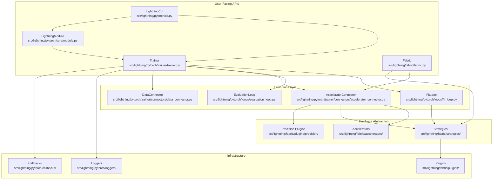
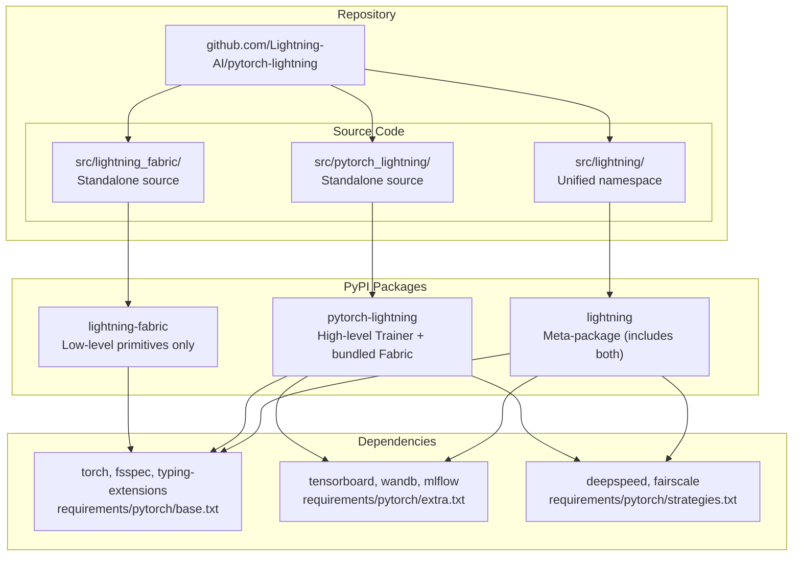
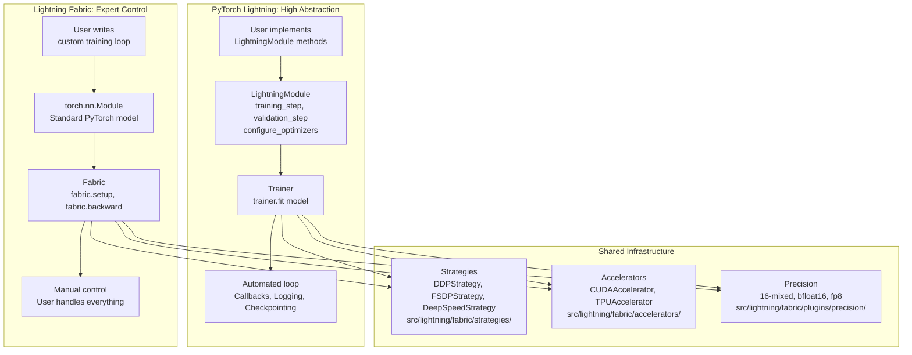
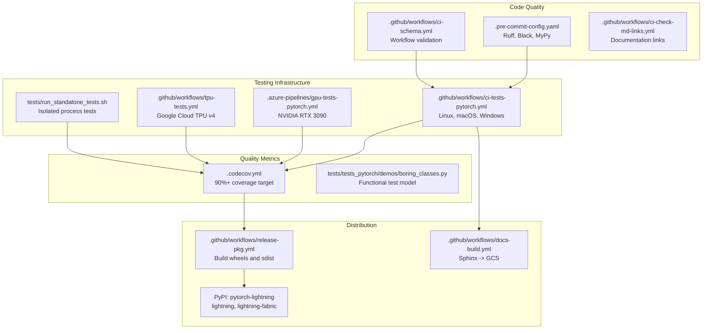
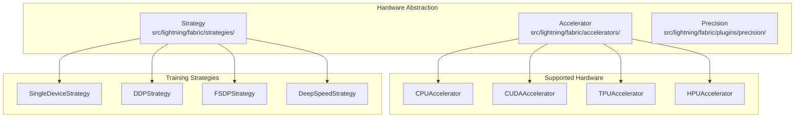

<!-- source: DeepWiki mcp.deepwiki.com · repo Lightning-AI/pytorch-lightning · page 1 Overview · fetched 2026-10-21 -->

# Overview

<details>
<summary>Relevant source files</summary>

The following files were used as context for generating this wiki page:

- [README.md](README.md)

</details>


## Purpose and Scope

This document provides a high-level introduction to the PyTorch Lightning ecosystem, covering the relationship between its core packages, architectural design principles, and development infrastructure. PyTorch Lightning is a comprehensive deep learning framework built on PyTorch that provides multiple levels of abstraction for training, deploying, and scaling AI models.

For detailed information about specific components, see:
- Core framework components: [Core Framework](#2)
- Distributed training strategies: [Distributed Training](#3)  
- Training system internals: [Training System](#4)
- Installation and deployment: [Installation and Deployment](#7)

## Lightning Ecosystem: Two Core Packages

Lightning consists of two core packages that provide different levels of abstraction over PyTorch. Users can choose between high-level automation (PyTorch Lightning) or low-level expert control (Lightning Fabric).

**Core Framework Architecture**



This architecture provides three-tier separation: User-Facing APIs provide different abstraction levels, Execution Layer handles training loops and configuration, Hardware Abstraction enables device-agnostic training, and Infrastructure provides cross-cutting concerns.

Sources: [README.md:74-78](), [src/pytorch_lightning/README.md:42-66](), [src/lightning/pytorch/trainer/trainer.py:1-50]()

## Package Distribution Strategy

Lightning uses a monorepo that publishes three installable packages. The `lightning` meta-package includes both `pytorch-lightning` and `lightning-fabric`, while the individual packages can be installed standalone.

**Package Structure and Distribution**



**Installation Options:**

| Command | Package | Contents |
|---------|---------|----------|
| `pip install lightning` | Meta-package | Both pytorch-lightning and lightning-fabric |
| `pip install pytorch-lightning` | Standalone | High-level Trainer with bundled Fabric source |
| `pip install lightning-fabric` | Standalone | Low-level primitives only (minimal) |
| `pip install lightning[all]` | With extras | Includes all optional dependencies |

Sources: [README.md:89-135](), [src/pytorch_lightning/README.md:94-142](), [Makefile:13-28]()

## Abstraction Continuum: PyTorch Lightning vs Fabric

Lightning provides granular control over abstraction level. Users can choose between automated training (PyTorch Lightning) or manual loop control (Fabric), or even mix both approaches.

**Design Philosophy Comparison**



**API Comparison:**

| Aspect | PyTorch Lightning | Lightning Fabric |
|--------|-------------------|------------------|
| Abstraction | High: define hooks in `LightningModule` | Low: write your own training loop |
| Training Loop | Automated by `Trainer` | Manual implementation |
| Best For | Standard supervised learning, rapid prototyping | Complex training (RL, GANs), custom workflows |
| Code Structure | Structured: separate train/val/test steps | Flexible: any loop structure |
| Entry Point | `trainer.fit(model)` | `fabric.launch()` then custom loop |

Both APIs share the same underlying distributed strategies, accelerators, and precision plugins, ensuring consistent behavior regardless of abstraction level.

Sources: [README.md:74-80](), [README.md:375-463](), [src/lightning_fabric/README.md:25-29]()

## Core Design Principles

Lightning's architecture follows several key principles documented in the contributing guidelines:

### No PyTorch Interference
Lightning does not add abstractions over PyTorch primitives. `LightningModule` is a standard `torch.nn.Module` subclass, and users can access all PyTorch functionality directly. This ensures researchers maintain full control without learning framework-specific patterns.

### Organized Code Structure
Lightning enforces separation of concerns:
- **Research code**: Model definition and training logic in `LightningModule`
- **Engineering code**: Device management, distributed training in `Trainer`
- **Non-essential code**: Logging, checkpointing in `Callbacks`
- **Data handling**: `DataLoader` or `LightningDataModule`

This structure makes code reusable and shareable across projects.

### Force Best Practices
Lightning implements established best practices as default behavior. For example, `validation_step` automatically sets the model to eval mode, preventing subtle bugs. When patterns become standard in the research community, Lightning incorporates them to reduce boilerplate.

### Backward Compatibility
All API changes maintain backward compatibility with deprecation warnings. Users can upgrade Lightning without breaking existing code. This principle is critical for production deployments.

### Simple External API
The API is designed for clarity over cleverness. Changes undergo validation to ensure they benefit the broader community, not just specific use cases.

Sources: [.github/CONTRIBUTING.md:8-50](), [src/pytorch_lightning/README.md:49-66]()

## Development and Testing Infrastructure

Lightning maintains rigorous quality assurance through automated testing across multiple platforms, Python versions, and PyTorch versions.

**CI/CD Pipeline Architecture**



**Test Execution:**

Lightning uses `pytest` with the `BoringModel` pattern for testing. The `BoringModel` is a minimal functional model used to test framework features without domain-specific complexity:

```python
# tests/tests_pytorch/demos/boring_classes.py
class BoringModel(LightningModule):
    def __init__(self):
        super().__init__()
        self.layer = torch.nn.Linear(32, 2)
    
    def training_step(self, batch, batch_idx):
        loss = self(batch).sum()
        return loss
```

This pattern allows testing trainer features, callbacks, and strategies independently of model complexity.

Sources: [.github/workflows/README.md:8-28](), [tests/README.md:1-36](), [.github/workflows/ci-schema.yml:1-16](), [Makefile:52-59]()

## Hardware and Strategy Support

Lightning provides extensive hardware accelerator support and distributed training strategies through its plugin architecture, allowing seamless scaling from single devices to multi-node clusters.

| Accelerator | Strategy | Configuration |
|-------------|----------|---------------|
| CPU | Single, DDP | `accelerator="cpu"` |
| GPU (CUDA) | Single, DDP, FSDP, DeepSpeed | `accelerator="gpu", devices=N` |
| TPU | Single, DDP | `accelerator="tpu", devices=8` |
| HPU (Habana) | Single, DDP | `accelerator="hpu", devices=N` |
| MPS (Apple) | Single | `accelerator="mps", devices=1` |



Sources: [README.md:234-255](), [docs/source-fabric/advanced/compile.rst:455-475](), [README.md:456-491]()

Lightning's modular architecture and comprehensive infrastructure make it suitable for research experimentation through production deployment, while maintaining PyTorch compatibility and providing multiple levels of abstraction to match user expertise and requirements.

---

