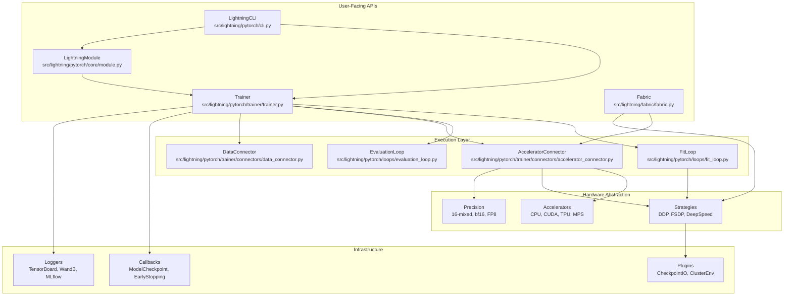
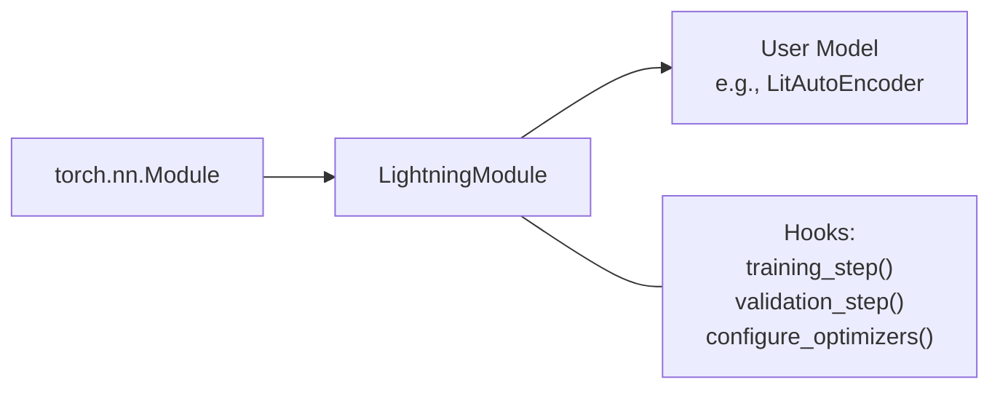
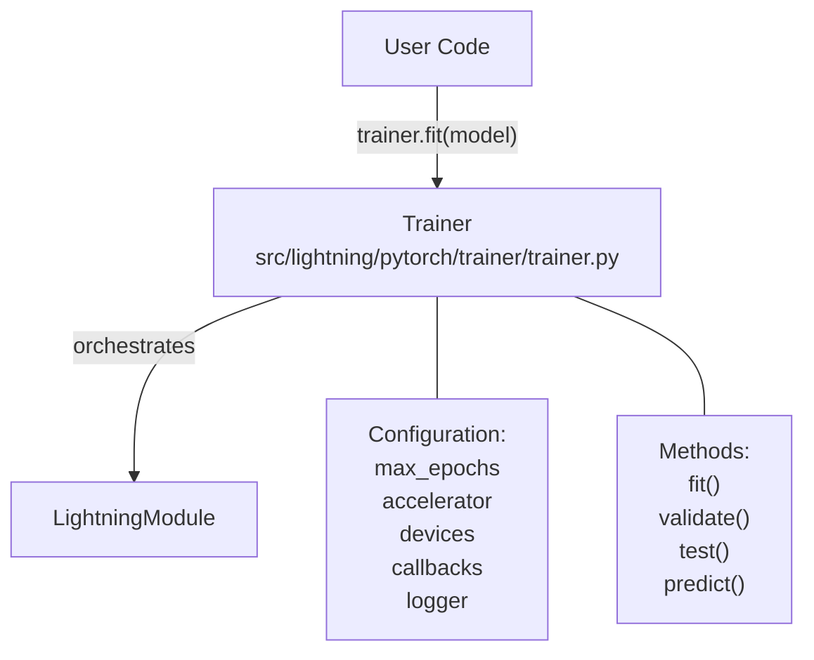
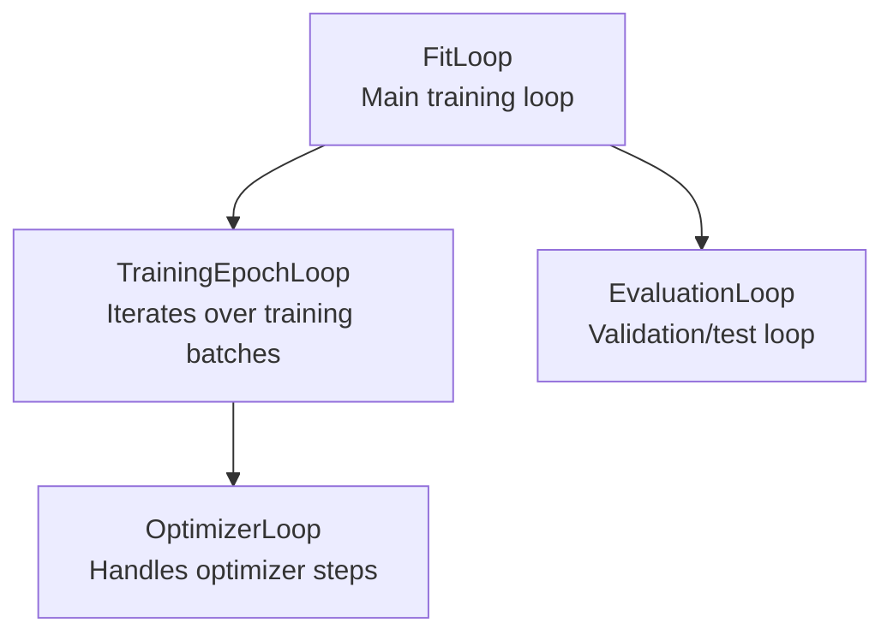
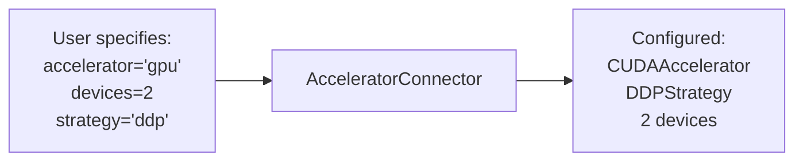
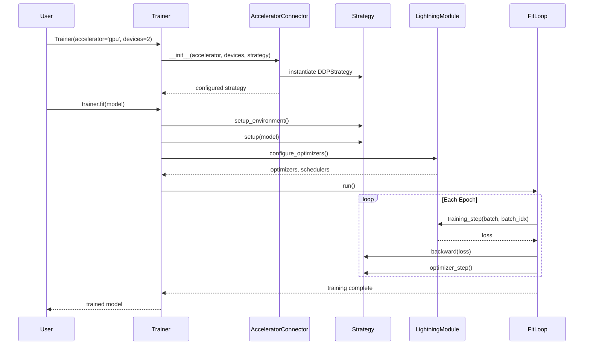
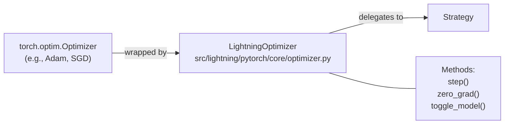
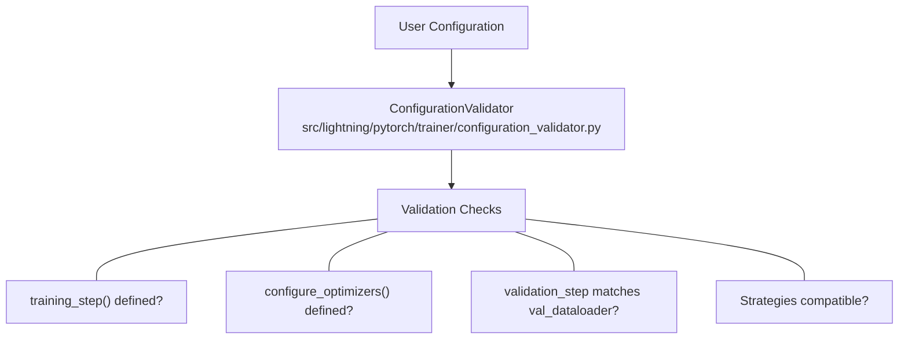

<!-- source: DeepWiki mcp.deepwiki.com · repo Lightning-AI/pytorch-lightning · page 2 Core Framework · fetched 2026-10-21 -->

# Core Framework

Relevant source files

The following files were used as context for generating this wiki page:

- [README.md](README.md)

## Purpose and Scope

This document provides an overview of the core framework components in PyTorch Lightning and Lightning Fabric. It describes the main architectural layers, their relationships, and how they enable scalable deep learning training. For detailed information about specific components, see:

- Comparison of high-level vs low-level APIs: [PyTorch Lightning vs Fabric](#2.1)
- Model abstraction details: [LightningModule](#2.2)
- Training orchestration: [Trainer](#2.3)
- Expert-level control: [Lightning Fabric](#2.4)
- Hardware configuration system: [Connector System](#2.5)

For information about distributed training strategies, see [Distributed Training](#3). For data handling, see [Data Handling](#5).

## Overview

PyTorch Lightning provides two complementary APIs for different levels of abstraction:

1. **PyTorch Lightning (High-Level)**: The `Trainer` class orchestrates `LightningModule` objects through automated training loops, providing a batteries-included approach with built-in features like callbacks, logging, and checkpointing.

2. **Lightning Fabric (Expert-Level)**: A minimal wrapper over PyTorch that provides distributed training primitives while letting users write their own training loops.

Both APIs share the same underlying infrastructure for hardware abstraction (accelerators, strategies, precision plugins), enabling code reuse and consistency across abstraction levels.

**Sources**: [README.md:1-634](), [src/lightning/pytorch/CHANGELOG.md]()

## Core Architecture

The framework is organized into four main layers:

**Sources**: [README.md:67-243](), [tests/tests_pytorch/trainer/test_trainer.py:68-76]()

## User-Facing APIs

### LightningModule

The `LightningModule` class extends `torch.nn.Module` with hooks for training, validation, and testing. It encapsulates:

- Model architecture (`forward()`)
- Training logic (`training_step()`, `validation_step()`, `test_step()`)
- Optimizer configuration (`configure_optimizers()`)
- Data loading (`train_dataloader()`, `val_dataloader()`, etc.)

**Example usage from codebase**:

[README.md:154-177]() shows a typical `LightningModule` implementation with `training_step()` and `configure_optimizers()`.

**Sources**: [README.md:138-192](), [tests/tests_pytorch/core/test_lightning_module.py:32-103]()

### Trainer

The `Trainer` class is the main entry point for high-level training automation. It handles:

- Training loop execution (`fit()`, `validate()`, `test()`, `predict()`)
- Hardware configuration (accelerators, devices, strategies)
- Callback management
- Logging and checkpointing
- Gradient accumulation and clipping

**Sources**: [README.md:188-192](), [tests/tests_pytorch/trainer/test_trainer.py:68-119]()

### Fabric

`Fabric` provides expert-level control with minimal abstractions. Key primitives:

- `fabric.setup(model, optimizer)` - wraps model and optimizer for distributed training
- `fabric.setup_dataloaders(dataloader)` - wraps dataloaders
- `fabric.backward(loss)` - handles distributed backward pass
- `fabric.launch()` - initializes distributed environment

Users write their own training loops while Fabric handles device management and distributed communication.

**Sources**: [README.md:375-463](), [tests/tests_pytorch/core/test_lightning_module.py:479-525]()

### LightningCLI

The `LightningCLI` class enables configuration-driven training through command-line arguments and YAML config files. It automatically parses:

- Model hyperparameters
- Trainer arguments
- Datamodule configuration
- Callbacks and loggers

**Sources**: [README.md:1-634]()

## Execution Layer

### Training Loops

The framework uses a hierarchical loop structure:

- **FitLoop**: Manages epochs, validation frequency, and early stopping checks
- **TrainingEpochLoop**: Iterates through training batches, calls `training_step()`
- **EvaluationLoop**: Handles validation, test, and prediction batches
- **OptimizerLoop**: Manages gradient accumulation and optimizer stepping

**Sources**: [tests/tests_pytorch/trainer/test_trainer.py:183-243](), [tests/tests_pytorch/trainer/properties/test_estimated_stepping_batches.py:30-105]()

### Connector System

Connectors configure the execution environment:

| Connector | Purpose | Location |
|-----------|---------|----------|
| `AcceleratorConnector` | Selects accelerator, strategy, and precision based on user config | `src/lightning/pytorch/trainer/connectors/accelerator_connector.py` |
| `DataConnector` | Attaches dataloaders to the trainer | `src/lightning/pytorch/trainer/connectors/data_connector.py` |

The `AcceleratorConnector` resolves hardware configuration during trainer initialization:

**Sources**: [tests/tests_pytorch/trainer/properties/test_estimated_stepping_batches.py:30-65]()

## Hardware Abstraction

### Accelerators

Accelerator classes provide device-agnostic interfaces:

- `CPUAccelerator` - CPU training
- `CUDAAccelerator` - NVIDIA GPU training  
- `MPSAccelerator` - Apple Silicon GPU training
- `TPUAccelerator` - Google TPU training via PyTorch/XLA

All accelerators implement a common interface for device management, tensor movement, and distributed initialization.

**Sources**: [README.md:245-267](), [tests/tests_pytorch/trainer/properties/test_estimated_stepping_batches.py:107-158]()

### Strategies

Strategy classes implement distributed training patterns:

- `SingleDeviceStrategy` - Single device (CPU or GPU)
- `DDPStrategy` - DistributedDataParallel for multi-GPU
- `FSDPStrategy` - Fully Sharded Data Parallel for memory efficiency
- `DeepSpeedStrategy` - Microsoft DeepSpeed with ZeRO optimization
- `XLAStrategy` - TPU training

Strategies handle:
- Model wrapping (e.g., `DistributedDataParallel`)
- Gradient synchronization
- Checkpoint save/load (sharded vs full state)

**Sources**: [README.md:245-267](), [tests/tests_pytorch/trainer/test_trainer.py:1-100]()

### Precision Plugins

Precision plugins manage mixed precision training:

- `Precision(precision="32-true")` - Full precision
- `Precision(precision="16-mixed")` - Automatic Mixed Precision
- `Precision(precision="bf16-mixed")` - BFloat16 mixed precision
- `TransformerEnginePrecision` - FP8 training for transformers
- `BitsandbytesPrecision` - Quantization

**Sources**: [README.md:269-277]()

## Infrastructure

### Callbacks

The `Callback` class provides hooks into the training lifecycle. Built-in callbacks include:

| Callback | Purpose | Key Hooks |
|----------|---------|-----------|
| `ModelCheckpoint` | Save model checkpoints | `on_validation_end`, `on_train_epoch_end` |
| `EarlyStopping` | Stop training when metric stops improving | `on_validation_end` |
| `Timer` | Track training time | `on_train_start`, `on_train_end` |
| `BackboneFinetuning` | Freeze/unfreeze model layers progressively | `freeze_before_training`, `finetune_function` |

**Sources**: [tests/tests_pytorch/trainer/test_trainer.py:306-345](), [tests/tests_pytorch/callbacks/test_finetuning_callback.py:43-119]()

### Loggers

Logger classes record metrics and artifacts to experiment tracking platforms:

- `TensorBoardLogger` - TensorBoard
- `WandbLogger` - Weights & Biases
- `MLFlowLogger` - MLflow
- `CometLogger` - Comet.ml
- `NeptuneLogger` - Neptune.ai

**Sources**: [README.md:280-301](), [tests/tests_pytorch/core/test_lightning_module.py:77-103]()

### Plugins

Plugins extend framework functionality:

- `CheckpointIO` - Custom checkpoint save/load logic
- `ClusterEnvironment` - Cluster-specific environment setup
- `PrecisionPlugin` - Custom precision handling

**Sources**: [README.md:1-634]()

## Component Interaction Flow

The following diagram illustrates the initialization and training flow:

**Sources**: [tests/tests_pytorch/trainer/test_trainer.py:68-119](), [tests/tests_pytorch/trainer/test_trainer.py:422-456]()

## Optimizer Management

The framework wraps optimizers in the `LightningOptimizer` class to handle distributed training logic:

The `LightningOptimizer`:
- Delegates `.step()` to `Strategy.optimizer_step()` for distributed coordination
- Provides `toggle_model()` context manager for advanced multi-optimizer scenarios
- Maintains reference to the original optimizer in `._optimizer`

**Example from tests**: [tests/tests_pytorch/core/test_lightning_optimizer.py:28-66]() shows how `LightningOptimizer` wraps user optimizers and maintains state synchronization.

**Sources**: [src/lightning/pytorch/core/optimizer.py:39-172](), [tests/tests_pytorch/core/test_lightning_optimizer.py:126-173]()

## Configuration and Validation

The trainer validates configuration before training:

Common validation checks include:
- `training_step()` is defined if calling `trainer.fit()`
- `configure_optimizers()` returns valid optimizer(s)
- Validation step/dataloader consistency
- Compatibility between manual optimization and trainer features

**Sources**: [tests/tests_pytorch/trainer/test_config_validator.py:28-163]()

## Model Export

Both `LightningModule` and models wrapped by `Fabric` support exporting to production formats:

| Method | Format | Use Case |
|--------|--------|----------|
| `model.to_torchscript()` | TorchScript | Production inference, C++ deployment |
| `model.to_onnx()` | ONNX | Cross-framework compatibility |

**Example**: [tests/tests_pytorch/models/test_torchscript.py:32-86]() demonstrates scripting and tracing `LightningModule` objects.

**Sources**: [README.md:327-349](), [tests/tests_pytorch/models/test_torchscript.py:32-230]()

## Key Abstractions Summary

| Component | Abstraction Level | Primary Responsibility |
|-----------|------------------|------------------------|
| `LightningModule` | High | Define model, training logic, optimizers |
| `Trainer` | High | Orchestrate training, handle infrastructure |
| `Fabric` | Low | Minimal distributed training primitives |
| `Strategy` | Mid | Implement distributed training patterns |
| `Accelerator` | Mid | Device management and operations |
| `Loop` | Mid | Control training/validation flow |
| `Callback` | High | Extend functionality via hooks |
| `LightningOptimizer` | Internal | Wrap optimizers for distributed training |

**Sources**: [README.md:1-634](), [tests/tests_pytorch/trainer/test_trainer.py:1-100](), [tests/tests_pytorch/core/test_lightning_module.py:32-103]()

---

