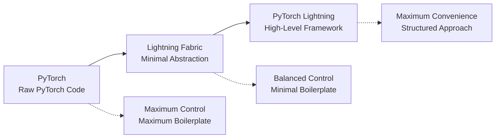
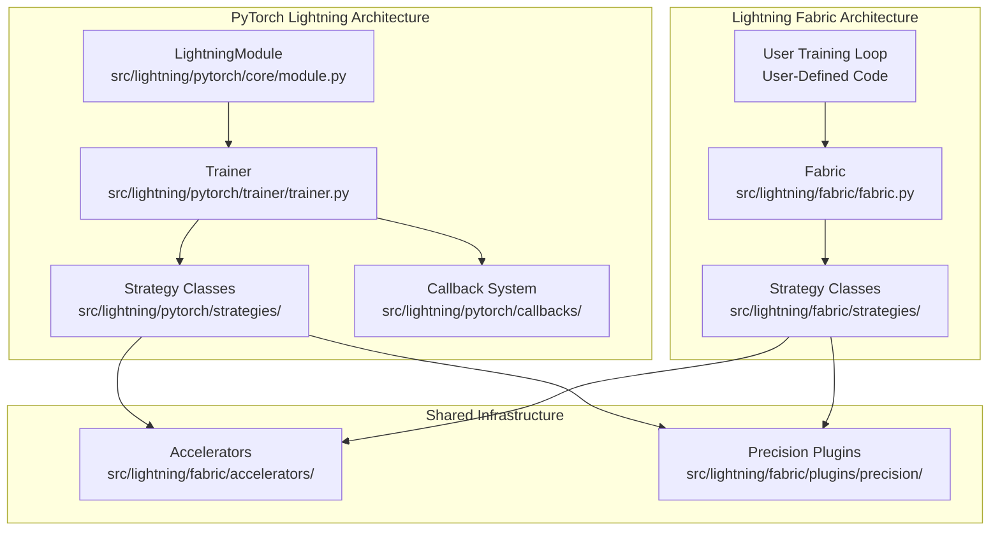
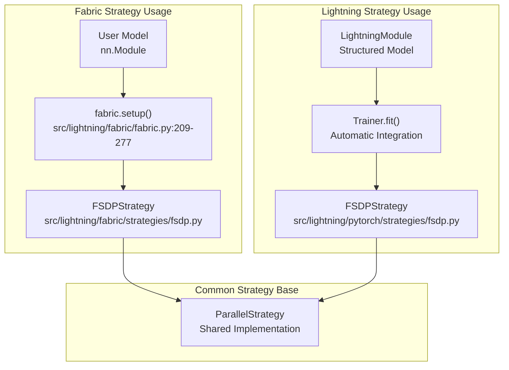
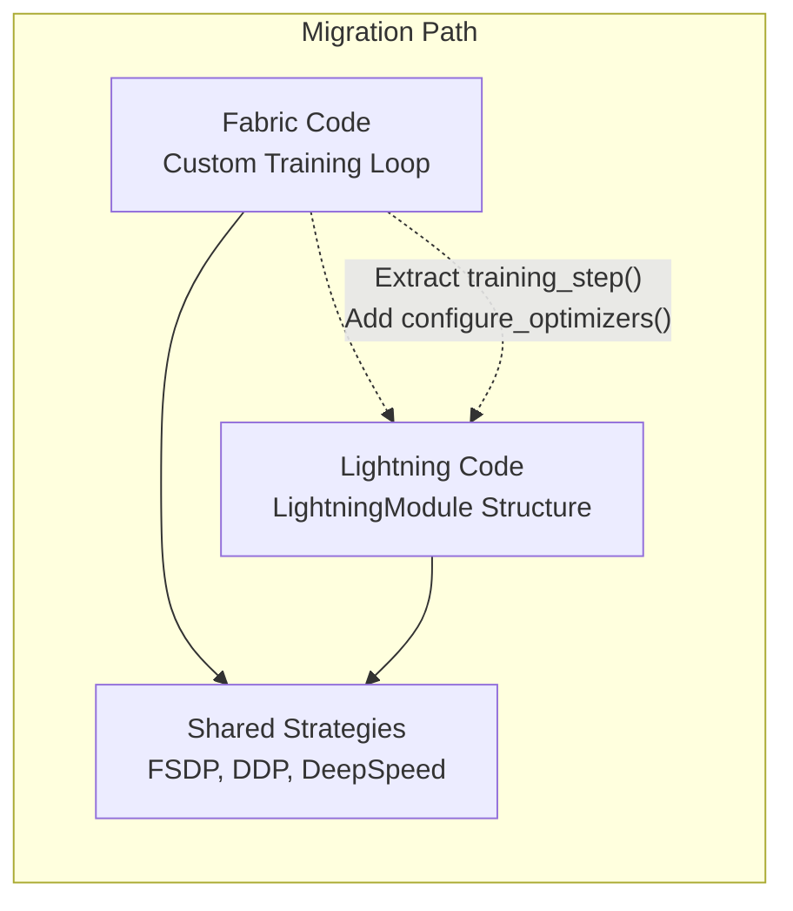
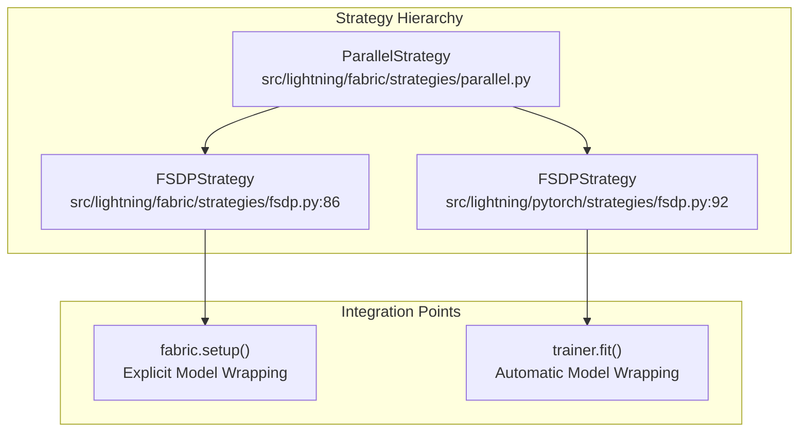

<!-- source: DeepWiki mcp.deepwiki.com · repo Lightning-AI/pytorch-lightning · page 2.1 PyTorch Lightning vs Fabric · fetched 2026-10-21 -->

# PyTorch Lightning vs Fabric

<details>
<summary>Relevant source files</summary>

The following files were used as context for generating this wiki page:

- [README.md](README.md)
- [docs/source-fabric/api/fabric_methods.rst](docs/source-fabric/api/fabric_methods.rst)
- [docs/source-fabric/api/wrappers.rst](docs/source-fabric/api/wrappers.rst)
- [src/lightning/fabric/CHANGELOG.md](src/lightning/fabric/CHANGELOG.md)
- [src/lightning/fabric/fabric.py](src/lightning/fabric/fabric.py)
- [src/lightning/fabric/strategies/ddp.py](src/lightning/fabric/strategies/ddp.py)
- [src/lightning/fabric/strategies/deepspeed.py](src/lightning/fabric/strategies/deepspeed.py)
- [src/lightning/fabric/strategies/fsdp.py](src/lightning/fabric/strategies/fsdp.py)
- [src/lightning/fabric/strategies/strategy.py](src/lightning/fabric/strategies/strategy.py)
- [src/lightning/pytorch/CHANGELOG.md](src/lightning/pytorch/CHANGELOG.md)
- [src/lightning/pytorch/core/module.py](src/lightning/pytorch/core/module.py)
- [src/lightning/pytorch/strategies/ddp.py](src/lightning/pytorch/strategies/ddp.py)
- [src/lightning/pytorch/strategies/deepspeed.py](src/lightning/pytorch/strategies/deepspeed.py)
- [src/lightning/pytorch/strategies/fsdp.py](src/lightning/pytorch/strategies/fsdp.py)
- [src/lightning/pytorch/strategies/strategy.py](src/lightning/pytorch/strategies/strategy.py)
- [tests/tests_fabric/strategies/test_ddp.py](tests/tests_fabric/strategies/test_ddp.py)
- [tests/tests_fabric/strategies/test_deepspeed.py](tests/tests_fabric/strategies/test_deepspeed.py)
- [tests/tests_fabric/strategies/test_deepspeed_integration.py](tests/tests_fabric/strategies/test_deepspeed_integration.py)
- [tests/tests_fabric/strategies/test_fsdp.py](tests/tests_fabric/strategies/test_fsdp.py)
- [tests/tests_fabric/strategies/test_fsdp_integration.py](tests/tests_fabric/strategies/test_fsdp_integration.py)
- [tests/tests_fabric/strategies/test_single_device.py](tests/tests_fabric/strategies/test_single_device.py)
- [tests/tests_fabric/test_fabric.py](tests/tests_fabric/test_fabric.py)
- [tests/tests_pytorch/models/test_onnx.py](tests/tests_pytorch/models/test_onnx.py)
- [tests/tests_pytorch/strategies/test_ddp.py](tests/tests_pytorch/strategies/test_ddp.py)
- [tests/tests_pytorch/strategies/test_ddp_integration.py](tests/tests_pytorch/strategies/test_ddp_integration.py)
- [tests/tests_pytorch/strategies/test_deepspeed.py](tests/tests_pytorch/strategies/test_deepspeed.py)
- [tests/tests_pytorch/strategies/test_fsdp.py](tests/tests_pytorch/strategies/test_fsdp.py)

</details>


This document explains the fundamental differences between PyTorch Lightning and Lightning Fabric, the two main frameworks within the Lightning ecosystem. It covers their architectural differences, use cases, and helps developers choose the appropriate tool for their needs.

For information about the overall Lightning ecosystem structure, see [Overview](#1). For detailed documentation of the Trainer class, see [Trainer](#2.3). For comprehensive Fabric API details, see [Lightning Fabric](#2.4).

## Conceptual Overview

PyTorch Lightning and Lightning Fabric represent different points on the abstraction spectrum, each targeting distinct user needs and development philosophies.

**PyTorch Lightning** is a high-level framework that organizes PyTorch code into structured components. It automates training loops, hardware management, and distributed training while enforcing best practices through its opinionated structure.

**Lightning Fabric** provides minimal abstraction over PyTorch, offering distributed training capabilities and hardware acceleration with maximum user control. It requires users to write their own training loops while handling the complex distributed setup.

### Abstraction Continuum



Sources: [README.md:64-75](), [README.md:363-368]()

## Architecture Comparison

The two frameworks have fundamentally different architectural approaches, reflected in their core classes and responsibilities.

### Core Framework Components



Sources: [src/lightning/fabric/fabric.py:86-142](), [src/lightning/pytorch/strategies/fsdp.py:92-142]()

### Strategy Implementation Comparison

Both frameworks share strategy implementations for distributed training, but with different integration patterns:



Sources: [src/lightning/fabric/strategies/fsdp.py:86-155](), [src/lightning/pytorch/strategies/fsdp.py:144-195]()

## API Surface Comparison

The API design reflects each framework's philosophy regarding user control and automation.

### Fabric API - Explicit Control

Fabric's API requires explicit calls for each training component:

| Operation | Fabric Method | File Reference |
|-----------|---------------|----------------|
| Model Setup | `fabric.setup(model, optimizer)` | [src/lightning/fabric/fabric.py:209-277]() |
| DataLoader Setup | `fabric.setup_dataloaders(dataloader)` | [src/lightning/fabric/fabric.py:351-377]() |
| Backward Pass | `fabric.backward(loss)` | [src/lightning/fabric/fabric.py:554-570]() |
| Process Launch | `fabric.launch()` | [src/lightning/fabric/fabric.py:616-678]() |

### Lightning API - Automated Workflow

Lightning's API abstracts the training loop through structured hooks:

| Component | Lightning Method | File Reference |
|-----------|------------------|----------------|
| Model Definition | `LightningModule.training_step()` | [src/lightning/pytorch/core/module.py]() |
| Optimizer Config | `LightningModule.configure_optimizers()` | [src/lightning/pytorch/core/module.py]() |
| Training Execution | `Trainer.fit(model, dataloader)` | [src/lightning/pytorch/trainer/trainer.py]() |
| Validation | `LightningModule.validation_step()` | [src/lightning/pytorch/core/module.py]() |

Sources: [src/lightning/fabric/fabric.py:86-142](), [README.md:128-181]()

## Code Organization Differences

The frameworks organize distributed training differently, impacting how users structure their code.

### Fabric Code Pattern

```python
# Minimal changes to existing PyTorch code
fabric = Fabric(accelerator="gpu", devices=8, strategy="fsdp")
fabric.launch()

model = MyModel()
optimizer = torch.optim.Adam(model.parameters())
model, optimizer = fabric.setup(model, optimizer)

dataloader = fabric.setup_dataloaders(dataloader)

# User-written training loop
for batch in dataloader:
    optimizer.zero_grad()
    loss = model(batch)
    fabric.backward(loss)
    optimizer.step()
```

### Lightning Code Pattern

```python
# Structured approach with predefined hooks
class MyLightningModule(LightningModule):
    def training_step(self, batch, batch_idx):
        loss = self.model(batch)
        return loss
    
    def configure_optimizers(self):
        return torch.optim.Adam(self.parameters())

# Automated training execution
trainer = Trainer(accelerator="gpu", devices=8, strategy="fsdp")
trainer.fit(model, dataloader)
```

Sources: [README.md:417-446](), [README.md:131-181]()

## Use Case Guidelines

### Choose Lightning Fabric When:

- **Existing PyTorch Codebase**: Minimal migration effort from existing PyTorch training scripts
- **Custom Training Loops**: Need for specialized training procedures not covered by standard hooks
- **Research Prototyping**: Rapid experimentation with new training methodologies
- **Fine-grained Control**: Requirement for explicit control over training step execution

### Choose PyTorch Lightning When:

- **Production Training**: Standardized, reproducible training workflows
- **Team Collaboration**: Enforced code organization and best practices
- **Complex Workflows**: Multi-stage training, validation, and testing procedures
- **Rich Ecosystem**: Integration with callbacks, loggers, and profilers

### Migration Considerations

Both frameworks share the same underlying strategy implementations, making migration possible:



Sources: [src/lightning/fabric/strategies/fsdp.py:86-155](), [src/lightning/pytorch/strategies/fsdp.py:144-195](), [tests/tests_fabric/test_fabric.py:77-119]()

## Strategy Implementation Inheritance

Both frameworks leverage shared strategy base classes, ensuring consistent distributed training behavior:



Sources: [src/lightning/fabric/strategies/fsdp.py:86-155](), [src/lightning/pytorch/strategies/fsdp.py:92-195](), [src/lightning/fabric/strategies/parallel.py]()

---

