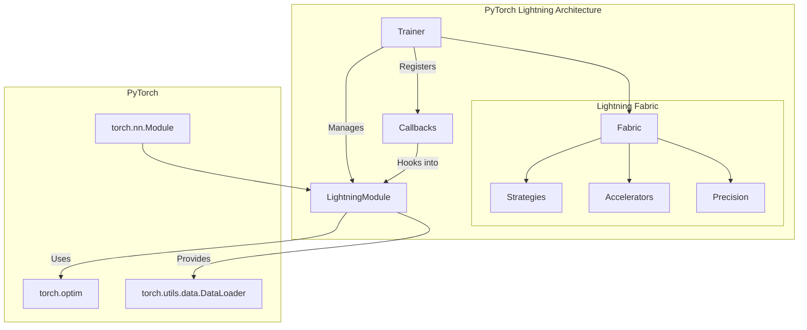
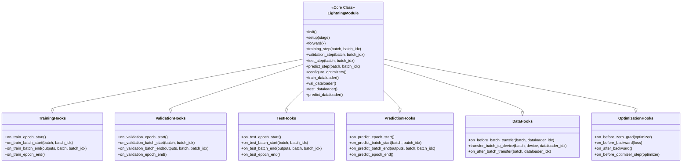
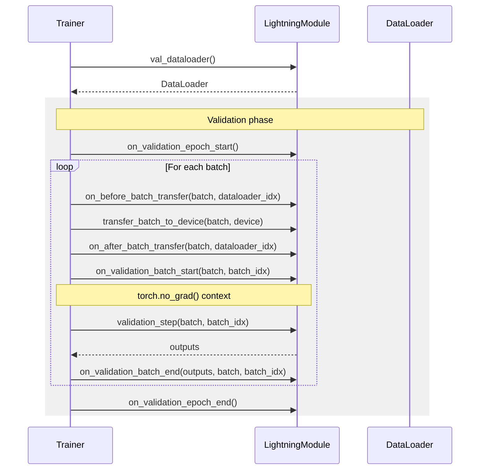
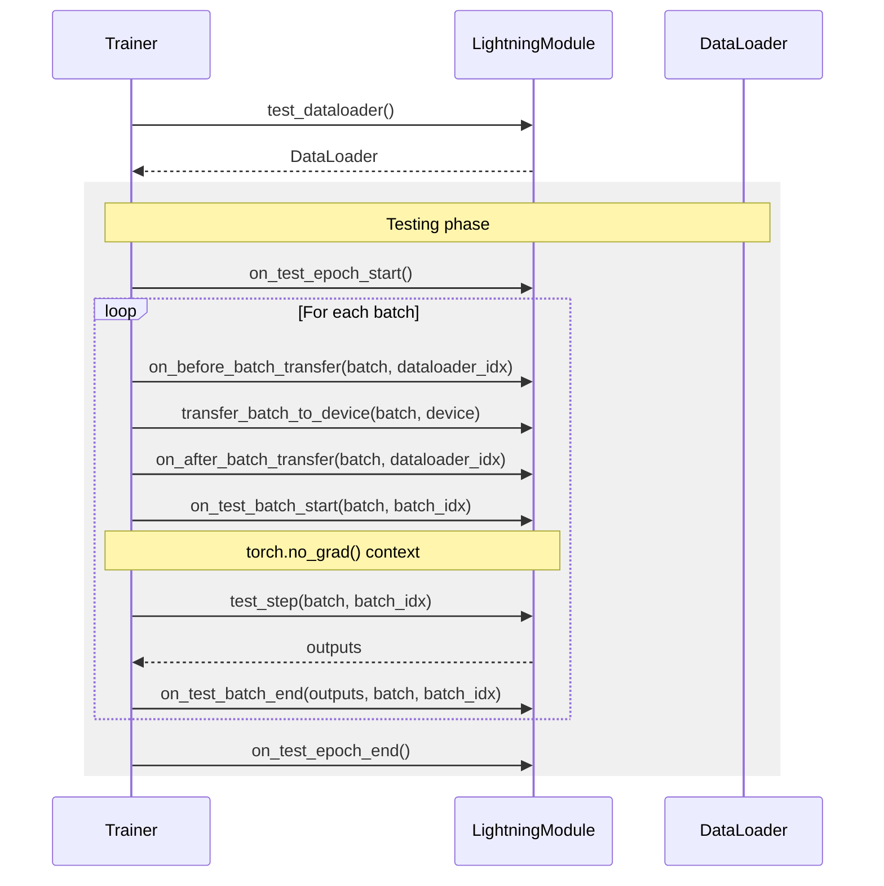
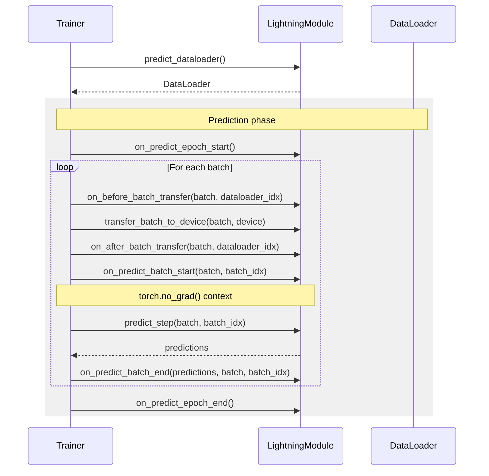
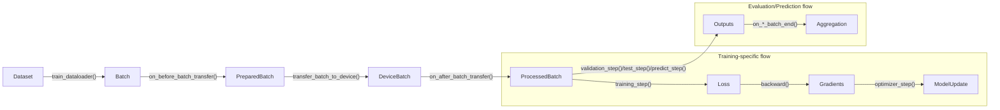

<!-- source: DeepWiki mcp.deepwiki.com · repo Lightning-AI/pytorch-lightning · page 2.2 LightningModule · fetched 2026-10-21 -->

# LightningModule

<details>
<summary>Relevant source files</summary>

The following files were used as context for generating this wiki page:

- [README.md](README.md)
- [docs/source-pytorch/common/lightning_module.rst](docs/source-pytorch/common/lightning_module.rst)
- [docs/source-pytorch/common/trainer.rst](docs/source-pytorch/common/trainer.rst)
- [src/lightning/pytorch/callbacks/callback.py](src/lightning/pytorch/callbacks/callback.py)
- [src/lightning/pytorch/callbacks/device_stats_monitor.py](src/lightning/pytorch/callbacks/device_stats_monitor.py)
- [src/lightning/pytorch/core/hooks.py](src/lightning/pytorch/core/hooks.py)
- [src/lightning/pytorch/loops/evaluation_loop.py](src/lightning/pytorch/loops/evaluation_loop.py)
- [src/lightning/pytorch/loops/fetchers.py](src/lightning/pytorch/loops/fetchers.py)
- [src/lightning/pytorch/loops/fit_loop.py](src/lightning/pytorch/loops/fit_loop.py)
- [src/lightning/pytorch/loops/prediction_loop.py](src/lightning/pytorch/loops/prediction_loop.py)
- [src/lightning/pytorch/loops/training_epoch_loop.py](src/lightning/pytorch/loops/training_epoch_loop.py)
- [src/lightning/pytorch/loops/utilities.py](src/lightning/pytorch/loops/utilities.py)
- [src/lightning/pytorch/trainer/connectors/data_connector.py](src/lightning/pytorch/trainer/connectors/data_connector.py)
- [src/lightning/pytorch/trainer/trainer.py](src/lightning/pytorch/trainer/trainer.py)
- [src/lightning/pytorch/utilities/combined_loader.py](src/lightning/pytorch/utilities/combined_loader.py)
- [tests/tests_pytorch/core/test_lightning_module.py](tests/tests_pytorch/core/test_lightning_module.py)
- [tests/tests_pytorch/loops/test_evaluation_loop.py](tests/tests_pytorch/loops/test_evaluation_loop.py)
- [tests/tests_pytorch/loops/test_fetchers.py](tests/tests_pytorch/loops/test_fetchers.py)
- [tests/tests_pytorch/loops/test_prediction_loop.py](tests/tests_pytorch/loops/test_prediction_loop.py)
- [tests/tests_pytorch/loops/test_training_epoch_loop.py](tests/tests_pytorch/loops/test_training_epoch_loop.py)
- [tests/tests_pytorch/models/test_hooks.py](tests/tests_pytorch/models/test_hooks.py)
- [tests/tests_pytorch/trainer/connectors/test_data_connector.py](tests/tests_pytorch/trainer/connectors/test_data_connector.py)
- [tests/tests_pytorch/trainer/flags/test_overfit_batches.py](tests/tests_pytorch/trainer/flags/test_overfit_batches.py)
- [tests/tests_pytorch/trainer/properties/test_estimated_stepping_batches.py](tests/tests_pytorch/trainer/properties/test_estimated_stepping_batches.py)
- [tests/tests_pytorch/trainer/test_dataloaders.py](tests/tests_pytorch/trainer/test_dataloaders.py)
- [tests/tests_pytorch/trainer/test_trainer.py](tests/tests_pytorch/trainer/test_trainer.py)
- [tests/tests_pytorch/utilities/test_combined_loader.py](tests/tests_pytorch/utilities/test_combined_loader.py)
- [tests/tests_pytorch/utilities/test_enums.py](tests/tests_pytorch/utilities/test_enums.py)

</details>


The LightningModule is a core component of the PyTorch Lightning framework that organizes your PyTorch code into a structured format. It serves as the main building block for defining models, with clear separation of training logic, validation processes, testing procedures, and prediction workflows.

For information about the Trainer that works with LightningModule, see [Trainer](#2.2).

## Overview

The LightningModule extends PyTorch's `nn.Module` by adding standardized hooks and methods that streamline the training lifecycle. By using this class, you can:

- Define all model components in one place
- Standardize the training, validation, testing, and prediction workflows
- Make your model hardware-agnostic
- Reduce boilerplate code compared to raw PyTorch
- Easily integrate with the Lightning Trainer for automated training



Sources:
- [README.md:89-146](https://github.com/Lightning-AI/pytorch-lightning/blob/master/README.md)
- [src/lightning/pytorch/trainer/trainer.py:89-146](https://github.com/Lightning-AI/pytorch-lightning/blob/master/src/lightning/pytorch/trainer/trainer.py)
- [docs/source-pytorch/common/lightning_module.rst:1-76](https://github.com/Lightning-AI/pytorch-lightning/blob/master/docs/source-pytorch/common/lightning_module.rst)

## Core Structure

A LightningModule organizes PyTorch code into 6 key sections:

1. **Initialization** (`__init__` and `setup`)
2. **Train Loop** (`training_step` and related hooks)
3. **Validation Loop** (`validation_step` and related hooks)
4. **Test Loop** (`test_step` and related hooks)
5. **Prediction Loop** (`predict_step` and related hooks)
6. **Optimizers and LR Schedulers** (`configure_optimizers`)



Sources:
- [docs/source-pytorch/common/lightning_module.rst:10-22](https://github.com/Lightning-AI/pytorch-lightning/blob/master/docs/source-pytorch/common/lightning_module.rst)
- [src/lightning/pytorch/core/hooks.py:14-70](https://github.com/Lightning-AI/pytorch-lightning/blob/master/src/lightning/pytorch/core/hooks.py)

## Basic Implementation

Here's an example of a minimal LightningModule implementation:

```python
import torch
import lightning as L

class LitModel(L.LightningModule):
    def __init__(self):
        super().__init__()
        self.layer = torch.nn.Linear(28 * 28, 10)
        
    def forward(self, x):
        return torch.relu(self.layer(x.view(x.size(0), -1)))
    
    def training_step(self, batch, batch_idx):
        x, y = batch
        y_hat = self(x)
        loss = torch.nn.functional.cross_entropy(y_hat, y)
        self.log("train_loss", loss)
        return loss
    
    def validation_step(self, batch, batch_idx):
        x, y = batch
        y_hat = self(x)
        loss = torch.nn.functional.cross_entropy(y_hat, y)
        self.log("val_loss", loss)
        
    def configure_optimizers(self):
        return torch.optim.Adam(self.parameters(), lr=0.001)
```

Sources:
- [docs/source-pytorch/common/lightning_module.rst:87-109](https://github.com/Lightning-AI/pytorch-lightning/blob/master/docs/source-pytorch/common/lightning_module.rst)
- [README.md:133-162](https://github.com/Lightning-AI/pytorch-lightning/blob/master/README.md)

## Training Loop Flow

The LightningModule centralizes the training logic in the `training_step` method. Underneath, the Trainer orchestrates a complex flow of operations.

```mermaid
sequenceDiagram
    participant TR as Trainer
    participant LM as LightningModule
    participant DL as DataLoader
    participant OPT as Optimizer
    
    TR->>LM: setup(stage="fit")
    TR->>LM: configure_optimizers()
    LM-->>TR: optimizer(s)
    TR->>LM: train_dataloader()
    LM-->>TR: DataLoader
    
    rect rgb(240, 240, 240)
        Note over TR,OPT: For each epoch
        TR->>LM: on_train_epoch_start()
        
        loop For each batch
            TR->>LM: on_before_batch_transfer(batch, dataloader_idx)
            TR->>LM: transfer_batch_to_device(batch, device)
            TR->>LM: on_after_batch_transfer(batch, dataloader_idx)
            TR->>LM: on_train_batch_start(batch, batch_idx)
            TR->>LM: training_step(batch, batch_idx)
            LM-->>TR: loss
            TR->>LM: on_before_zero_grad(optimizer)
            TR->>OPT: zero_grad()
            TR->>LM: on_before_backward(loss)
            Note over TR,LM: loss.backward()
            TR->>LM: on_after_backward()
            TR->>LM: on_before_optimizer_step(optimizer)
            TR->>OPT: step()
            TR->>LM: on_train_batch_end(outputs, batch, batch_idx)
        end
        
        TR->>LM: on_train_epoch_end()
    end
```

In the training step, you return the loss value that will be used for backpropagation:

```python
def training_step(self, batch, batch_idx):
    x, y = batch
    y_hat = self(x)
    loss = torch.nn.functional.cross_entropy(y_hat, y)
    # Log metrics to be monitored
    self.log("train_loss", loss, on_step=True, on_epoch=True, prog_bar=True)
    # Return loss for backpropagation
    return loss
```

Sources:
- [src/lightning/pytorch/loops/training_epoch_loop.py:48-100](https://github.com/Lightning-AI/pytorch-lightning/blob/master/src/lightning/pytorch/loops/training_epoch_loop.py)
- [src/lightning/pytorch/loops/fit_loop.py:58-110](https://github.com/Lightning-AI/pytorch-lightning/blob/master/src/lightning/pytorch/loops/fit_loop.py)
- [docs/source-pytorch/common/lightning_module.rst:152-207](https://github.com/Lightning-AI/pytorch-lightning/blob/master/docs/source-pytorch/common/lightning_module.rst)

## Validation Loop Flow

The validation flow follows a similar pattern but without gradient calculation or optimizer updates:



The `validation_step` typically involves a forward pass through your model and computation of validation metrics:

```python
def validation_step(self, batch, batch_idx):
    x, y = batch
    y_hat = self(x)
    loss = torch.nn.functional.cross_entropy(y_hat, y)
    preds = torch.argmax(y_hat, dim=1)
    acc = (preds == y).float().mean()
    # Log metrics
    self.log("val_loss", loss)
    self.log("val_acc", acc)
    # Return values for later use if needed
    return {"val_loss": loss, "val_acc": acc}
```

Sources:
- [src/lightning/pytorch/loops/evaluation_loop.py:57-117](https://github.com/Lightning-AI/pytorch-lightning/blob/master/src/lightning/pytorch/loops/evaluation_loop.py)
- [docs/source-pytorch/common/lightning_module.rst:262-303](https://github.com/Lightning-AI/pytorch-lightning/blob/master/docs/source-pytorch/common/lightning_module.rst)

## Test Loop Flow

Testing follows the same pattern as validation but is typically run after training is complete:



The `test_step` is similar to `validation_step` but is used for final model evaluation:

```python
def test_step(self, batch, batch_idx):
    x, y = batch
    y_hat = self(x)
    loss = torch.nn.functional.cross_entropy(y_hat, y)
    preds = torch.argmax(y_hat, dim=1)
    acc = (preds == y).float().mean()
    # Log metrics
    self.log("test_loss", loss)
    self.log("test_acc", acc)
    return {"test_loss": loss, "test_acc": acc}
```

Sources:
- [src/lightning/pytorch/loops/evaluation_loop.py:57-117](https://github.com/Lightning-AI/pytorch-lightning/blob/master/src/lightning/pytorch/loops/evaluation_loop.py)
- [docs/source-pytorch/common/lightning_module.rst:374-402](https://github.com/Lightning-AI/pytorch-lightning/blob/master/docs/source-pytorch/common/lightning_module.rst)

## Prediction Loop Flow

The prediction loop is used for inference without any metric calculation:



The `predict_step` method is used for generating model predictions:

```python
def predict_step(self, batch, batch_idx, dataloader_idx=0):
    x = batch
    return self(x)
```

Sources:
- [src/lightning/pytorch/loops/prediction_loop.py:47-104](https://github.com/Lightning-AI/pytorch-lightning/blob/master/src/lightning/pytorch/loops/prediction_loop.py)
- [docs/source-pytorch/common/lightning_module.rst:407-420](https://github.com/Lightning-AI/pytorch-lightning/blob/master/docs/source-pytorch/common/lightning_module.rst)

## Data Flow Pipeline

Data flow in PyTorch Lightning is handled through a series of hooks that process the data at different stages:



You can customize the data loading and processing through several methods:

```python
def train_dataloader(self):
    return DataLoader(MyDataset(), batch_size=32)

def val_dataloader(self):
    return DataLoader(MyValDataset(), batch_size=32)

def test_dataloader(self):
    return DataLoader(MyTestDataset(), batch_size=32)

def predict_dataloader(self):
    return DataLoader(MyPredictDataset(), batch_size=32)

def on_before_batch_transfer(self, batch, dataloader_idx):
    # Preprocess data before device transfer
    return batch

def transfer_batch_to_device(self, batch, device, dataloader_idx):
    # Custom device transfer logic
    return batch.to(device)

def on_after_batch_transfer(self, batch, dataloader_idx):
    # Additional preprocessing after device transfer
    return batch
```

Sources:
- [src/lightning/pytorch/trainer/connectors/data_connector.py:46-170](https://github.com/Lightning-AI/pytorch-lightning/blob/master/src/lightning/pytorch/trainer/connectors/data_connector.py)
- [tests/tests_pytorch/trainer/test_dataloaders.py:67-110](https://github.com/Lightning-AI/pytorch-lightning/blob/master/tests/tests_pytorch/trainer/test_dataloaders.py)
- [docs/source-pytorch/common/lightning_module.rst:469-506](https://github.com/Lightning-AI/pytorch-lightning/blob/master/docs/source-pytorch/common/lightning_module.rst)

## Optimization Configuration

The LightningModule's `configure_optimizers` method allows you to define how your model should be optimized:

```python
# Simple optimizer
def configure_optimizers(self):
    return torch.optim.Adam(self.parameters(), lr=0.001)

# Optimizer with learning rate scheduler
def configure_optimizers(self):
    optimizer = torch.optim.Adam(self.parameters(), lr=0.001)
    scheduler = torch.optim.lr_scheduler.ReduceLROnPlateau(optimizer)
    return {
        "optimizer": optimizer,
        "lr_scheduler": scheduler,
        "monitor": "val_loss"
    }

# Multiple optimizers
def configure_optimizers(self):
    optimizer1 = torch.optim.Adam(self.generator.parameters(), lr=0.001)
    optimizer2 = torch.optim.Adam(self.discriminator.parameters(), lr=0.001)
    return [optimizer1, optimizer2]
```

Sources:
- [docs/source-pytorch/common/lightning_module.rst:626-718](https://github.com/Lightning-AI/pytorch-lightning/blob/master/docs/source-pytorch/common/lightning_module.rst)
- [tests/tests_pytorch/core/test_lightning_module.py:105-120](https://github.com/Lightning-AI/pytorch-lightning/blob/master/tests/tests_pytorch/core/test_lightning_module.py)

## Manual Optimization

By default, Lightning handles the optimization process automatically. However, you can take manual control of the optimization process by setting `self.automatic_optimization = False`:

```python
def __init__(self):
    super().__init__()
    self.automatic_optimization = False

def training_step(self, batch, batch_idx):
    # Get optimizers
    opt_a, opt_b = self.optimizers()
    
    # Optimize generator
    x, y = batch
    opt_a.zero_grad()
    y_hat = self.generator(x)
    loss_a = self.generator_loss(y_hat, y)
    self.manual_backward(loss_a)
    opt_a.step()
    
    # Optimize discriminator
    opt_b.zero_grad()
    y_hat = self.discriminator(x)
    loss_b = self.discriminator_loss(y_hat, y)
    self.manual_backward(loss_b)
    opt_b.step()
    
    return {"loss_a": loss_a, "loss_b": loss_b}
```

When using manual optimization, you're responsible for:
- Calling `optimizer.zero_grad()`
- Using `self.manual_backward(loss)` instead of `loss.backward()`
- Calling `optimizer.step()`

Sources:
- [docs/source-pytorch/common/lightning_module.rst:720-774](https://github.com/Lightning-AI/pytorch-lightning/blob/master/docs/source-pytorch/common/lightning_module.rst)
- [src/lightning/pytorch/loops/optimization/manual.py:1-60](https://github.com/Lightning-AI/pytorch-lightning/blob/master/src/lightning/pytorch/loops/optimization/manual.py)

## Multiple Dataloaders

Lightning makes it easy to work with multiple dataloaders for validation, testing and prediction:

```python
# In your LightningModule
def val_dataloader(self):
    return [
        DataLoader(Dataset1()),
        DataLoader(Dataset2()),
    ]

def validation_step(self, batch, batch_idx, dataloader_idx=0):
    if dataloader_idx == 0:
        # Handle first dataloader
        x, y = batch
    else:
        # Handle second dataloader
        x, y, z = batch
    
    # Rest of validation step
    loss = ...
    self.log(f"val_loss_{dataloader_idx}", loss)
    return loss
```

This pattern also applies to test and predict dataloaders.

Sources:
- [tests/tests_pytorch/trainer/test_dataloaders.py:46-64](https://github.com/Lightning-AI/pytorch-lightning/blob/master/tests/tests_pytorch/trainer/test_dataloaders.py)
- [src/lightning/pytorch/utilities/combined_loader.py:1-70](https://github.com/Lightning-AI/pytorch-lightning/blob/master/src/lightning/pytorch/utilities/combined_loader.py)

## Handling Device Transfer

Lightning automatically handles transferring your data to the appropriate device (CPU, GPU, TPU, etc.). It provides hooks for customizing this process:

```python
class CustomBatchModule(LightningModule):
    def on_before_batch_transfer(self, batch, dataloader_idx):
        # Called before transferring batch to device
        # You can do data augmentation here
        return batch
    
    def transfer_batch_to_device(self, batch, device, dataloader_idx):
        # Custom logic for transferring to device
        if isinstance(batch, CustomBatch):
            batch.x = batch.x.to(device)
            batch.y = batch.y.to(device)
            return batch
        return super().transfer_batch_to_device(batch, device, dataloader_idx)
    
    def on_after_batch_transfer(self, batch, dataloader_idx):
        # Called after transferring batch to device
        # You can normalize data here
        return batch
```

Sources:
- [tests/tests_pytorch/models/test_hooks.py:30-52](https://github.com/Lightning-AI/pytorch-lightning/blob/master/tests/tests_pytorch/models/test_hooks.py)
- [tests/tests_pytorch/models/test_hooks.py:111-159](https://github.com/Lightning-AI/pytorch-lightning/blob/master/tests/tests_pytorch/models/test_hooks.py)

## Integration with the Trainer

The LightningModule is designed to be used with the Trainer class, which automates the training process:

```python
# Define your model
model = MyLightningModule()

# Define trainer with desired options
trainer = Trainer(
    max_epochs=10,
    accelerator="gpu",
    devices=1,
    precision="16-mixed"
)

# Train the model
trainer.fit(model, train_dataloaders, val_dataloaders)

# Evaluate the model
trainer.test(model, test_dataloaders)

# Generate predictions
predictions = trainer.predict(model, predict_dataloaders)
```

The Trainer handles:
- Moving data to the appropriate device
- Calling the appropriate hooks at the right time
- Managing distributed training
- Handling precision (16-bit, 32-bit, etc.)
- Logging, checkpointing, and callbacks

Sources:
- [src/lightning/pytorch/trainer/trainer.py:513-569](https://github.com/Lightning-AI/pytorch-lightning/blob/master/src/lightning/pytorch/trainer/trainer.py)
- [docs/source-pytorch/common/trainer.rst:10-44](https://github.com/Lightning-AI/pytorch-lightning/blob/master/docs/source-pytorch/common/trainer.rst)

## Logging Metrics

LightningModule provides a convenient `log` method for logging metrics:

```python
def training_step(self, batch, batch_idx):
    x, y = batch
    y_hat = self(x)
    loss = F.cross_entropy(y_hat, y)
    
    # Log training loss
    self.log("train_loss", loss, on_step=True, on_epoch=True, prog_bar=True, logger=True)
    
    # You can also log other metrics
    preds = torch.argmax(y_hat, dim=1)
    acc = (preds == y).float().mean()
    self.log("train_acc", acc, on_step=True, on_epoch=True)
    
    return loss
```

The `log` method parameters include:
- `name`: The metric name
- `value`: The metric value
- `on_step`: Whether to log per step
- `on_epoch`: Whether to log epoch-aggregated metrics
- `prog_bar`: Whether to display in the progress bar
- `logger`: Whether to send to loggers
- `sync_dist`: Whether to sync across distributed processes

Sources:
- [docs/source-pytorch/common/lightning_module.rst:192-228](https://github.com/Lightning-AI/pytorch-lightning/blob/master/docs/source-pytorch/common/lightning_module.rst)
- [tests/tests_pytorch/models/test_hooks.py:74-104](https://github.com/Lightning-AI/pytorch-lightning/blob/master/tests/tests_pytorch/models/test_hooks.py)

## Summary

The LightningModule is the central component of PyTorch Lightning that:

1. **Organizes your PyTorch code** into a clear, structured format
2. **Abstracts away boilerplate** for training, validation, testing, and prediction
3. **Makes your models hardware-agnostic** by handling device placement
4. **Integrates with the Trainer** for automatic training orchestration
5. **Provides hooks** for customizing every step of the training process
6. **Supports distributed training** with minimal code changes
7. **Cleanly separates research code** from engineering boilerplate

By using a LightningModule, you can focus on your model's core logic while Lightning handles the engineering infrastructure.

Sources:
- [README.md:335-345](https://github.com/Lightning-AI/pytorch-lightning/blob/master/README.md)
- [docs/source-pytorch/common/lightning_module.rst:10-76](https://github.com/Lightning-AI/pytorch-lightning/blob/master/docs/source-pytorch/common/lightning_module.rst)

---

