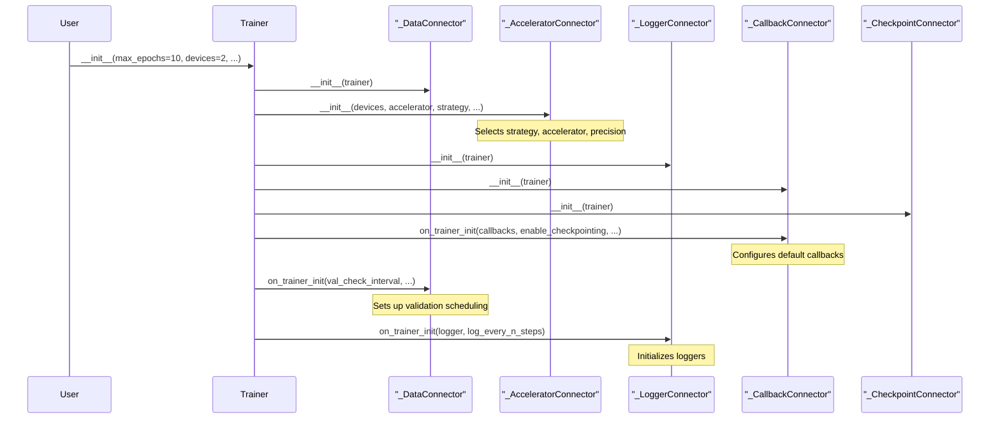
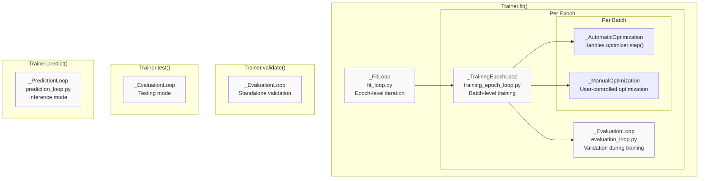
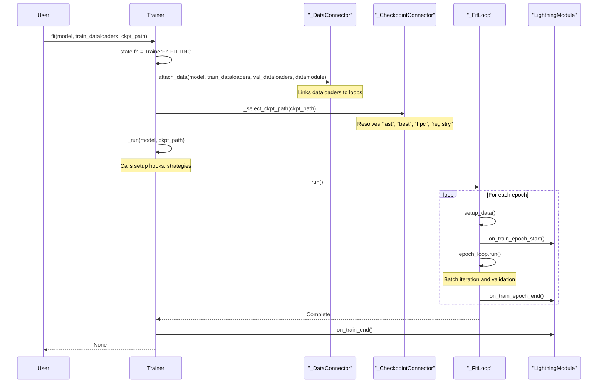

<!-- source: DeepWiki mcp.deepwiki.com · repo Lightning-AI/pytorch-lightning · page 2.3 Trainer · fetched 2026-10-21 -->

# Trainer

<details>
<summary>Relevant source files</summary>

The following files were used as context for generating this wiki page:

- [docs/source-pytorch/common/lightning_module.rst](docs/source-pytorch/common/lightning_module.rst)
- [docs/source-pytorch/common/trainer.rst](docs/source-pytorch/common/trainer.rst)
- [src/lightning/pytorch/callbacks/callback.py](src/lightning/pytorch/callbacks/callback.py)
- [src/lightning/pytorch/callbacks/device_stats_monitor.py](src/lightning/pytorch/callbacks/device_stats_monitor.py)
- [src/lightning/pytorch/core/hooks.py](src/lightning/pytorch/core/hooks.py)
- [src/lightning/pytorch/loops/evaluation_loop.py](src/lightning/pytorch/loops/evaluation_loop.py)
- [src/lightning/pytorch/loops/fetchers.py](src/lightning/pytorch/loops/fetchers.py)
- [src/lightning/pytorch/loops/fit_loop.py](src/lightning/pytorch/loops/fit_loop.py)
- [src/lightning/pytorch/loops/prediction_loop.py](src/lightning/pytorch/loops/prediction_loop.py)
- [src/lightning/pytorch/loops/training_epoch_loop.py](src/lightning/pytorch/loops/training_epoch_loop.py)
- [src/lightning/pytorch/loops/utilities.py](src/lightning/pytorch/loops/utilities.py)
- [src/lightning/pytorch/trainer/connectors/data_connector.py](src/lightning/pytorch/trainer/connectors/data_connector.py)
- [src/lightning/pytorch/trainer/trainer.py](src/lightning/pytorch/trainer/trainer.py)
- [src/lightning/pytorch/utilities/combined_loader.py](src/lightning/pytorch/utilities/combined_loader.py)
- [tests/tests_pytorch/core/test_lightning_module.py](tests/tests_pytorch/core/test_lightning_module.py)
- [tests/tests_pytorch/loops/test_evaluation_loop.py](tests/tests_pytorch/loops/test_evaluation_loop.py)
- [tests/tests_pytorch/loops/test_fetchers.py](tests/tests_pytorch/loops/test_fetchers.py)
- [tests/tests_pytorch/loops/test_prediction_loop.py](tests/tests_pytorch/loops/test_prediction_loop.py)
- [tests/tests_pytorch/loops/test_training_epoch_loop.py](tests/tests_pytorch/loops/test_training_epoch_loop.py)
- [tests/tests_pytorch/models/test_hooks.py](tests/tests_pytorch/models/test_hooks.py)
- [tests/tests_pytorch/trainer/connectors/test_data_connector.py](tests/tests_pytorch/trainer/connectors/test_data_connector.py)
- [tests/tests_pytorch/trainer/flags/test_overfit_batches.py](tests/tests_pytorch/trainer/flags/test_overfit_batches.py)
- [tests/tests_pytorch/trainer/properties/test_estimated_stepping_batches.py](tests/tests_pytorch/trainer/properties/test_estimated_stepping_batches.py)
- [tests/tests_pytorch/trainer/test_dataloaders.py](tests/tests_pytorch/trainer/test_dataloaders.py)
- [tests/tests_pytorch/trainer/test_trainer.py](tests/tests_pytorch/trainer/test_trainer.py)
- [tests/tests_pytorch/utilities/test_combined_loader.py](tests/tests_pytorch/utilities/test_combined_loader.py)
- [tests/tests_pytorch/utilities/test_enums.py](tests/tests_pytorch/utilities/test_enums.py)

</details>


## Purpose and Scope

The `Trainer` class is the central orchestrator in PyTorch Lightning that automates the training loop and manages all aspects of model training, validation, testing, and prediction. It handles device placement, distributed training, gradient accumulation, logging, checkpointing, and callback execution while allowing users to maintain full control over their PyTorch code through the `LightningModule` interface.

For information about the LightningModule that the Trainer executes, see [LightningModule](#2.2). For information about distributed training strategies, see [Strategy Pattern](#3.1).

**Sources:** [src/lightning/pytorch/trainer/trainer.py:89-521](), [docs/source-pytorch/common/trainer.rst:1-40]()

---

## Trainer Architecture

The `Trainer` is composed of specialized **connectors** that configure different aspects of training and **loops** that execute the training/evaluation/prediction logic.

### Component Overview

```mermaid
graph TB
    subgraph "Trainer Class"
        Trainer["Trainer<br/>(trainer.py)"]
        
        subgraph "Connectors"
            AccelConn["_AcceleratorConnector<br/>devices, strategy, precision"]
            DataConn["_DataConnector<br/>dataloaders, datamodule"]
            CallbackConn["_CallbackConnector<br/>callbacks, progress bars"]
            LoggerConn["_LoggerConnector<br/>loggers, metrics"]
            CheckpointConn["_CheckpointConnector<br/>save/load state"]
            SignalConn["_SignalConnector<br/>SIGTERM handling"]
        end
        
        subgraph "Loops"
            FitLoop["_FitLoop<br/>epoch iteration"]
            TrainEpochLoop["_TrainingEpochLoop<br/>batch iteration"]
            ValLoop["_EvaluationLoop<br/>validation"]
            TestLoop["_EvaluationLoop<br/>testing"]
            PredictLoop["_PredictionLoop<br/>prediction"]
        end
        
        subgraph "State"
            State["TrainerState<br/>fn, status, stage"]
        end
    end
    
    subgraph "User Code"
        LM["LightningModule<br/>training_step, etc"]
        DM["DataModule<br/>data preparation"]
    end
    
    Trainer --> AccelConn
    Trainer --> DataConn
    Trainer --> CallbackConn
    Trainer --> LoggerConn
    Trainer --> CheckpointConn
    Trainer --> SignalConn
    
    Trainer --> FitLoop
    Trainer --> ValLoop
    Trainer --> TestLoop
    Trainer --> PredictLoop
    
    FitLoop --> TrainEpochLoop
    TrainEpochLoop --> ValLoop
    
    Trainer --> State
    
    Trainer --> LM
    Trainer --> DM
```

**Sources:** [src/lightning/pytorch/trainer/trainer.py:414-442](), [src/lightning/pytorch/trainer/trainer.py:56-67]()

---

## Initialization

### Constructor Signature

The `Trainer.__init__()` method accepts configuration parameters that control every aspect of training. Key categories include:

**Hardware Configuration:**
- `accelerator`: Device type ("cpu", "gpu", "tpu", "hpu", "mps", "auto")
- `devices`: Number or list of devices to use
- `num_nodes`: Number of nodes for distributed training
- `strategy`: Training strategy ("auto", "ddp", "fsdp", "deepspeed", etc)
- `precision`: Precision mode ("32-true", "16-mixed", "bf16-mixed", etc)

**Training Control:**
- `max_epochs`, `min_epochs`: Epoch limits
- `max_steps`, `min_steps`: Step limits
- `max_time`: Time-based stopping
- `accumulate_grad_batches`: Gradient accumulation
- `gradient_clip_val`, `gradient_clip_algorithm`: Gradient clipping

**Data Configuration:**
- `limit_train_batches`, `limit_val_batches`, `limit_test_batches`, `limit_predict_batches`: Batch limits
- `val_check_interval`: Validation frequency
- `check_val_every_n_epoch`: Validation epoch interval
- `num_sanity_val_steps`: Sanity check batches
- `reload_dataloaders_every_n_epochs`: Dataloader refresh rate

**Features:**
- `logger`: Logger instance(s) or boolean
- `callbacks`: Callback list
- `enable_checkpointing`: Automatic checkpointing
- `enable_progress_bar`: Progress bar display
- `enable_model_summary`: Model summary display
- `log_every_n_steps`: Logging frequency

**Debugging:**
- `fast_dev_run`: Quick debugging mode
- `overfit_batches`: Overfitting test
- `detect_anomaly`: Autograd anomaly detection
- `barebones`: Minimal overhead mode
- `deterministic`, `benchmark`: Reproducibility settings

**Sources:** [src/lightning/pytorch/trainer/trainer.py:91-135](), [docs/source-pytorch/common/trainer.rst:177-1046]()

### Connector Initialization Sequence



**Sources:** [src/lightning/pytorch/trainer/trainer.py:414-520]()

---

## Connector System

Connectors are specialized components that configure and manage different aspects of the training process. They are initialized during `Trainer.__init__()` and configure their respective subsystems during the `on_trainer_init()` phase.

### _AcceleratorConnector

Configures hardware acceleration, distributed strategies, and precision settings.

**Key Responsibilities:**
- Selects appropriate `Accelerator` (CPU, CUDA, MPS, XLA)
- Selects appropriate `Strategy` (SingleDevice, DDP, FSDP, DeepSpeed, etc)
- Selects appropriate `Precision` plugin (native, mixed, bfloat16)
- Configures distributed sampler usage
- Sets deterministic and benchmark flags

**Sources:** [src/lightning/pytorch/trainer/trainer.py:417-428]()

### _DataConnector

Manages dataloader attachment and configuration.

**Key Responsibilities:**
- Attaches dataloaders from `LightningModule` or `LightningDataModule`
- Configures validation check intervals
- Handles dataloader reloading
- Manages distributed sampler injection
- Resolves overfit batches configuration

**Key Methods:**
- `attach_data()`: Links model and datamodule to trainer
- `attach_dataloaders()`: Sets up dataloader sources
- `attach_datamodule()`: Configures datamodule integration
- `_prepare_dataloader()`: Wraps dataloaders with distributed samplers

**Sources:** [src/lightning/pytorch/trainer/connectors/data_connector.py:47-228]()

### _CallbackConnector

Manages the lifecycle of callbacks including built-in and user-defined callbacks.

**Key Responsibilities:**
- Initializes default callbacks (ModelCheckpoint, ProgressBar, ModelSummary)
- Registers user callbacks
- Manages callback ordering (ModelCheckpoint runs last)
- Handles callback hook execution

**Default Callbacks:**
- `ModelCheckpoint`: When `enable_checkpointing=True`
- `ProgressBar` (TQDMProgressBar or RichProgressBar): When `enable_progress_bar=True`
- `ModelSummary` (or RichModelSummary): When `enable_model_summary=True`
- `Timer`: When `max_time` is set

**Sources:** [src/lightning/pytorch/trainer/trainer.py:447-454]()

### _LoggerConnector

Manages experiment loggers and metric collection.

**Key Responsibilities:**
- Initializes loggers (TensorBoard, WandB, CSV, etc)
- Manages log directory structure
- Aggregates metrics across devices
- Coordinates metric logging at appropriate intervals
- Handles hyperparameter logging

**Default Logger:**
- `TensorBoardLogger` if installed, otherwise `CSVLogger`
- Can be disabled with `logger=False`

**Sources:** [src/lightning/pytorch/trainer/trainer.py:497-498]()

### _CheckpointConnector

Handles model state persistence and restoration.

**Key Responsibilities:**
- Saves model, optimizer, and trainer state
- Loads checkpoints for resuming training
- Manages checkpoint path resolution ("best", "last", "hpc", "registry")
- Handles weights-only loading
- Integrates with distributed strategies for sharded checkpoints

**Checkpoint Path Resolution:**
- `None`: No checkpoint loaded (fit) or best checkpoint (validate/test/predict)
- `"best"`: Best model path from ModelCheckpoint
- `"last"`: Last saved checkpoint
- `"hpc"`: High-performance computing auto-resume
- `"registry"`: Download from Lightning Model Registry
- Explicit path: Load specific checkpoint

**Sources:** [src/lightning/pytorch/trainer/trainer.py:431](), [src/lightning/pytorch/trainer/trainer.py:624-630]()

### _SignalConnector

Handles system signals for graceful shutdown.

**Key Responsibilities:**
- Registers SIGTERM handler
- Sets `trainer.received_sigterm` flag
- Allows callbacks to conditionally execute cleanup

**Sources:** [src/lightning/pytorch/trainer/trainer.py:432]()

---

## Loop Hierarchy

The Trainer delegates execution to a hierarchy of loops. Each loop is responsible for a specific level of iteration and hook execution.

### Loop Structure



**Sources:** [src/lightning/pytorch/trainer/trainer.py:435-441](), [src/lightning/pytorch/loops/fit_loop.py:59-112]()

### _FitLoop

The top-level training loop that iterates over epochs.

**Location:** `trainer.fit_loop`

**Key Attributes:**
- `min_epochs`, `max_epochs`: Epoch limits
- `epoch_progress`: Tracks epoch completion
- `epoch_loop`: Instance of `_TrainingEpochLoop`
- `_combined_loader`: Combined dataloader
- `_data_fetcher`: Data fetching strategy

**Responsibilities:**
- Iterate over epochs until `max_epochs` or `max_steps` reached
- Setup and reload training data
- Call epoch-level hooks (`on_train_epoch_start`, `on_train_epoch_end`)
- Check stopping conditions (`should_stop`, min/max limits)
- Update learning rate schedulers

**Key Methods:**
- `run()`: Main loop execution
- `setup_data()`: Configure dataloaders
- `advance()`: Run one epoch via `epoch_loop.run()`

**Sources:** [src/lightning/pytorch/loops/fit_loop.py:59-200](), [src/lightning/pytorch/loops/fit_loop.py:208-224]()

### _TrainingEpochLoop

Iterates over batches within an epoch and handles validation intervals.

**Location:** `trainer.fit_loop.epoch_loop`

**Key Attributes:**
- `min_steps`, `max_steps`: Step limits
- `batch_progress`: Tracks batch completion
- `automatic_optimization`: Optimizer management
- `manual_optimization`: Manual optimization support
- `val_loop`: Validation loop instance

**Responsibilities:**
- Iterate over training batches
- Execute training_step and optimization
- Accumulate gradients across batches
- Trigger validation at configured intervals
- Call batch-level hooks

**Validation Triggering:**
- By epoch: `check_val_every_n_epoch`
- By batch: `val_check_interval` (int or float)
- By time: `val_check_interval` (timedelta)

**Sources:** [src/lightning/pytorch/loops/training_epoch_loop.py:51-96](), [src/lightning/pytorch/loops/training_epoch_loop.py:175-271]()

### _EvaluationLoop

Handles validation and testing execution.

**Modes:**
- Validation during training: `trainer.fit_loop.epoch_loop.val_loop`
- Standalone validation: `trainer.validate_loop`
- Testing: `trainer.test_loop`

**Key Attributes:**
- `_trainer_fn`: TrainerFn.VALIDATING or TrainerFn.TESTING
- `_stage`: RunningStage.VALIDATING or RunningStage.TESTING
- `batch_progress`: Tracks batch completion
- `_max_batches`: Per-dataloader batch limits
- `inference_mode`: Use torch.inference_mode vs torch.no_grad

**Responsibilities:**
- Iterate over validation/test batches
- Execute validation_step/test_step
- Aggregate metrics across batches and devices
- Support multiple dataloaders (sequential mode)
- Call evaluation hooks

**Sources:** [src/lightning/pytorch/loops/evaluation_loop.py:58-107](), [src/lightning/pytorch/loops/evaluation_loop.py:120-153]()

### _PredictionLoop

Handles inference/prediction execution.

**Location:** `trainer.predict_loop`

**Key Attributes:**
- `return_predictions`: Whether to return predictions
- `epoch_batch_indices`: Track sample indices for PredictionWriter
- `_predictions`: Accumulated predictions

**Responsibilities:**
- Iterate over prediction batches
- Execute predict_step
- Accumulate predictions (if return_predictions=True)
- Support BasePredictionWriter callbacks
- Track batch indices for each dataloader

**Sources:** [src/lightning/pytorch/loops/prediction_loop.py:47-91]()

---

## Main API Methods

### fit()

Runs the complete training workflow including validation.

**Signature:**
```python
def fit(
    self,
    model: LightningModule,
    train_dataloaders: Optional[TRAIN_DATALOADERS] = None,
    val_dataloaders: Optional[EVAL_DATALOADERS] = None,
    datamodule: Optional[LightningDataModule] = None,
    ckpt_path: Optional[str] = None,
    weights_only: Optional[bool] = None,
) -> None
```

**Execution Flow:**



**Sources:** [src/lightning/pytorch/trainer/trainer.py:522-594](), [src/lightning/pytorch/trainer/trainer.py:595-634]()

### validate()

Performs one evaluation epoch over validation set.

**Signature:**
```python
def validate(
    self,
    model: Optional[LightningModule] = None,
    dataloaders: Optional[EVAL_DATALOADERS] = None,
    ckpt_path: Optional[str] = None,
    verbose: bool = True,
    datamodule: Optional[LightningDataModule] = None,
    weights_only: Optional[bool] = None,
) -> list[dict[str, Any]]
```

**Key Behaviors:**
- If `model=None`, uses model from previous fit() call
- If `ckpt_path=None`, uses best checkpoint from previous fit()
- Returns list of dictionaries (one per dataloader) with logged metrics

**Sources:** [src/lightning/pytorch/trainer/trainer.py:636-704]()

### test()

Performs one evaluation epoch over test set.

**Signature:**
```python
def test(
    self,
    model: Optional[LightningModule] = None,
    dataloaders: Optional[EVAL_DATALOADERS] = None,
    ckpt_path: Optional[str] = None,
    verbose: bool = True,
    datamodule: Optional[LightningDataModule] = None,
    weights_only: Optional[bool] = None,
) -> list[dict[str, Any]]
```

**Same behavior as validate()** but calls test hooks and test_step.

**Sources:** [src/lightning/pytorch/trainer/trainer.py:772-840]()

### predict()

Performs inference over prediction dataset.

**Signature:**
```python
def predict(
    self,
    model: Optional[LightningModule] = None,
    dataloaders: Optional[EVAL_DATALOADERS] = None,
    datamodule: Optional[LightningDataModule] = None,
    return_predictions: Optional[bool] = None,
    ckpt_path: Optional[str] = None,
    weights_only: Optional[bool] = None,
) -> Optional[list[Any]]
```

**Key Behaviors:**
- Returns predictions if `return_predictions=True` (default for non-spawn strategies)
- Spawn/fork strategies cannot return predictions
- Supports BasePredictionWriter callbacks for saving predictions

**Sources:** [src/lightning/pytorch/trainer/trainer.py:908-976]()

---

## State Management

The Trainer maintains state through several enums and attributes.

### TrainerState

**Location:** `trainer.state`

**Attributes:**
- `fn`: TrainerFn (FITTING, VALIDATING, TESTING, PREDICTING)
- `status`: TrainerStatus (INITIALIZING, RUNNING, FINISHED, INTERRUPTED)
- `stage`: RunningStage (TRAINING, VALIDATING, TESTING, PREDICTING, SANITY_CHECKING)

**Sources:** [src/lightning/pytorch/trainer/trainer.py:491]()

### Important Flags

| Attribute | Type | Purpose |
|-----------|------|---------|
| `training` | bool | True during training |
| `validating` | bool | True during validation |
| `testing` | bool | True during testing |
| `predicting` | bool | True during prediction |
| `sanity_checking` | bool | True during sanity validation |
| `should_stop` | bool | Set by callbacks to request stop |
| `interrupted` | bool | Set on keyboard interrupt |
| `num_training_batches` | int | Total batches per training epoch |
| `num_val_batches` | list[int] | Batches per validation dataloader |
| `num_test_batches` | list[int] | Batches per test dataloader |
| `num_predict_batches` | list[int] | Batches per predict dataloader |
| `global_step` | int | Total optimizer steps across all epochs |
| `current_epoch` | int | Current epoch number |

**Sources:** [src/lightning/pytorch/trainer/trainer.py:68](), [src/lightning/pytorch/trainer/states.py]()

---

## Configuration Flags Reference

### Training Duration

| Flag | Type | Default | Description |
|------|------|---------|-------------|
| `max_epochs` | int | 1000* | Maximum epochs to train |
| `min_epochs` | int | None | Minimum epochs before early stopping |
| `max_steps` | int | -1 | Maximum optimizer steps (-1 = unlimited) |
| `min_steps` | int | None | Minimum steps before early stopping |
| `max_time` | str/timedelta/dict | None | Maximum training time |

*Default is 1000 if both `max_epochs` and `max_steps` are unspecified

### Data Limits

| Flag | Type | Default | Description |
|------|------|---------|-------------|
| `limit_train_batches` | int/float | 1.0 | Limit training batches per epoch |
| `limit_val_batches` | int/float | 1.0 | Limit validation batches |
| `limit_test_batches` | int/float | 1.0 | Limit test batches |
| `limit_predict_batches` | int/float | 1.0 | Limit prediction batches |
| `overfit_batches` | int/float | 0.0 | Overfit on subset for debugging |

### Validation Schedule

| Flag | Type | Default | Description |
|------|------|---------|-------------|
| `val_check_interval` | int/float/str/timedelta/dict | 1.0 | Validation frequency within epoch |
| `check_val_every_n_epoch` | int | 1 | Validation frequency across epochs |
| `num_sanity_val_steps` | int | 2 | Sanity check validation batches |

### Optimization

| Flag | Type | Default | Description |
|------|------|---------|-------------|
| `accumulate_grad_batches` | int | 1 | Gradient accumulation batches |
| `gradient_clip_val` | float | None | Gradient clipping value |
| `gradient_clip_algorithm` | str | "norm" | "norm" or "value" |

### Features

| Flag | Type | Default | Description |
|------|------|---------|-------------|
| `enable_checkpointing` | bool | True | Enable automatic checkpointing |
| `enable_progress_bar` | bool | True | Show progress bar |
| `enable_model_summary` | bool | True | Print model summary |
| `log_every_n_steps` | int | 50 | Logging frequency |
| `enable_autolog_hparams` | bool | True | Auto-log hyperparameters |

### Debugging

| Flag | Type | Default | Description |
|------|------|---------|-------------|
| `fast_dev_run` | int/bool | False | Run n batches for debugging |
| `detect_anomaly` | bool | False | Enable autograd anomaly detection |
| `barebones` | bool | False | Minimal overhead mode |
| `deterministic` | bool/str | None | Deterministic operations |
| `benchmark` | bool | None | cudnn benchmark mode |

**Sources:** [src/lightning/pytorch/trainer/trainer.py:136-318](), [docs/source-pytorch/common/trainer.rst:177-1046]()

---

## Advanced Features

### Barebones Mode

When `barebones=True`, Lightning disables all features that may impact raw speed:
- Checkpointing: `enable_checkpointing=False`
- Logging: `logger=False`, `log_every_n_steps=0`
- Progress bar: `enable_progress_bar=False`
- Model summary: `enable_model_summary=False`
- Sanity checking: `num_sanity_val_steps=0`

This mode is intended for analyzing Trainer overhead, not regular training.

**Sources:** [src/lightning/pytorch/trainer/trainer.py:328-399]()

### Fast Dev Run

When `fast_dev_run=True` or `fast_dev_run=n`, Lightning:
- Runs n batches of train, val, test, predict
- Sets `max_epochs=1`, `max_steps=n`
- Sets `num_sanity_val_steps=0`
- Sets `val_check_interval=1.0`
- Disables loggers, ModelCheckpoint, EarlyStopping
- Does not save config in LightningCLI

Useful for debugging without side effects.

**Sources:** [docs/source-pytorch/common/trainer.rst:551-591]()

### Gradient Accumulation

When `accumulate_grad_batches > 1`, Lightning:
- Calls `training_step` for each batch
- Accumulates gradients via `loss.backward()`
- Steps optimizer every N batches
- Ensures optimizer steps on the last batch even if not divisible

**Sources:** [src/lightning/pytorch/trainer/trainer.py:443](), [docs/source-pytorch/common/trainer.rst:236-251]()

### Dataloader Reloading

When `reload_dataloaders_every_n_epochs > 0`:
- Training dataloader is recreated every N epochs
- Validation dataloader is recreated every N epochs (during fit)
- Useful for dynamic data loading strategies

**Sources:** [src/lightning/pytorch/trainer/connectors/data_connector.py:73-78]()

---

## Internal Execution Flow

### Complete fit() Workflow

```mermaid
graph TB
    Start["trainer.fit(model, train_dl, val_dl, ckpt_path)"]
    
    subgraph "Setup Phase"
        SetState["Set state.fn = FITTING<br/>Set state.status = RUNNING"]
        AttachData["DataConnector.attach_data()"]
        SelectCkpt["CheckpointConnector._select_ckpt_path()"]
        CallRun["_run(model, ckpt_path)"]
    end
    
    subgraph "_run() Execution"
        Setup["Strategy.setup(trainer)"]
        SetupEnv["Strategy.setup_environment()"]
        Restore["CheckpointConnector.restore()"]
        CallSetup["model.setup('fit')"]
        CallPrepare["model.prepare_data()"]
        ConfigureModel["Strategy.setup_module(model)"]
        ConfigureOpt["Strategy.setup_optimizers(trainer)"]
    end
    
    subgraph "FitLoop.run()"
        SetupData["FitLoop.setup_data()"]
        OnTrainStart["on_train_start hooks"]
        
        EpochLoop["For each epoch"]
        OnEpochStart["on_train_epoch_start hooks"]
        TrainBatches["TrainingEpochLoop.run()"]
        MaybeValidate["Validation if scheduled"]
        OnEpochEnd["on_train_epoch_end hooks"]
        
        CheckDone{"Done?<br/>max_epochs, max_steps,<br/>should_stop"}
        
        OnTrainEnd["on_train_end hooks"]
    end
    
    Finish["Set state.status = FINISHED"]
    
    Start --> SetState
    SetState --> AttachData
    AttachData --> SelectCkpt
    SelectCkpt --> CallRun
    
    CallRun --> Setup
    Setup --> SetupEnv
    SetupEnv --> Restore
    Restore --> CallSetup
    CallSetup --> CallPrepare
    CallPrepare --> ConfigureModel
    ConfigureModel --> ConfigureOpt
    
    ConfigureOpt --> SetupData
    SetupData --> OnTrainStart
    OnTrainStart --> EpochLoop
    
    EpochLoop --> OnEpochStart
    OnEpochStart --> TrainBatches
    TrainBatches --> MaybeValidate
    MaybeValidate --> OnEpochEnd
    OnEpochEnd --> CheckDone
    
    CheckDone -->|No| EpochLoop
    CheckDone -->|Yes| OnTrainEnd
    
    OnTrainEnd --> Finish
```



**Sources:** [src/lightning/pytorch/trainer/trainer.py:595-634](), [src/lightning/pytorch/loops/fit_loop.py:208-224]()

### Training Batch Execution (Automatic Optimization)

```mermaid
sequenceDiagram
    participant TELoop as "_TrainingEpochLoop"
    participant Auto as "_AutomaticOptimization"
    participant LM as "LightningModule"
    participant Opt as "Optimizer"
    participant Prec as "Precision"
    
    loop For each batch
        TELoop->>LM: on_train_batch_start(batch, batch_idx)
        TELoop->>Auto: run(batch, batch_idx)
        
        Auto->>LM: training_step(batch, batch_idx)
        LM-->>Auto: loss
        
        Auto->>LM: on_before_zero_grad(optimizer)
        Auto->>Opt: zero_grad()
        
        Auto->>LM: on_before_backward(loss)
        Auto->>Prec: backward(loss)
        Note over Prec: loss.backward() with scaling
        Auto->>LM: on_after_backward()
        
        alt accumulate_grad_batches reached
            Auto->>LM: on_before_optimizer_step(optimizer)
            Auto->>LM: configure_gradient_clipping(...)
            Auto->>Prec: optimizer_step(optimizer, ...)
            Note over Prec: unscale, clip, optimizer.step()
            Auto->>LM: lr_scheduler_step(scheduler)
        end
        
        Auto-->>TELoop: outputs
        TELoop->>LM: on_train_batch_end(outputs, batch, batch_idx)
    end
```

**Sources:** [src/lightning/pytorch/loops/training_epoch_loop.py:175-271](), [src/lightning/pytorch/loops/optimization/automatic.py]()

---

## Properties and Accessors

The Trainer exposes several properties for accessing state:

| Property | Type | Description |
|----------|------|-------------|
| `strategy` | Strategy | Current training strategy |
| `accelerator` | Accelerator | Current accelerator |
| `precision_plugin` | Precision | Current precision plugin |
| `logger` | Logger | First logger or None |
| `loggers` | list[Logger] | All loggers |
| `callback_metrics` | dict | Latest callback metrics |
| `logged_metrics` | dict | Latest logged metrics |
| `progress_bar_metrics` | dict | Metrics for progress bar |
| `lightning_module` | LightningModule | Current model |
| `datamodule` | LightningDataModule | Current datamodule |
| `train_dataloader` | DataLoader | Training dataloader |
| `val_dataloaders` | list[DataLoader] | Validation dataloaders |
| `test_dataloaders` | list[DataLoader] | Test dataloaders |
| `predict_dataloaders` | list[DataLoader] | Predict dataloaders |
| `estimated_stepping_batches` | int | Total expected optimizer steps |

**Sources:** [src/lightning/pytorch/trainer/trainer.py]()

---

## Error Handling

The Trainer handles interruptions gracefully:

**KeyboardInterrupt (Ctrl+C):**
- Sets `trainer.interrupted = True`
- Calls `on_exception` callbacks
- Attempts graceful shutdown

**SIGTERM:**
- Sets `trainer.received_sigterm = True`
- Raises `SIGTERMException`
- Saves emergency checkpoint via OnExceptionCheckpoint

**Other Exceptions:**
- Calls `on_exception` callbacks
- Re-raises exception

**Sources:** [src/lightning/pytorch/trainer/trainer.py:432](), [src/lightning/pytorch/trainer/call.py]()

---

