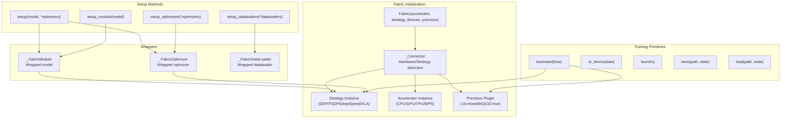
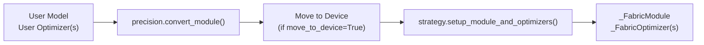
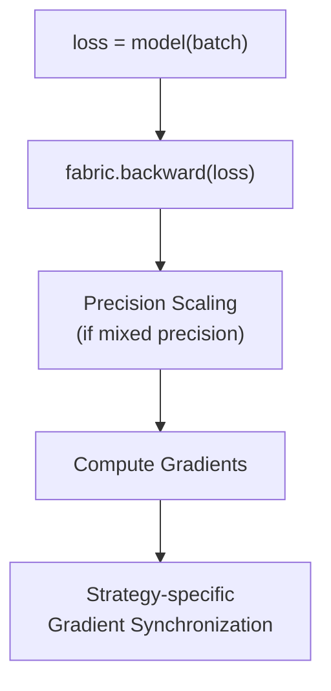
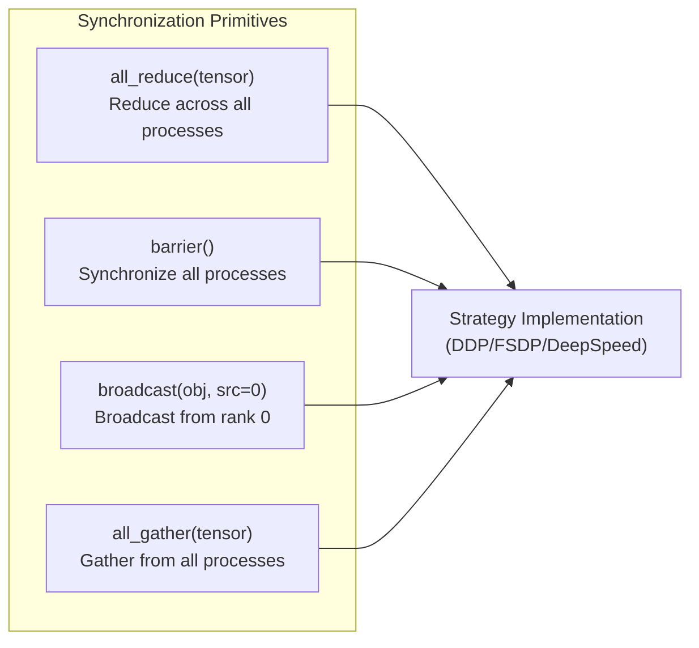
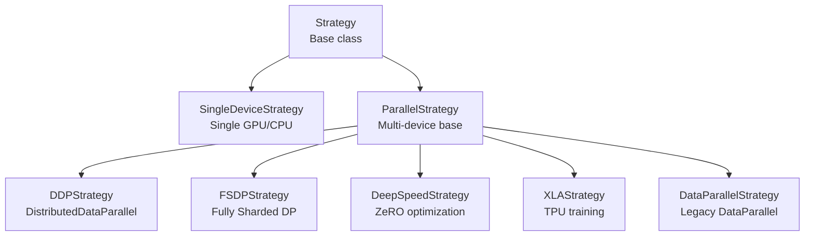
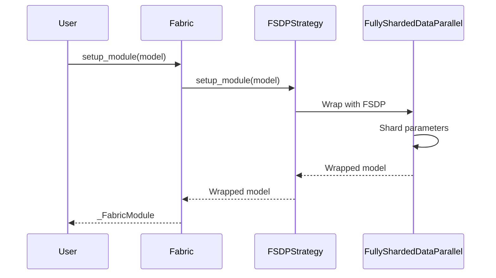
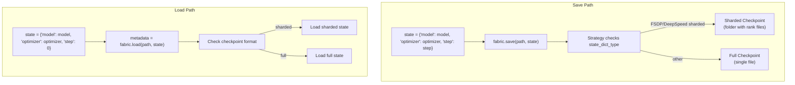

<!-- source: DeepWiki mcp.deepwiki.com · repo Lightning-AI/pytorch-lightning · page 2.4 Lightning Fabric · fetched 2026-10-21 -->

# Lightning Fabric

<details>
<summary>Relevant source files</summary>

The following files were used as context for generating this wiki page:

- [README.md](README.md)
- [docs/source-fabric/api/fabric_methods.rst](docs/source-fabric/api/fabric_methods.rst)
- [docs/source-fabric/api/wrappers.rst](docs/source-fabric/api/wrappers.rst)
- [src/lightning/fabric/CHANGELOG.md](src/lightning/fabric/CHANGELOG.md)
- [src/lightning/fabric/fabric.py](src/lightning/fabric/fabric.py)
- [src/lightning/fabric/strategies/ddp.py](src/lightning/fabric/strategies/ddp.py)
- [src/lightning/fabric/strategies/deepspeed.py](src/lightning/fabric/strategies/deepspeed.py)
- [src/lightning/fabric/strategies/fsdp.py](src/lightning/fabric/strategies/fsdp.py)
- [src/lightning/fabric/strategies/strategy.py](src/lightning/fabric/strategies/strategy.py)
- [src/lightning/pytorch/CHANGELOG.md](src/lightning/pytorch/CHANGELOG.md)
- [src/lightning/pytorch/core/module.py](src/lightning/pytorch/core/module.py)
- [src/lightning/pytorch/strategies/ddp.py](src/lightning/pytorch/strategies/ddp.py)
- [src/lightning/pytorch/strategies/deepspeed.py](src/lightning/pytorch/strategies/deepspeed.py)
- [src/lightning/pytorch/strategies/fsdp.py](src/lightning/pytorch/strategies/fsdp.py)
- [src/lightning/pytorch/strategies/strategy.py](src/lightning/pytorch/strategies/strategy.py)
- [tests/tests_fabric/strategies/test_ddp.py](tests/tests_fabric/strategies/test_ddp.py)
- [tests/tests_fabric/strategies/test_deepspeed.py](tests/tests_fabric/strategies/test_deepspeed.py)
- [tests/tests_fabric/strategies/test_deepspeed_integration.py](tests/tests_fabric/strategies/test_deepspeed_integration.py)
- [tests/tests_fabric/strategies/test_fsdp.py](tests/tests_fabric/strategies/test_fsdp.py)
- [tests/tests_fabric/strategies/test_fsdp_integration.py](tests/tests_fabric/strategies/test_fsdp_integration.py)
- [tests/tests_fabric/strategies/test_single_device.py](tests/tests_fabric/strategies/test_single_device.py)
- [tests/tests_fabric/test_fabric.py](tests/tests_fabric/test_fabric.py)
- [tests/tests_pytorch/models/test_onnx.py](tests/tests_pytorch/models/test_onnx.py)
- [tests/tests_pytorch/strategies/test_ddp.py](tests/tests_pytorch/strategies/test_ddp.py)
- [tests/tests_pytorch/strategies/test_ddp_integration.py](tests/tests_pytorch/strategies/test_ddp_integration.py)
- [tests/tests_pytorch/strategies/test_deepspeed.py](tests/tests_pytorch/strategies/test_deepspeed.py)
- [tests/tests_pytorch/strategies/test_fsdp.py](tests/tests_pytorch/strategies/test_fsdp.py)

</details>


## Purpose and Scope

Lightning Fabric provides expert-level control over PyTorch training loops with minimal abstraction. It is designed for researchers and practitioners who need fine-grained control over the training process while benefiting from automated distributed training, mixed precision, and hardware acceleration. Fabric sits between raw PyTorch and the high-level PyTorch Lightning Trainer, offering a middle ground that automates infrastructure while preserving full control over model logic.

For high-level automated training with the Trainer abstraction, see [Trainer](#2.3). For comparison between the two frameworks, see [PyTorch Lightning vs Fabric](#2.1).

**Sources:** [README.md:373-556](), [src/lightning/fabric/fabric.py:86-132]()

---

## Core Architecture

Lightning Fabric is built around the `Fabric` class, which orchestrates hardware acceleration, distributed training strategies, precision management, and logging. The class follows a minimal intervention philosophy: it wraps PyTorch objects with thin wrappers that add distributed capabilities without changing their API.

### Fabric Class Structure



**Diagram: Fabric Class Architecture**

The `Fabric` class initializes hardware configurations through the `_Connector`, which selects and configures the appropriate strategy, accelerator, and precision plugin. Setup methods wrap user objects in Fabric wrappers that delegate to the selected strategy for distributed operations.

**Sources:** [src/lightning/fabric/fabric.py:134-169](), [src/lightning/fabric/fabric.py:229-313](), [src/lightning/fabric/connector.py:1-100]()

---

## Setup Methods

Fabric provides three primary setup methods for preparing models and optimizers for accelerated training. These methods handle device placement, strategy-specific wrapping (e.g., DDP, FSDP), and precision conversion.

### setup()

The `setup()` method is the primary entry point for jointly preparing a model with one or more optimizers:

| Parameter | Type | Description |
|-----------|------|-------------|
| `module` | `nn.Module` | PyTorch model to wrap |
| `*optimizers` | `Optimizer` | Zero or more optimizers |
| `scheduler` | `_LRScheduler` (optional) | Learning rate scheduler |
| `move_to_device` | `bool` | Whether to move model to device (default: True) |
| `_reapply_compile` | `bool` | Whether to reapply `torch.compile` after wrapping (default: True) |

**Returns:** `_FabricModule` if no optimizers; tuple of `(_FabricModule, *_FabricOptimizer, scheduler)` otherwise



**Diagram: setup() Method Flow**

**Sources:** [src/lightning/fabric/fabric.py:229-313](), [src/lightning/fabric/fabric.py:271-290]()

### setup_module()

For strategies like FSDP that require separate model and optimizer setup, `setup_module()` prepares only the model:

```python
# Typical FSDP pattern
fabric = Fabric(strategy="fsdp")
model = fabric.setup_module(model)  # Wrap with FSDP first
optimizer = torch.optim.Adam(model.parameters())  # Create optimizer after
optimizer = fabric.setup_optimizers(optimizer)  # Then setup optimizer
```

This method follows the same flow as `setup()` but omits optimizer setup. It returns a `_FabricModule` wrapping the user's model.

**Sources:** [src/lightning/fabric/fabric.py:315-374](), [src/lightning/fabric/fabric.py:336-343]()

### setup_optimizers()

The `setup_optimizers()` method wraps optimizers independently of model setup:

```python
optimizer1, optimizer2 = fabric.setup_optimizers(opt1, opt2)
```

**Raises:** `RuntimeError` for strategies that require joint setup (DeepSpeed, XLA)

**Sources:** [src/lightning/fabric/fabric.py:376-410](), [tests/tests_fabric/test_fabric.py:225-242]()

### setup_dataloaders()

The `setup_dataloaders()` method configures dataloaders for distributed training:

| Parameter | Type | Description |
|-----------|------|-------------|
| `*dataloaders` | `DataLoader` | One or more dataloaders |
| `use_distributed_sampler` | `bool` | Auto-wrap sampler for distributed (default: True) |
| `move_to_device` | `bool` | Auto-move batches to device (default: True) |

Returns wrapped `_FabricDataLoader` instances that automatically handle distributed sampling and device placement.

**Sources:** [src/lightning/fabric/fabric.py:412-447](), [src/lightning/fabric/fabric.py:449-480]()

---

## Training Primitives

Fabric provides low-level primitives for training loops while automating precision and distributed communication.

### backward()



**Diagram: backward() Flow**

The `backward()` method replaces `loss.backward()` and automatically handles:
- Precision scaling and unscaling for mixed precision
- Gradient accumulation context management
- Multi-model backward for DeepSpeed (requires `model` parameter)

**Key Parameters:**
- `tensor`: Loss tensor to backpropagate
- `model`: Required for DeepSpeed with multiple models
- `*args, **kwargs`: Passed to underlying backward function

**Sources:** [src/lightning/fabric/fabric.py:482-539](), [src/lightning/fabric/fabric.py:505-530]()

### Device Management

Fabric provides properties and methods for device-aware operations:

| Property/Method | Type | Description |
|-----------------|------|-------------|
| `fabric.device` | `torch.device` | Current process device |
| `fabric.global_rank` | `int` | Global rank across all nodes/devices |
| `fabric.local_rank` | `int` | Local rank on current node |
| `fabric.world_size` | `int` | Total number of processes |
| `fabric.is_global_zero` | `bool` | Whether current process is rank 0 |
| `to_device(obj)` | Method | Move data to current device |

**Sources:** [src/lightning/fabric/fabric.py:179-210](), [src/lightning/fabric/fabric.py:541-556]()

### Collective Operations



**Diagram: Collective Operations**

These methods abstract distributed communication, delegating to the active strategy's implementation.

**Sources:** [src/lightning/fabric/fabric.py:642-678](), [src/lightning/fabric/fabric.py:698-721]()

---

## Distributed Strategies

Fabric supports multiple distributed training strategies through a pluggable architecture. Each strategy inherits from the base `Strategy` class and implements strategy-specific model wrapping, optimization, and communication.

### Strategy Hierarchy



**Diagram: Strategy Class Hierarchy**

**Sources:** [src/lightning/fabric/strategies/strategy.py:45-102](), [src/lightning/fabric/strategies/parallel.py:1-50]()

### Strategy Selection

Fabric automatically selects an appropriate strategy based on configuration:

| Configuration | Selected Strategy |
|---------------|-------------------|
| `devices=1, accelerator="cpu"` | `SingleDeviceStrategy` |
| `devices=1, accelerator="gpu"` | `SingleDeviceStrategy` |
| `devices=2, strategy="auto"` | `DDPStrategy` |
| `strategy="fsdp"` | `FSDPStrategy` |
| `strategy="deepspeed"` | `DeepSpeedStrategy` |
| `accelerator="tpu"` | `XLAStrategy` |

**Sources:** [src/lightning/fabric/connector.py:100-200](), [README.md:463-502]()

### FSDPStrategy

The `FSDPStrategy` implements Fully Sharded Data Parallel training, enabling massive model scaling by sharding parameters, gradients, and optimizer states across devices.

**Key Configuration:**

```python
fabric = Fabric(
    strategy=FSDPStrategy(
        sharding_strategy="FULL_SHARD",  # or "SHARD_GRAD_OP", "NO_SHARD", "HYBRID_SHARD"
        state_dict_type="sharded",  # or "full"
        auto_wrap_policy={nn.Linear},  # Auto-wrap specific layers
        activation_checkpointing_policy={nn.TransformerBlock},
        cpu_offload=True,  # Offload to CPU
    )
)
```

**Setup Flow:**



**Diagram: FSDP Setup Sequence**

**Sources:** [src/lightning/fabric/strategies/fsdp.py:86-312](), [tests/tests_fabric/strategies/test_fsdp_integration.py:116-169]()

### DeepSpeedStrategy

DeepSpeed integration provides ZeRO optimizer stages for memory-efficient large model training:

| ZeRO Stage | Sharding | Description |
|------------|----------|-------------|
| Stage 1 | Optimizer states | Shard optimizer states only |
| Stage 2 | Optimizer + Gradients | Shard optimizer states and gradients |
| Stage 3 | Optimizer + Gradients + Parameters | Shard everything (similar to FSDP) |

**Key Features:**
- CPU/NVMe offloading for optimizer states and parameters
- Gradient accumulation and mixed precision
- Multiple model support (requires `model` parameter in `backward()`)

**Sources:** [src/lightning/fabric/strategies/deepspeed.py:55-170](), [tests/tests_fabric/strategies/test_deepspeed_integration.py:34-56]()

### DDPStrategy

Standard `DistributedDataParallel` for multi-GPU training with model replication:

```python
fabric = Fabric(
    strategy=DDPStrategy(
        find_unused_parameters=False,
        gradient_as_bucket_view=True,
        static_graph=False,
    )
)
```

DDP replicates the model on each device and synchronizes gradients after each backward pass.

**Sources:** [src/lightning/fabric/strategies/ddp.py:1-200](), [tests/tests_fabric/strategies/test_ddp.py:1-100]()

---

## Advanced Features

### Context Managers

Fabric provides context managers for efficient initialization and fine-grained control:

#### init_module()

```python
with fabric.init_module(empty_init=True):
    model = MyLargeModel()  # Created on meta device
    
# Model is materialized during setup
model = fabric.setup_module(model)
```

The `init_module()` context manager:
- Creates modules on meta device (with `empty_init=True`)
- Sets appropriate dtype based on precision
- Enables FSDP/DeepSpeed initialization hooks
- Materializes parameters during `setup_module()`

**Sources:** [src/lightning/fabric/fabric.py:851-910](), [tests/tests_fabric/test_fabric.py:567-595]()

#### init_tensor()

```python
with fabric.init_tensor():
    large_tensor = torch.randn(1000000, 1000000)  # Created directly on device
```

Creates tensors directly on the target device and dtype, avoiding CPU allocation for large tensors.

**Sources:** [src/lightning/fabric/fabric.py:912-943]()

#### no_backward_sync()

```python
for i, batch in enumerate(dataloader):
    is_accumulating = (i + 1) % accumulation_steps != 0
    with fabric.no_backward_sync(model, enabled=is_accumulating):
        loss = model(batch)
        fabric.backward(loss)
```

Disables gradient synchronization for accumulation steps, synchronizing only when `enabled=False`.

**Sources:** [src/lightning/fabric/fabric.py:764-825]()

### Checkpointing

Fabric provides strategy-aware checkpointing that handles sharded and full state dictionaries:



**Diagram: Checkpointing Flow**

**Key Methods:**

| Method | Purpose |
|--------|---------|
| `save(path, state, filter=None)` | Save state dictionary (strategy-aware) |
| `load(path, state, strict=True)` | Load state dictionary (strategy-aware) |
| `load_raw(path, obj)` | Load raw PyTorch checkpoint |

**Sources:** [src/lightning/fabric/fabric.py:558-640](), [tests/tests_fabric/strategies/test_fsdp_integration.py:119-168]()

### Launching Distributed Training

```python
# Option 1: Launch with fabric.launch()
fabric = Fabric(devices=2)
fabric.launch()
# Your training code here

# Option 2: Launch a function
def training_function(fabric):
    model = MyModel()
    # ...training code...

fabric = Fabric(devices=2)
fabric.launch(training_function)
```

The `launch()` method:
- Spawns processes for multi-device training
- Initializes distributed backend
- Sets up environment variables
- Executes the training function in each process

**Sources:** [src/lightning/fabric/fabric.py:223-227](), [docs/source-fabric/api/fabric_methods.rst:1-31]()

---

## Integration with PyTorch Lightning

Fabric can be used within `LightningModule` for cases requiring fine-grained control. The module can access Fabric through `self.fabric` when configured:

```python
class MyModule(LightningModule):
    def __init__(self):
        super().__init__()
        # self._fabric will be set by the framework
        
    def training_step(self, batch, batch_idx):
        if self._fabric is not None:
            # Use Fabric for manual optimization
            optimizer = self._fabric_optimizers[0]
```

This integration allows gradual migration from Fabric to Trainer or vice versa.

**Sources:** [src/lightning/pytorch/core/module.py:150-153](), [src/lightning/pytorch/core/module.py:234-245]()

---

## Comparison Matrix

| Feature | Lightning Fabric | PyTorch Lightning Trainer |
|---------|------------------|---------------------------|
| **Abstraction Level** | Low (minimal intervention) | High (automated training) |
| **Training Loop** | User-written | Framework-provided |
| **Model Class** | Any `nn.Module` | `LightningModule` required |
| **Optimizer Setup** | Manual `setup()` call | Auto from `configure_optimizers()` |
| **Callbacks** | Optional, manual invocation | Built-in, automatic |
| **Logging** | Manual `log()` or logger calls | Automatic via `self.log()` |
| **Checkpointing** | Manual `save()`/`load()` | Automatic with `ModelCheckpoint` |
| **Use Case** | Custom training loops, research | Standard supervised learning |
| **Learning Curve** | Requires PyTorch knowledge | Easier for beginners |

**Sources:** [README.md:373-556](), [README.md:59-76]()

---

