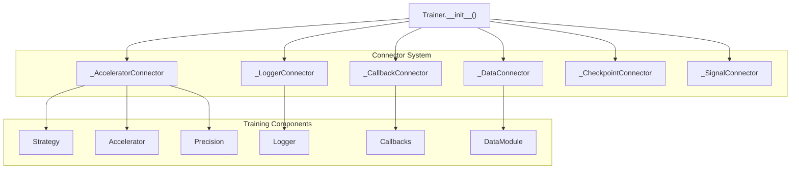
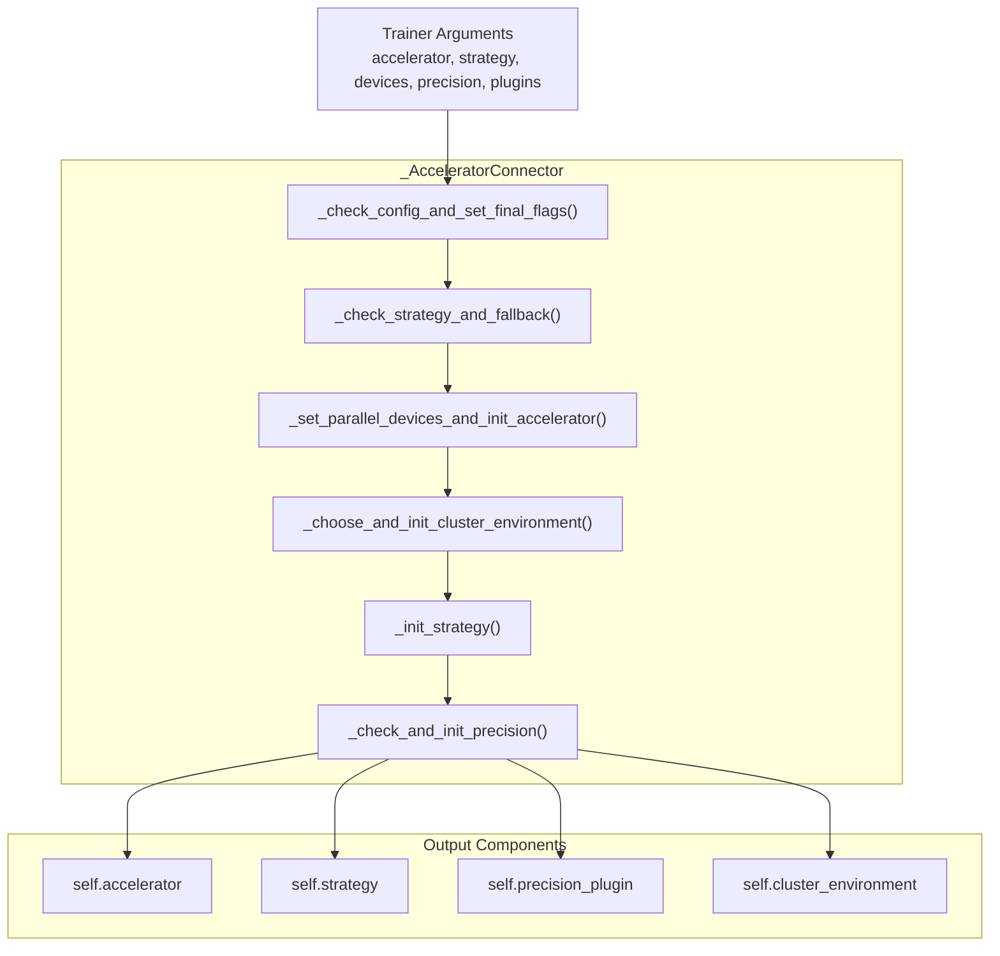
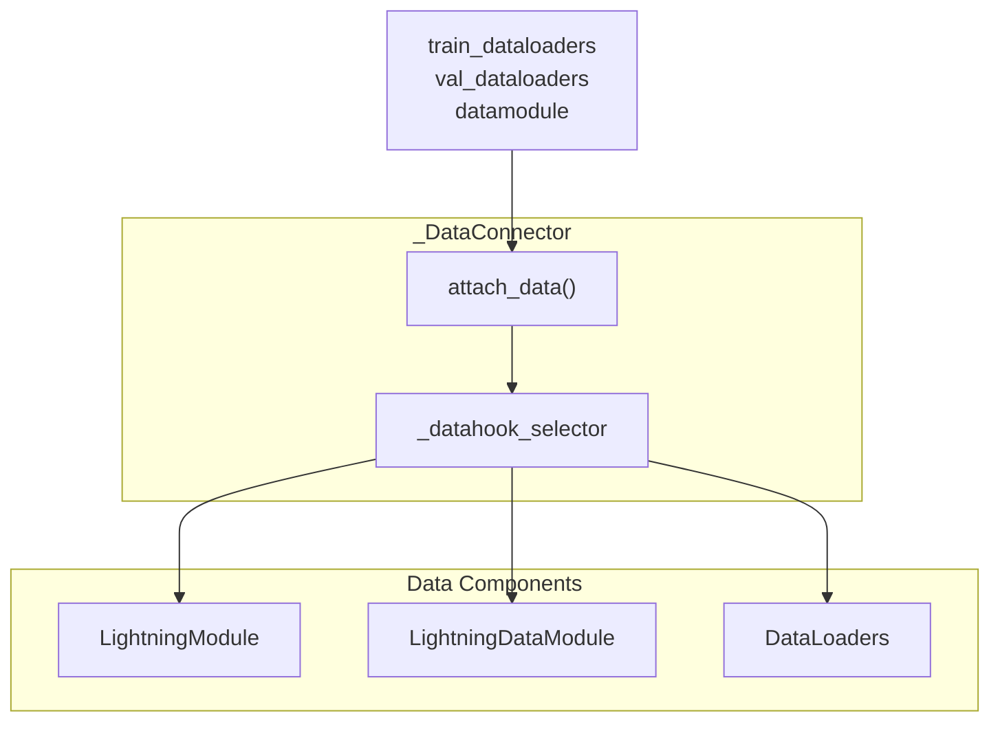
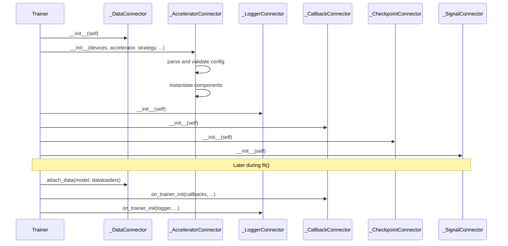
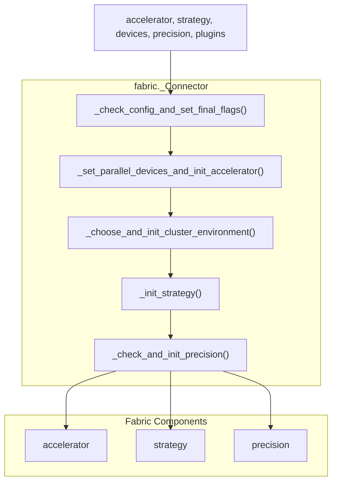

<!-- source: DeepWiki mcp.deepwiki.com · repo Lightning-AI/pytorch-lightning · page 2.5 Connector System · fetched 2026-10-21 -->

# Connector System

Relevant source files

The following files were used as context for generating this wiki page:

- [docs/source-fabric/conf.py](docs/source-fabric/conf.py)
- [docs/source-pytorch/api_references.rst](docs/source-pytorch/api_references.rst)
- [docs/source-pytorch/common/lightning_module.rst](docs/source-pytorch/common/lightning_module.rst)
- [docs/source-pytorch/common/trainer.rst](docs/source-pytorch/common/trainer.rst)
- [docs/source-pytorch/conf.py](docs/source-pytorch/conf.py)
- [docs/source-pytorch/extensions/plugins.rst](docs/source-pytorch/extensions/plugins.rst)
- [requirements/ci.txt](requirements/ci.txt)
- [requirements/docs.txt](requirements/docs.txt)
- [requirements/fabric/docs.txt](requirements/fabric/docs.txt)
- [requirements/pytorch/docs.txt](requirements/pytorch/docs.txt)
- [src/lightning/fabric/connector.py](src/lightning/fabric/connector.py)
- [src/lightning/fabric/utilities/imports.py](src/lightning/fabric/utilities/imports.py)
- [src/lightning/fabric/utilities/registry.py](src/lightning/fabric/utilities/registry.py)
- [src/lightning/fabric/utilities/testing/_runif.py](src/lightning/fabric/utilities/testing/_runif.py)
- [src/lightning/pytorch/callbacks/callback.py](src/lightning/pytorch/callbacks/callback.py)
- [src/lightning/pytorch/callbacks/device_stats_monitor.py](src/lightning/pytorch/callbacks/device_stats_monitor.py)
- [src/lightning/pytorch/core/hooks.py](src/lightning/pytorch/core/hooks.py)
- [src/lightning/pytorch/loops/evaluation_loop.py](src/lightning/pytorch/loops/evaluation_loop.py)
- [src/lightning/pytorch/loops/fetchers.py](src/lightning/pytorch/loops/fetchers.py)
- [src/lightning/pytorch/loops/fit_loop.py](src/lightning/pytorch/loops/fit_loop.py)
- [src/lightning/pytorch/loops/prediction_loop.py](src/lightning/pytorch/loops/prediction_loop.py)
- [src/lightning/pytorch/loops/training_epoch_loop.py](src/lightning/pytorch/loops/training_epoch_loop.py)
- [src/lightning/pytorch/loops/utilities.py](src/lightning/pytorch/loops/utilities.py)
- [src/lightning/pytorch/plugins/__init__.py](src/lightning/pytorch/plugins/__init__.py)
- [src/lightning/pytorch/plugins/precision/__init__.py](src/lightning/pytorch/plugins/precision/__init__.py)
- [src/lightning/pytorch/trainer/connectors/accelerator_connector.py](src/lightning/pytorch/trainer/connectors/accelerator_connector.py)
- [src/lightning/pytorch/trainer/connectors/callback_connector.py](src/lightning/pytorch/trainer/connectors/callback_connector.py)
- [src/lightning/pytorch/trainer/connectors/data_connector.py](src/lightning/pytorch/trainer/connectors/data_connector.py)
- [src/lightning/pytorch/trainer/connectors/logger_connector/logger_connector.py](src/lightning/pytorch/trainer/connectors/logger_connector/logger_connector.py)
- [src/lightning/pytorch/trainer/connectors/signal_connector.py](src/lightning/pytorch/trainer/connectors/signal_connector.py)
- [src/lightning/pytorch/trainer/trainer.py](src/lightning/pytorch/trainer/trainer.py)
- [src/lightning/pytorch/utilities/combined_loader.py](src/lightning/pytorch/utilities/combined_loader.py)
- [src/lightning/pytorch/utilities/imports.py](src/lightning/pytorch/utilities/imports.py)
- [src/lightning/pytorch/utilities/testing/_runif.py](src/lightning/pytorch/utilities/testing/_runif.py)
- [tests/tests_fabric/conftest.py](tests/tests_fabric/conftest.py)
- [tests/tests_fabric/test_connector.py](tests/tests_fabric/test_connector.py)
- [tests/tests_fabric/utilities/test_registry.py](tests/tests_fabric/utilities/test_registry.py)
- [tests/tests_pytorch/conftest.py](tests/tests_pytorch/conftest.py)
- [tests/tests_pytorch/helpers/runif.py](tests/tests_pytorch/helpers/runif.py)
- [tests/tests_pytorch/loops/test_evaluation_loop.py](tests/tests_pytorch/loops/test_evaluation_loop.py)
- [tests/tests_pytorch/loops/test_fetchers.py](tests/tests_pytorch/loops/test_fetchers.py)
- [tests/tests_pytorch/loops/test_prediction_loop.py](tests/tests_pytorch/loops/test_prediction_loop.py)
- [tests/tests_pytorch/loops/test_training_epoch_loop.py](tests/tests_pytorch/loops/test_training_epoch_loop.py)
- [tests/tests_pytorch/models/test_hooks.py](tests/tests_pytorch/models/test_hooks.py)
- [tests/tests_pytorch/trainer/connectors/test_accelerator_connector.py](tests/tests_pytorch/trainer/connectors/test_accelerator_connector.py)
- [tests/tests_pytorch/trainer/connectors/test_callback_connector.py](tests/tests_pytorch/trainer/connectors/test_callback_connector.py)
- [tests/tests_pytorch/trainer/connectors/test_data_connector.py](tests/tests_pytorch/trainer/connectors/test_data_connector.py)
- [tests/tests_pytorch/trainer/flags/test_overfit_batches.py](tests/tests_pytorch/trainer/flags/test_overfit_batches.py)
- [tests/tests_pytorch/trainer/test_dataloaders.py](tests/tests_pytorch/trainer/test_dataloaders.py)
- [tests/tests_pytorch/utilities/test_combined_loader.py](tests/tests_pytorch/utilities/test_combined_loader.py)
- [tests/tests_pytorch/utilities/test_imports.py](tests/tests_pytorch/utilities/test_imports.py)

The Connector System is PyTorch Lightning's architectural pattern for parsing user configuration, instantiating training components, and orchestrating the setup of the training environment. Each connector is responsible for a specific aspect of training infrastructure, from hardware acceleration to data handling to checkpointing.

For information about the overall Trainer architecture, see [Trainer](#2.3). For details on distributed training strategies, see [Strategy Pattern](#3.1).

## System Overview

The Connector System consists of multiple specialized connector classes that work together to transform high-level Trainer arguments into properly configured training components. Each connector handles a distinct domain of functionality while coordinating with others to ensure compatibility.

### Connector Architecture

Sources: [src/lightning/pytorch/trainer/trainer.py:406-423]()

### Core Responsibilities

Each connector follows a consistent pattern:

1. **Configuration Parsing** - Convert user arguments into component-specific settings
2. **Validation** - Check for configuration conflicts and compatibility issues  
3. **Component Instantiation** - Create the appropriate instances based on parsed configuration
4. **Integration** - Set up relationships and dependencies between components

## Individual Connectors

### AcceleratorConnector

The `_AcceleratorConnector` is the most complex connector, responsible for parsing hardware and training strategy configuration. It transforms high-level arguments like `accelerator="auto"` and `devices="auto"` into concrete strategy and accelerator instances.

Key responsibilities:
- Resolves `"auto"` values for accelerator and devices based on available hardware
- Handles strategy selection logic (e.g., auto-selecting DDP for multi-GPU)
- Manages plugin configuration and validation
- Sets up cluster environment detection

Sources: [src/lightning/pytorch/trainer/connectors/accelerator_connector.py:75-164]()

### DataConnector

The `_DataConnector` manages data-related configuration and integrates with both `LightningModule` and `LightningDataModule` instances.

Sources: [src/lightning/pytorch/trainer/trainer.py:406](), [src/lightning/pytorch/trainer/trainer.py:591-593]()

### LoggerConnector

The `_LoggerConnector` handles logger setup and metric collection coordination.

Sources: [src/lightning/pytorch/trainer/trainer.py:420](), [src/lightning/pytorch/trainer/trainer.py:489]()

### CallbackConnector  

The `_CallbackConnector` manages callback registration, ordering, and lifecycle.

Sources: [src/lightning/pytorch/trainer/trainer.py:421](), [src/lightning/pytorch/trainer/trainer.py:438-445]()

### CheckpointConnector

The `_CheckpointConnector` handles checkpoint loading, saving, and path resolution.

Sources: [src/lightning/pytorch/trainer/trainer.py:422](), [src/lightning/pytorch/trainer/trainer.py:598-603]()

### SignalConnector

The `_SignalConnector` manages signal handling for graceful training interruption.

Sources: [src/lightning/pytorch/trainer/trainer.py:423]()

## Configuration Flow

The connector system follows a specific initialization order to handle dependencies between components:

Sources: [src/lightning/pytorch/trainer/trainer.py:405-423](), [src/lightning/pytorch/trainer/trainer.py:438-445](), [src/lightning/pytorch/trainer/trainer.py:449-453](), [src/lightning/pytorch/trainer/trainer.py:489]()

## Fabric Connector

Lightning Fabric includes its own `_Connector` class that implements a simplified version of the accelerator connector pattern. It handles strategy, accelerator, and precision setup for the lower-level Fabric API.

Sources: [src/lightning/fabric/connector.py:74-163]()

## Error Handling and Validation

Connectors implement extensive validation to catch configuration errors early:

| Validation Type | Example | Connector |
|-----------------|---------|-----------|
| Hardware compatibility | MPS accelerator with DDP strategy | `_AcceleratorConnector` |
| Argument conflicts | Both precision flag and precision plugin | `_AcceleratorConnector` |
| Strategy requirements | FSDP requiring GPU accelerator | `_AcceleratorConnector` |
| Environment detection | Interactive mode with incompatible strategies | `_AcceleratorConnector` |

Sources: [src/lightning/pytorch/trainer/connectors/accelerator_connector.py:211-222](), [src/lightning/pytorch/trainer/connectors/accelerator_connector.py:454-461]()

## Integration Points

Connectors integrate with the broader Lightning ecosystem through several key interfaces:

- **Plugin System**: Connectors handle plugin registration and validation
- **Strategy Pattern**: AcceleratorConnector instantiates and configures strategies
- **Hook System**: Connectors coordinate with LightningModule and Callback hooks
- **Registry System**: Connectors use registries to resolve string names to classes

Sources: [src/lightning/pytorch/trainer/connectors/accelerator_connector.py:114-119](), [src/lightning/pytorch/trainer/connectors/accelerator_connector.py:227-260]()

---

