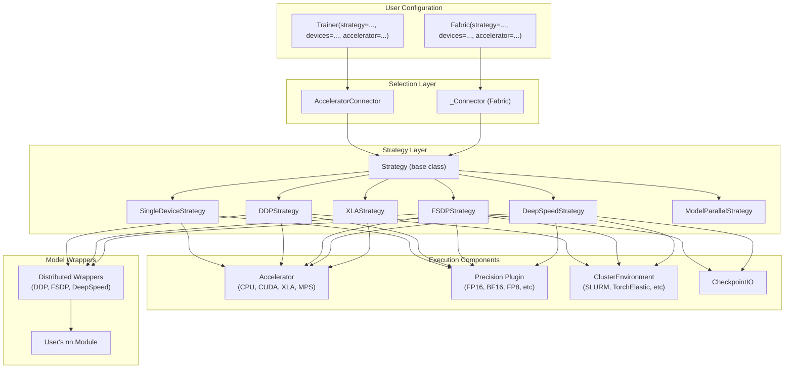
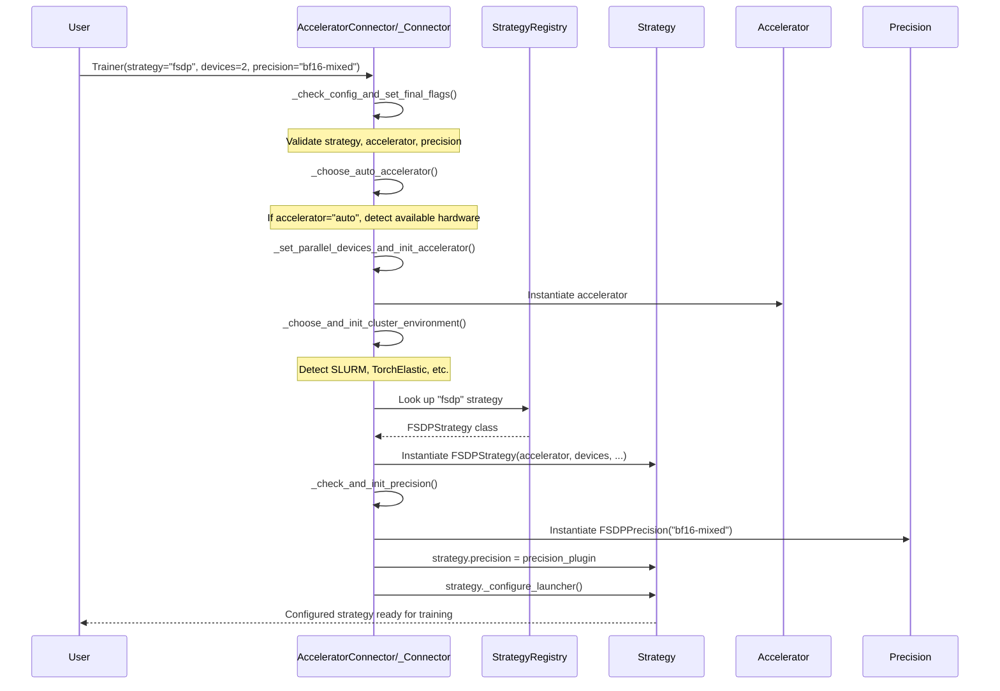
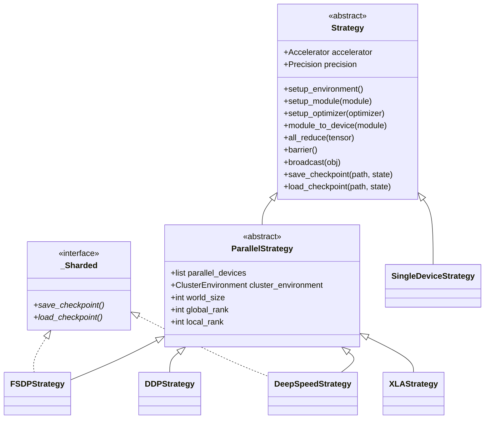
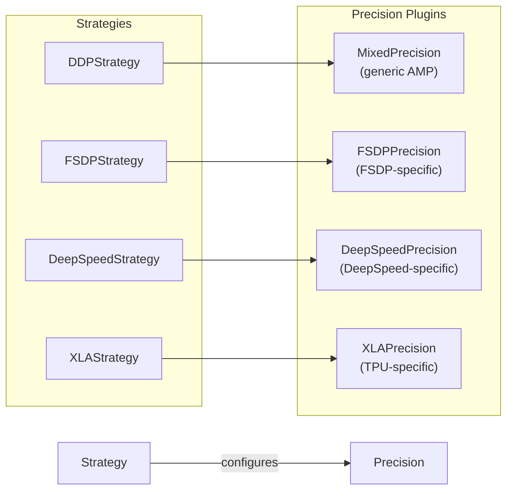
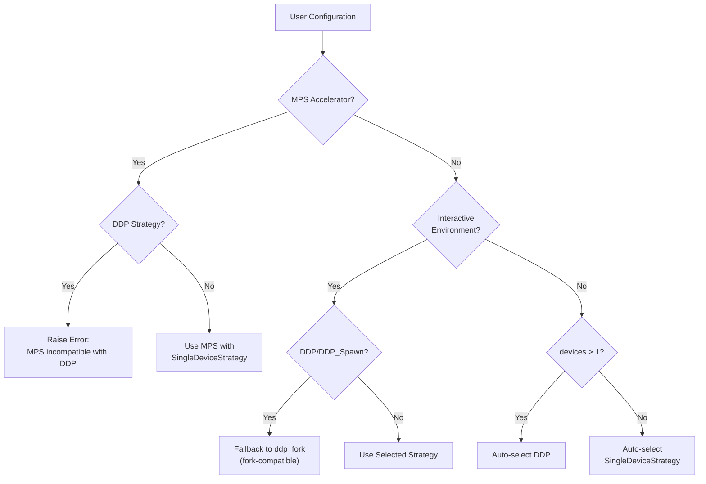

<!-- source: DeepWiki mcp.deepwiki.com · repo Lightning-AI/pytorch-lightning · page 3 Distributed Training · fetched 2026-10-21 -->

# Distributed Training

<details>
<summary>Relevant source files</summary>

The following files were used as context for generating this wiki page:

- [docs/source-fabric/api/fabric_methods.rst](docs/source-fabric/api/fabric_methods.rst)
- [docs/source-fabric/api/wrappers.rst](docs/source-fabric/api/wrappers.rst)
- [src/lightning/fabric/CHANGELOG.md](src/lightning/fabric/CHANGELOG.md)
- [src/lightning/fabric/fabric.py](src/lightning/fabric/fabric.py)
- [src/lightning/fabric/strategies/ddp.py](src/lightning/fabric/strategies/ddp.py)
- [src/lightning/fabric/strategies/deepspeed.py](src/lightning/fabric/strategies/deepspeed.py)
- [src/lightning/fabric/strategies/fsdp.py](src/lightning/fabric/strategies/fsdp.py)
- [src/lightning/fabric/strategies/strategy.py](src/lightning/fabric/strategies/strategy.py)
- [src/lightning/pytorch/CHANGELOG.md](src/lightning/pytorch/CHANGELOG.md)
- [src/lightning/pytorch/core/module.py](src/lightning/pytorch/core/module.py)
- [src/lightning/pytorch/strategies/ddp.py](src/lightning/pytorch/strategies/ddp.py)
- [src/lightning/pytorch/strategies/deepspeed.py](src/lightning/pytorch/strategies/deepspeed.py)
- [src/lightning/pytorch/strategies/fsdp.py](src/lightning/pytorch/strategies/fsdp.py)
- [src/lightning/pytorch/strategies/strategy.py](src/lightning/pytorch/strategies/strategy.py)
- [tests/tests_fabric/strategies/test_ddp.py](tests/tests_fabric/strategies/test_ddp.py)
- [tests/tests_fabric/strategies/test_deepspeed.py](tests/tests_fabric/strategies/test_deepspeed.py)
- [tests/tests_fabric/strategies/test_deepspeed_integration.py](tests/tests_fabric/strategies/test_deepspeed_integration.py)
- [tests/tests_fabric/strategies/test_fsdp.py](tests/tests_fabric/strategies/test_fsdp.py)
- [tests/tests_fabric/strategies/test_fsdp_integration.py](tests/tests_fabric/strategies/test_fsdp_integration.py)
- [tests/tests_fabric/strategies/test_single_device.py](tests/tests_fabric/strategies/test_single_device.py)
- [tests/tests_fabric/test_fabric.py](tests/tests_fabric/test_fabric.py)
- [tests/tests_pytorch/models/test_onnx.py](tests/tests_pytorch/models/test_onnx.py)
- [tests/tests_pytorch/strategies/test_ddp.py](tests/tests_pytorch/strategies/test_ddp.py)
- [tests/tests_pytorch/strategies/test_ddp_integration.py](tests/tests_pytorch/strategies/test_ddp_integration.py)
- [tests/tests_pytorch/strategies/test_deepspeed.py](tests/tests_pytorch/strategies/test_deepspeed.py)
- [tests/tests_pytorch/strategies/test_fsdp.py](tests/tests_pytorch/strategies/test_fsdp.py)

</details>


## Purpose and Scope

This document provides an overview of Lightning's distributed training capabilities and introduces the Strategy pattern - the core abstraction that enables seamless switching between different distributed training approaches. It covers the high-level architecture, available strategies, and how strategies are selected and configured.

For detailed information about specific strategies, see:
- [Strategy Pattern](#3.1) - The base abstraction and interface
- [FSDP Strategy](#3.2) - Fully Sharded Data Parallel implementation
- [DeepSpeed Strategy](#3.3) - DeepSpeed/ZeRO integration
- [DDP and Other Strategies](#3.4) - DistributedDataParallel and single-device strategies
- [Accelerators and Precision](#3.5) - Hardware accelerators and precision plugins

For information about how strategies are selected during Trainer initialization, see [Connector System](#2.5).

## Overview

Lightning provides a unified interface for distributed training that allows users to scale from single-device training to multi-node, multi-GPU training with minimal code changes. The system is built on the **Strategy pattern**, where different distributed training approaches (DDP, FSDP, DeepSpeed, etc.) are implemented as interchangeable strategy objects that share a common interface.

### Key Benefits

- **Minimal Code Changes**: Switch between strategies by changing a single argument: `Trainer(strategy="ddp")` vs `Trainer(strategy="fsdp")`
- **Hardware Agnostic**: Same code works across CPU, GPU, TPU with appropriate strategy selection
- **Modular Design**: Strategies, accelerators, and precision plugins are independently configurable
- **Shared Infrastructure**: All strategies leverage common implementations for checkpointing, gradient clipping, and optimizer handling

Sources: [README.md:1-50](), [src/lightning/pytorch/CHANGELOG.md:86-141]()

## Distributed Training Architecture

The following diagram shows how distributed training components are organized and interact:



Sources: [src/lightning/pytorch/trainer/connectors/accelerator_connector.py:74-162](), [src/lightning/fabric/connector.py:1-50](), [src/lightning/fabric/strategies/strategy.py:1-50]()

## Strategy Selection Process

Strategies are automatically selected during initialization based on user configuration. The `AcceleratorConnector` (PyTorch Lightning) and `_Connector` (Fabric) parse user arguments and instantiate the appropriate strategy.



Sources: [src/lightning/pytorch/trainer/connectors/accelerator_connector.py:129-162](), [src/lightning/fabric/connector.py:80-150](), [tests/tests_pytorch/trainer/connectors/test_accelerator_connector.py:1-50]()

## Available Strategies

### Strategy Hierarchy

| Strategy | Devices | Use Case | Sharded |
|----------|---------|----------|---------|
| `SingleDeviceStrategy` | 1 | Single CPU/GPU training | No |
| `DDPStrategy` | 1+ | Multi-GPU data parallel (replicated model) | No |
| `FSDPStrategy` | 1+ | Large models with parameter sharding | Yes |
| `DeepSpeedStrategy` | 1+ | ZeRO optimization stages 1-3 | Yes |
| `XLAStrategy` | 1+ | TPU training | No |
| `SingleDeviceXLAStrategy` | 1 | Single TPU core | No |
| `ModelParallelStrategy` | 1+ | 2D parallelism (tensor + data parallel) | Yes |

Sources: [src/lightning/pytorch/strategies/fsdp.py:92-142](), [src/lightning/pytorch/strategies/deepspeed.py:55-106](), [src/lightning/fabric/strategies/strategy.py:1-100]()

### Strategy Registration

Strategies can be referenced by string names registered in `StrategyRegistry`:

```python
# String-based selection
trainer = Trainer(strategy="ddp")
trainer = Trainer(strategy="fsdp")
trainer = Trainer(strategy="deepspeed_stage_2")

# Instance-based selection with custom configuration
from lightning.pytorch.strategies import FSDPStrategy
trainer = Trainer(strategy=FSDPStrategy(
    sharding_strategy="FULL_SHARD",
    cpu_offload=True
))
```

Available aliases:
- DDP: `"ddp"`, `"ddp_spawn"`, `"ddp_fork"`, `"ddp_notebook"`
- FSDP: `"fsdp"`, `"fsdp_cpu_offload"`
- DeepSpeed: `"deepspeed"`, `"deepspeed_stage_1"`, `"deepspeed_stage_2"`, `"deepspeed_stage_3"`, `"deepspeed_stage_2_offload"`, `"deepspeed_stage_3_offload"`
- XLA: `"xla"`, `"single_xla"` (legacy: `"tpu_spawn"`, `"single_tpu"`)

Sources: [src/lightning/fabric/strategies/registry.py:1-50](), [src/lightning/pytorch/trainer/connectors/accelerator_connector.py:186-197]()

## Strategy Interface

All strategies implement the `Strategy` base class interface, which defines key methods for distributed training:



The `_Sharded` marker interface identifies strategies that support sharded checkpoints, where model state is distributed across processes rather than consolidated on rank 0.

Sources: [src/lightning/fabric/strategies/strategy.py:50-200](), [src/lightning/fabric/strategies/fsdp.py:86-155](), [src/lightning/fabric/strategies/deepspeed.py:55-106]()

## Key Strategy Responsibilities

### 1. Environment Setup

Strategies initialize the distributed backend and configure process groups:

```python
# Example from FSDPStrategy
def setup_environment(self) -> None:
    super().setup_environment()
    self._setup_distributed()
```

This includes:
- Initializing `torch.distributed` with appropriate backend (`nccl`, `gloo`, `mpi`)
- Setting up process groups for multi-node training
- Configuring environment-specific settings (SLURM, TorchElastic)

Sources: [src/lightning/fabric/strategies/fsdp.py:253-261](), [src/lightning/pytorch/strategies/fsdp.py:233-247]()

### 2. Module Wrapping

Strategies wrap user modules with distributed wrappers:

```python
# DDPStrategy wraps with DistributedDataParallel
module = torch.nn.parallel.DistributedDataParallel(
    module, 
    device_ids=[device_id],
    find_unused_parameters=find_unused_parameters
)

# FSDPStrategy wraps with FullyShardedDataParallel
module = FullyShardedDataParallel(
    module,
    sharding_strategy=self.sharding_strategy,
    cpu_offload=self.cpu_offload,
    mixed_precision=self.mixed_precision_config
)
```

Sources: [src/lightning/fabric/strategies/fsdp.py:280-312](), [src/lightning/pytorch/strategies/fsdp.py:248-300]()

### 3. Collective Operations

Strategies provide methods for distributed communication:

| Method | Purpose |
|--------|---------|
| `all_reduce(tensor, reduce_op="mean")` | Reduce tensor across all processes |
| `barrier()` | Synchronize all processes |
| `broadcast(obj, src=0)` | Send object from src rank to all ranks |
| `all_gather(tensor)` | Gather tensors from all processes |

Sources: [src/lightning/fabric/strategies/strategy.py:200-250](), [src/lightning/fabric/strategies/fsdp.py:365-390]()

### 4. Checkpoint Handling

Strategies manage distributed checkpoint saving and loading. Sharded strategies (`FSDPStrategy`, `DeepSpeedStrategy`) support two checkpoint formats:

**Full Checkpoint** (`state_dict_type="full"`):
- Assembles complete model state on rank 0
- Saves to single file
- Compatible with non-distributed loading

**Sharded Checkpoint** (`state_dict_type="sharded"`):
- Each rank saves its shard
- Creates directory with multiple files
- Memory-efficient for large models

Sources: [src/lightning/fabric/strategies/fsdp.py:414-511](), [src/lightning/pytorch/strategies/fsdp.py:330-415]()

## Strategy and Precision Integration

Strategies work closely with precision plugins to configure mixed precision training:



Each strategy validates and configures precision appropriately:
- `FSDPStrategy` requires `FSDPPrecision` and creates `MixedPrecision` config for FSDP wrappers
- `DeepSpeedStrategy` uses `DeepSpeedPrecision` and injects precision config into DeepSpeed config JSON
- `DDPStrategy` works with generic `MixedPrecision` plugin using `torch.amp.autocast`

Sources: [src/lightning/pytorch/strategies/fsdp.py:196-244](), [src/lightning/pytorch/strategies/deepspeed.py:100-250](), [src/lightning/pytorch/trainer/connectors/accelerator_connector.py:300-400]()

## Fallback and Compatibility Logic

The connector implements automatic fallback logic when user selections are incompatible:



Examples of fallback logic:
- MPS accelerator cannot use DDP strategies (raises error) [src/lightning/pytorch/trainer/connectors/accelerator_connector.py:209-216]()
- Interactive notebooks default to `ddp_fork` instead of `ddp_spawn` [src/lightning/pytorch/trainer/connectors/accelerator_connector.py:229-243]()
- Single device automatically uses `SingleDeviceStrategy` [src/lightning/pytorch/trainer/connectors/accelerator_connector.py:400-450]()

Sources: [src/lightning/pytorch/trainer/connectors/accelerator_connector.py:154-400](), [tests/tests_pytorch/trainer/connectors/test_accelerator_connector.py:228-242]()

## Usage Examples

### Basic Strategy Selection

```python
# Single GPU (automatic)
trainer = Trainer(accelerator="gpu", devices=1)
# Result: SingleDeviceStrategy with CUDAAccelerator

# Multi-GPU DDP (automatic)
trainer = Trainer(accelerator="gpu", devices=4)
# Result: DDPStrategy with 4 GPUs

# Explicit FSDP
trainer = Trainer(
    accelerator="gpu",
    devices=4,
    strategy="fsdp",
    precision="bf16-mixed"
)

# Custom strategy with options
from lightning.pytorch.strategies import FSDPStrategy
from torch.distributed.fsdp import ShardingStrategy

trainer = Trainer(
    strategy=FSDPStrategy(
        sharding_strategy=ShardingStrategy.FULL_SHARD,
        cpu_offload=True,
        state_dict_type="sharded"
    ),
    devices=8,
    precision="bf16-mixed"
)
```

Sources: [tests/tests_pytorch/trainer/connectors/test_accelerator_connector.py:254-308](), [tests/tests_pytorch/strategies/test_fsdp.py:119-155]()

### Strategy with Fabric

```python
from lightning.fabric import Fabric

# Same interface in Fabric
fabric = Fabric(
    accelerator="cuda",
    strategy="fsdp",
    devices=2,
    precision="bf16-mixed"
)
fabric.launch()

# Manual setup
model = MyModel()
optimizer = torch.optim.Adam(model.parameters())
model, optimizer = fabric.setup(model, optimizer)
```

Sources: [tests/tests_fabric/test_fabric.py:58-90](), [tests/tests_fabric/strategies/test_fsdp_integration.py:119-155]()

## Strategy-Specific Features

Each strategy has unique capabilities and configuration options:

| Feature | DDP | FSDP | DeepSpeed | XLA |
|---------|-----|------|-----------|-----|
| Multi-node | ✓ | ✓ | ✓ | ✓ |
| Parameter sharding | ✗ | ✓ | ✓ | ✗ |
| Optimizer sharding | ✗ | ✓ | ✓ | ✗ |
| CPU offloading | ✗ | ✓ | ✓ | ✗ |
| Gradient checkpointing | ✓ | ✓ | ✓ | ✓ |
| Mixed precision | ✓ | ✓ | ✓ | ✓ |
| Find unused parameters | ✓ | ✗ | ✗ | ✗ |
| Static graph | ✓ | ✗ | ✗ | ✗ |
| Compile support | ✓ | ✓ | Limited | ✗ |

For detailed information about each strategy's features and configuration:
- [FSDP Strategy](#3.2) - Sharding strategies, activation checkpointing, hybrid sharding
- [DeepSpeed Strategy](#3.3) - ZeRO stages, optimizer offloading, configuration JSON
- [DDP and Other Strategies](#3.4) - DDP variants, XLA, model parallel

Sources: [src/lightning/pytorch/CHANGELOG.md:286-380](), [src/lightning/fabric/CHANGELOG.md:150-310]()

---

