<!-- source: DeepWiki mcp.deepwiki.com · repo Lightning-AI/pytorch-lightning · page 3.1 Strategy Pattern · fetched 2026-10-21 -->

# Strategy Pattern

<details>
<summary>Relevant source files</summary>

The following files were used as context for generating this wiki page:

- [docs/source-fabric/api/fabric_methods.rst](docs/source-fabric/api/fabric_methods.rst)
- [docs/source-fabric/api/wrappers.rst](docs/source-fabric/api/wrappers.rst)
- [docs/source-pytorch/api_references.rst](docs/source-pytorch/api_references.rst)
- [docs/source-pytorch/extensions/plugins.rst](docs/source-pytorch/extensions/plugins.rst)
- [src/lightning/fabric/CHANGELOG.md](src/lightning/fabric/CHANGELOG.md)
- [src/lightning/fabric/connector.py](src/lightning/fabric/connector.py)
- [src/lightning/fabric/fabric.py](src/lightning/fabric/fabric.py)
- [src/lightning/fabric/strategies/ddp.py](src/lightning/fabric/strategies/ddp.py)
- [src/lightning/fabric/strategies/deepspeed.py](src/lightning/fabric/strategies/deepspeed.py)
- [src/lightning/fabric/strategies/fsdp.py](src/lightning/fabric/strategies/fsdp.py)
- [src/lightning/fabric/strategies/strategy.py](src/lightning/fabric/strategies/strategy.py)
- [src/lightning/fabric/utilities/imports.py](src/lightning/fabric/utilities/imports.py)
- [src/lightning/fabric/utilities/testing/_runif.py](src/lightning/fabric/utilities/testing/_runif.py)
- [src/lightning/pytorch/CHANGELOG.md](src/lightning/pytorch/CHANGELOG.md)
- [src/lightning/pytorch/core/module.py](src/lightning/pytorch/core/module.py)
- [src/lightning/pytorch/plugins/__init__.py](src/lightning/pytorch/plugins/__init__.py)
- [src/lightning/pytorch/plugins/precision/__init__.py](src/lightning/pytorch/plugins/precision/__init__.py)
- [src/lightning/pytorch/strategies/ddp.py](src/lightning/pytorch/strategies/ddp.py)
- [src/lightning/pytorch/strategies/deepspeed.py](src/lightning/pytorch/strategies/deepspeed.py)
- [src/lightning/pytorch/strategies/fsdp.py](src/lightning/pytorch/strategies/fsdp.py)
- [src/lightning/pytorch/strategies/strategy.py](src/lightning/pytorch/strategies/strategy.py)
- [src/lightning/pytorch/trainer/connectors/accelerator_connector.py](src/lightning/pytorch/trainer/connectors/accelerator_connector.py)
- [src/lightning/pytorch/utilities/imports.py](src/lightning/pytorch/utilities/imports.py)
- [src/lightning/pytorch/utilities/testing/_runif.py](src/lightning/pytorch/utilities/testing/_runif.py)
- [tests/tests_fabric/conftest.py](tests/tests_fabric/conftest.py)
- [tests/tests_fabric/strategies/test_ddp.py](tests/tests_fabric/strategies/test_ddp.py)
- [tests/tests_fabric/strategies/test_deepspeed.py](tests/tests_fabric/strategies/test_deepspeed.py)
- [tests/tests_fabric/strategies/test_deepspeed_integration.py](tests/tests_fabric/strategies/test_deepspeed_integration.py)
- [tests/tests_fabric/strategies/test_fsdp.py](tests/tests_fabric/strategies/test_fsdp.py)
- [tests/tests_fabric/strategies/test_fsdp_integration.py](tests/tests_fabric/strategies/test_fsdp_integration.py)
- [tests/tests_fabric/strategies/test_single_device.py](tests/tests_fabric/strategies/test_single_device.py)
- [tests/tests_fabric/test_connector.py](tests/tests_fabric/test_connector.py)
- [tests/tests_fabric/test_fabric.py](tests/tests_fabric/test_fabric.py)
- [tests/tests_pytorch/conftest.py](tests/tests_pytorch/conftest.py)
- [tests/tests_pytorch/helpers/runif.py](tests/tests_pytorch/helpers/runif.py)
- [tests/tests_pytorch/models/test_onnx.py](tests/tests_pytorch/models/test_onnx.py)
- [tests/tests_pytorch/strategies/test_ddp.py](tests/tests_pytorch/strategies/test_ddp.py)
- [tests/tests_pytorch/strategies/test_ddp_integration.py](tests/tests_pytorch/strategies/test_ddp_integration.py)
- [tests/tests_pytorch/strategies/test_deepspeed.py](tests/tests_pytorch/strategies/test_deepspeed.py)
- [tests/tests_pytorch/strategies/test_fsdp.py](tests/tests_pytorch/strategies/test_fsdp.py)
- [tests/tests_pytorch/trainer/connectors/test_accelerator_connector.py](tests/tests_pytorch/trainer/connectors/test_accelerator_connector.py)
- [tests/tests_pytorch/utilities/test_imports.py](tests/tests_pytorch/utilities/test_imports.py)

</details>


The Strategy Pattern provides the pluggable architecture for distributed training in PyTorch Lightning. The `Strategy` base class defines a common interface for model setup, optimizer configuration, gradient synchronization, and checkpointing. Concrete implementations (`DDPStrategy`, `FSDPStrategy`, `DeepSpeedStrategy`, `XLAStrategy`) encapsulate framework-specific distributed training logic.

## Strategy Base Class

The `Strategy` abstract base class ([src/lightning/fabric/strategies/strategy.py:45-260]()) defines the core interface that all strategies must implement. It composes three key plugins: `Accelerator` (hardware abstraction), `Precision` (mixed precision handling), and `CheckpointIO` (checkpoint saving/loading).

**Strategy Class Structure and Key Methods**

```mermaid
graph TB
    subgraph "lightning.fabric.strategies.strategy"
        Strategy["Strategy (ABC)"]
        
        Strategy --> Properties["Properties<br/>root_device: torch.device<br/>is_global_zero: bool<br/>distributed_sampler_kwargs: dict"]
        
        Strategy --> Setup["Setup Methods<br/>setup_environment()<br/>setup_module(module)<br/>setup_optimizer(optimizer)<br/>setup_module_and_optimizers()"]
        
        Strategy --> Training["Training Methods<br/>backward(tensor, module)<br/>optimizer_step(optimizer)<br/>clip_gradients_value()<br/>clip_gradients_norm()"]
        
        Strategy --> Collective["Collective Operations<br/>all_reduce(tensor, group, reduce_op)<br/>barrier(*args, **kwargs)<br/>broadcast(obj, src)<br/>all_gather(tensor, group)"]
        
        Strategy --> Checkpoint["Checkpoint Methods<br/>save_checkpoint(path, state)<br/>load_checkpoint(path, state)"]
        
        Strategy --> Context["Context Managers<br/>tensor_init_context()<br/>module_init_context(empty_init)<br/>no_backward_sync(module, enabled)"]
    end
    
    subgraph "Composed Plugins"
        Accelerator["accelerator: Accelerator"]
        Precision["precision: Precision"]
        CheckpointIO["checkpoint_io: CheckpointIO"]
        ClusterEnv["cluster_environment: ClusterEnvironment"]
    end
    
    Strategy --> Accelerator
    Strategy --> Precision
    Strategy --> CheckpointIO
    Strategy --> ClusterEnv
```

**Concrete Strategy Implementations**

| Strategy Class | Module Path | Primary Use Case | Key Features |
|---------------|-------------|------------------|--------------|
| `SingleDeviceStrategy` | `lightning.fabric.strategies.single_device` | Single GPU/CPU training | No distributed setup, direct device placement |
| `DDPStrategy` | `lightning.fabric.strategies.ddp` | Multi-GPU on single/multiple nodes | `DistributedDataParallel` wrapping, gradient bucketing |
| `FSDPStrategy` | `lightning.fabric.strategies.fsdp` | Large models, memory efficiency | Parameter sharding, CPU offload, `use_orig_params=True` |
| `DeepSpeedStrategy` | `lightning.fabric.strategies.deepspeed` | Very large models, ZeRO optimization | ZeRO stages 1-3, optimizer offload, `DeepSpeedEngine` |
| `XLAStrategy` | `lightning.fabric.strategies.xla` | TPU training | XLA compilation, `xm.mark_step()` synchronization |
| `ModelParallelStrategy` | `lightning.fabric.strategies.model_parallel` | 2D parallelism (tensor + data) | `DeviceMesh`, tensor parallel + FSDP |

Sources:
- [src/lightning/fabric/strategies/strategy.py:45-260]()
- [src/lightning/fabric/strategies/single_device.py:18-109]()
- [src/lightning/fabric/strategies/ddp.py:52-240]()
- [src/lightning/fabric/strategies/fsdp.py:86-364]()
- [src/lightning/fabric/strategies/deepspeed.py:55-800]()
- [src/lightning/fabric/strategies/xla.py]()

## Strategy Class Hierarchy

Strategies inherit from `Strategy` (base) or `ParallelStrategy` (for multi-device training). `ParallelStrategy` extends `Strategy` with distributed process group initialization, rank management, and parallel device handling.

**Inheritance Hierarchy and Key Attributes**

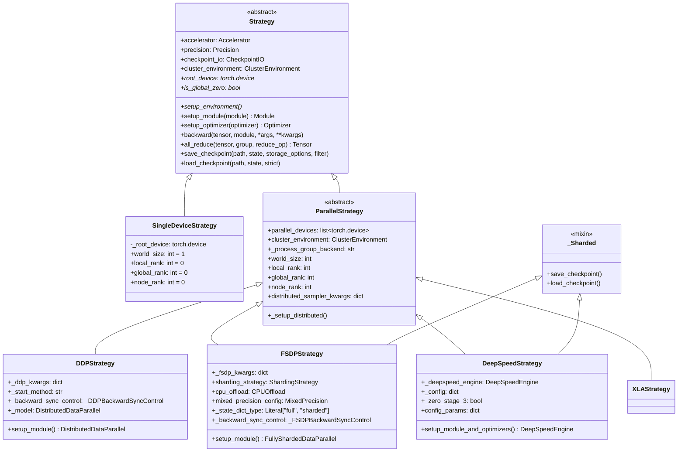

**Key Differences Between Strategies**

| Aspect | `DDPStrategy` | `FSDPStrategy` | `DeepSpeedStrategy` |
|--------|---------------|----------------|---------------------|
| Model Wrapper | `torch.nn.parallel.DistributedDataParallel` | `torch.distributed.fsdp.FullyShardedDataParallel` | `deepspeed.DeepSpeedEngine` |
| Parameter Sharding | None (replicate all) | Full model sharding | ZeRO stage 1/2/3 |
| Gradient Syncing | Allreduce during backward | Reduce-scatter during backward | Configurable per ZeRO stage |
| Optimizer Setup | Before or after model setup | Must be after model setup (unless `use_orig_params=True`) | Joint setup with model |
| Checkpoint Format | Standard PyTorch state dict | Sharded or full state dict | DeepSpeed specialized format |
| Memory Efficiency | Baseline | High (sharded params) | Very high (ZeRO-3 + offload) |

Sources:
- [src/lightning/fabric/strategies/strategy.py:45-260]()
- [src/lightning/fabric/strategies/single_device.py:18-109]()
- [src/lightning/fabric/strategies/parallel.py:25-84]()
- [src/lightning/fabric/strategies/ddp.py:52-240]()
- [src/lightning/fabric/strategies/fsdp.py:86-500]()
- [src/lightning/fabric/strategies/deepspeed.py:55-800]()

## Strategy Registry and Selection

The `_StrategyRegistry` ([src/lightning/fabric/strategies/registry.py]()) maps strategy name strings to strategy classes, enabling runtime strategy selection. The `_Connector` class ([src/lightning/fabric/connector.py:34-700]()) performs strategy resolution based on user configuration and hardware availability.

**Strategy Registry Structure**

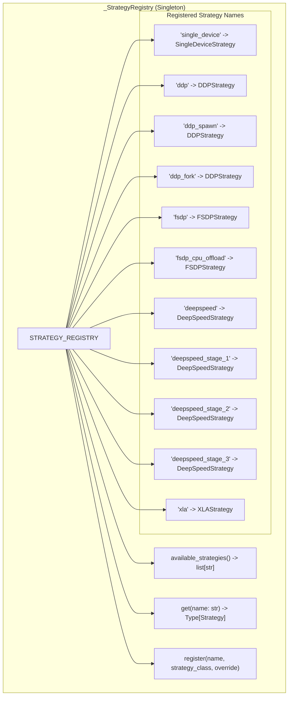

**Connector Strategy Resolution Flow**

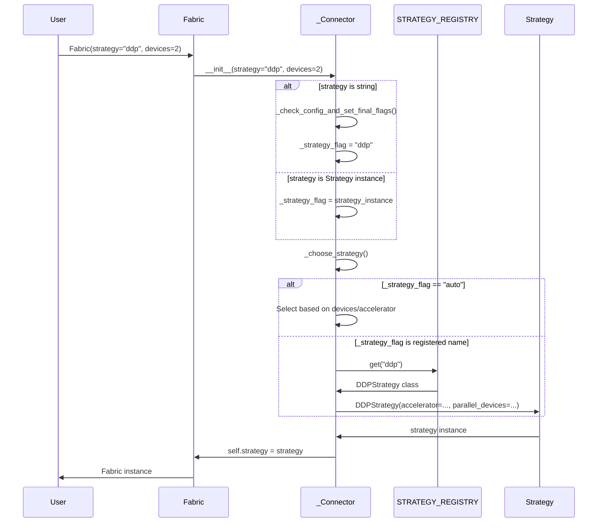

**Auto Strategy Selection Logic**

| Condition | Selected Strategy | Reasoning |
|-----------|------------------|-----------|
| `devices == 1` and single device | `SingleDeviceStrategy` | No distributed training needed |
| `devices > 1` and `accelerator="cpu"` | `DDPStrategy` | Multi-process CPU training |
| `devices > 1` and `accelerator="gpu"` | `DDPStrategy` (default) | Standard multi-GPU training |
| `devices > 1` and `accelerator="tpu"` | `XLAStrategy` | TPU requires XLA backend |
| `strategy="fsdp"` | `FSDPStrategy` | User explicitly requests FSDP |
| `strategy="deepspeed"` | `DeepSpeedStrategy` | User explicitly requests DeepSpeed |

Sources:
- [src/lightning/fabric/strategies/registry.py:25-100]()
- [src/lightning/fabric/connector.py:75-450]()
- [src/lightning/fabric/strategies/ddp.py:243-250]()
- [src/lightning/fabric/strategies/fsdp.py:80-81]()
- [src/lightning/pytorch/trainer/connectors/accelerator_connector.py:74-162]()

## Strategy Interface Methods

The `Strategy` class defines methods for model setup, training operations, collective communications, and checkpointing. All methods have default implementations, but strategies override specific methods to implement their distributed training logic.

**Core Strategy Methods by Category**

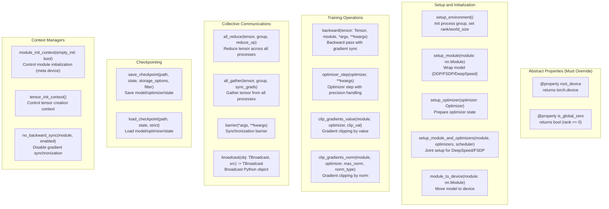

**Method Override Patterns in Concrete Strategies**

| Method | `SingleDeviceStrategy` | `DDPStrategy` | `FSDPStrategy` | `DeepSpeedStrategy` |
|--------|------------------------|---------------|----------------|---------------------|
| `setup_environment()` | No-op | Init `torch.distributed` with `nccl`/`gloo` | Init `torch.distributed` | Init `deepspeed.initialize` |
| `setup_module()` | Return module as-is | Wrap in `DistributedDataParallel` | Wrap in `FullyShardedDataParallel` | N/A (use joint setup) |
| `setup_module_and_optimizers()` | Not used | Not used | Wrap model, return optimizers | `deepspeed.initialize()` returns engine |
| `backward()` | `tensor.backward()` | `tensor.backward()` with DDP sync | `tensor.backward()` with FSDP sync | `engine.backward(tensor)` |
| `save_checkpoint()` | Standard `torch.save()` | Standard `torch.save()` | Full or sharded state dict | DeepSpeed checkpoint format |
| `load_checkpoint()` | Standard `torch.load()` | Standard `torch.load()` | Load full or sharded | DeepSpeed checkpoint loading |

Sources:
- [src/lightning/fabric/strategies/strategy.py:45-260]()
- [src/lightning/fabric/strategies/single_device.py:18-109]()
- [src/lightning/fabric/strategies/ddp.py:52-240]()
- [src/lightning/fabric/strategies/fsdp.py:86-600]()
- [src/lightning/fabric/strategies/deepspeed.py:55-800]()

## Strategy Integration with Fabric and Trainer

Both `Fabric` ([src/lightning/fabric/fabric.py:86-1000]()) and `Trainer` ([src/lightning/pytorch/trainer/trainer.py]()) delegate distributed training operations to the `Strategy` instance. The strategy handles model wrapping, optimizer setup, gradient synchronization, and checkpointing.

**Fabric Delegation to Strategy**

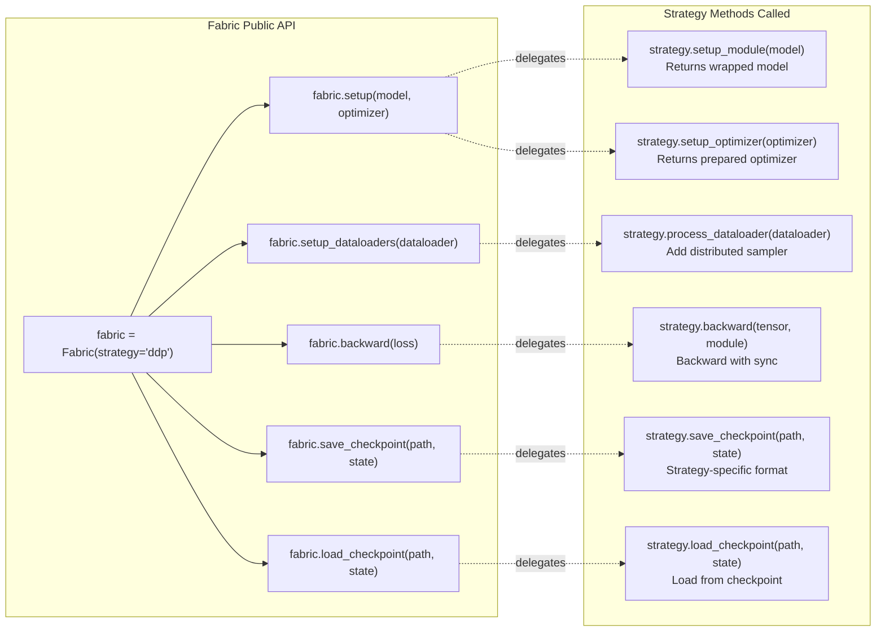

**Strategy Initialization and Setup Sequence**

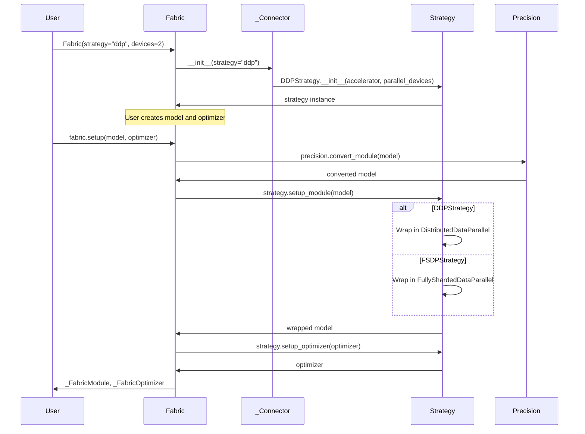

**Model Wrapping by Strategy Type**

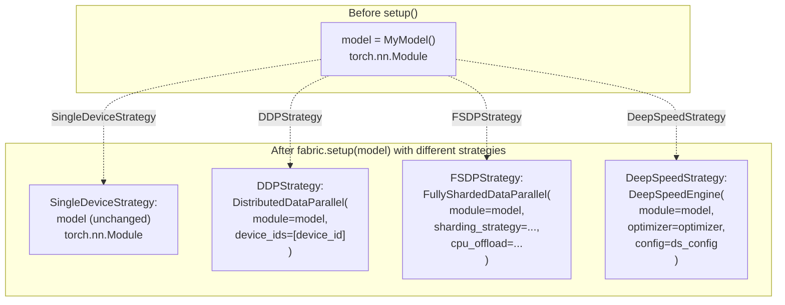

Sources:
- [src/lightning/fabric/fabric.py:229-313]()
- [src/lightning/fabric/fabric.py:482-526]()
- [src/lightning/fabric/fabric.py:693-844]()
- [src/lightning/fabric/connector.py:34-700]()
- [src/lightning/pytorch/trainer/trainer.py:242-360]()

## Specialized Strategy Interfaces

Lightning defines specialized interfaces and mixins for advanced distributed training features such as model sharding and gradient synchronization control.

### _Sharded Mixin Interface

The `_Sharded` mixin ([src/lightning/fabric/strategies/strategy.py:38-42]()) marks strategies that support sharded model and optimizer states. It provides specialized checkpoint save/load methods for distributed checkpointing.

**_Sharded Interface Structure**

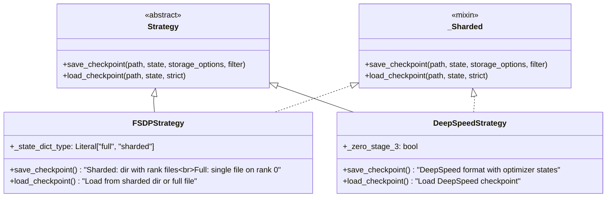

**Sharded Checkpoint Formats**

| Strategy | `state_dict_type` | Checkpoint Structure | Files Created |
|----------|-------------------|----------------------|---------------|
| `FSDPStrategy` | `"full"` | Single file on rank 0 with full state dict | `checkpoint.ckpt` (single file) |
| `FSDPStrategy` | `"sharded"` | Directory with one file per rank | `checkpoint/__0_0.distcp` ... `__N_0.distcp`, `meta.pt` |
| `DeepSpeedStrategy` | N/A | DeepSpeed specialized format | `checkpoint/mp_rank_00_model_states.pt`, `zero_pp_rank_*_mp_rank_00_optim_states.pt` |

### _BackwardSyncControl Pattern

The `_BackwardSyncControl` class ([src/lightning/fabric/strategies/strategy.py:29-35]()) provides a strategy-specific interface for controlling gradient synchronization during backward passes. This enables gradient accumulation by deferring synchronization.

**BackwardSyncControl Implementations**

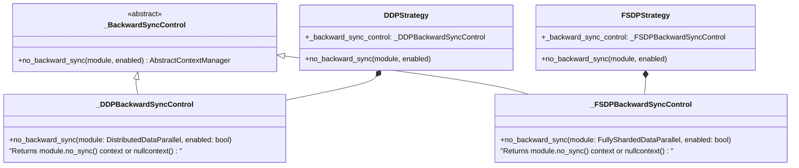

**Gradient Accumulation with BackwardSyncControl**

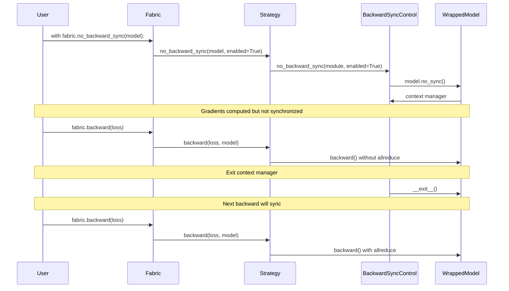

Sources:
- [src/lightning/fabric/strategies/strategy.py:29-42]()
- [src/lightning/fabric/strategies/ddp.py:217-240]()
- [src/lightning/fabric/strategies/fsdp.py:570-593]()
- [src/lightning/fabric/strategies/fsdp.py:414-445]()
- [src/lightning/fabric/strategies/deepspeed.py:631-721]()

## Strategy Pattern Benefits

The Strategy pattern provides a pluggable architecture that decouples distributed training logic from the core training loop, enabling flexibility and extensibility.

### Polymorphic Substitution

All strategies implement the `Strategy` interface, allowing runtime substitution without changing user code. Users specify `strategy="ddp"` or `strategy="fsdp"` and the framework handles the implementation differences.

**Strategy Substitution Example**

```python
# User code remains identical across strategies
def train(fabric):
    model = MyModel()
    optimizer = torch.optim.Adam(model.parameters())
    
    model, optimizer = fabric.setup(model, optimizer)
    
    for batch in dataloader:
        loss = model(batch)
        fabric.backward(loss)  # Strategy handles gradient sync
        optimizer.step()
        optimizer.zero_grad()

# Switch strategies by changing initialization only
fabric_ddp = Fabric(strategy="ddp", devices=4)
fabric_fsdp = Fabric(strategy="fsdp", devices=4)
fabric_deepspeed = Fabric(strategy="deepspeed", devices=4)
```

### Encapsulation of Distributed Complexity

Each strategy encapsulates framework-specific implementation details, providing a consistent interface while handling different distributed training mechanics internally.

**Encapsulated Operations by Strategy**

| Operation | What User Calls | `DDPStrategy` Internal | `FSDPStrategy` Internal | `DeepSpeedStrategy` Internal |
|-----------|----------------|------------------------|------------------------|------------------------------|
| Setup model | `fabric.setup(model)` | Wrap in `DistributedDataParallel` | Wrap in `FullyShardedDataParallel` with sharding config | Call `deepspeed.initialize()` |
| Backward pass | `fabric.backward(loss)` | `loss.backward()` triggers DDP allreduce hooks | `loss.backward()` with FSDP reduce-scatter | `engine.backward(loss)` with ZeRO gradient reduction |
| Save checkpoint | `fabric.save_checkpoint(path, state)` | Gather state dict on rank 0, `torch.save()` | Full or sharded state dict with `torch.distributed.checkpoint` | DeepSpeed checkpoint format with `engine.save_checkpoint()` |
| Device placement | `fabric.setup(model)` | Move to `parallel_devices[local_rank]` | Parameters sharded across devices | Parameters sharded based on ZeRO stage |

### Extensibility Through Inheritance

New strategies can be added by subclassing `Strategy` or `ParallelStrategy` and registering with `STRATEGY_REGISTRY.register()`. Custom strategies inherit common functionality and override specific methods.

**Custom Strategy Extension Points**

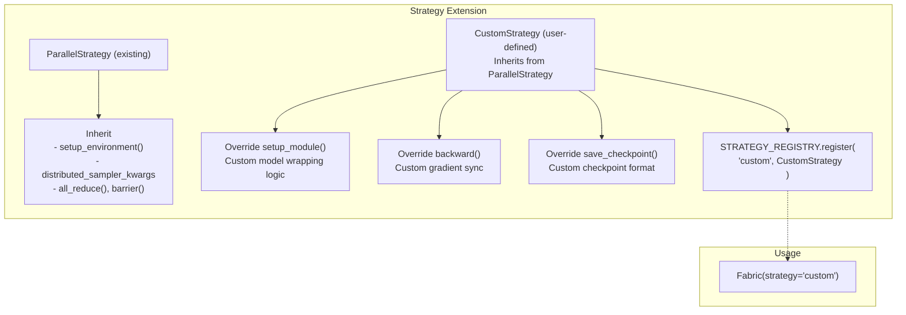

**Required Methods for Custom Strategy**

| Method | Required? | Purpose |
|--------|-----------|---------|
| `root_device` (property) | Yes | Return the device for this process |
| `is_global_zero` (property) | Yes | Return whether this is rank 0 |
| `setup_environment()` | Optional | Initialize process group if needed |
| `setup_module()` | Recommended | Wrap model with custom distributed logic |
| `backward()` | Optional | Custom backward pass implementation |
| `save_checkpoint()` | Optional | Custom checkpoint format |

Sources:
- [src/lightning/fabric/strategies/strategy.py:45-260]()
- [src/lightning/fabric/strategies/registry.py:25-100]()
- [src/lightning/fabric/fabric.py:229-313]()
- [src/lightning/fabric/strategies/parallel.py:25-84]()

## Strategy-Specific Checkpointing

Each strategy implements checkpointing differently based on its model wrapping and sharding approach. The `save_checkpoint()` and `load_checkpoint()` methods are defined in the `Strategy` base class but overridden by sharded strategies.

### FSDP Checkpoint Formats

`FSDPStrategy` ([src/lightning/fabric/strategies/fsdp.py:414-530]()) supports two checkpoint formats controlled by the `state_dict_type` parameter:

**FSDP Checkpointing Implementation**

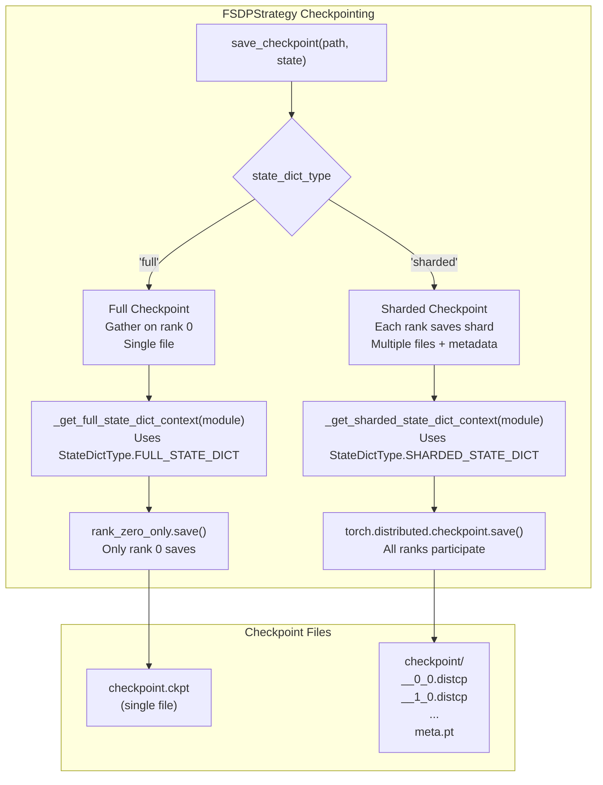

**Loading FSDP Checkpoints**

| Checkpoint Type | Save Method | Load Method | Use Case |
|----------------|-------------|-------------|----------|
| Full (`state_dict_type="full"`) | Gather all parameters on rank 0, save single file | All ranks load from single file, scatter parameters | Compatible with non-FSDP models, easier debugging |
| Sharded (`state_dict_type="sharded"`) | Each rank saves its shard, metadata file on rank 0 | Each rank loads its shard directly | Faster for very large models, required for models that don't fit on single device |

### DeepSpeed Checkpoint Format

`DeepSpeedStrategy` ([src/lightning/fabric/strategies/deepspeed.py:631-721]()) uses DeepSpeed's native checkpointing format, which stores model weights and optimizer states separately, with ZeRO-specific optimizations.

**DeepSpeed Checkpoint Structure**

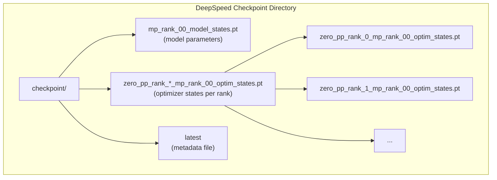

**DeepSpeed Checkpoint Operations**

| Operation | Method | Behavior |
|-----------|--------|----------|
| Save | `DeepSpeedEngine.save_checkpoint(path)` | Creates directory with model states and per-rank optimizer states |
| Load | `DeepSpeedEngine.load_checkpoint(path)` | Loads model and optimizer states, handles ZeRO stage-specific loading |
| Convert to standard | `_load_raw_module_state()` helper | Extract standard PyTorch state dict from DeepSpeed checkpoint |

Sources:
- [src/lightning/fabric/strategies/fsdp.py:414-530]()
- [src/lightning/pytorch/strategies/fsdp.py:463-570]()
- [src/lightning/fabric/strategies/deepspeed.py:631-721]()
- [src/lightning/pytorch/strategies/deepspeed.py:740-830]()
- [src/lightning/fabric/strategies/fsdp.py:52-72]() (_get_full_state_dict_context, _get_sharded_state_dict_context)

## Advanced Strategy Features

### Activation Checkpointing

Available in FSDP and DeepSpeed strategies to reduce memory usage by recomputing activations during backward pass.

```python
from torch.distributed.fsdp.wrap import transformer_auto_wrap_policy
import torch.nn as nn

# With FSDP
strategy = FSDPStrategy(
    activation_checkpointing_policy=transformer_auto_wrap_policy(
        {nn.TransformerEncoderLayer, nn.TransformerDecoderLayer}
    )
)
```

### Auto Wrapping Policies

FSDP allows automatic wrapping of model components for optimal sharding:

```python
from torch.distributed.fsdp.wrap import size_based_auto_wrap_policy
from functools import partial

# Wrap modules with at least 100M parameters
auto_wrap = partial(size_based_auto_wrap_policy, min_num_params=1e8)
strategy = FSDPStrategy(auto_wrap_policy=auto_wrap)
```

### CPU and NVMe Offloading

DeepSpeed and FSDP support offloading parameters and optimizer states to CPU or NVMe:

```python
# FSDP with CPU offloading
strategy = FSDPStrategy(cpu_offload=True)

# DeepSpeed with NVMe offloading
strategy = DeepSpeedStrategy(
    offload_optimizer=True,
    offload_parameters=True,
    offload_params_device="nvme",
    offload_optimizer_device="nvme",
    nvme_path="/path/to/nvme"
)
```

Sources:
- src/lightning/fabric/strategies/fsdp.py:173-178
- src/lightning/pytorch/strategies/fsdp.py:190-194
- src/lightning/fabric/strategies/deepspeed.py:53-105
- src/lightning/pytorch/strategies/deepspeed.py:56-143

## Conclusion

PyTorch Lightning's strategy system provides a unified interface for many distributed training approaches, making it easy to scale your training from a single device to multiple nodes with minimal code changes. By understanding the different strategies and their configurations, you can optimize your training for your specific hardware, model size, and performance requirements.

---

