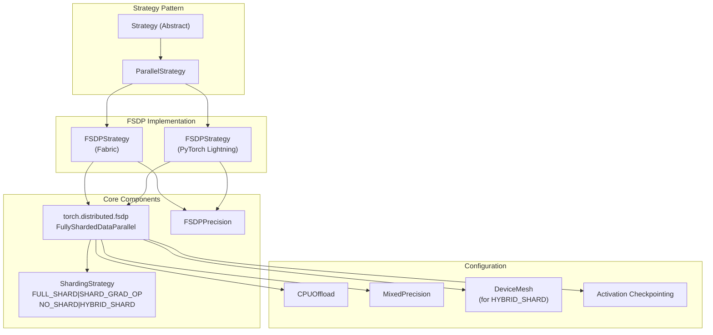
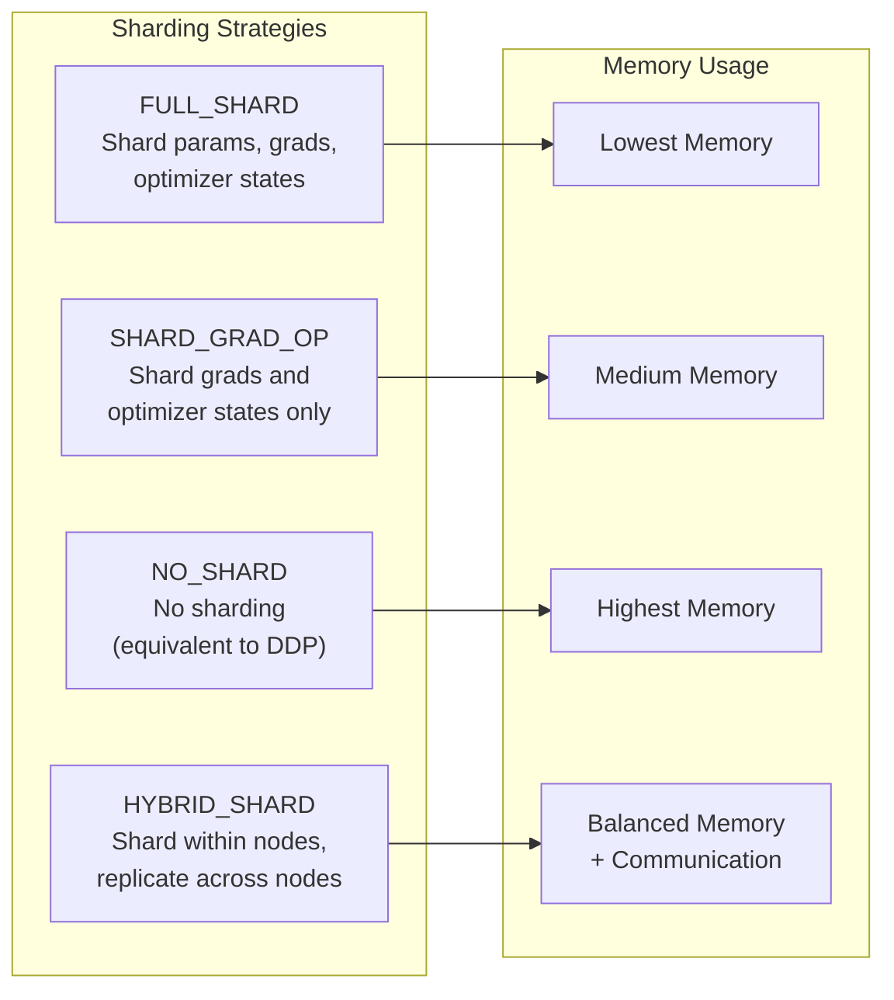
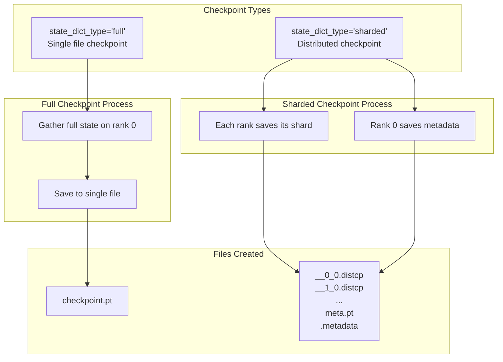
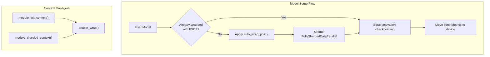
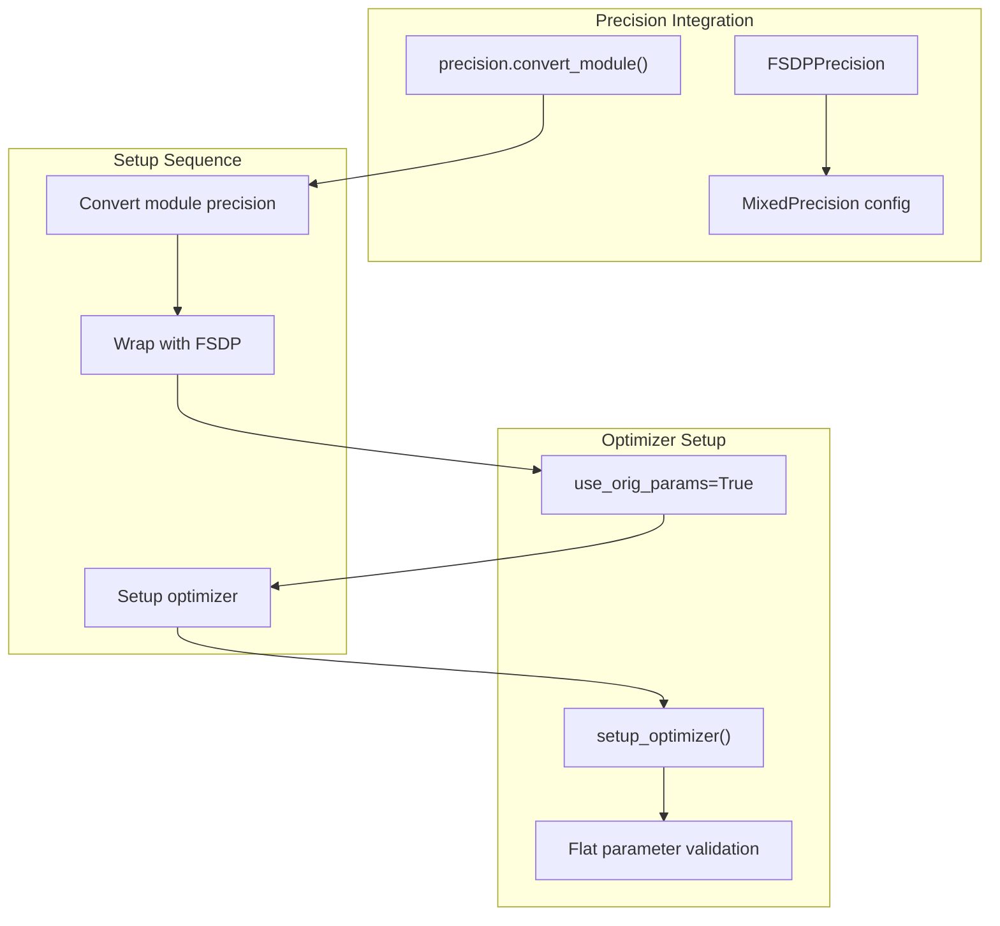

<!-- source: DeepWiki mcp.deepwiki.com · repo Lightning-AI/pytorch-lightning · page 3.2 FSDP Strategy · fetched 2026-10-21 -->

# FSDP Strategy

Relevant source files

The following files were used as context for generating this wiki page:

- [docs/source-fabric/api/fabric_methods.rst](docs/source-fabric/api/fabric_methods.rst)
- [docs/source-fabric/api/wrappers.rst](docs/source-fabric/api/wrappers.rst)
- [src/lightning/fabric/CHANGELOG.md](src/lightning/fabric/CHANGELOG.md)
- [src/lightning/fabric/fabric.py](src/lightning/fabric/fabric.py)
- [src/lightning/fabric/strategies/ddp.py](src/lightning/fabric/strategies/ddp.py)
- [src/lightning/fabric/strategies/deepspeed.py](src/lightning/fabric/strategies/deepspeed.py)
- [src/lightning/fabric/strategies/fsdp.py](src/lightning/fabric/strategies/fsdp.py)
- [src/lightning/fabric/strategies/strategy.py](src/lightning/fabric/strategies/strategy.py)
- [src/lightning/pytorch/CHANGELOG.md](src/lightning/pytorch/CHANGELOG.md)
- [src/lightning/pytorch/core/module.py](src/lightning/pytorch/core/module.py)
- [src/lightning/pytorch/strategies/ddp.py](src/lightning/pytorch/strategies/ddp.py)
- [src/lightning/pytorch/strategies/deepspeed.py](src/lightning/pytorch/strategies/deepspeed.py)
- [src/lightning/pytorch/strategies/fsdp.py](src/lightning/pytorch/strategies/fsdp.py)
- [src/lightning/pytorch/strategies/strategy.py](src/lightning/pytorch/strategies/strategy.py)
- [tests/tests_fabric/strategies/test_ddp.py](tests/tests_fabric/strategies/test_ddp.py)
- [tests/tests_fabric/strategies/test_deepspeed.py](tests/tests_fabric/strategies/test_deepspeed.py)
- [tests/tests_fabric/strategies/test_deepspeed_integration.py](tests/tests_fabric/strategies/test_deepspeed_integration.py)
- [tests/tests_fabric/strategies/test_fsdp.py](tests/tests_fabric/strategies/test_fsdp.py)
- [tests/tests_fabric/strategies/test_fsdp_integration.py](tests/tests_fabric/strategies/test_fsdp_integration.py)
- [tests/tests_fabric/strategies/test_single_device.py](tests/tests_fabric/strategies/test_single_device.py)
- [tests/tests_fabric/test_fabric.py](tests/tests_fabric/test_fabric.py)
- [tests/tests_pytorch/models/test_onnx.py](tests/tests_pytorch/models/test_onnx.py)
- [tests/tests_pytorch/strategies/test_ddp.py](tests/tests_pytorch/strategies/test_ddp.py)
- [tests/tests_pytorch/strategies/test_ddp_integration.py](tests/tests_pytorch/strategies/test_ddp_integration.py)
- [tests/tests_pytorch/strategies/test_deepspeed.py](tests/tests_pytorch/strategies/test_deepspeed.py)
- [tests/tests_pytorch/strategies/test_fsdp.py](tests/tests_pytorch/strategies/test_fsdp.py)

## Purpose and Scope

The FSDP Strategy implements Fully Sharded Data Parallel training in both Lightning Fabric and PyTorch Lightning. It enables scaling model training across multiple GPUs by sharding model parameters, gradients, and optimizer states, allowing training of models that exceed single-GPU memory capacity while maintaining efficient communication patterns.

This document covers the FSDP strategy implementation, configuration options, and checkpointing behavior. For general information about the strategy pattern, see [Strategy Pattern](#3.1). For other distributed training approaches, see [DeepSpeed Strategy](#3.3) and [DDP and Other Strategies](#3.4).

## Architecture Overview

The FSDP strategy integrates into Lightning's strategy system through a common interface while providing specialized sharding capabilities:

Sources: [src/lightning/fabric/strategies/fsdp.py:86-136](), [src/lightning/pytorch/strategies/fsdp.py:92-142](), [src/lightning/fabric/strategies/parallel.py](), [src/lightning/fabric/strategies/strategy.py:45-101]()

## Key Classes and Implementation

The FSDP strategy implementation spans multiple layers, from high-level configuration to low-level PyTorch integration:

```mermaid
graph TB
    subgraph "User Interface"
        Fabric["Fabric(strategy='fsdp')"]
        Trainer["Trainer(strategy='fsdp')"]
    end
    
    subgraph "Strategy Classes"
        FabricFSDPStrategy["lightning.fabric.strategies.fsdp.FSDPStrategy"]
        PyTorchFSDPStrategy["lightning.pytorch.strategies.fsdp.FSDPStrategy"]
    end
    
    subgraph "Core Methods"
        setup_module["setup_module()"]
        setup_module_and_optimizers["setup_module_and_optimizers()"]
        save_checkpoint["save_checkpoint()"]
        load_checkpoint["load_checkpoint()"]
        module_init_context["module_init_context()"]
        module_sharded_context["module_sharded_context()"]
    end
    
    subgraph "PyTorch FSDP"
        FSDP["torch.distributed.fsdp.FullyShardedDataParallel"]
        enable_wrap["torch.distributed.fsdp.wrap.enable_wrap"]
        checkpoint_wrapper["torch.distributed.algorithms._checkpoint.checkpoint_wrapper"]
    end
    
    subgraph "Checkpointing"
        distributed_checkpoint_save["_distributed_checkpoint_save"]
        distributed_checkpoint_load["_distributed_checkpoint_load"]
        get_full_state_dict_context["_get_full_state_dict_context"]
        get_sharded_state_dict_context["_get_sharded_state_dict_context"]
    end
    
    Fabric --> FabricFSDPStrategy
    Trainer --> PyTorchFSDPStrategy
    
    FabricFSDPStrategy --> setup_module
    FabricFSDPStrategy --> save_checkpoint
    FabricFSDPStrategy --> load_checkpoint
    FabricFSDPStrategy --> module_init_context
    PyTorchFSDPStrategy --> setup_module_and_optimizers
    
    setup_module --> FSDP
    module_init_context --> enable_wrap
    setup_module --> checkpoint_wrapper
    
    save_checkpoint --> distributed_checkpoint_save
    save_checkpoint --> get_full_state_dict_context
    load_checkpoint --> distributed_checkpoint_load
    load_checkpoint --> get_sharded_state_dict_context
```

Sources: [src/lightning/fabric/strategies/fsdp.py:264-312](), [src/lightning/pytorch/strategies/fsdp.py:289-321](), [src/lightning/fabric/strategies/fsdp.py:414-512](), [src/lightning/fabric/strategies/fsdp.py:514-608]()

## Configuration Options

The FSDP strategy provides extensive configuration through its constructor parameters:

| Parameter | Type | Default | Description |
|-----------|------|---------|-------------|
| `sharding_strategy` | `str` or `ShardingStrategy` | `"FULL_SHARD"` | Controls parameter/gradient sharding |
| `cpu_offload` | `bool` or `CPUOffload` | `None` | Enables CPU offloading |
| `mixed_precision` | `MixedPrecision` | `None` | Configures mixed precision training |
| `auto_wrap_policy` | `Policy` | `None` | Automatic module wrapping policy |
| `activation_checkpointing_policy` | `Policy` | `None` | Activation checkpointing configuration |
| `state_dict_type` | `"full"` or `"sharded"` | `"sharded"` (Fabric), `"full"` (Lightning) | Checkpoint format |
| `device_mesh` | `tuple` or `DeviceMesh` | `None` | Device topology for hybrid sharding |

### Sharding Strategies

Sources: [src/lightning/fabric/strategies/fsdp.py:113-122](), [src/lightning/pytorch/strategies/fsdp.py:119-127](), [src/lightning/fabric/strategies/fsdp.py:180-181]()

## Checkpointing Behavior

FSDP supports two distinct checkpointing modes with different trade-offs:

Sources: [src/lightning/fabric/strategies/fsdp.py:492-511](), [src/lightning/fabric/strategies/fsdp.py:462-490](), [src/lightning/fabric/strategies/fsdp.py:40-50]()

## Module Wrapping and Setup

The FSDP strategy handles model wrapping through several mechanisms depending on user preference:

Sources: [src/lightning/fabric/strategies/fsdp.py:286-312](), [src/lightning/pytorch/strategies/fsdp.py:294-321](), [src/lightning/fabric/strategies/fsdp.py:352-363](), [src/lightning/fabric/strategies/fsdp.py:338-349]()

## Integration with Precision and Optimizers

FSDP requires specific integration patterns with precision plugins and optimizers:

Sources: [src/lightning/fabric/strategies/fsdp.py:222-228](), [src/lightning/fabric/strategies/fsdp.py:314-331](), [src/lightning/fabric/strategies/fsdp.py:169-170](), [src/lightning/pytorch/strategies/fsdp.py:189-190]()

---

