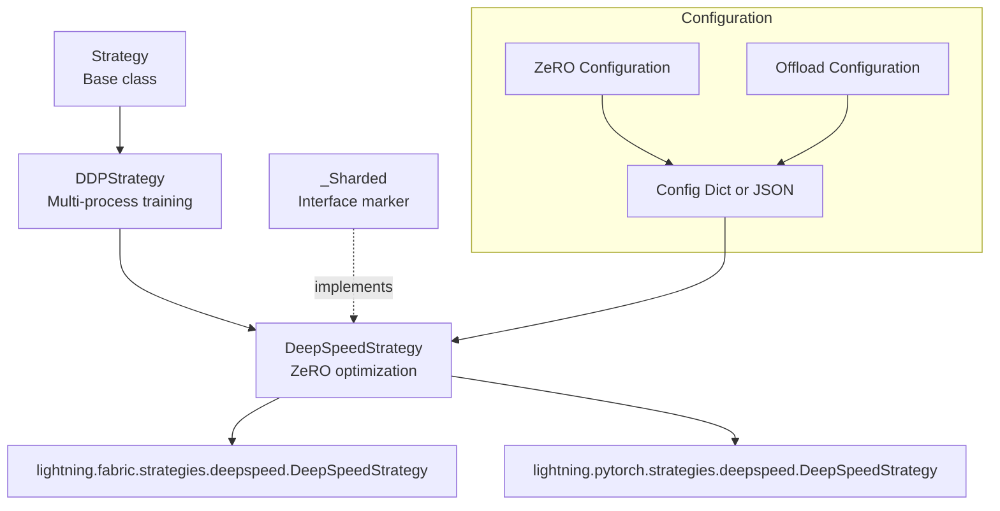
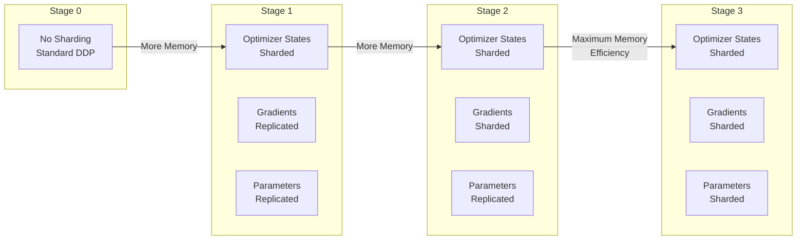
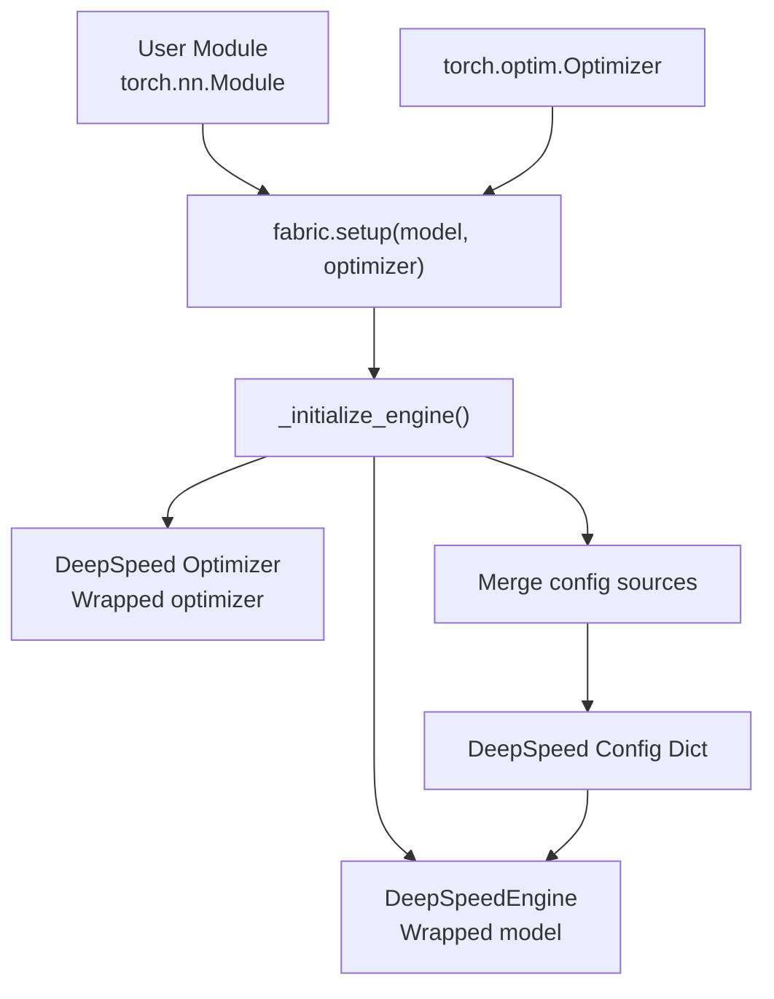
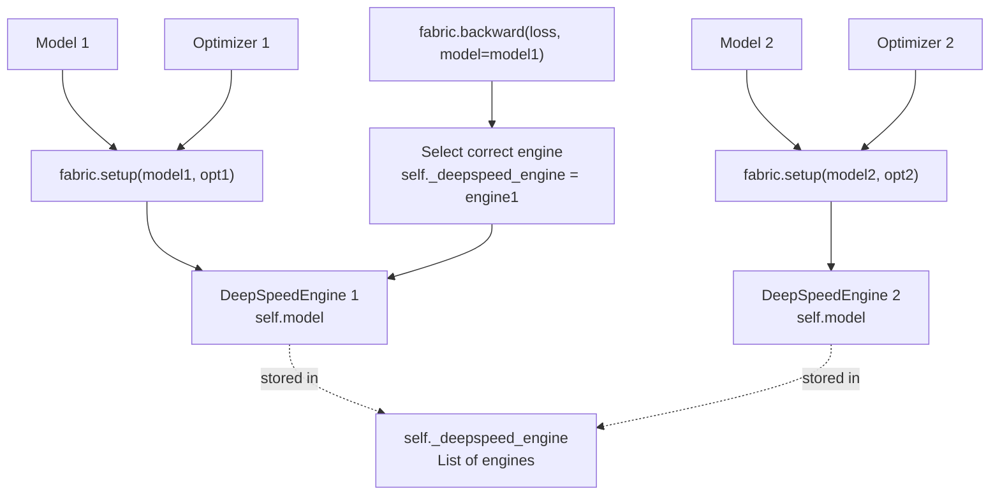
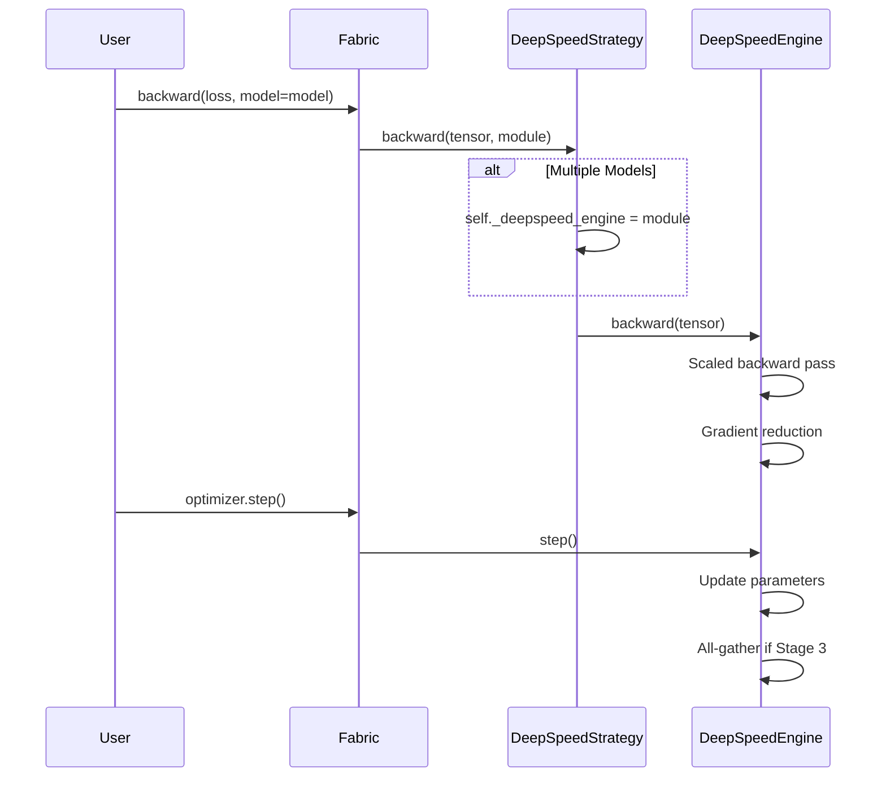
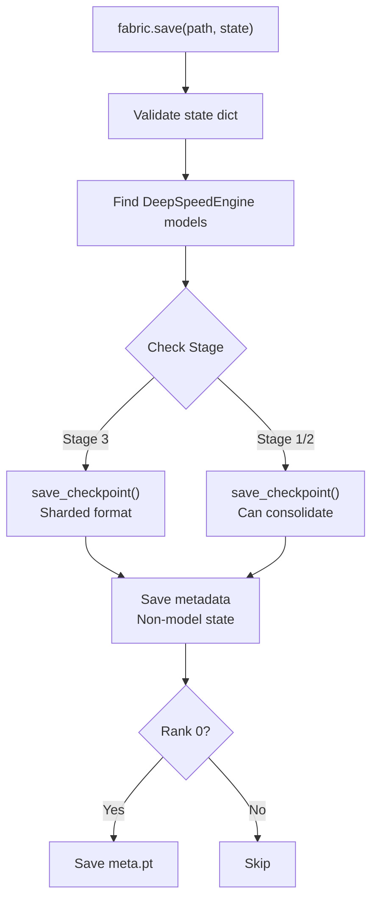
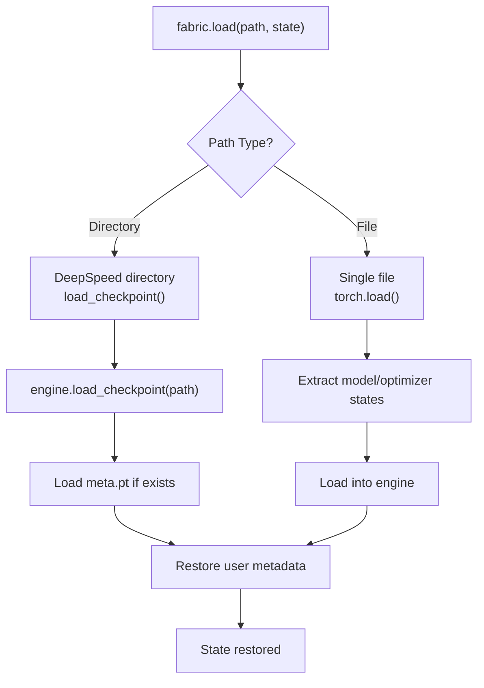
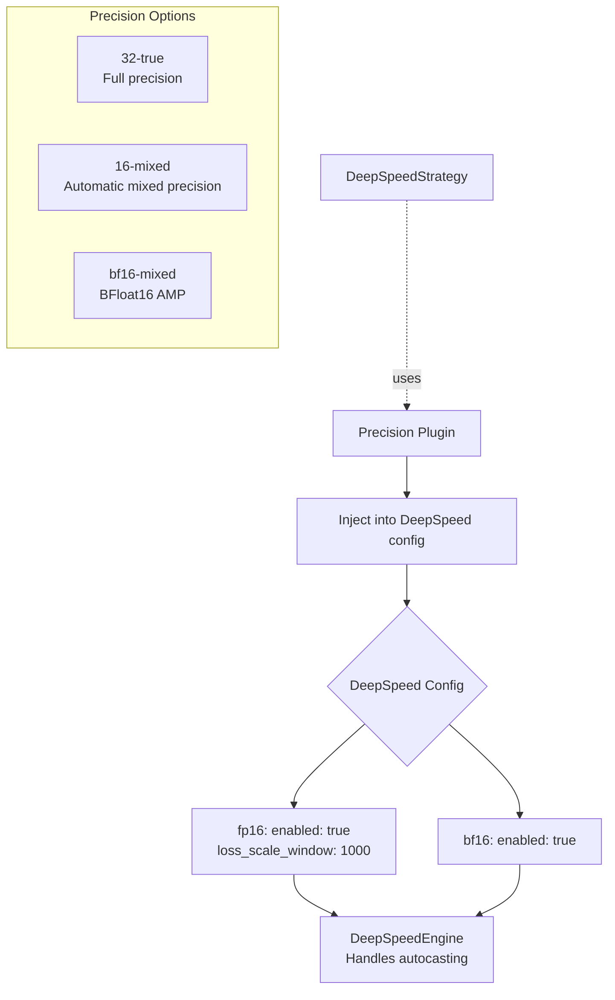
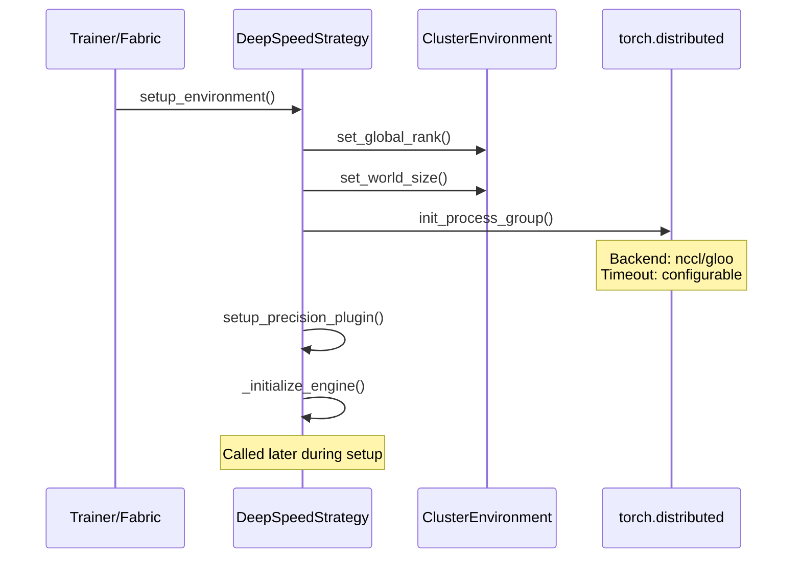

<!-- source: DeepWiki mcp.deepwiki.com · repo Lightning-AI/pytorch-lightning · page 3.3 DeepSpeed Strategy · fetched 2026-10-21 -->

# DeepSpeed Strategy

<details>
<summary>Relevant source files</summary>

The following files were used as context for generating this wiki page:

- [docs/source-fabric/api/fabric_methods.rst](docs/source-fabric/api/fabric_methods.rst)
- [docs/source-fabric/api/wrappers.rst](docs/source-fabric/api/wrappers.rst)
- [src/lightning/fabric/CHANGELOG.md](src/lightning/fabric/CHANGELOG.md)
- [src/lightning/fabric/fabric.py](src/lightning/fabric/fabric.py)
- [src/lightning/fabric/strategies/ddp.py](src/lightning/fabric/strategies/ddp.py)
- [src/lightning/fabric/strategies/deepspeed.py](src/lightning/fabric/strategies/deepspeed.py)
- [src/lightning/fabric/strategies/fsdp.py](src/lightning/fabric/strategies/fsdp.py)
- [src/lightning/fabric/strategies/strategy.py](src/lightning/fabric/strategies/strategy.py)
- [src/lightning/pytorch/CHANGELOG.md](src/lightning/pytorch/CHANGELOG.md)
- [src/lightning/pytorch/core/module.py](src/lightning/pytorch/core/module.py)
- [src/lightning/pytorch/strategies/ddp.py](src/lightning/pytorch/strategies/ddp.py)
- [src/lightning/pytorch/strategies/deepspeed.py](src/lightning/pytorch/strategies/deepspeed.py)
- [src/lightning/pytorch/strategies/fsdp.py](src/lightning/pytorch/strategies/fsdp.py)
- [src/lightning/pytorch/strategies/strategy.py](src/lightning/pytorch/strategies/strategy.py)
- [tests/tests_fabric/strategies/test_ddp.py](tests/tests_fabric/strategies/test_ddp.py)
- [tests/tests_fabric/strategies/test_deepspeed.py](tests/tests_fabric/strategies/test_deepspeed.py)
- [tests/tests_fabric/strategies/test_deepspeed_integration.py](tests/tests_fabric/strategies/test_deepspeed_integration.py)
- [tests/tests_fabric/strategies/test_fsdp.py](tests/tests_fabric/strategies/test_fsdp.py)
- [tests/tests_fabric/strategies/test_fsdp_integration.py](tests/tests_fabric/strategies/test_fsdp_integration.py)
- [tests/tests_fabric/strategies/test_single_device.py](tests/tests_fabric/strategies/test_single_device.py)
- [tests/tests_fabric/test_fabric.py](tests/tests_fabric/test_fabric.py)
- [tests/tests_pytorch/models/test_onnx.py](tests/tests_pytorch/models/test_onnx.py)
- [tests/tests_pytorch/strategies/test_ddp.py](tests/tests_pytorch/strategies/test_ddp.py)
- [tests/tests_pytorch/strategies/test_ddp_integration.py](tests/tests_pytorch/strategies/test_ddp_integration.py)
- [tests/tests_pytorch/strategies/test_deepspeed.py](tests/tests_pytorch/strategies/test_deepspeed.py)
- [tests/tests_pytorch/strategies/test_fsdp.py](tests/tests_pytorch/strategies/test_fsdp.py)

</details>


## Purpose and Scope

This document covers the **DeepSpeedStrategy** class, which integrates Microsoft's DeepSpeed library for memory-efficient training of large models. DeepSpeedStrategy provides ZeRO (Zero Redundancy Optimizer) capabilities for sharding optimizer states, gradients, and parameters across distributed processes. For general distributed training strategies, see [Strategy Pattern](#3.1). For alternative sharding strategies, see [FSDP Strategy](#3.2) and [DDP and Other Strategies](#3.4).

---

## Overview

The DeepSpeedStrategy enables training of large-scale models that wouldn't fit in GPU memory by partitioning model states across devices. It wraps PyTorch models with `DeepSpeedEngine` and provides automatic configuration of ZeRO optimization stages, offloading mechanisms, and precision settings.

**Key Features:**
- ZeRO optimization stages 0-3 for progressive memory reduction
- CPU and NVMe offloading for optimizer states and parameters
- Support for multiple models in a single training script
- Integration with mixed precision training
- Checkpoint management for sharded states

**Location:**
- Fabric: [src/lightning/fabric/strategies/deepspeed.py:55]()
- PyTorch Lightning: [src/lightning/pytorch/strategies/deepspeed.py:76]()

Sources: [src/lightning/fabric/strategies/deepspeed.py:1-50](), [src/lightning/pytorch/strategies/deepspeed.py:1-80]()

---

## Strategy Class Hierarchy



Sources: [src/lightning/fabric/strategies/deepspeed.py:55-56](), [src/lightning/pytorch/strategies/deepspeed.py:76-77](), [src/lightning/fabric/strategies/strategy.py:45-60]()

---

## Configuration System

DeepSpeedStrategy accepts configuration through three methods:

### 1. Constructor Arguments

```python
strategy = DeepSpeedStrategy(
    stage=2,                      # ZeRO stage
    offload_optimizer=True,       # CPU offloading
    offload_parameters=False,     # Parameter offloading
    allgather_bucket_size=200_000_000,
    reduce_bucket_size=200_000_000,
)
```

### 2. JSON Configuration File

```python
strategy = DeepSpeedStrategy(config="/path/to/config.json")
```

### 3. Dictionary Configuration

```python
config = {
    "zero_optimization": {
        "stage": 2,
        "offload_optimizer": {"device": "cpu"}
    },
    "train_batch_size": 32
}
strategy = DeepSpeedStrategy(config=config)
```

**Configuration Priority:** JSON file > Constructor arguments > Defaults

**Environment Variable:** `PL_DEEPSPEED_CONFIG_PATH` can specify a default config path.

Sources: [src/lightning/fabric/strategies/deepspeed.py:58-106](), [src/lightning/pytorch/strategies/deepspeed.py:80-128]()

---

## Configuration Parameters

| Parameter Category | Key Parameters | Purpose |
|-------------------|----------------|---------|
| **ZeRO Stage** | `stage` (0-3) | Controls what is partitioned |
| **Optimizer Offload** | `offload_optimizer`, `offload_optimizer_device` | Move optimizer states to CPU/NVMe |
| **Parameter Offload** | `offload_parameters`, `offload_params_device` | Move parameters to CPU/NVMe (Stage 3 only) |
| **Communication** | `overlap_comm`, `allgather_partitions`, `reduce_scatter` | Optimize gradient synchronization |
| **Memory** | `contiguous_gradients`, `allgather_bucket_size` | Memory efficiency tuning |
| **NVMe** | `nvme_path`, `block_size`, `queue_depth` | NVMe offloading configuration |

Sources: [src/lightning/fabric/strategies/deepspeed.py:58-106](), [src/lightning/pytorch/strategies/deepspeed.py:80-149]()

---

## ZeRO Optimization Stages



### Stage Characteristics

**Stage 0:** Disabled ZeRO, equivalent to standard DDP.

**Stage 1:** Partitions optimizer states only. Reduces memory by ~4x for Adam optimizer.

**Stage 2:** Partitions optimizer states and gradients. Reduces memory by ~8x.

**Stage 3:** Partitions optimizer states, gradients, and parameters. Provides maximum memory savings but requires parameter gathering during forward/backward passes.

Sources: [src/lightning/fabric/strategies/deepspeed.py:118-146](), [src/lightning/pytorch/strategies/deepspeed.py:140-146]()

---

## Model Wrapping and Setup

### Single Model Setup



The setup process:

1. **Module Initialization Context:** Models can be initialized on meta device or with empty weights using `fabric.init_module()`.
   - [src/lightning/fabric/strategies/deepspeed.py:380-417]()

2. **Configuration Merging:** Constructor args, JSON config, and defaults are merged into a single DeepSpeed config.
   - [src/lightning/fabric/strategies/deepspeed.py:526-595]()

3. **Engine Creation:** `deepspeed.initialize()` wraps the model and optimizer into a `DeepSpeedEngine`.
   - [src/lightning/fabric/strategies/deepspeed.py:260-310]()

Sources: [src/lightning/fabric/strategies/deepspeed.py:241-310](), [src/lightning/pytorch/strategies/deepspeed.py:271-343]()

---

## Multiple Model Support

DeepSpeedStrategy supports training multiple models simultaneously, each with its own optimizer:



**Key Points:**
- Each model is wrapped independently as a `DeepSpeedEngine`
- `fabric.backward()` requires `model` argument to select the correct engine
- Multiple engines are tracked in `self._deepspeed_engine` or stored individually

**Implementation:**
- Fabric: [src/lightning/fabric/strategies/deepspeed.py:241-310]()
- PyTorch Lightning: [src/lightning/pytorch/strategies/deepspeed.py:271-343]()

Sources: [tests/tests_fabric/strategies/test_deepspeed_integration.py:34-60](), [src/lightning/fabric/fabric.py:505-525]()

---

## Backward Pass and Optimization



**Important:** 
- With Stage 3, parameters are automatically gathered before forward pass and freed after backward pass
- Gradient scaling is handled internally by DeepSpeed based on precision settings
- The `backward()` call on DeepSpeedEngine handles gradient synchronization

Sources: [src/lightning/fabric/strategies/deepspeed.py:312-338](), [src/lightning/pytorch/strategies/deepspeed.py:345-375]()

---

## Checkpointing

### Save Process



**Checkpoint Structure:**

For **Stage 3** (sharded):
```
checkpoint_dir/
├── mp_rank_00_model_states.pt
├── zero_pp_rank_0_mp_rank_00_optim_states.pt
├── latest (file with checkpoint tag)
└── meta.pt (Lightning metadata)
```

For **Stage 1/2** (can be full or sharded):
```
checkpoint.ckpt (single file with full state)
```

**Key Methods:**
- `save_checkpoint()`: [src/lightning/fabric/strategies/deepspeed.py:440-480]()
- `load_checkpoint()`: [src/lightning/fabric/strategies/deepspeed.py:482-525]()

Sources: [src/lightning/fabric/strategies/deepspeed.py:440-525](), [src/lightning/pytorch/strategies/deepspeed.py:496-577]()

---

## Load Process



**Important Considerations:**
- **Stage 3 Initialization:** Models must be initialized through `fabric.init_module()` context to handle meta device parameters
- **Optimizer State:** Optimizer states are automatically loaded by DeepSpeed
- **Strict Loading:** Use `strict=False` parameter to ignore missing keys

Sources: [src/lightning/fabric/strategies/deepspeed.py:482-525](), [src/lightning/pytorch/strategies/deepspeed.py:579-646]()

---

## Precision Handling

DeepSpeedStrategy integrates with the precision plugin system:



**Configuration Injection:**
- Precision settings are automatically converted to DeepSpeed's format
- [src/lightning/fabric/strategies/deepspeed.py:622-655]()

**Gradient Scaling:**
- FP16 training uses DeepSpeed's built-in loss scaling
- Configurable via `loss_scale`, `initial_scale_power`, `loss_scale_window`, `hysteresis`, `min_loss_scale`

Sources: [src/lightning/fabric/strategies/deepspeed.py:622-700](), [src/lightning/pytorch/strategies/deepspeed.py:704-740]()

---

## Gradient Clipping

DeepSpeedStrategy handles gradient clipping through the DeepSpeed engine:

```python
# Gradient clipping by norm
fabric.clip_gradients(model, optimizer, max_norm=1.0)

# Gradient clipping by value
fabric.clip_gradients(model, optimizer, clip_val=0.5)
```

**Implementation:**
- Clipping is performed by the DeepSpeedEngine's internal mechanism
- Values are set in the DeepSpeed configuration
- [src/lightning/pytorch/strategies/deepspeed.py:648-702]()

Sources: [src/lightning/pytorch/strategies/deepspeed.py:648-702](), [src/lightning/fabric/strategies/deepspeed.py:340-378]()

---

## Environment Setup and Initialization



**Key Steps:**
1. Determine global rank and world size from cluster environment
2. Initialize distributed process group with appropriate backend
3. Configure precision plugin
4. Engine initialization happens during model setup, not in environment setup

Sources: [src/lightning/fabric/strategies/deepspeed.py:207-239](), [src/lightning/pytorch/strategies/deepspeed.py:225-269]()

---

## Registry and Strategy Selection

DeepSpeedStrategy is registered with multiple aliases:

```python
_StrategyRegistry.register(
    "deepspeed",
    DeepSpeedStrategy,
    description="Default DeepSpeed with ZeRO Stage 2",
)

_StrategyRegistry.register(
    "deepspeed_stage_1",
    DeepSpeedStrategy,
    description="DeepSpeed ZeRO Stage 1",
    stage=1,
)

_StrategyRegistry.register(
    "deepspeed_stage_2",
    DeepSpeedStrategy,
    description="DeepSpeed ZeRO Stage 2",
    stage=2,
)

_StrategyRegistry.register(
    "deepspeed_stage_3",
    DeepSpeedStrategy,
    description="DeepSpeed ZeRO Stage 3",
    stage=3,
)

_StrategyRegistry.register(
    "deepspeed_stage_1_offload",
    DeepSpeedStrategy,
    description="DeepSpeed ZeRO Stage 1 with CPU offload",
    stage=1,
    offload_optimizer=True,
)
```

**Usage:**
```python
# By string
fabric = Fabric(strategy="deepspeed_stage_3")

# By instance
strategy = DeepSpeedStrategy(stage=3, offload_optimizer=True)
fabric = Fabric(strategy=strategy)
```

Sources: [src/lightning/fabric/strategies/deepspeed.py:702-748](), [src/lightning/pytorch/strategies/deepspeed.py:769-815]()

---

## Limitations and Constraints

| Limitation | Description | Reason |
|-----------|-------------|--------|
| **Joint Setup Required** | Model and optimizer must be set up together | DeepSpeed requires both to create engine |
| **No setup_module + setup_optimizers** | Cannot split model and optimizer setup | Unlike FSDP, DeepSpeed needs joint initialization |
| **CUDA Accelerator Only** | Requires CUDA-capable GPUs | DeepSpeed library limitation |
| **Single Checkpoint Format** | Cannot save only weights (weights_only) with stage 3 | Sharded state requires full checkpoint |
| **No CheckpointIO Plugin** | Uses DeepSpeed's internal checkpoint mechanism | Not compatible with custom CheckpointIO |

Sources: [src/lightning/fabric/fabric.py:281-290](), [src/lightning/fabric/strategies/deepspeed.py:241-260]()

---

## Integration with Trainer/Fabric

### Fabric Integration

```python
from lightning import Fabric
from lightning.fabric.strategies import DeepSpeedStrategy

fabric = Fabric(
    accelerator="cuda",
    devices=4,
    strategy=DeepSpeedStrategy(stage=3, offload_optimizer=True),
    precision="16-mixed",
)

# Initialize model on meta device for stage 3
with fabric.init_module():
    model = MyLargeModel()

optimizer = torch.optim.Adam(model.parameters())
model, optimizer = fabric.setup(model, optimizer)

# Training loop
for batch in dataloader:
    loss = model(batch)
    fabric.backward(loss)  # Automatically uses correct engine
    optimizer.step()
    optimizer.zero_grad()
```

### PyTorch Lightning Integration

```python
from lightning.pytorch import Trainer
from lightning.pytorch.strategies import DeepSpeedStrategy

trainer = Trainer(
    accelerator="cuda",
    devices=4,
    strategy=DeepSpeedStrategy(stage=3),
    precision="16-mixed",
)

trainer.fit(model, datamodule)
```

Sources: [src/lightning/fabric/fabric.py:229-313](), [tests/tests_fabric/strategies/test_deepspeed_integration.py:34-67]()

---

## Comparison with Other Strategies

| Feature | DeepSpeed | FSDP | DDP |
|---------|-----------|------|-----|
| **Parameter Sharding** | Stage 3 | Yes | No |
| **Optimizer Sharding** | Stage 1+ | Yes | No |
| **Gradient Sharding** | Stage 2+ | Yes | No |
| **CPU Offloading** | Yes | Yes | No |
| **NVMe Offloading** | Yes | No | No |
| **Multiple Models** | Yes | Limited | Yes |
| **Config System** | JSON + Constructor | Constructor only | Constructor only |
| **Checkpoint Format** | Custom sharded | PyTorch sharded | Standard |

Sources: [src/lightning/fabric/strategies/deepspeed.py:55-106](), [src/lightning/fabric/strategies/fsdp.py:86-136](), [src/lightning/fabric/strategies/ddp.py:55-100]()

---

