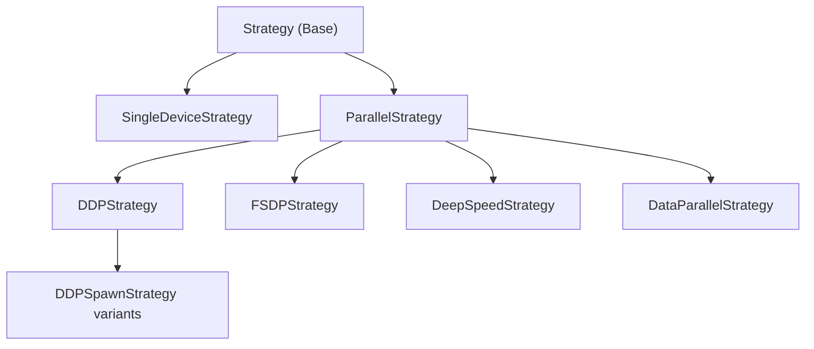
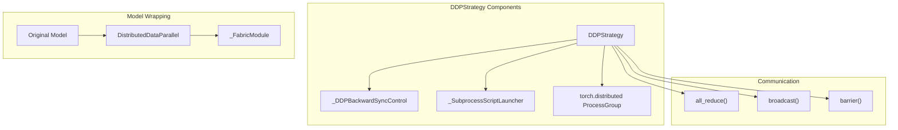
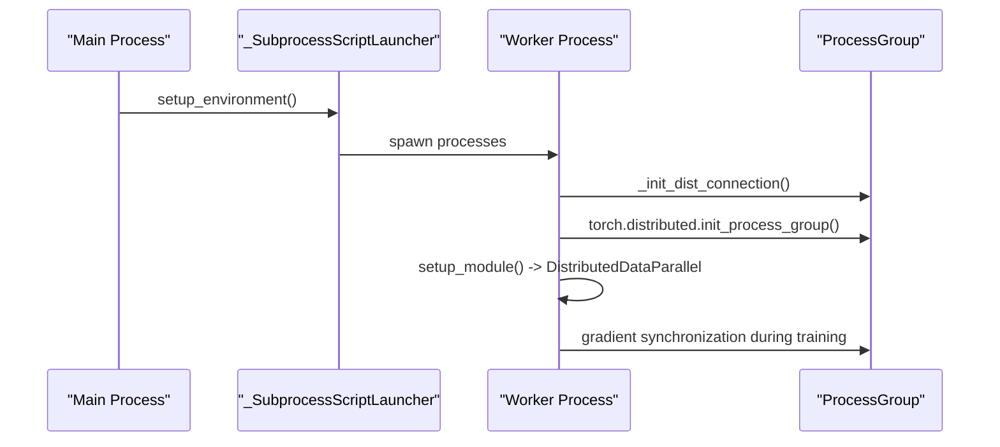
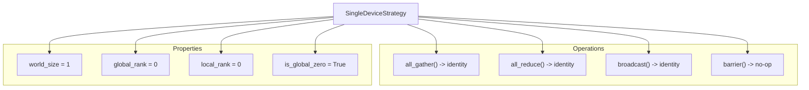
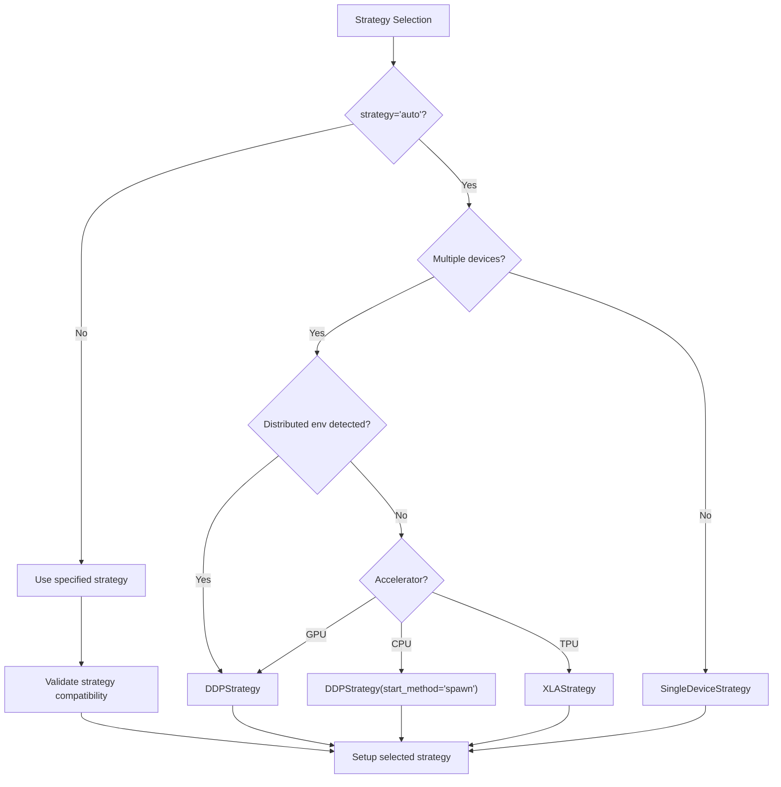

<!-- source: DeepWiki mcp.deepwiki.com · repo Lightning-AI/pytorch-lightning · page 3.4 DDP and Other Strategies · fetched 2026-10-21 -->

# DDP and Other Strategies

<details>
<summary>Relevant source files</summary>

The following files were used as context for generating this wiki page:

- [docs/source-fabric/api/fabric_methods.rst](docs/source-fabric/api/fabric_methods.rst)
- [docs/source-fabric/api/wrappers.rst](docs/source-fabric/api/wrappers.rst)
- [src/lightning/fabric/CHANGELOG.md](src/lightning/fabric/CHANGELOG.md)
- [src/lightning/fabric/fabric.py](src/lightning/fabric/fabric.py)
- [src/lightning/fabric/strategies/ddp.py](src/lightning/fabric/strategies/ddp.py)
- [src/lightning/fabric/strategies/deepspeed.py](src/lightning/fabric/strategies/deepspeed.py)
- [src/lightning/fabric/strategies/fsdp.py](src/lightning/fabric/strategies/fsdp.py)
- [src/lightning/fabric/strategies/strategy.py](src/lightning/fabric/strategies/strategy.py)
- [src/lightning/pytorch/CHANGELOG.md](src/lightning/pytorch/CHANGELOG.md)
- [src/lightning/pytorch/core/module.py](src/lightning/pytorch/core/module.py)
- [src/lightning/pytorch/strategies/ddp.py](src/lightning/pytorch/strategies/ddp.py)
- [src/lightning/pytorch/strategies/deepspeed.py](src/lightning/pytorch/strategies/deepspeed.py)
- [src/lightning/pytorch/strategies/fsdp.py](src/lightning/pytorch/strategies/fsdp.py)
- [src/lightning/pytorch/strategies/strategy.py](src/lightning/pytorch/strategies/strategy.py)
- [tests/tests_fabric/strategies/test_ddp.py](tests/tests_fabric/strategies/test_ddp.py)
- [tests/tests_fabric/strategies/test_deepspeed.py](tests/tests_fabric/strategies/test_deepspeed.py)
- [tests/tests_fabric/strategies/test_deepspeed_integration.py](tests/tests_fabric/strategies/test_deepspeed_integration.py)
- [tests/tests_fabric/strategies/test_fsdp.py](tests/tests_fabric/strategies/test_fsdp.py)
- [tests/tests_fabric/strategies/test_fsdp_integration.py](tests/tests_fabric/strategies/test_fsdp_integration.py)
- [tests/tests_fabric/strategies/test_single_device.py](tests/tests_fabric/strategies/test_single_device.py)
- [tests/tests_fabric/test_fabric.py](tests/tests_fabric/test_fabric.py)
- [tests/tests_pytorch/models/test_onnx.py](tests/tests_pytorch/models/test_onnx.py)
- [tests/tests_pytorch/strategies/test_ddp.py](tests/tests_pytorch/strategies/test_ddp.py)
- [tests/tests_pytorch/strategies/test_ddp_integration.py](tests/tests_pytorch/strategies/test_ddp_integration.py)
- [tests/tests_pytorch/strategies/test_deepspeed.py](tests/tests_pytorch/strategies/test_deepspeed.py)
- [tests/tests_pytorch/strategies/test_fsdp.py](tests/tests_pytorch/strategies/test_fsdp.py)

</details>


This page covers DistributedDataParallel (DDP) strategy and other training strategies in Lightning, excluding FSDP and DeepSpeed which have dedicated coverage. For FSDP strategy details, see [FSDP Strategy](#3.2). For DeepSpeed strategy information, see [DeepSpeed Strategy](#3.3). For the overall strategy pattern architecture, see [Strategy Pattern](#3.1).

## Strategy Architecture Overview

All training strategies in Lightning inherit from a common base `Strategy` class that defines the interface for distributed training, model setup, and hardware acceleration. The strategy pattern allows Lightning to support different distributed training approaches transparently.

### Strategy Class Hierarchy



Sources: [src/lightning/fabric/strategies/strategy.py:45-200](), [src/lightning/fabric/strategies/ddp.py:52-80](), [src/lightning/pytorch/strategies/ddp.py:68-90]()

### Core Strategy Interface

The base `Strategy` class provides essential methods that all strategies must implement:

| Method | Purpose |
|--------|---------|
| `setup_environment()` | Initialize distributed processes and communication |
| `setup_module()` | Wrap model for distributed training |
| `setup_optimizer()` | Configure optimizer for strategy |
| `all_reduce()` | Reduce tensors across processes |
| `broadcast()` | Broadcast data from rank 0 |
| `barrier()` | Synchronize all processes |

Sources: [src/lightning/fabric/strategies/strategy.py:105-200]()

## DDP Strategy

DistributedDataParallel (DDP) is the primary multi-GPU training strategy that replicates the model across devices and synchronizes gradients during backpropagation.

### DDP Implementation Architecture



Sources: [src/lightning/fabric/strategies/ddp.py:52-200](), [src/lightning/pytorch/strategies/ddp.py:68-150]()

### DDP Strategy Configuration

The `DDPStrategy` supports various configuration options:

```python
# Key DDP parameters from the constructor
process_group_backend: Optional[str] = None  # "nccl", "gloo", or auto-detected
timeout: Optional[timedelta] = default_pg_timeout
start_method: Literal["popen", "spawn", "fork", "forkserver"] = "popen"
find_unused_parameters: bool = False  # Passed to DistributedDataParallel
```

Sources: [src/lightning/fabric/strategies/ddp.py:55-80](), [src/lightning/pytorch/strategies/ddp.py:71-90]()

### DDP Process Group Setup



Sources: [src/lightning/fabric/strategies/ddp.py:120-180](), [src/lightning/fabric/utilities/distributed.py:50-100]()

### Backward Synchronization Control

DDP provides gradient synchronization control through `_DDPBackwardSyncControl`:

```python
class _DDPBackwardSyncControl(_BackwardSyncControl):
    def no_backward_sync(self, module: Module, enabled: bool) -> AbstractContextManager:
        if not isinstance(module, DistributedDataParallel):
            raise TypeError("Only DistributedDataParallel modules supported")
        return module.no_sync() if enabled else nullcontext()
```

Sources: [src/lightning/fabric/strategies/ddp.py:200-250](), [tests/tests_fabric/strategies/test_ddp.py:56-76]()

## Strategy Aliases and Variants

Lightning provides multiple aliases for different DDP configurations:

| Alias | Description |
|-------|-------------|
| `"ddp"` | Standard DDP with subprocess launching |
| `"ddp_spawn"` | DDP with spawn start method |
| `"ddp_fork"` | DDP with fork start method |
| `"ddp_notebook"` | DDP optimized for Jupyter notebooks |
| `"ddp_find_unused_parameters_true"` | DDP with unused parameter detection |

Sources: [src/lightning/fabric/strategies/ddp.py:46-50](), [src/lightning/pytorch/strategies/ddp.py:58-66]()

## Single Device Strategy

For single-device training (CPU or single GPU), Lightning uses `SingleDeviceStrategy`:

### SingleDeviceStrategy Architecture



Sources: [tests/tests_fabric/strategies/test_single_device.py:24-50]()

## DataParallel Strategy

For legacy multi-GPU support on a single node, Lightning provides `DataParallelStrategy` using `torch.nn.DataParallel`:

```python
# DataParallel differs from DDP by:
# - Single process with multiple threads
# - Model replicated on forward pass
# - Gradients gathered on backward pass
# - Limited to single node
```

Sources: [src/lightning/fabric/strategies/__init__.py:20-40]()

## Strategy Selection Flow



Sources: [src/lightning/fabric/connector.py:100-200](), [src/lightning/pytorch/trainer/connectors/accelerator_connector.py:200-300]()

## Strategy Registry System

Lightning uses a registry pattern to manage strategy selection:

```python
# Strategy registration example
@_StrategyRegistry.register("ddp", description="DDP strategy")
class DDPStrategy(ParallelStrategy):
    pass

# Runtime strategy lookup
strategy = _StrategyRegistry.get("ddp")
```

Sources: [src/lightning/fabric/strategies/registry.py:1-50](), [src/lightning/fabric/strategies/ddp.py:34]()

## Precision Integration

All strategies integrate with precision plugins for mixed precision training:

| Precision | DDP Support | Notes |
|-----------|-------------|-------|
| `"32-true"` | ✅ | Full precision |
| `"16-mixed"` | ✅ | Automatic mixed precision |
| `"bf16-mixed"` | ✅ | BFloat16 mixed precision |
| `"64-true"` | ✅ | Double precision |

Sources: [src/lightning/fabric/strategies/strategy.py:95-130](), [tests/tests_fabric/strategies/test_single_device.py:59-75]()

---

