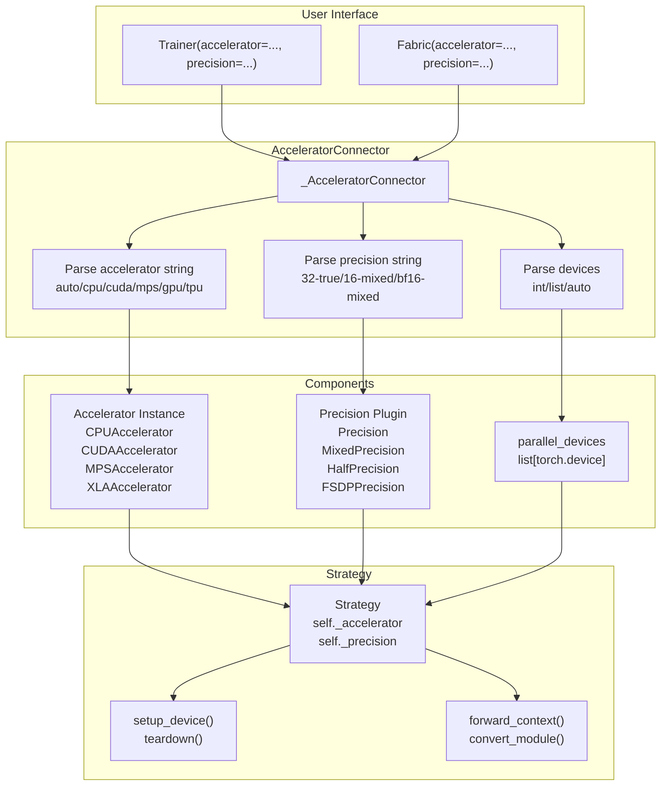
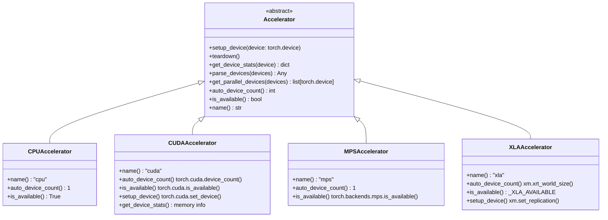
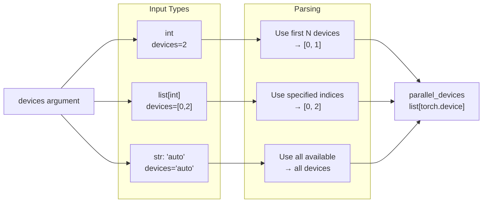
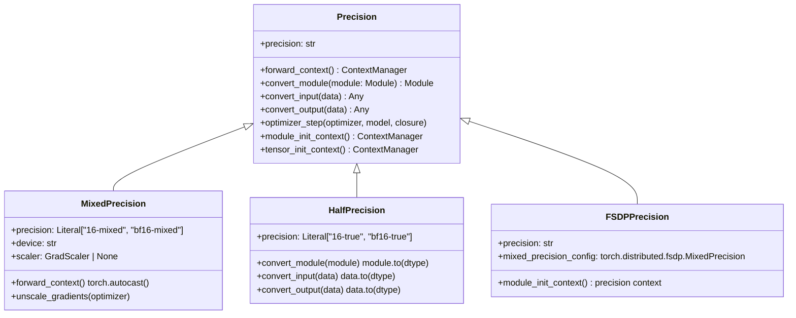
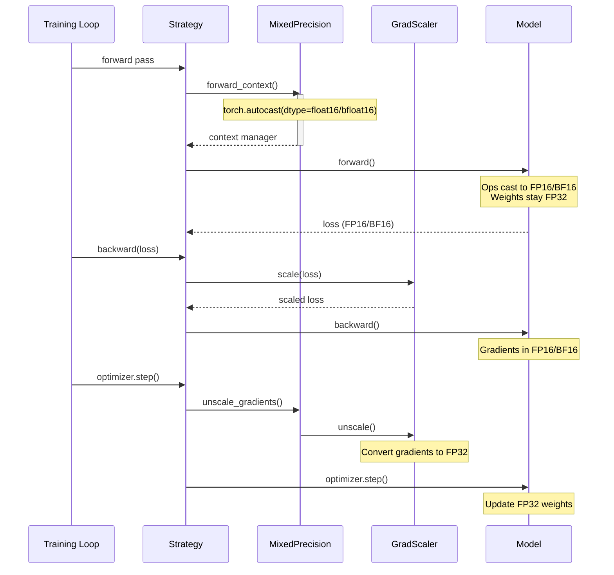
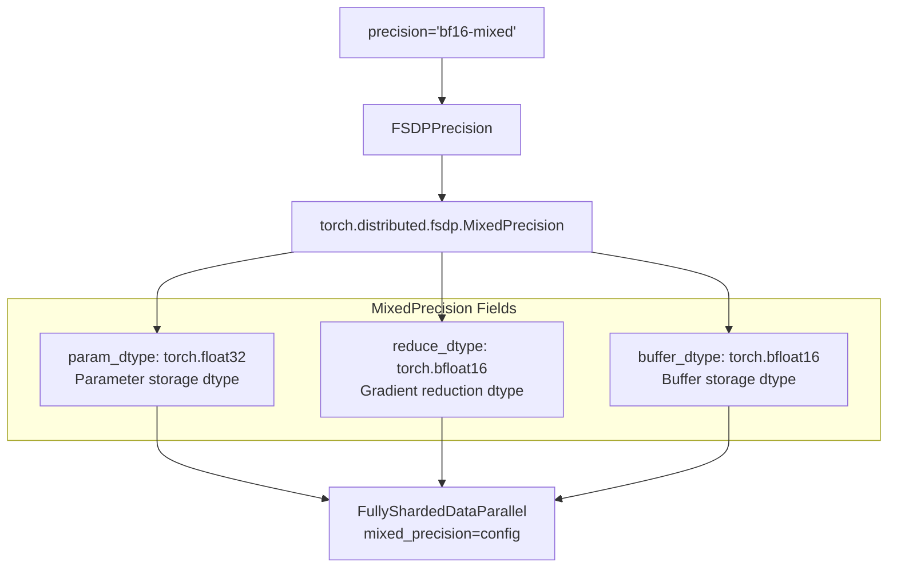
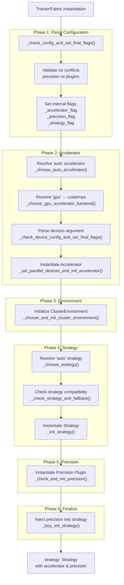
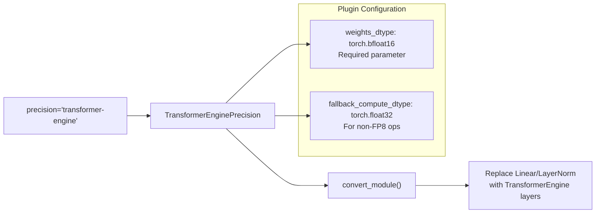
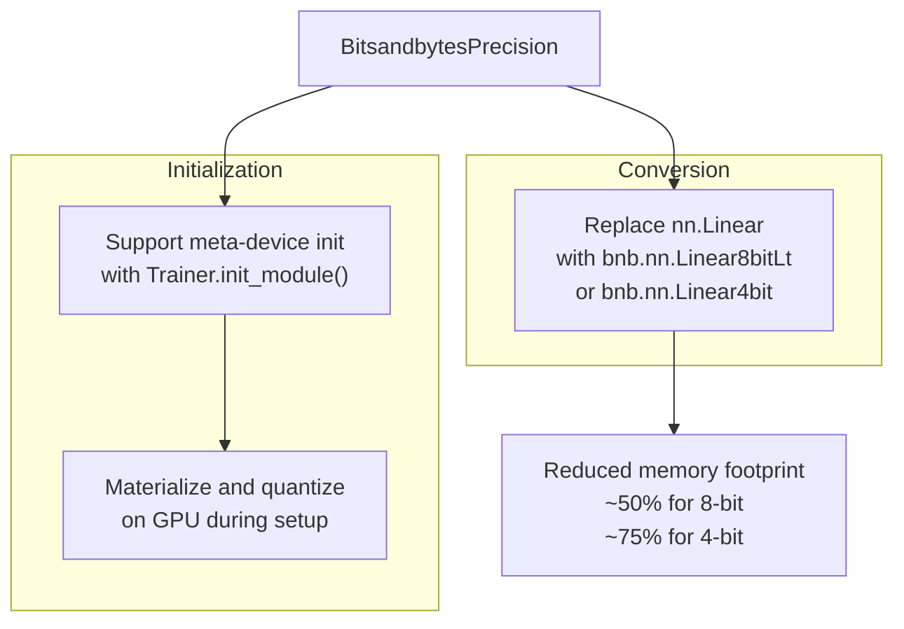

<!-- source: DeepWiki mcp.deepwiki.com · repo Lightning-AI/pytorch-lightning · page 3.5 Accelerators and Precision · fetched 2026-10-21 -->

# Accelerators and Precision

<details>
<summary>Relevant source files</summary>

The following files were used as context for generating this wiki page:

- [docs/source-fabric/api/fabric_methods.rst](docs/source-fabric/api/fabric_methods.rst)
- [docs/source-fabric/api/wrappers.rst](docs/source-fabric/api/wrappers.rst)
- [docs/source-pytorch/api_references.rst](docs/source-pytorch/api_references.rst)
- [docs/source-pytorch/extensions/plugins.rst](docs/source-pytorch/extensions/plugins.rst)
- [src/lightning/fabric/CHANGELOG.md](src/lightning/fabric/CHANGELOG.md)
- [src/lightning/fabric/connector.py](src/lightning/fabric/connector.py)
- [src/lightning/fabric/fabric.py](src/lightning/fabric/fabric.py)
- [src/lightning/fabric/strategies/ddp.py](src/lightning/fabric/strategies/ddp.py)
- [src/lightning/fabric/strategies/deepspeed.py](src/lightning/fabric/strategies/deepspeed.py)
- [src/lightning/fabric/strategies/fsdp.py](src/lightning/fabric/strategies/fsdp.py)
- [src/lightning/fabric/strategies/strategy.py](src/lightning/fabric/strategies/strategy.py)
- [src/lightning/fabric/utilities/imports.py](src/lightning/fabric/utilities/imports.py)
- [src/lightning/fabric/utilities/testing/_runif.py](src/lightning/fabric/utilities/testing/_runif.py)
- [src/lightning/pytorch/CHANGELOG.md](src/lightning/pytorch/CHANGELOG.md)
- [src/lightning/pytorch/core/module.py](src/lightning/pytorch/core/module.py)
- [src/lightning/pytorch/plugins/__init__.py](src/lightning/pytorch/plugins/__init__.py)
- [src/lightning/pytorch/plugins/precision/__init__.py](src/lightning/pytorch/plugins/precision/__init__.py)
- [src/lightning/pytorch/strategies/ddp.py](src/lightning/pytorch/strategies/ddp.py)
- [src/lightning/pytorch/strategies/deepspeed.py](src/lightning/pytorch/strategies/deepspeed.py)
- [src/lightning/pytorch/strategies/fsdp.py](src/lightning/pytorch/strategies/fsdp.py)
- [src/lightning/pytorch/strategies/strategy.py](src/lightning/pytorch/strategies/strategy.py)
- [src/lightning/pytorch/trainer/connectors/accelerator_connector.py](src/lightning/pytorch/trainer/connectors/accelerator_connector.py)
- [src/lightning/pytorch/utilities/imports.py](src/lightning/pytorch/utilities/imports.py)
- [src/lightning/pytorch/utilities/testing/_runif.py](src/lightning/pytorch/utilities/testing/_runif.py)
- [tests/tests_fabric/conftest.py](tests/tests_fabric/conftest.py)
- [tests/tests_fabric/strategies/test_ddp.py](tests/tests_fabric/strategies/test_ddp.py)
- [tests/tests_fabric/strategies/test_deepspeed.py](tests/tests_fabric/strategies/test_deepspeed.py)
- [tests/tests_fabric/strategies/test_deepspeed_integration.py](tests/tests_fabric/strategies/test_deepspeed_integration.py)
- [tests/tests_fabric/strategies/test_fsdp.py](tests/tests_fabric/strategies/test_fsdp.py)
- [tests/tests_fabric/strategies/test_fsdp_integration.py](tests/tests_fabric/strategies/test_fsdp_integration.py)
- [tests/tests_fabric/strategies/test_single_device.py](tests/tests_fabric/strategies/test_single_device.py)
- [tests/tests_fabric/test_connector.py](tests/tests_fabric/test_connector.py)
- [tests/tests_fabric/test_fabric.py](tests/tests_fabric/test_fabric.py)
- [tests/tests_pytorch/conftest.py](tests/tests_pytorch/conftest.py)
- [tests/tests_pytorch/helpers/runif.py](tests/tests_pytorch/helpers/runif.py)
- [tests/tests_pytorch/models/test_onnx.py](tests/tests_pytorch/models/test_onnx.py)
- [tests/tests_pytorch/strategies/test_ddp.py](tests/tests_pytorch/strategies/test_ddp.py)
- [tests/tests_pytorch/strategies/test_ddp_integration.py](tests/tests_pytorch/strategies/test_ddp_integration.py)
- [tests/tests_pytorch/strategies/test_deepspeed.py](tests/tests_pytorch/strategies/test_deepspeed.py)
- [tests/tests_pytorch/strategies/test_fsdp.py](tests/tests_pytorch/strategies/test_fsdp.py)
- [tests/tests_pytorch/trainer/connectors/test_accelerator_connector.py](tests/tests_pytorch/trainer/connectors/test_accelerator_connector.py)
- [tests/tests_pytorch/utilities/test_imports.py](tests/tests_pytorch/utilities/test_imports.py)

</details>


## Purpose and Scope

This page documents the hardware accelerator and precision plugin systems in PyTorch Lightning and Lightning Fabric. These components determine:

1. **Which hardware device(s)** to use for training/inference (CPU, CUDA GPUs, Apple MPS, TPU/XLA)
2. **What numerical precision** to use (float32, float16, bfloat16, mixed precision, quantization)

For information about distributed training strategies that coordinate multiple accelerators, see [Strategy Pattern](#3.1), [FSDP Strategy](#3.2), [DeepSpeed Strategy](#3.3), and [DDP and Other Strategies](#3.4).

---

## System Architecture

### Component Overview



**Sources:**
- [src/lightning/pytorch/trainer/connectors/accelerator_connector.py:74-162]()
- [src/lightning/fabric/connector.py:1-300]()

---

## Accelerators

### Accelerator Class Hierarchy

The `Accelerator` base class defines hardware-specific operations:



**Sources:**
- [docs/source-pytorch/api_references.rst:4-16]()
- [tests/tests_pytorch/trainer/connectors/test_accelerator_connector.py:117-308]()

### Accelerator Selection Logic

| User Input | Selected Accelerator | Requirements |
|------------|---------------------|--------------|
| `"auto"` | `CUDAAccelerator` | `torch.cuda.is_available() == True` |
| `"auto"` | `MPSAccelerator` | `torch.backends.mps.is_available() == True` |
| `"auto"` | `XLAAccelerator` | XLA package available |
| `"auto"` | `CPUAccelerator` | Fallback if no GPU/TPU |
| `"cpu"` | `CPUAccelerator` | Always available |
| `"cuda"` | `CUDAAccelerator` | Raises error if CUDA unavailable |
| `"mps"` | `MPSAccelerator` | Raises error if MPS unavailable |
| `"gpu"` | `CUDAAccelerator` or `MPSAccelerator` | Detects available GPU backend |
| `"tpu"` | `XLAAccelerator` | Requires XLA package |

**Sources:**
- [src/lightning/pytorch/trainer/connectors/accelerator_connector.py:138-145]()
- [tests/tests_pytorch/trainer/connectors/test_accelerator_connector.py:258-289]()

### Device Selection

The `devices` argument determines which specific hardware units to use:



**Sources:**
- [src/lightning/pytorch/trainer/connectors/accelerator_connector.py:144-145]()
- [tests/tests_pytorch/trainer/connectors/test_accelerator_connector.py:299-320]()

### MPS Accelerator (Apple Silicon)

The MPS accelerator enables GPU acceleration on Apple Silicon Macs:

- **Device**: Single device only (`devices=1`)
- **Availability**: `torch.backends.mps.is_available()`
- **Mixed Precision**: Supported since Lightning 2.6.0
- **Limitations**: Cannot use DDP strategies (no multi-device support)

**Sources:**
- [src/lightning/pytorch/CHANGELOG.md:80]()
- [tests/tests_pytorch/trainer/connectors/test_accelerator_connector.py:334-340]()

---

## Precision Plugins

### Precision Plugin Types

```mermaid
graph TB
    Precision["Precision<br/>Base class"]
    
    subgraph "Standard Precision"
        Precision32["Precision<br/>32-true: float32"]
        DoublePrecision["DoublePrecision<br/>64-true: float64"]
    end
    
    subgraph "Reduced Precision"
        HalfPrecision["HalfPrecision<br/>16-true/bf16-true<br/>Pure FP16/BF16"]
        MixedPrecision["MixedPrecision<br/>16-mixed/bf16-mixed<br/>Automatic Mixed Precision"]
    end
    
    subgraph "Strategy-Specific"
        FSDPPrecision["FSDPPrecision<br/>FSDP MixedPrecision config"]
        DeepSpeedPrecision["DeepSpeedPrecision<br/>DeepSpeed FP16 config"]
        XLAPrecision["XLAPrecision<br/>TPU precision"]
    end
    
    subgraph "Advanced"
        TransformerEngine["TransformerEnginePrecision<br/>FP8 training"]
        Bitsandbytes["BitsandbytesPrecision<br/>4-bit/8-bit quantization"]
    end
    
    Precision --> Precision32
    Precision --> DoublePrecision
    Precision --> HalfPrecision
    Precision --> MixedPrecision
    Precision --> FSDPPrecision
    Precision --> DeepSpeedPrecision
    Precision --> XLAPrecision
    Precision --> TransformerEngine
    Precision --> Bitsandbytes
```



**Sources:**
- [docs/source-pytorch/api_references.rst:109-127]()
- [src/lightning/fabric/connector.py:27-46]()

### Precision String Format Reference

| String | Plugin Class | Computation Dtype | Storage Dtype | Autocast | Description |
|--------|-------------|-------------------|---------------|----------|-------------|
| `"32-true"` | `Precision` | `torch.float32` | `torch.float32` | No | Default full precision |
| `"64-true"` | `DoublePrecision` | `torch.float64` | `torch.float64` | No | Double precision |
| `"16-true"` | `HalfPrecision` | `torch.float16` | `torch.float16` | No | Pure FP16 (no AMP) |
| `"bf16-true"` | `HalfPrecision` | `torch.bfloat16` | `torch.bfloat16` | No | Pure BF16 (no AMP) |
| `"16-mixed"` | `MixedPrecision` | `torch.float16` | `torch.float32` | Yes | AMP with FP16 |
| `"bf16-mixed"` | `MixedPrecision` | `torch.bfloat16` | `torch.float32` | Yes | AMP with BF16 |
| `"transformer-engine"` | `TransformerEnginePrecision` | FP8/FP16/BF16 | Mixed | Yes | Nvidia FP8 |

**Sources:**
- [src/lightning/fabric/plugins/precision/precision.py]()
- [src/lightning/pytorch/CHANGELOG.md:489]()
- [tests/tests_pytorch/trainer/connectors/test_accelerator_connector.py:550-638]()

### Precision Plugin Interface



**Sources:**
- [src/lightning/fabric/plugins/precision/precision.py]()
- [src/lightning/fabric/strategies/fsdp.py:221-237]()

### Mixed Precision (AMP) Flow

Automatic Mixed Precision uses `torch.autocast` to selectively cast operations:



**Sources:**
- [tests/tests_fabric/strategies/test_fsdp_integration.py:89-97]()
- [src/lightning/fabric/plugins/precision/precision.py]()

### FSDP Precision Configuration

`FSDPPrecision` creates a `torch.distributed.fsdp.MixedPrecision` configuration:



**FSDP Precision Mapping:**

| Lightning Precision | param_dtype | reduce_dtype | buffer_dtype |
|--------------------|-------------|--------------|--------------|
| `"32-true"` | `float32` | `float32` | `float32` |
| `"16-true"` | `float16` | `float16` | `float16` |
| `"16-mixed"` | `float32` | `float16` | `float16` |
| `"bf16-true"` | `bfloat16` | `bfloat16` | `bfloat16` |
| `"bf16-mixed"` | `float32` | `bfloat16` | `bfloat16` |

**Sources:**
- [src/lightning/fabric/strategies/fsdp.py:210-228]()
- [tests/tests_pytorch/strategies/test_fsdp.py:80-97]()
- [src/lightning/pytorch/CHANGELOG.md:123]()

---

## AcceleratorConnector Flow

The `_AcceleratorConnector` class orchestrates component selection and initialization:



**Sources:**
- [src/lightning/pytorch/trainer/connectors/accelerator_connector.py:129-162]()
- [src/lightning/fabric/connector.py:100-250]()

---

## Advanced Precision Features

### Transformer Engine (FP8)

Enables FP8 training with Nvidia's Transformer Engine library:



**Key Changes:**
- Added in Lightning 2.1.0
- Requires `transformer-engine` package
- Fallback compute dtype configurable since 2.2.0

**Sources:**
- [src/lightning/fabric/CHANGELOG.md:208]()
- [src/lightning/fabric/CHANGELOG.md:289]()
- [src/lightning/pytorch/CHANGELOG.md:367]()

### Bitsandbytes Quantization

Enables 4-bit/8-bit quantization for memory-efficient training:



**Key Features:**
- Added in Lightning 2.1.0
- Meta-device support added in 2.2.0
- Works with FSDP and DeepSpeed

**Sources:**
- [src/lightning/fabric/CHANGELOG.md:207]()
- [src/lightning/fabric/CHANGELOG.md:290]()
- [src/lightning/pytorch/CHANGELOG.md:366]()

---

## Usage Examples

### Basic Configuration (PyTorch Lightning)

```python
# Automatic mixed precision with CUDA
trainer = Trainer(accelerator="cuda", devices=2, precision="16-mixed")

# Pure bfloat16
trainer = Trainer(accelerator="cuda", devices=1, precision="bf16-true")

# Double precision CPU
trainer = Trainer(accelerator="cpu", precision="64-true")

# MPS with mixed precision (macOS Apple Silicon)
trainer = Trainer(accelerator="mps", precision="16-mixed")
```

**Sources:**
- [tests/tests_pytorch/trainer/connectors/test_accelerator_connector.py:279-314]()

### Strategy-Specific Precision (PyTorch Lightning)

```python
# FSDP with mixed precision
trainer = Trainer(
    accelerator="cuda",
    devices=4,
    strategy="fsdp",
    precision="bf16-mixed"
)

# DeepSpeed with FP16
trainer = Trainer(
    accelerator="cuda",
    devices=4,
    strategy="deepspeed",
    precision="16-mixed"
)
```

**Sources:**
- [tests/tests_pytorch/strategies/test_fsdp.py:1-50]()

### Custom Precision Plugin (Lightning Fabric)

```python
from lightning.fabric import Fabric
from lightning.fabric.plugins import MixedPrecision

# Using plugin directly
precision_plugin = MixedPrecision(precision="16-mixed", device="cuda")
fabric = Fabric(accelerator="cuda", devices=2, plugins=precision_plugin)

# Or via string
fabric = Fabric(accelerator="cuda", devices=2, precision="16-mixed")
```

**Sources:**
- [tests/tests_fabric/test_fabric.py:58-157]()
- [tests/tests_fabric/test_connector.py:200-250]()

### Advanced Precision (PyTorch Lightning)

```python
# Transformer Engine FP8
from lightning.pytorch.plugins import TransformerEnginePrecision

trainer = Trainer(
    accelerator="cuda",
    devices=1,
    plugins=TransformerEnginePrecision(
        weights_dtype=torch.bfloat16,
        fallback_compute_dtype=torch.float32
    )
)

# Bitsandbytes 8-bit quantization
from lightning.pytorch.plugins import BitsandbytesPrecision

trainer = Trainer(
    accelerator="cuda",
    devices=1,
    plugins=BitsandbytesPrecision(mode="int8")
)
```

**Sources:**
- [src/lightning/fabric/CHANGELOG.md:208]()
- [src/lightning/fabric/CHANGELOG.md:290]()

---

## Validation and Error Handling

The `AcceleratorConnector` performs validation and raises errors for invalid configurations:

| Error Condition | Exception | Message Pattern |
|----------------|-----------|-----------------|
| Accelerator unavailable | `MisconfigurationException` | "CUDAAccelerator can not run on your system" |
| Invalid accelerator name | `ValueError` | "You selected an invalid accelerator name" |
| MPS + DDP strategy | `ValueError` | "strategies from the DDP family are not supported" |
| Precision + plugin conflict | `ValueError` | "both `precision=...` and `plugins=...`" |

**Sources:**
- [tests/tests_pytorch/trainer/connectors/test_accelerator_connector.py:85-98]()
- [tests/tests_pytorch/trainer/connectors/test_accelerator_connector.py:266-270]()
- [tests/tests_pytorch/trainer/connectors/test_accelerator_connector.py:334-340]()

---

## Key Files Reference

### Core Implementation
- [src/lightning/pytorch/trainer/connectors/accelerator_connector.py:1-800]() - Main connector for PyTorch Lightning
- [src/lightning/fabric/connector.py:1-800]() - Main connector for Fabric
- [src/lightning/fabric/plugins/precision/precision.py]() - Base precision plugin
- [src/lightning/fabric/plugins/precision/fsdp.py]() - FSDP precision

### Accelerator Implementations
- CPU, CUDA, MPS, XLA accelerator classes (see [docs/source-pytorch/api_references.rst:4-16]())

### Tests
- [tests/tests_pytorch/trainer/connectors/test_accelerator_connector.py:1-1000]() - Comprehensive connector tests
- [tests/tests_fabric/test_connector.py:1-1000]() - Fabric connector tests
- [tests/tests_pytorch/strategies/test_fsdp.py:1-500]() - FSDP precision tests

---

