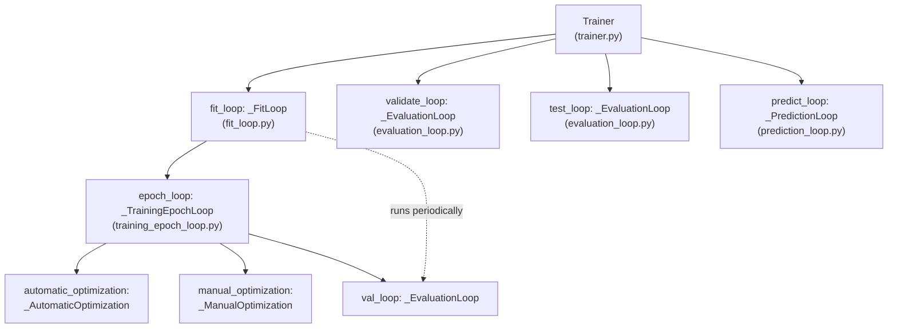
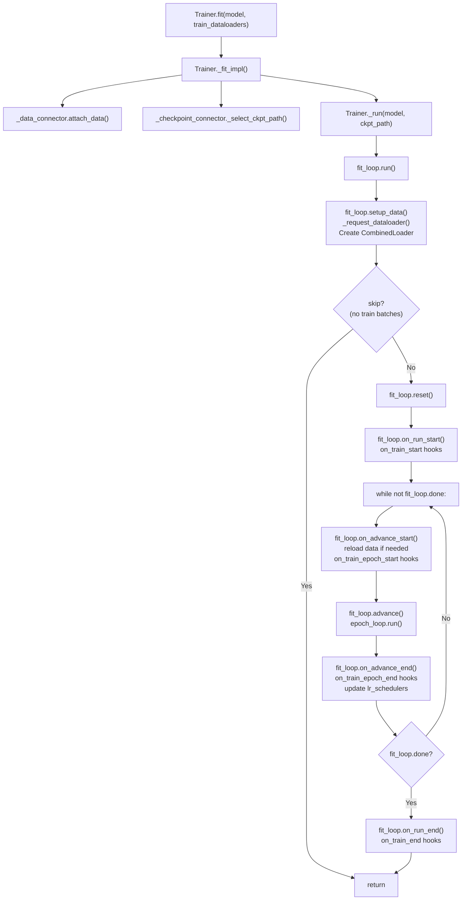
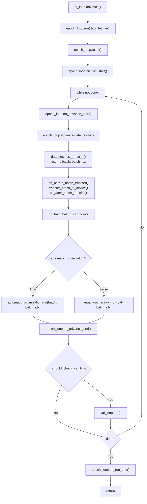
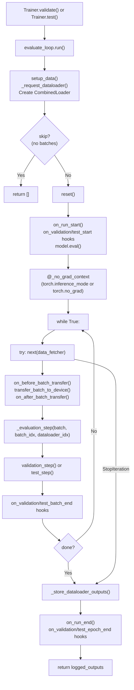
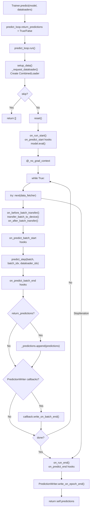
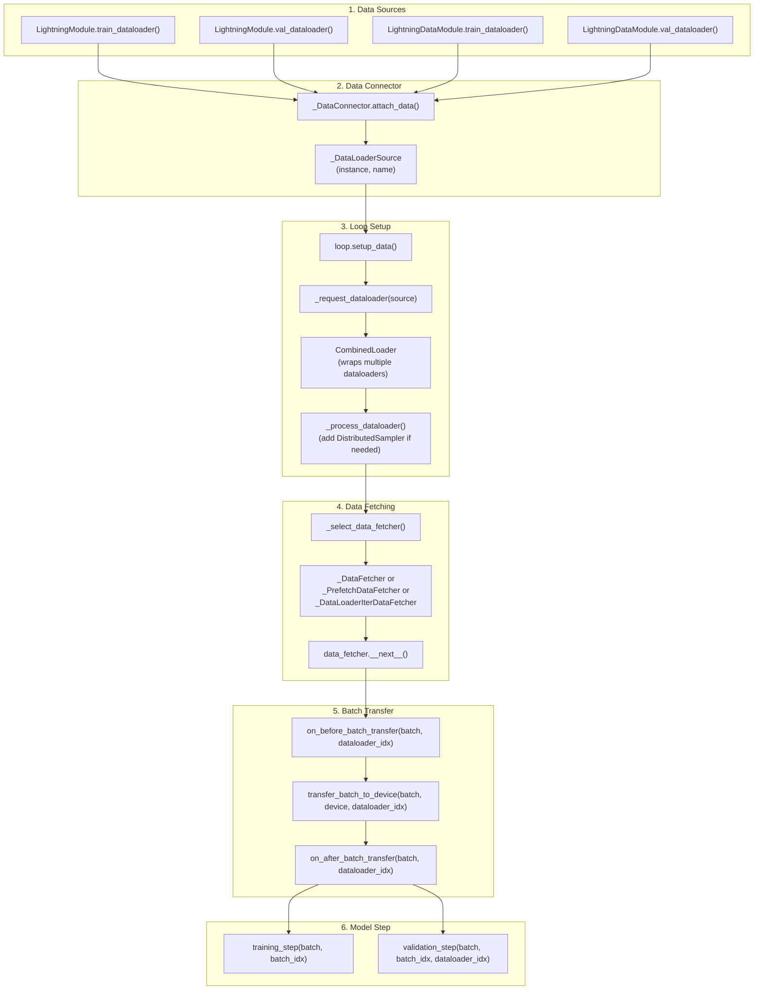

<!-- source: DeepWiki mcp.deepwiki.com · repo Lightning-AI/pytorch-lightning · page 4.1 Training Loops · fetched 2026-10-21 -->

# Training Loops

<details>
<summary>Relevant source files</summary>

The following files were used as context for generating this wiki page:

- [docs/source-pytorch/common/lightning_module.rst](docs/source-pytorch/common/lightning_module.rst)
- [docs/source-pytorch/common/trainer.rst](docs/source-pytorch/common/trainer.rst)
- [src/lightning/pytorch/callbacks/callback.py](src/lightning/pytorch/callbacks/callback.py)
- [src/lightning/pytorch/callbacks/device_stats_monitor.py](src/lightning/pytorch/callbacks/device_stats_monitor.py)
- [src/lightning/pytorch/core/hooks.py](src/lightning/pytorch/core/hooks.py)
- [src/lightning/pytorch/loops/evaluation_loop.py](src/lightning/pytorch/loops/evaluation_loop.py)
- [src/lightning/pytorch/loops/fetchers.py](src/lightning/pytorch/loops/fetchers.py)
- [src/lightning/pytorch/loops/fit_loop.py](src/lightning/pytorch/loops/fit_loop.py)
- [src/lightning/pytorch/loops/prediction_loop.py](src/lightning/pytorch/loops/prediction_loop.py)
- [src/lightning/pytorch/loops/training_epoch_loop.py](src/lightning/pytorch/loops/training_epoch_loop.py)
- [src/lightning/pytorch/loops/utilities.py](src/lightning/pytorch/loops/utilities.py)
- [src/lightning/pytorch/trainer/connectors/data_connector.py](src/lightning/pytorch/trainer/connectors/data_connector.py)
- [src/lightning/pytorch/trainer/trainer.py](src/lightning/pytorch/trainer/trainer.py)
- [src/lightning/pytorch/utilities/combined_loader.py](src/lightning/pytorch/utilities/combined_loader.py)
- [tests/tests_pytorch/core/test_lightning_module.py](tests/tests_pytorch/core/test_lightning_module.py)
- [tests/tests_pytorch/loops/test_evaluation_loop.py](tests/tests_pytorch/loops/test_evaluation_loop.py)
- [tests/tests_pytorch/loops/test_fetchers.py](tests/tests_pytorch/loops/test_fetchers.py)
- [tests/tests_pytorch/loops/test_prediction_loop.py](tests/tests_pytorch/loops/test_prediction_loop.py)
- [tests/tests_pytorch/loops/test_training_epoch_loop.py](tests/tests_pytorch/loops/test_training_epoch_loop.py)
- [tests/tests_pytorch/models/test_hooks.py](tests/tests_pytorch/models/test_hooks.py)
- [tests/tests_pytorch/trainer/connectors/test_data_connector.py](tests/tests_pytorch/trainer/connectors/test_data_connector.py)
- [tests/tests_pytorch/trainer/flags/test_overfit_batches.py](tests/tests_pytorch/trainer/flags/test_overfit_batches.py)
- [tests/tests_pytorch/trainer/properties/test_estimated_stepping_batches.py](tests/tests_pytorch/trainer/properties/test_estimated_stepping_batches.py)
- [tests/tests_pytorch/trainer/test_dataloaders.py](tests/tests_pytorch/trainer/test_dataloaders.py)
- [tests/tests_pytorch/trainer/test_trainer.py](tests/tests_pytorch/trainer/test_trainer.py)
- [tests/tests_pytorch/utilities/test_combined_loader.py](tests/tests_pytorch/utilities/test_combined_loader.py)
- [tests/tests_pytorch/utilities/test_enums.py](tests/tests_pytorch/utilities/test_enums.py)

</details>


The training loops in PyTorch Lightning orchestrate the execution of model training, validation, testing, and prediction. The loop architecture is hierarchical, with top-level loops delegating to nested loops that handle progressively finer-grained execution details. This page documents the loop classes, their responsibilities, and how they interact with the `Trainer`, `LightningModule`, and other components.

For information about the `LightningModule` API that defines training logic, see page 2.2.  
For information about the `Trainer` class that configures and runs loops, see page 2.3.  
For information about callbacks that customize loop behavior, see page 4.2.

## Loop Architecture Overview

The loop system is hierarchical. Each `Trainer` method (`fit`, `validate`, `test`, `predict`) delegates to a top-level loop instance that manages the overall execution flow. These loops are instantiated during `Trainer.__init__` and stored as attributes.

**Trainer Initialization and Loop Hierarchy**



The `Trainer` instantiates these loops in `__init__`:
- `self.fit_loop = _FitLoop(...)` at [src/lightning/pytorch/trainer/trainer.py:435]()
- `self.fit_loop.epoch_loop = _TrainingEpochLoop(...)` at [src/lightning/pytorch/trainer/trainer.py:436]()
- `self.validate_loop = _EvaluationLoop(...)` at [src/lightning/pytorch/trainer/trainer.py:437-439]()
- `self.test_loop = _EvaluationLoop(...)` at [src/lightning/pytorch/trainer/trainer.py:440]()
- `self.predict_loop = _PredictionLoop(...)` at [src/lightning/pytorch/trainer/trainer.py:441]()

Each loop inherits from the base class `_Loop` defined in [src/lightning/pytorch/loops/loop.py]().

Sources:
- [src/lightning/pytorch/trainer/trainer.py:434-441]()
- [src/lightning/pytorch/loops/fit_loop.py:59-112]()
- [src/lightning/pytorch/loops/training_epoch_loop.py:51-96]()
- [src/lightning/pytorch/loops/evaluation_loop.py:58-86]()
- [src/lightning/pytorch/loops/prediction_loop.py:47-66]()

## _FitLoop: Training Orchestration

The `_FitLoop` class in [src/lightning/pytorch/loops/fit_loop.py]() manages the overall training process. `Trainer.fit()` delegates to `_FitLoop.run()`.

**FitLoop Execution Flow**



The `done` property at [src/lightning/pytorch/loops/fit_loop.py:173-199]() checks:
- `self.max_batches == 0` (no training batches)
- `_is_max_limit_reached(self.epoch_loop.global_step, self.max_steps)` (max steps reached)
- `_is_max_limit_reached(self.epoch_progress.current.processed, self.max_epochs)` (max epochs reached)
- `self.trainer.should_stop and self._can_stop_early` (early stopping condition met)

Sources:
- [src/lightning/pytorch/trainer/trainer.py:522-593]()
- [src/lightning/pytorch/trainer/trainer.py:595-630]()
- [src/lightning/pytorch/loops/fit_loop.py:208-224]()
- [src/lightning/pytorch/loops/fit_loop.py:226-323]()
- [src/lightning/pytorch/loops/fit_loop.py:410-429]()
- [src/lightning/pytorch/loops/fit_loop.py:431-465]()
- [src/lightning/pytorch/loops/fit_loop.py:467-500]()

## _TrainingEpochLoop: Batch Iteration

The `_TrainingEpochLoop` class in [src/lightning/pytorch/loops/training_epoch_loop.py]() iterates over batches in the training dataloader for one epoch. It delegates to either `_AutomaticOptimization` or `_ManualOptimization` depending on the `LightningModule.automatic_optimization` setting.

**TrainingEpochLoop Execution Flow**



The `done` property at [src/lightning/pytorch/loops/training_epoch_loop.py:130-152]() checks:
- `_is_training_done`: Whether `max_steps` reached or all batches processed
- `_is_validation_done`: Whether validation has finished (relevant when restarting)
- `trainer.should_stop`: Whether early stopping was triggered

Sources:
- [src/lightning/pytorch/loops/training_epoch_loop.py:197-276]()
- [src/lightning/pytorch/loops/training_epoch_loop.py:278-310]()
- [src/lightning/pytorch/loops/training_epoch_loop.py:312-343]()
- [src/lightning/pytorch/loops/training_epoch_loop.py:345-404]()

## _EvaluationLoop: Validation and Testing

The `_EvaluationLoop` class in [src/lightning/pytorch/loops/evaluation_loop.py]() handles both validation and testing. The same loop instance is used for both stages, differentiated by the `TrainerFn` and `RunningStage` passed during initialization.

The `Trainer` creates two instances:
- `self.validate_loop = _EvaluationLoop(self, TrainerFn.VALIDATING, RunningStage.VALIDATING)` at [src/lightning/pytorch/trainer/trainer.py:437-439]()
- `self.test_loop = _EvaluationLoop(self, TrainerFn.TESTING, RunningStage.TESTING)` at [src/lightning/pytorch/trainer/trainer.py:440]()

**EvaluationLoop Execution Flow**



Key differences from training:
- No gradient computation: decorated with `@_no_grad_context` at [src/lightning/pytorch/loops/evaluation_loop.py:119]()
- Model set to eval mode via `_on_evaluation_model_eval()` at [src/lightning/pytorch/loops/evaluation_loop.py:285]()
- No optimizer steps
- Results are collected and returned as a list of dictionaries

Sources:
- [src/lightning/pytorch/loops/evaluation_loop.py:119-153]()
- [src/lightning/pytorch/loops/evaluation_loop.py:155-206]()
- [src/lightning/pytorch/loops/evaluation_loop.py:281-323]()
- [src/lightning/pytorch/trainer/trainer.py:636-703]()
- [src/lightning/pytorch/trainer/trainer.py:706-796]()

## _PredictionLoop: Model Predictions

The `_PredictionLoop` class in [src/lightning/pytorch/loops/prediction_loop.py]() generates predictions from a trained model. Unlike evaluation loops, predictions are typically returned to the user rather than just logged.

**PredictionLoop Execution Flow**



Key features:
- `return_predictions` property controls whether predictions are accumulated and returned
- `_PredictionLoop.predictions` stores results per dataloader at [src/lightning/pytorch/loops/prediction_loop.py:86-90]()
- `BasePredictionWriter` callbacks can write predictions to disk incrementally
- The loop tracks `epoch_batch_indices` for prediction writers at [src/lightning/pytorch/loops/prediction_loop.py:54]()

Sources:
- [src/lightning/pytorch/loops/prediction_loop.py:124-218]()
- [src/lightning/pytorch/loops/prediction_loop.py:220-265]()
- [src/lightning/pytorch/trainer/trainer.py:799-857]()

## Data Loading and Batch Processing

Data flows through several stages before reaching the model's `*_step` methods. Understanding this pipeline is crucial for customizing data handling.

**Data Loading Pipeline**



**Key Classes and Methods:**

| Component | File | Description |
|-----------|------|-------------|
| `_DataConnector` | [src/lightning/pytorch/trainer/connectors/data_connector.py:47]() | Attaches dataloaders to the trainer |
| `_DataLoaderSource` | [src/lightning/pytorch/trainer/connectors/data_connector.py:272-321]() | Wraps dataloader source (module or instance) |
| `_request_dataloader()` | [src/lightning/pytorch/trainer/connectors/data_connector.py:323-335]() | Calls dataloader hook and returns dataloaders |
| `CombinedLoader` | [src/lightning/pytorch/utilities/combined_loader.py:109-239]() | Combines multiple dataloaders with different modes |
| `_DataFetcher` | [src/lightning/pytorch/loops/fetchers.py:25-86]() | Base class for fetching batches |
| `_process_dataloader()` | [src/lightning/pytorch/trainer/connectors/data_connector.py:177-194]() | Adds distributed sampler if needed |

Sources:
- [src/lightning/pytorch/trainer/connectors/data_connector.py:104-167]()
- [src/lightning/pytorch/trainer/connectors/data_connector.py:323-335]()
- [src/lightning/pytorch/loops/fit_loop.py:226-323]()
- [src/lightning/pytorch/utilities/combined_loader.py:109-239]()
- [src/lightning/pytorch/loops/fetchers.py:25-130]()
- [src/lightning/pytorch/loops/utilities.py:122-145]()

## Callback and Hook System

Callbacks and `LightningModule` hooks provide extension points throughout the training loop. The `Trainer` invokes these via the `call` module at [src/lightning/pytorch/trainer/call.py]().

**Hook Invocation Order During Training**

```mermaid
flowchart TD
    TrainerInit["Trainer.__init__()"] --> CallbacksInit["Callback.setup(trainer, pl_module, stage)"]
    
    TrainerFit["Trainer.fit()"] --> OnFitStart["call._call_callback_hooks('on_fit_start')<br/>call._call_lightning_module_hook('on_fit_start')"]
    
    OnFitStart --> OnTrainStart["call._call_callback_hooks('on_train_start')<br/>call._call_lightning_module_hook('on_train_start')<br/>call._call_strategy_hook('on_train_start')"]
    
    OnTrainStart --> LoopEpoch["For each epoch:"]
    
    LoopEpoch --> OnEpochStart["call._call_callback_hooks('on_train_epoch_start')<br/>call._call_lightning_module_hook('on_train_epoch_start')"]
    
    OnEpochStart --> LoopBatch["For each batch:"]
    
    LoopBatch --> OnBatchStart["Callback.on_train_batch_start(trainer, pl_module, batch, batch_idx)<br/>LightningModule.on_train_batch_start(batch, batch_idx)"]
    
    OnBatchStart --> TrainingStep["LightningModule.training_step(batch, batch_idx)"]
    
    TrainingStep --> OnBeforeZeroGrad["Callback.on_before_zero_grad(trainer, pl_module, optimizer)"]
    OnBeforeZeroGrad --> ZeroGrad["optimizer.zero_grad()"]
    
    ZeroGrad --> OnBeforeBackward["Callback.on_before_backward(trainer, pl_module, loss)<br/>LightningModule.on_before_backward(loss)"]
    OnBeforeBackward --> Backward["loss.backward()"]
    
    Backward --> OnAfterBackward["Callback.on_after_backward(trainer, pl_module)<br/>LightningModule.on_after_backward()"]
    
    OnAfterBackward --> OnBeforeOptStep["Callback.on_before_optimizer_step(trainer, pl_module, optimizer)<br/>LightningModule.on_before_optimizer_step(optimizer)"]
    OnBeforeOptStep --> OptStep["optimizer.step()"]
    
    OptStep --> OnBatchEnd["Callback.on_train_batch_end(trainer, pl_module, outputs, batch, batch_idx)<br/>LightningModule.on_train_batch_end(outputs, batch, batch_idx)"]
    
    OnBatchEnd --> CheckMore{"More batches?"}
    CheckMore -->|"Yes"| LoopBatch
    CheckMore -->|"No"| OnEpochEnd
    
    OnEpochEnd["Callback.on_train_epoch_end(trainer, pl_module)<br/>LightningModule.on_train_epoch_end()"]
    OnEpochEnd --> CheckMoreEpochs{"More epochs?"}
    CheckMoreEpochs -->|"Yes"| LoopEpoch
    CheckMoreEpochs -->|"No"| OnTrainEnd
    
    OnTrainEnd["call._call_callback_hooks('on_train_end')<br/>call._call_lightning_module_hook('on_train_end')"]
    OnTrainEnd --> OnFitEnd["call._call_callback_hooks('on_fit_end')<br/>call._call_lightning_module_hook('on_fit_end')"]
```



The `call` module provides utilities for invoking hooks:
- `_call_callback_hooks(trainer, hook_name, *args, **kwargs)` at [src/lightning/pytorch/trainer/call.py]()
- `_call_lightning_module_hook(trainer, hook_name, *args, **kwargs)` at [src/lightning/pytorch/trainer/call.py]()
- `_call_strategy_hook(trainer, hook_name, *args, **kwargs)` at [src/lightning/pytorch/trainer/call.py]()

These functions iterate through callbacks/modules and invoke the hook methods if they are overridden.

Sources:
- [src/lightning/pytorch/trainer/call.py:19-98]()
- [src/lightning/pytorch/loops/fit_loop.py:410-429]()
- [src/lightning/pytorch/loops/fit_loop.py:467-500]()
- [src/lightning/pytorch/loops/training_epoch_loop.py:312-343]()
- [tests/tests_pytorch/models/test_hooks.py:229-343]()

## Automatic vs Manual Optimization

The `_TrainingEpochLoop` supports two optimization modes, controlled by the `LightningModule.automatic_optimization` attribute.

**Automatic Optimization (_AutomaticOptimization)**

When `automatic_optimization = True` (default), the `_AutomaticOptimization` loop at [src/lightning/pytorch/loops/optimization/automatic.py]() handles:

1. **Gradient accumulation**: Tracks `accumulate_grad_batches` and only steps the optimizer every N batches
2. **Zero grad**: Calls `optimizer.zero_grad()` before backward
3. **Backward pass**: Calls `loss.backward()` with proper gradient scaling for mixed precision
4. **Gradient clipping**: Applies `gradient_clip_val` and `gradient_clip_algorithm` if configured
5. **Optimizer step**: Calls `optimizer.step()` through the precision plugin
6. **Learning rate scheduling**: Updates LR schedulers at appropriate intervals

The loop is invoked at [src/lightning/pytorch/loops/training_epoch_loop.py:347-353]():
```python
if lightning_module.automatic_optimization:
    outputs = self.automatic_optimization.run(batch, batch_idx)
```

**Manual Optimization (_ManualOptimization)**

When `automatic_optimization = False`, the `_ManualOptimization` loop at [src/lightning/pytorch/loops/optimization/manual.py]() provides minimal scaffolding:

1. Calls `training_step(batch, batch_idx)` 
2. The user is responsible for calling `self.manual_backward(loss)` inside `training_step`
3. The user must call `optimizer.zero_grad()` and `optimizer.step()` manually
4. The user controls when and how gradient accumulation happens

The loop is invoked at [src/lightning/pytorch/loops/training_epoch_loop.py:355-357]():
```python
else:
    outputs = self.manual_optimization.run(batch, batch_idx)
```

**Comparison Table**

| Aspect | Automatic Optimization | Manual Optimization |
|--------|------------------------|---------------------|
| **Setting** | `automatic_optimization = True` | `automatic_optimization = False` |
| **Backward** | `loss.backward()` called automatically | User calls `self.manual_backward(loss)` |
| **Zero Grad** | Automatic via `optimizer.zero_grad()` | User calls `optimizer.zero_grad()` |
| **Optimizer Step** | Automatic after accumulation | User calls `optimizer.step()` |
| **Gradient Clipping** | Configured via `Trainer(gradient_clip_*)` | User implements manually |
| **Gradient Accumulation** | Configured via `Trainer(accumulate_grad_batches)` | User implements manually |
| **Multiple Optimizers** | Handled automatically with optimizer indices | User controls via `self.optimizers()` |
| **Use Cases** | Standard supervised learning | GANs, RL, custom training loops |

**Manual Optimization Example Pattern**

```python
class ManualModel(LightningModule):
    def __init__(self):
        super().__init__()
        self.automatic_optimization = False
    
    def training_step(self, batch, batch_idx):
        opt = self.optimizers()
        
        # Forward pass
        loss = self(batch)
        
        # Backward pass
        opt.zero_grad()
        self.manual_backward(loss)
        opt.step()
```

Sources:
- [src/lightning/pytorch/loops/training_epoch_loop.py:85-86]()
- [src/lightning/pytorch/loops/training_epoch_loop.py:345-357]()
- [src/lightning/pytorch/loops/optimization/automatic.py:35-154]()
- [src/lightning/pytorch/loops/optimization/manual.py:20-65]()
- [tests/tests_pytorch/core/test_lightning_module.py:139-197]()

## Progress Tracking

Loops track their progress using `_Progress` and specialized progress classes like `_BatchProgress`, `_SchedulerProgress`, etc. from [src/lightning/pytorch/loops/progress.py]().

**Progress Tracking Structure**

Each loop maintains progress counters with three states for each unit (batch, epoch, etc.):
- **ready**: About to be processed
- **started**: Processing has begun
- **processed**: Processing logic completed
- **completed**: All cleanup and hooks completed

Example from `_FitLoop`:
- `self.epoch_progress = _Progress()` at [src/lightning/pytorch/loops/fit_loop.py:103]()
- Tracks: `ready`, `started`, `processed`, `completed` for epochs

Example from `_TrainingEpochLoop`:
- `self.batch_progress = _BatchProgress()` at [src/lightning/pytorch/loops/training_epoch_loop.py:82]()
- Tracks batch-level progress within an epoch

**Progress Properties**

The `_Progress` class provides convenient properties:
- `current`: Progress within the current run (resets each epoch)
- `total`: Cumulative progress across all runs
- `is_last_batch`: Boolean indicating if this is the final batch

These are used throughout the codebase to determine when to trigger certain actions like validation checks, logging, or lr scheduler steps.

Sources:
- [src/lightning/pytorch/loops/progress.py:27-182]()
- [src/lightning/pytorch/loops/fit_loop.py:103]()
- [src/lightning/pytorch/loops/training_epoch_loop.py:82-83]()
- [src/lightning/pytorch/loops/evaluation_loop.py:72]()

## Loop State Management and Restart

Loops support saving and restoring their state for fault-tolerant training. Each loop implements the `_Stateful` interface from Fabric.

**State Dict Structure**

Each loop can save its state via `state_dict()` and restore via `load_state_dict()`. The state typically includes:
- Progress counters
- Data fetcher state
- Combined loader state

Example from `_FitLoop.state_dict()` at [src/lightning/pytorch/loops/fit_loop.py:543-573]():
```python
def state_dict(self) -> dict:
    return {
        "epoch_loop.state_dict": self.epoch_loop.state_dict(),
        "epoch_progress": self.epoch_progress.state_dict(),
        # ... other state
    }
```

**Restarting Behavior**

When resuming from a checkpoint, loops have special "restart stages" to handle mid-epoch/mid-batch resumption:

From `_FitLoop` at [src/lightning/pytorch/loops/fit_loop.py:51-56]():
```python
class RestartStage:
    NONE = "none"
    RESTARTED_ON_EPOCH_START = "restarted_on_epoch_start"
    RESTARTED_MID_EPOCH = "restarted_mid_epoch"
    RESTARTED_ON_EPOCH_END = "restarted_on_epoch_end"
    RESUMED_ON_EPOCH_END = "resumed_on_epoch_end"
```

The loop uses these stages to determine which hooks to skip and which progress counters to update when restarting.

**Distributed Training Considerations**

In distributed settings:
- Each rank saves its local loop state
- Strategies handle synchronization via barriers at [src/lightning/pytorch/loops/fit_loop.py:239]()
- `DistributedSampler` epoch is set via `_set_sampler_epoch()` at [src/lightning/pytorch/loops/fit_loop.py:441]()
- Only rank 0 typically saves checkpoints to avoid conflicts

Sources:
- [src/lightning/pytorch/loops/fit_loop.py:51-56]()
- [src/lightning/pytorch/loops/fit_loop.py:324-376]()
- [src/lightning/pytorch/loops/fit_loop.py:543-573]()
- [src/lightning/pytorch/loops/training_epoch_loop.py:44-48]()
- [src/lightning/pytorch/loops/training_epoch_loop.py:482-561]()

## Summary

The training loop in PyTorch Lightning provides a comprehensive architecture for model training, validation, testing, and prediction. The hierarchical loop system abstracts away boilerplate code while providing extensive customization hooks. Understanding the flow of control and data through these loops will help you effectively use and customize PyTorch Lightning for your specific needs.

---

