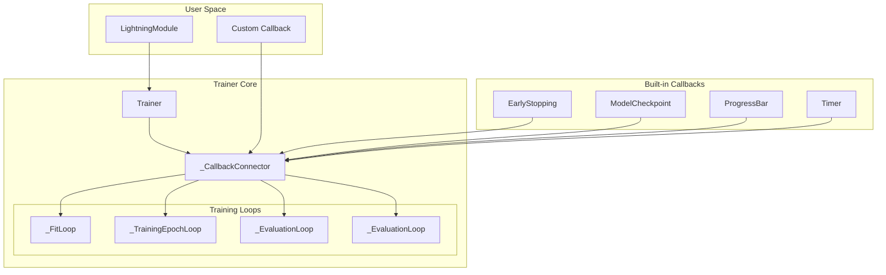
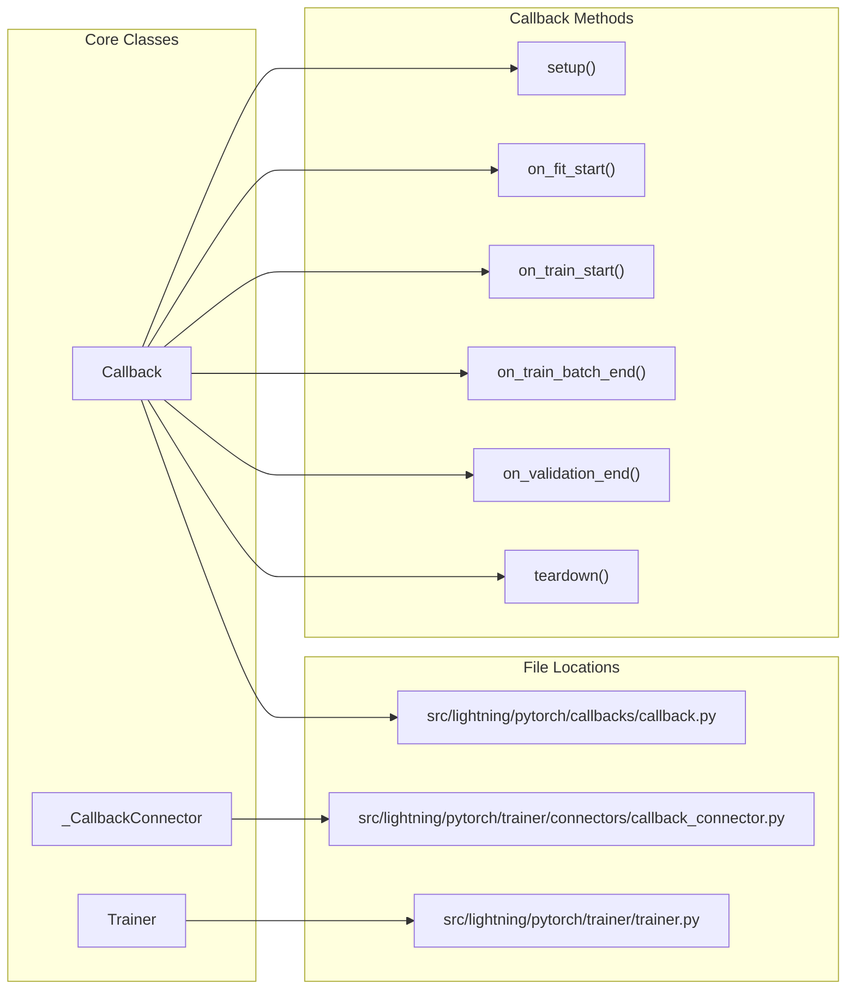
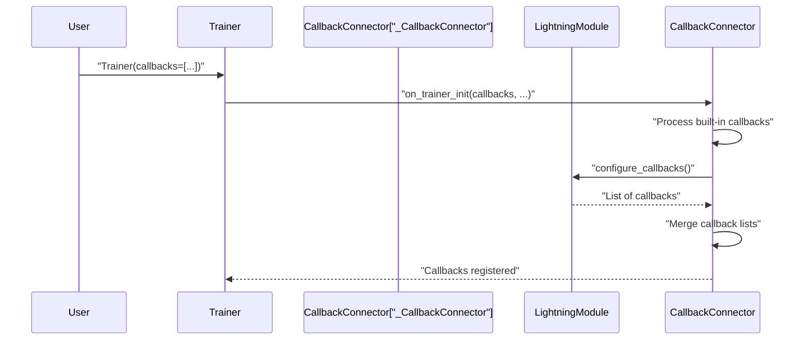
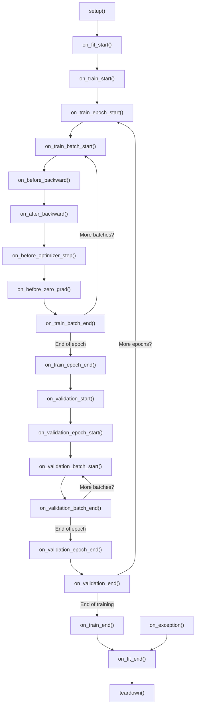
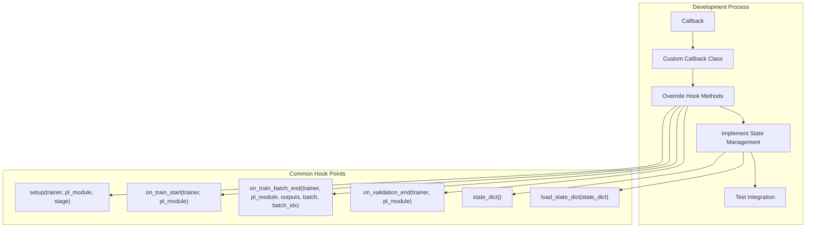
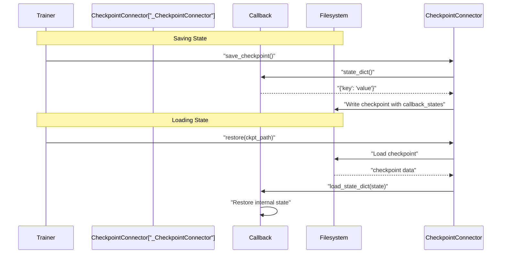

<!-- source: DeepWiki mcp.deepwiki.com · repo Lightning-AI/pytorch-lightning · page 4.2 Callbacks and Hooks · fetched 2026-10-21 -->

# Callbacks and Extensions

<details>
<summary>Relevant source files</summary>

The following files were used as context for generating this wiki page:

- [.pre-commit-config.yaml](.pre-commit-config.yaml)
- [docs/source-pytorch/advanced/transfer_learning.rst](docs/source-pytorch/advanced/transfer_learning.rst)
- [docs/source-pytorch/common/lightning_module.rst](docs/source-pytorch/common/lightning_module.rst)
- [docs/source-pytorch/common/trainer.rst](docs/source-pytorch/common/trainer.rst)
- [docs/source-pytorch/debug/debugging_basic.rst](docs/source-pytorch/debug/debugging_basic.rst)
- [pyproject.toml](pyproject.toml)
- [src/lightning/pytorch/callbacks/callback.py](src/lightning/pytorch/callbacks/callback.py)
- [src/lightning/pytorch/callbacks/device_stats_monitor.py](src/lightning/pytorch/callbacks/device_stats_monitor.py)
- [src/lightning/pytorch/callbacks/finetuning.py](src/lightning/pytorch/callbacks/finetuning.py)
- [src/lightning/pytorch/callbacks/model_summary.py](src/lightning/pytorch/callbacks/model_summary.py)
- [src/lightning/pytorch/callbacks/rich_model_summary.py](src/lightning/pytorch/callbacks/rich_model_summary.py)
- [src/lightning/pytorch/core/hooks.py](src/lightning/pytorch/core/hooks.py)
- [src/lightning/pytorch/loops/evaluation_loop.py](src/lightning/pytorch/loops/evaluation_loop.py)
- [src/lightning/pytorch/loops/fetchers.py](src/lightning/pytorch/loops/fetchers.py)
- [src/lightning/pytorch/loops/fit_loop.py](src/lightning/pytorch/loops/fit_loop.py)
- [src/lightning/pytorch/loops/prediction_loop.py](src/lightning/pytorch/loops/prediction_loop.py)
- [src/lightning/pytorch/loops/training_epoch_loop.py](src/lightning/pytorch/loops/training_epoch_loop.py)
- [src/lightning/pytorch/loops/utilities.py](src/lightning/pytorch/loops/utilities.py)
- [src/lightning/pytorch/trainer/connectors/data_connector.py](src/lightning/pytorch/trainer/connectors/data_connector.py)
- [src/lightning/pytorch/trainer/trainer.py](src/lightning/pytorch/trainer/trainer.py)
- [src/lightning/pytorch/utilities/combined_loader.py](src/lightning/pytorch/utilities/combined_loader.py)
- [src/lightning/pytorch/utilities/model_summary/model_summary.py](src/lightning/pytorch/utilities/model_summary/model_summary.py)
- [src/lightning/pytorch/utilities/model_summary/model_summary_deepspeed.py](src/lightning/pytorch/utilities/model_summary/model_summary_deepspeed.py)
- [tests/tests_pytorch/callbacks/test_model_summary.py](tests/tests_pytorch/callbacks/test_model_summary.py)
- [tests/tests_pytorch/callbacks/test_rich_model_summary.py](tests/tests_pytorch/callbacks/test_rich_model_summary.py)
- [tests/tests_pytorch/core/test_lightning_module.py](tests/tests_pytorch/core/test_lightning_module.py)
- [tests/tests_pytorch/loops/test_evaluation_loop.py](tests/tests_pytorch/loops/test_evaluation_loop.py)
- [tests/tests_pytorch/loops/test_fetchers.py](tests/tests_pytorch/loops/test_fetchers.py)
- [tests/tests_pytorch/loops/test_prediction_loop.py](tests/tests_pytorch/loops/test_prediction_loop.py)
- [tests/tests_pytorch/loops/test_training_epoch_loop.py](tests/tests_pytorch/loops/test_training_epoch_loop.py)
- [tests/tests_pytorch/models/test_hooks.py](tests/tests_pytorch/models/test_hooks.py)
- [tests/tests_pytorch/trainer/connectors/test_data_connector.py](tests/tests_pytorch/trainer/connectors/test_data_connector.py)
- [tests/tests_pytorch/trainer/flags/test_overfit_batches.py](tests/tests_pytorch/trainer/flags/test_overfit_batches.py)
- [tests/tests_pytorch/trainer/properties/test_estimated_stepping_batches.py](tests/tests_pytorch/trainer/properties/test_estimated_stepping_batches.py)
- [tests/tests_pytorch/trainer/test_dataloaders.py](tests/tests_pytorch/trainer/test_dataloaders.py)
- [tests/tests_pytorch/trainer/test_trainer.py](tests/tests_pytorch/trainer/test_trainer.py)
- [tests/tests_pytorch/utilities/test_combined_loader.py](tests/tests_pytorch/utilities/test_combined_loader.py)
- [tests/tests_pytorch/utilities/test_deepspeed_model_summary.py](tests/tests_pytorch/utilities/test_deepspeed_model_summary.py)
- [tests/tests_pytorch/utilities/test_enums.py](tests/tests_pytorch/utilities/test_enums.py)
- [tests/tests_pytorch/utilities/test_model_summary.py](tests/tests_pytorch/utilities/test_model_summary.py)

</details>


Callbacks in PyTorch Lightning provide a powerful mechanism to extend and customize the training process without modifying core code. They allow users to inject custom logic at specific points (hooks) in the training, validation, testing, and prediction workflows. This page covers the callback system architecture, built-in callbacks, creating custom callbacks, and managing callback state.

For information about the command-line interface that works with callbacks, see [LightningCLI](#3.3).

## Callback System Architecture

Callbacks in PyTorch Lightning follow a hook-based pattern implemented through the `_CallbackConnector` class, where the `Trainer` executes callback methods at specific points in the training workflow. This design separates model logic from training extensions.

Training System Architecture with Callback Integration


Callback Code Entity Mapping


Sources: [src/lightning/pytorch/trainer/trainer.py:421-422](), [src/lightning/pytorch/trainer/trainer.py:438-445](), [src/lightning/pytorch/callbacks/callback.py:1-53]()

## Callback Registration

The `_CallbackConnector` manages callback registration through the `on_trainer_init` method. Callbacks can be registered in multiple ways:

Callback Registration Flow


### Registration Methods

1. **Trainer Constructor**: Pass callbacks directly to `Trainer(callbacks=...)`
2. **LightningModule Method**: Override `configure_callbacks()` in your model
3. **Automatic Built-ins**: Enable via Trainer flags (`enable_checkpointing`, `enable_progress_bar`)

### Built-in Callback Auto-registration

The `_CallbackConnector.on_trainer_init` method automatically adds built-in callbacks based on Trainer configuration:

| Trainer Flag | Callback Added | Class |
|--------------|----------------|-------|
| `enable_checkpointing=True` | Model checkpointing | `ModelCheckpoint` |
| `enable_progress_bar=True` | Progress display | `TQDMProgressBar` |
| `enable_model_summary=True` | Model summary | `ModelSummary` |
| `max_time` set | Time-based stopping | `Timer` |

When using both explicit callbacks and `configure_callbacks()`, the connector merges them with model callbacks taking precedence for duplicate types.

Sources: [src/lightning/pytorch/trainer/trainer.py:438-445](), [src/lightning/pytorch/trainer/connectors/callback_connector.py:62-66]()

## Callback Lifecycle and Hook Points

Callbacks connect to the training process through hook methods that are called at specific points in the workflow. Here's the lifecycle of a callback during training:



Similar hook patterns exist for test and predict workflows, with corresponding methods like `on_test_start`, `on_test_batch_end`, etc.

Sources: 
- [docs/source-pytorch/extensions/callbacks.rst:112-368](https://github.com/Lightning-AI/pytorch-lightning/blob/master/docs/source-pytorch/extensions/callbacks.rst)
- [tests/tests_pytorch/trainer/logging_/test_logger_connector.py:40-146](https://github.com/Lightning-AI/pytorch-lightning/blob/master/tests/tests_pytorch/trainer/logging_/test_logger_connector.py)

## Built-in Callbacks

PyTorch Lightning provides built-in callbacks for common training extensions, organized into functional categories:

Built-in Callback Hierarchy

```mermaid
graph TD
    subgraph "Training Control"
        EarlyStopping["EarlyStopping"]
        Timer["Timer"]
        StochasticWeightAveraging["StochasticWeightAveraging"]
    end
    
    subgraph "Model Management"
        ModelCheckpoint["ModelCheckpoint"]
        ModelSummary["ModelSummary"]
    end
    
    subgraph "Progress & Monitoring"
        TQDMProgressBar["TQDMProgressBar"]
        RichProgressBar["RichProgressBar"]
        DeviceStatsMonitor["DeviceStatsMonitor"]
        LearningRateMonitor["LearningRateMonitor"]
    end
    
    subgraph "Transfer Learning"
        BaseFinetuning["BaseFinetuning"]
        BackboneFinetuning["BackboneFinetuning"]
    end
    
    subgraph "Utility"
        LambdaCallback["LambdaCallback"]
        GradientAccumulationScheduler["GradientAccumulationScheduler"]
    end
    
    subgraph "Base Class"
        Callback["Callback"]
    end
    
    EarlyStopping --> Callback
    Timer --> Callback
    ModelCheckpoint --> Callback
    TQDMProgressBar --> Callback
    BaseFinetuning --> Callback
    LambdaCallback --> Callback
```


### Core Training Extensions

| Callback | File Location | Key Features |
|----------|---------------|--------------|
| `EarlyStopping` | `src/lightning/pytorch/callbacks/early_stopping.py` | Monitors metrics, stops on plateau |
| `ModelCheckpoint` | `src/lightning/pytorch/callbacks/model_checkpoint.py` | Saves best/latest models |
| `Timer` | `src/lightning/pytorch/callbacks/timer.py` | Time-based training control |
| `TQDMProgressBar` | `src/lightning/pytorch/callbacks/progress/tqdm_progress.py` | Training progress display |
| `DeviceStatsMonitor` | `src/lightning/pytorch/callbacks/device_stats_monitor.py` | GPU/CPU monitoring |

### EarlyStopping Implementation

The `EarlyStopping` callback uses the `on_validation_end` hook to monitor metrics:

**Key Configuration Options:**
- `monitor`: Metric name to track
- `patience`: Epochs to wait before stopping
- `min_delta`: Minimum improvement threshold
- `mode`: 'min' or 'max' for metric direction
- `check_on_train_epoch_end`: When to perform checks

**State Management:**
- `wait_count`: Current patience counter
- `best_score`: Best metric value seen
- `patience_count`: Total patience remaining

### ModelCheckpoint Extension

The `ModelCheckpoint` callback extends training with automatic model persistence:

**Monitoring Options:**
- `save_top_k`: Number of best models to keep
- `save_last`: Always save most recent checkpoint
- `every_n_epochs`: Periodic saving frequency
- `filename`: Custom checkpoint naming

**Integration Points:**
- `on_validation_end`: Evaluate save conditions
- `on_train_epoch_end`: Alternative save timing
- `on_exception`: Save on training interruption

### Custom Progress Extensions

Lightning provides multiple progress bar implementations:

**TQDMProgressBar**: Standard terminal progress
**RichProgressBar**: Enhanced console output with colors and formatting

Both extend the base `ProgressBarBase` class and integrate at these hooks:
- `on_train_start`/`on_train_end`
- `on_train_batch_end`
- `on_validation_batch_end`

Sources: [src/lightning/pytorch/callbacks/early_stopping.py:47-122](), [src/lightning/pytorch/callbacks/model_checkpoint.py:134-189](), [src/lightning/pytorch/callbacks/timer.py:42-67](), [src/lightning/pytorch/callbacks/device_stats_monitor.py:43-78]()

## Creating Custom Training Extensions

Custom callbacks extend the base `Callback` class from `src/lightning/pytorch/callbacks/callback.py`. The base class provides empty implementations of all hook methods, allowing you to override only needed functionality.

Custom Callback Development Pattern


### Hook Method Signatures

The `Callback` base class defines standardized method signatures for all training phases:

**Training Hooks:**
- `on_fit_start(trainer, pl_module)`
- `on_train_start(trainer, pl_module)`
- `on_train_epoch_start(trainer, pl_module)`
- `on_train_batch_start(trainer, pl_module, batch, batch_idx)`
- `on_train_batch_end(trainer, pl_module, outputs, batch, batch_idx)`

**Optimization Hooks:**
- `on_before_backward(trainer, pl_module, loss)`
- `on_after_backward(trainer, pl_module)`
- `on_before_optimizer_step(trainer, pl_module, optimizer)`

**Validation/Test Hooks:**
- `on_validation_start(trainer, pl_module)`
- `on_validation_epoch_end(trainer, pl_module)`
- `on_test_start(trainer, pl_module)`

### Example: Metric Tracking Extension

```python
from lightning.pytorch.callbacks import Callback
import torch

class MetricTracker(Callback):
    def __init__(self):
        super().__init__()
        self.train_losses = []
        self.val_metrics = {}
        
    def on_train_batch_end(self, trainer, pl_module, outputs, batch, batch_idx):
        # Track training loss
        if 'loss' in outputs:
            self.train_losses.append(outputs['loss'].item())
    
    def on_validation_epoch_end(self, trainer, pl_module):
        # Access logged metrics from trainer
        if trainer.callback_metrics:
            epoch_metrics = {k: v.item() for k, v in trainer.callback_metrics.items()}
            self.val_metrics[trainer.current_epoch] = epoch_metrics
    
    def state_dict(self):
        return {
            'train_losses': self.train_losses,
            'val_metrics': self.val_metrics
        }
    
    def load_state_dict(self, state_dict):
        self.train_losses = state_dict['train_losses']
        self.val_metrics = state_dict['val_metrics']
```

### Integration with Trainer State

Custom callbacks can access and modify trainer state through the `trainer` parameter:

**Accessing Training State:**
- `trainer.current_epoch`: Current training epoch
- `trainer.global_step`: Total optimization steps
- `trainer.callback_metrics`: Logged metrics
- `trainer.logged_metrics`: All logged values

**Controlling Training:**
- `trainer.should_stop = True`: Stop training early
- `trainer.save_checkpoint(path)`: Save checkpoint manually

### Advanced Extension Patterns

**Conditional Hook Execution:**
```python
def on_train_batch_end(self, trainer, pl_module, outputs, batch, batch_idx):
    if trainer.current_epoch >= self.start_epoch:
        # Only execute after certain epoch
        self.perform_action()
```

**Multi-Stage Callbacks:**
```python
def setup(self, trainer, pl_module, stage):
    if stage == 'fit':
        self.setup_training()
    elif stage == 'test':
        self.setup_testing()
```

Sources: [src/lightning/pytorch/callbacks/callback.py:27-52](), [tests/tests_pytorch/callbacks/test_callbacks.py:107-136](), [src/lightning/pytorch/trainer/trainer.py:481-482]()

## Stateful Callback Extensions

Callbacks that need to persist state across training sessions implement the `_Stateful` interface through `state_dict()` and `load_state_dict()` methods. The `_CheckpointConnector` handles automatic state persistence.

Callback State Persistence Architecture


### State Management Interface

The base `Callback` class provides default implementations that callbacks can override:

**Default State Methods:**
```python
def state_dict(self) -> dict[str, Any]:
    return {}

def load_state_dict(self, state_dict: dict[str, Any]) -> None:
    pass
```

**State Key Generation:**
The `state_key` property creates unique identifiers for callback state:
- Format: `"ClassName_id"` where `id` is the callback's memory ID
- Used by `_CheckpointConnector` to organize callback states in checkpoints

### Built-in Stateful Callbacks

**EarlyStopping State:**
- `wait_count`: Epochs waited since last improvement
- `best_score`: Best monitored metric value
- `patience_count`: Remaining patience

**Timer State:**
- `_start_time`: Training start timestamp  
- `_end_time`: Training end timestamp
- `_offset`: Time offset for resumed training

**ModelCheckpoint State:**
- `best_model_score`: Best model metric value
- `best_model_path`: Path to best checkpoint
- `last_model_path`: Path to most recent checkpoint

### Custom Stateful Extension Example

```python
class LearningRateScheduler(Callback):
    def __init__(self, schedule_func):
        super().__init__()
        self.schedule_func = schedule_func
        self.step_count = 0
        self.lr_history = []
    
    def on_train_batch_end(self, trainer, pl_module, outputs, batch, batch_idx):
        self.step_count += 1
        # Apply custom learning rate schedule
        new_lr = self.schedule_func(self.step_count)
        for optimizer in trainer.optimizers:
            for param_group in optimizer.param_groups:
                param_group['lr'] = new_lr
        self.lr_history.append(new_lr)
    
    def state_dict(self):
        return {
            'step_count': self.step_count,
            'lr_history': self.lr_history
        }
    
    def load_state_dict(self, state_dict):
        self.step_count = state_dict['step_count']
        self.lr_history = state_dict['lr_history']
```

### State Restoration Timing

Callback state restoration occurs during the `_CheckpointConnector.restore()` process:

1. **Model Loading**: Model state_dict restored first
2. **Callback State**: Each callback's `load_state_dict()` called
3. **Trainer State**: Trainer internal state restored
4. **Optimizer State**: Optimizer states restored last

This ordering ensures callbacks have access to properly restored model state when their `load_state_dict` method is called.

Sources: [src/lightning/pytorch/trainer/connectors/checkpoint_connector.py:267-285](), [src/lightning/pytorch/callbacks/early_stopping.py:229-245](), [src/lightning/pytorch/callbacks/timer.py:165-189]()

## Logging from Callbacks

Callbacks can log metrics by calling the LightningModule's `log` method, but this is only allowed at certain hook points:

```python
def on_train_batch_end(self, trainer, pl_module, outputs, batch, batch_idx):
    # This is allowed
    pl_module.log('my_metric', some_value, on_step=True, on_epoch=True)
```

Not all hook points support logging. For example, you cannot log in `on_fit_start`, `on_fit_end`, or `setup`.

Sources: [tests/tests_pytorch/trainer/logging_/test_logger_connector.py:111-146](https://github.com/Lightning-AI/pytorch-lightning/blob/master/tests/tests_pytorch/trainer/logging_/test_logger_connector.py)

## Best Practices for Callbacks

1. Keep callbacks focused on single responsibilities
2. Don't rely on the behavior of other callbacks
3. Avoid manually calling callback methods
4. Make callbacks independent of execution order when possible
5. Implement `state_dict` and `load_state_dict` for stateful callbacks

Sources: [docs/source-pytorch/extensions/callbacks.rst:94-104](https://github.com/Lightning-AI/pytorch-lightning/blob/master/docs/source-pytorch/extensions/callbacks.rst)

## Multiple Callbacks of the Same Type

PyTorch Lightning supports using multiple callbacks of the same type. For example, you can use multiple EarlyStopping callbacks to monitor different metrics:

```python
trainer = Trainer(
    callbacks=[
        EarlyStopping(monitor='val_loss', patience=3),
        EarlyStopping(monitor='val_accuracy', patience=5, mode='max')
    ]
)
```

When multiple early stopping callbacks are used, training stops if any of them triggers.

Sources: [tests/tests_pytorch/callbacks/test_early_stopping.py:372-431](https://github.com/Lightning-AI/pytorch-lightning/blob/master/tests/tests_pytorch/callbacks/test_early_stopping.py)

## Conclusion

Callbacks are a powerful extension mechanism in PyTorch Lightning that allow you to customize training without modifying core code. By understanding the callback lifecycle and available hook points, you can create custom callbacks that fulfill a wide range of needs, from early stopping and checkpointing to more complex behaviors like dynamic learning rate adjustments and model freezing/unfreezing.

The built-in callbacks cover many common use cases, but the true power of the callback system lies in its extensibility, allowing you to implement custom behaviors tailored to your specific requirements.

---

