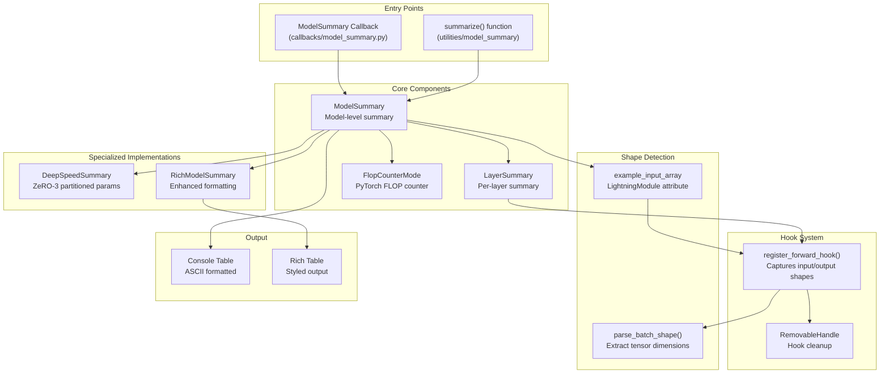
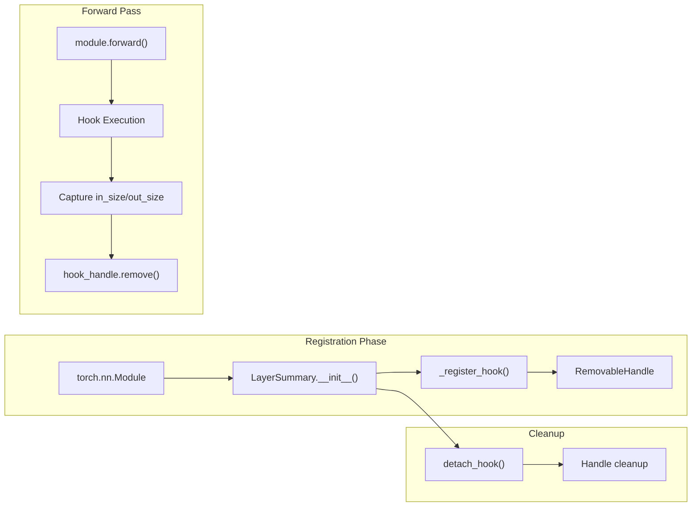
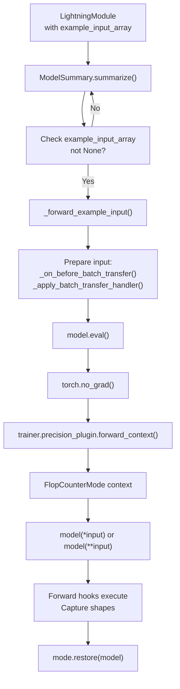
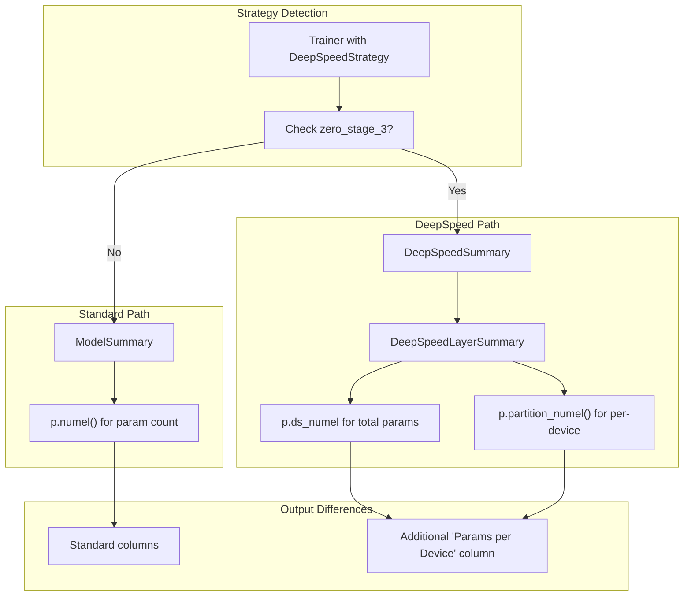
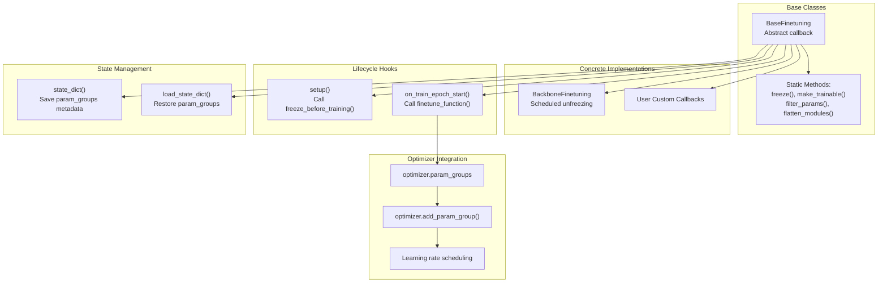
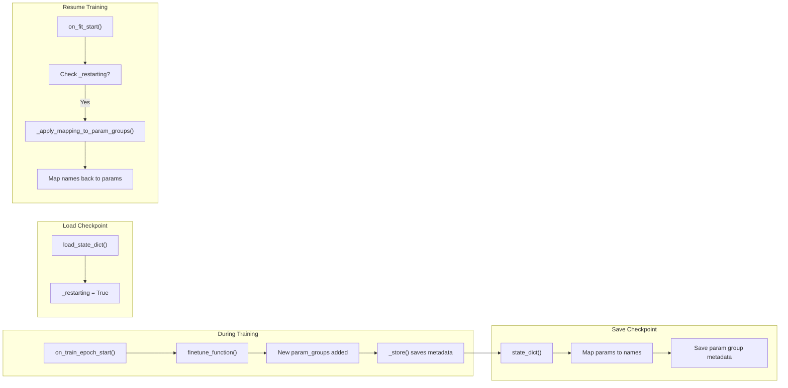
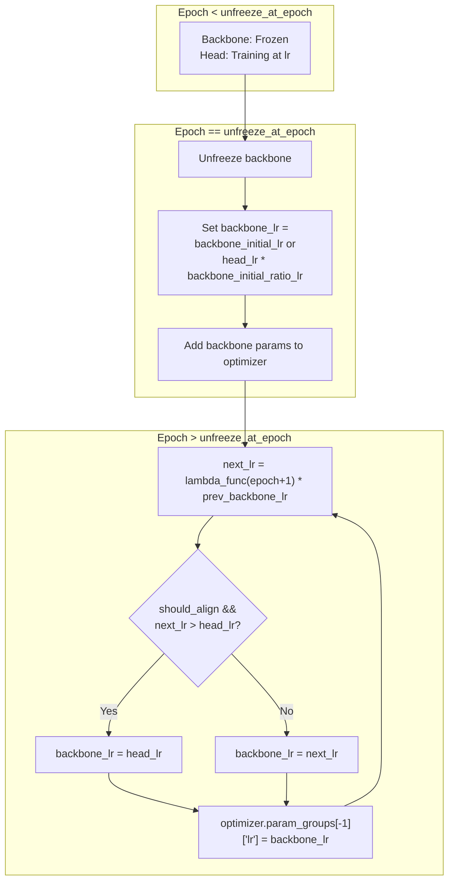

<!-- source: DeepWiki mcp.deepwiki.com · repo Lightning-AI/pytorch-lightning · page 4.3 Model Summary and Debugging · fetched 2026-10-21 -->

# Model Summary and Debugging

<details>
<summary>Relevant source files</summary>

The following files were used as context for generating this wiki page:

- [.pre-commit-config.yaml](.pre-commit-config.yaml)
- [docs/source-pytorch/advanced/transfer_learning.rst](docs/source-pytorch/advanced/transfer_learning.rst)
- [docs/source-pytorch/debug/debugging_basic.rst](docs/source-pytorch/debug/debugging_basic.rst)
- [pyproject.toml](pyproject.toml)
- [src/lightning/pytorch/callbacks/finetuning.py](src/lightning/pytorch/callbacks/finetuning.py)
- [src/lightning/pytorch/callbacks/model_summary.py](src/lightning/pytorch/callbacks/model_summary.py)
- [src/lightning/pytorch/callbacks/rich_model_summary.py](src/lightning/pytorch/callbacks/rich_model_summary.py)
- [src/lightning/pytorch/utilities/model_summary/model_summary.py](src/lightning/pytorch/utilities/model_summary/model_summary.py)
- [src/lightning/pytorch/utilities/model_summary/model_summary_deepspeed.py](src/lightning/pytorch/utilities/model_summary/model_summary_deepspeed.py)
- [tests/tests_pytorch/callbacks/test_model_summary.py](tests/tests_pytorch/callbacks/test_model_summary.py)
- [tests/tests_pytorch/callbacks/test_rich_model_summary.py](tests/tests_pytorch/callbacks/test_rich_model_summary.py)
- [tests/tests_pytorch/utilities/test_deepspeed_model_summary.py](tests/tests_pytorch/utilities/test_deepspeed_model_summary.py)
- [tests/tests_pytorch/utilities/test_model_summary.py](tests/tests_pytorch/utilities/test_model_summary.py)

</details>


This document covers the model inspection and fine-tuning infrastructure in PyTorch Lightning. The model summary system provides detailed information about network architectures, parameter counts, computational complexity, and layer shapes. The fine-tuning system enables programmatic control over parameter freezing and unfreezing for transfer learning workflows.

For information about training loops and callbacks in general, see [Training Loops](#4.1) and [Callbacks and Hooks](#4.2). For checkpoint saving and loading, see [Checkpoint System](#6.1).

---

## Overview

The model summary and debugging system consists of two main subsystems:

1. **Model Summary System**: Inspects model architecture and generates detailed summaries including parameter counts, layer types, input/output shapes, and FLOP counts
2. **Fine-tuning System**: Programmatically freezes and unfreezes model parameters for transfer learning

---

## Model Summary Architecture



**Sources:**
- [src/lightning/pytorch/callbacks/model_summary.py:1-111]()
- [src/lightning/pytorch/utilities/model_summary/model_summary.py:1-566]()
- [src/lightning/pytorch/callbacks/rich_model_summary.py:1-124]()

---

## ModelSummary Class

The `ModelSummary` class generates comprehensive summaries of LightningModule architectures. It collects information about each layer including type, parameter count, input/output shapes, and computational cost.

### Core Components

| Component | Location | Purpose |
|-----------|----------|---------|
| `ModelSummary` | [src/lightning/pytorch/utilities/model_summary/model_summary.py:150-432]() | Main summary class for entire model |
| `LayerSummary` | [src/lightning/pytorch/utilities/model_summary/model_summary.py:44-148]() | Summary for individual layers |
| `summarize()` | [src/lightning/pytorch/utilities/model_summary/model_summary.py:552-566]() | Convenience function for creating summaries |

### Key Properties

The `ModelSummary` class provides the following properties:

- `named_modules`: List of `(name, module)` tuples for modules up to `max_depth`
- `layer_names`: List of layer names in the summary
- `layer_types`: List of layer class names (e.g., "Linear", "Conv2d")
- `in_sizes`: List of input shapes for each layer
- `out_sizes`: List of output shapes for each layer
- `param_nums`: List of parameter counts per layer
- `training_modes`: List of boolean values indicating train/eval mode
- `total_parameters`: Total number of parameters in the model
- `trainable_parameters`: Number of parameters with `requires_grad=True`
- `model_size`: Estimated model size in megabytes based on precision
- `total_flops`: Total floating-point operations
- `total_training_modes`: Dictionary with counts of modules in train/eval mode

**Sources:**
- [src/lightning/pytorch/utilities/model_summary/model_summary.py:250-324]()

### Max Depth Configuration

The `max_depth` parameter controls how deeply nested modules are included in the summary:

- `max_depth=-1`: Show all nested modules (full hierarchy)
- `max_depth=0`: Disable summary
- `max_depth=1`: Show only top-level modules (default)
- `max_depth=2+`: Show modules up to specified nesting level

**Sources:**
- [src/lightning/pytorch/utilities/model_summary/model_summary.py:214-228]()
- [tests/tests_pytorch/utilities/test_model_summary.py:380-393]()

---

## LayerSummary and Hook Mechanism



The `LayerSummary` class uses forward hooks to capture input and output shapes during model execution:

### Hook Registration

When a `LayerSummary` is created for a module, it registers a forward hook using `register_forward_hook()` with `with_kwargs=True` to capture both positional and keyword arguments.

**Key Implementation Details:**

1. **Hook Function**: [src/lightning/pytorch/utilities/model_summary/model_summary.py:95-109]()
   - Captures input and output tensors
   - Calls `parse_batch_shape()` to extract dimensions
   - Removes itself after first execution (one-shot hook)

2. **ScriptModule Handling**: Hooks cannot be registered on `torch.jit.ScriptModule` instances, so the hook handle is set to `None` for these modules [src/lightning/pytorch/utilities/model_summary/model_summary.py:112-114]()

3. **Cleanup**: The `detach_hook()` method ensures hooks are removed even if the forward pass doesn't reach all modules [src/lightning/pytorch/utilities/model_summary/model_summary.py:117-124]()

### Shape Detection

The `parse_batch_shape()` function extracts tensor dimensions from various input types:

- `torch.Tensor`: Returns `list(tensor.shape)`
- `list` or `tuple`: Recursively parses each element
- `dict`: Extracts shapes from values
- Other types: Returns `UNKNOWN_SIZE` marker

**Sources:**
- [src/lightning/pytorch/utilities/model_summary/model_summary.py:434-441]()
- [tests/tests_pytorch/utilities/test_model_summary.py:268-302]()

---

## Example Input Array and Forward Pass

The `example_input_array` attribute on `LightningModule` triggers shape detection:



### Forward Pass Details

The `_forward_example_input()` method [src/lightning/pytorch/utilities/model_summary/model_summary.py:339-372]() performs the following steps:

1. **Input Preparation**: Applies batch transfer handlers (e.g., moving to device)
2. **Mode Capture**: Saves current train/eval state of all modules
3. **Evaluation Mode**: Sets model to `eval()` for consistent shape detection
4. **Context Managers**:
   - `torch.no_grad()`: Disable gradient computation
   - `trainer.precision_plugin.forward_context()`: Apply precision-specific context
   - `FlopCounterMode`: Count floating-point operations
5. **Forward Call**: Executes model with appropriate unpacking based on input type
6. **Mode Restoration**: Restores original train/eval state

**Sources:**
- [src/lightning/pytorch/utilities/model_summary/model_summary.py:339-372]()
- [tests/tests_pytorch/utilities/test_model_summary.py:433-456]()

---

## FLOP Counting

PyTorch Lightning integrates `torch.utils.flop_counter.FlopCounterMode` to measure computational complexity:

### FlopCounterMode Integration

The `FlopCounterMode` is created during `ModelSummary.__init__()` with depth configuration:

```python
self._flop_counter = FlopCounterMode(
    mods=None if _TORCH_GREATER_EQUAL_2_4 else self._model,
    display=False,
    depth=max_depth + 1,
)
```

### Accessing FLOP Counts

- `total_flops`: Total FLOPs across entire model via `get_total_flops()`
- `flop_counts`: Dictionary mapping layer names to operation counts

**Limitations:**
- `FlopCounterMode` does not support `ScriptModule` in PyTorch < 2.4.0
- A null context is used as fallback when ScriptModules are detected

**Sources:**
- [src/lightning/pytorch/utilities/model_summary/model_summary.py:221-225]()
- [src/lightning/pytorch/utilities/model_summary/model_summary.py:310-323]()
- [src/lightning/pytorch/utilities/model_summary/model_summary.py:354-361]()

---

## Model Size Calculation

Model size estimation accounts for parameter precision:

### Precision Mapping

| Precision String | Bits per Parameter |
|------------------|-------------------|
| "64", "64-true" | 64 |
| "32", "32-true" | 32 |
| "16", "16-true", "bf16", "bf16-true" | 16 |

### Calculation

```
model_size_mb = total_parameters * (precision_bits / 8.0) * 1e-6
```

The precision is determined from `trainer.precision` if available, defaulting to 32 bits.

**Warning Handling:**
If an unsupported precision is detected (e.g., "16-mixed"), a warning is issued and 32-bit precision is used as fallback.

**Sources:**
- [src/lightning/pytorch/utilities/model_summary/model_summary.py:231-248]()
- [src/lightning/pytorch/utilities/model_summary/model_summary.py:306-307]()
- [tests/tests_pytorch/utilities/test_model_summary.py:331-354]()

---

## DeepSpeed Integration



### DeepSpeedSummary

When using DeepSpeed ZeRO Stage 3, parameters are partitioned across devices. The standard `numel()` method doesn't reflect the true parameter count, so `DeepSpeedSummary` uses DeepSpeed-specific attributes:

**Key Differences:**

| Aspect | Standard | DeepSpeed ZeRO-3 |
|--------|----------|------------------|
| Parameter Count | `p.numel()` | `p.ds_numel` |
| Per-Device Count | N/A | `p.partition_numel()` |
| Summary Class | `ModelSummary` | `DeepSpeedSummary` |
| Layer Class | `LayerSummary` | `DeepSpeedLayerSummary` |

### DeepSpeedLayerSummary

The `DeepSpeedLayerSummary` class extends `LayerSummary` with two properties:

1. `num_parameters`: Uses `deepspeed_param_size()` which accesses `p.ds_numel`
2. `average_shard_parameters`: Returns per-device parameter count using `p.partition_numel()` (DeepSpeed >= 0.6.6) or `p.partitioned_size()` (older versions)

### Strategy Detection

The `ModelSummary` callback automatically selects the appropriate summary class:

```python
if isinstance(trainer.strategy, DeepSpeedStrategy) and trainer.strategy.zero_stage_3:
    return DeepSpeedSummary(pl_module, max_depth=self._max_depth)
return summarize(pl_module, max_depth=self._max_depth)
```

**Sources:**
- [src/lightning/pytorch/utilities/model_summary/model_summary_deepspeed.py:1-120]()
- [src/lightning/pytorch/callbacks/model_summary.py:85-90]()
- [tests/tests_pytorch/utilities/test_deepspeed_model_summary.py:27-58]()

---

## RichModelSummary

`RichModelSummary` provides enhanced visual formatting using the `rich` library for styled console output:

### Key Features

- **Styled Tables**: Uses `rich.table.Table` with customizable header styles
- **Column Alignment**: Right-aligns numeric columns for readability
- **Grid Layout**: Uses `Table.grid()` for parameter breakdown summary
- **Bold Labels**: Emphasizes section headers with bold formatting

### Usage

```python
from lightning.pytorch.callbacks import RichModelSummary

trainer = Trainer(callbacks=[RichModelSummary(max_depth=1)])
```

Or automatically via `RichProgressBar`:

```python
from lightning.pytorch.callbacks import RichProgressBar

trainer = Trainer(callbacks=[RichProgressBar()])
# RichModelSummary is automatically added
```

### Implementation Details

The `RichModelSummary.summarize()` static method [src/lightning/pytorch/callbacks/rich_model_summary.py:68-123]():

1. Creates a `Table` with configurable header style
2. Adds columns conditionally (e.g., "Params per Device" for DeepSpeed)
3. Populates rows from summary data
4. Prints table and parameter breakdown grid

**Sources:**
- [src/lightning/pytorch/callbacks/rich_model_summary.py:23-124]()
- [tests/tests_pytorch/callbacks/test_rich_model_summary.py:27-73]()

---

## Fine-Tuning System Architecture



**Sources:**
- [src/lightning/pytorch/callbacks/finetuning.py:48-339]()

---

## BaseFinetuning Callback

`BaseFinetuning` is an abstract callback providing infrastructure for programmatic parameter freezing and unfreezing:

### Core Methods

| Method | Purpose | When Called |
|--------|---------|-------------|
| `freeze_before_training()` | Define initial frozen state | Before `configure_optimizers()` |
| `finetune_function()` | Define unfreezing schedule | Every training epoch start |
| `freeze()` | Freeze module parameters | User-controlled |
| `make_trainable()` | Unfreeze module parameters | User-controlled |
| `unfreeze_and_add_param_group()` | Unfreeze and add to optimizer | User-controlled |

### Static Utility Methods

#### freeze()

Freezes parameters of given modules [src/lightning/pytorch/callbacks/finetuning.py:207-223]():

```python
BaseFinetuning.freeze(modules, train_bn=True)
```

- Sets `requires_grad=False` on parameters
- Optionally keeps BatchNorm layers trainable if `train_bn=True`
- Sets `track_running_stats=False` on frozen BatchNorm layers

#### make_trainable()

Unfreezes parameters [src/lightning/pytorch/callbacks/finetuning.py:177-190]():

```python
BaseFinetuning.make_trainable(modules)
```

- Sets `requires_grad=True` on parameters
- Sets `track_running_stats=True` on BatchNorm layers

#### flatten_modules()

Recursively flattens module hierarchies [src/lightning/pytorch/callbacks/finetuning.py:127-151]():

- Returns leaf modules (modules with no children)
- Also includes parent modules with direct parameters
- Handles `ModuleDict` and iterable structures

#### filter_params()

Yields parameters matching criteria [src/lightning/pytorch/callbacks/finetuning.py:154-174]():

```python
BaseFinetuning.filter_params(modules, train_bn=True, requires_grad=True)
```

- Filters by `requires_grad` value
- Optionally excludes BatchNorm parameters if `train_bn=False`

#### unfreeze_and_add_param_group()

Unfreezes modules and adds parameters to optimizer [src/lightning/pytorch/callbacks/finetuning.py:255-281]():

```python
BaseFinetuning.unfreeze_and_add_param_group(
    modules=module,
    optimizer=optimizer,
    lr=1e-4,
    train_bn=True
)
```

- Unfreezes the modules
- Filters parameters not already in optimizer
- Adds new parameter group with specified learning rate
- If `lr=None`, uses first param group's LR divided by `initial_denom_lr`

**Sources:**
- [src/lightning/pytorch/callbacks/finetuning.py:48-282]()

---

## State Management and Checkpointing

The fine-tuning system maintains state across checkpoints to preserve parameter groups:

### State Dictionary Structure

```python
{
    "internal_optimizer_metadata": {
        opt_idx: [
            {
                "params": [param_name1, param_name2, ...],
                "lr": learning_rate,
                # other optimizer-specific settings
            },
            # ... more param groups
        ]
    },
    # For BackboneFinetuning only:
    "previous_backbone_lr": float
}
```

### Checkpoint Workflow



### Implementation Details

1. **Parameter Mapping**: Parameters are stored by name rather than reference to survive serialization [src/lightning/pytorch/callbacks/finetuning.py:296-316]()

2. **Restoration Logic**: On `on_fit_start()`, if `_restarting=True`, the callback rebuilds optimizer param groups from saved metadata [src/lightning/pytorch/callbacks/finetuning.py:113-124]()

3. **DeepSpeed Incompatibility**: Fine-tuning callbacks raise `NotImplementedError` when used with `DeepSpeedStrategy` [src/lightning/pytorch/callbacks/finetuning.py:287-293]()

**Sources:**
- [src/lightning/pytorch/callbacks/finetuning.py:93-124]()
- [src/lightning/pytorch/callbacks/finetuning.py:296-321]()

---

## BackboneFinetuning Callback

`BackboneFinetuning` implements a specific fine-tuning strategy for transfer learning with a backbone-head architecture:

### Requirements

The LightningModule **must** have a `backbone` attribute that is a `torch.nn.Module`:

```python
class MyModel(LightningModule):
    def __init__(self):
        super().__init__()
        self.backbone = pretrained_model  # REQUIRED attribute name
        self.head = nn.Linear(features, num_classes)
```

### Configuration Parameters

| Parameter | Type | Default | Description |
|-----------|------|---------|-------------|
| `unfreeze_backbone_at_epoch` | int | 10 | Epoch to start unfreezing backbone |
| `lambda_func` | Callable | `lambda epoch: 2.0` | LR multiplier function |
| `backbone_initial_ratio_lr` | float | 0.01 | Initial backbone LR as ratio of head LR |
| `backbone_initial_lr` | float | None | Explicit initial backbone LR (overrides ratio) |
| `should_align` | bool | True | Align with head LR when backbone LR exceeds it |
| `initial_denom_lr` | float | 10.0 | LR denominator when `backbone_initial_lr=None` |
| `train_bn` | bool | True | Keep BatchNorm trainable |
| `verbose` | bool | False | Print learning rates each epoch |
| `rounding` | int | 12 | Decimal places for verbose output |

### Learning Rate Schedule



### Implementation Flow

1. **freeze_before_training()** [src/lightning/pytorch/callbacks/finetuning.py:457-458]():
   - Freezes all backbone parameters before training starts

2. **finetune_function()** [src/lightning/pytorch/callbacks/finetuning.py:461-498]():
   - **At unfreeze epoch**: Unfreezes backbone and adds it as a new parameter group
   - **After unfreeze epoch**: Applies `lambda_func` to scale backbone learning rate
   - **Alignment**: If `should_align=True` and backbone LR exceeds head LR, sets backbone LR to head LR

3. **State Preservation** [src/lightning/pytorch/callbacks/finetuning.py:434-443]():
   - Stores `previous_backbone_lr` in checkpoint for LR schedule continuity

**Sources:**
- [src/lightning/pytorch/callbacks/finetuning.py:341-498]()
- [docs/source-pytorch/advanced/transfer_learning.rst:132-260]()

---

## Usage Examples

### Basic Model Summary

```python
from lightning.pytorch.utilities.model_summary import summarize

model = LightningModule()
model.example_input_array = torch.randn(10, 28, 28)

summary = summarize(model, max_depth=1)
print(summary)
```

**Output Format:**

```
  | Name | Type       | Params | Mode  | FLOPs | In sizes    | Out sizes
----------------------------------------------------------------------------
0 | net  | Sequential | 132 K  | train | 2.6 M | [10, 256]   | [10, 512]
----------------------------------------------------------------------------
132 K     Trainable params
0         Non-trainable params
132 K     Total params
0.530     Total estimated model params size (MB)
1         Modules in train mode
0         Modules in eval mode
2.6 M     Total FLOPs
```

**Sources:**
- [src/lightning/pytorch/utilities/model_summary/model_summary.py:171-211]()

### Trainer Integration

The `ModelSummary` callback is automatically added to Trainer:

```python
# Automatic with default max_depth=1
trainer = Trainer()

# Explicit configuration
from lightning.pytorch.callbacks import ModelSummary
trainer = Trainer(callbacks=[ModelSummary(max_depth=-1)])

# Disable
trainer = Trainer(enable_model_summary=False)
```

**Sources:**
- [tests/tests_pytorch/callbacks/test_model_summary.py:21-41]()
- [docs/source-pytorch/debug/debugging_basic.rst:103-143]()

### Transfer Learning with BackboneFinetuning

```python
import torchvision.models as models
from lightning.pytorch.callbacks import BackboneFinetuning

class TransferModel(LightningModule):
    def __init__(self):
        super().__init__()
        resnet = models.resnet50(weights="DEFAULT")
        self.backbone = nn.Sequential(*list(resnet.children())[:-1])
        self.head = nn.Sequential(
            nn.Flatten(),
            nn.Linear(2048, 512),
            nn.ReLU(),
            nn.Linear(512, num_classes)
        )
    
    def configure_optimizers(self):
        # Only optimize head initially
        return torch.optim.Adam(self.head.parameters(), lr=1e-3)

# Configure gradual unfreezing
finetuning = BackboneFinetuning(
    unfreeze_backbone_at_epoch=10,
    lambda_func=lambda epoch: 1.5,  # Multiply LR by 1.5 each epoch
    backbone_initial_ratio_lr=0.1,   # Start at 10% of head LR
    should_align=True,
    verbose=True
)

trainer = Trainer(callbacks=[finetuning], max_epochs=20)
trainer.fit(model)
```

**Sources:**
- [docs/source-pytorch/advanced/transfer_learning.rst:164-223]()
- [src/lightning/pytorch/callbacks/finetuning.py:362-405]()

### Custom Fine-Tuning Strategy

```python
from lightning.pytorch.callbacks.finetuning import BaseFinetuning

class LayerWiseUnfreezing(BaseFinetuning):
    def __init__(self, unfreeze_start_epoch=5, layers_per_epoch=2):
        super().__init__()
        self.unfreeze_start = unfreeze_start_epoch
        self.layers_per_epoch = layers_per_epoch
        self.unfrozen_layers = 0
    
    def freeze_before_training(self, pl_module):
        self.freeze(pl_module.backbone)
    
    def finetune_function(self, pl_module, epoch, optimizer):
        if epoch >= self.unfreeze_start:
            backbone_children = list(pl_module.backbone.children())
            layers_to_unfreeze = min(
                self.layers_per_epoch,
                len(backbone_children) - self.unfrozen_layers
            )
            
            # Unfreeze from end (top layers)
            for layer in backbone_children[-(self.unfrozen_layers + layers_to_unfreeze):]:
                self.unfreeze_and_add_param_group(
                    layer, optimizer, lr=1e-4, train_bn=True
                )
            
            self.unfrozen_layers += layers_to_unfreeze
```

**Sources:**
- [docs/source-pytorch/advanced/transfer_learning.rst:225-260]()
- [src/lightning/pytorch/callbacks/finetuning.py:48-90]()

---

## Special Considerations

### Leftover Parameters

Parameters not associated with any module (e.g., registered as buffers or direct attributes) are tracked separately:

- Counted in `total_parameters` but not in `total_layer_params`
- Displayed in summary table as `LEFTOVER_PARAMS_NAME` ("other params")
- Type, input sizes, and output sizes shown as `NOT_APPLICABLE` ("n/a")

**Sources:**
- [src/lightning/pytorch/utilities/model_summary/model_summary.py:40-41]()
- [src/lightning/pytorch/utilities/model_summary/model_summary.py:392-410]()
- [tests/tests_pytorch/utilities/test_model_summary.py:411-430]()

### Lazy Modules

Modules with uninitialized parameters (e.g., `nn.LazyLinear`) trigger a warning:

> "The total number of parameters detected may be inaccurate because the model contains an instance of `UninitializedParameter`. To get an accurate number, set `self.example_input_array` in your LightningModule."

The `_tensor_has_shape()` function detects `UninitializedParameter` instances and excludes them from counts.

**Sources:**
- [src/lightning/pytorch/utilities/model_summary/model_summary.py:538-549]()
- [tests/tests_pytorch/utilities/test_model_summary.py:357-366]()

### DTensor Support

When using DTensor (distributed tensors), the model summary correctly handles parameters:

- `_is_dtensor()` check distinguishes DTensors from uninitialized parameters
- DTensors have known shapes despite inheriting from `UninitializedParameter`
- No warning is issued for DTensor parameters

**Sources:**
- [src/lightning/pytorch/utilities/model_summary/model_summary.py:541-542]()
- [tests/tests_pytorch/utilities/test_model_summary.py:368-378]()

### Training Mode Preservation

The `_ModuleMode` utility captures and restores training/eval state:

- Model is set to `eval()` during shape detection
- Original mode is restored after forward pass
- Ensures consistent shape detection without affecting training state

**Sources:**
- [src/lightning/pytorch/utilities/model_summary/model_summary.py:349-372]()
- [tests/tests_pytorch/utilities/test_model_summary.py:433-456]()

---

