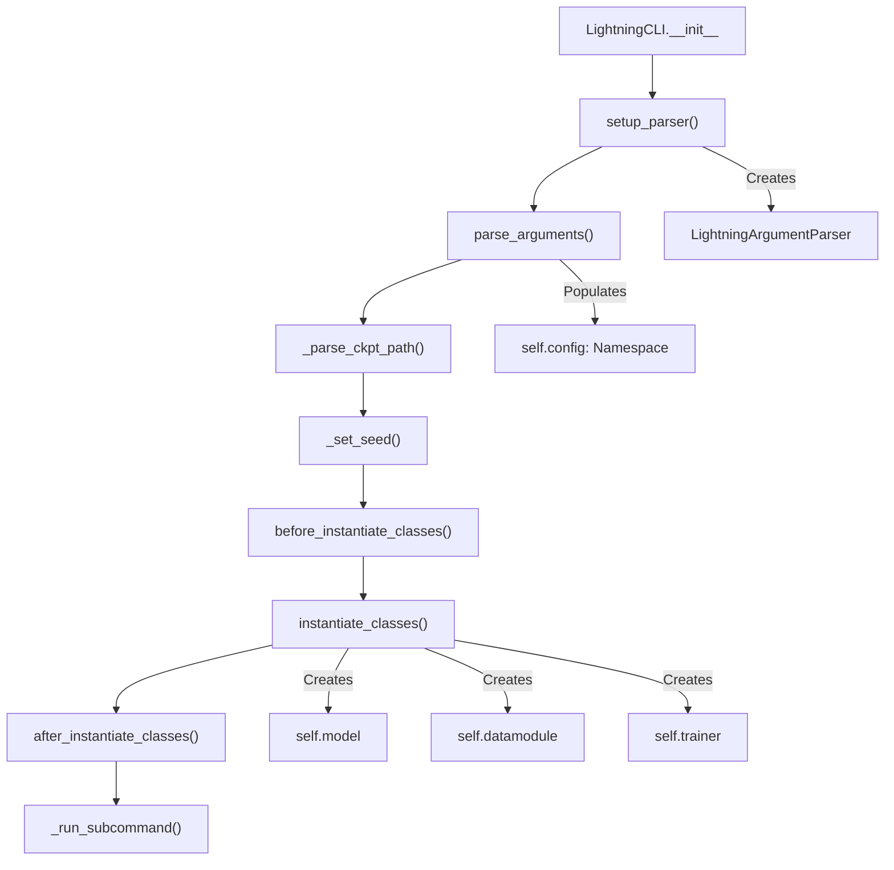
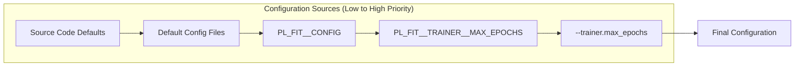
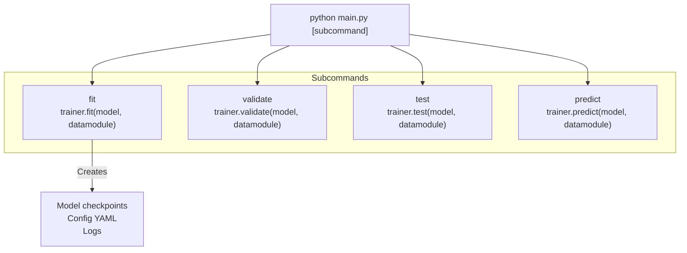
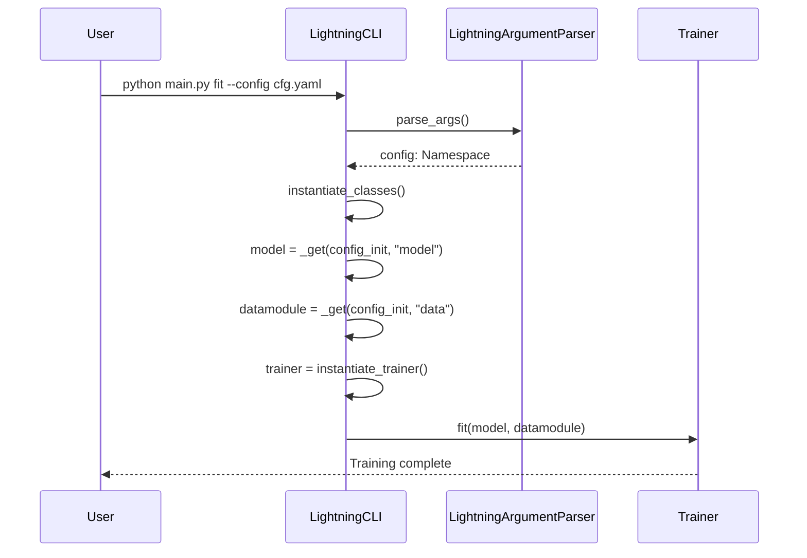
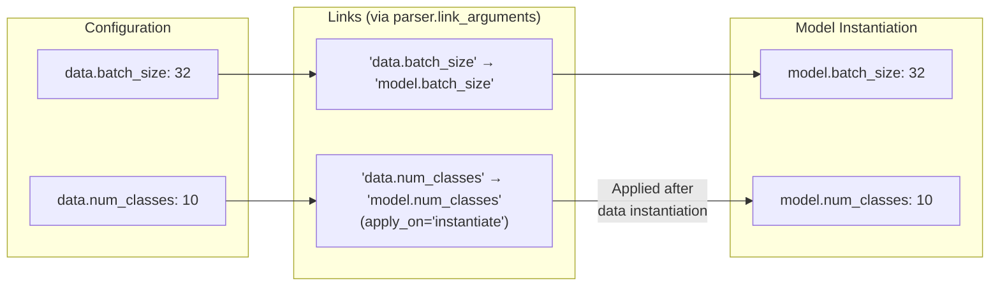
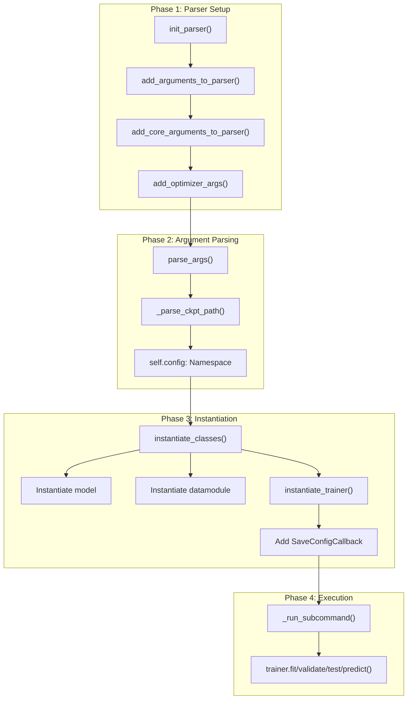
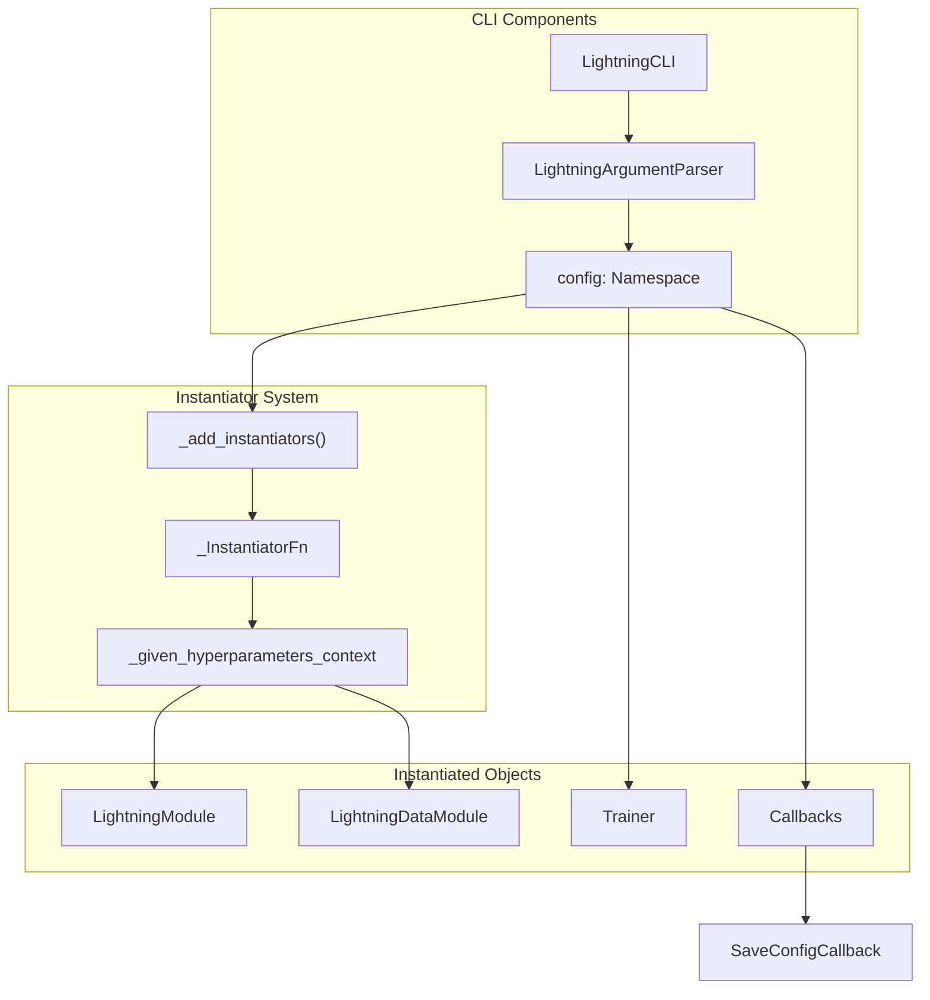

<!-- source: DeepWiki mcp.deepwiki.com · repo Lightning-AI/pytorch-lightning · page 4.4 Lightning CLI · fetched 2026-10-21 -->

# Lightning CLI

<details>
<summary>Relevant source files</summary>

The following files were used as context for generating this wiki page:

- [docs/source-pytorch/cli/lightning_cli.rst](docs/source-pytorch/cli/lightning_cli.rst)
- [docs/source-pytorch/cli/lightning_cli_advanced.rst](docs/source-pytorch/cli/lightning_cli_advanced.rst)
- [docs/source-pytorch/cli/lightning_cli_advanced_2.rst](docs/source-pytorch/cli/lightning_cli_advanced_2.rst)
- [docs/source-pytorch/cli/lightning_cli_advanced_3.rst](docs/source-pytorch/cli/lightning_cli_advanced_3.rst)
- [docs/source-pytorch/cli/lightning_cli_expert.rst](docs/source-pytorch/cli/lightning_cli_expert.rst)
- [docs/source-pytorch/cli/lightning_cli_faq.rst](docs/source-pytorch/cli/lightning_cli_faq.rst)
- [docs/source-pytorch/cli/lightning_cli_intermediate.rst](docs/source-pytorch/cli/lightning_cli_intermediate.rst)
- [docs/source-pytorch/cli/lightning_cli_intermediate_2.rst](docs/source-pytorch/cli/lightning_cli_intermediate_2.rst)
- [docs/source-pytorch/common/hyperparameters.rst](docs/source-pytorch/common/hyperparameters.rst)
- [requirements/pytorch/extra.txt](requirements/pytorch/extra.txt)
- [src/lightning/pytorch/cli.py](src/lightning/pytorch/cli.py)
- [src/lightning/pytorch/serve/servable_module_validator.py](src/lightning/pytorch/serve/servable_module_validator.py)
- [tests/tests_pytorch/test_cli.py](tests/tests_pytorch/test_cli.py)

</details>


## Purpose and Scope

The Lightning CLI provides a command-line interface for PyTorch Lightning applications built on the `jsonargparse` library. It automatically generates CLI arguments from `LightningModule`, `LightningDataModule`, `Trainer`, and `Callback` classes, eliminating boilerplate code for argument parsing and enabling configuration-driven experimentation.

This document covers `LightningCLI`, `LightningArgumentParser`, `SaveConfigCallback`, and the configuration system. For information about the Trainer class that the CLI orchestrates, see [Trainer](#2.3). For callbacks that can be configured through the CLI, see [Callbacks and Hooks](#4.2).

---

## Core Components

### LightningCLI Class

The `LightningCLI` class is the main entry point defined in [src/lightning/pytorch/cli.py:319-649](). It instantiates and connects all components required for training:

| Parameter | Type | Purpose |
|-----------|------|---------|
| `model_class` | `type[LightningModule]` or `Callable` | Model class to instantiate |
| `datamodule_class` | `type[LightningDataModule]` or `Callable` | DataModule class to instantiate |
| `trainer_class` | `type[Trainer]` or `Callable` | Trainer class (default: `Trainer`) |
| `save_config_callback` | `type[SaveConfigCallback]` | Callback for saving configuration |
| `parser_class` | `type[LightningArgumentParser]` | Parser class to use |
| `subclass_mode_model` | `bool` | Allow any subclass of `model_class` |
| `subclass_mode_data` | `bool` | Allow any subclass of `datamodule_class` |
| `auto_configure_optimizers` | `bool` | Automatically add optimizer arguments |
| `run` | `bool` | Execute trainer method immediately |

**Instantiation Flow:**



Sources: [src/lightning/pytorch/cli.py:322-422]()

### LightningArgumentParser

`LightningArgumentParser` extends `jsonargparse.ArgumentParser` with Lightning-specific functionality [src/lightning/pytorch/cli.py:93-220]():

**Key Methods:**

| Method | Purpose |
|--------|---------|
| `add_lightning_class_args()` | Add arguments from Lightning class `__init__` |
| `add_optimizer_args()` | Add optimizer class arguments |
| `add_lr_scheduler_args()` | Add learning rate scheduler arguments |
| `link_arguments()` | Create dependencies between arguments |

The parser supports type hints including complex types like `torch.nn.Module`, `Optimizer`, and `Callback` subclasses, automatically generating `class_path` and `init_args` structure for them.

Sources: [src/lightning/pytorch/cli.py:93-220](), [tests/tests_pytorch/test_cli.py:91-108]()

### SaveConfigCallback

`SaveConfigCallback` automatically saves the full configuration to the log directory [src/lightning/pytorch/cli.py:222-317]():

**Configuration:**

| Attribute | Default | Purpose |
|-----------|---------|---------|
| `config_filename` | `"config.yaml"` | Name of saved config file |
| `overwrite` | `False` | Overwrite existing config |
| `multifile` | `False` | Preserve multi-file config structure |
| `save_to_log_dir` | `True` | Save to `trainer.log_dir` |

The callback saves during the `setup()` hook on rank zero only [src/lightning/pytorch/cli.py:262-299](). It prevents overwriting by default to avoid destroying previous experiment results.

Sources: [src/lightning/pytorch/cli.py:222-317](), [tests/tests_pytorch/test_cli.py:288-322]()

---

## Configuration Sources

The CLI accepts configuration from multiple sources with a defined precedence order:



### YAML Configuration Files

YAML files are the primary configuration method. The parser accepts `--config` or `-c` argument [src/lightning/pytorch/cli.py:433-435]():

```bash
python main.py fit --config config.yaml
```

**YAML Structure:**

```yaml
seed_everything: 42
model:
  learning_rate: 0.001
data:
  batch_size: 32
trainer:
  max_epochs: 100
  callbacks:
    - class_path: lightning.pytorch.callbacks.ModelCheckpoint
      init_args:
        monitor: val_loss
```

Multiple config files can be composed [src/lightning/pytorch/cli.py:550-561](), with later files overriding earlier ones.

### Environment Variables

When `parser_kwargs={"default_env": True}` is set, the CLI parses environment variables with the prefix `PL_` [src/lightning/pytorch/cli.py:100-102]():

| CLI Argument | Environment Variable |
|--------------|---------------------|
| `--trainer.max_epochs` | `PL_FIT__TRAINER__MAX_EPOCHS` |
| `--model.learning_rate` | `PL_FIT__MODEL__LEARNING_RATE` |
| `--seed_everything` | `PL_FIT__SEED_EVERYTHING` |

Sources: [tests/tests_pytorch/test_cli.py:263-286](), [docs/source-pytorch/cli/lightning_cli_advanced_2.rst:97-149]()

### Command Line Arguments

CLI arguments use dot notation for nested parameters:

```bash
python main.py fit --model.learning_rate=0.01 --trainer.max_epochs=50
```

Arguments can override config file values when provided after `--config`.

Sources: [src/lightning/pytorch/cli.py:550-561](), [docs/source-pytorch/cli/lightning_cli_intermediate.rst:137-149]()

---

## Subcommands and Workflow

The CLI provides four subcommands corresponding to `Trainer` methods:



### Subcommand Implementation

Subcommands are registered in `_add_subcommands()` [src/lightning/pytorch/cli.py:508-525]():

```python
# Defined in LightningCLI.subcommands()
{
    "fit": {"model", "train_dataloaders", "val_dataloaders", "datamodule"},
    "validate": {"model", "dataloaders", "datamodule"},
    "test": {"model", "dataloaders", "datamodule"},
    "predict": {"model", "dataloaders", "datamodule"},
}
```

Each subcommand gets its own parser with method-specific arguments extracted via `add_method_arguments()` [src/lightning/pytorch/cli.py:527-535]().

### Execution Flow

When `run=True` (default), the CLI executes the subcommand automatically [src/lightning/pytorch/cli.py:420-421]():



Sources: [src/lightning/pytorch/cli.py:498-506](), [src/lightning/pytorch/cli.py:610-617](), [tests/tests_pytorch/test_cli.py:126-156]()

---

## Advanced Features

### Subclass Mode

Subclass mode allows selecting any subclass via `class_path` in configuration [src/lightning/pytorch/cli.py:395-403]():

**Enabling Subclass Mode:**

```python
cli = LightningCLI(
    model_class=LightningModule,  # Base class
    subclass_mode_model=True,
    datamodule_class=LightningDataModule,
    subclass_mode_data=True
)
```

**YAML Configuration:**

```yaml
model:
  class_path: myproject.models.TransformerModel
  init_args:
    num_layers: 12
data:
  class_path: myproject.data.ImageNetDataModule
  init_args:
    data_dir: /datasets/imagenet
```

The CLI validates that selected classes are subclasses of the specified base class [src/lightning/pytorch/cli.py:151-168]().

Sources: [src/lightning/pytorch/cli.py:333-334](), [src/lightning/pytorch/cli.py:368-373](), [tests/tests_pytorch/test_cli.py:387-423]()

### Argument Linking

Argument linking ensures consistency between related parameters without requiring users to specify values multiple times [src/lightning/pytorch/cli.py:538-548]():



**Implementation:**

```python
class MyLightningCLI(LightningCLI):
    def add_arguments_to_parser(self, parser):
        # Link during parsing
        parser.link_arguments("data.batch_size", "model.batch_size")
        
        # Link after instantiation (when value only available at runtime)
        parser.link_arguments(
            "data.num_classes", 
            "model.num_classes", 
            apply_on="instantiate"
        )
```

Sources: [tests/tests_pytorch/test_cli.py:640-684](), [docs/source-pytorch/cli/lightning_cli_expert.rst:209-268]()

### Optimizer and Scheduler Configuration

The CLI provides two modes for optimizer/scheduler configuration:

**Auto-Configuration Mode** (default, `auto_configure_optimizers=True`):

The CLI automatically adds generic optimizer and scheduler arguments [src/lightning/pytorch/cli.py:482-488]():

```bash
python main.py fit --optimizer Adam --optimizer.lr=0.001 \
    --lr_scheduler CosineAnnealingLR --lr_scheduler.T_max=100
```

The CLI overrides `configure_optimizers()` on the model [src/lightning/pytorch/cli.py:683-734]().

**Manual Configuration Mode** (`auto_configure_optimizers=False`):

For multiple optimizers or custom logic, disable auto-configuration and use dependency injection [src/lightning/pytorch/cli.py:87-90]():

```python
class MyModel(LightningModule):
    def __init__(
        self,
        optimizer: OptimizerCallable = torch.optim.Adam,
        scheduler: LRSchedulerCallable = torch.optim.lr_scheduler.StepLR
    ):
        super().__init__()
        self.optimizer = optimizer
        self.scheduler = scheduler
    
    def configure_optimizers(self):
        optimizer = self.optimizer(self.parameters())
        scheduler = self.scheduler(optimizer)
        return {"optimizer": optimizer, "lr_scheduler": scheduler}

cli = LightningCLI(MyModel, auto_configure_optimizers=False)
```

**Optimizer Argument Registration:**

Custom optimizer configuration can be added via `add_optimizer_args()` [src/lightning/pytorch/cli.py:170-194]():

```python
class MyLightningCLI(LightningCLI):
    def add_arguments_to_parser(self, parser):
        parser.add_optimizer_args(torch.optim.Adam)
        parser.add_lr_scheduler_args(torch.optim.lr_scheduler.ExponentialLR)
```

Sources: [src/lightning/pytorch/cli.py:170-220](), [tests/tests_pytorch/test_cli.py:798-836](), [tests/tests_pytorch/test_cli.py:865-888]()

---

## Architecture and Data Flow

### Parsing and Instantiation Pipeline



### Checkpoint Hyperparameter Loading

When `ckpt_path` is provided, the CLI extracts and merges hyperparameters from the checkpoint [src/lightning/pytorch/cli.py:563-584]():

```python
def _parse_ckpt_path(self) -> None:
    ckpt_path = self.config[self.config.subcommand].get("ckpt_path")
    if ckpt_path and Path(ckpt_path).is_file():
        ckpt = torch.load(ckpt_path, weights_only=True, map_location="cpu")
        hparams = ckpt.get("hyper_parameters", {})
        # Merge with config
        hparams = {self.config.subcommand: {"model": hparams}}
        self.config = self.parser.parse_object(hparams, self.config)
```

This enables loading models with correct hyperparameters automatically.

Sources: [src/lightning/pytorch/cli.py:563-584](), [tests/tests_pytorch/test_cli.py:498-528]()

### Config Dumping and Serialization

The configuration is serialized using `parser.dump()` [src/lightning/pytorch/cli.py:586-593]():

```python
def _dump_config(self) -> None:
    self.config_dump = yaml.safe_load(
        self.parser.dump(self.config, skip_link_targets=False, skip_none=False, format="yaml")
    )
```

The dump includes:
- Full class paths (even when shorthand was used)
- All arguments (including defaults when `skip_none=False`)
- Linked argument targets
- Version header (e.g., `lightning.pytorch==2.x.x`)

Sources: [src/lightning/pytorch/cli.py:586-593](), [src/lightning/pytorch/cli.py:429-432]()

---

## Customization Hooks

The `LightningCLI` class provides several extension points:

| Method | Purpose |
|--------|---------|
| `add_arguments_to_parser(parser)` | Add custom arguments |
| `before_instantiate_classes()` | Run code before instantiation |
| `after_instantiate_classes()` | Run code after instantiation |
| `instantiate_trainer(**kwargs)` | Customize trainer instantiation |
| `before_fit()` / `after_fit()` | Hooks around fit subcommand |
| `before_validate()` / `after_validate()` | Hooks around validate subcommand |
| `before_test()` / `after_test()` | Hooks around test subcommand |
| `before_predict()` / `after_predict()` | Hooks around predict subcommand |

Example customization:

```python
class MyLightningCLI(LightningCLI):
    def add_arguments_to_parser(self, parser):
        parser.add_argument("--notification_email")
        parser.add_lightning_class_args(EarlyStopping, "early_stopping")
        parser.link_arguments("data.batch_size", "model.batch_size")
    
    def before_fit(self):
        print(f"Starting training with config: {self.config}")
    
    def after_fit(self):
        print("Training completed")
```

Sources: [src/lightning/pytorch/cli.py:490-496](), [src/lightning/pytorch/cli.py:607-619](), [docs/source-pytorch/cli/lightning_cli_expert.rst:84-98]()

---

## Integration with Trainer and Instantiator System



The CLI uses the instantiator system when `load_from_checkpoint_support=True` [src/lightning/pytorch/cli.py:414-415](), which enables proper reconstruction of objects from checkpoints by storing the original parsed hyperparameters rather than the processed `__init__` arguments.

The instantiator wraps class initialization with `_given_hyperparameters_context` [src/lightning/pytorch/cli.py:595-605](), ensuring `save_hyperparameters()` captures the correct configuration for checkpoint loading.

Sources: [src/lightning/pytorch/cli.py:595-605](), [src/lightning/pytorch/cli.py:414-415](), [src/lightning/pytorch/core/mixins/hparams_mixin.py:34]()(referenced)

---

