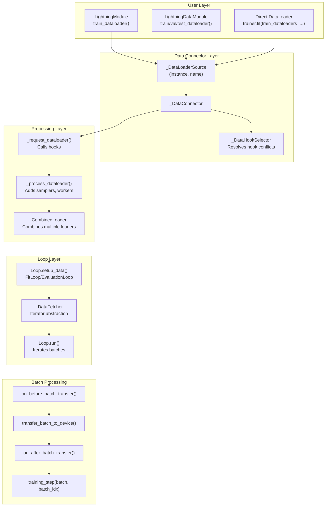
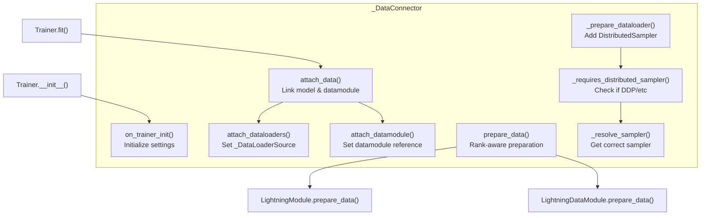
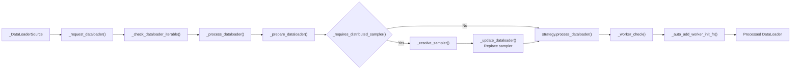
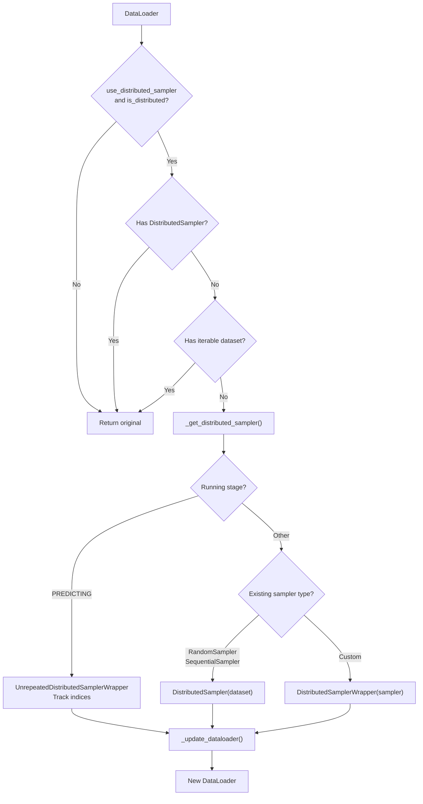
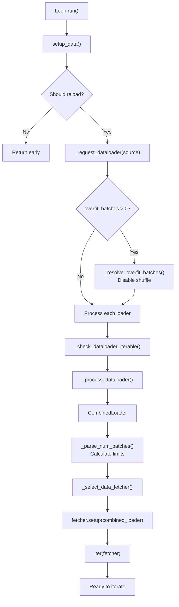
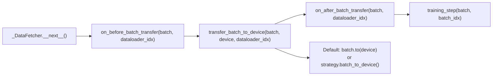
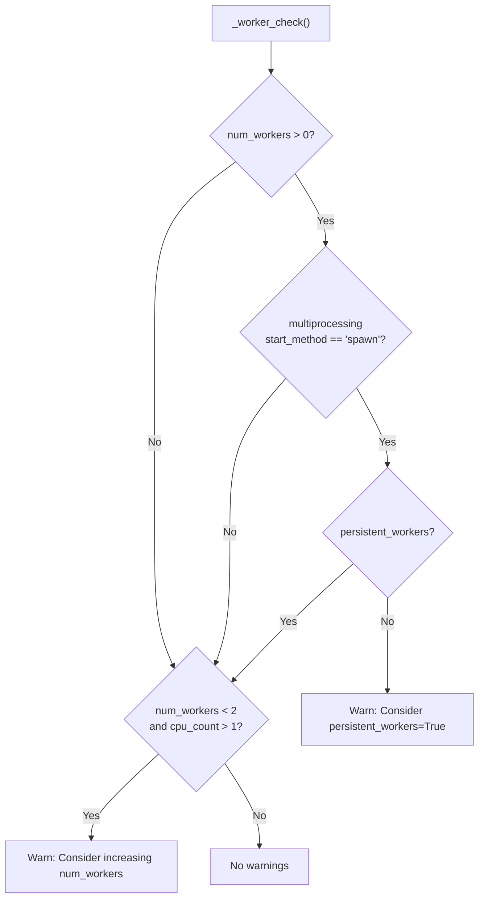

<!-- source: DeepWiki mcp.deepwiki.com · repo Lightning-AI/pytorch-lightning · page 5 Data Handling · fetched 2026-10-21 -->

# Data Handling

<details>
<summary>Relevant source files</summary>

The following files were used as context for generating this wiki page:

- [docs/source-pytorch/common/lightning_module.rst](docs/source-pytorch/common/lightning_module.rst)
- [docs/source-pytorch/common/trainer.rst](docs/source-pytorch/common/trainer.rst)
- [src/lightning/pytorch/callbacks/callback.py](src/lightning/pytorch/callbacks/callback.py)
- [src/lightning/pytorch/callbacks/device_stats_monitor.py](src/lightning/pytorch/callbacks/device_stats_monitor.py)
- [src/lightning/pytorch/core/hooks.py](src/lightning/pytorch/core/hooks.py)
- [src/lightning/pytorch/loops/evaluation_loop.py](src/lightning/pytorch/loops/evaluation_loop.py)
- [src/lightning/pytorch/loops/fetchers.py](src/lightning/pytorch/loops/fetchers.py)
- [src/lightning/pytorch/loops/fit_loop.py](src/lightning/pytorch/loops/fit_loop.py)
- [src/lightning/pytorch/loops/prediction_loop.py](src/lightning/pytorch/loops/prediction_loop.py)
- [src/lightning/pytorch/loops/training_epoch_loop.py](src/lightning/pytorch/loops/training_epoch_loop.py)
- [src/lightning/pytorch/loops/utilities.py](src/lightning/pytorch/loops/utilities.py)
- [src/lightning/pytorch/trainer/connectors/data_connector.py](src/lightning/pytorch/trainer/connectors/data_connector.py)
- [src/lightning/pytorch/trainer/trainer.py](src/lightning/pytorch/trainer/trainer.py)
- [src/lightning/pytorch/utilities/combined_loader.py](src/lightning/pytorch/utilities/combined_loader.py)
- [tests/tests_pytorch/loops/test_evaluation_loop.py](tests/tests_pytorch/loops/test_evaluation_loop.py)
- [tests/tests_pytorch/loops/test_fetchers.py](tests/tests_pytorch/loops/test_fetchers.py)
- [tests/tests_pytorch/loops/test_prediction_loop.py](tests/tests_pytorch/loops/test_prediction_loop.py)
- [tests/tests_pytorch/loops/test_training_epoch_loop.py](tests/tests_pytorch/loops/test_training_epoch_loop.py)
- [tests/tests_pytorch/models/test_hooks.py](tests/tests_pytorch/models/test_hooks.py)
- [tests/tests_pytorch/trainer/connectors/test_data_connector.py](tests/tests_pytorch/trainer/connectors/test_data_connector.py)
- [tests/tests_pytorch/trainer/flags/test_overfit_batches.py](tests/tests_pytorch/trainer/flags/test_overfit_batches.py)
- [tests/tests_pytorch/trainer/test_dataloaders.py](tests/tests_pytorch/trainer/test_dataloaders.py)
- [tests/tests_pytorch/utilities/test_combined_loader.py](tests/tests_pytorch/utilities/test_combined_loader.py)

</details>


## Purpose and Scope

This document covers how PyTorch Lightning handles data loading, preprocessing, and distribution. It explains the integration with PyTorch DataLoaders, the internal data connector system, and how batches flow from dataloaders to training/validation/test steps.

For information about specific dataloader implementations like CombinedLoader and data fetchers, see [DataLoaders and CombinedLoader](#5.1). For the LightningDataModule pattern that encapsulates data preparation logic, see [LightningDataModule](#5.2).

---

## Data Flow Architecture

The following diagram shows how data flows from user-defined sources through Lightning's internal systems to the training loop:

**Diagram: End-to-End Data Flow**



**Sources**: [src/lightning/pytorch/trainer/connectors/data_connector.py:47-514](), [src/lightning/pytorch/loops/fit_loop.py:226-323](), [src/lightning/pytorch/loops/evaluation_loop.py:155-207]()

---

## Core Components

### _DataConnector

The `_DataConnector` class is the central coordinator for all data-related operations in the Trainer. It handles dataloader attachment, preparation, and distributed sampler injection.

**Key Responsibilities**:
- Attaching dataloaders from `LightningModule` or `LightningDataModule`
- Calling `prepare_data()` hooks with proper rank coordination
- Resolving data hook precedence between module and datamodule
- Injecting distributed samplers when required
- Processing dataloaders through the strategy

**Diagram: _DataConnector Structure**



**Sources**: [src/lightning/pytorch/trainer/connectors/data_connector.py:47-228]()

### _DataLoaderSource

The `_DataLoaderSource` class stores information about where dataloaders come from - either a hook method on LightningModule/LightningDataModule or a direct instance.

```python
# Structure
@dataclass
class _DataLoaderSource:
    instance: Union[TRAIN_DATALOADERS, EVAL_DATALOADERS, LightningModule, LightningDataModule]
    name: str  # e.g., "train_dataloader", "val_dataloader"
```

**Key Methods**:
- `dataloader()`: Returns the dataloader by calling the hook or returning the instance [src/lightning/pytorch/trainer/connectors/data_connector.py:292-304]()
- `is_defined()`: Checks if the source can provide a dataloader [src/lightning/pytorch/trainer/connectors/data_connector.py:306-312]()
- `is_module()`: Returns whether the source is a LightningModule/DataModule [src/lightning/pytorch/trainer/connectors/data_connector.py:314-320]()

**Sources**: [src/lightning/pytorch/trainer/connectors/data_connector.py:272-321]()

### _DataHookSelector

The `_DataHookSelector` resolves which implementation to use when both `LightningModule` and `LightningDataModule` override the same data hook (`on_before_batch_transfer`, `transfer_batch_to_device`, `on_after_batch_transfer`).

**Priority**: `LightningDataModule` takes precedence over `LightningModule` when both are overridden, with a warning issued.

**Sources**: [src/lightning/pytorch/trainer/connectors/data_connector.py:338-383]()

---

## DataLoader Request and Processing Pipeline

The following table shows the sequence of operations when a dataloader is requested:

| Step | Function | Purpose |
|------|----------|---------|
| 1 | `_request_dataloader(source)` | Calls the appropriate hook method or returns direct instance. Captures `__init__` arguments using context manager for later re-instantiation |
| 2 | `_check_dataloader_iterable()` | Validates that the returned object is iterable |
| 3 | `_process_dataloader()` | Orchestrates sampler injection, strategy processing, and worker checks |
| 4 | `_prepare_dataloader()` | Adds distributed sampler if needed or wraps for prediction index tracking |
| 5 | `strategy.process_dataloader()` | Allows strategy to modify dataloader (e.g., for special accelerators) |
| 6 | `_worker_check()` | Warns about performance issues with num_workers settings |
| 7 | `_auto_add_worker_init_fn()` | Adds worker initialization for proper seeding |

**Sources**: [src/lightning/pytorch/trainer/connectors/data_connector.py:323-514]()

**Diagram: DataLoader Processing Pipeline**



**Sources**: [src/lightning/pytorch/trainer/connectors/data_connector.py:323-514]()

---

## Distributed Sampler Injection

Lightning automatically adds `DistributedSampler` to dataloaders when running distributed training, unless the user has already added one. This behavior can be controlled with `Trainer(use_distributed_sampler=...)`.

**Diagram: Distributed Sampler Decision Tree**



**Sources**: [src/lightning/pytorch/trainer/connectors/data_connector.py:169-244]()

**Implementation Details**:

The `_get_distributed_sampler()` function creates the appropriate sampler:
- For prediction: Uses `UnrepeatedDistributedSamplerWrapper` to track sample indices without repetition [src/lightning/pytorch/trainer/connectors/data_connector.py:240-241]()
- For `RandomSampler`/`SequentialSampler`: Creates `DistributedSampler` directly on the dataset [src/lightning/pytorch/trainer/connectors/data_connector.py:242-243]()
- For custom samplers: Wraps with `DistributedSamplerWrapper` [src/lightning/pytorch/trainer/connectors/data_connector.py:244]()

The shuffle behavior is controlled by passing `shuffle` argument based on `overfit_batches` setting [src/lightning/pytorch/trainer/connectors/data_connector.py:238]().

**Sources**: [src/lightning/pytorch/trainer/connectors/data_connector.py:230-244]()

---

## Loop Integration

Each training loop (`_FitLoop`, `_EvaluationLoop`, `_PredictionLoop`) has a `setup_data()` method that prepares dataloaders before iteration begins.

**Common Pattern**:



**Sources**: [src/lightning/pytorch/loops/fit_loop.py:226-323](), [src/lightning/pytorch/loops/evaluation_loop.py:155-207](), [src/lightning/pytorch/loops/prediction_loop.py:133-172]()

### FitLoop Data Setup

The `_FitLoop.setup_data()` method is called:
- At the start of training
- Every N epochs if `reload_dataloaders_every_n_epochs > 0`

Key operations:
1. Requests the training dataloader from the `_DataLoaderSource` [src/lightning/pytorch/loops/fit_loop.py:238]()
2. Wraps in `CombinedLoader` if not already wrapped [src/lightning/pytorch/loops/fit_loop.py:241-244]()
3. Processes each dataloader (adds samplers, workers, etc.) [src/lightning/pytorch/loops/fit_loop.py:251-256]()
4. Calculates `max_batches` considering `limit_train_batches` [src/lightning/pytorch/loops/fit_loop.py:263-270]()
5. Sets up validation interval (`val_check_batch`) [src/lightning/pytorch/loops/fit_loop.py:287-314]()
6. Creates a `_DataFetcher` and initializes the iterator [src/lightning/pytorch/loops/fit_loop.py:274-276]()

**Sources**: [src/lightning/pytorch/loops/fit_loop.py:226-323]()

### EvaluationLoop Data Setup

The `_EvaluationLoop.setup_data()` method handles validation and test dataloaders:
- Uses "sequential" mode by default for `CombinedLoader` (unlike training which uses "max_size_cycle") [src/lightning/pytorch/loops/evaluation_loop.py:181]()
- Reloads every N epochs during fitting if configured [src/lightning/pytorch/loops/evaluation_loop.py:158-173]()
- Sets sampler epoch based on training progress for proper shuffling [src/lightning/pytorch/loops/evaluation_loop.py:255]()

**Sources**: [src/lightning/pytorch/loops/evaluation_loop.py:155-207]()

---

## Batch Transfer Pipeline

Once a batch is fetched from the dataloader, it goes through three data hooks before reaching the training/validation step:

**Diagram: Batch Transfer Flow**



**Hook Purposes**:

| Hook | Purpose | Default Behavior |
|------|---------|------------------|
| `on_before_batch_transfer` | Preprocessing on the original device (e.g., data augmentation) | No-op |
| `transfer_batch_to_device` | Move batch to the target device | Calls `batch.to(device)` or delegates to strategy |
| `on_after_batch_transfer` | Preprocessing on the target device (e.g., GPU-accelerated transforms) | No-op |

**Sources**: [src/lightning/pytorch/core/hooks.py:259-316]()

### Hook Resolution

When both `LightningModule` and `LightningDataModule` override the same hook, `_DataHookSelector` determines which implementation to use:

```python
# Priority: LightningDataModule > LightningModule
def get_instance(self, hook_name: str):
    if self.datamodule is not None and is_overridden(hook_name, self.datamodule):
        return self.datamodule  # Use datamodule's implementation
    return self.model  # Fall back to model's implementation
```

A warning is issued when both override the same hook [src/lightning/pytorch/trainer/connectors/data_connector.py:370-374]().

**Sources**: [src/lightning/pytorch/trainer/connectors/data_connector.py:338-383]()

---

## Batch Limiting and Parsing

Lightning supports limiting the number of batches processed via `limit_train_batches`, `limit_val_batches`, `limit_test_batches`, and `limit_predict_batches`. These can be:
- **Integer**: Exact number of batches per dataloader
- **Float (0.0-1.0)**: Fraction of total batches
- **Special value 0**: Disable that loop entirely

The `_parse_num_batches()` function converts these settings to actual batch counts:

| Input Type | DataLoader Length | Result |
|------------|-------------------|---------|
| `int` | Any | `min(length, limit_batches)` |
| `float` | Known (map-style) | `int(length * limit_batches)` |
| `float` | Unknown (iterable) | Requires limit to be `1.0` or raises error |

**Edge Case Handling**:
- If `limit_batches * length < 1`, raises error suggesting minimum percentage [src/lightning/pytorch/trainer/connectors/data_connector.py:467-474]()
- For iterable datasets with float limits, only `1.0` is allowed [src/lightning/pytorch/trainer/connectors/data_connector.py:462-465]()

**Sources**: [src/lightning/pytorch/trainer/connectors/data_connector.py:449-476]()

---

## Overfit Batches Mode

When `Trainer(overfit_batches=...)` is set, Lightning ensures consistent batches by:
1. Disabling shuffling on all dataloaders [src/lightning/pytorch/trainer/connectors/data_connector.py:260-263]()
2. Replacing shuffled samplers with `SequentialSampler` [src/lightning/pytorch/trainer/connectors/data_connector.py:265-269]()
3. Using the same batches for both training and validation [src/lightning/pytorch/trainer/connectors/data_connector.py:247-269]()

**Note**: Training and validation use **different subsets** of data. They don't overlap.

**Sources**: [src/lightning/pytorch/trainer/connectors/data_connector.py:247-269]()

---

## DataLoader Reloading

Lightning supports reloading dataloaders during training via `Trainer(reload_dataloaders_every_n_epochs=N)`. This is useful for:
- Updating training data (e.g., curriculum learning)
- Re-shuffling with new random state
- Changing dataset composition

**Implementation**:
- `_FitLoop` tracks the last reload epoch in `_last_train_dl_reload_epoch` [src/lightning/pytorch/loops/fit_loop.py:110]()
- Checks if reload is needed via `_should_reload_train_dl` property [src/lightning/pytorch/loops/fit_loop.py:167-170]()
- Validation dataloaders can also reload every N epochs [src/lightning/pytorch/loops/evaluation_loop.py:109-112]()

**Warning**: Using `persistent_workers=True` with `pin_memory=True` and reloading can cause instability [src/lightning/pytorch/trainer/connectors/data_connector.py:440-446]().

**Sources**: [src/lightning/pytorch/loops/fit_loop.py:167-170](), [src/lightning/pytorch/trainer/connectors/data_connector.py:440-446]()

---

## Worker Configuration and Warnings

Lightning provides helpful warnings for dataloader worker configuration:

**Diagram: Worker Check Logic**



**Key Warnings**:
1. **Spawn + non-persistent workers**: Recommend `persistent_workers=True` to avoid repeated initialization overhead [src/lightning/pytorch/trainer/connectors/data_connector.py:428-431]()
2. **Low worker count**: Suggest increasing `num_workers` based on `suggested_max_num_workers()` [src/lightning/pytorch/trainer/connectors/data_connector.py:432-438]()
3. **Persistent + pin_memory + reloading**: Warn about PyTorch instability [src/lightning/pytorch/trainer/connectors/data_connector.py:440-446]()

**Sources**: [src/lightning/pytorch/trainer/connectors/data_connector.py:417-447]()

---

## Automatic Sampler Epoch Setting

For proper shuffling across epochs, Lightning automatically calls `set_epoch()` on samplers that support it (e.g., `DistributedSampler`). This is done via `_set_sampler_epoch()` which is called:

- At the start of each training epoch [src/lightning/pytorch/loops/fit_loop.py:441]()
- Before validation during fitting [src/lightning/pytorch/loops/evaluation_loop.py:255]()
- For test/predict if not during fitting [src/lightning/pytorch/trainer/connectors/data_connector.py:509-511]()

This ensures different shuffling across epochs in distributed training while maintaining reproducibility with proper seeding.

**Sources**: [src/lightning/pytorch/loops/fit_loop.py:438-441](), [src/lightning/pytorch/loops/evaluation_loop.py:255]()

---

## Key Implementation Classes

| Class | File | Purpose |
|-------|------|---------|
| `_DataConnector` | [src/lightning/pytorch/trainer/connectors/data_connector.py:47-228]() | Main coordinator for dataloader management |
| `_DataLoaderSource` | [src/lightning/pytorch/trainer/connectors/data_connector.py:272-321]() | Stores dataloader source information |
| `_DataHookSelector` | [src/lightning/pytorch/trainer/connectors/data_connector.py:338-383]() | Resolves hook conflicts between module and datamodule |
| `CombinedLoader` | [src/lightning/pytorch/utilities/combined_loader.py:220-555]() | Combines multiple dataloaders with different iteration modes |
| `_DataFetcher` | [src/lightning/pytorch/loops/fetchers.py:29-83]() | Base class for iterating over combined loaders |
| `_PrefetchDataFetcher` | [src/lightning/pytorch/loops/fetchers.py:86-166]() | Prefetches batches for performance |
| `_DataLoaderIterDataFetcher` | [src/lightning/pytorch/loops/fetchers.py:169-229]() | Exposes dataloader iterator directly to step methods |

**Sources**: Files listed in table above

---

