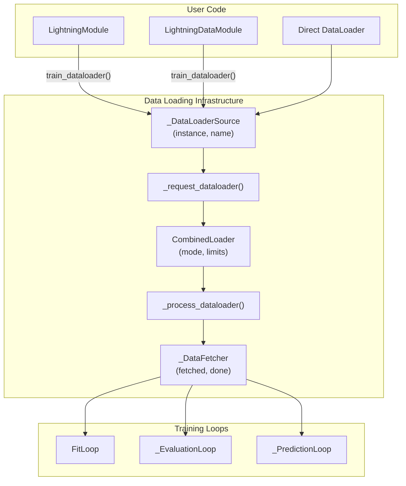
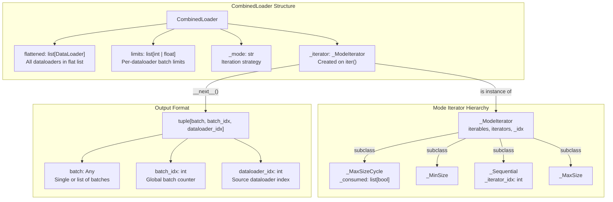
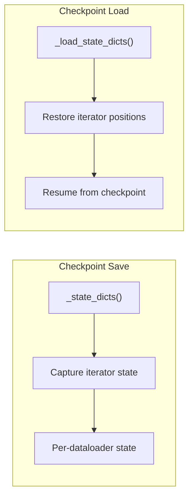
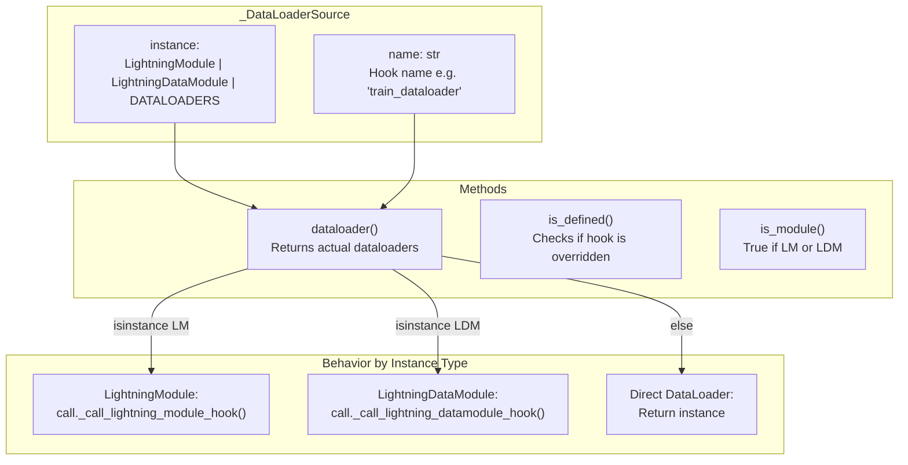
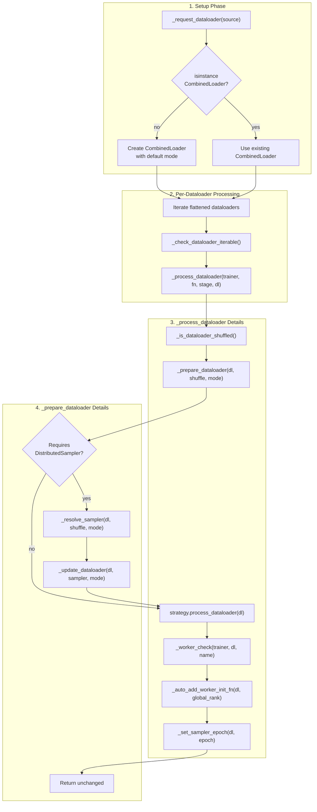
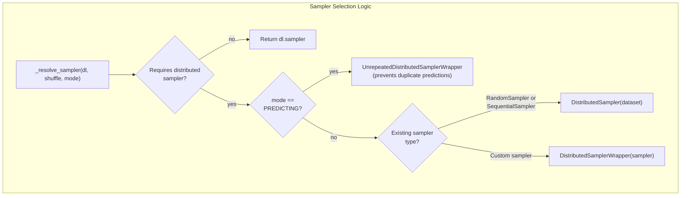
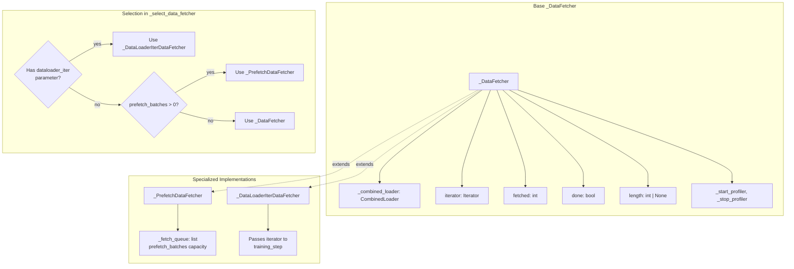
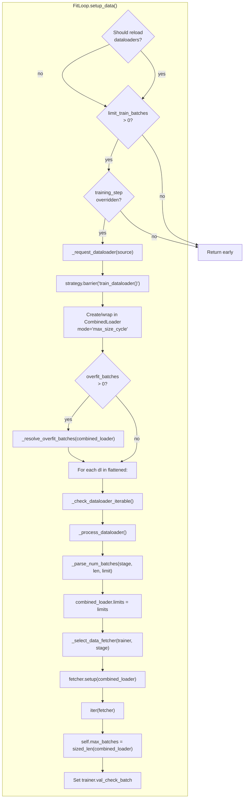
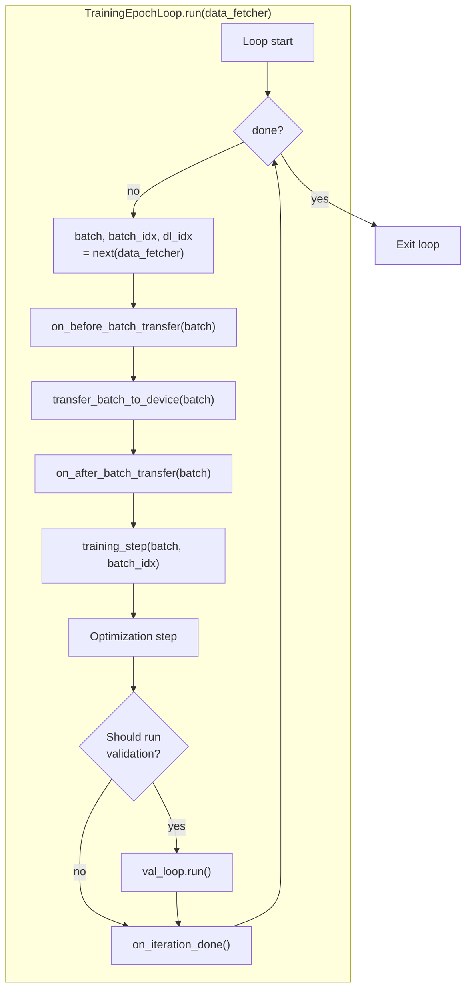

<!-- source: DeepWiki mcp.deepwiki.com · repo Lightning-AI/pytorch-lightning · page 5.1 DataLoaders and CombinedLoader · fetched 2026-10-21 -->

# DataLoaders and CombinedLoader

<details>
<summary>Relevant source files</summary>

The following files were used as context for generating this wiki page:

- [docs/source-pytorch/common/lightning_module.rst](docs/source-pytorch/common/lightning_module.rst)
- [docs/source-pytorch/common/trainer.rst](docs/source-pytorch/common/trainer.rst)
- [src/lightning/pytorch/callbacks/callback.py](src/lightning/pytorch/callbacks/callback.py)
- [src/lightning/pytorch/callbacks/device_stats_monitor.py](src/lightning/pytorch/callbacks/device_stats_monitor.py)
- [src/lightning/pytorch/core/hooks.py](src/lightning/pytorch/core/hooks.py)
- [src/lightning/pytorch/loops/evaluation_loop.py](src/lightning/pytorch/loops/evaluation_loop.py)
- [src/lightning/pytorch/loops/fetchers.py](src/lightning/pytorch/loops/fetchers.py)
- [src/lightning/pytorch/loops/fit_loop.py](src/lightning/pytorch/loops/fit_loop.py)
- [src/lightning/pytorch/loops/prediction_loop.py](src/lightning/pytorch/loops/prediction_loop.py)
- [src/lightning/pytorch/loops/training_epoch_loop.py](src/lightning/pytorch/loops/training_epoch_loop.py)
- [src/lightning/pytorch/loops/utilities.py](src/lightning/pytorch/loops/utilities.py)
- [src/lightning/pytorch/trainer/connectors/data_connector.py](src/lightning/pytorch/trainer/connectors/data_connector.py)
- [src/lightning/pytorch/trainer/trainer.py](src/lightning/pytorch/trainer/trainer.py)
- [src/lightning/pytorch/utilities/combined_loader.py](src/lightning/pytorch/utilities/combined_loader.py)
- [tests/tests_pytorch/loops/test_evaluation_loop.py](tests/tests_pytorch/loops/test_evaluation_loop.py)
- [tests/tests_pytorch/loops/test_fetchers.py](tests/tests_pytorch/loops/test_fetchers.py)
- [tests/tests_pytorch/loops/test_prediction_loop.py](tests/tests_pytorch/loops/test_prediction_loop.py)
- [tests/tests_pytorch/loops/test_training_epoch_loop.py](tests/tests_pytorch/loops/test_training_epoch_loop.py)
- [tests/tests_pytorch/models/test_hooks.py](tests/tests_pytorch/models/test_hooks.py)
- [tests/tests_pytorch/trainer/connectors/test_data_connector.py](tests/tests_pytorch/trainer/connectors/test_data_connector.py)
- [tests/tests_pytorch/trainer/flags/test_overfit_batches.py](tests/tests_pytorch/trainer/flags/test_overfit_batches.py)
- [tests/tests_pytorch/trainer/test_dataloaders.py](tests/tests_pytorch/trainer/test_dataloaders.py)
- [tests/tests_pytorch/utilities/test_combined_loader.py](tests/tests_pytorch/utilities/test_combined_loader.py)

</details>


## Purpose and Scope

This page documents PyTorch Lightning's data loading infrastructure, focusing on the `CombinedLoader` class that handles multiple dataloaders simultaneously, the `_DataFetcher` abstraction for batch iteration, and the `_DataConnector` that manages dataloader setup and processing. This covers how dataloaders integrate with training, validation, testing, and prediction loops.

For information about organizing data loading logic using the LightningDataModule pattern, see [LightningDataModule](#5.2).

## Overview

Lightning's data loading system consists of several interconnected components:

1. **CombinedLoader** - Unifies multiple dataloaders into a single iterable with configurable iteration strategies
2. **_DataLoaderSource** - Tracks dataloader origin (LightningModule, LightningDataModule, or direct instance)
3. **_DataFetcher** - Abstracts batch iteration with optional prefetching and profiling hooks
4. **_DataConnector** - Orchestrates dataloader setup, distributed sampler injection, and processing



**Sources:** [src/lightning/pytorch/utilities/combined_loader.py:238-518](), [src/lightning/pytorch/trainer/connectors/data_connector.py:47-383](), [src/lightning/pytorch/loops/fetchers.py:29-164]()

## CombinedLoader

### Purpose and Iteration Modes

The `CombinedLoader` class [src/lightning/pytorch/utilities/combined_loader.py:238-518]() provides a unified interface for iterating over single or multiple dataloaders. It supports four iteration modes:

| Mode | Class | Behavior | Typical Use |
|------|-------|----------|-------------|
| `"max_size_cycle"` | `_MaxSizeCycle` | Cycles through shorter loaders until longest completes | Training (default) |
| `"min_size"` | `_MinSize` | Stops when shortest loader exhausts | Memory-constrained training |
| `"sequential"` | `_Sequential` | Iterates loaders one after another | Validation/testing |
| `"max_size"` | `_MaxSize` | Stops when longest completes (no cycling) | Fixed-length iteration |

**Sources:** [src/lightning/pytorch/utilities/combined_loader.py:28-226](), [tests/tests_pytorch/utilities/test_combined_loader.py:44-149]()

### Architecture and Components



**Sources:** [src/lightning/pytorch/utilities/combined_loader.py:238-395](), [src/lightning/pytorch/utilities/combined_loader.py:28-226]()

### Initialization and Flattening

The `CombinedLoader` constructor [src/lightning/pytorch/utilities/combined_loader.py:265-321]() accepts:

- Single `DataLoader`
- List of dataloaders: `[dl1, dl2, ...]`
- Dictionary of dataloaders: `{"train": dl1, "val": dl2}`
- Nested structures (automatically flattened)

The `_flatten_loaders()` method [src/lightning/pytorch/utilities/combined_loader.py:358-395]() recursively flattens nested structures into a single list stored in `flattened`.

**Example:**
```python
# Single loader
combined = CombinedLoader(train_dataloader)

# Multiple loaders with mode
combined = CombinedLoader([train_dl1, train_dl2], mode="min_size")

# Dict of loaders
combined = CombinedLoader({"a": dl1, "b": dl2}, mode="sequential")
```

**Sources:** [src/lightning/pytorch/utilities/combined_loader.py:265-395](), [tests/tests_pytorch/utilities/test_combined_loader.py:53-80]()

### Iterator Implementations

#### _MaxSizeCycle

The `_MaxSizeCycle` iterator [src/lightning/pytorch/utilities/combined_loader.py:67-107]() implements cycling behavior:

1. Maintains `_consumed` boolean list tracking exhausted dataloaders
2. When a dataloader exhausts, marks it consumed and resets its iterator
3. Continues until all dataloaders have been consumed at least once
4. Returns combined batch from all dataloaders as list

**Sources:** [src/lightning/pytorch/utilities/combined_loader.py:67-107]()

#### _MinSize

The `_MinSize` iterator [src/lightning/pytorch/utilities/combined_loader.py:109-121]() stops at the shortest dataloader:

```python
def __next__(self):
    out = [next(it) for it in self.iterators]  # Raises StopIteration when any exhausts
    index = self._idx
    self._idx += 1
    return out, index, 0
```

**Sources:** [src/lightning/pytorch/utilities/combined_loader.py:109-121]()

#### _Sequential

The `_Sequential` iterator [src/lightning/pytorch/utilities/combined_loader.py:123-166]() processes dataloaders sequentially:

1. Tracks current dataloader with `_iterator_idx`
2. When current iterator exhausts, moves to next dataloader
3. Returns `dataloader_idx` to identify source dataloader
4. Used by default in validation and testing loops

**Sources:** [src/lightning/pytorch/utilities/combined_loader.py:123-166]()

### State Management

`CombinedLoader` implements the `_Stateful` protocol [src/lightning/pytorch/utilities/combined_loader.py:439-459]():



The `_state_dicts()` method [src/lightning/pytorch/utilities/combined_loader.py:439-449]() captures:
- Iterator state for each dataloader
- Current batch index position
- Mode iterator internal state

**Sources:** [src/lightning/pytorch/utilities/combined_loader.py:439-459](), [tests/tests_pytorch/utilities/test_combined_loader.py:369-429]()

## DataLoader Source Management

### _DataLoaderSource Dataclass

The `_DataLoaderSource` dataclass [src/lightning/pytorch/trainer/connectors/data_connector.py:272-321]() encapsulates dataloader origin:



**Sources:** [src/lightning/pytorch/trainer/connectors/data_connector.py:272-321]()

### Requesting Dataloaders

The `_request_dataloader()` function [src/lightning/pytorch/trainer/connectors/data_connector.py:323-336]() retrieves dataloaders with special handling:

```python
def _request_dataloader(data_source: _DataLoaderSource):
    with _replace_dunder_methods(DataLoader, "dataset"), _replace_dunder_methods(BatchSampler):
        # Captures __init__ arguments for later reconstruction
        return data_source.dataloader()
```

The context manager [src/lightning/pytorch/trainer/connectors/data_connector.py:330-335]() patches `DataLoader` to capture initialization parameters, enabling later reconstruction with modified samplers.

**Sources:** [src/lightning/pytorch/trainer/connectors/data_connector.py:323-336]()

## Data Connector Processing Pipeline

### Complete Processing Flow



**Sources:** [src/lightning/pytorch/loops/fit_loop.py:226-276](), [src/lightning/pytorch/trainer/connectors/data_connector.py:478-514](), [src/lightning/pytorch/trainer/connectors/data_connector.py:177-228]()

### Distributed Sampler Injection

The `_prepare_dataloader()` method [src/lightning/pytorch/trainer/connectors/data_connector.py:177-194]() conditionally adds distributed sampling:

**Conditions requiring `DistributedSampler`:**
- `use_distributed_sampler=True` (from `Trainer`)
- Strategy is distributed (`is_distributed=True`)
- DataLoader doesn't already have `DistributedSampler`
- Dataset is not iterable-style

**For prediction stage:** Always checks to enable batch index tracking via `_IndexBatchSamplerWrapper`.

**Sources:** [src/lightning/pytorch/trainer/connectors/data_connector.py:169-194](), [src/lightning/pytorch/trainer/connectors/data_connector.py:478-514]()

### Sampler Resolution Strategy

The `_resolve_sampler()` method [src/lightning/pytorch/trainer/connectors/data_connector.py:196-228]() creates appropriate samplers:



**Sources:** [src/lightning/pytorch/trainer/connectors/data_connector.py:196-228](), [src/lightning/pytorch/trainer/connectors/data_connector.py:230-245]()

### DataLoader Reconstruction

The `_update_dataloader()` function reconstructs `DataLoader` instances with new samplers while preserving:

- Custom `DataLoader` subclass type
- All initialization arguments captured during `_request_dataloader()`
- Custom attributes set after construction
- Multiprocessing context settings

**Important:** Validation checks ensure required parameters exist in custom `DataLoader` subclasses [tests/tests_pytorch/trainer/connectors/test_data_connector.py:189-250]().

**Sources:** [src/lightning/pytorch/utilities/data.py](), [tests/tests_pytorch/trainer/connectors/test_data_connector.py:189-336]()

## Data Fetchers

### Fetcher Architecture



**Sources:** [src/lightning/pytorch/loops/fetchers.py:29-164](), [src/lightning/pytorch/loops/utilities.py:135-157]()

### _DataFetcher Base Class

The `_DataFetcher` [src/lightning/pytorch/loops/fetchers.py:29-74]() provides core iteration functionality:

**Key methods:**
- `setup(combined_loader)` - Associates with a `CombinedLoader` [src/lightning/pytorch/loops/fetchers.py:47-48]()
- `__iter__()` - Creates iterator and resets state [src/lightning/pytorch/loops/fetchers.py:51-54]()
- `__next__()` - Fetches next batch, updates `fetched` counter, sets `done` flag [src/lightning/pytorch/loops/fetchers.py:57-68]()
- `reset()` - Resets counters without recreating iterator [src/lightning/pytorch/loops/fetchers.py:70-72]()
- `teardown()` - Cleanup for iterator [src/lightning/pytorch/loops/fetchers.py:74]()

**Return format:** Each `__next__()` call returns `(batch, batch_idx, dataloader_idx)`.

**Sources:** [src/lightning/pytorch/loops/fetchers.py:29-74]()

### _PrefetchDataFetcher

The `_PrefetchDataFetcher` [src/lightning/pytorch/loops/fetchers.py:77-120]() implements prefetching for performance:

**Mechanism:**
1. Maintains `_fetch_queue` of size `prefetch_batches` [src/lightning/pytorch/loops/fetchers.py:80-81]()
2. Pre-populates queue in `__iter__()` before first yield [src/lightning/pytorch/loops/fetchers.py:92-97]()
3. On each `__next__()`, yields from queue and immediately fetches next batch [src/lightning/pytorch/loops/fetchers.py:99-117]()

**Benefit:** Overlaps data loading with model computation, reducing idle time.

**Configuration:** Set via `Trainer(prefetch_batches=N)` where `N > 0`.

**Sources:** [src/lightning/pytorch/loops/fetchers.py:77-120](), [tests/tests_pytorch/loops/test_fetchers.py:48-100]()

### _DataLoaderIterDataFetcher

When a step function includes `dataloader_iter` parameter, `_DataLoaderIterDataFetcher` [src/lightning/pytorch/loops/fetchers.py:123-164]() passes the iterator directly:

```python
class MyModel(LightningModule):
    def training_step(self, batch, batch_idx, dataloader_iter):
        # User has full control over iteration
        batch = next(dataloader_iter)
        # Can fetch multiple batches, skip batches, etc.
        return loss
```

**Implementation:**
- Yields the iterator itself rather than batches
- User code manually calls `next(dataloader_iter)`
- Batch and dataloader index tracked internally but not guaranteed accurate

**Use cases:**
- Custom batch aggregation
- Variable batch sizes per step
- Conditional batch skipping

**Sources:** [src/lightning/pytorch/loops/fetchers.py:123-164](), [src/lightning/pytorch/loops/utilities.py:135-157]()

## Integration with Training Loops

### FitLoop DataLoader Setup



**Sources:** [src/lightning/pytorch/loops/fit_loop.py:226-323]()

### EvaluationLoop DataLoader Setup

The `_EvaluationLoop` [src/lightning/pytorch/loops/evaluation_loop.py:155-210]() sets up dataloaders with sequential mode:

**Key differences from training:**
1. Uses `mode="sequential"` by default [src/lightning/pytorch/loops/evaluation_loop.py:180-183]()
2. Processes each dataloader independently
3. Stores results per dataloader using `dataloader_idx`
4. Checks validation step override before setup [src/lightning/pytorch/loops/evaluation_loop.py:164]()

**Sources:** [src/lightning/pytorch/loops/evaluation_loop.py:155-210]()

### Batch Iteration in Loops



**Sources:** [src/lightning/pytorch/loops/training_epoch_loop.py:148-403]()

## Special Features and Configuration

### Overfit Batches Mode

The `_resolve_overfit_batches()` function [src/lightning/pytorch/trainer/connectors/data_connector.py:247-270]() implements overfitting mode:

**Behavior:**
1. Checks if all dataloaders have `SequentialSampler` [src/lightning/pytorch/trainer/connectors/data_connector.py:254-258]()
2. If not, replaces samplers with `SequentialSampler(dataset)` [src/lightning/pytorch/trainer/connectors/data_connector.py:265-269]()
3. Warns user that shuffling has been disabled [src/lightning/pytorch/trainer/connectors/data_connector.py:260-263]()

**Result:** Consistent batches across epochs, training and validation use different data subsets.

**Sources:** [src/lightning/pytorch/trainer/connectors/data_connector.py:247-270](), [tests/tests_pytorch/trainer/flags/test_overfit_batches.py:30-132]()

### Reload Dataloaders Every N Epochs

**Tracking mechanism:**
- `FitLoop._last_train_dl_reload_epoch` [src/lightning/pytorch/loops/fit_loop.py:110]()
- `_EvaluationLoop._last_val_dl_reload_epoch` [src/lightning/pytorch/loops/evaluation_loop.py:84]()

**Reload condition:**
```python
n_epochs = trainer.reload_dataloaders_every_n_epochs
should_reload = (n_epochs and 
                 current_epoch - last_reload_epoch >= n_epochs)
```

**Triggered in:** Loop's `setup_data()` method [src/lightning/pytorch/loops/fit_loop.py:167-171](), [src/lightning/pytorch/loops/evaluation_loop.py:109-113]()

**Sources:** [src/lightning/pytorch/loops/fit_loop.py:167-171](), [src/lightning/pytorch/loops/evaluation_loop.py:109-113]()

### Worker Initialization and Seeding

The `_auto_add_worker_init_fn()` function [src/lightning/pytorch/trainer/connectors/data_connector.py:507]() ensures deterministic behavior:

**Functionality:**
- Assigns unique seed to each DataLoader worker process
- Seeds based on worker ID and global rank
- Chains with user-provided `worker_init_fn` if present

**Purpose:** Prevents duplicate data augmentations when using multiple workers.

**Sources:** [src/lightning/pytorch/trainer/connectors/data_connector.py:507](), [docs/source-pytorch/common/trainer.rst:164-167]()

### Worker Performance Warnings

The `_worker_check()` function [src/lightning/pytorch/trainer/connectors/data_connector.py:417-447]() emits performance warnings:

| Condition | Warning |
|-----------|---------|
| `num_workers < 2` on multi-core system | "Consider increasing the value of the `num_workers` argument" |
| `num_workers > 0` with spawn context, no `persistent_workers` | "Consider setting `persistent_workers=True`" |
| `persistent_workers=True` + `pin_memory=True` + `reload_dataloaders_every_n_epochs > 0` | Potential PyTorch instability warning |

**Sources:** [src/lightning/pytorch/trainer/connectors/data_connector.py:417-447](), [tests/tests_pytorch/trainer/connectors/test_data_connector.py:126-182]()

## Batch Limit Configuration

### Limit Parsing Logic

The `_parse_num_batches()` function [src/lightning/pytorch/trainer/connectors/data_connector.py:449-476]() processes `limit_*_batches` parameters:

**Integer limits:** Use exactly N batches
```python
limit_train_batches=100  # Use 100 batches
num_batches = min(dataloader_length, 100)
```

**Float limits (0.0-1.0):** Use fraction of total
```python
limit_val_batches=0.25  # Use 25% of batches
num_batches = int(dataloader_length * 0.25)
```

**Validation:** For iterable datasets, only integers and 1.0 allowed [src/lightning/pytorch/trainer/connectors/data_connector.py:461-465]()

**Sources:** [src/lightning/pytorch/trainer/connectors/data_connector.py:449-476]()

### Multiple Dataloader Limits

When using multiple dataloaders, limits are applied **per dataloader individually**:

```python
# Each dataloader gets its own limit
combined_loader.limits = [
    _parse_num_batches(stage, len(dl1), limit),
    _parse_num_batches(stage, len(dl2), limit),
]
```

This ensures consistent behavior regardless of iteration mode.

**Sources:** [src/lightning/pytorch/loops/fit_loop.py:263-270](), [src/lightning/pytorch/loops/evaluation_loop.py:200-206]()

## Multiple Dataloaders Usage

### Configuration Patterns

**Training - List:**
```python
class MyModel(LightningModule):
    def train_dataloader(self):
        return [dataloader1, dataloader2]
```

**Validation/Test - Dictionary:**
```python
class MyModel(LightningModule):
    def val_dataloader(self):
        return {"dataset_a": val_dl_a, "dataset_b": val_dl_b}
    
    def validation_step(self, batch, batch_idx, dataloader_idx):
        # dataloader_idx identifies source
        pass
```

**Sources:** [tests/tests_pytorch/trainer/test_dataloaders.py:47-64](), [docs/source-pytorch/common/lightning_module.rst:267-343]()

### Dataloader Index Behavior

The `dataloader_idx` parameter behavior varies by mode:

| Mode | `dataloader_idx` Behavior |
|------|---------------------------|
| `max_size_cycle` | Always 0 (batches combined into list) |
| `sequential` | Increments per dataloader (0, 1, 2, ...) |
| `min_size` | Always 0 (batches combined) |
| `max_size` | Always 0 (batches combined) |

**Sources:** [src/lightning/pytorch/utilities/combined_loader.py:67-166](), [src/lightning/pytorch/loops/evaluation_loop.py:129-152]()

## Key Classes and Functions Reference

| Entity | Location | Purpose |
|--------|----------|---------|
| `CombinedLoader` | [src/lightning/pytorch/utilities/combined_loader.py:238-518]() | Unified interface for multiple dataloaders |
| `_ModeIterator` | [src/lightning/pytorch/utilities/combined_loader.py:28-64]() | Base class for iteration strategies |
| `_MaxSizeCycle` | [src/lightning/pytorch/utilities/combined_loader.py:67-107]() | Cycles shorter loaders |
| `_Sequential` | [src/lightning/pytorch/utilities/combined_loader.py:123-166]() | Sequential iteration |
| `_DataLoaderSource` | [src/lightning/pytorch/trainer/connectors/data_connector.py:272-321]() | Tracks dataloader origin |
| `_DataConnector` | [src/lightning/pytorch/trainer/connectors/data_connector.py:47-228]() | Manages dataloader setup |
| `_DataFetcher` | [src/lightning/pytorch/loops/fetchers.py:29-74]() | Base batch iteration |
| `_PrefetchDataFetcher` | [src/lightning/pytorch/loops/fetchers.py:77-120]() | Batch prefetching |
| `_DataLoaderIterDataFetcher` | [src/lightning/pytorch/loops/fetchers.py:123-164]() | Iterator passthrough |
| `_request_dataloader()` | [src/lightning/pytorch/trainer/connectors/data_connector.py:323-336]() | Retrieves dataloaders from source |
| `_process_dataloader()` | [src/lightning/pytorch/trainer/connectors/data_connector.py:478-514]() | Prepares dataloader for training |
| `_prepare_dataloader()` | [src/lightning/pytorch/trainer/connectors/data_connector.py:177-194]() | Injects distributed sampler |
| `_resolve_sampler()` | [src/lightning/pytorch/trainer/connectors/data_connector.py:196-228]() | Creates appropriate sampler |
| `_parse_num_batches()` | [src/lightning/pytorch/trainer/connectors/data_connector.py:449-476]() | Processes batch limits |
| `_resolve_overfit_batches()` | [src/lightning/pytorch/trainer/connectors/data_connector.py:247-270]() | Configures overfit mode |
| `_worker_check()` | [src/lightning/pytorch/trainer/connectors/data_connector.py:417-447]() | Performance warnings |
| `_select_data_fetcher()` | [src/lightning/pytorch/loops/utilities.py:135-157]() | Chooses fetcher implementation |

**Sources:** All locations listed in table above

---

