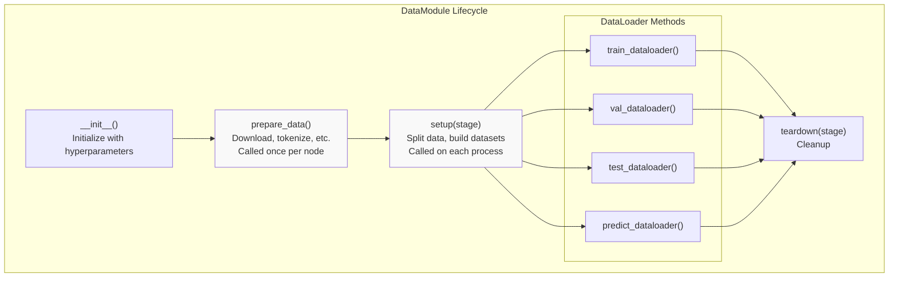
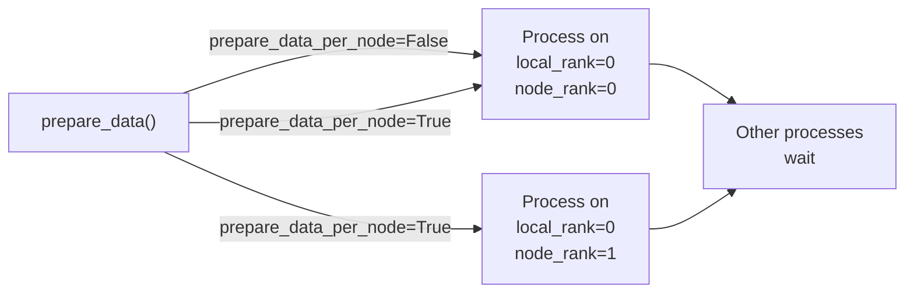
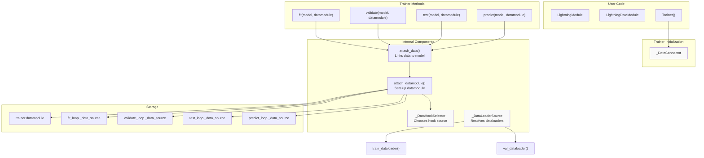
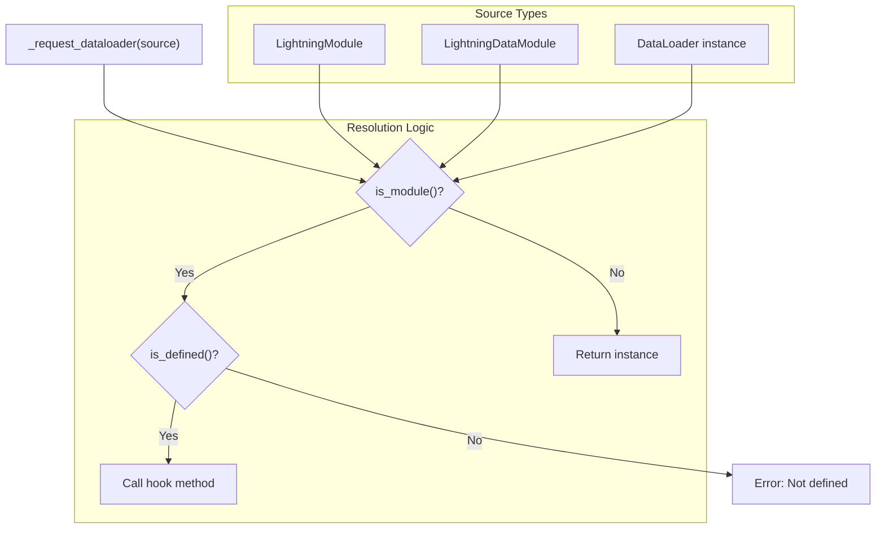
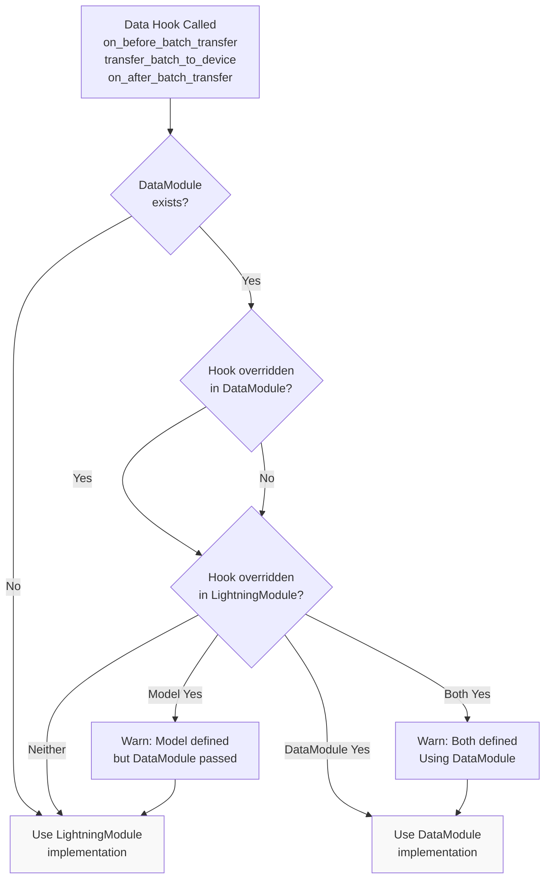
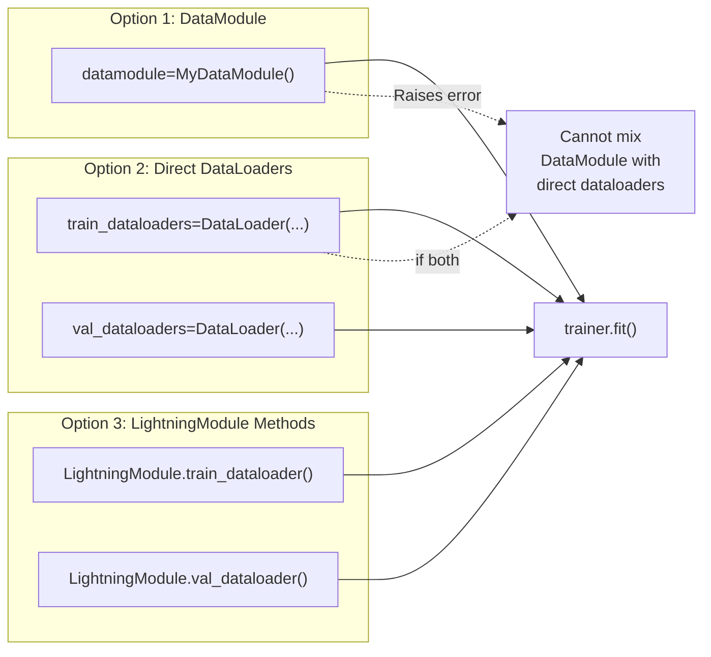
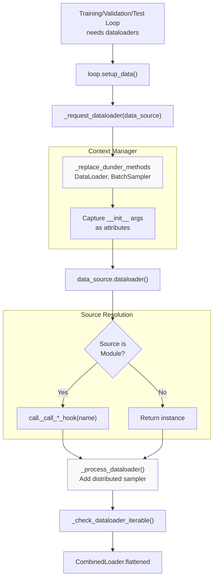
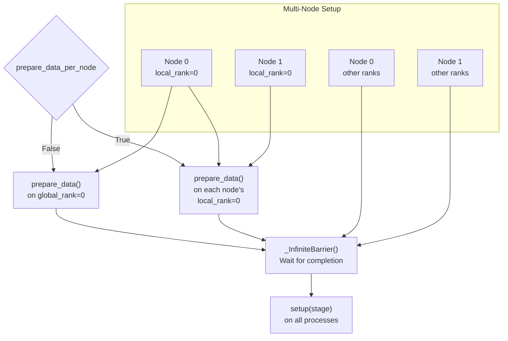
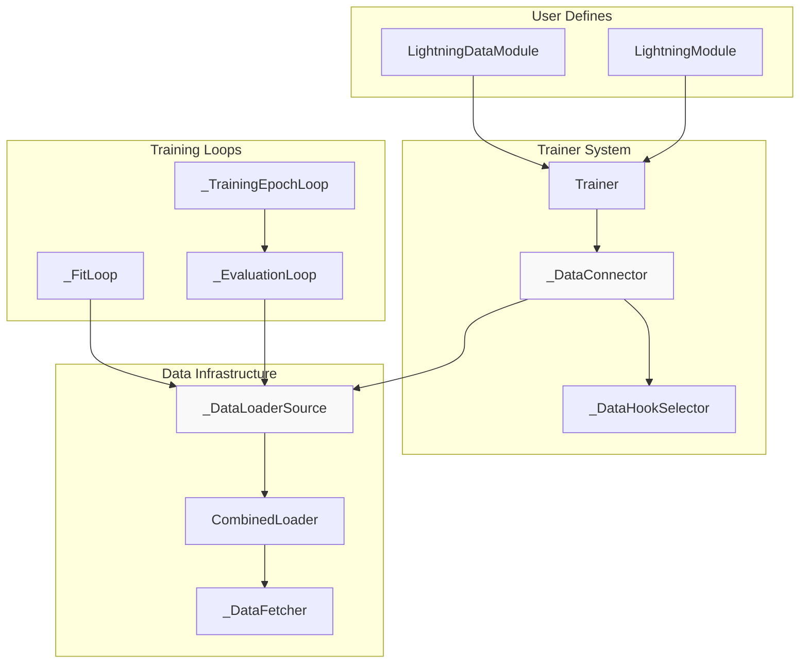

<!-- source: DeepWiki mcp.deepwiki.com · repo Lightning-AI/pytorch-lightning · page 5.2 LightningDataModule · fetched 2026-10-21 -->

# LightningDataModule

<details>
<summary>Relevant source files</summary>

The following files were used as context for generating this wiki page:

- [README.md](README.md)
- [docs/source-pytorch/common/lightning_module.rst](docs/source-pytorch/common/lightning_module.rst)
- [docs/source-pytorch/common/trainer.rst](docs/source-pytorch/common/trainer.rst)
- [src/lightning/pytorch/callbacks/callback.py](src/lightning/pytorch/callbacks/callback.py)
- [src/lightning/pytorch/callbacks/device_stats_monitor.py](src/lightning/pytorch/callbacks/device_stats_monitor.py)
- [src/lightning/pytorch/core/hooks.py](src/lightning/pytorch/core/hooks.py)
- [src/lightning/pytorch/loops/evaluation_loop.py](src/lightning/pytorch/loops/evaluation_loop.py)
- [src/lightning/pytorch/loops/fetchers.py](src/lightning/pytorch/loops/fetchers.py)
- [src/lightning/pytorch/loops/fit_loop.py](src/lightning/pytorch/loops/fit_loop.py)
- [src/lightning/pytorch/loops/prediction_loop.py](src/lightning/pytorch/loops/prediction_loop.py)
- [src/lightning/pytorch/loops/training_epoch_loop.py](src/lightning/pytorch/loops/training_epoch_loop.py)
- [src/lightning/pytorch/loops/utilities.py](src/lightning/pytorch/loops/utilities.py)
- [src/lightning/pytorch/trainer/connectors/data_connector.py](src/lightning/pytorch/trainer/connectors/data_connector.py)
- [src/lightning/pytorch/trainer/trainer.py](src/lightning/pytorch/trainer/trainer.py)
- [src/lightning/pytorch/utilities/combined_loader.py](src/lightning/pytorch/utilities/combined_loader.py)
- [tests/tests_pytorch/loops/test_evaluation_loop.py](tests/tests_pytorch/loops/test_evaluation_loop.py)
- [tests/tests_pytorch/loops/test_fetchers.py](tests/tests_pytorch/loops/test_fetchers.py)
- [tests/tests_pytorch/loops/test_prediction_loop.py](tests/tests_pytorch/loops/test_prediction_loop.py)
- [tests/tests_pytorch/loops/test_training_epoch_loop.py](tests/tests_pytorch/loops/test_training_epoch_loop.py)
- [tests/tests_pytorch/models/test_hooks.py](tests/tests_pytorch/models/test_hooks.py)
- [tests/tests_pytorch/trainer/connectors/test_data_connector.py](tests/tests_pytorch/trainer/connectors/test_data_connector.py)
- [tests/tests_pytorch/trainer/flags/test_overfit_batches.py](tests/tests_pytorch/trainer/flags/test_overfit_batches.py)
- [tests/tests_pytorch/trainer/test_dataloaders.py](tests/tests_pytorch/trainer/test_dataloaders.py)
- [tests/tests_pytorch/utilities/test_combined_loader.py](tests/tests_pytorch/utilities/test_combined_loader.py)

</details>


## Purpose and Scope

This document describes the `LightningDataModule` class, which provides a standardized pattern for encapsulating all data preparation, downloading, splitting, and loading logic in PyTorch Lightning. The `LightningDataModule` separates data-related code from model code, enabling reusability and cleaner organization.

For information about how dataloaders are combined and iterated, see [DataLoaders and CombinedLoader](#5.1). For details about the Trainer orchestration system, see [Trainer](#2.3).

---

## Overview

`LightningDataModule` is an organizational abstraction that groups all data-handling logic into a single reusable class. It defines hooks for data preparation and methods for creating dataloaders, keeping this code separate from the `LightningModule` which focuses on model architecture and training logic.

### Key Characteristics

| Aspect | Description |
|--------|-------------|
| **Purpose** | Encapsulate data downloading, preparation, splitting, and loading |
| **Independence** | Can be reused across different models |
| **Trainer Integration** | Passed to `Trainer.fit()`, `Trainer.validate()`, `Trainer.test()`, `Trainer.predict()` |
| **Priority** | DataModule hooks take precedence over LightningModule hooks when both are defined |
| **Sharing** | DataModules can be shared across projects and teams |

Sources: [src/lightning/pytorch/trainer/connectors/data_connector.py:1-445]()

---

## Core Methods and Lifecycle

### Data Lifecycle Diagram



**Lifecycle Methods - Called Once Per Node**



Sources: [src/lightning/pytorch/trainer/connectors/data_connector.py:80-103](), [src/lightning/pytorch/core/hooks.py:1-900]()

### Method Descriptions

#### `prepare_data()`

Called to perform one-time data preparation operations such as:
- Downloading raw data
- Tokenization
- Creating vocabularies

This method is called only once and on a single process to avoid duplicate work. The `prepare_data_per_node` attribute controls whether it runs once globally or once per node.

[src/lightning/pytorch/trainer/connectors/data_connector.py:80-103]()

#### `setup(stage: str)`

Called on every process to perform data operations that need to happen on each GPU/TPU:
- Reading data
- Splitting datasets
- Building PyTorch `Dataset` objects
- Applying transforms

The `stage` parameter can be `'fit'`, `'validate'`, `'test'`, or `'predict'`.

[src/lightning/pytorch/core/hooks.py:215-244]()

#### `train_dataloader()`, `val_dataloader()`, `test_dataloader()`, `predict_dataloader()`

Return PyTorch `DataLoader` instances for the respective stages. These can return:
- A single `DataLoader`
- A list of `DataLoader` objects
- A dictionary of `DataLoader` objects

[src/lightning/pytorch/core/hooks.py:245-368]()

#### `teardown(stage: str)`

Called for cleanup operations after training/validation/testing completes.

[src/lightning/pytorch/core/hooks.py:369-388]()

Sources: [src/lightning/pytorch/core/hooks.py:215-388]()

---

## Integration with Trainer

### Data Connector Architecture



Sources: [src/lightning/pytorch/trainer/connectors/data_connector.py:47-228]()

### Data Source Resolution

The `_DataLoaderSource` class encapsulates where dataloaders originate:



The `_DataLoaderSource` class stores:
- `instance`: The object containing the dataloader (LightningModule, LightningDataModule, or DataLoader)
- `name`: The hook name to call (e.g., `"train_dataloader"`)

Sources: [src/lightning/pytorch/trainer/connectors/data_connector.py:272-321](), [src/lightning/pytorch/trainer/connectors/data_connector.py:323-336]()

### Trainer Methods Integration

When calling `Trainer.fit()`:

```python
trainer.fit(model, train_dataloaders, val_dataloaders, datamodule)
```

The Trainer processes these arguments via `_DataConnector`:

1. If `datamodule` is provided, it takes precedence
2. The datamodule is attached to both the Trainer and model: `trainer.datamodule = datamodule`, `datamodule.trainer = trainer`
3. All loop `_data_source.instance` fields are set to the datamodule
4. If dataloaders are passed directly, they conflict with datamodule and raise an error

[src/lightning/pytorch/trainer/trainer.py:595-634](), [src/lightning/pytorch/trainer/connectors/data_connector.py:104-168]()

---

## DataHooks Priority System

### Hook Selection Logic

When both `LightningModule` and `LightningDataModule` define the same data hook, the `_DataHookSelector` class determines which implementation to use:



Sources: [src/lightning/pytorch/trainer/connectors/data_connector.py:338-383]()

### Shared DataHooks

The following hooks can be defined in both `LightningModule` and `LightningDataModule`:

| Hook Name | Purpose |
|-----------|---------|
| `on_before_batch_transfer` | Called before batch is moved to device |
| `transfer_batch_to_device` | Customizes how batch is moved to device |
| `on_after_batch_transfer` | Called after batch is moved to device |

The `_DataHookSelector` maintains a `_valid_hooks` tuple containing these hook names and uses the `get_instance(hook_name)` method to resolve which object should handle the hook.

[src/lightning/pytorch/trainer/connectors/data_connector.py:338-383]()

---

## Usage Patterns

### Basic DataModule Structure

```python
# Example structure (not actual code from repo)
class MyDataModule(LightningDataModule):
    def __init__(self, data_dir, batch_size):
        super().__init__()
        self.data_dir = data_dir
        self.batch_size = batch_size
    
    def prepare_data(self):
        # Download data (called once)
        pass
    
    def setup(self, stage):
        # Load and split data (called on each process)
        if stage == 'fit':
            self.train_dataset = ...
            self.val_dataset = ...
        if stage == 'test':
            self.test_dataset = ...
    
    def train_dataloader(self):
        return DataLoader(self.train_dataset, batch_size=self.batch_size)
    
    def val_dataloader(self):
        return DataLoader(self.val_dataset, batch_size=self.batch_size)
```

### DataModule with Trainer

The datamodule integrates seamlessly with Trainer:

```python
# Usage pattern
datamodule = MyDataModule(data_dir='./data', batch_size=32)
model = MyLightningModule()
trainer = Trainer()

# DataModule methods are called automatically
trainer.fit(model, datamodule=datamodule)
```

When `trainer.fit()` is called:
1. `prepare_data()` is called on the appropriate process(es)
2. `setup(stage='fit')` is called on all processes
3. `train_dataloader()` and `val_dataloader()` are called to get dataloaders
4. Training proceeds with the dataloaders
5. `teardown(stage='fit')` is called for cleanup

Sources: [src/lightning/pytorch/trainer/trainer.py:522-634]()

### DataModule vs Direct DataLoaders

The Trainer accepts data in multiple ways:



Sources: [src/lightning/pytorch/trainer/trainer.py:595-634](), [src/lightning/pytorch/trainer/connectors/data_connector.py:104-168]()

---

## DataLoader Request Flow

### Request Process



The `_request_dataloader()` function uses a context manager to capture DataLoader initialization arguments, allowing Lightning to reinitialize dataloaders with modified samplers when needed (e.g., for distributed training).

Sources: [src/lightning/pytorch/trainer/connectors/data_connector.py:323-336](), [src/lightning/pytorch/loops/fit_loop.py:226-323](), [src/lightning/pytorch/loops/evaluation_loop.py:155-207]()

---

## DataModule in Distributed Training

### Prepare Data Coordination



The `_InfiniteBarrier` ensures that all processes wait for data preparation to complete before proceeding to the `setup()` stage.

Sources: [src/lightning/pytorch/trainer/connectors/data_connector.py:80-103]()

### Distributed Sampler Integration

When using distributed training strategies, Lightning automatically adds `DistributedSampler` to dataloaders unless:
1. The dataloader already has a `DistributedSampler`
2. The dataset is an `IterableDataset`
3. `use_distributed_sampler=False` in Trainer

The `_DataConnector._prepare_dataloader()` method handles this logic:

[src/lightning/pytorch/trainer/connectors/data_connector.py:177-228]()

---

## Relationship to Other Components

### Component Interaction Map



### Key Relationships

| Component | Relationship | Description |
|-----------|-------------|-------------|
| `Trainer` | Contains | `trainer.datamodule` stores the DataModule instance |
| `_DataConnector` | Manages | Handles attaching and preparing DataModule |
| `_DataHookSelector` | Resolves | Chooses between Module and DataModule for shared hooks |
| `_DataLoaderSource` | Abstracts | Provides uniform interface for dataloader sources |
| `_FitLoop` | Uses | Requests dataloaders via `_data_source` |
| `_EvaluationLoop` | Uses | Requests dataloaders via `_data_source` |
| `_PredictionLoop` | Uses | Requests dataloaders via `_data_source` |

Sources: [src/lightning/pytorch/trainer/connectors/data_connector.py:1-445](), [src/lightning/pytorch/trainer/trainer.py:1-1400](), [src/lightning/pytorch/loops/fit_loop.py:1-600]()

---

## Advanced Features

### Multiple DataLoaders

DataModules can return multiple dataloaders as lists or dictionaries:

```python
# Multiple validation dataloaders
def val_dataloader(self):
    return [
        DataLoader(val_dataset_1),
        DataLoader(val_dataset_2)
    ]

# Named dataloaders (dictionary)
def val_dataloader(self):
    return {
        'val_clean': DataLoader(clean_dataset),
        'val_noisy': DataLoader(noisy_dataset)
    }
```

These are automatically wrapped in a `CombinedLoader` for iteration.

Sources: [tests/tests_pytorch/models/test_hooks.py:1-700](), [src/lightning/pytorch/utilities/combined_loader.py:1-450]()

### Reloading DataLoaders

The Trainer can reload dataloaders periodically using `reload_dataloaders_every_n_epochs`:

```python
trainer = Trainer(reload_dataloaders_every_n_epochs=5)
```

This triggers `setup_data()` again, which calls the dataloader methods. The DataModule tracks the last reload epoch to avoid unnecessary reloads.

[src/lightning/pytorch/trainer/connectors/data_connector.py:52-78](), [src/lightning/pytorch/loops/fit_loop.py:166-171]()

### Custom Batch Transfer

DataModules can override batch transfer hooks for custom data types:

```python
class CustomDataModule(LightningDataModule):
    def on_before_batch_transfer(self, batch, dataloader_idx):
        # Preprocess before moving to device
        return batch
    
    def transfer_batch_to_device(self, batch, device, dataloader_idx):
        # Custom device transfer logic
        return batch.to(device)
    
    def on_after_batch_transfer(self, batch, dataloader_idx):
        # Postprocess after moving to device
        return batch
```

These hooks are prioritized over the same hooks in `LightningModule` when a DataModule is present.

Sources: [src/lightning/pytorch/trainer/connectors/data_connector.py:338-383](), [tests/tests_pytorch/models/test_hooks.py:106-160]()

---

## Implementation Details

### DataConnector Initialization

The `_DataConnector` is created during Trainer initialization:

[src/lightning/pytorch/trainer/trainer.py:414-432]()

Key initialization parameters:
- `val_check_interval`: Controls validation frequency
- `reload_dataloaders_every_n_epochs`: Controls dataloader reloading
- `check_val_every_n_epoch`: Controls validation epoch frequency

### AttachData Flow

When `attach_data()` is called during `trainer.fit()`:

1. `attach_dataloaders()` sets up dataloader sources
2. `attach_datamodule()` creates `_DataHookSelector` and updates sources
3. Model's `trainer` attribute is set
4. DataModule's `trainer` attribute is set

[src/lightning/pytorch/trainer/connectors/data_connector.py:104-168]()

### Loop Integration

Each loop maintains its own `_data_source`:

| Loop | Source Name |
|------|-------------|
| `_FitLoop` | `"train_dataloader"` |
| `_EvaluationLoop` (validation) | `"val_dataloader"` |
| `_EvaluationLoop` (testing) | `"test_dataloader"` |
| `_PredictionLoop` | `"predict_dataloader"` |

These sources are updated when a DataModule is attached, causing the loops to use the DataModule's methods instead of the model's methods.

Sources: [src/lightning/pytorch/trainer/connectors/data_connector.py:126-165](), [src/lightning/pytorch/loops/fit_loop.py:106-112](), [src/lightning/pytorch/loops/evaluation_loop.py:80-86]()

---

## Testing and Validation

### DataModule in Tests

Test fixtures often use DataModules for cleaner test organization:

```python
# From test files
class HookedDataModule(BoringDataModule):
    # Hooks are instrumented for testing
    def prepare_data(self):
        ...
```

The `BoringDataModule` class provides a minimal DataModule implementation for testing.

Sources: [tests/tests_pytorch/models/test_hooks.py:30-52](), [tests/tests_pytorch/trainer/connectors/test_data_connector.py:1-600]()

### Validation Checks

The data connector performs several validation checks:

1. **Mutual Exclusion**: Raises error if both `datamodule` and direct dataloaders are passed to `trainer.fit()`
2. **Hook Override**: Warns if hooks are overridden in both Module and DataModule
3. **Dataloader Validity**: Checks that returned dataloaders are iterable
4. **Worker Count**: Warns about suboptimal worker configurations

[src/lightning/pytorch/trainer/connectors/data_connector.py:104-168](), [src/lightning/pytorch/trainer/connectors/data_connector.py:385-439]()

---

