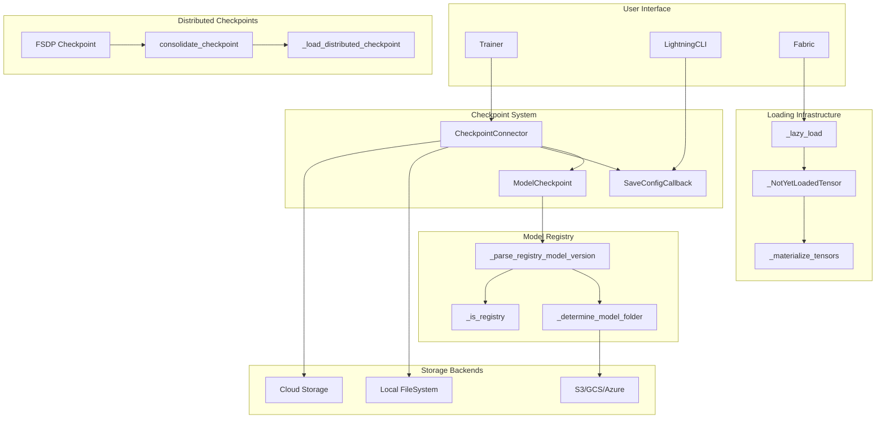
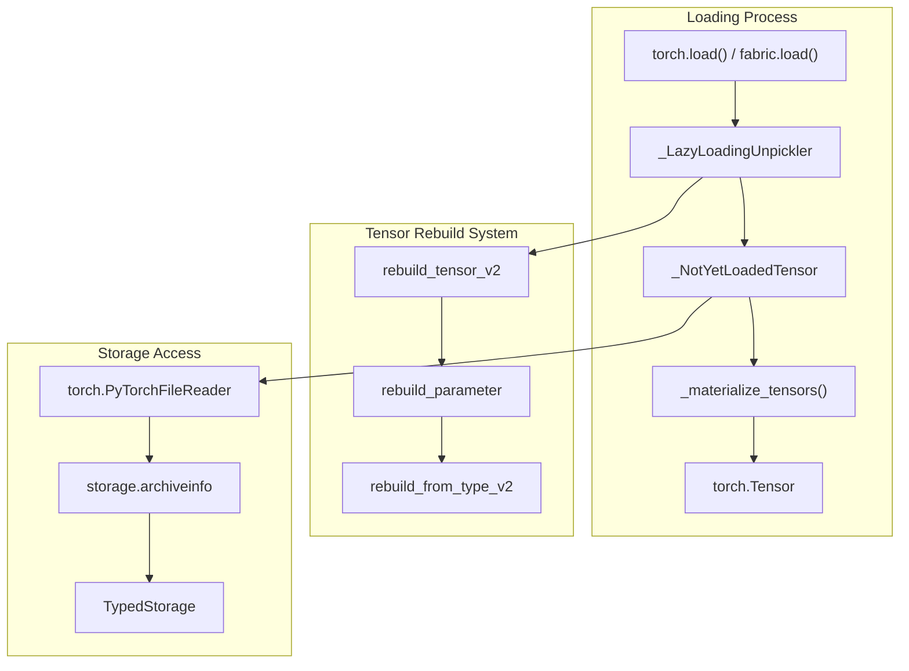
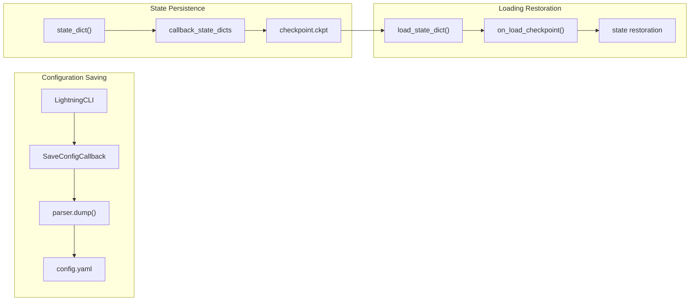
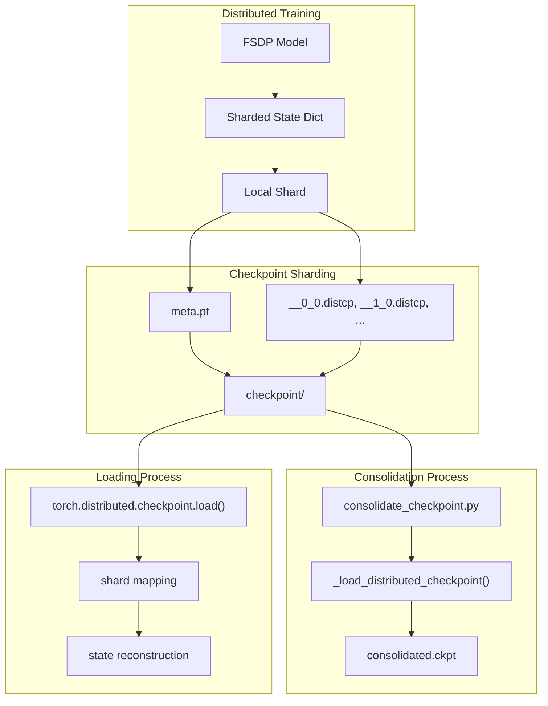
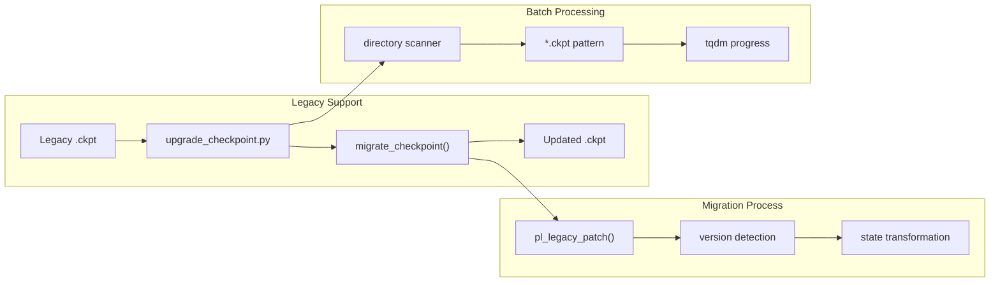
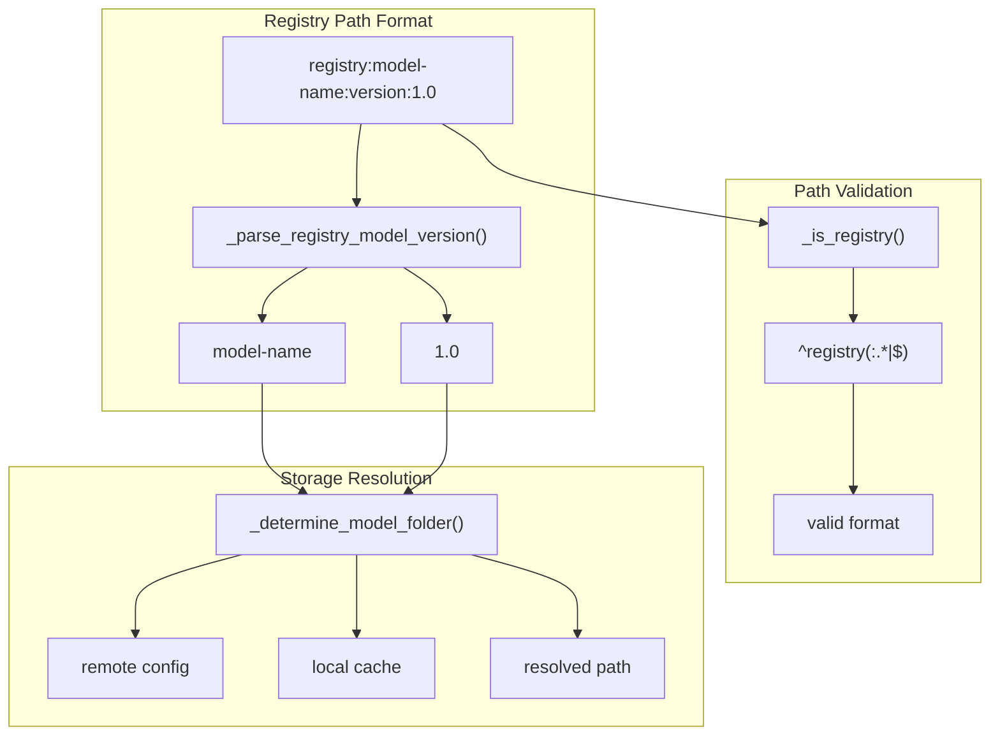
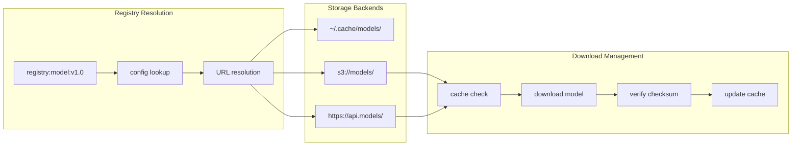

<!-- source: DeepWiki mcp.deepwiki.com · repo Lightning-AI/pytorch-lightning · page 6 Checkpointing and Export · fetched 2026-10-21 -->

# Checkpointing and Model Management

Relevant source files

The following files were used as context for generating this wiki page:

- [README.md](README.md)
- [docs/source-fabric/api/fabric_methods.rst](docs/source-fabric/api/fabric_methods.rst)
- [docs/source-fabric/api/wrappers.rst](docs/source-fabric/api/wrappers.rst)
- [src/lightning/fabric/CHANGELOG.md](src/lightning/fabric/CHANGELOG.md)
- [src/lightning/fabric/fabric.py](src/lightning/fabric/fabric.py)
- [src/lightning/fabric/strategies/ddp.py](src/lightning/fabric/strategies/ddp.py)
- [src/lightning/fabric/strategies/deepspeed.py](src/lightning/fabric/strategies/deepspeed.py)
- [src/lightning/fabric/strategies/fsdp.py](src/lightning/fabric/strategies/fsdp.py)
- [src/lightning/fabric/strategies/strategy.py](src/lightning/fabric/strategies/strategy.py)
- [src/lightning/pytorch/CHANGELOG.md](src/lightning/pytorch/CHANGELOG.md)
- [src/lightning/pytorch/core/module.py](src/lightning/pytorch/core/module.py)
- [src/lightning/pytorch/strategies/ddp.py](src/lightning/pytorch/strategies/ddp.py)
- [src/lightning/pytorch/strategies/deepspeed.py](src/lightning/pytorch/strategies/deepspeed.py)
- [src/lightning/pytorch/strategies/fsdp.py](src/lightning/pytorch/strategies/fsdp.py)
- [src/lightning/pytorch/strategies/strategy.py](src/lightning/pytorch/strategies/strategy.py)
- [tests/tests_fabric/strategies/test_ddp.py](tests/tests_fabric/strategies/test_ddp.py)
- [tests/tests_fabric/strategies/test_deepspeed.py](tests/tests_fabric/strategies/test_deepspeed.py)
- [tests/tests_fabric/strategies/test_deepspeed_integration.py](tests/tests_fabric/strategies/test_deepspeed_integration.py)
- [tests/tests_fabric/strategies/test_fsdp.py](tests/tests_fabric/strategies/test_fsdp.py)
- [tests/tests_fabric/strategies/test_fsdp_integration.py](tests/tests_fabric/strategies/test_fsdp_integration.py)
- [tests/tests_fabric/strategies/test_single_device.py](tests/tests_fabric/strategies/test_single_device.py)
- [tests/tests_fabric/test_fabric.py](tests/tests_fabric/test_fabric.py)
- [tests/tests_pytorch/models/test_onnx.py](tests/tests_pytorch/models/test_onnx.py)
- [tests/tests_pytorch/strategies/test_ddp.py](tests/tests_pytorch/strategies/test_ddp.py)
- [tests/tests_pytorch/strategies/test_ddp_integration.py](tests/tests_pytorch/strategies/test_ddp_integration.py)
- [tests/tests_pytorch/strategies/test_deepspeed.py](tests/tests_pytorch/strategies/test_deepspeed.py)
- [tests/tests_pytorch/strategies/test_fsdp.py](tests/tests_pytorch/strategies/test_fsdp.py)

This document covers PyTorch Lightning's checkpointing system and model registry infrastructure. The checkpointing system handles saving and loading model states, configurations, and training metadata, while the model registry provides versioning and management capabilities for deployed models.

For information about training loop callbacks and model lifecycle hooks, see [Training System](#4). For distributed training coordination, see [Distributed Training](#3).

## System Architecture Overview

The checkpointing and model management system consists of two main subsystems: the checkpoint system for persistent state management and the model registry for model versioning and deployment.

Sources: [src/lightning/pytorch/cli.py:214-310](), [src/lightning/fabric/utilities/load.py:207-214](), [src/lightning/pytorch/utilities/model_registry.py:29-51](), [docs/source-fabric/guide/checkpoint/distributed_checkpoint.rst:1-38]()

## Checkpoint Loading Architecture

The checkpoint loading system uses lazy loading and tensor materialization to efficiently handle large model states without loading everything into memory at once.

### Lazy Loading Implementation

Sources: [src/lightning/fabric/utilities/load.py:41-176](), [src/lightning/fabric/utilities/load.py:178-205](), [src/lightning/fabric/utilities/load.py:216-221]()

The `_NotYetLoadedTensor` class implements `__torch_function__` to intercept tensor operations and materialize tensors only when needed. This prevents memory exhaustion when loading large checkpoints by keeping tensors as metadata until actually accessed.

### Configuration and State Management

The `SaveConfigCallback` automatically saves training configurations and handles checkpoint metadata:

Sources: [src/lightning/pytorch/cli.py:230-309](), [src/lightning/pytorch/trainer/call.py:235-310](), [src/lightning/fabric/utilities/load.py:223-237]()

## Distributed Checkpointing

Distributed checkpointing enables efficient saving and loading of large models across multiple devices by sharding the state across nodes.

### FSDP Checkpoint Architecture

Sources: [docs/source-fabric/guide/checkpoint/distributed_checkpoint.rst:13-38](), [src/lightning/fabric/utilities/consolidate_checkpoint.py:14-72](), [src/lightning/pytorch/utilities/consolidate_checkpoint.py:10-26]()

The consolidation process merges distributed checkpoint shards into a single file that can be loaded with standard `torch.load()`. The `_format_checkpoint` function handles the conversion between FSDP format and Lightning Trainer format.

### Checkpoint Upgrade System

Sources: [src/lightning/pytorch/utilities/upgrade_checkpoint.py:29-49](), [src/lightning/pytorch/utilities/upgrade_checkpoint.py:59-95](), [tests/tests_pytorch/utilities/test_upgrade_checkpoint.py:25-46]()

## Model Registry System

The model registry provides a standardized way to reference and manage model versions using URI-like paths.

### Registry Path Resolution

Sources: [src/lightning/pytorch/utilities/model_registry.py:29-51](), [src/lightning/pytorch/utilities/model_registry.py:53-78](), [src/lightning/pytorch/utilities/model_registry.py:80-135]()

### Model Versioning and Storage

The registry system supports both local and remote model storage with automatic path resolution:

Sources: [src/lightning/pytorch/utilities/model_registry.py:137-185](), [src/lightning/pytorch/utilities/model_registry.py:187-234]()

The `_determine_model_folder` function handles the complex logic of resolving registry paths to actual file system locations, supporting both local caching and remote model repositories. The system integrates with cloud storage providers and can automatically download models on first access.

---

