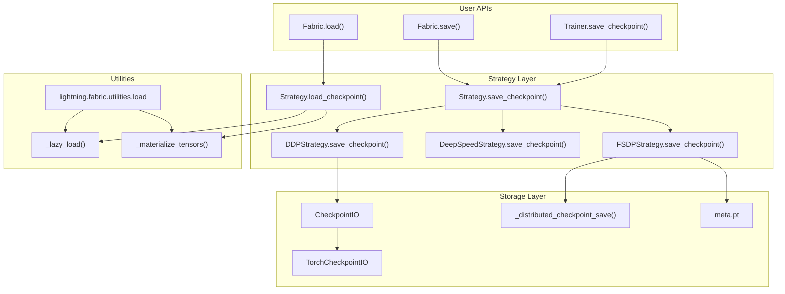
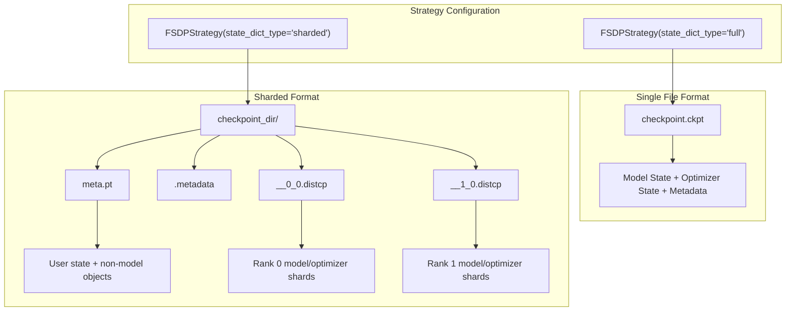
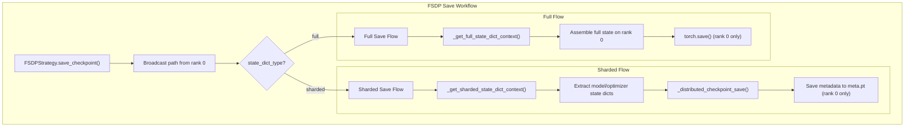
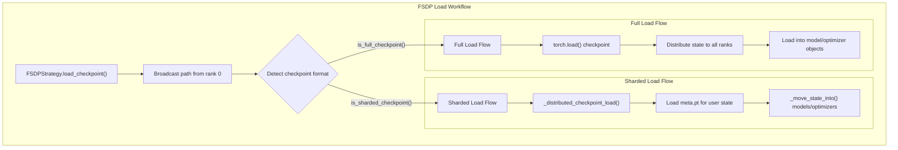
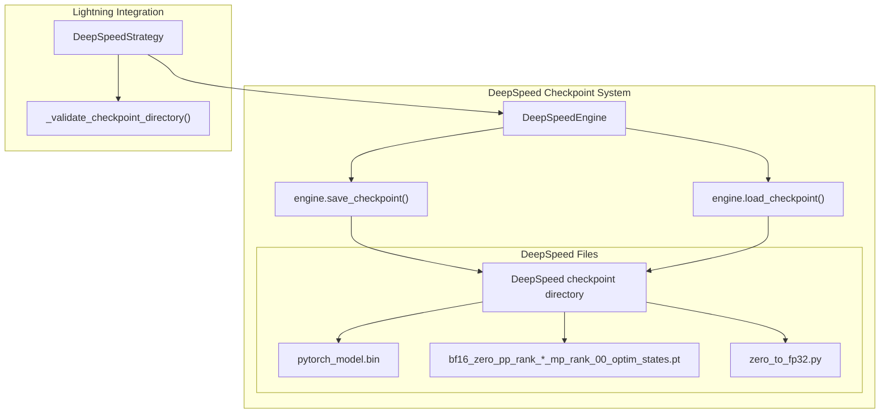
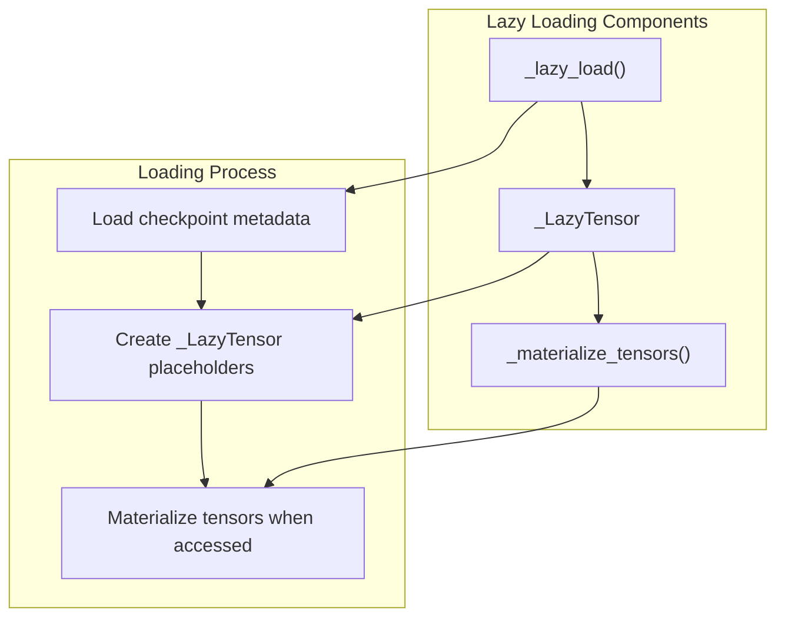

<!-- source: DeepWiki mcp.deepwiki.com · repo Lightning-AI/pytorch-lightning · page 6.1 Checkpoint System · fetched 2026-10-21 -->

# Checkpoint System

<details>
<summary>Relevant source files</summary>

The following files were used as context for generating this wiki page:

- [docs/source-fabric/api/fabric_methods.rst](docs/source-fabric/api/fabric_methods.rst)
- [docs/source-fabric/api/wrappers.rst](docs/source-fabric/api/wrappers.rst)
- [src/lightning/fabric/CHANGELOG.md](src/lightning/fabric/CHANGELOG.md)
- [src/lightning/fabric/fabric.py](src/lightning/fabric/fabric.py)
- [src/lightning/fabric/strategies/ddp.py](src/lightning/fabric/strategies/ddp.py)
- [src/lightning/fabric/strategies/deepspeed.py](src/lightning/fabric/strategies/deepspeed.py)
- [src/lightning/fabric/strategies/fsdp.py](src/lightning/fabric/strategies/fsdp.py)
- [src/lightning/fabric/strategies/strategy.py](src/lightning/fabric/strategies/strategy.py)
- [src/lightning/pytorch/CHANGELOG.md](src/lightning/pytorch/CHANGELOG.md)
- [src/lightning/pytorch/core/module.py](src/lightning/pytorch/core/module.py)
- [src/lightning/pytorch/strategies/ddp.py](src/lightning/pytorch/strategies/ddp.py)
- [src/lightning/pytorch/strategies/deepspeed.py](src/lightning/pytorch/strategies/deepspeed.py)
- [src/lightning/pytorch/strategies/fsdp.py](src/lightning/pytorch/strategies/fsdp.py)
- [src/lightning/pytorch/strategies/strategy.py](src/lightning/pytorch/strategies/strategy.py)
- [tests/tests_fabric/strategies/test_ddp.py](tests/tests_fabric/strategies/test_ddp.py)
- [tests/tests_fabric/strategies/test_deepspeed.py](tests/tests_fabric/strategies/test_deepspeed.py)
- [tests/tests_fabric/strategies/test_deepspeed_integration.py](tests/tests_fabric/strategies/test_deepspeed_integration.py)
- [tests/tests_fabric/strategies/test_fsdp.py](tests/tests_fabric/strategies/test_fsdp.py)
- [tests/tests_fabric/strategies/test_fsdp_integration.py](tests/tests_fabric/strategies/test_fsdp_integration.py)
- [tests/tests_fabric/strategies/test_single_device.py](tests/tests_fabric/strategies/test_single_device.py)
- [tests/tests_fabric/test_fabric.py](tests/tests_fabric/test_fabric.py)
- [tests/tests_pytorch/core/test_lightning_module.py](tests/tests_pytorch/core/test_lightning_module.py)
- [tests/tests_pytorch/models/test_onnx.py](tests/tests_pytorch/models/test_onnx.py)
- [tests/tests_pytorch/strategies/test_ddp.py](tests/tests_pytorch/strategies/test_ddp.py)
- [tests/tests_pytorch/strategies/test_ddp_integration.py](tests/tests_pytorch/strategies/test_ddp_integration.py)
- [tests/tests_pytorch/strategies/test_deepspeed.py](tests/tests_pytorch/strategies/test_deepspeed.py)
- [tests/tests_pytorch/strategies/test_fsdp.py](tests/tests_pytorch/strategies/test_fsdp.py)
- [tests/tests_pytorch/trainer/properties/test_estimated_stepping_batches.py](tests/tests_pytorch/trainer/properties/test_estimated_stepping_batches.py)
- [tests/tests_pytorch/trainer/test_trainer.py](tests/tests_pytorch/trainer/test_trainer.py)
- [tests/tests_pytorch/utilities/test_enums.py](tests/tests_pytorch/utilities/test_enums.py)

</details>


The checkpoint system in PyTorch Lightning provides mechanisms for saving and loading model state, optimizer state, and training metadata during distributed and single-device training. This system enables training resumption, model deployment, and state persistence across different hardware configurations and training strategies.

This document covers the core checkpointing infrastructure used by both Lightning Fabric and PyTorch Lightning. For model management and versioning features, see [Model Registry](#6.2). For training loop integration and automatic checkpointing, see [Callbacks and Extensions](#4.2).

## Architecture Overview

The checkpoint system follows a layered architecture where high-level APIs delegate to strategy-specific implementations that handle the complexities of distributed storage formats.



Sources: [src/lightning/fabric/fabric.py:489-580](), [src/lightning/fabric/strategies/strategy.py:337-398](), [src/lightning/fabric/strategies/fsdp.py:414-611]()

## Checkpoint Formats

The system supports multiple checkpoint formats depending on the training strategy and configuration:

### Single File Checkpoints
Standard PyTorch checkpoint format containing the complete state in a single `.pt` or `.ckpt` file. Used by single-device strategies and FSDP with `state_dict_type="full"`.

### Sharded Checkpoints  
Distributed checkpoint format where each process saves its portion of the state to separate files within a directory structure. Used by FSDP with `state_dict_type="sharded"` (default in Fabric).



Sources: [src/lightning/fabric/strategies/fsdp.py:462-512](), [src/lightning/fabric/utilities/load.py:33]()

## Core APIs

### Fabric Save/Load Interface

The primary API for checkpointing in Lightning Fabric:

```python
# Save state
fabric.save(path, state)

# Load state  
remainder = fabric.load(path, state, strict=True)
```

The `state` parameter is a dictionary containing model and optimizer references along with user data. The system automatically extracts state dictionaries from PyTorch objects.

### Strategy Save/Load Methods

Each strategy implements the checkpoint interface:

```python
def save_checkpoint(self, path, state, storage_options=None, filter=None):
    # Strategy-specific save implementation
    
def load_checkpoint(self, path, state=None, strict=True):
    # Strategy-specific load implementation
```

Sources: [src/lightning/fabric/fabric.py:489-517](), [src/lightning/fabric/strategies/strategy.py:337-398]()

## FSDP Checkpointing Implementation

FSDP (Fully Sharded Data Parallel) provides the most sophisticated checkpointing implementation, supporting both full and sharded formats:



Sources: [src/lightning/fabric/strategies/fsdp.py:414-512]()

### FSDP Load Workflow



Sources: [src/lightning/fabric/strategies/fsdp.py:514-611]()

## DeepSpeed Checkpointing

DeepSpeed uses its own checkpoint format and APIs:



Sources: [src/lightning/fabric/strategies/deepspeed.py:600-650](), [src/lightning/pytorch/strategies/deepspeed.py:400-500]()

## Checkpoint Utilities and Loading

The system provides sophisticated utilities for efficient checkpoint loading:

### Lazy Loading System



Sources: [src/lightning/fabric/utilities/load.py:200-300]()

### State Movement and Validation

The checkpoint system includes utilities for moving state between devices and validating checkpoint compatibility:

- `_move_state_into()`: Moves loaded state into target objects
- `_validate_keys_for_strict_loading()`: Validates state dict keys for strict loading
- `_materialize_tensors()`: Converts lazy tensors to actual tensors on target devices

Sources: [src/lightning/fabric/utilities/load.py:350-450](), [src/lightning/fabric/strategies/strategy.py:400-450]()

## Distributed Checkpoint Consolidation

For sharded checkpoints, the system provides utilities to consolidate distributed checkpoints into single files:

```bash
# CLI utility for consolidating FSDP checkpoints
fabric consolidate path/to/sharded/checkpoint path/to/output.pt
```

This functionality is implemented in the consolidation utilities and enables easier deployment and sharing of trained models.

Sources: [src/lightning/fabric/utilities/consolidate_checkpoint.py:1-50](), [tests/tests_fabric/utilities/test_consolidate_checkpoint.py:1-100]()

---

