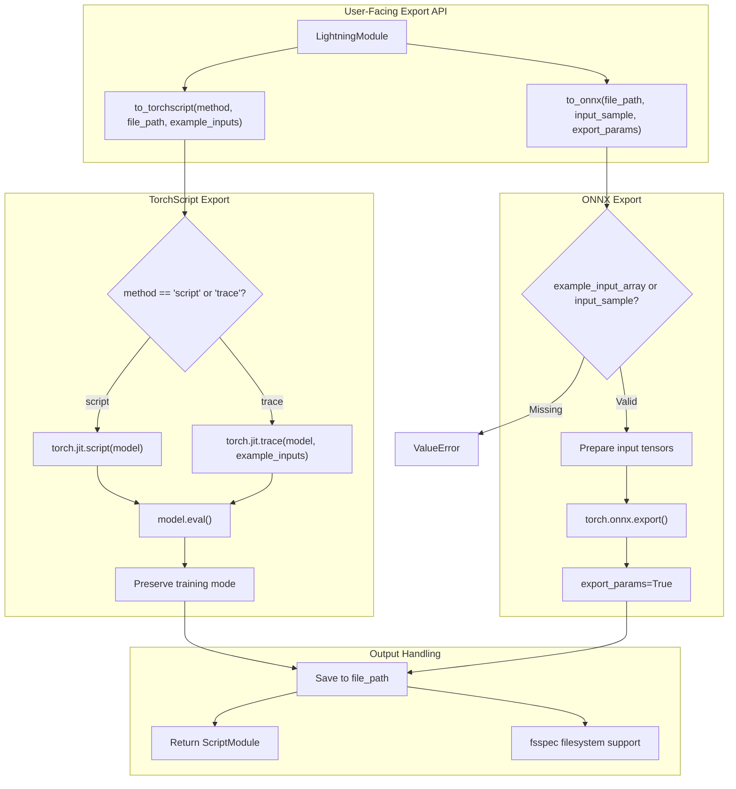
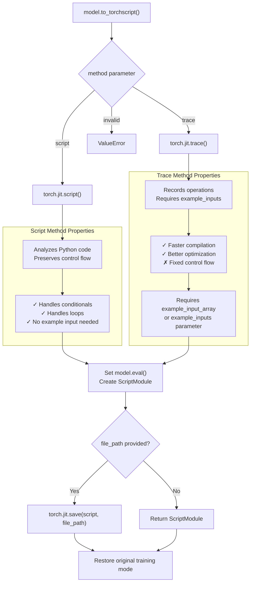
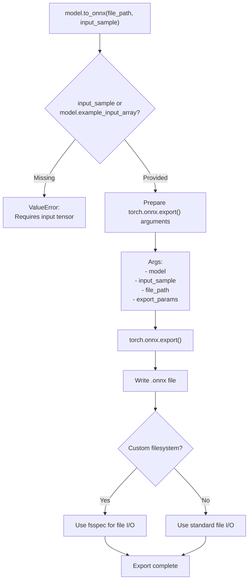

<!-- source: DeepWiki mcp.deepwiki.com · repo Lightning-AI/pytorch-lightning · page 6.2 Model Export · fetched 2026-10-21 -->

# Model Export

<details>
<summary>Relevant source files</summary>

The following files were used as context for generating this wiki page:

- [README.md](README.md)

</details>


Model Export provides methods to convert trained LightningModule models into deployment-ready formats. PyTorch Lightning supports two primary export formats: TorchScript (for PyTorch runtime) and ONNX (for cross-platform deployment). These export mechanisms enable production deployment while preserving model behavior and weights.

For information about model checkpointing and state management during training, see [Checkpoint System](#6.1).

## Export Formats Overview

PyTorch Lightning supports two primary model export formats:

| Format | Use Case | Method | Key Features |
|--------|----------|--------|--------------|
| **TorchScript** | PyTorch runtime deployment | `model.to_torchscript()` | Script or trace compilation, preserves model structure |
| **ONNX** | Cross-platform inference | `model.to_onnx()` | Open format, supports multiple runtimes (ONNX Runtime, TensorRT) |

Both formats preserve trained weights and model behavior while removing training-specific code like `training_step()` and `configure_optimizers()`.

Sources: [README.md:327-349](), [tests/tests_pytorch/models/test_torchscript.py:1-230]()

## Export Architecture

Diagram: Model Export System Architecture



Sources: [tests/tests_pytorch/models/test_torchscript.py:32-230](), [README.md:327-349]()

## TorchScript Export

TorchScript compilation converts Python code into an optimized intermediate representation for deployment. Lightning provides the `to_torchscript()` method with two compilation strategies.

### Script vs Trace Methods

Diagram: TorchScript Export Methods



Sources: [tests/tests_pytorch/models/test_torchscript.py:30-71](), [tests/tests_pytorch/models/test_torchscript.py:182-198]()

### Example Usage

```python
# Script method - analyzes Python code
model = LitAutoEncoder()
script = model.to_torchscript(method="script")

# Trace method - requires example input
model.example_input_array = torch.randn(5, 32)
script = model.to_torchscript(method="trace")

# Or provide example_inputs directly
example_inputs = torch.randn(1, 32)
script = model.to_torchscript(example_inputs=example_inputs, method="trace")

# Save to file (supports fsspec filesystems)
script = model.to_torchscript(file_path="model.pt")
```

Sources: [tests/tests_pytorch/models/test_torchscript.py:32-86](), [README.md:327-335]()

### Device Handling

The exported ScriptModule preserves the device placement of the original model:

```python
# Model on CUDA
model = BoringModel().to("cuda:0")
script = model.to_torchscript()
# script.parameters() are on cuda:0

# Model on CPU
model = BoringModel().to("cpu")
script = model.to_torchscript()
# script.parameters() are on cpu
```

Sources: [tests/tests_pytorch/models/test_torchscript.py:88-106]()

### Training State Preservation

The export process temporarily sets the model to evaluation mode but preserves the original training state:

```python
model = BoringModel()
model.train(True)  # Set to training mode
script = model.to_torchscript()

assert model.training  # Original model still in training mode
assert not script.training  # Exported script in eval mode
```

Sources: [tests/tests_pytorch/models/test_torchscript.py:128-139]()

## ONNX Export

ONNX (Open Neural Network Exchange) is an open format for representing neural networks, enabling deployment across different frameworks and runtime environments.

### Export Process

Diagram: ONNX Export Workflow



Sources: [README.md:337-349]()

### Basic Usage

```python
import tempfile
import os

# Export with input sample
autoencoder = LitAutoEncoder()
input_sample = torch.randn((1, 64))

with tempfile.NamedTemporaryFile(suffix=".onnx", delete=False) as tmpfile:
    autoencoder.to_onnx(tmpfile.name, input_sample, export_params=True)
    assert os.path.isfile(tmpfile.name)
```

Sources: [README.md:340-347]()

### Export Parameters

The `to_onnx()` method accepts several key parameters:

| Parameter | Type | Purpose | Default |
|-----------|------|---------|---------|
| `file_path` | `str` | Output file path (required) | - |
| `input_sample` | `Tensor` | Example input for tracing | Uses `example_input_array` |
| `export_params` | `bool` | Include trained parameters | `True` |
| Additional kwargs | Various | Passed to `torch.onnx.export()` | - |

The method internally calls PyTorch's `torch.onnx.export()` with the appropriate arguments, handling file system operations through fsspec for flexible storage backends.

Sources: [README.md:340-347]()

## Exported Model Properties

Exported models undergo transformations that make them suitable for production deployment:

### Removed Components

The export process strips training-specific methods and properties:

```python
model = BoringModel()
script = model.to_torchscript()

# Training methods are not callable in exported model
assert not callable(getattr(script, "training_step", None))
assert not callable(getattr(script, "configure_optimizers", None))

# Hyperparameters and properties may be preserved
assert not hasattr(model, "batch_size") or hasattr(script, "batch_size")
```

Sources: [tests/tests_pytorch/models/test_torchscript.py:141-149]()

### Preserved Components

The exported model retains:
- Model architecture (`forward()` method)
- Trained parameters and buffers
- Model properties (if defined as attributes)
- Device placement

### Recursive Scripting

TorchScript export handles nested LightningModule structures:

```python
class GrandChild(LightningModule):
    def __init__(self):
        super().__init__()
        self.model = torch.nn.Linear(1, 1)

class Child(LightningModule):
    def __init__(self):
        super().__init__()
        self.model = torch.nn.Sequential(GrandChild(), GrandChild())

class Parent(LightningModule):
    def __init__(self):
        super().__init__()
        self.model = Child()

lm = Parent()
script = lm.to_torchscript(method="script")
# Returns torch.jit.RecursiveScriptModule
```

Sources: [tests/tests_pytorch/models/test_torchscript.py:200-230]()

## File System Support

Both TorchScript and ONNX export support custom file systems through fsspec:

### Custom Filesystem Example

```python
import fsspec
from fsspec.implementations.local import LocalFileSystem

# Register custom filesystem
class DummyFileSystem(LocalFileSystem):
    pass

fsspec.register_implementation("dummy", DummyFileSystem)

# Export to custom filesystem
model = BoringModel()
output_file = "dummy://path/to/model.pt"
script = model.to_torchscript(file_path=output_file)

# Load from custom filesystem
fs = get_filesystem(output_file)
with fs.open(output_file, "rb") as f:
    loaded_script = torch.jit.load(f)
```

Sources: [tests/tests_pytorch/models/test_torchscript.py:161-180]()

### Save and Load Operations

Exported models can be saved and loaded across different execution contexts:

```python
# Save TorchScript model
model = BoringModel()
script = model.to_torchscript(file_path="model.pt")

# Load in different process/environment
loaded_script = torch.jit.load("model.pt")

# Verify parameters match
assert torch.allclose(
    next(script.parameters()),
    next(loaded_script.parameters())
)
```

Sources: [tests/tests_pytorch/models/test_torchscript.py:151-159]()

## Advanced Export Scenarios

### Tracing with Check Inputs

The trace method supports validation inputs to verify export correctness:

```python
model = BoringModel()
model.example_input_array = torch.randn(5, 32)

# Provide different inputs for export verification
check_inputs = torch.rand(5, 32)
script = model.to_torchscript(method="trace", check_inputs=check_inputs)
```

Sources: [tests/tests_pytorch/models/test_torchscript.py:108-127]()

### Multi-Device Support

Exported models maintain device placement and can be used across different accelerators:

| Device | Export | Inference |
|--------|--------|-----------|
| CPU | `model.to("cpu").to_torchscript()` | Script runs on CPU |
| CUDA | `model.to("cuda:0").to_torchscript()` | Script runs on CUDA |
| MPS | `model.to("mps:0").to_torchscript()` | Script runs on MPS |

Device placement is preserved in exported model parameters and execution.

Sources: [tests/tests_pytorch/models/test_torchscript.py:88-106](), [tests/tests_pytorch/models/test_torchscript.py:108-127]()

### Model Scriptability

LightningModule is designed to be `torch.jit.script`-able out of the box:

```python
model = BoringModel()
trainer = Trainer()
model.trainer = trainer

# LightningModule can be scripted directly
torch.jit.script(model)
```

This ensures compatibility with TorchScript's static type analysis system.

Sources: [tests/tests_pytorch/core/test_lightning_module.py:437-447]()

## API Reference

### Core Functions

| Function | Parameters | Returns | Purpose |
|----------|------------|---------|---------|
| `_is_registry` | `text: Optional[_PATH]` | `bool` | Validates registry path format |
| `_parse_registry_model_version` | `ckpt_path: Optional[_PATH]` | `tuple[str, str]` | Extracts model name and version |
| `_determine_model_name` | `ckpt_path, default_model_registry` | `str` | Resolves full model identifier |
| `_determine_model_folder` | `model_name: str, default_root_dir: str` | `str` | Computes local storage path |
| `find_model_local_ckpt_path` | `ckpt_path, default_model_registry, default_root_dir` | `str` | Locates local checkpoint file |
| `download_model_from_registry` | `ckpt_path, trainer: pl.Trainer` | `None` | Downloads model from registry |

### Error Conditions

| Exception | Trigger | Message Pattern |
|-----------|---------|-----------------|
| `ValueError` | Invalid registry path | `"Invalid registry path: {ckpt_path}"` |
| `ValueError` | Missing model name | `"Invalid model registry: '{ckpt_path}'"` |
| `ImportError` | Missing litmodels | `"The litmodels package is not installed"` |
| `RuntimeError` | No checkpoints found | `"Parsing files from downloaded model"` |
| `RuntimeError` | Download failure | `"Download model failed - {model_registry}"` |

Sources: [src/lightning/pytorch/utilities/model_registry.py:1-179]()

---

