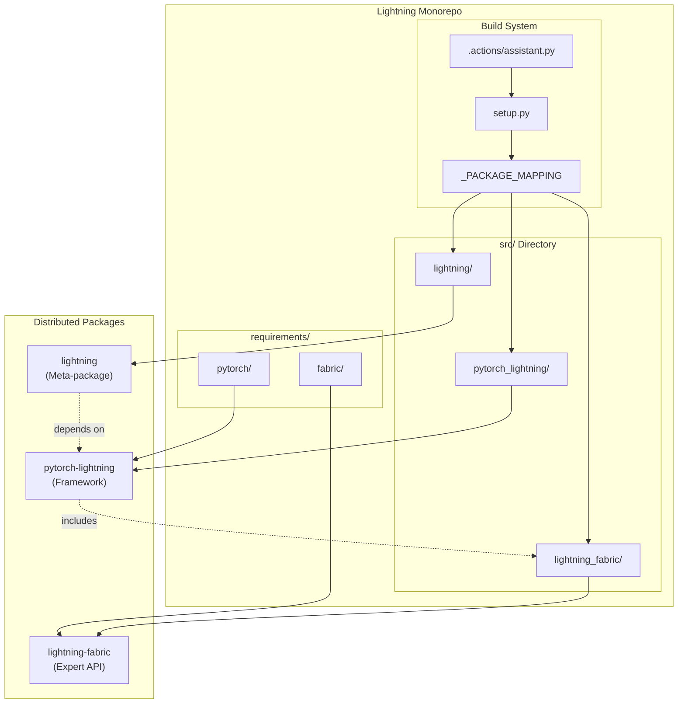
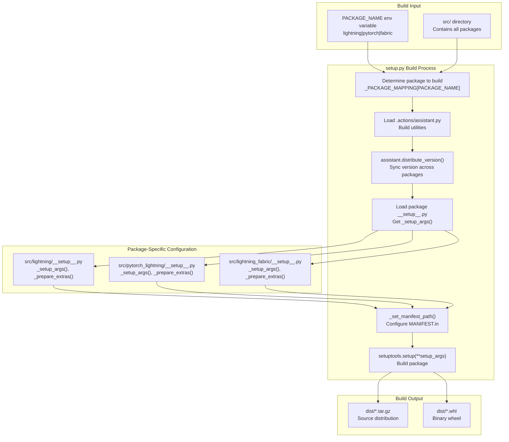

<!-- source: DeepWiki mcp.deepwiki.com · repo Lightning-AI/pytorch-lightning · page 7 Package Structure and Installation · fetched 2026-10-21 -->

# Package Structure and Installation

<details>
<summary>Relevant source files</summary>

The following files were used as context for generating this wiki page:

- [.github/actions/pkg-check/action.yml](.github/actions/pkg-check/action.yml)
- [.github/dependabot.yml](.github/dependabot.yml)
- [requirements/fabric/extra.txt](requirements/fabric/extra.txt)
- [setup.py](setup.py)
- [src/lightning/__setup__.py](src/lightning/__setup__.py)
- [src/lightning_fabric/__setup__.py](src/lightning_fabric/__setup__.py)
- [src/pytorch_lightning/MANIFEST.in](src/pytorch_lightning/MANIFEST.in)
- [src/pytorch_lightning/__setup__.py](src/pytorch_lightning/__setup__.py)
- [tests/tests_fabric/utilities/test_imports.py](tests/tests_fabric/utilities/test_imports.py)

</details>


This document explains the PyTorch Lightning monorepo structure, how packages are built and distributed, and the available installation methods. The repository produces three distinct packages from a unified codebase using a dynamic build system.

**Detailed Documentation:**
- [Package Architecture](#7.1) - Three-package structure, setup.py mechanics, and PACKAGE_NAME environment variable
- [Dependencies and Requirements](#7.2) - Requirements hierarchy, version constraints, and FREEZE_REQUIREMENTS
- [Installation Methods](#7.3) - PyPI, conda, source installation, and package validation

## Monorepo Structure

The Lightning repository uses a monorepo layout where multiple packages share a common source tree. The repository is organized as follows:

**Source Directory Layout:**

```
lightning/
├── src/
│   ├── lightning/              # Meta-package source
│   │   ├── __about__.py
│   │   ├── __init__.py
│   │   ├── __setup__.py        # Package configuration
│   │   ├── __version__.py
│   │   ├── fabric/             # Fabric API (namespace)
│   │   └── pytorch/            # PyTorch Lightning API (namespace)
│   ├── pytorch_lightning/      # PyTorch Lightning source
│   │   ├── __about__.py
│   │   ├── __init__.py
│   │   ├── __setup__.py        # Package configuration
│   │   ├── __version__.py
│   │   ├── MANIFEST.in         # Distribution manifest
│   │   ├── trainer/            # Trainer implementation
│   │   ├── callbacks/          # Callbacks
│   │   └── ...
│   └── lightning_fabric/       # Lightning Fabric source
│       ├── __about__.py
│       ├── __init__.py
│       ├── __setup__.py        # Package configuration
│       ├── __version__.py
│       ├── MANIFEST.in         # Distribution manifest
│       ├── fabric.py           # Fabric class
│       ├── strategies/         # Distributed strategies
│       └── ...
├── requirements/               # Dependency specifications
│   ├── pytorch/                # PyTorch Lightning requirements
│   ├── fabric/                 # Lightning Fabric requirements
│   └── ...
├── setup.py                    # Main build orchestrator
└── .actions/
    └── assistant.py            # Build utilities
```

This structure enables:
1. **Shared Infrastructure**: Common code (strategies, accelerators) used by both frameworks
2. **Independent Packages**: Each package can be built and distributed separately
3. **Unified Meta-Package**: The `lightning` package aggregates both frameworks
4. **Monorepo Benefits**: Single CI/CD pipeline, unified versioning, easier cross-package changes

Sources: [setup.py:64-66](), [src/lightning/__setup__.py:10-13](), [src/pytorch_lightning/__setup__.py:11-14](), [src/lightning_fabric/__setup__.py:11-14]()

## Three-Package Architecture

The repository produces three distinct packages that can be installed independently or together:

**Package Overview:**



**Package Characteristics:**

| Package Name | PyPI Package | Import Statement | Distribution Strategy | Use Case |
|--------------|--------------|------------------|----------------------|----------|
| lightning | `lightning` | `import lightning` | Meta-package depending on pytorch-lightning | Unified installation |
| pytorch-lightning | `pytorch-lightning` | `import pytorch_lightning` | Includes lightning_fabric source code | High-level automation |
| lightning-fabric | `lightning-fabric` | `import lightning_fabric` | Standalone package | Expert-level control |

The `pytorch-lightning` package includes the `lightning_fabric` source code to maintain backward compatibility and simplify deployment. This is specified in the package configuration:

```python
# src/pytorch_lightning/__setup__.py:68-76
"packages": find_packages(
    where="src",
    include=[
        "pytorch_lightning",
        "pytorch_lightning.*",
        "lightning_fabric",
        "lightning_fabric.*",
    ],
)
```

Sources: [setup.py:56-61](), [src/pytorch_lightning/__setup__.py:68-76](), [src/lightning/__setup__.py:79]()

For detailed information about the build system mechanics, see [Package Architecture](#7.1).

## Build System

The build system uses a single `setup.py` entry point that dynamically configures package builds based on the `PACKAGE_NAME` environment variable.

**Build System Architecture:**



**Build Process Flow:**

1. **Package Selection** ([setup.py:56-61]()): The `PACKAGE_NAME` environment variable is mapped via `_PACKAGE_MAPPING`:
   ```python
   _PACKAGE_MAPPING = {
       "lightning": "lightning",
       "pytorch": "pytorch_lightning",
       "fabric": "lightning_fabric",
   }
   ```

2. **Version Distribution** ([setup.py:128]()): `assistant.distribute_version()` synchronizes version information across all package `__version__.py` files

3. **Package Configuration Loading** ([setup.py:159-163]()): The package-specific `__setup__.py` file is loaded dynamically:
   ```python
   pkg_setup = os.path.join(pkg_path, "__setup__.py")
   setup_module = _load_py_module(f"{package_to_install}_setup", location=pkg_setup)
   setup_args = setup_module._setup_args()
   ```

4. **Manifest Configuration** ([setup.py:87-121]()): The `_set_manifest_path()` context manager configures which files are included in the distribution. For the `lightning` meta-package, it aggregates all sub-package manifests.

5. **Build Execution** ([setup.py:169-171]()): `setuptools.setup()` is called with the configured arguments to produce the distribution files.

**Build Commands:**

```bash
# Build all three packages (requires running three times with different PACKAGE_NAME)
PACKAGE_NAME=lightning python setup.py sdist bdist_wheel
PACKAGE_NAME=pytorch python setup.py sdist bdist_wheel
PACKAGE_NAME=fabric python setup.py sdist bdist_wheel

# Outputs to dist/ directory:
# lightning-*.tar.gz, lightning-*.whl
# pytorch-lightning-*.tar.gz, pytorch-lightning-*.whl
# lightning-fabric-*.tar.gz, lightning-fabric-*.whl
```

Sources: [setup.py:56-61](), [setup.py:123-172](), [setup.py:87-121]()

For detailed information about manifest management, version synchronization, and package mirroring, see [Package Architecture](#7.1).

## Installation Overview

The Lightning ecosystem provides three installation methods to accommodate different use cases:

**Installation Method Comparison:**

| Method | Use Case | Package Control | Version Control |
|--------|----------|-----------------|-----------------|
| PyPI | End users, production | Three package options | Published releases |
| Conda | Conda environment users | Same as PyPI | Conda-forge releases |
| Source | Contributors, development | Full PACKAGE_NAME control | Latest development |

**Quick Installation Examples:**

```bash
# PyPI Installation (most common)
pip install lightning                    # Meta-package (recommended)
pip install pytorch-lightning            # High-level framework only
pip install lightning-fabric             # Expert API only

# Source Installation (development)
git clone https://github.com/Lightning-AI/pytorch-lightning.git
cd pytorch-lightning
pip install -e .                         # Editable install

# Source with specific package
PACKAGE_NAME=pytorch pip install -e .    # Only pytorch-lightning
PACKAGE_NAME=fabric pip install -e .     # Only lightning-fabric

# Optional dependencies
pip install "pytorch-lightning[strategies]"  # Distributed training
pip install "lightning[all]"                 # All optional features
```

**Package Dependencies:**

The `lightning` meta-package depends on `pytorch-lightning`, which in turn includes `lightning_fabric` source code. This dependency structure is defined in the package configuration:

```python
# src/lightning/__setup__.py:79
install_requires += ["pytorch-lightning"]
```

This means:
- Installing `lightning` → installs `pytorch-lightning` → includes `lightning_fabric`
- Installing `pytorch-lightning` → includes `lightning_fabric` 
- Installing `lightning-fabric` → standalone, no dependencies on other Lightning packages

Sources: [src/lightning/__setup__.py:79](), [src/pytorch_lightning/__setup__.py:68-76]()

For detailed information about installation methods, package validation, and troubleshooting, see [Installation Methods](#7.3).

## Dependency Management Overview

Dependencies are organized in a hierarchical structure under the `requirements/` directory, with separate subdirectories for each package:

```
requirements/
├── pytorch/         # PyTorch Lightning dependencies
│   ├── base.txt    # Core runtime dependencies
│   ├── extra.txt   # Optional features (hydra)
│   ├── strategies.txt  # Distributed training (DeepSpeed, etc.)
│   ├── examples.txt    # Example dependencies
│   └── test.txt        # Testing dependencies
└── fabric/          # Lightning Fabric dependencies
    ├── base.txt
    ├── extra.txt
    ├── strategies.txt
    ├── examples.txt
    └── test.txt
```

**Dynamic Dependency Loading:**

The `FREEZE_REQUIREMENTS` environment variable controls version constraint handling:

```bash
# Development/CI (relaxed constraints)
pip install .

# Production release (strict constraints)
FREEZE_REQUIREMENTS=1 pip install .
```

The `assistant.py` module provides `load_requirements()` to process requirement files and adjust version constraints based on this setting.

Sources: [setup.py:67](), [src/lightning/__setup__.py:14](), [requirements/fabric/extra.txt:1-5]()

For detailed information about the requirements hierarchy, version constraints, conditional dependencies, and the extras system, see [Dependencies and Requirements](#7.2).

## Command-Line Interfaces

Both the unified `lightning` package and standalone `lightning-fabric` package provide CLI entry points:

| Package | Command | Entry Point Module |
|---------|---------|-------------------|
| lightning | `fabric` | `lightning.fabric.cli:_main` |
| lightning-fabric | `fabric` | `lightning_fabric.cli:_main` |

```bash
# After installing either package
fabric --help
```

Sources: [src/lightning/__setup__.py:98-102](), [src/lightning_fabric/__setup__.py:81-85]()

## System Requirements

### Python Version Support

All packages support Python 3.9, 3.10, 3.11, and 3.12. The version requirement is specified in each package's classifiers:

```python
"python_requires": ">=3.9"
```

Sources: [src/lightning/__setup__.py:97-129](), [src/pytorch_lightning/__setup__.py:83-114](), [src/lightning_fabric/__setup__.py:76-112]()

### PyTorch Version

PyTorch Lightning requires `torch >=2.1.0, <2.9.0`. The upper bound is set for CI stability and is typically relaxed during installation unless `FREEZE_REQUIREMENTS=1` is set.

Sources: [requirements/pytorch/base.txt:4](), [requirements/fabric/base.txt:4]()

### Hardware Compatibility

PyTorch Lightning supports training on:
- **CPU**: Any modern CPU
- **CUDA**: NVIDIA GPUs with CUDA support
- **MPS**: Apple Silicon GPUs (Metal Performance Shaders)
- **TPU**: Google Cloud TPUs via PyTorch/XLA

Hardware support is handled through the accelerator system (see [Accelerators and Precision](#3.5)).

## Troubleshooting Installation

Common issues and solutions:

1. **Dependency conflicts**: Try installing in a fresh virtual environment
2. **CUDA version mismatch**: Ensure PyTorch is installed with the correct CUDA version for your system
3. **Import errors**: Check if you're using the correct import paths:
   - `import lightning.pytorch as pl` for the unified package
   - `import pytorch_lightning as pl` for the standalone package

---

