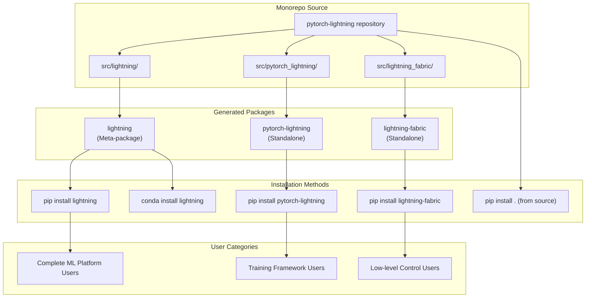
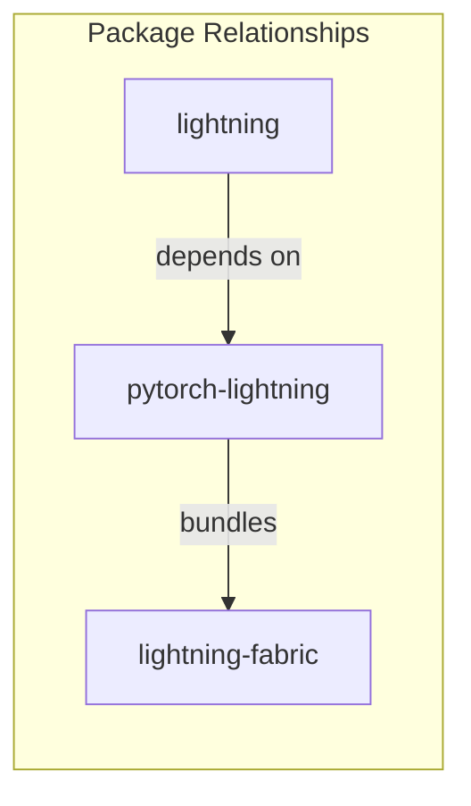
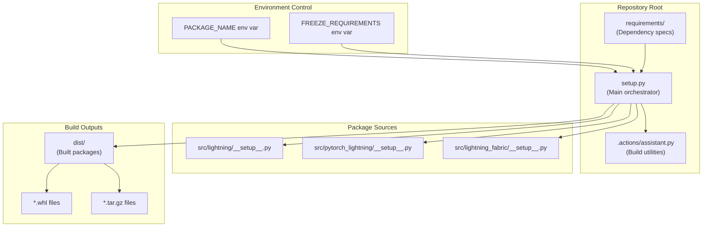
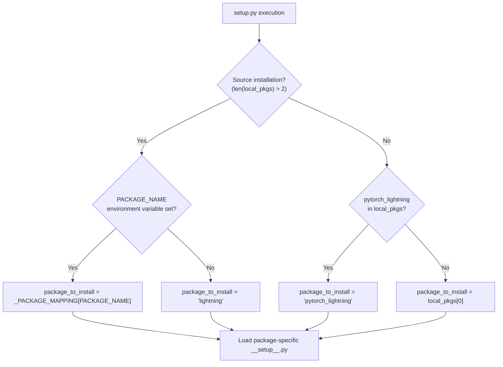
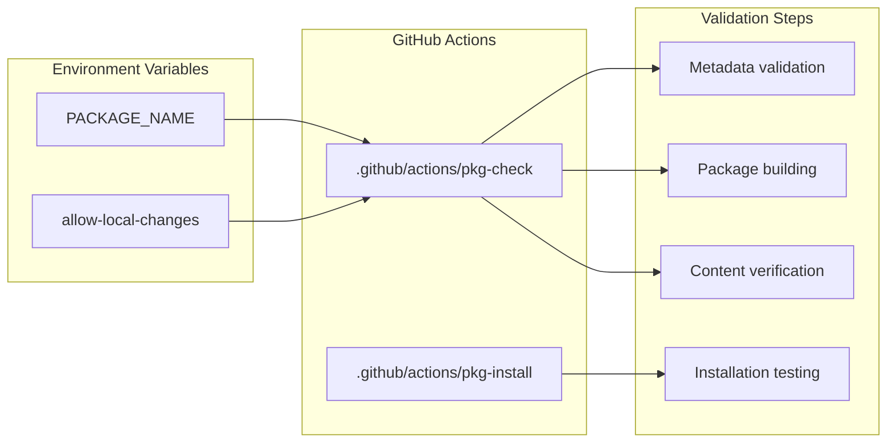

<!-- source: DeepWiki mcp.deepwiki.com · repo Lightning-AI/pytorch-lightning · page 7.1 Package Architecture · fetched 2026-10-21 -->

# Package Structure

<details>
<summary>Relevant source files</summary>

The following files were used as context for generating this wiki page:

- [.github/actions/pkg-check/action.yml](.github/actions/pkg-check/action.yml)
- [.github/dependabot.yml](.github/dependabot.yml)
- [requirements/fabric/extra.txt](requirements/fabric/extra.txt)
- [setup.py](setup.py)
- [src/lightning/__setup__.py](src/lightning/__setup__.py)
- [src/lightning_fabric/__setup__.py](src/lightning_fabric/__setup__.py)
- [src/pytorch_lightning/MANIFEST.in](src/pytorch_lightning/MANIFEST.in)
- [src/pytorch_lightning/__setup__.py](src/pytorch_lightning/__setup__.py)
- [tests/tests_fabric/utilities/test_imports.py](tests/tests_fabric/utilities/test_imports.py)

</details>


This document explains the multi-package structure of the PyTorch Lightning repository and how the monorepo generates multiple installable packages. For information about specific package dependencies and optional extras, see [Dependencies](#7.3). For Docker-based deployment options, see [Docker Containers](#7.2).

## Overview

The PyTorch Lightning repository uses a **monorepo architecture** that generates three distinct packages from a single codebase. This design allows users to install only the components they need while maintaining code sharing and unified development workflows.

### Package Distribution Model



**Sources:** [setup.py:57-61](), [setup.py:15-41]()

## Package Types and Use Cases

The repository produces three main packages, each targeting different user needs:

| Package | Description | Target Users | Installation Command |
|---------|-------------|--------------|---------------------|
| `lightning` | Meta-package including all components | Users wanting complete ML platform | `pip install lightning` |
| `pytorch-lightning` | High-level training framework | ML researchers and practitioners | `pip install pytorch-lightning` |
| `lightning-fabric` | Low-level training utilities | Expert users needing fine control | `pip install lightning-fabric` |

### Package Dependencies

The `lightning` meta-package includes `pytorch-lightning` as a dependency, while `pytorch-lightning` includes `lightning-fabric` directly in its distribution:



**Sources:** [src/lightning/__setup__.py:79](), [src/pytorch_lightning/__setup__.py:68-76]()

## Source Code Organization

The monorepo organizes source code in the `src/` directory with separate folders for each package:

### Directory Structure

```
src/
├── lightning/           # Meta-package source
├── pytorch_lightning/   # PyTorch Lightning framework
└── lightning_fabric/    # Lightning Fabric utilities
```

Each package directory contains:
- `__setup__.py` - Package-specific build configuration
- `__about__.py` - Package metadata
- `__version__.py` - Version information
- `MANIFEST.in` - File inclusion rules (where applicable)

### Build System Architecture



**Sources:** [setup.py:56-67](), [setup.py:124-172]()

## Installation Scenarios

The build system supports four primary installation scenarios controlled by environment variables and execution context:

### 1. PyPI Installation
Direct installation from the Python Package Index:
```bash
pip install lightning
pip install pytorch-lightning  
pip install lightning-fabric
```

### 2. Source Installation
Installation from cloned repository using environment variables:
```bash
# Install meta-package (default)
pip install .

# Install specific package
export PACKAGE_NAME=pytorch && pip install .
export PACKAGE_NAME=fabric && pip install .
```

### 3. Package Building
Creating distribution packages for PyPI publishing:
```bash
# Build all packages (controlled by PACKAGE_NAME)
python setup.py sdist bdist_wheel

# Build specific package
PACKAGE_NAME=pytorch python setup.py sdist bdist_wheel
```

### 4. Development Installation
Editable installation for development:
```bash
pip install -e .  # Default: lightning meta-package
PACKAGE_NAME=pytorch pip install -e .  # PyTorch Lightning only
```

**Sources:** [setup.py:18-41](), [setup.py:144-155]()

## Build System Mechanics

The main [setup.py]() file acts as an orchestrator that delegates to package-specific setup files based on environment variables and context detection.

### Package Selection Logic



**Sources:** [setup.py:137-155]()

### Package Mapping System

The build system uses a mapping dictionary to translate environment variable values to actual package directories:

```python
_PACKAGE_MAPPING = {
    "lightning": "lightning",
    "pytorch": "pytorch_lightning", 
    "fabric": "lightning_fabric",
}
```

This mapping allows users to specify shorter names while the system resolves them to the correct source directories.

**Sources:** [setup.py:57-61]()

## Manifest and File Inclusion

Package distribution includes specific files based on `MANIFEST.in` files. The PyTorch Lightning package includes the most comprehensive set:

### PyTorch Lightning Manifest
- Version information files
- Lightning Fabric source code (embedded)
- Requirements files for both packages
- Documentation and changelog files
- Type hint markers (`py.typed`)

The build system can aggregate manifests for the meta-package installation, ensuring all necessary files are included across packages.

**Sources:** [src/pytorch_lightning/MANIFEST.in:1-13](), [setup.py:88-121]()

## Extras and Optional Dependencies

Each package defines extras for optional functionality through their respective `__setup__.py` files:

### Common Extra Categories
- `test` - Testing dependencies
- `examples` - Example dependencies  
- `strategies` - Distributed training strategies
- `all` - All optional dependencies
- `dev` - Development dependencies

### Lightning Meta-Package Extras
The lightning package aggregates extras from all constituent packages and creates unified extra groups:
- `fabric-all`, `fabric-dev` - Fabric-specific extras
- `pytorch-all`, `pytorch-dev` - PyTorch Lightning extras
- Merged extras by category (e.g., `test` includes tests for all packages)

**Sources:** [src/lightning/__setup__.py:29-63](), [src/pytorch_lightning/__setup__.py:32-49](), [src/lightning_fabric/__setup__.py:32-49]()

## CI/CD Integration

The package structure integrates with GitHub Actions for automated building, testing, and publishing:

### Package Validation Workflow



The CI system validates that:
1. Package metadata is correct
2. Builds produce expected artifacts
3. Installation works for both wheel and source distributions
4. No unintended local changes occur during build

**Sources:** [.github/actions/pkg-check/action.yml:24-64](), [.github/actions/pkg-install/action.yml:23-54]()

---

