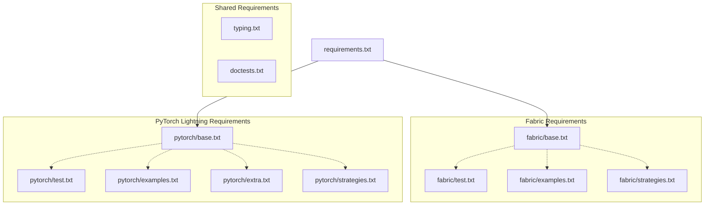
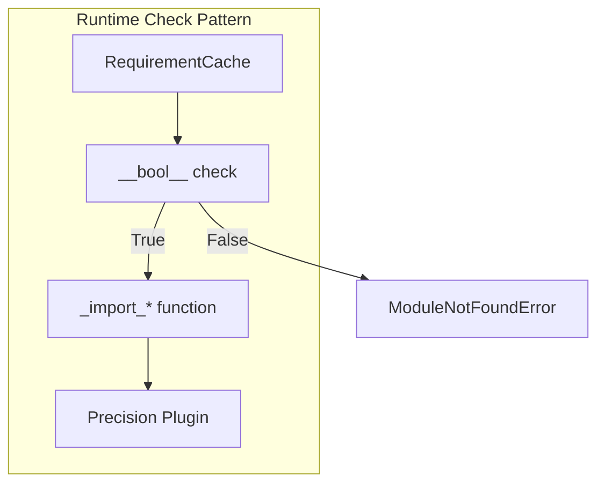
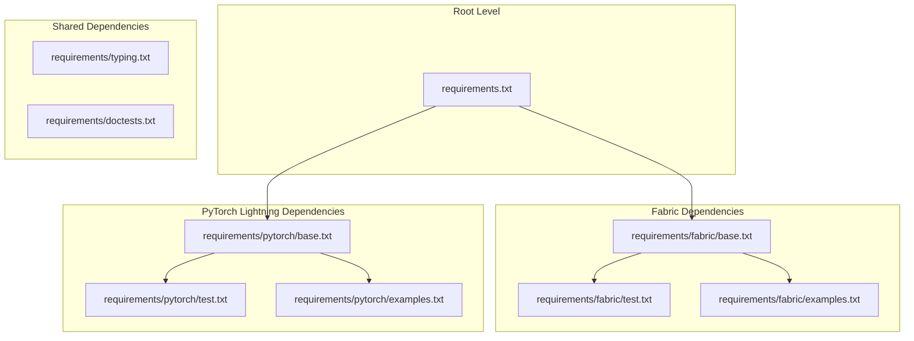

<!-- source: DeepWiki mcp.deepwiki.com · repo Lightning-AI/pytorch-lightning · page 7.2 Dependencies and Requirements · fetched 2026-10-21 -->

# Dependencies and Requirements

<details>
<summary>Relevant source files</summary>

The following files were used as context for generating this wiki page:

- [.github/actions/pkg-check/action.yml](.github/actions/pkg-check/action.yml)
- [.github/dependabot.yml](.github/dependabot.yml)
- [requirements.txt](requirements.txt)
- [requirements/doctests.txt](requirements/doctests.txt)
- [requirements/fabric/base.txt](requirements/fabric/base.txt)
- [requirements/fabric/examples.txt](requirements/fabric/examples.txt)
- [requirements/fabric/extra.txt](requirements/fabric/extra.txt)
- [requirements/fabric/strategies.txt](requirements/fabric/strategies.txt)
- [requirements/fabric/test.txt](requirements/fabric/test.txt)
- [requirements/pytorch/base.txt](requirements/pytorch/base.txt)
- [requirements/pytorch/examples.txt](requirements/pytorch/examples.txt)
- [requirements/pytorch/strategies.txt](requirements/pytorch/strategies.txt)
- [requirements/pytorch/test.txt](requirements/pytorch/test.txt)
- [requirements/typing.txt](requirements/typing.txt)
- [setup.py](setup.py)
- [src/lightning/__setup__.py](src/lightning/__setup__.py)
- [src/lightning_fabric/__setup__.py](src/lightning_fabric/__setup__.py)
- [src/pytorch_lightning/MANIFEST.in](src/pytorch_lightning/MANIFEST.in)
- [src/pytorch_lightning/__setup__.py](src/pytorch_lightning/__setup__.py)
- [tests/tests_fabric/utilities/test_imports.py](tests/tests_fabric/utilities/test_imports.py)

</details>


This page documents the dependency structure across the Lightning ecosystem, including core requirements, optional extras for strategies and features, and development dependencies. The system uses modular requirements files organized by package and feature.

For package installation options and build configuration, see [Package Structure](#7.1). For project-level configuration files, see [Project Configuration](#7.3).

## Requirements File Organization

The dependency system is organized into a hierarchical structure of requirements files under the `requirements/` directory:

**Requirements File Hierarchy Diagram**



Sources: [requirements.txt:1-5](), [requirements/fabric/base.txt](), [requirements/pytorch/base.txt](), [requirements/pytorch/extra.txt](), [requirements/pytorch/strategies.txt](), [requirements/fabric/strategies.txt]()

## Core Dependencies

### Fabric Base Dependencies

The minimal dependencies required by Lightning Fabric are defined in [requirements/fabric/base.txt:1-9]():

| Package | Version Range | Purpose |
|---------|---------------|---------|
| `torch` | `>=2.1.0, <2.9.0` | PyTorch framework |
| `fsspec[http]` | `>=2022.5.0, <2025.11.0` | Filesystem abstraction with HTTP support |
| `packaging` | `>=20.0, <=25.0` | Version parsing and package utilities |
| `typing-extensions` | `>4.5.0, <4.16.0` | Enhanced type annotations for Python <3.11 |
| `lightning-utilities` | `>=0.10.0, <0.16.0` | Shared utilities across Lightning packages |

### PyTorch Lightning Base Dependencies

PyTorch Lightning extends Fabric's dependencies with additional requirements in [requirements/pytorch/base.txt:1-12]():

| Package | Version Range | Purpose |
|---------|---------------|---------|
| `torch` | `>=2.1.0, <2.9.0` | PyTorch framework (same as Fabric) |
| `tqdm` | `>=4.57.0, <4.68.0` | Progress bars in training loops |
| `PyYAML` | `>5.4, <6.1.0` | YAML configuration file parsing |
| `fsspec[http]` | `>=2022.5.0, <2025.11.0` | Filesystem abstraction |
| `torchmetrics` | `>0.7.0, <1.9.0` | Metrics computation and aggregation |
| `packaging` | `>=20.0, <=25.0` | Version parsing |
| `typing-extensions` | `>4.5.0, <4.16.0` | Enhanced type annotations |
| `lightning-utilities` | `>=0.10.0, <0.16.0` | Shared utilities |

Sources: [requirements/fabric/base.txt:1-9](), [requirements/pytorch/base.txt:1-12]()

## Optional Dependencies

### PyTorch Lightning Extra Features

The [requirements/pytorch/extra.txt:1-12]() file defines optional dependencies for enhanced functionality:

| Package | Version Range | Purpose |
|---------|---------------|---------|
| `matplotlib` | `>3.1, <3.11.0` | Visualization utilities |
| `omegaconf` | `>=2.2.3, <2.4.0` | Hierarchical configuration management |
| `hydra-core` | `>=1.2.0, <1.4.0` | Configuration composition framework |
| `jsonargparse[signatures,jsonnet]` | `>=4.39.0, <4.44.0` | CLI argument parsing for `LightningCLI` |
| `rich` | `>=12.3.0, <14.3.0` | Rich terminal output formatting |
| `tensorboardX` | `>=2.2, <2.7.0` | Alternative TensorBoard logger |
| `bitsandbytes` | `>=0.45.2,<0.47.0` | Quantization support (not on Darwin) |

The `jsonargparse` dependency is particularly important for the `LightningCLI` class, which uses `RequirementCache("jsonargparse[signatures]>=4.27.7")` for runtime checking as seen in [src/lightning/pytorch/cli.py:39]().

Sources: [requirements/pytorch/extra.txt:1-12](), [src/lightning/pytorch/cli.py:39]()

### Strategy-Specific Dependencies

**DeepSpeed Strategy**

Both PyTorch Lightning and Fabric support DeepSpeed through [requirements/pytorch/strategies.txt:1-7]() and [requirements/fabric/strategies.txt:1-10]():

```python
deepspeed >=0.15.0,<0.17.0; platform_system != "Windows" and platform_system != "Darwin"  # strict
```

Platform restrictions exclude Windows and macOS. The `# strict` comment indicates the upper bound is enforced in production (not just CI). The `DeepSpeedPrecision` plugin in [src/lightning/fabric/plugins/precision/deepspeed.py]() uses TYPE_CHECKING imports to avoid hard dependency.

**Bitsandbytes Quantization**

The Fabric strategies file includes bitsandbytes for quantized training:

```python
bitsandbytes >=0.45.2,<0.47.0; platform_system != "Darwin"
```

The `BitsandbytesPrecision` plugin in [src/lightning/fabric/plugins/precision/bitsandbytes.py:43]() uses `RequirementCache("bitsandbytes")` for runtime availability checking.

**Transformer Engine**

While not in requirements files, the `TransformerEnginePrecision` plugin in [src/lightning/fabric/plugins/precision/transformer_engine.py:36]() uses:

```python
_TRANSFORMER_ENGINE_AVAILABLE = RequirementCache("transformer_engine>=0.11.0")
```

Sources: [requirements/pytorch/strategies.txt:1-7](), [requirements/fabric/strategies.txt:1-10](), [src/lightning/fabric/plugins/precision/bitsandbytes.py:43](), [src/lightning/fabric/plugins/precision/transformer_engine.py:36](), [src/lightning/fabric/plugins/precision/deepspeed.py:27-29]()

### Example Dependencies

Dependencies for running examples and tutorials:

**PyTorch Lightning Examples** ([requirements/pytorch/examples.txt:1-8]()):
- `requests <2.33.0` - HTTP requests for data downloading
- `torchvision >=0.16.0, <0.25.0` - Computer vision datasets and models
- `ipython[all] >=8.0.0, <10.0.0` - Interactive notebook support
- `torchmetrics >=0.10.0, <1.9.0` - Additional metrics beyond base requirements

**Fabric Examples** ([requirements/fabric/examples.txt:1-6]()):
- `torchvision >=0.16.0, <0.25.0` - Computer vision utilities
- `torchmetrics >=0.10.0, <1.9.0` - Metrics for example scripts

Sources: [requirements/pytorch/examples.txt:1-8](), [requirements/fabric/examples.txt:1-6]()

### Test Dependencies

**Core Test Infrastructure**

Both packages share pytest and coverage tooling ([requirements/pytorch/test.txt:1-9](), [requirements/fabric/test.txt:1-9]()):

| Package | Version Range | Purpose |
|---------|---------------|---------|
| `pytest` | `==8.4.2` | Test framework |
| `coverage` | `==7.11.0` (py>=3.10) or `==7.10.7` (py<3.10) | Code coverage measurement |
| `pytest-cov` | `==7.0.0` | Coverage plugin for pytest |
| `pytest-timeout` | `==2.4.0` | Test timeout enforcement |
| `pytest-rerunfailures` | `==16.1` (py>=3.10) or `==16.0.1` (py<3.10) | Retry flaky tests |
| `pytest-random-order` | `==1.2.0` | Randomize test execution order |

**PyTorch Lightning Test Dependencies**

Additional testing dependencies in [requirements/pytorch/test.txt:10-26]():

| Package | Version Range | Purpose |
|---------|---------------|---------|
| `cloudpickle` | `>=1.3, <3.2.0` | Serialization testing |
| `scikit-learn` | `>0.22.1, <1.8.0` | ML model integration testing |
| `numpy` | `>1.20.0, <1.27.0` | Numerical operations |
| `onnx` | `>1.12.0, <1.20.0` | ONNX model export testing |
| `onnxruntime` | `>=1.12.0, <1.24.0` | ONNX runtime testing |
| `onnxscript` | `>= 0.1.0, < 0.6.0` | ONNX script support |
| `psutil` | `<7.2.0` | System monitoring (`DeviceStatsMonitor`) |
| `pandas` | `>2.0, <2.4.0` | Benchmarking data processing |
| `fastapi` / `uvicorn` | No version constraint | `ServableModuleValidator` testing |
| `tensorboard` | `>=2.11, <2.21.0` | `TensorBoardLogger` testing |
| `torch-tensorrt` | Linux + Python >=3.12 only | TensorRT optimization testing |
| `huggingface-hub` | No version constraint | Model hub integration |

**Fabric Test Dependencies**

Minimal additional dependencies in [requirements/fabric/test.txt:10-14]():

| Package | Version Range | Purpose |
|---------|---------------|---------|
| `numpy` | `>=1.21.0, <1.27.0` | Numerical operations |
| `click` | `==8.1.8` (py<3.11) or `==8.3.1` (py>3.10) | CLI testing utilities |
| `tensorboardX` | `>=2.6, <2.7.0` | Alternative TensorBoard logger |
| `huggingface-hub` | No version constraint | Model hub integration |

Sources: [requirements/pytorch/test.txt:1-26](), [requirements/fabric/test.txt:1-14]()

### Development Dependencies

**Type Checking**

The [requirements/typing.txt:1-21]() file defines type checking infrastructure:

| Package | Version | Purpose |
|---------|---------|---------|
| `mypy` | `==1.19.0` | Static type checker |
| `torch` | `==2.8.0` | PyTorch type stubs |
| `types-Markdown` | Latest | Markdown type stubs |
| `types-PyYAML` | Latest | PyYAML type stubs |
| `types-requests` | Latest | Requests library type stubs |
| `types-setuptools` | Latest | Setuptools type stubs |
| 15+ additional `types-*` packages | Latest | Various library type stubs |

**Documentation Testing**

The [requirements/doctests.txt:1-3]() file defines doctest dependencies:

```
pytest ==8.4.2
pytest-doctestplus ==1.6.0
```

These enable testing of code examples in docstrings across the codebase.

Sources: [requirements/typing.txt:1-21](), [requirements/doctests.txt:1-3]()

## Runtime Dependency Checking

### RequirementCache Pattern

Lightning uses the `RequirementCache` utility from `lightning-utilities` to check optional dependencies at runtime. This pattern allows graceful degradation when optional features are unavailable.

**Pattern Usage in Precision Plugins**



**Bitsandbytes Example** ([src/lightning/fabric/plugins/precision/bitsandbytes.py:43-46]()):

```python
_BITSANDBYTES_AVAILABLE = RequirementCache("bitsandbytes")

@functools.lru_cache(maxsize=1)
def _import_bitsandbytes() -> ModuleType:
    if not _BITSANDBYTES_AVAILABLE:
        raise ModuleNotFoundError(str(_BITSANDBYTES_AVAILABLE))
    # ... import bitsandbytes
```

The `BitsandbytesPrecision` plugin constructor calls `_import_bitsandbytes()` at initialization, ensuring early failure with a clear error message if the package is unavailable [src/lightning/fabric/plugins/precision/bitsandbytes.py:76]().

**Transformer Engine Example** ([src/lightning/fabric/plugins/precision/transformer_engine.py:36-76]()):

```python
_TRANSFORMER_ENGINE_AVAILABLE = RequirementCache("transformer_engine>=0.11.0")

def __init__(self, ...) -> None:
    if not _TRANSFORMER_ENGINE_AVAILABLE:
        raise ModuleNotFoundError(str(_TRANSFORMER_ENGINE_AVAILABLE))
```

**LightningCLI Example** ([src/lightning/pytorch/cli.py:39-41]()):

```python
_JSONARGPARSE_SIGNATURES_AVAILABLE = RequirementCache("jsonargparse[signatures]>=4.27.7")

if _JSONARGPARSE_SIGNATURES_AVAILABLE:
    import docstring_parser
    from jsonargparse import ArgumentParser, Namespace, ...
```

Sources: [src/lightning/fabric/plugins/precision/bitsandbytes.py:43-76](), [src/lightning/fabric/plugins/precision/transformer_engine.py:36-76](), [src/lightning/pytorch/cli.py:39-64]()

### Platform-Specific Dependencies

Dependencies use environment markers to conditionally install based on platform and Python version:

**Platform Exclusions**

| Package | Condition | Reason |
|---------|-----------|--------|
| `deepspeed` | `platform_system != "Windows" and platform_system != "Darwin"` | Only supported on Linux |
| `bitsandbytes` | `platform_system != "Darwin"` | Requires CUDA; not available on macOS |
| `torch-tensorrt` | `platform_system == "Linux" and python_version >= "3.12"` | Linux-only, requires Python 3.12+ |

**Python Version-Specific**

| Package | Condition | Version |
|---------|-----------|---------|
| `coverage` | `python_version >= "3.10"` | `==7.11.0` |
| `coverage` | `python_version < "3.10"` | `==7.10.7` |
| `pytest-rerunfailures` | `python_version >= "3.10"` | `==16.1` |
| `pytest-rerunfailures` | `python_version < "3.10"` | `==16.0.1` |
| `click` | `python_version < "3.11"` | `==8.1.8` |
| `click` | `python_version > "3.10"` | `==8.3.1` |

Sources: [requirements/pytorch/strategies.txt:6](), [requirements/fabric/strategies.txt:8-9](), [requirements/pytorch/test.txt:1-2,6-7,24](), [requirements/fabric/test.txt:1-2,7-8,10-11]()

## Version Management

### Upper Bound Policy

All requirements files include this header explaining version bound management:

```
# NOTE: the upper bound for the package version is only set for CI stability, 
# and it is dropped while installing this package in case you want to 
# preserve/enforce restrictions on the latest compatible version, 
# add "strict" as an in-line comment
```

**Behavior:**
- **CI Environment**: All specified upper bounds are enforced
- **User Installation**: Upper bounds are removed unless marked `# strict`
- **Strict Dependencies**: Upper bounds with `# strict` comment are always enforced

**Example from [requirements/pytorch/strategies.txt:6]():**

```python
deepspeed >=0.15.0,<0.17.0; platform_system != "Windows" and platform_system != "Darwin"  # strict
```

The `# strict` marker ensures the upper bound `<0.17.0` is enforced in production installations due to known compatibility issues.

Sources: [requirements/pytorch/base.txt:1-3](), [requirements/pytorch/strategies.txt:1-7]()

### PyTorch Version Support

Both Fabric and PyTorch Lightning support PyTorch `>=2.1.0, <2.9.0` ([requirements/fabric/base.txt:4](), [requirements/pytorch/base.txt:4]()). This provides compatibility across:

- PyTorch 2.1.x through 2.8.x
- CUDA 11.8, 12.1, 12.4 (depending on PyTorch version)
- Multiple Python versions (3.8-3.12+)

The test suite validates compatibility across this range using the CI matrix defined in GitHub Actions workflows.

Sources: [requirements/fabric/base.txt:4](), [requirements/pytorch/base.txt:4]()

## Dependency File Organization

The dependency management system uses a hierarchical file structure:



Sources: [requirements.txt:3-4](), [requirements/fabric/base.txt](), [requirements/pytorch/base.txt](), [requirements/typing.txt](), [requirements/doctests.txt]()

This hierarchical organization allows for:
- **Minimal core installations** with only essential dependencies
- **Feature-specific extras** for different use cases
- **Development environment setup** with comprehensive tooling
- **CI/CD optimization** with precise dependency control

---

