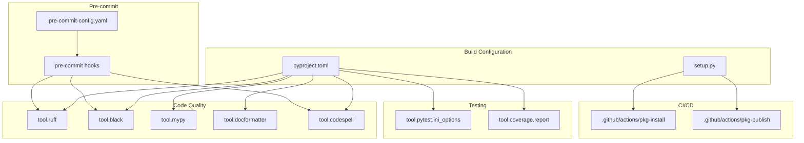
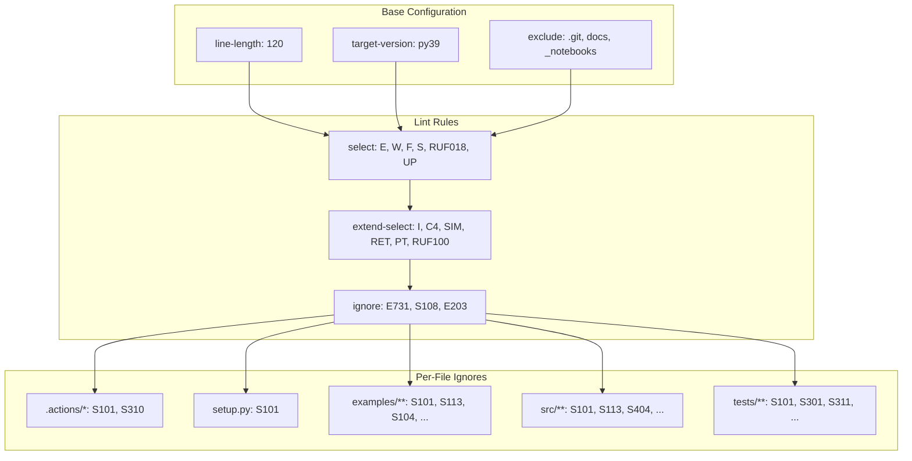
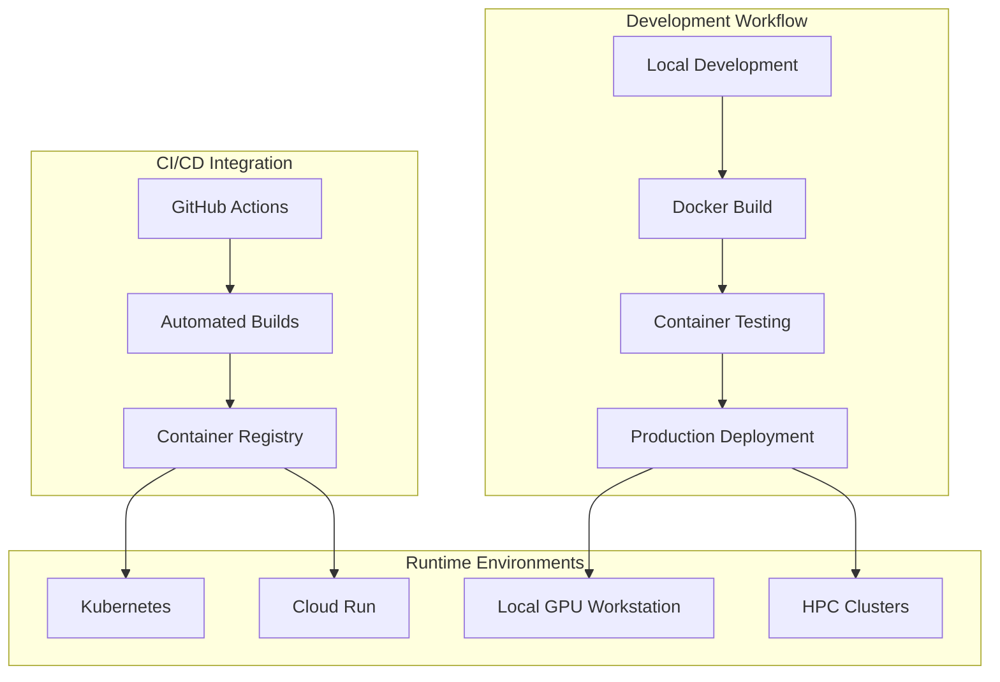

<!-- source: DeepWiki mcp.deepwiki.com · repo Lightning-AI/pytorch-lightning · page 7.3 Installation Methods · fetched 2026-10-21 -->

# Project Configuration

Relevant source files

The following files were used as context for generating this wiki page:

- [.github/actions/pkg-check/action.yml](.github/actions/pkg-check/action.yml)
- [.github/actions/pkg-install/action.yml](.github/actions/pkg-install/action.yml)
- [.github/actions/pkg-publish/action.yml](.github/actions/pkg-publish/action.yml)
- [.github/dependabot.yml](.github/dependabot.yml)
- [README.md](README.md)
- [requirements/fabric/extra.txt](requirements/fabric/extra.txt)
- [setup.py](setup.py)
- [src/lightning/__setup__.py](src/lightning/__setup__.py)
- [src/lightning_fabric/__setup__.py](src/lightning_fabric/__setup__.py)
- [src/pytorch_lightning/MANIFEST.in](src/pytorch_lightning/MANIFEST.in)
- [src/pytorch_lightning/__setup__.py](src/pytorch_lightning/__setup__.py)
- [tests/tests_fabric/utilities/test_imports.py](tests/tests_fabric/utilities/test_imports.py)

This document covers the configuration files that control PyTorch Lightning's build system, code quality tools, testing framework, and development workflow. These configurations ensure consistency across development environments and enforce quality standards throughout the codebase.

For package structure and build architecture, see [Package Structure](#7.1). For dependency management, see [Dependencies and Requirements](#7.2).

## Configuration File Overview

PyTorch Lightning uses multiple configuration files to manage different aspects of the project:

**Configuration Files:**
- `pyproject.toml`: Primary configuration file containing build system, linting, testing, and formatting settings
- `.pre-commit-config.yaml`: Pre-commit hook configurations for automated code quality checks
- `.github/actions/`: Reusable GitHub Actions for package installation and publishing

Sources: [pyproject.toml:1-179](), [.pre-commit-config.yaml:1-104]()

## Build System Configuration

The `pyproject.toml` file defines the build system requirements and configuration at the project root.

### Build System Requirements

The build system section specifies the build-time dependencies needed to package Lightning:

| Requirement | Purpose |
|-------------|---------|
| `setuptools` | Package building and installation |
| `wheel` | Binary distribution format support |
| `packaging` | Version parsing and comparison utilities |

This configuration is defined in [pyproject.toml:15-20]() and follows PEP 517/518 standards for declaring build-system requirements.

### Build Backend

The project uses `setuptools` as the build backend, which is invoked by `setup.py` to handle:
- Source distribution (`.tar.gz`) generation
- Wheel distribution (`.whl`) generation  
- Metadata extraction from package sources
- Dependency resolution

The `setup.py` file coordinates the build process for the three-package structure (lightning, pytorch-lightning, lightning-fabric) as documented in [Package Structure](#7.1).

Sources: [pyproject.toml:15-20]()

## Code Formatting and Style

The project enforces consistent code style through automated formatters configured in `pyproject.toml`.

### Black Configuration

Black is configured as the primary code formatter with these settings defined in [pyproject.toml:23-25]():

| Setting | Value | Purpose |
|---------|-------|---------|
| `line-length` | `120` | Maximum line length before wrapping |
| `exclude` | `_notebooks/.*` | Directories to skip during formatting |

Black is invoked automatically through pre-commit hooks (see [Pre-commit Hooks](#pre-commit-hooks)) and enforces a consistent, opinionated code style across the codebase.

### Docstring Formatting

The `docformatter` tool ensures consistent docstring formatting with configuration in [pyproject.toml:27-32]():

| Setting | Value | Purpose |
|---------|-------|---------|
| `recursive` | `true` | Process all subdirectories |
| `wrap-summaries` | `119` | Maximum summary line length |
| `wrap-descriptions` | `120` | Maximum description line length |
| `blank` | `true` | Add blank line after summary |

The slightly shorter summary line (119 vs 120) accommodates raw docstrings (`r"""..."""`) which consume one additional character.

Sources: [pyproject.toml:23-32]()

## Linting Configuration

The project uses Ruff as the primary linter for fast, comprehensive code analysis.

### Ruff Settings

Ruff configuration is defined in [pyproject.toml:45-120]() with the following structure:

**Rule Categories:**

| Category | Rules | Purpose |
|----------|-------|---------|
| Pycodestyle | `E`, `W` | Style guide enforcement (PEP 8) |
| Pyflakes | `F` | Logical errors (unused imports, undefined names) |
| Bandit | `S` | Security issue detection |
| Pyupgrade | `UP` | Modern Python syntax upgrades |
| isort | `I` | Import statement organization |
| flake8-comprehensions | `C4` | List/dict comprehension improvements |
| flake8-simplify | `SIM` | Code simplification suggestions |
| flake8-return | `RET` | Return statement consistency |
| flake8-pytest-style | `PT` | pytest best practices |
| Ruff-specific | `RUF018`, `RUF100` | Assignments in assert, unused noqa |

### Per-File Rule Overrides

The configuration provides targeted rule exemptions for different file types:

**Test Files** ([pyproject.toml:103-116]()): Exempt from security checks (`S101`, `S301`, `S311`) since tests commonly use `assert`, `pickle`, and random number generation.

**Source Files** ([pyproject.toml:92-102]()): Allow `assert` statements (`S101`) and subprocess usage for legitimate infrastructure code.

**Examples** ([pyproject.toml:83-91]()): Relaxed security rules for demonstration code that may bind to all interfaces or use temporary files.

### McCabe Complexity

Ruff enforces a maximum cyclomatic complexity of 10 as defined in [pyproject.toml:118-120](), preventing overly complex functions that are difficult to test and maintain.

Sources: [pyproject.toml:45-120]()

## Type Checking Configuration

MyPy performs static type analysis to catch type-related errors before runtime.

### MyPy Settings

Configuration defined in [pyproject.toml:123-140]():

| Setting | Value | Purpose |
|---------|-------|---------|
| `files` | `src/lightning` | Directories to type-check |
| `disallow_untyped_defs` | `True` | Require type annotations on all functions |
| `ignore_missing_imports` | `True` | Don't error on untyped third-party libraries |
| `show_error_codes` | `True` | Display error codes for easier suppression |
| `warn_redundant_casts` | `True` | Warn about unnecessary type casts |
| `warn_unused_configs` | `True` | Warn about unused configuration options |
| `warn_unused_ignores` | `True` | Warn about unnecessary `# type: ignore` comments |
| `allow_redefinition` | `True` | Allow variable redefinition in same scope |
| `disable_error_code` | `attr-defined` | Disable attribute definition checks |

### Trainer Attribute Exception

The `attr-defined` error code is disabled because `Trainer` attributes are dynamically added by connector classes during initialization rather than in `__init__`, as noted in [pyproject.toml:137-138](). This is a deliberate architectural choice where the `AcceleratorConnector` and other connectors attach configuration attributes to the `Trainer` instance.

Sources: [pyproject.toml:123-140]()

## Container Ecosystem Integration

The Docker containers integrate with the broader Lightning ecosystem through standardized interfaces and consistent environments:

The containers provide consistent environments across development, testing, and production phases while supporting various deployment targets from local workstations to cloud platforms.

Sources: [dockers/base-cuda/Dockerfile:1-107](), [dockers/nvidia/Dockerfile:1-71](), [dockers/release/Dockerfile:1-62](), [dockers/README.md:1-70]()

---

