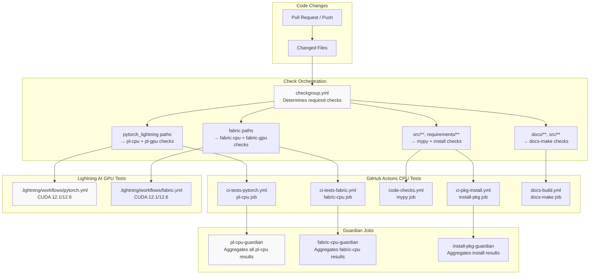
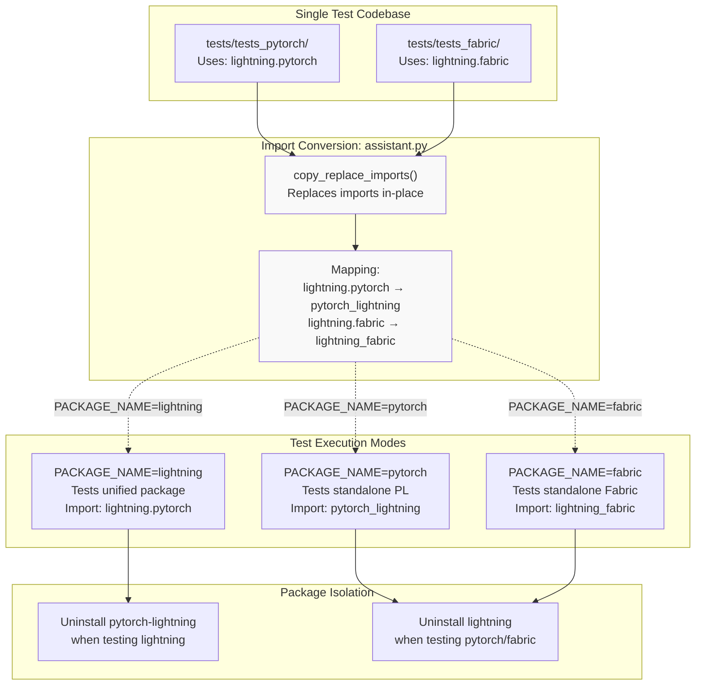
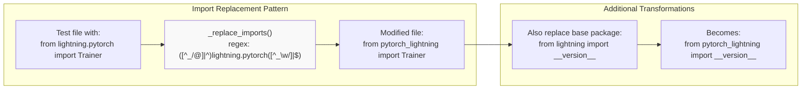
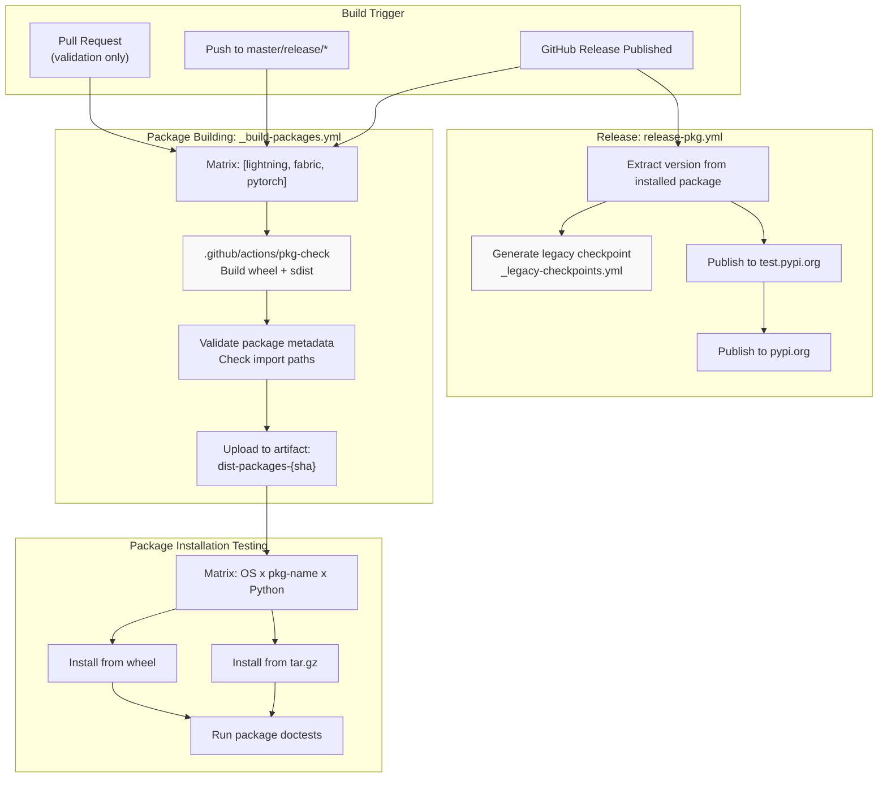
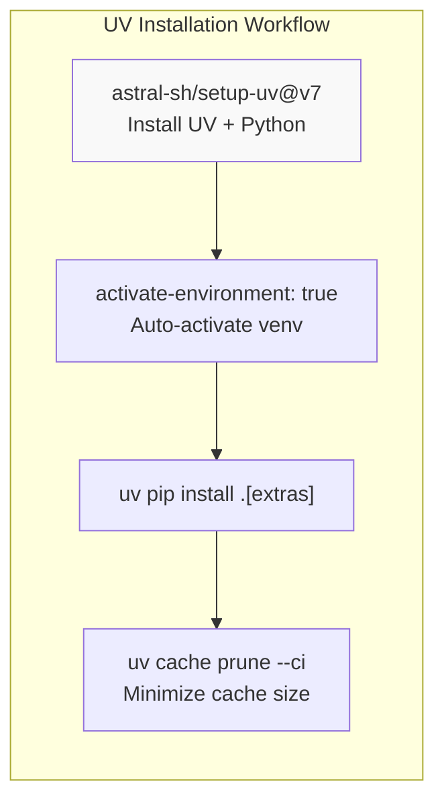
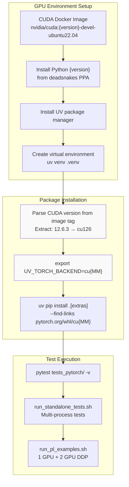
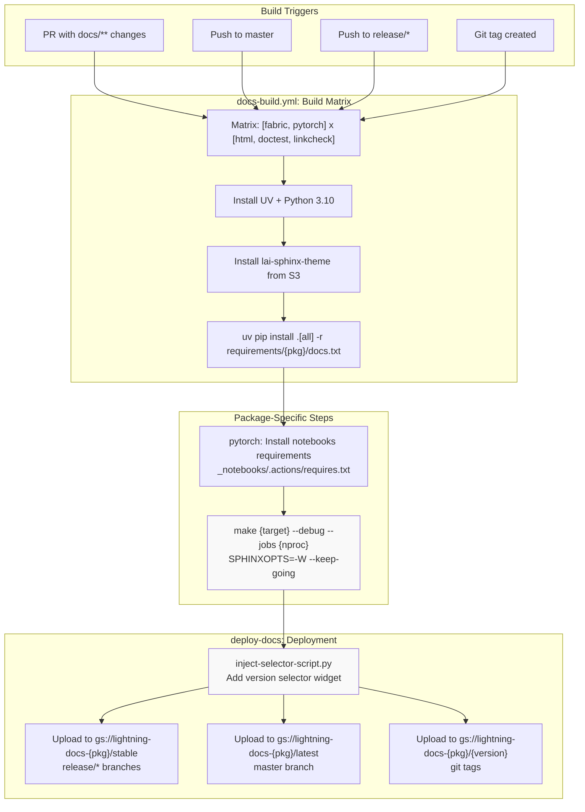
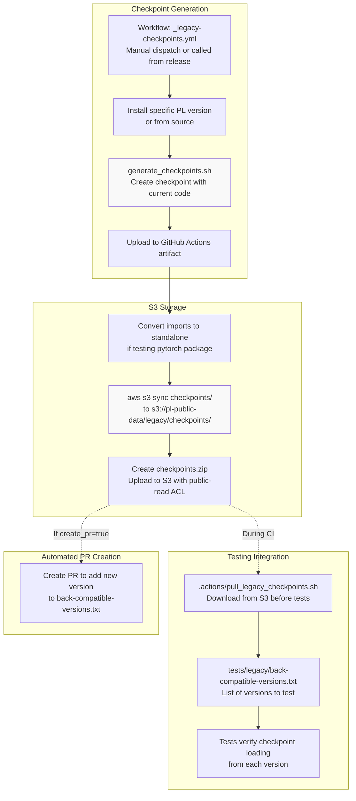

<!-- source: DeepWiki mcp.deepwiki.com · repo Lightning-AI/pytorch-lightning · page 8 Development Guide · fetched 2026-10-21 -->

# Development Guide

<details>
<summary>Relevant source files</summary>

The following files were used as context for generating this wiki page:

- [.actions/assistant.py](.actions/assistant.py)
- [.actions/requirements.txt](.actions/requirements.txt)
- [.github/checkgroup.yml](.github/checkgroup.yml)
- [.github/workflows/_build-packages.yml](.github/workflows/_build-packages.yml)
- [.github/workflows/_legacy-checkpoints.yml](.github/workflows/_legacy-checkpoints.yml)
- [.github/workflows/ci-pkg-install.yml](.github/workflows/ci-pkg-install.yml)
- [.github/workflows/ci-tests-fabric.yml](.github/workflows/ci-tests-fabric.yml)
- [.github/workflows/ci-tests-pytorch.yml](.github/workflows/ci-tests-pytorch.yml)
- [.github/workflows/cleanup-caches.yml](.github/workflows/cleanup-caches.yml)
- [.github/workflows/code-checks.yml](.github/workflows/code-checks.yml)
- [.github/workflows/docs-build.yml](.github/workflows/docs-build.yml)
- [.github/workflows/docs-tutorials.yml](.github/workflows/docs-tutorials.yml)
- [.github/workflows/labeler-issue.yml](.github/workflows/labeler-issue.yml)
- [.github/workflows/release-nightly.yml](.github/workflows/release-nightly.yml)
- [.github/workflows/release-pkg.yml](.github/workflows/release-pkg.yml)
- [.lightning/workflows/fabric.yml](.lightning/workflows/fabric.yml)
- [.lightning/workflows/pytorch.yml](.lightning/workflows/pytorch.yml)

</details>


## Purpose and Scope

This guide provides technical details for contributors to the PyTorch Lightning repository. It covers the testing infrastructure, CI/CD pipelines, documentation system, and release processes that enable the development and maintenance of the Lightning ecosystem.

For information about the package structure and build system, see [Package Architecture](#7.1). For detailed information about specific CI workflows, testing strategies, and documentation building, see the child pages: [CI/CD Pipeline](#8.1), [Testing Infrastructure](#8.2), and [Documentation System](#8.3).

## Development Workflow Overview

The Lightning monorepo employs a multi-package development model where three distinct packages (`lightning`, `pytorch-lightning`, `lightning-fabric`) are developed, tested, and released from a single codebase. The development workflow integrates:

- **Intelligent check orchestration** via `checkgroup.yml` that determines required tests based on changed files
- **Multi-dimensional testing** across OS (macOS, Ubuntu, Windows), Python versions (3.10-3.13), and PyTorch versions (2.1-2.9)
- **Dual execution environments**: CPU tests on GitHub Actions and GPU tests on Lightning AI's platform
- **Automated package building and validation** for all three package flavors
- **Continuous documentation deployment** to Google Cloud Storage



**Diagram: CI/CD Orchestration Architecture** - Shows how `checkgroup.yml` routes file changes to appropriate test jobs, with guardian jobs aggregating matrix results.

Sources: [.github/checkgroup.yml:1-197](), [.github/workflows/ci-tests-pytorch.yml:1-230](), [.github/workflows/ci-tests-fabric.yml:1-189](), [.lightning/workflows/pytorch.yml:1-193](), [.lightning/workflows/fabric.yml:1-165]()

## Testing Matrix and Import Conversion

The repository tests both unified (`lightning`) and standalone packages (`pytorch-lightning`, `lightning-fabric`) from the same test codebase using a clever import conversion strategy implemented in `assistant.py`.

### Testing Matrix Configuration

| Package | Python Versions | PyTorch Versions | Operating Systems |
|---------|----------------|------------------|-------------------|
| `lightning` | 3.10, 3.11, 3.12.7 | 2.1, 2.2.2, 2.3, 2.4.1, 2.5.1 | macOS-14, ubuntu-22.04, windows-2022 |
| `pytorch` | 3.12.7, 3.12, 3.13 | 2.6, 2.7, 2.8, 2.9 | macOS-14, ubuntu-22.04, windows-2022 |
| `fabric` | 3.12.7, 3.12, 3.13 | 2.6, 2.7, 2.8, 2.9 | macOS-14, ubuntu-22.04, windows-2022 |



**Diagram: Import Conversion Strategy** - The `assistant.py` script enables testing multiple package distributions from a single test codebase by dynamically converting import statements.

Sources: [.github/workflows/ci-tests-pytorch.yml:159-165](), [.github/workflows/ci-tests-fabric.yml:136-140](), [.actions/assistant.py:237-323](), [.lightning/workflows/pytorch.yml:111-120]()

### assistant.py Helper Script

The `.actions/assistant.py` script provides critical development utilities:

**Core Functions:**

| Function | Purpose | Usage in CI |
|----------|---------|-------------|
| `copy_replace_imports()` | Convert imports between package namespaces | [.github/workflows/ci-tests-pytorch.yml:162-164]() |
| `load_requirements()` | Parse and adjust requirement files | [.actions/assistant.py:132-148]() |
| `prune_pytest_as_errors()` | Remove warning-as-error filters for oldest tests | [.github/workflows/ci-tests-pytorch.yml:106]() |
| `convert_version2nightly()` | Transform version to nightly format | [.github/workflows/release-nightly.yml:34]() |
| `pull_docs_files()` | Download external documentation pages | [.actions/assistant.py:361-418]() |



**Diagram: Import Replacement Mechanism** - Regex-based pattern matching ensures complete import conversion while avoiding false positives.

Sources: [.actions/assistant.py:237-282](), [.actions/assistant.py:344-358]()

## Package Build and Release Pipeline

The repository uses a modular workflow system for building and releasing packages:



**Diagram: Package Build and Release Flow** - Shows the progression from building packages through validation and eventual PyPI publication.

Sources: [.github/workflows/_build-packages.yml:1-71](), [.github/workflows/ci-pkg-install.yml:1-120](), [.github/workflows/release-pkg.yml:1-191]()

### Build Artifacts Structure

After building, artifacts are organized as:

```
dist-packages-{sha}/
├── lightning/
│   ├── lightning-{version}-py3-none-any.whl
│   └── lightning-{version}.tar.gz
├── pytorch/
│   ├── pytorch_lightning-{version}-py3-none-any.whl
│   └── pytorch_lightning-{version}.tar.gz
└── fabric/
    ├── lightning_fabric-{version}-py3-none-any.whl
    └── lightning_fabric-{version}.tar.gz
```

Sources: [.github/workflows/_build-packages.yml:40-48]()

## UV Package Manager Integration

The CI system uses `uv` as a fast, modern Python package installer instead of `pip`:

**Key Features:**
- **Cache Management**: `uv cache prune --ci` minimizes cache size after tests ([.github/workflows/ci-tests-pytorch.yml:214-215]())
- **Torch Backend Support**: `UV_TORCH_BACKEND` environment variable selects CPU/CUDA wheels ([.github/workflows/ci-tests-pytorch.yml:72]())
- **Find Links Support**: Prefers CUDA-specific packages from PyTorch index ([.lightning/workflows/pytorch.yml:126-128]())
- **Virtual Environment Activation**: Uses `activate-environment: true` for automatic activation ([.github/workflows/ci-tests-pytorch.yml:76-82]())



**Diagram: UV Integration Pattern** - Consistent pattern used across all CI workflows for fast dependency installation.

Sources: [.github/workflows/ci-tests-pytorch.yml:76-82](), [.github/workflows/ci-tests-fabric.yml:71-78](), [.lightning/workflows/pytorch.yml:55-71]()

## Coverage Reporting Strategy

The testing infrastructure collects and reports code coverage to Codecov:

**Coverage Scopes:**

| Package Being Tested | Coverage Source | Flags |
|---------------------|-----------------|-------|
| `lightning` | `lightning` | `lightning,cpu,pytest-full,python{ver},pytorch{ver}` |
| `pytorch-lightning` | `pytorch_lightning` | `pytorch_lightning,cpu,pytest-full,python{ver},pytorch{ver}` |
| `lightning-fabric` | `lightning_fabric` | `lightning_fabric,cpu,pytest,python{ver}` |

The scope is dynamically determined:
```python
# Determine coverage scope based on package being tested
python -c "print('COVERAGE_SCOPE=' + str('lightning' if '${{matrix.config.pkg-name}}' == 'lightning' else 'pytorch_lightning'))" >> $GITHUB_ENV
```

Sources: [.github/workflows/ci-tests-pytorch.yml:118-128](), [.github/workflows/ci-tests-fabric.yml:118-126](), [.github/workflows/ci-tests-pytorch.yml:186-212]()

## GPU Testing on Lightning AI Platform

GPU tests run on Lightning AI's infrastructure using custom workflow definitions:

**GPU Test Configuration:**

| Workflow | CUDA Versions | Python Versions | Machines |
|----------|--------------|-----------------|----------|
| `.lightning/workflows/pytorch.yml` | 12.1.1, 12.6.3 | 3.10, 3.12 | L4_X_2 (2x NVIDIA L4) |
| `.lightning/workflows/fabric.yml` | 12.1.1, 12.6.3 | 3.10, 3.12 | L4_X_2 (2x NVIDIA L4) |



**Diagram: GPU Test Environment Setup** - Shows the automated environment configuration for GPU testing on Lightning AI platform.

Sources: [.lightning/workflows/pytorch.yml:36-193](), [.lightning/workflows/fabric.yml:36-165](), [.lightning/workflows/pytorch.yml:81-88]()

### Standalone Test Execution

Standalone tests verify multi-process functionality:

```bash
export PL_RUN_STANDALONE_TESTS=1
bash ./run_standalone_tests.sh "tests_pytorch"
```

This script:
1. Identifies test files marked as standalone (containing `@RunIf`)
2. Executes each in a separate process to avoid state pollution
3. Tests distributed training features that require process isolation

Sources: [.lightning/workflows/pytorch.yml:163-168](), [.lightning/workflows/fabric.yml:141-145]()

## Documentation Build System

Documentation is built using Sphinx and deployed to Google Cloud Storage:



**Diagram: Documentation Build and Deployment Pipeline** - Shows how documentation is built for both packages and deployed to version-specific paths.

Sources: [.github/workflows/docs-build.yml:1-200](), [.github/workflows/docs-build.yml:143-200]()

### Documentation Paths on GCS

Deployed documentation follows this structure:

| Event | Deployment Path | Purpose |
|-------|----------------|---------|
| Push to `release/*` | `gs://lightning-docs-{pkg}/stable` | Current stable release docs |
| Push to `master` | `gs://lightning-docs-{pkg}/latest` | Development docs from master |
| Git tag/Release | `gs://lightning-docs-{pkg}/{version}` | Version-specific archive |

Additionally, zipped archives are stored: `gs://lightning-docs-{pkg}/{version}.zip`

Sources: [.github/workflows/docs-build.yml:172-199]()

## Legacy Checkpoint System

The repository maintains backward compatibility by testing against checkpoints created with previous PyTorch Lightning versions:



**Diagram: Legacy Checkpoint Workflow** - Ensures backward compatibility by testing against checkpoints from previous releases.

Sources: [.github/workflows/_legacy-checkpoints.yml:1-164](), [.github/workflows/ci-tests-pytorch.yml:169-174]()

The checkpoint generation script creates models with various configurations and saves them:
- Location: `tests/legacy/checkpoints/{version}/`
- Pulled during CI: [.github/workflows/ci-tests-pytorch.yml:169-174]()
- S3 bucket: `s3://pl-public-data/legacy/checkpoints/`

Sources: [.github/workflows/_legacy-checkpoints.yml:90-103](), [.github/workflows/_legacy-checkpoints.yml:123-134]()

## Environment Variable Configuration

Key environment variables used across CI workflows:

| Variable | Purpose | Example Values |
|----------|---------|---------------|
| `PACKAGE_NAME` | Determines which package to build/test | `lightning`, `pytorch`, `fabric` |
| `FREEZE_REQUIREMENTS` | Whether to use frozen versions | `1` on release branches, `0` on master |
| `TORCH_URL` | PyTorch wheel index URL | `https://download.pytorch.org/whl/cpu/` |
| `TORCH_URL_TEST` | PyTorch test/nightly builds | `https://download.pytorch.org/whl/test/cpu/` |
| `UV_TORCH_BACKEND` | CUDA version for UV | `cpu`, `cu121`, `cu126` |
| `COVERAGE_SCOPE` | Source path for coverage | `lightning`, `pytorch_lightning`, `lightning_fabric` |
| `DISABLE_MPS` | Disable MPS tests on macOS | `1` on macOS-14 |
| `RUN_ONLY_CUDA_TESTS` | Skip CPU-only tests on GPU runners | `1` |
| `PL_RUN_STANDALONE_TESTS` | Enable standalone test mode | `1` |

Sources: [.github/workflows/ci-tests-pytorch.yml:64-128](), [.lightning/workflows/pytorch.yml:25-34](), [.github/workflows/ci-tests-fabric.yml:60-126]()

## Nightly Release Process

Weekly nightly builds are published every Sunday:

**Workflow Steps:**
1. Convert version to nightly format: `X.Y.Z` → `X.Y.Z.devYYYYMMDD`
2. Build package with nightly version
3. Publish to both test.pypi.org and pypi.org

```python
# Version conversion in assistant.py
timestamp = datetime.now().strftime("%Y%m%d")
version = f"{'.'.join(vers.groups())}.dev{timestamp}"
```

Sources: [.github/workflows/release-nightly.yml:1-69](), [.actions/assistant.py:430-442]()

## Best Practices for Contributors

**Before Submitting a PR:**
1. Run tests locally for the package you're modifying
2. If changing imports, verify both `lightning` and standalone packages work
3. Update documentation if adding/changing public APIs
4. Run `mypy` if modifying type annotations

**Testing Locally:**
```bash
# Test PyTorch Lightning
PACKAGE_NAME=pytorch pytest tests/tests_pytorch/

# Test with import conversion
python .actions/assistant.py copy_replace_imports \
    --source_dir="./tests" \
    --source_import="lightning.pytorch" \
    --target_import="pytorch_lightning"
```

**Understanding CI Failures:**
- Check `checkgroup.yml` to see which checks are required for your changes
- Guardian jobs (`pl-cpu-guardian`, etc.) aggregate matrix results - check individual job logs
- GPU test logs are in Lightning AI platform - linked from GitHub checks

Sources: [.github/checkgroup.yml:1-197](), [.actions/assistant.py:344-358]()

---

