<!-- source: DeepWiki mcp.deepwiki.com · repo Lightning-AI/pytorch-lightning · page 8.1 CI/CD Pipeline · fetched 2026-10-21 -->

# CI/CD Pipeline

<details>
<summary>Relevant source files</summary>

The following files were used as context for generating this wiki page:

- [.actions/assistant.py](.actions/assistant.py)
- [.actions/requirements.txt](.actions/requirements.txt)
- [.github/actions/pkg-install/action.yml](.github/actions/pkg-install/action.yml)
- [.github/actions/pkg-publish/action.yml](.github/actions/pkg-publish/action.yml)
- [.github/checkgroup.yml](.github/checkgroup.yml)
- [.github/workflows/_build-packages.yml](.github/workflows/_build-packages.yml)
- [.github/workflows/_legacy-checkpoints.yml](.github/workflows/_legacy-checkpoints.yml)
- [.github/workflows/ci-pkg-install.yml](.github/workflows/ci-pkg-install.yml)
- [.github/workflows/ci-tests-fabric.yml](.github/workflows/ci-tests-fabric.yml)
- [.github/workflows/ci-tests-pytorch.yml](.github/workflows/ci-tests-pytorch.yml)
- [.github/workflows/cleanup-caches.yml](.github/workflows/cleanup-caches.yml)
- [.github/workflows/code-checks.yml](.github/workflows/code-checks.yml)
- [.github/workflows/docs-build.yml](.github/workflows/docs-build.yml)
- [.github/workflows/docs-tutorials.yml](.github/workflows/docs-tutorials.yml)
- [.github/workflows/labeler-issue.yml](.github/workflows/labeler-issue.yml)
- [.github/workflows/release-nightly.yml](.github/workflows/release-nightly.yml)
- [.github/workflows/release-pkg.yml](.github/workflows/release-pkg.yml)
- [.lightning/workflows/fabric.yml](.lightning/workflows/fabric.yml)
- [.lightning/workflows/pytorch.yml](.lightning/workflows/pytorch.yml)

</details>


This page documents the continuous integration and continuous delivery pipeline for the PyTorch Lightning repository. It covers how automated testing, code quality checks, package building, and deployment processes are organized to ensure code quality and streamline releases. For information about the development workflow for contributors, see [Contributing Workflow](7.1).

## Purpose and Scope

The CI/CD pipeline in PyTorch Lightning is designed to:

1. Automate testing across multiple environments (Python versions, PyTorch versions, operating systems)
2. Ensure code quality through static analysis and documentation checks
3. Build and publish packages for all Lightning components
4. Generate and deploy documentation
5. Create and publish Docker images for different configurations
6. Support the release process with automated deployment

Sources: [.github/workflows/README.md]()

## Architecture Overview

The CI/CD pipeline uses GitHub Actions for CPU testing and code quality checks, and Lightning AI's infrastructure for GPU testing. The system is orchestrated through multiple workflow files that coordinate testing, building, and releasing.

**CI/CD Pipeline Architecture**

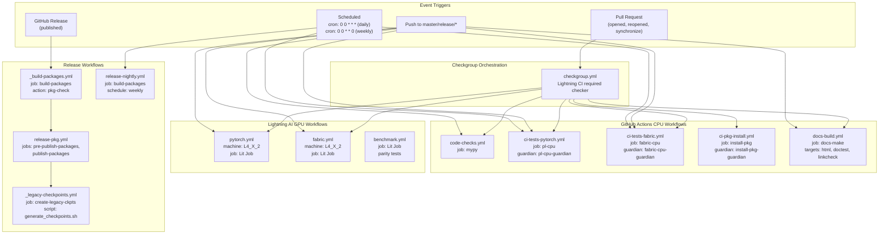

Sources: [.github/checkgroup.yml:1-197](), [.github/workflows/ci-tests-pytorch.yml:1-32](), [.github/workflows/ci-tests-fabric.yml:1-28](), [.github/workflows/code-checks.yml:1-26](), [.github/workflows/ci-pkg-install.yml:1-32](), [.github/workflows/docs-build.yml:1-46](), [.lightning/workflows/pytorch.yml:1-10](), [.lightning/workflows/fabric.yml:1-10](), [.github/workflows/_build-packages.yml:1-20](), [.github/workflows/release-pkg.yml:1-28](), [.github/workflows/release-nightly.yml:1-19](), [.github/workflows/_legacy-checkpoints.yml:1-51]()

## Workflow Selection and Control

The CI/CD pipeline uses path-based filtering to determine which workflows run for each PR or commit. This is controlled through two mechanisms: path filters in workflow definitions and the checkgroup configuration.

### Required Checks Configuration

The [.github/checkgroup.yml:1-197]() file defines subprojects with path patterns and required checks. This enables the "Lightning CI required checker" custom check that aggregates status from multiple workflows:

**Checkgroup Configuration Architecture**

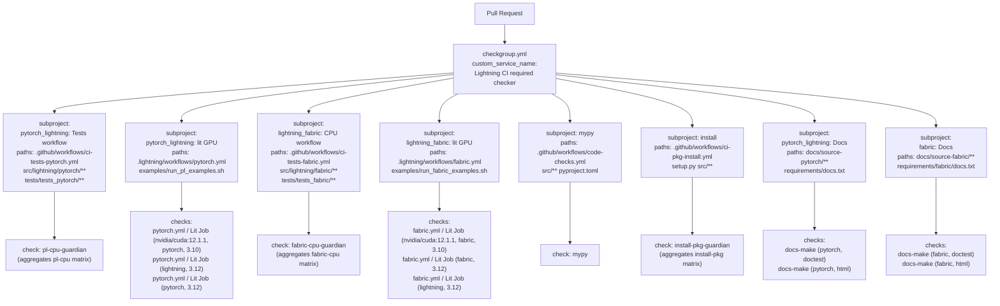

The guardian jobs (e.g., `pl-cpu-guardian`, `fabric-cpu-guardian`, `install-pkg-guardian`) aggregate results from multiple test matrix jobs and serve as the single required check for merging PRs. Each subproject in checkgroup.yml defines path filters and the checks that must pass.

Sources: [.github/checkgroup.yml:1-197](), [.github/workflows/ci-tests-pytorch.yml:217-229](), [.github/workflows/ci-tests-fabric.yml:176-188](), [.github/workflows/ci-pkg-install.yml:107-119]()

### Workflow Triggers

Each workflow file specifies trigger conditions using GitHub Actions `on:` syntax:

**Pull Request Triggers**
- Trigger on `opened`, `reopened`, `ready_for_review`, `synchronize` events
- Target branches: `master` and `release/*`
- Path filters (e.g., [.github/workflows/ci-tests-pytorch.yml:10-25]()) limit execution based on changed files
- Draft PRs are skipped via `if: github.event.pull_request.draft == false`

**Push Triggers**
- Trigger on pushes to `master` and `release/*` branches
- Used for documentation deployment and nightly builds

**Release Triggers**
- Trigger when a GitHub release is published
- Activates package publishing workflows ([.github/workflows/release-pkg.yml:7-8]())

**Schedule Triggers**
- Daily tests: `cron: "0 0 * * *"` (end of each day) for [.github/workflows/ci-tests-pytorch.yml:26-28]()
- Weekly nightly builds: `cron: "0 0 * * 0"` (Sundays) for [.github/workflows/release-nightly.yml:12-13]()

**Workflow Dispatch**
- Manual triggers enabled for release workflows and documentation updates

**Concurrency Control**

All workflows use concurrency groups to cancel in-progress runs when new commits are pushed:

```yaml
concurrency:
  group: ${{ github.workflow }}-${{ github.ref }}-${{ github.head_ref }}
  cancel-in-progress: ${{ github.event_name == 'pull_request' }}
```

This prevents resource waste by canceling outdated runs on PRs.

Sources: [.github/workflows/ci-tests-pytorch.yml:3-32](), [.github/workflows/ci-tests-fabric.yml:3-28](), [.github/workflows/docs-build.yml:3-41](), [.github/workflows/release-pkg.yml:3-18](), [.github/workflows/release-nightly.yml:3-14]()

## Continuous Integration Components

### Testing Infrastructure

Tests run on two separate infrastructure platforms:

**CPU Test Infrastructure (GitHub Actions)**

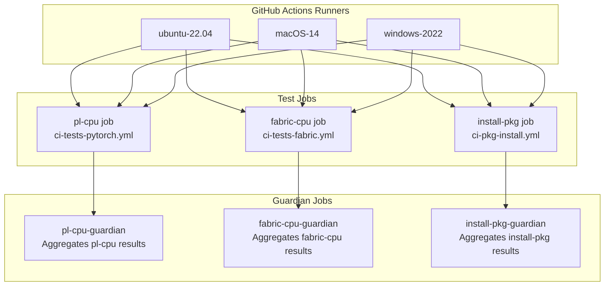

**GPU Test Infrastructure (Lightning AI)**

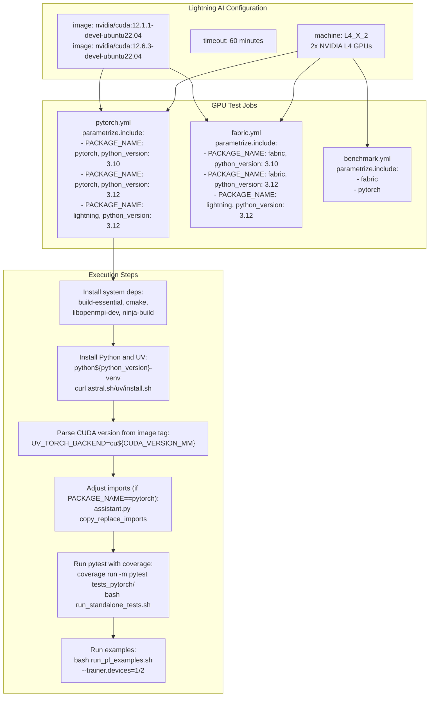

Sources: [.lightning/workflows/pytorch.yml:1-193](), [.lightning/workflows/fabric.yml:1-165]()

#### Test Workflow Execution Flow

Each test workflow follows this pattern:

**CPU Test Workflow Steps**

```mermaid
graph TD
    Start["Workflow Trigger"] --> SetupUV["Step: Install uv and set Python version<br/>uses: astral-sh/setup-uv@v7<br/>with.python-version: from matrix<br/>with.enable-cache: true"]
    
    SetupUV --> BasicSetup["Step: Basic setup<br/>run: uv pip install -q -r .actions/requirements.txt"]
    
    BasicSetup --> SetEnvVars["Step: Append Env. vars<br/>GLOO_SOCKET_IFNAME: eth0 (Linux) / lo0 (macOS)<br/>TORCH_URL: stable vs test index<br/>COVERAGE_SCOPE: lightning / pytorch_lightning"]
    
    SetEnvVars --> HandleOldest{"matrix.config.requires<br/>== 'oldest'?"}
    
    HandleOldest -->|Yes| SetOldest["Step: Set min. dependencies<br/>lightning_utilities.cli requirements set-oldest<br/>assistant.py prune_pytest_as_errors"]
    HandleOldest -->|No| AdjustTorch["Step: Adjust PyTorch versions<br/>adjust-torch-versions.py"]
    
    SetOldest --> InstallPkg["Step: Install package & dependencies<br/>uv pip install .[extra,test,strategies]<br/>--find-links=TORCH_URL"]
    AdjustTorch --> InstallPkg
    
    InstallPkg --> AdjustImports["Step: Adjust imports (if standalone pkg)<br/>assistant.py copy_replace_imports<br/>--source_import='lightning.fabric,lightning.pytorch'<br/>--target_import='lightning_fabric,pytorch_lightning'"]
    
    AdjustImports --> RemoveSource["Step: Prevent using raw source<br/>run: rm -rf src/"]
    
    RemoveSource --> GetCheckpoints["Step: Get legacy checkpoints<br/>bash .actions/pull_legacy_checkpoints.sh<br/>bash tests/legacy/generate_checkpoints.sh"]
    
    GetCheckpoints --> RunTests["Step: Testing PyTorch<br/>coverage run --source COVERAGE_SCOPE<br/>-m pytest . -v --timeout=90<br/>--random-order-seed=GITHUB_RUN_ID"]
    
    RunTests --> CoverageStats["Step: Statistics<br/>coverage report<br/>coverage xml"]
    
    CoverageStats --> UploadResults["Step: Upload test results<br/>uses: codecov/test-results-action@v1"]
    
    UploadResults --> UploadCoverage["Step: Upload coverage<br/>uses: codecov/codecov-action@v5<br/>flags: COVERAGE_SCOPE,cpu,pytest-full"]
    
    UploadCoverage --> PruneCache["Step: Minimize uv cache<br/>run: uv cache prune --ci"]
```

**Guardian Job Pattern**

The guardian jobs ([.github/workflows/ci-tests-pytorch.yml:217-229](), [.github/workflows/ci-tests-fabric.yml:176-188]()) follow this pattern:

```yaml
pl-cpu-guardian:
  runs-on: ubuntu-latest
  needs: pl-cpu
  if: always()
  steps:
    - run: echo "${{ needs.pl-cpu.result }}"
    - name: failing...
      if: needs.pl-cpu.result == 'failure'
      run: exit 1
    - name: cancelled or skipped...
      if: contains(fromJSON('["cancelled", "skipped"]'), needs.pl-cpu.result)
      timeout-minutes: 1
      run: sleep 90
```

The sleep on cancelled/skipped prevents false positives in required checks.

Sources: [.github/workflows/ci-tests-pytorch.yml:73-215](), [.github/workflows/ci-tests-fabric.yml:71-174](), [.actions/assistant.py:284-323](), [.github/workflows/ci-tests-pytorch.yml:217-229](), [.github/workflows/ci-tests-fabric.yml:176-188]()

### Test Matrix Configuration

The testing infrastructure uses a comprehensive matrix strategy defined in workflow files.

**CPU Test Matrix** ([.github/workflows/ci-tests-pytorch.yml:42-62]())

| Package | Python | PyTorch | Test Scope |
|---------|--------|---------|------------|
| lightning | 3.10 | 2.1 | All OS (Ubuntu, macOS, Windows) |
| lightning | 3.11 | 2.2.2 | All OS |
| lightning | 3.11 | 2.3 | All OS |
| lightning | 3.12.7 | 2.4.1 | All OS |
| lightning | 3.12.7 | 2.5.1 | All OS |
| pytorch | 3.12.7 | 2.6 | All OS |
| pytorch | 3.12 | 2.7 | All OS |
| pytorch | 3.12 | 2.8 | All OS |
| pytorch | 3.12 | 2.9 | All OS |
| pytorch | (default) | 2.1 | All OS (oldest requirements) |

The matrix uses `fail-fast: false` ([.github/workflows/ci-tests-pytorch.yml:43]()) to ensure all combinations complete even if some fail.

**GPU Test Matrix** ([.lightning/workflows/pytorch.yml:10-23]())

```yaml
parametrize:
  include:
    - image: "nvidia/cuda:12.1.1-devel-ubuntu22.04"
      PACKAGE_NAME: "pytorch"
      python_version: "3.10"
    - PACKAGE_NAME: "pytorch"
      python_version: "3.12"
    - PACKAGE_NAME: "lightning"
      python_version: "3.12"
```

GPU tests run on Lightning AI's `L4_X_2` machines with 2x NVIDIA L4 GPUs and 60-minute timeout.

**Environment Variables**

Key environment variables control test behavior:

- `PACKAGE_NAME`: Determines which package to test (lightning, pytorch, fabric)
- `FREEZE_REQUIREMENTS`: Controls dependency pinning ([.github/workflows/ci-tests-pytorch.yml:68]())
- `TORCH_URL`: PyTorch wheel index URL (CPU or CUDA-specific)
- `COVERAGE_SCOPE`: Source code to measure coverage for
- `RUN_ONLY_CUDA_TESTS`: Skip CPU-only tests on GPU runners ([.lightning/workflows/pytorch.yml:33]())

**Oldest Dependencies Testing**

For `requires: "oldest"` configurations ([.github/workflows/ci-tests-pytorch.yml:61-106]()):
1. Run `lightning-utilities.cli requirements set-oldest` to pin to minimum versions
2. Install compatibility workarounds (e.g., `cython<3.0`, `pyyaml==5.4`)
3. Prune pytest error warnings via `.actions/assistant.py prune_pytest_as_errors`

Sources: [.github/workflows/ci-tests-pytorch.yml:42-62](), [.github/workflows/ci-tests-fabric.yml:40-57](), [.lightning/workflows/pytorch.yml:10-34](), [.lightning/workflows/fabric.yml:10-35]()

### Code Quality Checks

**MyPy Type Checking** ([.github/workflows/code-checks.yml:28-60]())

The `mypy` job runs static type checking:

```mermaid
graph LR
    Checkout[actions/checkout@v6] --> SetupUV["astral-sh/setup-uv@v7<br/>Python 3.11"]
    SetupUV --> InstallDeps["Install '[pytorch-all,fabric-all]'<br/>+ requirements/typing.txt"]
    InstallDeps --> CacheMyPy["actions/cache@v4<br/>.mypy_cache/"]
    CacheMyPy --> RunMyPy["mypy command<br/>(config in pyproject.toml)"]
```

The mypy configuration is defined in [pyproject.toml]() with settings for:
- Strict mode checking
- Disallowing untyped definitions
- Warning about unused ignores
- Namespace packages support

**Pre-commit Hooks** (local only, not enforced in CI)

While not run in CI, the repository provides pre-commit hooks configured in [.pre-commit-config.yaml]() for:
- Ruff linting and formatting
- Trailing whitespace removal
- YAML validation
- Markdown formatting

**Documentation Validation**

The `docs-make` job ([.github/workflows/docs-build.yml:53-141]()) validates documentation through multiple targets:

| Target | Purpose | Path |
|--------|---------|------|
| `html` | Build HTML documentation | `docs/source-{pytorch,fabric}/` |
| `doctest` | Validate code examples in docstrings | All source files |
| `linkcheck` | Verify external URLs | All documentation |

Documentation builds use:
- Sphinx with custom `lai-sphinx-theme`
- Napoleon extension for Google-style docstrings
- NBSphinx for Jupyter notebook rendering (PyTorch only)
- Build flags: `--keep-going` to collect all errors, `-W` to treat warnings as errors

Sources: [.github/workflows/code-checks.yml:28-60](), [.github/workflows/docs-build.yml:53-141]()

## Continuous Delivery Components

### Package Building and Publishing

Package building and release uses a multi-stage pipeline to ensure quality before publishing.

**Package Build Process** ([.github/workflows/_build-packages.yml:1-71]())

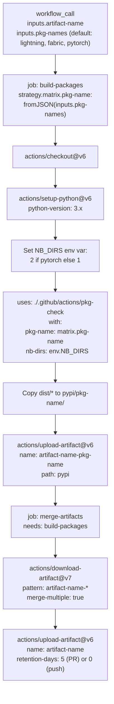

The `pkg-check` action ([.github/actions/pkg-check/action.yml]()) internally performs:
1. Set `PACKAGE_NAME` environment variable
2. Run `python setup.py sdist bdist_wheel` 
3. Execute `twine check dist/*`
4. Test imports with both wheel and source distributions

**Installation Testing** ([.github/workflows/ci-pkg-install.yml:39-106]())

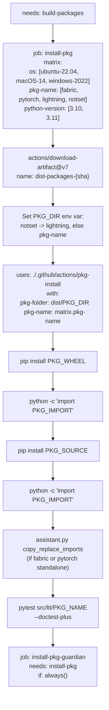

Sources: [.github/workflows/_build-packages.yml:1-71](), [.github/workflows/ci-pkg-install.yml:34-119](), [.github/actions/pkg-check/action.yml:1-70](), [.github/actions/pkg-install/action.yml:1-55]()

**Publishing Pipeline** ([.github/workflows/release-pkg.yml:133-182]())

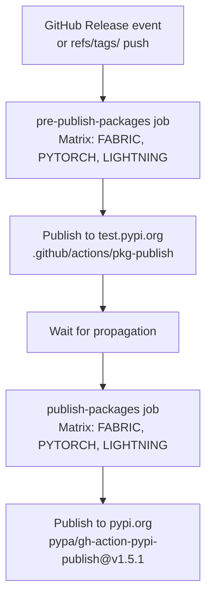

Publishing uses secrets:
- `PYPI_TEST_TOKEN_{FABRIC,PYTORCH,LIGHTNING}` for test.pypi.org
- `PYPI_TOKEN_{FABRIC,PYTORCH,LIGHTNING}` for pypi.org

**Nightly Builds** ([.github/workflows/release-nightly.yml:20-69]())

Nightly builds run on schedule (`cron: "0 0 * * 0"`) and:
1. Convert version to nightly format via `.actions/assistant.py convert_version2nightly`
2. Build packages with nightly version
3. Publish to both test PyPI and production PyPI

Sources: [.github/workflows/_build-packages.yml:21-70](), [.github/workflows/ci-pkg-install.yml:39-106](), [.github/workflows/release-pkg.yml:30-182](), [.github/workflows/release-nightly.yml:20-69](), [.github/actions/pkg-check/action.yml:1-70](), [.github/actions/pkg-publish/action.yml:1-42]()

### Documentation Building and Publishing

Documentation is built for both PyTorch Lightning and Lightning Fabric using Sphinx.

**Documentation Build Job** ([.github/workflows/docs-build.yml:53-141]())

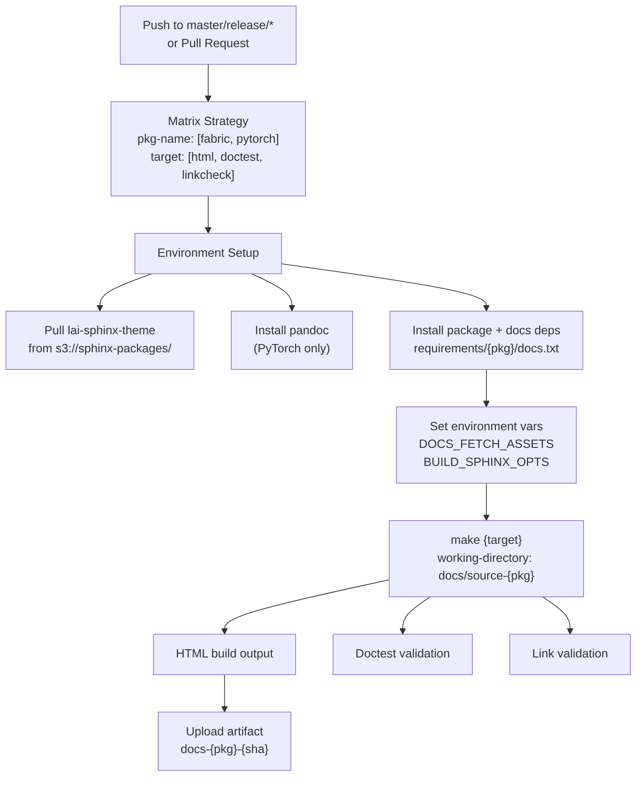

Documentation build configuration:
- **Environment variables** ([.github/workflows/docs-build.yml:62-64]()):
  - `DOCS_COPY_NOTEBOOKS=1`: Copy notebook tutorials
  - `PIN_RELEASE_VERSIONS=1`: Pin package versions for reproducibility
  - `BUILD_SPHINX_OPTS=-W --keep-going`: Treat warnings as errors
  
- **PyTorch-specific setup** ([.github/workflows/docs-build.yml:84-114]()):
  - Checkout Git LFS for tutorial notebooks
  - Install `pandoc` for Jupyter notebook rendering
  - Install notebook dependencies from `_notebooks/.actions/requires.txt`

**Documentation Deployment** ([.github/workflows/docs-build.yml:143-200]())

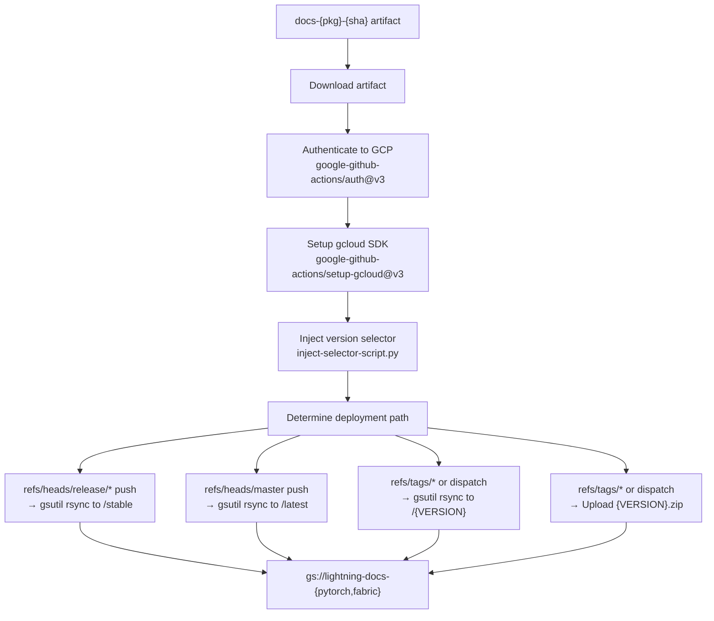

Documentation is deployed to Google Cloud Storage buckets:
- **Latest**: `gs://lightning-docs-{pkg}/latest/` (master branch)
- **Stable**: `gs://lightning-docs-{pkg}/stable/` (release branches)
- **Versioned**: `gs://lightning-docs-{pkg}/{version}/` (tagged releases)
- **Archives**: `gs://lightning-docs-{pkg}/{version}.zip` (backup)

The version selector injection ([.github/workflows/docs-build.yml:179-184]()) adds a dropdown to switch between documentation versions on the hosted site.

Sources: [.github/workflows/docs-build.yml:53-200]()

### Legacy Checkpoint Generation

The legacy checkpoint system ensures backward compatibility by testing that newer Lightning versions can load checkpoints created by older versions.

**Checkpoint Generation Workflow** ([.github/workflows/_legacy-checkpoints.yml:52-134]())

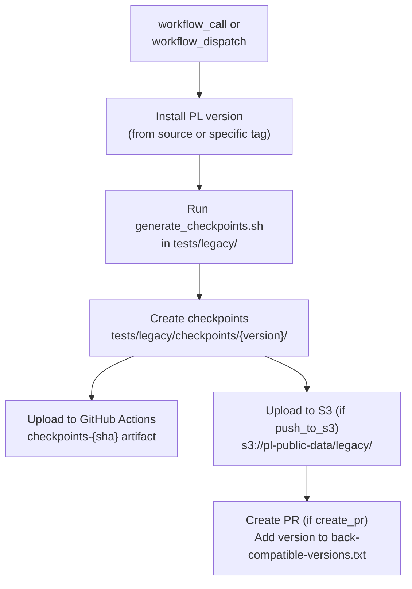

The checkpoint generation process:
1. **Install target version** ([.github/workflows/_legacy-checkpoints.yml:69-80]())
   - Either from source (`inputs.pl_version == ''`)
   - Or specific PyPI version (`pytorch-lightning==${inputs.pl_version}`)

2. **Adjust imports** ([.github/workflows/_legacy-checkpoints.yml:82-88]())
   - Replace `lightning.pytorch` with `pytorch_lightning` via `.actions/assistant.py copy_replace_imports`

3. **Generate checkpoints** ([.github/workflows/_legacy-checkpoints.yml:90-103]())
   - Run `tests/legacy/generate_checkpoints.sh`
   - Creates checkpoints in `tests/legacy/checkpoints/`
   - Renames `local` to actual version if releasing

4. **Upload to S3** ([.github/workflows/_legacy-checkpoints.yml:122-133]())
   - Uses AWS credentials from secrets
   - Syncs to `s3://pl-public-data/legacy/checkpoints/`
   - Creates zip archive: `s3://pl-public-data/legacy/checkpoints.zip`

5. **Create test PR** ([.github/workflows/_legacy-checkpoints.yml:135-164]())
   - Appends version to `tests/legacy/back-compatible-versions.txt`
   - Creates PR with automated changes using `peter-evans/create-pull-request@v7`

The checkpoint system is invoked during releases ([.github/workflows/release-pkg.yml:183-190]()) with:
```yaml
with:
  push_to_s3: true
  upload_local: true
  create_pr: true
```

Sources: [.github/workflows/_legacy-checkpoints.yml:52-164](), [.github/workflows/release-pkg.yml:183-190]()

## Release Process

The release process is triggered when a GitHub release is published or a tag matching `refs/tags/*` is pushed.

**Release Workflow Orchestration** ([.github/workflows/release-pkg.yml:29-191]())

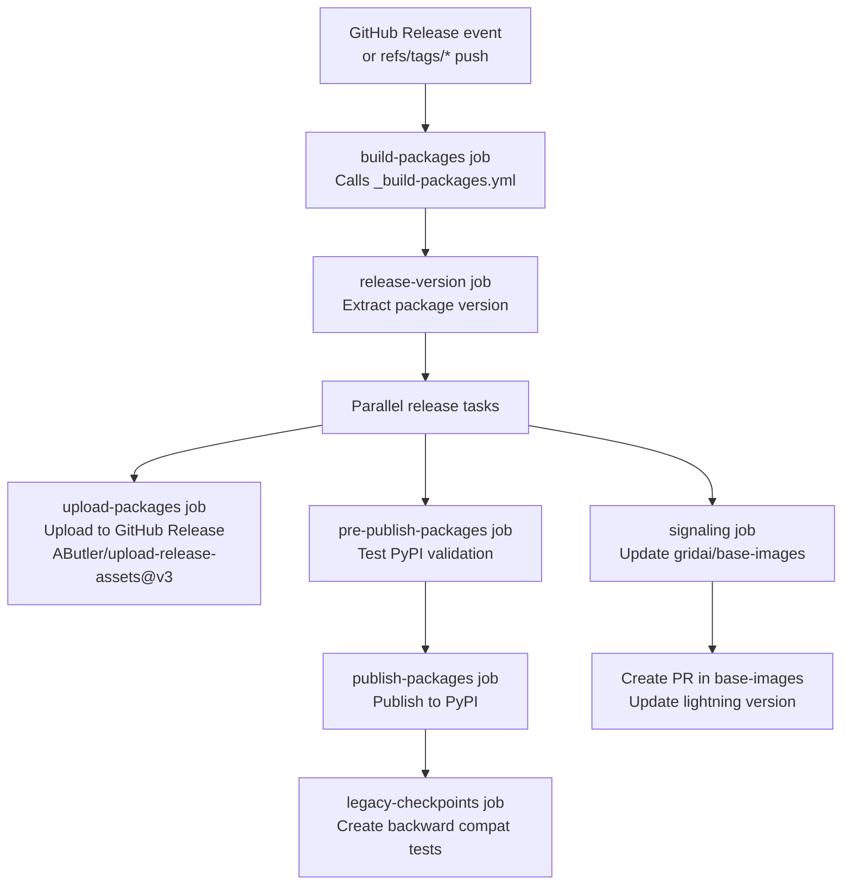

**Key Release Jobs**

1. **build-packages** ([.github/workflows/release-pkg.yml:30-33]())
   - Calls reusable workflow `_build-packages.yml`
   - Builds wheel and sdist for all three packages
   - Stores artifacts as `dist-packages-${sha}`

2. **release-version** ([.github/workflows/release-pkg.yml:52-67]())
   - Installs `lightning` package from source
   - Extracts version: `python -c "import lightning ; print(f'version={lightning.__version__}')"`
   - Outputs version for downstream jobs

3. **upload-packages** ([.github/workflows/release-pkg.yml:35-50]())
   - Runs only on `github.event_name == 'release'`
   - Downloads artifacts from build job
   - Uploads all packages to GitHub Release using `AButler/upload-release-assets@v3`

4. **pre-publish-packages** ([.github/workflows/release-pkg.yml:133-156]())
   - Tests publishing to test.pypi.org
   - Matrix: FABRIC, PYTORCH, LIGHTNING
   - Uses `.github/actions/pkg-publish` with test tokens

5. **publish-packages** ([.github/workflows/release-pkg.yml:158-182]())
   - Publishes to production pypi.org
   - Matrix: FABRIC, PYTORCH, LIGHTNING
   - Uses secrets: `PYPI_TOKEN_{FABRIC,PYTORCH,LIGHTNING}`

6. **signaling** ([.github/workflows/release-pkg.yml:69-131]())
   - Updates `gridai/base-images` repository
   - Modifies `versions.json` with new Lightning version
   - Creates automated PR to trigger base image rebuilds

7. **legacy-checkpoints** ([.github/workflows/release-pkg.yml:183-190]())
   - Calls `_legacy-checkpoints.yml` workflow
   - Generates checkpoints with release version
   - Uploads to S3 and creates test PR

**Version Management**

The `.actions/assistant.py` script provides utilities:
- `convert_version2nightly`: Converts `X.Y.Z` to `X.Y.Z.devYYYYMMDD` ([.actions/assistant.py:429-442]())
- `generate_docker_tags`: Creates Docker tag strings for releases ([.actions/assistant.py:444-461]())

**Release Documentation**

Documentation for releases is automatically deployed by `docs-build.yml`:
- Versioned docs: `gs://lightning-docs-{pkg}/{VERSION}/`
- Archived zip: `gs://lightning-docs-{pkg}/{VERSION}.zip`

Sources: [.github/workflows/release-pkg.yml:29-191](), [.actions/assistant.py:429-461]()

## Infrastructure and Resources

### Compute Infrastructure

**GitHub Actions Runners** (CPU tests)

The CI pipeline uses GitHub-hosted runners for all CPU-based testing:

| Runner Image | OS | Workflows |
|--------------|-----|-----------|
| `ubuntu-22.04` | Linux | All CPU tests, package builds, docs |
| `macOS-14` | macOS (Apple Silicon) | CPU tests, package installs |
| `windows-2022` | Windows | CPU tests, package installs |

**Lightning AI Runners** (GPU tests)

GPU tests run on Lightning AI's infrastructure ([.lightning/workflows/pytorch.yml:7-9]()):
- **Machine type**: `L4_X_2` (2x NVIDIA L4 GPUs)
- **Timeout**: 60 minutes
- **Base images**: `nvidia/cuda:12.1.1-devel-ubuntu22.04`, `nvidia/cuda:12.6.3-devel-ubuntu22.04`
- **Environment**: Full CUDA toolkit with cuDNN and NCCL

### Storage Infrastructure

**Google Cloud Storage** (Documentation)

Documentation artifacts are stored in GCS buckets:
- `gs://lightning-docs-pytorch/` - PyTorch Lightning docs
- `gs://lightning-docs-fabric/` - Lightning Fabric docs

Each bucket contains:
- `latest/` - master branch builds
- `stable/` - latest release branch builds
- `{version}/` - versioned release builds
- `{version}.zip` - archived version snapshots

**AWS S3** (Legacy Checkpoints)

Backward compatibility checkpoints are stored in S3:
- `s3://pl-public-data/legacy/checkpoints/` - Individual version checkpoints
- `s3://pl-public-data/legacy/checkpoints.zip` - Complete archive

**GitHub Actions Artifacts**

Temporary artifacts during CI runs:
- Package distributions: `dist-packages-{sha}` (1-5 day retention)
- Documentation builds: `docs-{pkg}-{sha}` (0-7 day retention)
- Checkpoints: `checkpoints-{sha}` (0-30 day retention)

### Caching Strategy

**UV Package Cache** ([.github/workflows/ci-tests-pytorch.yml:75-82]())

The `astral-sh/setup-uv@v7` action provides automatic caching:
```yaml
- name: Install uv and set Python version
  uses: astral-sh/setup-uv@v7
  with:
    enable-cache: true
```

Cache is pruned at workflow end: `uv cache prune --ci` ([.github/workflows/ci-tests-pytorch.yml:213-214]())

**MyPy Cache** ([.github/workflows/code-checks.yml:50-54]())

Type checking cache persists between runs:
```yaml
- name: mypy cache
  uses: actions/cache@v4
  with:
    path: .mypy_cache
    key: mypy-${{ hashFiles('requirements/typing.txt') }}
```

**Cache Cleanup** ([.github/workflows/cleanup-caches.yml:1-34]())

When PRs close, associated caches are deleted:
1. Trigger on `pull_request.types: [closed]`
2. Use `gh actions-cache list` to find PR caches
3. Delete each cache key via `gh actions-cache delete`

Sources: [.github/workflows/ci-tests-pytorch.yml:75-82](), [.github/workflows/ci-tests-pytorch.yml:213-214](), [.github/workflows/code-checks.yml:50-54](), [.github/workflows/cleanup-caches.yml:1-34](), [.github/workflows/docs-build.yml:152-200](), [.lightning/workflows/pytorch.yml:7-9]()

## Best Practices for CI/CD

When working with the CI/CD pipeline:

1. **Check Required Tests**: Use the checkgroup configuration to see which tests must pass for your changes
2. **Run Tests Locally**: Run relevant tests before pushing to reduce CI failures
3. **Monitor CI Status**: Watch CI progress on pull requests
4. **Fix CI Issues Promptly**: When CI fails, investigate and fix quickly
5. **Use Skip CI**: Add `[skip ci]` to commit messages for documentation-only changes
6. **Read Failure Logs**: CI failure logs contain detailed information for debugging

## Additional Resources

- [Contributing Workflow](7.1) - Contribution process and guidelines
- [Testing Framework](7.4) - Details of the testing framework
- [Documentation System](7.3) - Documentation building and organization

Sources: [.github/workflows/README.md:1-76]()

---

