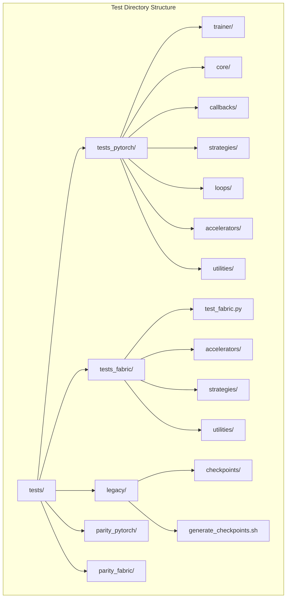
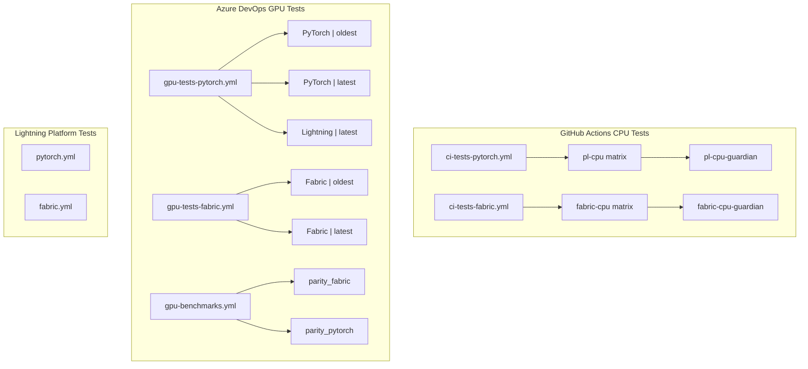
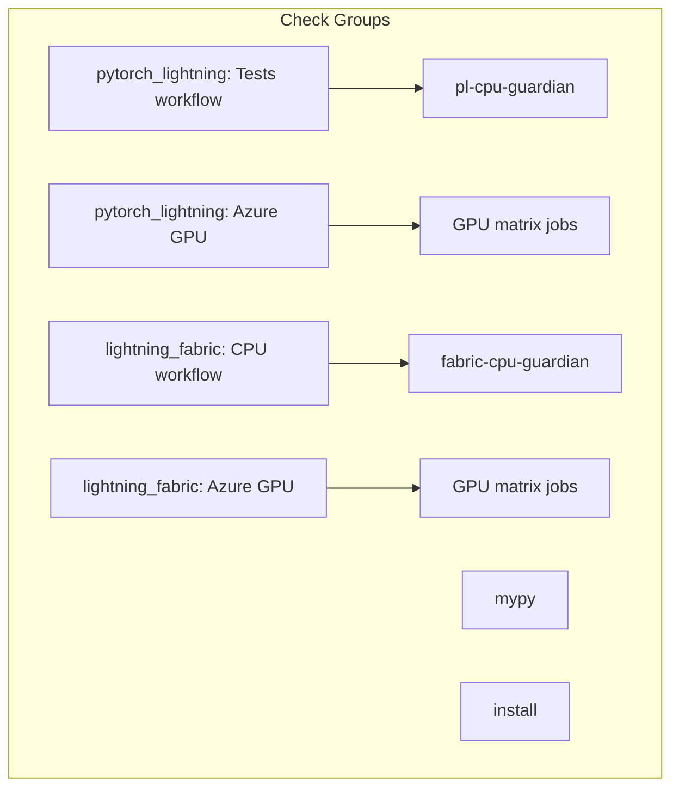
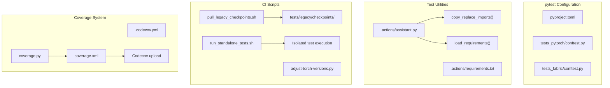
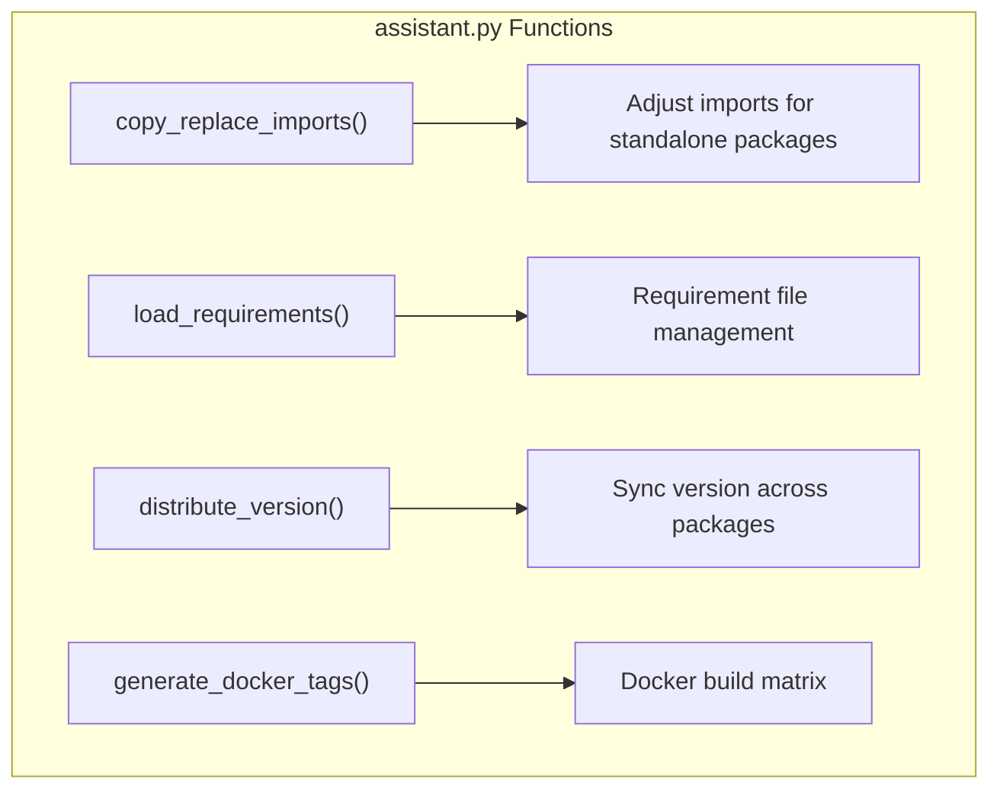
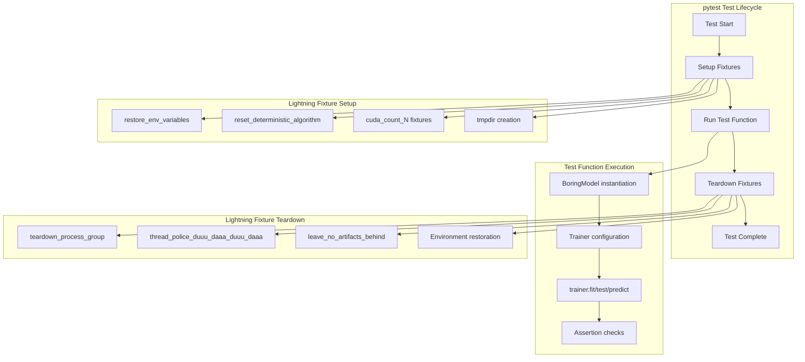
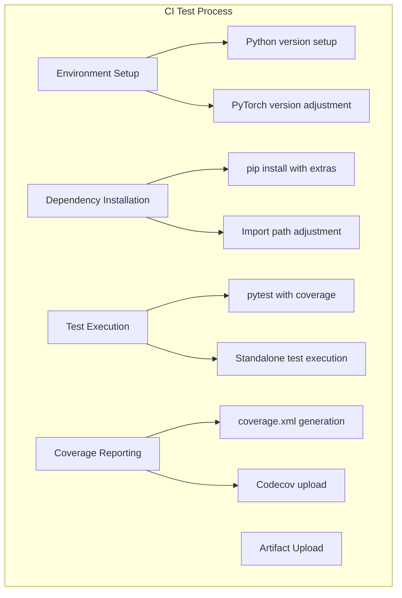
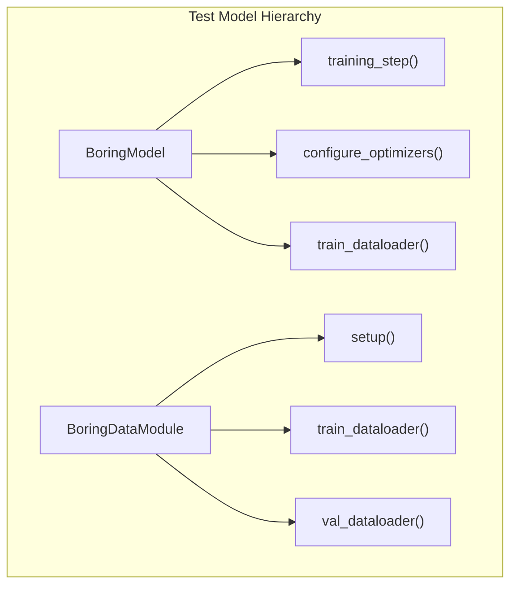
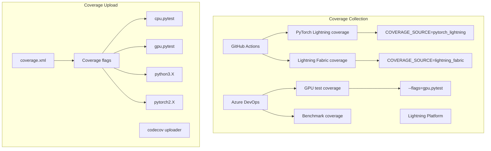

<!-- source: DeepWiki mcp.deepwiki.com · repo Lightning-AI/pytorch-lightning · page 8.2 Testing Infrastructure · fetched 2026-10-21 -->

# Testing Framework

<details>
<summary>Relevant source files</summary>

The following files were used as context for generating this wiki page:

- [.actions/assistant.py](.actions/assistant.py)
- [.actions/requirements.txt](.actions/requirements.txt)
- [.github/checkgroup.yml](.github/checkgroup.yml)
- [.github/workflows/_build-packages.yml](.github/workflows/_build-packages.yml)
- [.github/workflows/_legacy-checkpoints.yml](.github/workflows/_legacy-checkpoints.yml)
- [.github/workflows/ci-pkg-install.yml](.github/workflows/ci-pkg-install.yml)
- [.github/workflows/ci-tests-fabric.yml](.github/workflows/ci-tests-fabric.yml)
- [.github/workflows/ci-tests-pytorch.yml](.github/workflows/ci-tests-pytorch.yml)
- [.github/workflows/cleanup-caches.yml](.github/workflows/cleanup-caches.yml)
- [.github/workflows/code-checks.yml](.github/workflows/code-checks.yml)
- [.github/workflows/docs-build.yml](.github/workflows/docs-build.yml)
- [.github/workflows/docs-tutorials.yml](.github/workflows/docs-tutorials.yml)
- [.github/workflows/labeler-issue.yml](.github/workflows/labeler-issue.yml)
- [.github/workflows/release-nightly.yml](.github/workflows/release-nightly.yml)
- [.github/workflows/release-pkg.yml](.github/workflows/release-pkg.yml)
- [.lightning/workflows/fabric.yml](.lightning/workflows/fabric.yml)
- [.lightning/workflows/pytorch.yml](.lightning/workflows/pytorch.yml)
- [requirements/doctests.txt](requirements/doctests.txt)
- [requirements/fabric/base.txt](requirements/fabric/base.txt)
- [requirements/fabric/examples.txt](requirements/fabric/examples.txt)
- [requirements/fabric/strategies.txt](requirements/fabric/strategies.txt)
- [requirements/fabric/test.txt](requirements/fabric/test.txt)
- [requirements/pytorch/base.txt](requirements/pytorch/base.txt)
- [requirements/pytorch/examples.txt](requirements/pytorch/examples.txt)
- [requirements/pytorch/strategies.txt](requirements/pytorch/strategies.txt)
- [requirements/pytorch/test.txt](requirements/pytorch/test.txt)
- [requirements/typing.txt](requirements/typing.txt)

</details>


The PyTorch Lightning testing framework provides comprehensive test coverage across the entire ecosystem using `pytest`, GitHub Actions, Azure DevOps, and the Lightning Platform. This system validates functionality for both PyTorch Lightning and Lightning Fabric while ensuring compatibility across multiple Python versions, PyTorch versions, and hardware configurations.

## Purpose and Scope

The testing framework validates:
- Core functionality in `src/lightning/pytorch/` and `src/lightning/fabric/`
- Multi-platform compatibility (macOS, Ubuntu, Windows)
- PyTorch version compatibility (2.1-2.8)
- Python version compatibility (3.10-3.12)
- Hardware configurations (CPU, CUDA, TPU, MPS)
- Package installation modes (`lightning`, `pytorch-lightning`, `lightning-fabric`)
- Distributed training strategies and precision modes
- Backward compatibility via legacy checkpoint tests

For general contribution guidelines, see [Contributing Workflow](#8.1).

## Test Organization

Tests are organized into separate directories for each major component, with specific test modules mapping to source code structure.

Test Directory Structure:


Key test categories:

| Directory | Purpose | Source Mapping |
|-----------|---------|----------------|
| `tests_pytorch/` | PyTorch Lightning functionality | `src/lightning/pytorch/` |
| `tests_fabric/` | Lightning Fabric functionality | `src/lightning/fabric/` |
| `legacy/` | Backward compatibility validation | Historical checkpoints |
| `parity_pytorch/` | Performance benchmarks | Fabric vs PyTorch Lightning parity |
| `parity_fabric/` | Performance benchmarks | Fabric vs raw PyTorch parity |

Sources:
- [.github/workflows/ci-tests-pytorch.yml:15-25]()
- [.github/workflows/ci-tests-fabric.yml:13-21]()
- [.azure/gpu-tests-pytorch.yml:33-38]()
- [.azure/gpu-tests-fabric.yml:31-33]()

## Continuous Integration System

The CI system uses GitHub Actions for CPU tests, Azure DevOps for GPU tests, and Lightning Platform for additional GPU validation.

CI Pipeline Architecture:


Test Environment Matrix:
| Component | OS | Python | PyTorch | Package |
|-----------|----|---------|---------|---------| 
| CPU Tests | macOS-14, ubuntu-22.04, windows-2022 | 3.10-3.12 | 2.1-2.8 | lightning, pytorch, fabric |
| GPU Tests | ubuntu (Azure) | 3.10-3.12 | 2.1-2.8 | lightning, pytorch, fabric |
| Benchmarks | ubuntu (Azure) | 3.12 | 2.8 | fabric, pytorch |

The `checkgroup.yml` configuration defines which tests must pass for different file changes:



Sources:
- [.github/checkgroup.yml:1-24]()
- [.github/workflows/ci-tests-pytorch.yml:38-77]()
- [.github/workflows/ci-tests-fabric.yml:35-73]()
- [.azure/gpu-tests-pytorch.yml:50-63]()
- [.azure/gpu-tests-fabric.yml:57-70]()
- [.lightning/workflows/pytorch.yml:9-20]()
- [.lightning/workflows/fabric.yml:9-20]()

## Testing Framework Components

The testing system is built on `pytest` with custom fixtures, utilities, and CI integration scripts.

Core Testing Components:


Key pytest configurations in `pyproject.toml`:

| Setting | Purpose |
|---------|---------|
| `testpaths` | Defines test discovery paths |
| `python_files` | Test file patterns |
| `python_functions` | Test function patterns |
| `addopts` | Default pytest options |
| `markers` | Custom test markers |

The `assistant.py` script provides utilities for CI operations:



Sources:
- [.actions/assistant.py:343-358]()
- [.actions/assistant.py:283-322]()
- [.actions/assistant.py:131-146]()
- [.codecov.yml:20-70]()

## Running Tests Locally

### Environment Setup

Install the package in development mode with test dependencies:

```bash
# Clone repository
git clone https://github.com/Lightning-AI/lightning.git
cd lightning

# Install for PyTorch Lightning development
export PACKAGE_NAME=pytorch
pip install -e ".[pytorch-dev]"

# OR install for Lightning Fabric development  
export PACKAGE_NAME=fabric
pip install -e ".[fabric-dev]"

# OR install unified Lightning package
export PACKAGE_NAME=lightning
pip install -e ".[pytorch-dev,fabric-dev]"
```

Download legacy checkpoints for backward compatibility tests:
```bash
bash .actions/pull_legacy_checkpoints.sh
cd tests/legacy
bash generate_checkpoints.sh
```

### Test Execution Commands

Run component test suites:
```bash
# PyTorch Lightning tests
python -m pytest tests/tests_pytorch/ -v

# Lightning Fabric tests  
python -m pytest tests/tests_fabric/ -v

# Specific test file
python -m pytest tests/tests_pytorch/trainer/test_trainer.py -v

# Specific test function
python -m pytest tests/tests_pytorch/trainer/test_trainer.py::test_trainer_fit -v
```

### Coverage Collection

Generate coverage reports using the same configuration as CI:
```bash
# PyTorch Lightning coverage
python -m coverage run --source lightning.pytorch \
  -m pytest tests/tests_pytorch/ -v
  
# Lightning Fabric coverage
python -m coverage run --source lightning_fabric \
  -m pytest tests/tests_fabric/ -v

# Generate reports
coverage report -m
coverage xml  # For Codecov compatibility
```

### Standalone Test Execution

Some tests require process isolation to avoid interference:
```bash
cd tests/
export PL_RUN_STANDALONE_TESTS=1
wget https://raw.githubusercontent.com/Lightning-AI/utilities/main/scripts/run_standalone_tests.sh
bash ./run_standalone_tests.sh "tests_pytorch"
bash ./run_standalone_tests.sh "tests_fabric"
```

Sources:
- [.github/workflows/ci-tests-pytorch.yml:138-147]()
- [.github/workflows/ci-tests-fabric.yml:140-146]()
- [.azure/gpu-tests-pytorch.yml:177-190]()
- [.azure/gpu-tests-fabric.yml:156-168]()

## Test Execution Process

The test execution follows pytest's fixture lifecycle with Lightning-specific setup and teardown procedures.

Test Execution Flow:


CI-specific test execution process mirrors this but includes additional steps:



Sources:
- [.github/workflows/ci-tests-pytorch.yml:198-212]()
- [.github/workflows/ci-tests-fabric.yml:168-182]()
- [.azure/gpu-tests-pytorch.yml:177-211]()

## Writing Tests

When contributing new features or fixing bugs, follow these guidelines for writing tests:

### Test Requirements

1. **Test Coverage**: New code should be covered by tests.
2. **Isolation**: Tests should be self-contained and not depend on other tests.
3. **Cleanup**: Tests should clean up after themselves using fixtures.
4. **Edge Cases**: Tests should cover edge cases and failure modes.

### Using BoringModel

Most tests use the `BoringModel` base class, which provides a simple implementation of a `LightningModule`:

```python
class ExtendedModel(BoringModel):
    # Add or override methods to test specific functionality
    pass

def test_my_feature(tmpdir):
    """
    Test description explaining what is being tested
    """
    model = ExtendedModel()
    
    # Optionally disable methods to test specific behavior
    # model.training_step_end = None
    
    trainer = Trainer(default_root_dir=tmpdir, ...)
    trainer.fit(model)
    
    # Assert expected behavior
    assert ...
```

### Conditional Tests with RunIf

Use the `@RunIf` decorator to conditionally run tests based on requirements:

```python
@RunIf(min_cuda_gpus=1)
def test_gpu_feature():
    # This test only runs when at least one CUDA GPU is available
    pass

@RunIf(skip_windows=True)
def test_linux_feature():
    # This test skips Windows
    pass
```

The `RunIf` decorator supports various conditions such as:
- `min_cuda_gpus`: Minimum number of CUDA GPUs required
- `min_torch`: Minimum PyTorch version required
- `skip_windows`, `skip_mac`, `skip_linux`: Skip specific operating systems
- `tpu`: Requires TPU availability

### Test Template

Here's a recommended template for new tests:

```python
# [OPTIONAL] pytest decorator
# @RunIf(min_cuda_gpus=1)
def test_explain_what_is_being_tested(tmpdir):
    """
    Test description about text reason to be
    """

    class ExtendedModel(BoringModel):
        ...

    model = ExtendedModel()

    # BoringModel is a functional model. You might want to set methods to None to test your behavior
    # Example: model.training_step_end = None

    trainer = Trainer(default_root_dir=tmpdir, ...)  # will save everything within a tmpdir generated for this test
    trainer.fit(model)
    trainer.test()  # [OPTIONAL]

    # assert the behavior is correct.
    assert ...
```

Sources:
- [.github/CONTRIBUTING.md:226-268]()
- [tests/README.md]()

## Key Testing Fixtures

The `conftest.py` files in both `tests_pytorch/` and `tests_fabric/` provide essential fixtures for test isolation and hardware mocking.

Core Fixtures:

| Fixture Name | Scope | Purpose |
|--------------|-------|---------|
| `restore_env_variables` | function | Backup and restore environment variables |
| `reset_deterministic_algorithm` | function | Reset `torch.use_deterministic_algorithms` |
| `teardown_process_group` | function | Clean up distributed process groups |
| `thread_police_duuu_daaa_duuu_daaa` | function | Terminate zombie threads |
| `leave_no_artifacts_behind` | function | Verify no files created outside test dirs |

Hardware Mocking Fixtures:

| Fixture Name | Purpose |
|--------------|---------|
| `cuda_count_0` | Mock 0 CUDA devices |
| `cuda_count_1` | Mock 1 CUDA device |
| `cuda_count_2` | Mock 2 CUDA devices |
| `cuda_count_4` | Mock 4 CUDA devices |
| `mps_count_0` | Mock 0 MPS devices |
| `mps_count_1` | Mock 1 MPS device |
| `tpu_available` | Mock TPU availability |

Test Model Fixtures:



The `@RunIf` decorator provides conditional test execution:

| Condition | Usage |
|-----------|--------|
| `@RunIf(min_cuda_gpus=1)` | Requires CUDA GPUs |
| `@RunIf(min_torch="2.0")` | Minimum PyTorch version |
| `@RunIf(skip_windows=True)` | Skip on Windows |
| `@RunIf(tpu=True)` | Requires TPU |
| `@RunIf(standalone=True)` | Requires standalone execution |

Sources:
- Referenced from CI workflow patterns in test execution
- Based on pytest fixture patterns seen in CI commands

## Coverage Tracking

The project uses `coverage.py` for test coverage measurement and Codecov for visualization and reporting.

Coverage Configuration (`.codecov.yml`):

| Setting | Value | Purpose |
|---------|-------|---------|
| `after_n_builds` | 23 | Wait for all CI jobs before reporting |
| `target` | 99% | Project coverage target |
| `threshold` | 30% | Allowed coverage decrease |
| `patch.target` | 50% | New code coverage target |

Coverage execution varies by CI platform:



Coverage commands used in CI:

```bash
# GitHub Actions (CPU tests)
python -m coverage run --source ${COVERAGE_SCOPE} \
  -m pytest . -v --timeout=90 --durations=50

# Azure DevOps (GPU tests)  
python -m coverage run --source ${COVERAGE_SOURCE} \
  -m pytest tests_pytorch/ -v --durations=50
```

The coverage scope is dynamically set based on package being tested:
- `lightning` package: covers `lightning` scope
- `pytorch` package: covers `pytorch_lightning` scope  
- `fabric` package: covers `lightning_fabric` scope

Sources:
- [.codecov.yml:30-50]()
- [.github/workflows/ci-tests-pytorch.yml:203-204]()
- [.github/workflows/ci-tests-fabric.yml:173-174]()
- [.azure/gpu-tests-pytorch.yml:177]()
- [.azure/gpu-tests-fabric.yml:156]()

## Best Practices for Test Contributions

When contributing tests to the PyTorch Lightning project:

1. **Use Test-Driven Development**: Write your test before implementing the feature.
2. **Cover Edge Cases**: Make sure your tests handle edge cases and failure modes.
3. **Isolate Tests**: Tests should not depend on or affect each other.
4. **Clean Up**: Use fixtures to ensure your test cleans up after itself.
5. **Document**: Add docstrings explaining what the test is checking.
6. **Use BoringModel**: Extend the BoringModel for most tests to keep tests simple.
7. **Parameterize**: Use pytest's parameterization for testing multiple similar cases.
8. **Hardware Awareness**: Use RunIf decorators for hardware-specific tests.

Sources:
- [.github/CONTRIBUTING.md:67-105]()
- [tests/README.md]()

## Debugging Test Failures

When a test fails, follow these steps to debug:

1. **Run the Specific Test**: Isolate and run just the failing test
   ```bash
   python -m pytest tests/tests_pytorch/path/to/test.py::test_name -v
   ```

2. **Enable Verbose Output**: Add `-v` or `-vv` for more detail

3. **Disable Capturing**: Use `--capture=no` to see print statements
   ```bash
   python -m pytest tests/tests_pytorch/path/to/test.py::test_name -v --capture=no
   ```

4. **Temporary Print Debugging**: Add print statements to trace execution

5. **Check CI Logs**: If a test fails in CI but not locally, carefully review the CI logs

Sources:
- [tests/README.md]()
- [.github/CONTRIBUTING.md]()

---

