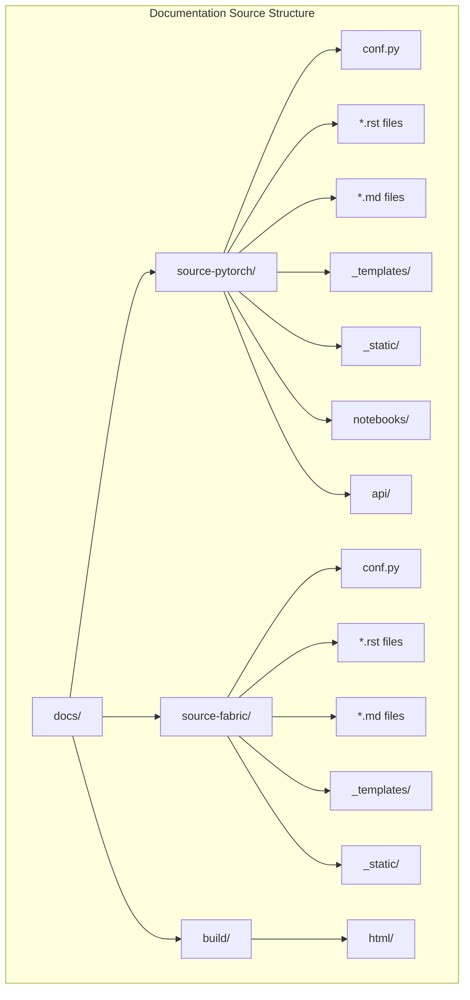
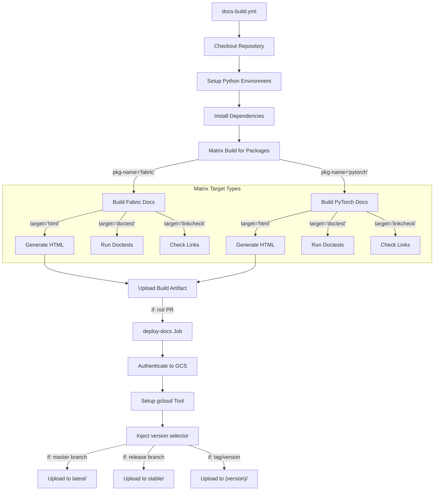
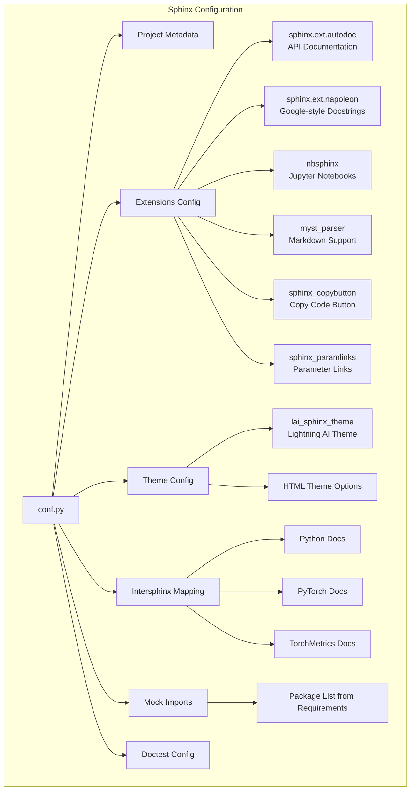
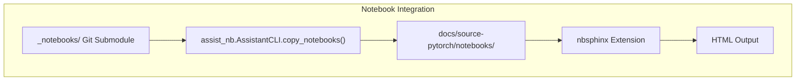
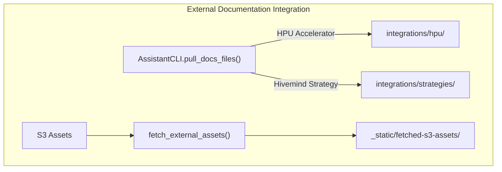
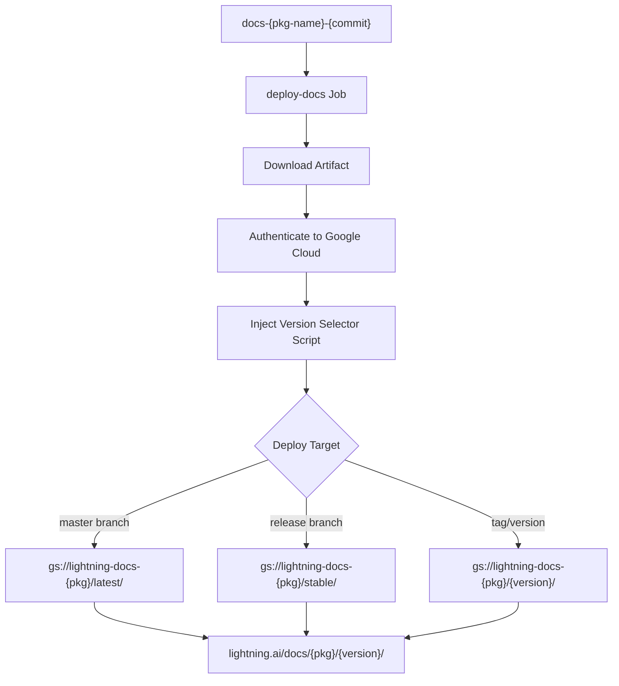

<!-- source: DeepWiki mcp.deepwiki.com · repo Lightning-AI/pytorch-lightning · page 8.3 Documentation System · fetched 2026-10-21 -->

# Documentation System

<details>
<summary>Relevant source files</summary>

The following files were used as context for generating this wiki page:

- [.codecov.yml](.codecov.yml)
- [.gitignore](.gitignore)
- [docs/README.md](docs/README.md)
- [docs/source-fabric/conf.py](docs/source-fabric/conf.py)
- [docs/source-pytorch/conf.py](docs/source-pytorch/conf.py)
- [requirements/ci.txt](requirements/ci.txt)
- [requirements/docs.txt](requirements/docs.txt)
- [requirements/fabric/docs.txt](requirements/fabric/docs.txt)
- [requirements/pytorch/docs.txt](requirements/pytorch/docs.txt)
- [src/lightning/fabric/utilities/registry.py](src/lightning/fabric/utilities/registry.py)
- [src/lightning/pytorch/trainer/connectors/callback_connector.py](src/lightning/pytorch/trainer/connectors/callback_connector.py)
- [src/lightning/pytorch/trainer/connectors/logger_connector/logger_connector.py](src/lightning/pytorch/trainer/connectors/logger_connector/logger_connector.py)
- [src/lightning/pytorch/trainer/connectors/signal_connector.py](src/lightning/pytorch/trainer/connectors/signal_connector.py)
- [tests/tests_fabric/utilities/test_registry.py](tests/tests_fabric/utilities/test_registry.py)
- [tests/tests_pytorch/trainer/connectors/test_callback_connector.py](tests/tests_pytorch/trainer/connectors/test_callback_connector.py)

</details>


The PyTorch Lightning documentation system is responsible for generating comprehensive API documentation, guides, examples, and tutorials for the entire Lightning ecosystem. This page explains the documentation infrastructure, build process, and publishing workflow.

For information on how to write tests for the codebase, see [Testing Framework](#7.4).

## Documentation Structure and Organization

The documentation is organized into separate source directories for each main component of the Lightning ecosystem:



Sources: [.gitignore:10-22](), [docs/source-pytorch/conf.py:39-47](), [docs/source-fabric/conf.py:21-22]()

## Build System

Documentation is built using Sphinx through GitHub Actions workflows. The primary workflow file is `.github/workflows/docs-build.yml` which orchestrates the build and deployment process.



Sources: [.github/workflows/docs-build.yml:54-139](), [.github/workflows/docs-build.yml:149-205]()

## Documentation Environment and Dependencies

Documentation builds require specific dependencies defined in requirements files:

| File | Purpose |
|------|---------|
| `requirements/docs.txt` | Core documentation dependencies |
| `requirements/fabric/docs.txt` | Additional Fabric-specific docs dependencies |
| `requirements/pytorch/docs.txt` | Additional PyTorch Lightning-specific docs dependencies |

Key dependencies include:

```
sphinx >5.0, <6.0
myst-parser >=0.18.1, <3.0.0
nbsphinx >=0.8.5, <=0.9.2
sphinx-autodoc-typehints >=1.16
sphinx-paramlinks >=0.5.1, <=0.6.0
sphinx-copybutton >=0.3, <=0.5.2
lai-sphinx-theme
```

Sources: [requirements/docs.txt:1-24](), [requirements/fabric/docs.txt:1-4]()

## Sphinx Configuration

Sphinx is configured through `conf.py` files in each source directory, defining extensions, themes, and settings for documentation generation:



Sources: [docs/source-pytorch/conf.py:159-180](), [docs/source-fabric/conf.py:69-89](), [docs/source-pytorch/conf.py:357-373]()

## Documentation Source Processing

The documentation build process involves several specialized processing steps:

### Notebook Integration



PyTorch Lightning docs integrate Jupyter notebooks from the `_notebooks` Git submodule. This includes course materials and examples that are copied to the source directory during the build process and converted to HTML by the `nbsphinx` extension.

Sources: [docs/source-pytorch/conf.py:67-76](), [.github/workflows/docs-tutorials.yml:1-76]()

### External Documentation Integration



The documentation system pulls content from external repositories (like Lightning-Habana) and fetches assets from S3 buckets to integrate into the built documentation.

Sources: [docs/source-pytorch/conf.py:89-118](), [docs/source-fabric/conf.py:44-51]()

## Documentation Publishing and Versioning

Documentation is published to Google Cloud Storage buckets and served on the Lightning AI website. The publishing workflow is defined in the `deploy-docs` job of the `.github/workflows/docs-build.yml` workflow:



The documentation is versioned based on the source:
- `latest`: Generated from the `master` branch
- `stable`: Generated from the latest release branch
- `{version}`: Generated from a specific tag (e.g., v2.0.0)

Sources: [.github/workflows/docs-build.yml:149-205]()

## Release Process Integration

Documentation is a key part of the PyTorch Lightning release process:

1. For regular releases, the documented version is automatically updated based on the package version
2. Checkpoints are created for compatibility testing using the `.github/workflows/_legacy-checkpoints.yml` workflow
3. Documentation builds for the new version are deployed when a release is published

Sources: [.github/workflows/release-pkg.yml:1-39](), [.github/workflows/_legacy-checkpoints.yml:1-157]()

## Contributing to Documentation

To contribute to the documentation:

1. **Local Development Setup**:
   - Clone the repository
   - Install documentation dependencies: `pip install -r requirements/docs.txt`
   - For faster development, set environment variables:
     ```bash
     export FAST_DOCS_DEV=1
     export SPHINX_MOCK_REQUIREMENTS=1
     ```

2. **Building Documentation Locally**:
   ```bash
   cd docs/source-pytorch  # or source-fabric
   make html
   ```

3. **Documentation Testing**:
   ```bash
   cd docs/source-pytorch  # or source-fabric
   make doctest  # Test code examples
   make linkcheck  # Check for broken links
   ```

4. **Pull Request Process**:
   - Make your changes
   - Submit a PR targeting the `master` branch
   - The CI will automatically build and check your documentation
   - Once merged, docs are automatically deployed to the latest version

Sources: [.github/workflows/docs-build.yml:4-26](), [docs/source-pytorch/conf.py:27-34]()

## Development Environment Variables

The documentation system supports several environment variables to control the build process:

| Variable | Purpose |
|----------|---------|
| `SPHINX_MOCK_REQUIREMENTS` | Mock package imports to avoid installing dependencies |
| `FAST_DOCS_DEV` | Skip time-consuming steps during development |
| `DOCS_COPY_NOTEBOOKS` | Control whether to copy notebooks from submodule |
| `DOCS_FETCH_ASSETS` | Control whether to fetch external assets |
| `PIN_RELEASE_VERSIONS` | Pin external documentation links to specific versions |

Sources: [docs/source-pytorch/conf.py:27-34](), [docs/source-fabric/conf.py:25-28]()