# Page: Overview

# Overview

<details>
<summary>Relevant source files</summary>

The following files were used as context for generating this wiki page:

- [README.md](README.md)

</details>


## Purpose and Scope

This document provides a high-level introduction to the PyTorch Lightning ecosystem, covering the relationship between its core packages, architectural design principles, and development infrastructure. PyTorch Lightning is a comprehensive deep learning framework built on PyTorch that provides multiple levels of abstraction for training, deploying, and scaling AI models.

For detailed information about specific components, see:
- Core framework components: [Core Framework](#2)
- Distributed training strategies: [Distributed Training](#3)  
- Training system internals: [Training System](#4)
- Installation and deployment: [Installation and Deployment](#7)

## Lightning Ecosystem: Two Core Packages

Lightning consists of two core packages that provide different levels of abstraction over PyTorch. Users can choose between high-level automation (PyTorch Lightning) or low-level expert control (Lightning Fabric).

**Core Framework Architecture**

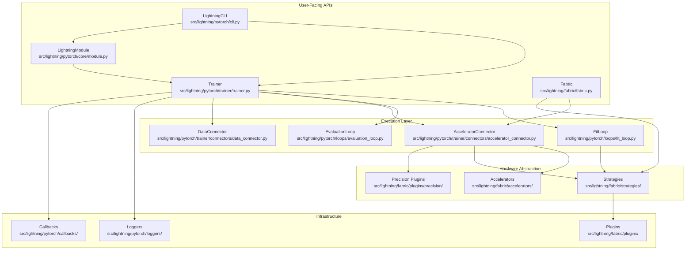

This architecture provides three-tier separation: User-Facing APIs provide different abstraction levels, Execution Layer handles training loops and configuration, Hardware Abstraction enables device-agnostic training, and Infrastructure provides cross-cutting concerns.

Sources: [README.md:74-78](), [src/pytorch_lightning/README.md:42-66](), [src/lightning/pytorch/trainer/trainer.py:1-50]()

## Package Distribution Strategy

Lightning uses a monorepo that publishes three installable packages. The `lightning` meta-package includes both `pytorch-lightning` and `lightning-fabric`, while the individual packages can be installed standalone.

**Package Structure and Distribution**

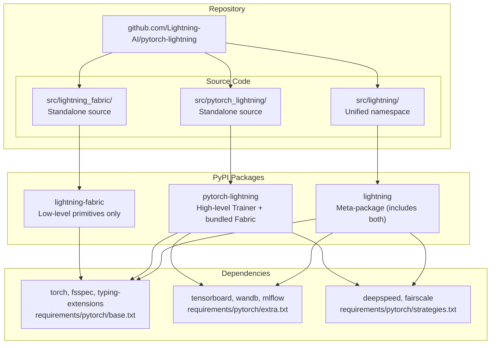

**Installation Options:**

| Command | Package | Contents |
|---------|---------|----------|
| `pip install lightning` | Meta-package | Both pytorch-lightning and lightning-fabric |
| `pip install pytorch-lightning` | Standalone | High-level Trainer with bundled Fabric source |
| `pip install lightning-fabric` | Standalone | Low-level primitives only (minimal) |
| `pip install lightning[all]` | With extras | Includes all optional dependencies |

Sources: [README.md:89-135](), [src/pytorch_lightning/README.md:94-142](), [Makefile:13-28]()

## Abstraction Continuum: PyTorch Lightning vs Fabric

Lightning provides granular control over abstraction level. Users can choose between automated training (PyTorch Lightning) or manual loop control (Fabric), or even mix both approaches.

**Design Philosophy Comparison**

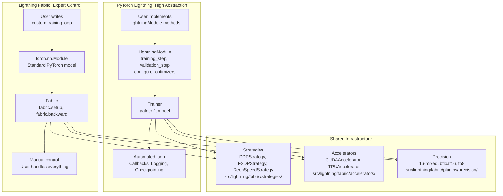

**API Comparison:**

| Aspect | PyTorch Lightning | Lightning Fabric |
|--------|-------------------|------------------|
| Abstraction | High: define hooks in `LightningModule` | Low: write your own training loop |
| Training Loop | Automated by `Trainer` | Manual implementation |
| Best For | Standard supervised learning, rapid prototyping | Complex training (RL, GANs), custom workflows |
| Code Structure | Structured: separate train/val/test steps | Flexible: any loop structure |
| Entry Point | `trainer.fit(model)` | `fabric.launch()` then custom loop |

Both APIs share the same underlying distributed strategies, accelerators, and precision plugins, ensuring consistent behavior regardless of abstraction level.

Sources: [README.md:74-80](), [README.md:375-463](), [src/lightning_fabric/README.md:25-29]()

## Core Design Principles

Lightning's architecture follows several key principles documented in the contributing guidelines:

### No PyTorch Interference
Lightning does not add abstractions over PyTorch primitives. `LightningModule` is a standard `torch.nn.Module` subclass, and users can access all PyTorch functionality directly. This ensures researchers maintain full control without learning framework-specific patterns.

### Organized Code Structure
Lightning enforces separation of concerns:
- **Research code**: Model definition and training logic in `LightningModule`
- **Engineering code**: Device management, distributed training in `Trainer`
- **Non-essential code**: Logging, checkpointing in `Callbacks`
- **Data handling**: `DataLoader` or `LightningDataModule`

This structure makes code reusable and shareable across projects.

### Force Best Practices
Lightning implements established best practices as default behavior. For example, `validation_step` automatically sets the model to eval mode, preventing subtle bugs. When patterns become standard in the research community, Lightning incorporates them to reduce boilerplate.

### Backward Compatibility
All API changes maintain backward compatibility with deprecation warnings. Users can upgrade Lightning without breaking existing code. This principle is critical for production deployments.

### Simple External API
The API is designed for clarity over cleverness. Changes undergo validation to ensure they benefit the broader community, not just specific use cases.

Sources: [.github/CONTRIBUTING.md:8-50](), [src/pytorch_lightning/README.md:49-66]()

## Development and Testing Infrastructure

Lightning maintains rigorous quality assurance through automated testing across multiple platforms, Python versions, and PyTorch versions.

**CI/CD Pipeline Architecture**

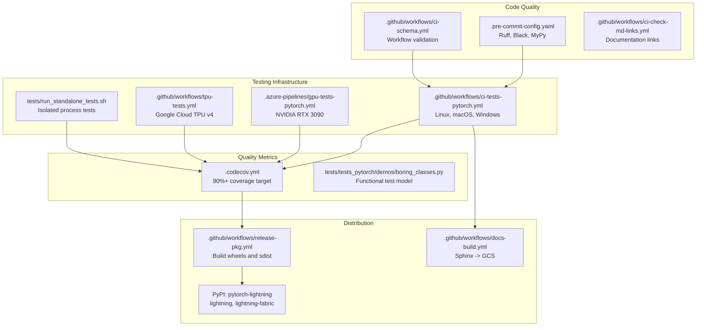

**Test Execution:**

Lightning uses `pytest` with the `BoringModel` pattern for testing. The `BoringModel` is a minimal functional model used to test framework features without domain-specific complexity:

```python
# tests/tests_pytorch/demos/boring_classes.py
class BoringModel(LightningModule):
    def __init__(self):
        super().__init__()
        self.layer = torch.nn.Linear(32, 2)
    
    def training_step(self, batch, batch_idx):
        loss = self(batch).sum()
        return loss
```

This pattern allows testing trainer features, callbacks, and strategies independently of model complexity.

Sources: [.github/workflows/README.md:8-28](), [tests/README.md:1-36](), [.github/workflows/ci-schema.yml:1-16](), [Makefile:52-59]()

## Hardware and Strategy Support

Lightning provides extensive hardware accelerator support and distributed training strategies through its plugin architecture, allowing seamless scaling from single devices to multi-node clusters.

| Accelerator | Strategy | Configuration |
|-------------|----------|---------------|
| CPU | Single, DDP | `accelerator="cpu"` |
| GPU (CUDA) | Single, DDP, FSDP, DeepSpeed | `accelerator="gpu", devices=N` |
| TPU | Single, DDP | `accelerator="tpu", devices=8` |
| HPU (Habana) | Single, DDP | `accelerator="hpu", devices=N` |
| MPS (Apple) | Single | `accelerator="mps", devices=1` |

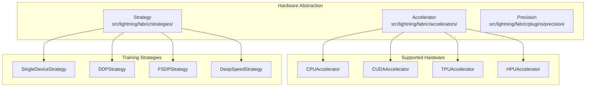

Sources: [README.md:234-255](), [docs/source-fabric/advanced/compile.rst:455-475](), [README.md:456-491]()

Lightning's modular architecture and comprehensive infrastructure make it suitable for research experimentation through production deployment, while maintaining PyTorch compatibility and providing multiple levels of abstraction to match user expertise and requirements.

---

# Page: Core Framework

# Core Framework

<details>
<summary>Relevant source files</summary>

The following files were used as context for generating this wiki page:

- [README.md](README.md)

</details>


## Purpose and Scope

This document provides an overview of the core framework components in PyTorch Lightning and Lightning Fabric. It describes the main architectural layers, their relationships, and how they enable scalable deep learning training. For detailed information about specific components, see:

- Comparison of high-level vs low-level APIs: [PyTorch Lightning vs Fabric](#2.1)
- Model abstraction details: [LightningModule](#2.2)
- Training orchestration: [Trainer](#2.3)
- Expert-level control: [Lightning Fabric](#2.4)
- Hardware configuration system: [Connector System](#2.5)

For information about distributed training strategies, see [Distributed Training](#3). For data handling, see [Data Handling](#5).

## Overview

PyTorch Lightning provides two complementary APIs for different levels of abstraction:

1. **PyTorch Lightning (High-Level)**: The `Trainer` class orchestrates `LightningModule` objects through automated training loops, providing a batteries-included approach with built-in features like callbacks, logging, and checkpointing.

2. **Lightning Fabric (Expert-Level)**: A minimal wrapper over PyTorch that provides distributed training primitives while letting users write their own training loops.

Both APIs share the same underlying infrastructure for hardware abstraction (accelerators, strategies, precision plugins), enabling code reuse and consistency across abstraction levels.

**Sources**: [README.md:1-634](), [src/lightning/pytorch/CHANGELOG.md]()

## Core Architecture

The framework is organized into four main layers:

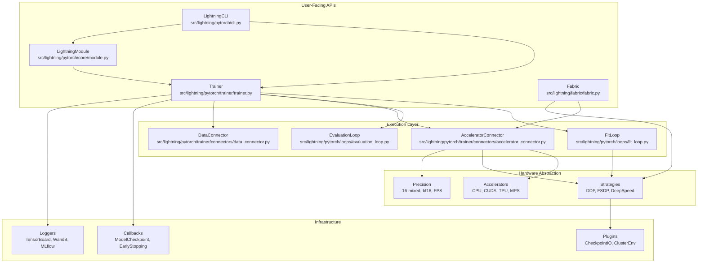

**Sources**: [README.md:67-243](), [tests/tests_pytorch/trainer/test_trainer.py:68-76]()

## User-Facing APIs

### LightningModule

The `LightningModule` class extends `torch.nn.Module` with hooks for training, validation, and testing. It encapsulates:

- Model architecture (`forward()`)
- Training logic (`training_step()`, `validation_step()`, `test_step()`)
- Optimizer configuration (`configure_optimizers()`)
- Data loading (`train_dataloader()`, `val_dataloader()`, etc.)

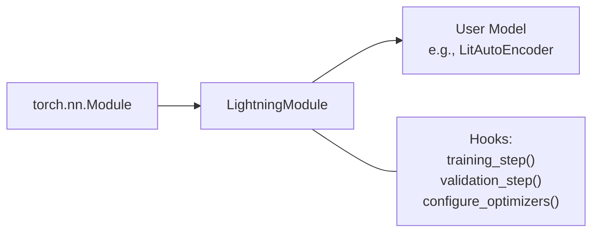

**Example usage from codebase**:

[README.md:154-177]() shows a typical `LightningModule` implementation with `training_step()` and `configure_optimizers()`.

**Sources**: [README.md:138-192](), [tests/tests_pytorch/core/test_lightning_module.py:32-103]()

### Trainer

The `Trainer` class is the main entry point for high-level training automation. It handles:

- Training loop execution (`fit()`, `validate()`, `test()`, `predict()`)
- Hardware configuration (accelerators, devices, strategies)
- Callback management
- Logging and checkpointing
- Gradient accumulation and clipping

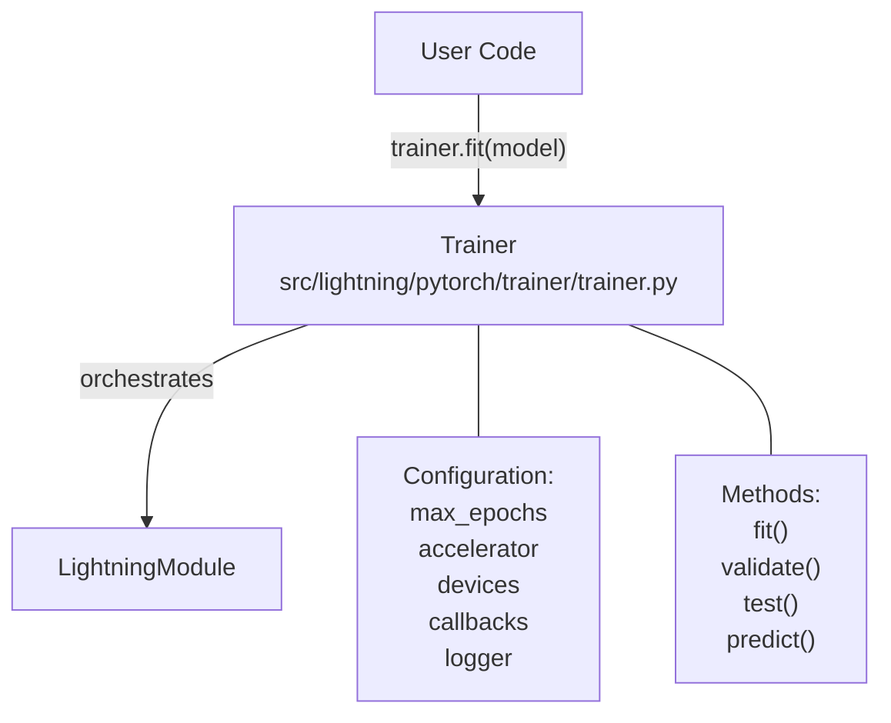

**Sources**: [README.md:188-192](), [tests/tests_pytorch/trainer/test_trainer.py:68-119]()

### Fabric

`Fabric` provides expert-level control with minimal abstractions. Key primitives:

- `fabric.setup(model, optimizer)` - wraps model and optimizer for distributed training
- `fabric.setup_dataloaders(dataloader)` - wraps dataloaders
- `fabric.backward(loss)` - handles distributed backward pass
- `fabric.launch()` - initializes distributed environment

Users write their own training loops while Fabric handles device management and distributed communication.

**Sources**: [README.md:375-463](), [tests/tests_pytorch/core/test_lightning_module.py:479-525]()

### LightningCLI

The `LightningCLI` class enables configuration-driven training through command-line arguments and YAML config files. It automatically parses:

- Model hyperparameters
- Trainer arguments
- Datamodule configuration
- Callbacks and loggers

**Sources**: [README.md:1-634]()

## Execution Layer

### Training Loops

The framework uses a hierarchical loop structure:

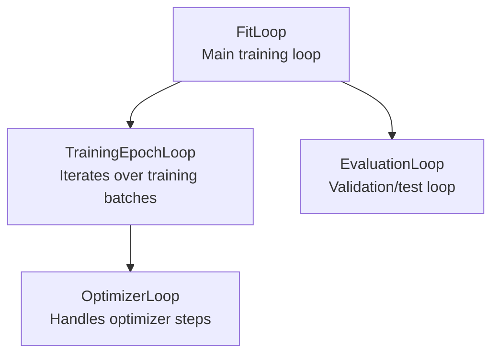

- **FitLoop**: Manages epochs, validation frequency, and early stopping checks
- **TrainingEpochLoop**: Iterates through training batches, calls `training_step()`
- **EvaluationLoop**: Handles validation, test, and prediction batches
- **OptimizerLoop**: Manages gradient accumulation and optimizer stepping

**Sources**: [tests/tests_pytorch/trainer/test_trainer.py:183-243](), [tests/tests_pytorch/trainer/properties/test_estimated_stepping_batches.py:30-105]()

### Connector System

Connectors configure the execution environment:

| Connector | Purpose | Location |
|-----------|---------|----------|
| `AcceleratorConnector` | Selects accelerator, strategy, and precision based on user config | `src/lightning/pytorch/trainer/connectors/accelerator_connector.py` |
| `DataConnector` | Attaches dataloaders to the trainer | `src/lightning/pytorch/trainer/connectors/data_connector.py` |

The `AcceleratorConnector` resolves hardware configuration during trainer initialization:

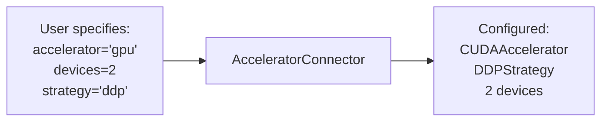

**Sources**: [tests/tests_pytorch/trainer/properties/test_estimated_stepping_batches.py:30-65]()

## Hardware Abstraction

### Accelerators

Accelerator classes provide device-agnostic interfaces:

- `CPUAccelerator` - CPU training
- `CUDAAccelerator` - NVIDIA GPU training  
- `MPSAccelerator` - Apple Silicon GPU training
- `TPUAccelerator` - Google TPU training via PyTorch/XLA

All accelerators implement a common interface for device management, tensor movement, and distributed initialization.

**Sources**: [README.md:245-267](), [tests/tests_pytorch/trainer/properties/test_estimated_stepping_batches.py:107-158]()

### Strategies

Strategy classes implement distributed training patterns:

- `SingleDeviceStrategy` - Single device (CPU or GPU)
- `DDPStrategy` - DistributedDataParallel for multi-GPU
- `FSDPStrategy` - Fully Sharded Data Parallel for memory efficiency
- `DeepSpeedStrategy` - Microsoft DeepSpeed with ZeRO optimization
- `XLAStrategy` - TPU training

Strategies handle:
- Model wrapping (e.g., `DistributedDataParallel`)
- Gradient synchronization
- Checkpoint save/load (sharded vs full state)

**Sources**: [README.md:245-267](), [tests/tests_pytorch/trainer/test_trainer.py:1-100]()

### Precision Plugins

Precision plugins manage mixed precision training:

- `Precision(precision="32-true")` - Full precision
- `Precision(precision="16-mixed")` - Automatic Mixed Precision
- `Precision(precision="bf16-mixed")` - BFloat16 mixed precision
- `TransformerEnginePrecision` - FP8 training for transformers
- `BitsandbytesPrecision` - Quantization

**Sources**: [README.md:269-277]()

## Infrastructure

### Callbacks

The `Callback` class provides hooks into the training lifecycle. Built-in callbacks include:

| Callback | Purpose | Key Hooks |
|----------|---------|-----------|
| `ModelCheckpoint` | Save model checkpoints | `on_validation_end`, `on_train_epoch_end` |
| `EarlyStopping` | Stop training when metric stops improving | `on_validation_end` |
| `Timer` | Track training time | `on_train_start`, `on_train_end` |
| `BackboneFinetuning` | Freeze/unfreeze model layers progressively | `freeze_before_training`, `finetune_function` |

**Sources**: [tests/tests_pytorch/trainer/test_trainer.py:306-345](), [tests/tests_pytorch/callbacks/test_finetuning_callback.py:43-119]()

### Loggers

Logger classes record metrics and artifacts to experiment tracking platforms:

- `TensorBoardLogger` - TensorBoard
- `WandbLogger` - Weights & Biases
- `MLFlowLogger` - MLflow
- `CometLogger` - Comet.ml
- `NeptuneLogger` - Neptune.ai

**Sources**: [README.md:280-301](), [tests/tests_pytorch/core/test_lightning_module.py:77-103]()

### Plugins

Plugins extend framework functionality:

- `CheckpointIO` - Custom checkpoint save/load logic
- `ClusterEnvironment` - Cluster-specific environment setup
- `PrecisionPlugin` - Custom precision handling

**Sources**: [README.md:1-634]()

## Component Interaction Flow

The following diagram illustrates the initialization and training flow:

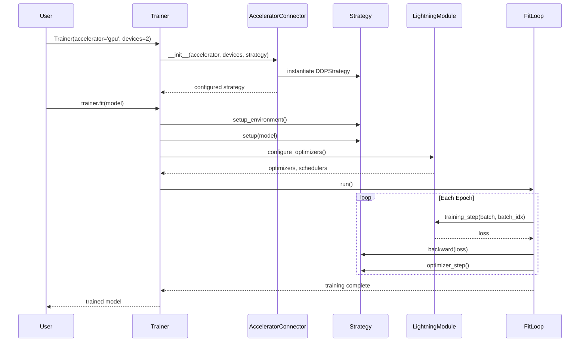

**Sources**: [tests/tests_pytorch/trainer/test_trainer.py:68-119](), [tests/tests_pytorch/trainer/test_trainer.py:422-456]()

## Optimizer Management

The framework wraps optimizers in the `LightningOptimizer` class to handle distributed training logic:

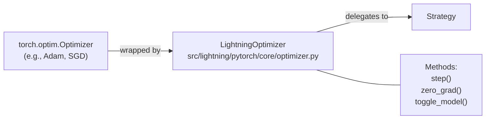

The `LightningOptimizer`:
- Delegates `.step()` to `Strategy.optimizer_step()` for distributed coordination
- Provides `toggle_model()` context manager for advanced multi-optimizer scenarios
- Maintains reference to the original optimizer in `._optimizer`

**Example from tests**: [tests/tests_pytorch/core/test_lightning_optimizer.py:28-66]() shows how `LightningOptimizer` wraps user optimizers and maintains state synchronization.

**Sources**: [src/lightning/pytorch/core/optimizer.py:39-172](), [tests/tests_pytorch/core/test_lightning_optimizer.py:126-173]()

## Configuration and Validation

The trainer validates configuration before training:

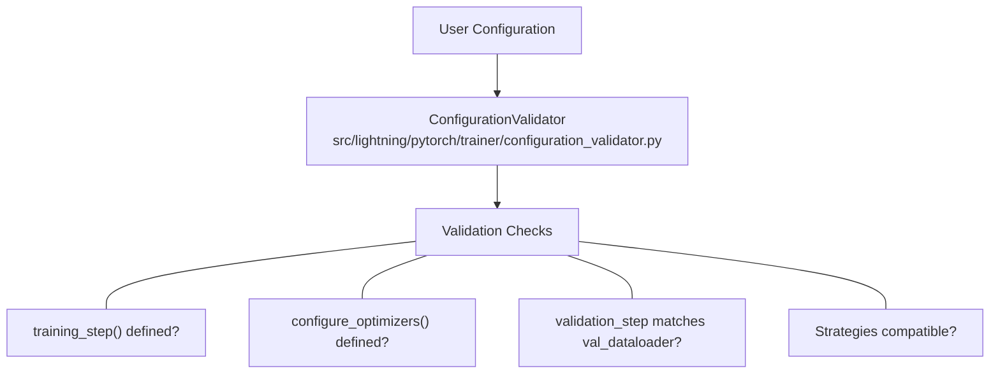

Common validation checks include:
- `training_step()` is defined if calling `trainer.fit()`
- `configure_optimizers()` returns valid optimizer(s)
- Validation step/dataloader consistency
- Compatibility between manual optimization and trainer features

**Sources**: [tests/tests_pytorch/trainer/test_config_validator.py:28-163]()

## Model Export

Both `LightningModule` and models wrapped by `Fabric` support exporting to production formats:

| Method | Format | Use Case |
|--------|--------|----------|
| `model.to_torchscript()` | TorchScript | Production inference, C++ deployment |
| `model.to_onnx()` | ONNX | Cross-framework compatibility |

**Example**: [tests/tests_pytorch/models/test_torchscript.py:32-86]() demonstrates scripting and tracing `LightningModule` objects.

**Sources**: [README.md:327-349](), [tests/tests_pytorch/models/test_torchscript.py:32-230]()

## Key Abstractions Summary

| Component | Abstraction Level | Primary Responsibility |
|-----------|------------------|------------------------|
| `LightningModule` | High | Define model, training logic, optimizers |
| `Trainer` | High | Orchestrate training, handle infrastructure |
| `Fabric` | Low | Minimal distributed training primitives |
| `Strategy` | Mid | Implement distributed training patterns |
| `Accelerator` | Mid | Device management and operations |
| `Loop` | Mid | Control training/validation flow |
| `Callback` | High | Extend functionality via hooks |
| `LightningOptimizer` | Internal | Wrap optimizers for distributed training |

**Sources**: [README.md:1-634](), [tests/tests_pytorch/trainer/test_trainer.py:1-100](), [tests/tests_pytorch/core/test_lightning_module.py:32-103]()

---

# Page: PyTorch Lightning vs Fabric

# PyTorch Lightning vs Fabric

<details>
<summary>Relevant source files</summary>

The following files were used as context for generating this wiki page:

- [README.md](README.md)
- [docs/source-fabric/api/fabric_methods.rst](docs/source-fabric/api/fabric_methods.rst)
- [docs/source-fabric/api/wrappers.rst](docs/source-fabric/api/wrappers.rst)
- [src/lightning/fabric/CHANGELOG.md](src/lightning/fabric/CHANGELOG.md)
- [src/lightning/fabric/fabric.py](src/lightning/fabric/fabric.py)
- [src/lightning/fabric/strategies/ddp.py](src/lightning/fabric/strategies/ddp.py)
- [src/lightning/fabric/strategies/deepspeed.py](src/lightning/fabric/strategies/deepspeed.py)
- [src/lightning/fabric/strategies/fsdp.py](src/lightning/fabric/strategies/fsdp.py)
- [src/lightning/fabric/strategies/strategy.py](src/lightning/fabric/strategies/strategy.py)
- [src/lightning/pytorch/CHANGELOG.md](src/lightning/pytorch/CHANGELOG.md)
- [src/lightning/pytorch/core/module.py](src/lightning/pytorch/core/module.py)
- [src/lightning/pytorch/strategies/ddp.py](src/lightning/pytorch/strategies/ddp.py)
- [src/lightning/pytorch/strategies/deepspeed.py](src/lightning/pytorch/strategies/deepspeed.py)
- [src/lightning/pytorch/strategies/fsdp.py](src/lightning/pytorch/strategies/fsdp.py)
- [src/lightning/pytorch/strategies/strategy.py](src/lightning/pytorch/strategies/strategy.py)
- [tests/tests_fabric/strategies/test_ddp.py](tests/tests_fabric/strategies/test_ddp.py)
- [tests/tests_fabric/strategies/test_deepspeed.py](tests/tests_fabric/strategies/test_deepspeed.py)
- [tests/tests_fabric/strategies/test_deepspeed_integration.py](tests/tests_fabric/strategies/test_deepspeed_integration.py)
- [tests/tests_fabric/strategies/test_fsdp.py](tests/tests_fabric/strategies/test_fsdp.py)
- [tests/tests_fabric/strategies/test_fsdp_integration.py](tests/tests_fabric/strategies/test_fsdp_integration.py)
- [tests/tests_fabric/strategies/test_single_device.py](tests/tests_fabric/strategies/test_single_device.py)
- [tests/tests_fabric/test_fabric.py](tests/tests_fabric/test_fabric.py)
- [tests/tests_pytorch/models/test_onnx.py](tests/tests_pytorch/models/test_onnx.py)
- [tests/tests_pytorch/strategies/test_ddp.py](tests/tests_pytorch/strategies/test_ddp.py)
- [tests/tests_pytorch/strategies/test_ddp_integration.py](tests/tests_pytorch/strategies/test_ddp_integration.py)
- [tests/tests_pytorch/strategies/test_deepspeed.py](tests/tests_pytorch/strategies/test_deepspeed.py)
- [tests/tests_pytorch/strategies/test_fsdp.py](tests/tests_pytorch/strategies/test_fsdp.py)

</details>


This document explains the fundamental differences between PyTorch Lightning and Lightning Fabric, the two main frameworks within the Lightning ecosystem. It covers their architectural differences, use cases, and helps developers choose the appropriate tool for their needs.

For information about the overall Lightning ecosystem structure, see [Overview](#1). For detailed documentation of the Trainer class, see [Trainer](#2.3). For comprehensive Fabric API details, see [Lightning Fabric](#2.4).

## Conceptual Overview

PyTorch Lightning and Lightning Fabric represent different points on the abstraction spectrum, each targeting distinct user needs and development philosophies.

**PyTorch Lightning** is a high-level framework that organizes PyTorch code into structured components. It automates training loops, hardware management, and distributed training while enforcing best practices through its opinionated structure.

**Lightning Fabric** provides minimal abstraction over PyTorch, offering distributed training capabilities and hardware acceleration with maximum user control. It requires users to write their own training loops while handling the complex distributed setup.

### Abstraction Continuum

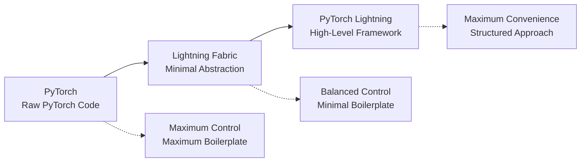

Sources: [README.md:64-75](), [README.md:363-368]()

## Architecture Comparison

The two frameworks have fundamentally different architectural approaches, reflected in their core classes and responsibilities.

### Core Framework Components

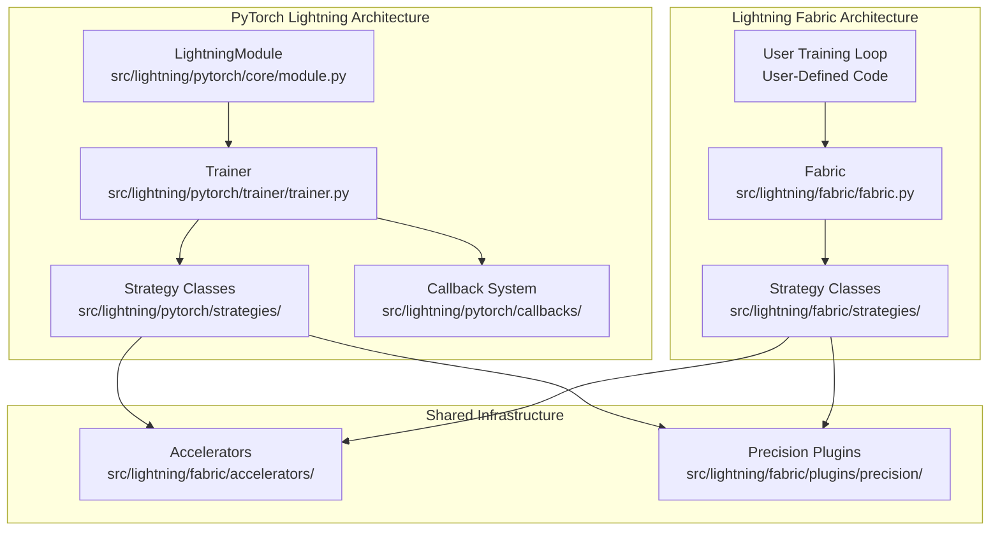

Sources: [src/lightning/fabric/fabric.py:86-142](), [src/lightning/pytorch/strategies/fsdp.py:92-142]()

### Strategy Implementation Comparison

Both frameworks share strategy implementations for distributed training, but with different integration patterns:

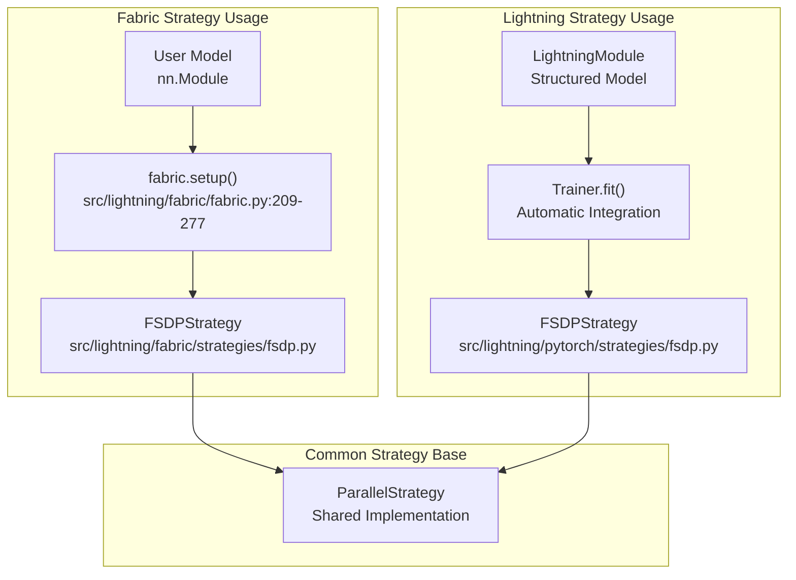

Sources: [src/lightning/fabric/strategies/fsdp.py:86-155](), [src/lightning/pytorch/strategies/fsdp.py:144-195]()

## API Surface Comparison

The API design reflects each framework's philosophy regarding user control and automation.

### Fabric API - Explicit Control

Fabric's API requires explicit calls for each training component:

| Operation | Fabric Method | File Reference |
|-----------|---------------|----------------|
| Model Setup | `fabric.setup(model, optimizer)` | [src/lightning/fabric/fabric.py:209-277]() |
| DataLoader Setup | `fabric.setup_dataloaders(dataloader)` | [src/lightning/fabric/fabric.py:351-377]() |
| Backward Pass | `fabric.backward(loss)` | [src/lightning/fabric/fabric.py:554-570]() |
| Process Launch | `fabric.launch()` | [src/lightning/fabric/fabric.py:616-678]() |

### Lightning API - Automated Workflow

Lightning's API abstracts the training loop through structured hooks:

| Component | Lightning Method | File Reference |
|-----------|------------------|----------------|
| Model Definition | `LightningModule.training_step()` | [src/lightning/pytorch/core/module.py]() |
| Optimizer Config | `LightningModule.configure_optimizers()` | [src/lightning/pytorch/core/module.py]() |
| Training Execution | `Trainer.fit(model, dataloader)` | [src/lightning/pytorch/trainer/trainer.py]() |
| Validation | `LightningModule.validation_step()` | [src/lightning/pytorch/core/module.py]() |

Sources: [src/lightning/fabric/fabric.py:86-142](), [README.md:128-181]()

## Code Organization Differences

The frameworks organize distributed training differently, impacting how users structure their code.

### Fabric Code Pattern

```python
# Minimal changes to existing PyTorch code
fabric = Fabric(accelerator="gpu", devices=8, strategy="fsdp")
fabric.launch()

model = MyModel()
optimizer = torch.optim.Adam(model.parameters())
model, optimizer = fabric.setup(model, optimizer)

dataloader = fabric.setup_dataloaders(dataloader)

# User-written training loop
for batch in dataloader:
    optimizer.zero_grad()
    loss = model(batch)
    fabric.backward(loss)
    optimizer.step()
```

### Lightning Code Pattern

```python
# Structured approach with predefined hooks
class MyLightningModule(LightningModule):
    def training_step(self, batch, batch_idx):
        loss = self.model(batch)
        return loss
    
    def configure_optimizers(self):
        return torch.optim.Adam(self.parameters())

# Automated training execution
trainer = Trainer(accelerator="gpu", devices=8, strategy="fsdp")
trainer.fit(model, dataloader)
```

Sources: [README.md:417-446](), [README.md:131-181]()

## Use Case Guidelines

### Choose Lightning Fabric When:

- **Existing PyTorch Codebase**: Minimal migration effort from existing PyTorch training scripts
- **Custom Training Loops**: Need for specialized training procedures not covered by standard hooks
- **Research Prototyping**: Rapid experimentation with new training methodologies
- **Fine-grained Control**: Requirement for explicit control over training step execution

### Choose PyTorch Lightning When:

- **Production Training**: Standardized, reproducible training workflows
- **Team Collaboration**: Enforced code organization and best practices
- **Complex Workflows**: Multi-stage training, validation, and testing procedures
- **Rich Ecosystem**: Integration with callbacks, loggers, and profilers

### Migration Considerations

Both frameworks share the same underlying strategy implementations, making migration possible:

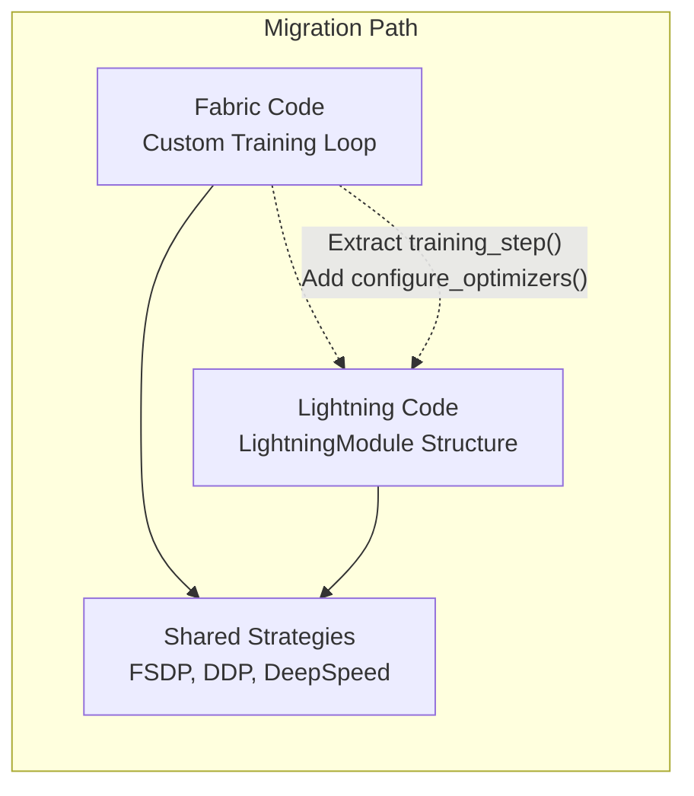

Sources: [src/lightning/fabric/strategies/fsdp.py:86-155](), [src/lightning/pytorch/strategies/fsdp.py:144-195](), [tests/tests_fabric/test_fabric.py:77-119]()

## Strategy Implementation Inheritance

Both frameworks leverage shared strategy base classes, ensuring consistent distributed training behavior:

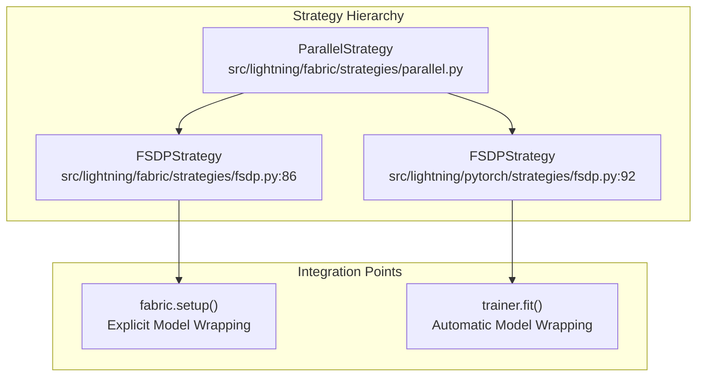

Sources: [src/lightning/fabric/strategies/fsdp.py:86-155](), [src/lightning/pytorch/strategies/fsdp.py:92-195](), [src/lightning/fabric/strategies/parallel.py]()

---

# Page: LightningModule

# LightningModule

<details>
<summary>Relevant source files</summary>

The following files were used as context for generating this wiki page:

- [README.md](README.md)
- [docs/source-pytorch/common/lightning_module.rst](docs/source-pytorch/common/lightning_module.rst)
- [docs/source-pytorch/common/trainer.rst](docs/source-pytorch/common/trainer.rst)
- [src/lightning/pytorch/callbacks/callback.py](src/lightning/pytorch/callbacks/callback.py)
- [src/lightning/pytorch/callbacks/device_stats_monitor.py](src/lightning/pytorch/callbacks/device_stats_monitor.py)
- [src/lightning/pytorch/core/hooks.py](src/lightning/pytorch/core/hooks.py)
- [src/lightning/pytorch/loops/evaluation_loop.py](src/lightning/pytorch/loops/evaluation_loop.py)
- [src/lightning/pytorch/loops/fetchers.py](src/lightning/pytorch/loops/fetchers.py)
- [src/lightning/pytorch/loops/fit_loop.py](src/lightning/pytorch/loops/fit_loop.py)
- [src/lightning/pytorch/loops/prediction_loop.py](src/lightning/pytorch/loops/prediction_loop.py)
- [src/lightning/pytorch/loops/training_epoch_loop.py](src/lightning/pytorch/loops/training_epoch_loop.py)
- [src/lightning/pytorch/loops/utilities.py](src/lightning/pytorch/loops/utilities.py)
- [src/lightning/pytorch/trainer/connectors/data_connector.py](src/lightning/pytorch/trainer/connectors/data_connector.py)
- [src/lightning/pytorch/trainer/trainer.py](src/lightning/pytorch/trainer/trainer.py)
- [src/lightning/pytorch/utilities/combined_loader.py](src/lightning/pytorch/utilities/combined_loader.py)
- [tests/tests_pytorch/core/test_lightning_module.py](tests/tests_pytorch/core/test_lightning_module.py)
- [tests/tests_pytorch/loops/test_evaluation_loop.py](tests/tests_pytorch/loops/test_evaluation_loop.py)
- [tests/tests_pytorch/loops/test_fetchers.py](tests/tests_pytorch/loops/test_fetchers.py)
- [tests/tests_pytorch/loops/test_prediction_loop.py](tests/tests_pytorch/loops/test_prediction_loop.py)
- [tests/tests_pytorch/loops/test_training_epoch_loop.py](tests/tests_pytorch/loops/test_training_epoch_loop.py)
- [tests/tests_pytorch/models/test_hooks.py](tests/tests_pytorch/models/test_hooks.py)
- [tests/tests_pytorch/trainer/connectors/test_data_connector.py](tests/tests_pytorch/trainer/connectors/test_data_connector.py)
- [tests/tests_pytorch/trainer/flags/test_overfit_batches.py](tests/tests_pytorch/trainer/flags/test_overfit_batches.py)
- [tests/tests_pytorch/trainer/properties/test_estimated_stepping_batches.py](tests/tests_pytorch/trainer/properties/test_estimated_stepping_batches.py)
- [tests/tests_pytorch/trainer/test_dataloaders.py](tests/tests_pytorch/trainer/test_dataloaders.py)
- [tests/tests_pytorch/trainer/test_trainer.py](tests/tests_pytorch/trainer/test_trainer.py)
- [tests/tests_pytorch/utilities/test_combined_loader.py](tests/tests_pytorch/utilities/test_combined_loader.py)
- [tests/tests_pytorch/utilities/test_enums.py](tests/tests_pytorch/utilities/test_enums.py)

</details>


The LightningModule is a core component of the PyTorch Lightning framework that organizes your PyTorch code into a structured format. It serves as the main building block for defining models, with clear separation of training logic, validation processes, testing procedures, and prediction workflows.

For information about the Trainer that works with LightningModule, see [Trainer](#2.2).

## Overview

The LightningModule extends PyTorch's `nn.Module` by adding standardized hooks and methods that streamline the training lifecycle. By using this class, you can:

- Define all model components in one place
- Standardize the training, validation, testing, and prediction workflows
- Make your model hardware-agnostic
- Reduce boilerplate code compared to raw PyTorch
- Easily integrate with the Lightning Trainer for automated training

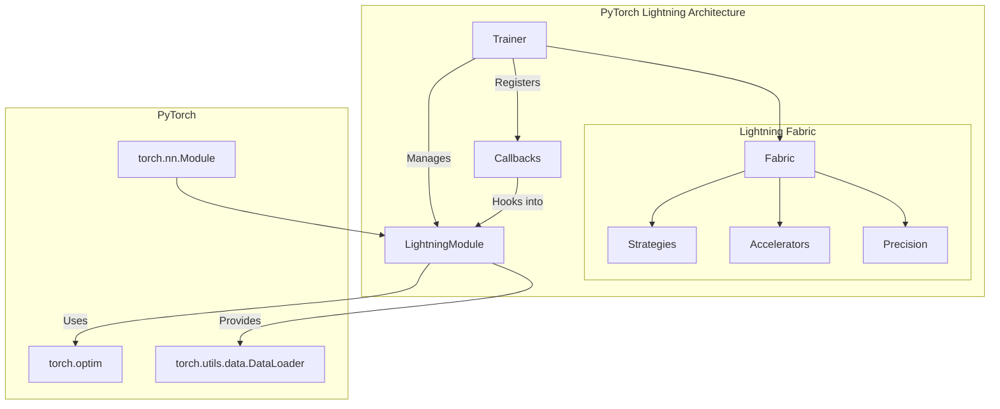

Sources:
- [README.md:89-146](https://github.com/Lightning-AI/pytorch-lightning/blob/master/README.md)
- [src/lightning/pytorch/trainer/trainer.py:89-146](https://github.com/Lightning-AI/pytorch-lightning/blob/master/src/lightning/pytorch/trainer/trainer.py)
- [docs/source-pytorch/common/lightning_module.rst:1-76](https://github.com/Lightning-AI/pytorch-lightning/blob/master/docs/source-pytorch/common/lightning_module.rst)

## Core Structure

A LightningModule organizes PyTorch code into 6 key sections:

1. **Initialization** (`__init__` and `setup`)
2. **Train Loop** (`training_step` and related hooks)
3. **Validation Loop** (`validation_step` and related hooks)
4. **Test Loop** (`test_step` and related hooks)
5. **Prediction Loop** (`predict_step` and related hooks)
6. **Optimizers and LR Schedulers** (`configure_optimizers`)

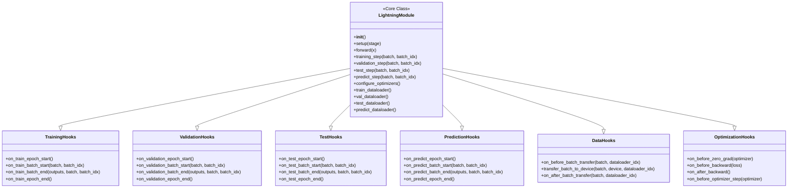

Sources:
- [docs/source-pytorch/common/lightning_module.rst:10-22](https://github.com/Lightning-AI/pytorch-lightning/blob/master/docs/source-pytorch/common/lightning_module.rst)
- [src/lightning/pytorch/core/hooks.py:14-70](https://github.com/Lightning-AI/pytorch-lightning/blob/master/src/lightning/pytorch/core/hooks.py)

## Basic Implementation

Here's an example of a minimal LightningModule implementation:

```python
import torch
import lightning as L

class LitModel(L.LightningModule):
    def __init__(self):
        super().__init__()
        self.layer = torch.nn.Linear(28 * 28, 10)
        
    def forward(self, x):
        return torch.relu(self.layer(x.view(x.size(0), -1)))
    
    def training_step(self, batch, batch_idx):
        x, y = batch
        y_hat = self(x)
        loss = torch.nn.functional.cross_entropy(y_hat, y)
        self.log("train_loss", loss)
        return loss
    
    def validation_step(self, batch, batch_idx):
        x, y = batch
        y_hat = self(x)
        loss = torch.nn.functional.cross_entropy(y_hat, y)
        self.log("val_loss", loss)
        
    def configure_optimizers(self):
        return torch.optim.Adam(self.parameters(), lr=0.001)
```

Sources:
- [docs/source-pytorch/common/lightning_module.rst:87-109](https://github.com/Lightning-AI/pytorch-lightning/blob/master/docs/source-pytorch/common/lightning_module.rst)
- [README.md:133-162](https://github.com/Lightning-AI/pytorch-lightning/blob/master/README.md)

## Training Loop Flow

The LightningModule centralizes the training logic in the `training_step` method. Underneath, the Trainer orchestrates a complex flow of operations.

```mermaid
sequenceDiagram
    participant TR as Trainer
    participant LM as LightningModule
    participant DL as DataLoader
    participant OPT as Optimizer
    
    TR->>LM: setup(stage="fit")
    TR->>LM: configure_optimizers()
    LM-->>TR: optimizer(s)
    TR->>LM: train_dataloader()
    LM-->>TR: DataLoader
    
    rect rgb(240, 240, 240)
        Note over TR,OPT: For each epoch
        TR->>LM: on_train_epoch_start()
        
        loop For each batch
            TR->>LM: on_before_batch_transfer(batch, dataloader_idx)
            TR->>LM: transfer_batch_to_device(batch, device)
            TR->>LM: on_after_batch_transfer(batch, dataloader_idx)
            TR->>LM: on_train_batch_start(batch, batch_idx)
            TR->>LM: training_step(batch, batch_idx)
            LM-->>TR: loss
            TR->>LM: on_before_zero_grad(optimizer)
            TR->>OPT: zero_grad()
            TR->>LM: on_before_backward(loss)
            Note over TR,LM: loss.backward()
            TR->>LM: on_after_backward()
            TR->>LM: on_before_optimizer_step(optimizer)
            TR->>OPT: step()
            TR->>LM: on_train_batch_end(outputs, batch, batch_idx)
        end
        
        TR->>LM: on_train_epoch_end()
    end
```

In the training step, you return the loss value that will be used for backpropagation:

```python
def training_step(self, batch, batch_idx):
    x, y = batch
    y_hat = self(x)
    loss = torch.nn.functional.cross_entropy(y_hat, y)
    # Log metrics to be monitored
    self.log("train_loss", loss, on_step=True, on_epoch=True, prog_bar=True)
    # Return loss for backpropagation
    return loss
```

Sources:
- [src/lightning/pytorch/loops/training_epoch_loop.py:48-100](https://github.com/Lightning-AI/pytorch-lightning/blob/master/src/lightning/pytorch/loops/training_epoch_loop.py)
- [src/lightning/pytorch/loops/fit_loop.py:58-110](https://github.com/Lightning-AI/pytorch-lightning/blob/master/src/lightning/pytorch/loops/fit_loop.py)
- [docs/source-pytorch/common/lightning_module.rst:152-207](https://github.com/Lightning-AI/pytorch-lightning/blob/master/docs/source-pytorch/common/lightning_module.rst)

## Validation Loop Flow

The validation flow follows a similar pattern but without gradient calculation or optimizer updates:

```mermaid
sequenceDiagram
    participant TR as Trainer
    participant LM as LightningModule
    participant DL as DataLoader
    
    TR->>LM: val_dataloader()
    LM-->>TR: DataLoader
    
    rect rgb(240, 240, 240)
        Note over TR,DL: Validation phase
        TR->>LM: on_validation_epoch_start()
        
        loop For each batch
            TR->>LM: on_before_batch_transfer(batch, dataloader_idx)
            TR->>LM: transfer_batch_to_device(batch, device)
            TR->>LM: on_after_batch_transfer(batch, dataloader_idx)
            TR->>LM: on_validation_batch_start(batch, batch_idx)
            Note over TR,LM: torch.no_grad() context
            TR->>LM: validation_step(batch, batch_idx)
            LM-->>TR: outputs
            TR->>LM: on_validation_batch_end(outputs, batch, batch_idx)
        end
        
        TR->>LM: on_validation_epoch_end()
    end
```

The `validation_step` typically involves a forward pass through your model and computation of validation metrics:

```python
def validation_step(self, batch, batch_idx):
    x, y = batch
    y_hat = self(x)
    loss = torch.nn.functional.cross_entropy(y_hat, y)
    preds = torch.argmax(y_hat, dim=1)
    acc = (preds == y).float().mean()
    # Log metrics
    self.log("val_loss", loss)
    self.log("val_acc", acc)
    # Return values for later use if needed
    return {"val_loss": loss, "val_acc": acc}
```

Sources:
- [src/lightning/pytorch/loops/evaluation_loop.py:57-117](https://github.com/Lightning-AI/pytorch-lightning/blob/master/src/lightning/pytorch/loops/evaluation_loop.py)
- [docs/source-pytorch/common/lightning_module.rst:262-303](https://github.com/Lightning-AI/pytorch-lightning/blob/master/docs/source-pytorch/common/lightning_module.rst)

## Test Loop Flow

Testing follows the same pattern as validation but is typically run after training is complete:

```mermaid
sequenceDiagram
    participant TR as Trainer
    participant LM as LightningModule
    participant DL as DataLoader
    
    TR->>LM: test_dataloader()
    LM-->>TR: DataLoader
    
    rect rgb(240, 240, 240)
        Note over TR,DL: Testing phase
        TR->>LM: on_test_epoch_start()
        
        loop For each batch
            TR->>LM: on_before_batch_transfer(batch, dataloader_idx)
            TR->>LM: transfer_batch_to_device(batch, device)
            TR->>LM: on_after_batch_transfer(batch, dataloader_idx)
            TR->>LM: on_test_batch_start(batch, batch_idx)
            Note over TR,LM: torch.no_grad() context
            TR->>LM: test_step(batch, batch_idx)
            LM-->>TR: outputs
            TR->>LM: on_test_batch_end(outputs, batch, batch_idx)
        end
        
        TR->>LM: on_test_epoch_end()
    end
```

The `test_step` is similar to `validation_step` but is used for final model evaluation:

```python
def test_step(self, batch, batch_idx):
    x, y = batch
    y_hat = self(x)
    loss = torch.nn.functional.cross_entropy(y_hat, y)
    preds = torch.argmax(y_hat, dim=1)
    acc = (preds == y).float().mean()
    # Log metrics
    self.log("test_loss", loss)
    self.log("test_acc", acc)
    return {"test_loss": loss, "test_acc": acc}
```

Sources:
- [src/lightning/pytorch/loops/evaluation_loop.py:57-117](https://github.com/Lightning-AI/pytorch-lightning/blob/master/src/lightning/pytorch/loops/evaluation_loop.py)
- [docs/source-pytorch/common/lightning_module.rst:374-402](https://github.com/Lightning-AI/pytorch-lightning/blob/master/docs/source-pytorch/common/lightning_module.rst)

## Prediction Loop Flow

The prediction loop is used for inference without any metric calculation:

```mermaid
sequenceDiagram
    participant TR as Trainer
    participant LM as LightningModule
    participant DL as DataLoader
    
    TR->>LM: predict_dataloader()
    LM-->>TR: DataLoader
    
    rect rgb(240, 240, 240)
        Note over TR,DL: Prediction phase
        TR->>LM: on_predict_epoch_start()
        
        loop For each batch
            TR->>LM: on_before_batch_transfer(batch, dataloader_idx)
            TR->>LM: transfer_batch_to_device(batch, device)
            TR->>LM: on_after_batch_transfer(batch, dataloader_idx)
            TR->>LM: on_predict_batch_start(batch, batch_idx)
            Note over TR,LM: torch.no_grad() context
            TR->>LM: predict_step(batch, batch_idx)
            LM-->>TR: predictions
            TR->>LM: on_predict_batch_end(predictions, batch, batch_idx)
        end
        
        TR->>LM: on_predict_epoch_end()
    end
```

The `predict_step` method is used for generating model predictions:

```python
def predict_step(self, batch, batch_idx, dataloader_idx=0):
    x = batch
    return self(x)
```

Sources:
- [src/lightning/pytorch/loops/prediction_loop.py:47-104](https://github.com/Lightning-AI/pytorch-lightning/blob/master/src/lightning/pytorch/loops/prediction_loop.py)
- [docs/source-pytorch/common/lightning_module.rst:407-420](https://github.com/Lightning-AI/pytorch-lightning/blob/master/docs/source-pytorch/common/lightning_module.rst)

## Data Flow Pipeline

Data flow in PyTorch Lightning is handled through a series of hooks that process the data at different stages:

```mermaid
graph LR
    Dataset --> |"train_dataloader()"| Batch
    Batch --> |"on_before_batch_transfer()"| PreparedBatch
    PreparedBatch --> |"transfer_batch_to_device()"| DeviceBatch
    DeviceBatch --> |"on_after_batch_transfer()"| ProcessedBatch
    
    subgraph "Training-specific flow"
        ProcessedBatch --> |"training_step()"| Loss["Loss"]
        Loss --> |"backward()"| Gradients
        Gradients --> |"optimizer_step()"| ModelUpdate
    end
    
    subgraph "Evaluation/Prediction flow"
        ProcessedBatch --> |"validation_step()/test_step()/predict_step()"| Outputs
        Outputs --> |"on_*_batch_end()"| Aggregation
    end
```

You can customize the data loading and processing through several methods:

```python
def train_dataloader(self):
    return DataLoader(MyDataset(), batch_size=32)

def val_dataloader(self):
    return DataLoader(MyValDataset(), batch_size=32)

def test_dataloader(self):
    return DataLoader(MyTestDataset(), batch_size=32)

def predict_dataloader(self):
    return DataLoader(MyPredictDataset(), batch_size=32)

def on_before_batch_transfer(self, batch, dataloader_idx):
    # Preprocess data before device transfer
    return batch

def transfer_batch_to_device(self, batch, device, dataloader_idx):
    # Custom device transfer logic
    return batch.to(device)

def on_after_batch_transfer(self, batch, dataloader_idx):
    # Additional preprocessing after device transfer
    return batch
```

Sources:
- [src/lightning/pytorch/trainer/connectors/data_connector.py:46-170](https://github.com/Lightning-AI/pytorch-lightning/blob/master/src/lightning/pytorch/trainer/connectors/data_connector.py)
- [tests/tests_pytorch/trainer/test_dataloaders.py:67-110](https://github.com/Lightning-AI/pytorch-lightning/blob/master/tests/tests_pytorch/trainer/test_dataloaders.py)
- [docs/source-pytorch/common/lightning_module.rst:469-506](https://github.com/Lightning-AI/pytorch-lightning/blob/master/docs/source-pytorch/common/lightning_module.rst)

## Optimization Configuration

The LightningModule's `configure_optimizers` method allows you to define how your model should be optimized:

```python
# Simple optimizer
def configure_optimizers(self):
    return torch.optim.Adam(self.parameters(), lr=0.001)

# Optimizer with learning rate scheduler
def configure_optimizers(self):
    optimizer = torch.optim.Adam(self.parameters(), lr=0.001)
    scheduler = torch.optim.lr_scheduler.ReduceLROnPlateau(optimizer)
    return {
        "optimizer": optimizer,
        "lr_scheduler": scheduler,
        "monitor": "val_loss"
    }

# Multiple optimizers
def configure_optimizers(self):
    optimizer1 = torch.optim.Adam(self.generator.parameters(), lr=0.001)
    optimizer2 = torch.optim.Adam(self.discriminator.parameters(), lr=0.001)
    return [optimizer1, optimizer2]
```

Sources:
- [docs/source-pytorch/common/lightning_module.rst:626-718](https://github.com/Lightning-AI/pytorch-lightning/blob/master/docs/source-pytorch/common/lightning_module.rst)
- [tests/tests_pytorch/core/test_lightning_module.py:105-120](https://github.com/Lightning-AI/pytorch-lightning/blob/master/tests/tests_pytorch/core/test_lightning_module.py)

## Manual Optimization

By default, Lightning handles the optimization process automatically. However, you can take manual control of the optimization process by setting `self.automatic_optimization = False`:

```python
def __init__(self):
    super().__init__()
    self.automatic_optimization = False

def training_step(self, batch, batch_idx):
    # Get optimizers
    opt_a, opt_b = self.optimizers()
    
    # Optimize generator
    x, y = batch
    opt_a.zero_grad()
    y_hat = self.generator(x)
    loss_a = self.generator_loss(y_hat, y)
    self.manual_backward(loss_a)
    opt_a.step()
    
    # Optimize discriminator
    opt_b.zero_grad()
    y_hat = self.discriminator(x)
    loss_b = self.discriminator_loss(y_hat, y)
    self.manual_backward(loss_b)
    opt_b.step()
    
    return {"loss_a": loss_a, "loss_b": loss_b}
```

When using manual optimization, you're responsible for:
- Calling `optimizer.zero_grad()`
- Using `self.manual_backward(loss)` instead of `loss.backward()`
- Calling `optimizer.step()`

Sources:
- [docs/source-pytorch/common/lightning_module.rst:720-774](https://github.com/Lightning-AI/pytorch-lightning/blob/master/docs/source-pytorch/common/lightning_module.rst)
- [src/lightning/pytorch/loops/optimization/manual.py:1-60](https://github.com/Lightning-AI/pytorch-lightning/blob/master/src/lightning/pytorch/loops/optimization/manual.py)

## Multiple Dataloaders

Lightning makes it easy to work with multiple dataloaders for validation, testing and prediction:

```python
# In your LightningModule
def val_dataloader(self):
    return [
        DataLoader(Dataset1()),
        DataLoader(Dataset2()),
    ]

def validation_step(self, batch, batch_idx, dataloader_idx=0):
    if dataloader_idx == 0:
        # Handle first dataloader
        x, y = batch
    else:
        # Handle second dataloader
        x, y, z = batch
    
    # Rest of validation step
    loss = ...
    self.log(f"val_loss_{dataloader_idx}", loss)
    return loss
```

This pattern also applies to test and predict dataloaders.

Sources:
- [tests/tests_pytorch/trainer/test_dataloaders.py:46-64](https://github.com/Lightning-AI/pytorch-lightning/blob/master/tests/tests_pytorch/trainer/test_dataloaders.py)
- [src/lightning/pytorch/utilities/combined_loader.py:1-70](https://github.com/Lightning-AI/pytorch-lightning/blob/master/src/lightning/pytorch/utilities/combined_loader.py)

## Handling Device Transfer

Lightning automatically handles transferring your data to the appropriate device (CPU, GPU, TPU, etc.). It provides hooks for customizing this process:

```python
class CustomBatchModule(LightningModule):
    def on_before_batch_transfer(self, batch, dataloader_idx):
        # Called before transferring batch to device
        # You can do data augmentation here
        return batch
    
    def transfer_batch_to_device(self, batch, device, dataloader_idx):
        # Custom logic for transferring to device
        if isinstance(batch, CustomBatch):
            batch.x = batch.x.to(device)
            batch.y = batch.y.to(device)
            return batch
        return super().transfer_batch_to_device(batch, device, dataloader_idx)
    
    def on_after_batch_transfer(self, batch, dataloader_idx):
        # Called after transferring batch to device
        # You can normalize data here
        return batch
```

Sources:
- [tests/tests_pytorch/models/test_hooks.py:30-52](https://github.com/Lightning-AI/pytorch-lightning/blob/master/tests/tests_pytorch/models/test_hooks.py)
- [tests/tests_pytorch/models/test_hooks.py:111-159](https://github.com/Lightning-AI/pytorch-lightning/blob/master/tests/tests_pytorch/models/test_hooks.py)

## Integration with the Trainer

The LightningModule is designed to be used with the Trainer class, which automates the training process:

```python
# Define your model
model = MyLightningModule()

# Define trainer with desired options
trainer = Trainer(
    max_epochs=10,
    accelerator="gpu",
    devices=1,
    precision="16-mixed"
)

# Train the model
trainer.fit(model, train_dataloaders, val_dataloaders)

# Evaluate the model
trainer.test(model, test_dataloaders)

# Generate predictions
predictions = trainer.predict(model, predict_dataloaders)
```

The Trainer handles:
- Moving data to the appropriate device
- Calling the appropriate hooks at the right time
- Managing distributed training
- Handling precision (16-bit, 32-bit, etc.)
- Logging, checkpointing, and callbacks

Sources:
- [src/lightning/pytorch/trainer/trainer.py:513-569](https://github.com/Lightning-AI/pytorch-lightning/blob/master/src/lightning/pytorch/trainer/trainer.py)
- [docs/source-pytorch/common/trainer.rst:10-44](https://github.com/Lightning-AI/pytorch-lightning/blob/master/docs/source-pytorch/common/trainer.rst)

## Logging Metrics

LightningModule provides a convenient `log` method for logging metrics:

```python
def training_step(self, batch, batch_idx):
    x, y = batch
    y_hat = self(x)
    loss = F.cross_entropy(y_hat, y)
    
    # Log training loss
    self.log("train_loss", loss, on_step=True, on_epoch=True, prog_bar=True, logger=True)
    
    # You can also log other metrics
    preds = torch.argmax(y_hat, dim=1)
    acc = (preds == y).float().mean()
    self.log("train_acc", acc, on_step=True, on_epoch=True)
    
    return loss
```

The `log` method parameters include:
- `name`: The metric name
- `value`: The metric value
- `on_step`: Whether to log per step
- `on_epoch`: Whether to log epoch-aggregated metrics
- `prog_bar`: Whether to display in the progress bar
- `logger`: Whether to send to loggers
- `sync_dist`: Whether to sync across distributed processes

Sources:
- [docs/source-pytorch/common/lightning_module.rst:192-228](https://github.com/Lightning-AI/pytorch-lightning/blob/master/docs/source-pytorch/common/lightning_module.rst)
- [tests/tests_pytorch/models/test_hooks.py:74-104](https://github.com/Lightning-AI/pytorch-lightning/blob/master/tests/tests_pytorch/models/test_hooks.py)

## Summary

The LightningModule is the central component of PyTorch Lightning that:

1. **Organizes your PyTorch code** into a clear, structured format
2. **Abstracts away boilerplate** for training, validation, testing, and prediction
3. **Makes your models hardware-agnostic** by handling device placement
4. **Integrates with the Trainer** for automatic training orchestration
5. **Provides hooks** for customizing every step of the training process
6. **Supports distributed training** with minimal code changes
7. **Cleanly separates research code** from engineering boilerplate

By using a LightningModule, you can focus on your model's core logic while Lightning handles the engineering infrastructure.

Sources:
- [README.md:335-345](https://github.com/Lightning-AI/pytorch-lightning/blob/master/README.md)
- [docs/source-pytorch/common/lightning_module.rst:10-76](https://github.com/Lightning-AI/pytorch-lightning/blob/master/docs/source-pytorch/common/lightning_module.rst)

---

# Page: Trainer

# Trainer

<details>
<summary>Relevant source files</summary>

The following files were used as context for generating this wiki page:

- [docs/source-pytorch/common/lightning_module.rst](docs/source-pytorch/common/lightning_module.rst)
- [docs/source-pytorch/common/trainer.rst](docs/source-pytorch/common/trainer.rst)
- [src/lightning/pytorch/callbacks/callback.py](src/lightning/pytorch/callbacks/callback.py)
- [src/lightning/pytorch/callbacks/device_stats_monitor.py](src/lightning/pytorch/callbacks/device_stats_monitor.py)
- [src/lightning/pytorch/core/hooks.py](src/lightning/pytorch/core/hooks.py)
- [src/lightning/pytorch/loops/evaluation_loop.py](src/lightning/pytorch/loops/evaluation_loop.py)
- [src/lightning/pytorch/loops/fetchers.py](src/lightning/pytorch/loops/fetchers.py)
- [src/lightning/pytorch/loops/fit_loop.py](src/lightning/pytorch/loops/fit_loop.py)
- [src/lightning/pytorch/loops/prediction_loop.py](src/lightning/pytorch/loops/prediction_loop.py)
- [src/lightning/pytorch/loops/training_epoch_loop.py](src/lightning/pytorch/loops/training_epoch_loop.py)
- [src/lightning/pytorch/loops/utilities.py](src/lightning/pytorch/loops/utilities.py)
- [src/lightning/pytorch/trainer/connectors/data_connector.py](src/lightning/pytorch/trainer/connectors/data_connector.py)
- [src/lightning/pytorch/trainer/trainer.py](src/lightning/pytorch/trainer/trainer.py)
- [src/lightning/pytorch/utilities/combined_loader.py](src/lightning/pytorch/utilities/combined_loader.py)
- [tests/tests_pytorch/core/test_lightning_module.py](tests/tests_pytorch/core/test_lightning_module.py)
- [tests/tests_pytorch/loops/test_evaluation_loop.py](tests/tests_pytorch/loops/test_evaluation_loop.py)
- [tests/tests_pytorch/loops/test_fetchers.py](tests/tests_pytorch/loops/test_fetchers.py)
- [tests/tests_pytorch/loops/test_prediction_loop.py](tests/tests_pytorch/loops/test_prediction_loop.py)
- [tests/tests_pytorch/loops/test_training_epoch_loop.py](tests/tests_pytorch/loops/test_training_epoch_loop.py)
- [tests/tests_pytorch/models/test_hooks.py](tests/tests_pytorch/models/test_hooks.py)
- [tests/tests_pytorch/trainer/connectors/test_data_connector.py](tests/tests_pytorch/trainer/connectors/test_data_connector.py)
- [tests/tests_pytorch/trainer/flags/test_overfit_batches.py](tests/tests_pytorch/trainer/flags/test_overfit_batches.py)
- [tests/tests_pytorch/trainer/properties/test_estimated_stepping_batches.py](tests/tests_pytorch/trainer/properties/test_estimated_stepping_batches.py)
- [tests/tests_pytorch/trainer/test_dataloaders.py](tests/tests_pytorch/trainer/test_dataloaders.py)
- [tests/tests_pytorch/trainer/test_trainer.py](tests/tests_pytorch/trainer/test_trainer.py)
- [tests/tests_pytorch/utilities/test_combined_loader.py](tests/tests_pytorch/utilities/test_combined_loader.py)
- [tests/tests_pytorch/utilities/test_enums.py](tests/tests_pytorch/utilities/test_enums.py)

</details>


## Purpose and Scope

The `Trainer` class is the central orchestrator in PyTorch Lightning that automates the training loop and manages all aspects of model training, validation, testing, and prediction. It handles device placement, distributed training, gradient accumulation, logging, checkpointing, and callback execution while allowing users to maintain full control over their PyTorch code through the `LightningModule` interface.

For information about the LightningModule that the Trainer executes, see [LightningModule](#2.2). For information about distributed training strategies, see [Strategy Pattern](#3.1).

**Sources:** [src/lightning/pytorch/trainer/trainer.py:89-521](), [docs/source-pytorch/common/trainer.rst:1-40]()

---

## Trainer Architecture

The `Trainer` is composed of specialized **connectors** that configure different aspects of training and **loops** that execute the training/evaluation/prediction logic.

### Component Overview

```mermaid
graph TB
    subgraph "Trainer Class"
        Trainer["Trainer<br/>(trainer.py)"]
        
        subgraph "Connectors"
            AccelConn["_AcceleratorConnector<br/>devices, strategy, precision"]
            DataConn["_DataConnector<br/>dataloaders, datamodule"]
            CallbackConn["_CallbackConnector<br/>callbacks, progress bars"]
            LoggerConn["_LoggerConnector<br/>loggers, metrics"]
            CheckpointConn["_CheckpointConnector<br/>save/load state"]
            SignalConn["_SignalConnector<br/>SIGTERM handling"]
        end
        
        subgraph "Loops"
            FitLoop["_FitLoop<br/>epoch iteration"]
            TrainEpochLoop["_TrainingEpochLoop<br/>batch iteration"]
            ValLoop["_EvaluationLoop<br/>validation"]
            TestLoop["_EvaluationLoop<br/>testing"]
            PredictLoop["_PredictionLoop<br/>prediction"]
        end
        
        subgraph "State"
            State["TrainerState<br/>fn, status, stage"]
        end
    end
    
    subgraph "User Code"
        LM["LightningModule<br/>training_step, etc"]
        DM["DataModule<br/>data preparation"]
    end
    
    Trainer --> AccelConn
    Trainer --> DataConn
    Trainer --> CallbackConn
    Trainer --> LoggerConn
    Trainer --> CheckpointConn
    Trainer --> SignalConn
    
    Trainer --> FitLoop
    Trainer --> ValLoop
    Trainer --> TestLoop
    Trainer --> PredictLoop
    
    FitLoop --> TrainEpochLoop
    TrainEpochLoop --> ValLoop
    
    Trainer --> State
    
    Trainer --> LM
    Trainer --> DM
```

**Sources:** [src/lightning/pytorch/trainer/trainer.py:414-442](), [src/lightning/pytorch/trainer/trainer.py:56-67]()

---

## Initialization

### Constructor Signature

The `Trainer.__init__()` method accepts configuration parameters that control every aspect of training. Key categories include:

**Hardware Configuration:**
- `accelerator`: Device type ("cpu", "gpu", "tpu", "hpu", "mps", "auto")
- `devices`: Number or list of devices to use
- `num_nodes`: Number of nodes for distributed training
- `strategy`: Training strategy ("auto", "ddp", "fsdp", "deepspeed", etc)
- `precision`: Precision mode ("32-true", "16-mixed", "bf16-mixed", etc)

**Training Control:**
- `max_epochs`, `min_epochs`: Epoch limits
- `max_steps`, `min_steps`: Step limits
- `max_time`: Time-based stopping
- `accumulate_grad_batches`: Gradient accumulation
- `gradient_clip_val`, `gradient_clip_algorithm`: Gradient clipping

**Data Configuration:**
- `limit_train_batches`, `limit_val_batches`, `limit_test_batches`, `limit_predict_batches`: Batch limits
- `val_check_interval`: Validation frequency
- `check_val_every_n_epoch`: Validation epoch interval
- `num_sanity_val_steps`: Sanity check batches
- `reload_dataloaders_every_n_epochs`: Dataloader refresh rate

**Features:**
- `logger`: Logger instance(s) or boolean
- `callbacks`: Callback list
- `enable_checkpointing`: Automatic checkpointing
- `enable_progress_bar`: Progress bar display
- `enable_model_summary`: Model summary display
- `log_every_n_steps`: Logging frequency

**Debugging:**
- `fast_dev_run`: Quick debugging mode
- `overfit_batches`: Overfitting test
- `detect_anomaly`: Autograd anomaly detection
- `barebones`: Minimal overhead mode
- `deterministic`, `benchmark`: Reproducibility settings

**Sources:** [src/lightning/pytorch/trainer/trainer.py:91-135](), [docs/source-pytorch/common/trainer.rst:177-1046]()

### Connector Initialization Sequence

```mermaid
sequenceDiagram
    participant User
    participant Trainer
    participant DataConn as "_DataConnector"
    participant AccelConn as "_AcceleratorConnector"
    participant LogConn as "_LoggerConnector"
    participant CallbackConn as "_CallbackConnector"
    participant CheckpointConn as "_CheckpointConnector"
    
    User->>Trainer: __init__(max_epochs=10, devices=2, ...)
    
    Trainer->>DataConn: __init__(trainer)
    Trainer->>AccelConn: __init__(devices, accelerator, strategy, ...)
    Note over AccelConn: Selects strategy, accelerator, precision
    
    Trainer->>LogConn: __init__(trainer)
    Trainer->>CallbackConn: __init__(trainer)
    Trainer->>CheckpointConn: __init__(trainer)
    
    Trainer->>CallbackConn: on_trainer_init(callbacks, enable_checkpointing, ...)
    Note over CallbackConn: Configures default callbacks
    
    Trainer->>DataConn: on_trainer_init(val_check_interval, ...)
    Note over DataConn: Sets up validation scheduling
    
    Trainer->>LogConn: on_trainer_init(logger, log_every_n_steps)
    Note over LogConn: Initializes loggers
```

**Sources:** [src/lightning/pytorch/trainer/trainer.py:414-520]()

---

## Connector System

Connectors are specialized components that configure and manage different aspects of the training process. They are initialized during `Trainer.__init__()` and configure their respective subsystems during the `on_trainer_init()` phase.

### _AcceleratorConnector

Configures hardware acceleration, distributed strategies, and precision settings.

**Key Responsibilities:**
- Selects appropriate `Accelerator` (CPU, CUDA, MPS, XLA)
- Selects appropriate `Strategy` (SingleDevice, DDP, FSDP, DeepSpeed, etc)
- Selects appropriate `Precision` plugin (native, mixed, bfloat16)
- Configures distributed sampler usage
- Sets deterministic and benchmark flags

**Sources:** [src/lightning/pytorch/trainer/trainer.py:417-428]()

### _DataConnector

Manages dataloader attachment and configuration.

**Key Responsibilities:**
- Attaches dataloaders from `LightningModule` or `LightningDataModule`
- Configures validation check intervals
- Handles dataloader reloading
- Manages distributed sampler injection
- Resolves overfit batches configuration

**Key Methods:**
- `attach_data()`: Links model and datamodule to trainer
- `attach_dataloaders()`: Sets up dataloader sources
- `attach_datamodule()`: Configures datamodule integration
- `_prepare_dataloader()`: Wraps dataloaders with distributed samplers

**Sources:** [src/lightning/pytorch/trainer/connectors/data_connector.py:47-228]()

### _CallbackConnector

Manages the lifecycle of callbacks including built-in and user-defined callbacks.

**Key Responsibilities:**
- Initializes default callbacks (ModelCheckpoint, ProgressBar, ModelSummary)
- Registers user callbacks
- Manages callback ordering (ModelCheckpoint runs last)
- Handles callback hook execution

**Default Callbacks:**
- `ModelCheckpoint`: When `enable_checkpointing=True`
- `ProgressBar` (TQDMProgressBar or RichProgressBar): When `enable_progress_bar=True`
- `ModelSummary` (or RichModelSummary): When `enable_model_summary=True`
- `Timer`: When `max_time` is set

**Sources:** [src/lightning/pytorch/trainer/trainer.py:447-454]()

### _LoggerConnector

Manages experiment loggers and metric collection.

**Key Responsibilities:**
- Initializes loggers (TensorBoard, WandB, CSV, etc)
- Manages log directory structure
- Aggregates metrics across devices
- Coordinates metric logging at appropriate intervals
- Handles hyperparameter logging

**Default Logger:**
- `TensorBoardLogger` if installed, otherwise `CSVLogger`
- Can be disabled with `logger=False`

**Sources:** [src/lightning/pytorch/trainer/trainer.py:497-498]()

### _CheckpointConnector

Handles model state persistence and restoration.

**Key Responsibilities:**
- Saves model, optimizer, and trainer state
- Loads checkpoints for resuming training
- Manages checkpoint path resolution ("best", "last", "hpc", "registry")
- Handles weights-only loading
- Integrates with distributed strategies for sharded checkpoints

**Checkpoint Path Resolution:**
- `None`: No checkpoint loaded (fit) or best checkpoint (validate/test/predict)
- `"best"`: Best model path from ModelCheckpoint
- `"last"`: Last saved checkpoint
- `"hpc"`: High-performance computing auto-resume
- `"registry"`: Download from Lightning Model Registry
- Explicit path: Load specific checkpoint

**Sources:** [src/lightning/pytorch/trainer/trainer.py:431](), [src/lightning/pytorch/trainer/trainer.py:624-630]()

### _SignalConnector

Handles system signals for graceful shutdown.

**Key Responsibilities:**
- Registers SIGTERM handler
- Sets `trainer.received_sigterm` flag
- Allows callbacks to conditionally execute cleanup

**Sources:** [src/lightning/pytorch/trainer/trainer.py:432]()

---

## Loop Hierarchy

The Trainer delegates execution to a hierarchy of loops. Each loop is responsible for a specific level of iteration and hook execution.

### Loop Structure

```mermaid
graph TB
    subgraph "Trainer.fit()"
        FitLoop["_FitLoop<br/>fit_loop.py<br/>Epoch-level iteration"]
        
        subgraph "Per Epoch"
            TELoop["_TrainingEpochLoop<br/>training_epoch_loop.py<br/>Batch-level training"]
            
            subgraph "Per Batch"
                AutoOpt["_AutomaticOptimization<br/>Handles optimizer.step()"]
                ManualOpt["_ManualOptimization<br/>User-controlled optimization"]
            end
            
            ValLoop1["_EvaluationLoop<br/>evaluation_loop.py<br/>Validation during training"]
        end
    end
    
    subgraph "Trainer.validate()"
        ValLoop2["_EvaluationLoop<br/>Standalone validation"]
    end
    
    subgraph "Trainer.test()"
        TestLoop["_EvaluationLoop<br/>Testing mode"]
    end
    
    subgraph "Trainer.predict()"
        PredLoop["_PredictionLoop<br/>prediction_loop.py<br/>Inference mode"]
    end
    
    FitLoop --> TELoop
    TELoop --> AutoOpt
    TELoop --> ManualOpt
    TELoop --> ValLoop1
    
    style FitLoop fill:#f9f9f9
    style TELoop fill:#f9f9f9
    style ValLoop1 fill:#f9f9f9
    style ValLoop2 fill:#f9f9f9
    style TestLoop fill:#f9f9f9
    style PredLoop fill:#f9f9f9
```

**Sources:** [src/lightning/pytorch/trainer/trainer.py:435-441](), [src/lightning/pytorch/loops/fit_loop.py:59-112]()

### _FitLoop

The top-level training loop that iterates over epochs.

**Location:** `trainer.fit_loop`

**Key Attributes:**
- `min_epochs`, `max_epochs`: Epoch limits
- `epoch_progress`: Tracks epoch completion
- `epoch_loop`: Instance of `_TrainingEpochLoop`
- `_combined_loader`: Combined dataloader
- `_data_fetcher`: Data fetching strategy

**Responsibilities:**
- Iterate over epochs until `max_epochs` or `max_steps` reached
- Setup and reload training data
- Call epoch-level hooks (`on_train_epoch_start`, `on_train_epoch_end`)
- Check stopping conditions (`should_stop`, min/max limits)
- Update learning rate schedulers

**Key Methods:**
- `run()`: Main loop execution
- `setup_data()`: Configure dataloaders
- `advance()`: Run one epoch via `epoch_loop.run()`

**Sources:** [src/lightning/pytorch/loops/fit_loop.py:59-200](), [src/lightning/pytorch/loops/fit_loop.py:208-224]()

### _TrainingEpochLoop

Iterates over batches within an epoch and handles validation intervals.

**Location:** `trainer.fit_loop.epoch_loop`

**Key Attributes:**
- `min_steps`, `max_steps`: Step limits
- `batch_progress`: Tracks batch completion
- `automatic_optimization`: Optimizer management
- `manual_optimization`: Manual optimization support
- `val_loop`: Validation loop instance

**Responsibilities:**
- Iterate over training batches
- Execute training_step and optimization
- Accumulate gradients across batches
- Trigger validation at configured intervals
- Call batch-level hooks

**Validation Triggering:**
- By epoch: `check_val_every_n_epoch`
- By batch: `val_check_interval` (int or float)
- By time: `val_check_interval` (timedelta)

**Sources:** [src/lightning/pytorch/loops/training_epoch_loop.py:51-96](), [src/lightning/pytorch/loops/training_epoch_loop.py:175-271]()

### _EvaluationLoop

Handles validation and testing execution.

**Modes:**
- Validation during training: `trainer.fit_loop.epoch_loop.val_loop`
- Standalone validation: `trainer.validate_loop`
- Testing: `trainer.test_loop`

**Key Attributes:**
- `_trainer_fn`: TrainerFn.VALIDATING or TrainerFn.TESTING
- `_stage`: RunningStage.VALIDATING or RunningStage.TESTING
- `batch_progress`: Tracks batch completion
- `_max_batches`: Per-dataloader batch limits
- `inference_mode`: Use torch.inference_mode vs torch.no_grad

**Responsibilities:**
- Iterate over validation/test batches
- Execute validation_step/test_step
- Aggregate metrics across batches and devices
- Support multiple dataloaders (sequential mode)
- Call evaluation hooks

**Sources:** [src/lightning/pytorch/loops/evaluation_loop.py:58-107](), [src/lightning/pytorch/loops/evaluation_loop.py:120-153]()

### _PredictionLoop

Handles inference/prediction execution.

**Location:** `trainer.predict_loop`

**Key Attributes:**
- `return_predictions`: Whether to return predictions
- `epoch_batch_indices`: Track sample indices for PredictionWriter
- `_predictions`: Accumulated predictions

**Responsibilities:**
- Iterate over prediction batches
- Execute predict_step
- Accumulate predictions (if return_predictions=True)
- Support BasePredictionWriter callbacks
- Track batch indices for each dataloader

**Sources:** [src/lightning/pytorch/loops/prediction_loop.py:47-91]()

---

## Main API Methods

### fit()

Runs the complete training workflow including validation.

**Signature:**
```python
def fit(
    self,
    model: LightningModule,
    train_dataloaders: Optional[TRAIN_DATALOADERS] = None,
    val_dataloaders: Optional[EVAL_DATALOADERS] = None,
    datamodule: Optional[LightningDataModule] = None,
    ckpt_path: Optional[str] = None,
    weights_only: Optional[bool] = None,
) -> None
```

**Execution Flow:**

```mermaid
sequenceDiagram
    participant User
    participant Trainer
    participant DataConn as "_DataConnector"
    participant CheckpointConn as "_CheckpointConnector"
    participant FitLoop as "_FitLoop"
    participant LM as "LightningModule"
    
    User->>Trainer: fit(model, train_dataloaders, ckpt_path)
    Trainer->>Trainer: state.fn = TrainerFn.FITTING
    
    Trainer->>DataConn: attach_data(model, train_dataloaders, val_dataloaders, datamodule)
    Note over DataConn: Links dataloaders to loops
    
    Trainer->>CheckpointConn: _select_ckpt_path(ckpt_path)
    Note over CheckpointConn: Resolves "last", "best", "hpc", "registry"
    
    Trainer->>Trainer: _run(model, ckpt_path)
    Note over Trainer: Calls setup hooks, strategies
    
    Trainer->>FitLoop: run()
    
    loop For each epoch
        FitLoop->>FitLoop: setup_data()
        FitLoop->>LM: on_train_epoch_start()
        FitLoop->>FitLoop: epoch_loop.run()
        Note over FitLoop: Batch iteration and validation
        FitLoop->>LM: on_train_epoch_end()
    end
    
    FitLoop-->>Trainer: Complete
    Trainer->>LM: on_train_end()
    Trainer-->>User: None
```

**Sources:** [src/lightning/pytorch/trainer/trainer.py:522-594](), [src/lightning/pytorch/trainer/trainer.py:595-634]()

### validate()

Performs one evaluation epoch over validation set.

**Signature:**
```python
def validate(
    self,
    model: Optional[LightningModule] = None,
    dataloaders: Optional[EVAL_DATALOADERS] = None,
    ckpt_path: Optional[str] = None,
    verbose: bool = True,
    datamodule: Optional[LightningDataModule] = None,
    weights_only: Optional[bool] = None,
) -> list[dict[str, Any]]
```

**Key Behaviors:**
- If `model=None`, uses model from previous fit() call
- If `ckpt_path=None`, uses best checkpoint from previous fit()
- Returns list of dictionaries (one per dataloader) with logged metrics

**Sources:** [src/lightning/pytorch/trainer/trainer.py:636-704]()

### test()

Performs one evaluation epoch over test set.

**Signature:**
```python
def test(
    self,
    model: Optional[LightningModule] = None,
    dataloaders: Optional[EVAL_DATALOADERS] = None,
    ckpt_path: Optional[str] = None,
    verbose: bool = True,
    datamodule: Optional[LightningDataModule] = None,
    weights_only: Optional[bool] = None,
) -> list[dict[str, Any]]
```

**Same behavior as validate()** but calls test hooks and test_step.

**Sources:** [src/lightning/pytorch/trainer/trainer.py:772-840]()

### predict()

Performs inference over prediction dataset.

**Signature:**
```python
def predict(
    self,
    model: Optional[LightningModule] = None,
    dataloaders: Optional[EVAL_DATALOADERS] = None,
    datamodule: Optional[LightningDataModule] = None,
    return_predictions: Optional[bool] = None,
    ckpt_path: Optional[str] = None,
    weights_only: Optional[bool] = None,
) -> Optional[list[Any]]
```

**Key Behaviors:**
- Returns predictions if `return_predictions=True` (default for non-spawn strategies)
- Spawn/fork strategies cannot return predictions
- Supports BasePredictionWriter callbacks for saving predictions

**Sources:** [src/lightning/pytorch/trainer/trainer.py:908-976]()

---

## State Management

The Trainer maintains state through several enums and attributes.

### TrainerState

**Location:** `trainer.state`

**Attributes:**
- `fn`: TrainerFn (FITTING, VALIDATING, TESTING, PREDICTING)
- `status`: TrainerStatus (INITIALIZING, RUNNING, FINISHED, INTERRUPTED)
- `stage`: RunningStage (TRAINING, VALIDATING, TESTING, PREDICTING, SANITY_CHECKING)

**Sources:** [src/lightning/pytorch/trainer/trainer.py:491]()

### Important Flags

| Attribute | Type | Purpose |
|-----------|------|---------|
| `training` | bool | True during training |
| `validating` | bool | True during validation |
| `testing` | bool | True during testing |
| `predicting` | bool | True during prediction |
| `sanity_checking` | bool | True during sanity validation |
| `should_stop` | bool | Set by callbacks to request stop |
| `interrupted` | bool | Set on keyboard interrupt |
| `num_training_batches` | int | Total batches per training epoch |
| `num_val_batches` | list[int] | Batches per validation dataloader |
| `num_test_batches` | list[int] | Batches per test dataloader |
| `num_predict_batches` | list[int] | Batches per predict dataloader |
| `global_step` | int | Total optimizer steps across all epochs |
| `current_epoch` | int | Current epoch number |

**Sources:** [src/lightning/pytorch/trainer/trainer.py:68](), [src/lightning/pytorch/trainer/states.py]()

---

## Configuration Flags Reference

### Training Duration

| Flag | Type | Default | Description |
|------|------|---------|-------------|
| `max_epochs` | int | 1000* | Maximum epochs to train |
| `min_epochs` | int | None | Minimum epochs before early stopping |
| `max_steps` | int | -1 | Maximum optimizer steps (-1 = unlimited) |
| `min_steps` | int | None | Minimum steps before early stopping |
| `max_time` | str/timedelta/dict | None | Maximum training time |

*Default is 1000 if both `max_epochs` and `max_steps` are unspecified

### Data Limits

| Flag | Type | Default | Description |
|------|------|---------|-------------|
| `limit_train_batches` | int/float | 1.0 | Limit training batches per epoch |
| `limit_val_batches` | int/float | 1.0 | Limit validation batches |
| `limit_test_batches` | int/float | 1.0 | Limit test batches |
| `limit_predict_batches` | int/float | 1.0 | Limit prediction batches |
| `overfit_batches` | int/float | 0.0 | Overfit on subset for debugging |

### Validation Schedule

| Flag | Type | Default | Description |
|------|------|---------|-------------|
| `val_check_interval` | int/float/str/timedelta/dict | 1.0 | Validation frequency within epoch |
| `check_val_every_n_epoch` | int | 1 | Validation frequency across epochs |
| `num_sanity_val_steps` | int | 2 | Sanity check validation batches |

### Optimization

| Flag | Type | Default | Description |
|------|------|---------|-------------|
| `accumulate_grad_batches` | int | 1 | Gradient accumulation batches |
| `gradient_clip_val` | float | None | Gradient clipping value |
| `gradient_clip_algorithm` | str | "norm" | "norm" or "value" |

### Features

| Flag | Type | Default | Description |
|------|------|---------|-------------|
| `enable_checkpointing` | bool | True | Enable automatic checkpointing |
| `enable_progress_bar` | bool | True | Show progress bar |
| `enable_model_summary` | bool | True | Print model summary |
| `log_every_n_steps` | int | 50 | Logging frequency |
| `enable_autolog_hparams` | bool | True | Auto-log hyperparameters |

### Debugging

| Flag | Type | Default | Description |
|------|------|---------|-------------|
| `fast_dev_run` | int/bool | False | Run n batches for debugging |
| `detect_anomaly` | bool | False | Enable autograd anomaly detection |
| `barebones` | bool | False | Minimal overhead mode |
| `deterministic` | bool/str | None | Deterministic operations |
| `benchmark` | bool | None | cudnn benchmark mode |

**Sources:** [src/lightning/pytorch/trainer/trainer.py:136-318](), [docs/source-pytorch/common/trainer.rst:177-1046]()

---

## Advanced Features

### Barebones Mode

When `barebones=True`, Lightning disables all features that may impact raw speed:
- Checkpointing: `enable_checkpointing=False`
- Logging: `logger=False`, `log_every_n_steps=0`
- Progress bar: `enable_progress_bar=False`
- Model summary: `enable_model_summary=False`
- Sanity checking: `num_sanity_val_steps=0`

This mode is intended for analyzing Trainer overhead, not regular training.

**Sources:** [src/lightning/pytorch/trainer/trainer.py:328-399]()

### Fast Dev Run

When `fast_dev_run=True` or `fast_dev_run=n`, Lightning:
- Runs n batches of train, val, test, predict
- Sets `max_epochs=1`, `max_steps=n`
- Sets `num_sanity_val_steps=0`
- Sets `val_check_interval=1.0`
- Disables loggers, ModelCheckpoint, EarlyStopping
- Does not save config in LightningCLI

Useful for debugging without side effects.

**Sources:** [docs/source-pytorch/common/trainer.rst:551-591]()

### Gradient Accumulation

When `accumulate_grad_batches > 1`, Lightning:
- Calls `training_step` for each batch
- Accumulates gradients via `loss.backward()`
- Steps optimizer every N batches
- Ensures optimizer steps on the last batch even if not divisible

**Sources:** [src/lightning/pytorch/trainer/trainer.py:443](), [docs/source-pytorch/common/trainer.rst:236-251]()

### Dataloader Reloading

When `reload_dataloaders_every_n_epochs > 0`:
- Training dataloader is recreated every N epochs
- Validation dataloader is recreated every N epochs (during fit)
- Useful for dynamic data loading strategies

**Sources:** [src/lightning/pytorch/trainer/connectors/data_connector.py:73-78]()

---

## Internal Execution Flow

### Complete fit() Workflow

```mermaid
graph TB
    Start["trainer.fit(model, train_dl, val_dl, ckpt_path)"]
    
    subgraph "Setup Phase"
        SetState["Set state.fn = FITTING<br/>Set state.status = RUNNING"]
        AttachData["DataConnector.attach_data()"]
        SelectCkpt["CheckpointConnector._select_ckpt_path()"]
        CallRun["_run(model, ckpt_path)"]
    end
    
    subgraph "_run() Execution"
        Setup["Strategy.setup(trainer)"]
        SetupEnv["Strategy.setup_environment()"]
        Restore["CheckpointConnector.restore()"]
        CallSetup["model.setup('fit')"]
        CallPrepare["model.prepare_data()"]
        ConfigureModel["Strategy.setup_module(model)"]
        ConfigureOpt["Strategy.setup_optimizers(trainer)"]
    end
    
    subgraph "FitLoop.run()"
        SetupData["FitLoop.setup_data()"]
        OnTrainStart["on_train_start hooks"]
        
        EpochLoop["For each epoch"]
        OnEpochStart["on_train_epoch_start hooks"]
        TrainBatches["TrainingEpochLoop.run()"]
        MaybeValidate["Validation if scheduled"]
        OnEpochEnd["on_train_epoch_end hooks"]
        
        CheckDone{"Done?<br/>max_epochs, max_steps,<br/>should_stop"}
        
        OnTrainEnd["on_train_end hooks"]
    end
    
    Finish["Set state.status = FINISHED"]
    
    Start --> SetState
    SetState --> AttachData
    AttachData --> SelectCkpt
    SelectCkpt --> CallRun
    
    CallRun --> Setup
    Setup --> SetupEnv
    SetupEnv --> Restore
    Restore --> CallSetup
    CallSetup --> CallPrepare
    CallPrepare --> ConfigureModel
    ConfigureModel --> ConfigureOpt
    
    ConfigureOpt --> SetupData
    SetupData --> OnTrainStart
    OnTrainStart --> EpochLoop
    
    EpochLoop --> OnEpochStart
    OnEpochStart --> TrainBatches
    TrainBatches --> MaybeValidate
    MaybeValidate --> OnEpochEnd
    OnEpochEnd --> CheckDone
    
    CheckDone -->|No| EpochLoop
    CheckDone -->|Yes| OnTrainEnd
    
    OnTrainEnd --> Finish
```

**Sources:** [src/lightning/pytorch/trainer/trainer.py:595-634](), [src/lightning/pytorch/loops/fit_loop.py:208-224]()

### Training Batch Execution (Automatic Optimization)

```mermaid
sequenceDiagram
    participant TELoop as "_TrainingEpochLoop"
    participant Auto as "_AutomaticOptimization"
    participant LM as "LightningModule"
    participant Opt as "Optimizer"
    participant Prec as "Precision"
    
    loop For each batch
        TELoop->>LM: on_train_batch_start(batch, batch_idx)
        TELoop->>Auto: run(batch, batch_idx)
        
        Auto->>LM: training_step(batch, batch_idx)
        LM-->>Auto: loss
        
        Auto->>LM: on_before_zero_grad(optimizer)
        Auto->>Opt: zero_grad()
        
        Auto->>LM: on_before_backward(loss)
        Auto->>Prec: backward(loss)
        Note over Prec: loss.backward() with scaling
        Auto->>LM: on_after_backward()
        
        alt accumulate_grad_batches reached
            Auto->>LM: on_before_optimizer_step(optimizer)
            Auto->>LM: configure_gradient_clipping(...)
            Auto->>Prec: optimizer_step(optimizer, ...)
            Note over Prec: unscale, clip, optimizer.step()
            Auto->>LM: lr_scheduler_step(scheduler)
        end
        
        Auto-->>TELoop: outputs
        TELoop->>LM: on_train_batch_end(outputs, batch, batch_idx)
    end
```

**Sources:** [src/lightning/pytorch/loops/training_epoch_loop.py:175-271](), [src/lightning/pytorch/loops/optimization/automatic.py]()

---

## Properties and Accessors

The Trainer exposes several properties for accessing state:

| Property | Type | Description |
|----------|------|-------------|
| `strategy` | Strategy | Current training strategy |
| `accelerator` | Accelerator | Current accelerator |
| `precision_plugin` | Precision | Current precision plugin |
| `logger` | Logger | First logger or None |
| `loggers` | list[Logger] | All loggers |
| `callback_metrics` | dict | Latest callback metrics |
| `logged_metrics` | dict | Latest logged metrics |
| `progress_bar_metrics` | dict | Metrics for progress bar |
| `lightning_module` | LightningModule | Current model |
| `datamodule` | LightningDataModule | Current datamodule |
| `train_dataloader` | DataLoader | Training dataloader |
| `val_dataloaders` | list[DataLoader] | Validation dataloaders |
| `test_dataloaders` | list[DataLoader] | Test dataloaders |
| `predict_dataloaders` | list[DataLoader] | Predict dataloaders |
| `estimated_stepping_batches` | int | Total expected optimizer steps |

**Sources:** [src/lightning/pytorch/trainer/trainer.py]()

---

## Error Handling

The Trainer handles interruptions gracefully:

**KeyboardInterrupt (Ctrl+C):**
- Sets `trainer.interrupted = True`
- Calls `on_exception` callbacks
- Attempts graceful shutdown

**SIGTERM:**
- Sets `trainer.received_sigterm = True`
- Raises `SIGTERMException`
- Saves emergency checkpoint via OnExceptionCheckpoint

**Other Exceptions:**
- Calls `on_exception` callbacks
- Re-raises exception

**Sources:** [src/lightning/pytorch/trainer/trainer.py:432](), [src/lightning/pytorch/trainer/call.py]()

---

# Page: Lightning Fabric

# Lightning Fabric

<details>
<summary>Relevant source files</summary>

The following files were used as context for generating this wiki page:

- [README.md](README.md)
- [docs/source-fabric/api/fabric_methods.rst](docs/source-fabric/api/fabric_methods.rst)
- [docs/source-fabric/api/wrappers.rst](docs/source-fabric/api/wrappers.rst)
- [src/lightning/fabric/CHANGELOG.md](src/lightning/fabric/CHANGELOG.md)
- [src/lightning/fabric/fabric.py](src/lightning/fabric/fabric.py)
- [src/lightning/fabric/strategies/ddp.py](src/lightning/fabric/strategies/ddp.py)
- [src/lightning/fabric/strategies/deepspeed.py](src/lightning/fabric/strategies/deepspeed.py)
- [src/lightning/fabric/strategies/fsdp.py](src/lightning/fabric/strategies/fsdp.py)
- [src/lightning/fabric/strategies/strategy.py](src/lightning/fabric/strategies/strategy.py)
- [src/lightning/pytorch/CHANGELOG.md](src/lightning/pytorch/CHANGELOG.md)
- [src/lightning/pytorch/core/module.py](src/lightning/pytorch/core/module.py)
- [src/lightning/pytorch/strategies/ddp.py](src/lightning/pytorch/strategies/ddp.py)
- [src/lightning/pytorch/strategies/deepspeed.py](src/lightning/pytorch/strategies/deepspeed.py)
- [src/lightning/pytorch/strategies/fsdp.py](src/lightning/pytorch/strategies/fsdp.py)
- [src/lightning/pytorch/strategies/strategy.py](src/lightning/pytorch/strategies/strategy.py)
- [tests/tests_fabric/strategies/test_ddp.py](tests/tests_fabric/strategies/test_ddp.py)
- [tests/tests_fabric/strategies/test_deepspeed.py](tests/tests_fabric/strategies/test_deepspeed.py)
- [tests/tests_fabric/strategies/test_deepspeed_integration.py](tests/tests_fabric/strategies/test_deepspeed_integration.py)
- [tests/tests_fabric/strategies/test_fsdp.py](tests/tests_fabric/strategies/test_fsdp.py)
- [tests/tests_fabric/strategies/test_fsdp_integration.py](tests/tests_fabric/strategies/test_fsdp_integration.py)
- [tests/tests_fabric/strategies/test_single_device.py](tests/tests_fabric/strategies/test_single_device.py)
- [tests/tests_fabric/test_fabric.py](tests/tests_fabric/test_fabric.py)
- [tests/tests_pytorch/models/test_onnx.py](tests/tests_pytorch/models/test_onnx.py)
- [tests/tests_pytorch/strategies/test_ddp.py](tests/tests_pytorch/strategies/test_ddp.py)
- [tests/tests_pytorch/strategies/test_ddp_integration.py](tests/tests_pytorch/strategies/test_ddp_integration.py)
- [tests/tests_pytorch/strategies/test_deepspeed.py](tests/tests_pytorch/strategies/test_deepspeed.py)
- [tests/tests_pytorch/strategies/test_fsdp.py](tests/tests_pytorch/strategies/test_fsdp.py)

</details>


## Purpose and Scope

Lightning Fabric provides expert-level control over PyTorch training loops with minimal abstraction. It is designed for researchers and practitioners who need fine-grained control over the training process while benefiting from automated distributed training, mixed precision, and hardware acceleration. Fabric sits between raw PyTorch and the high-level PyTorch Lightning Trainer, offering a middle ground that automates infrastructure while preserving full control over model logic.

For high-level automated training with the Trainer abstraction, see [Trainer](#2.3). For comparison between the two frameworks, see [PyTorch Lightning vs Fabric](#2.1).

**Sources:** [README.md:373-556](), [src/lightning/fabric/fabric.py:86-132]()

---

## Core Architecture

Lightning Fabric is built around the `Fabric` class, which orchestrates hardware acceleration, distributed training strategies, precision management, and logging. The class follows a minimal intervention philosophy: it wraps PyTorch objects with thin wrappers that add distributed capabilities without changing their API.

### Fabric Class Structure

```mermaid
graph TB
    subgraph "Fabric Initialization"
        Fabric["Fabric(accelerator, strategy, devices, precision)"]
        Connector["_Connector<br/>Hardware/Strategy Selection"]
        Strategy["Strategy Instance<br/>(DDP/FSDP/DeepSpeed/XLA)"]
        Accelerator["Accelerator Instance<br/>(CPU/GPU/TPU/MPS)"]
        Precision["Precision Plugin<br/>(16-mixed/bf16/32-true)"]
    end
    
    subgraph "Setup Methods"
        Setup["setup(model, *optimizers)"]
        SetupModule["setup_module(model)"]
        SetupOptimizers["setup_optimizers(*optimizers)"]
        SetupDataloaders["setup_dataloaders(*dataloaders)"]
    end
    
    subgraph "Wrappers"
        FabricModule["_FabricModule<br/>Wrapped model"]
        FabricOptimizer["_FabricOptimizer<br/>Wrapped optimizer"]
        FabricDataLoader["_FabricDataLoader<br/>Wrapped dataloader"]
    end
    
    subgraph "Training Primitives"
        Backward["backward(loss)"]
        ToDevice["to_device(data)"]
        Launch["launch()"]
        Save["save(path, state)"]
        Load["load(path, state)"]
    end
    
    Fabric --> Connector
    Connector --> Strategy
    Connector --> Accelerator
    Connector --> Precision
    
    Setup --> FabricModule
    Setup --> FabricOptimizer
    SetupModule --> FabricModule
    SetupOptimizers --> FabricOptimizer
    SetupDataloaders --> FabricDataLoader
    
    FabricModule --> Strategy
    FabricOptimizer --> Strategy
    
    Backward --> Precision
    Backward --> Strategy
```

**Diagram: Fabric Class Architecture**

The `Fabric` class initializes hardware configurations through the `_Connector`, which selects and configures the appropriate strategy, accelerator, and precision plugin. Setup methods wrap user objects in Fabric wrappers that delegate to the selected strategy for distributed operations.

**Sources:** [src/lightning/fabric/fabric.py:134-169](), [src/lightning/fabric/fabric.py:229-313](), [src/lightning/fabric/connector.py:1-100]()

---

## Setup Methods

Fabric provides three primary setup methods for preparing models and optimizers for accelerated training. These methods handle device placement, strategy-specific wrapping (e.g., DDP, FSDP), and precision conversion.

### setup()

The `setup()` method is the primary entry point for jointly preparing a model with one or more optimizers:

| Parameter | Type | Description |
|-----------|------|-------------|
| `module` | `nn.Module` | PyTorch model to wrap |
| `*optimizers` | `Optimizer` | Zero or more optimizers |
| `scheduler` | `_LRScheduler` (optional) | Learning rate scheduler |
| `move_to_device` | `bool` | Whether to move model to device (default: True) |
| `_reapply_compile` | `bool` | Whether to reapply `torch.compile` after wrapping (default: True) |

**Returns:** `_FabricModule` if no optimizers; tuple of `(_FabricModule, *_FabricOptimizer, scheduler)` otherwise

```mermaid
graph LR
    Input["User Model<br/>User Optimizer(s)"]
    Precision["precision.convert_module()"]
    MoveDevice["Move to Device<br/>(if move_to_device=True)"]
    StrategyWrap["strategy.setup_module_and_optimizers()"]
    Output["_FabricModule<br/>_FabricOptimizer(s)"]
    
    Input --> Precision
    Precision --> MoveDevice
    MoveDevice --> StrategyWrap
    StrategyWrap --> Output
```

**Diagram: setup() Method Flow**

**Sources:** [src/lightning/fabric/fabric.py:229-313](), [src/lightning/fabric/fabric.py:271-290]()

### setup_module()

For strategies like FSDP that require separate model and optimizer setup, `setup_module()` prepares only the model:

```python
# Typical FSDP pattern
fabric = Fabric(strategy="fsdp")
model = fabric.setup_module(model)  # Wrap with FSDP first
optimizer = torch.optim.Adam(model.parameters())  # Create optimizer after
optimizer = fabric.setup_optimizers(optimizer)  # Then setup optimizer
```

This method follows the same flow as `setup()` but omits optimizer setup. It returns a `_FabricModule` wrapping the user's model.

**Sources:** [src/lightning/fabric/fabric.py:315-374](), [src/lightning/fabric/fabric.py:336-343]()

### setup_optimizers()

The `setup_optimizers()` method wraps optimizers independently of model setup:

```python
optimizer1, optimizer2 = fabric.setup_optimizers(opt1, opt2)
```

**Raises:** `RuntimeError` for strategies that require joint setup (DeepSpeed, XLA)

**Sources:** [src/lightning/fabric/fabric.py:376-410](), [tests/tests_fabric/test_fabric.py:225-242]()

### setup_dataloaders()

The `setup_dataloaders()` method configures dataloaders for distributed training:

| Parameter | Type | Description |
|-----------|------|-------------|
| `*dataloaders` | `DataLoader` | One or more dataloaders |
| `use_distributed_sampler` | `bool` | Auto-wrap sampler for distributed (default: True) |
| `move_to_device` | `bool` | Auto-move batches to device (default: True) |

Returns wrapped `_FabricDataLoader` instances that automatically handle distributed sampling and device placement.

**Sources:** [src/lightning/fabric/fabric.py:412-447](), [src/lightning/fabric/fabric.py:449-480]()

---

## Training Primitives

Fabric provides low-level primitives for training loops while automating precision and distributed communication.

### backward()

```mermaid
graph TB
    Loss["loss = model(batch)"]
    Backward["fabric.backward(loss)"]
    PrecisionScale["Precision Scaling<br/>(if mixed precision)"]
    GradCompute["Compute Gradients"]
    StrategySync["Strategy-specific<br/>Gradient Synchronization"]
    
    Loss --> Backward
    Backward --> PrecisionScale
    PrecisionScale --> GradCompute
    GradCompute --> StrategySync
```

**Diagram: backward() Flow**

The `backward()` method replaces `loss.backward()` and automatically handles:
- Precision scaling and unscaling for mixed precision
- Gradient accumulation context management
- Multi-model backward for DeepSpeed (requires `model` parameter)

**Key Parameters:**
- `tensor`: Loss tensor to backpropagate
- `model`: Required for DeepSpeed with multiple models
- `*args, **kwargs`: Passed to underlying backward function

**Sources:** [src/lightning/fabric/fabric.py:482-539](), [src/lightning/fabric/fabric.py:505-530]()

### Device Management

Fabric provides properties and methods for device-aware operations:

| Property/Method | Type | Description |
|-----------------|------|-------------|
| `fabric.device` | `torch.device` | Current process device |
| `fabric.global_rank` | `int` | Global rank across all nodes/devices |
| `fabric.local_rank` | `int` | Local rank on current node |
| `fabric.world_size` | `int` | Total number of processes |
| `fabric.is_global_zero` | `bool` | Whether current process is rank 0 |
| `to_device(obj)` | Method | Move data to current device |

**Sources:** [src/lightning/fabric/fabric.py:179-210](), [src/lightning/fabric/fabric.py:541-556]()

### Collective Operations

```mermaid
graph LR
    subgraph "Synchronization Primitives"
        AllReduce["all_reduce(tensor)<br/>Reduce across all processes"]
        Barrier["barrier()<br/>Synchronize all processes"]
        Broadcast["broadcast(obj, src=0)<br/>Broadcast from rank 0"]
        AllGather["all_gather(tensor)<br/>Gather from all processes"]
    end
    
    Strategy["Strategy Implementation<br/>(DDP/FSDP/DeepSpeed)"]
    
    AllReduce --> Strategy
    Barrier --> Strategy
    Broadcast --> Strategy
    AllGather --> Strategy
```

**Diagram: Collective Operations**

These methods abstract distributed communication, delegating to the active strategy's implementation.

**Sources:** [src/lightning/fabric/fabric.py:642-678](), [src/lightning/fabric/fabric.py:698-721]()

---

## Distributed Strategies

Fabric supports multiple distributed training strategies through a pluggable architecture. Each strategy inherits from the base `Strategy` class and implements strategy-specific model wrapping, optimization, and communication.

### Strategy Hierarchy

```mermaid
graph TB
    Strategy["Strategy<br/>Base class"]
    SingleDevice["SingleDeviceStrategy<br/>Single GPU/CPU"]
    Parallel["ParallelStrategy<br/>Multi-device base"]
    
    DDP["DDPStrategy<br/>DistributedDataParallel"]
    FSDP["FSDPStrategy<br/>Fully Sharded DP"]
    DeepSpeed["DeepSpeedStrategy<br/>ZeRO optimization"]
    XLA["XLAStrategy<br/>TPU training"]
    DP["DataParallelStrategy<br/>Legacy DataParallel"]
    
    Strategy --> SingleDevice
    Strategy --> Parallel
    Parallel --> DDP
    Parallel --> FSDP
    Parallel --> DeepSpeed
    Parallel --> XLA
    Parallel --> DP
```

**Diagram: Strategy Class Hierarchy**

**Sources:** [src/lightning/fabric/strategies/strategy.py:45-102](), [src/lightning/fabric/strategies/parallel.py:1-50]()

### Strategy Selection

Fabric automatically selects an appropriate strategy based on configuration:

| Configuration | Selected Strategy |
|---------------|-------------------|
| `devices=1, accelerator="cpu"` | `SingleDeviceStrategy` |
| `devices=1, accelerator="gpu"` | `SingleDeviceStrategy` |
| `devices=2, strategy="auto"` | `DDPStrategy` |
| `strategy="fsdp"` | `FSDPStrategy` |
| `strategy="deepspeed"` | `DeepSpeedStrategy` |
| `accelerator="tpu"` | `XLAStrategy` |

**Sources:** [src/lightning/fabric/connector.py:100-200](), [README.md:463-502]()

### FSDPStrategy

The `FSDPStrategy` implements Fully Sharded Data Parallel training, enabling massive model scaling by sharding parameters, gradients, and optimizer states across devices.

**Key Configuration:**

```python
fabric = Fabric(
    strategy=FSDPStrategy(
        sharding_strategy="FULL_SHARD",  # or "SHARD_GRAD_OP", "NO_SHARD", "HYBRID_SHARD"
        state_dict_type="sharded",  # or "full"
        auto_wrap_policy={nn.Linear},  # Auto-wrap specific layers
        activation_checkpointing_policy={nn.TransformerBlock},
        cpu_offload=True,  # Offload to CPU
    )
)
```

**Setup Flow:**

```mermaid
sequenceDiagram
    participant User
    participant Fabric
    participant FSDPStrategy
    participant FSDP as FullyShardedDataParallel
    
    User->>Fabric: setup_module(model)
    Fabric->>FSDPStrategy: setup_module(model)
    FSDPStrategy->>FSDP: Wrap with FSDP
    FSDP->>FSDP: Shard parameters
    FSDP-->>FSDPStrategy: Wrapped model
    FSDPStrategy-->>Fabric: Wrapped model
    Fabric-->>User: _FabricModule
```

**Diagram: FSDP Setup Sequence**

**Sources:** [src/lightning/fabric/strategies/fsdp.py:86-312](), [tests/tests_fabric/strategies/test_fsdp_integration.py:116-169]()

### DeepSpeedStrategy

DeepSpeed integration provides ZeRO optimizer stages for memory-efficient large model training:

| ZeRO Stage | Sharding | Description |
|------------|----------|-------------|
| Stage 1 | Optimizer states | Shard optimizer states only |
| Stage 2 | Optimizer + Gradients | Shard optimizer states and gradients |
| Stage 3 | Optimizer + Gradients + Parameters | Shard everything (similar to FSDP) |

**Key Features:**
- CPU/NVMe offloading for optimizer states and parameters
- Gradient accumulation and mixed precision
- Multiple model support (requires `model` parameter in `backward()`)

**Sources:** [src/lightning/fabric/strategies/deepspeed.py:55-170](), [tests/tests_fabric/strategies/test_deepspeed_integration.py:34-56]()

### DDPStrategy

Standard `DistributedDataParallel` for multi-GPU training with model replication:

```python
fabric = Fabric(
    strategy=DDPStrategy(
        find_unused_parameters=False,
        gradient_as_bucket_view=True,
        static_graph=False,
    )
)
```

DDP replicates the model on each device and synchronizes gradients after each backward pass.

**Sources:** [src/lightning/fabric/strategies/ddp.py:1-200](), [tests/tests_fabric/strategies/test_ddp.py:1-100]()

---

## Advanced Features

### Context Managers

Fabric provides context managers for efficient initialization and fine-grained control:

#### init_module()

```python
with fabric.init_module(empty_init=True):
    model = MyLargeModel()  # Created on meta device
    
# Model is materialized during setup
model = fabric.setup_module(model)
```

The `init_module()` context manager:
- Creates modules on meta device (with `empty_init=True`)
- Sets appropriate dtype based on precision
- Enables FSDP/DeepSpeed initialization hooks
- Materializes parameters during `setup_module()`

**Sources:** [src/lightning/fabric/fabric.py:851-910](), [tests/tests_fabric/test_fabric.py:567-595]()

#### init_tensor()

```python
with fabric.init_tensor():
    large_tensor = torch.randn(1000000, 1000000)  # Created directly on device
```

Creates tensors directly on the target device and dtype, avoiding CPU allocation for large tensors.

**Sources:** [src/lightning/fabric/fabric.py:912-943]()

#### no_backward_sync()

```python
for i, batch in enumerate(dataloader):
    is_accumulating = (i + 1) % accumulation_steps != 0
    with fabric.no_backward_sync(model, enabled=is_accumulating):
        loss = model(batch)
        fabric.backward(loss)
```

Disables gradient synchronization for accumulation steps, synchronizing only when `enabled=False`.

**Sources:** [src/lightning/fabric/fabric.py:764-825]()

### Checkpointing

Fabric provides strategy-aware checkpointing that handles sharded and full state dictionaries:

```mermaid
graph TB
    subgraph "Save Path"
        State["state = {'model': model, 'optimizer': optimizer, 'step': step}"]
        Save["fabric.save(path, state)"]
        StrategyCheck["Strategy checks state_dict_type"]
        Sharded["Sharded Checkpoint<br/>(folder with rank files)"]
        Full["Full Checkpoint<br/>(single file)"]
        
        State --> Save
        Save --> StrategyCheck
        StrategyCheck -->|FSDP/DeepSpeed sharded| Sharded
        StrategyCheck -->|other| Full
    end
    
    subgraph "Load Path"
        LoadState["state = {'model': model, 'optimizer': optimizer, 'step': 0}"]
        Load["metadata = fabric.load(path, state)"]
        LoadCheck["Check checkpoint format"]
        LoadSharded["Load sharded state"]
        LoadFull["Load full state"]
        
        LoadState --> Load
        Load --> LoadCheck
        LoadCheck -->|sharded| LoadSharded
        LoadCheck -->|full| LoadFull
    end
```

**Diagram: Checkpointing Flow**

**Key Methods:**

| Method | Purpose |
|--------|---------|
| `save(path, state, filter=None)` | Save state dictionary (strategy-aware) |
| `load(path, state, strict=True)` | Load state dictionary (strategy-aware) |
| `load_raw(path, obj)` | Load raw PyTorch checkpoint |

**Sources:** [src/lightning/fabric/fabric.py:558-640](), [tests/tests_fabric/strategies/test_fsdp_integration.py:119-168]()

### Launching Distributed Training

```python
# Option 1: Launch with fabric.launch()
fabric = Fabric(devices=2)
fabric.launch()
# Your training code here

# Option 2: Launch a function
def training_function(fabric):
    model = MyModel()
    # ...training code...

fabric = Fabric(devices=2)
fabric.launch(training_function)
```

The `launch()` method:
- Spawns processes for multi-device training
- Initializes distributed backend
- Sets up environment variables
- Executes the training function in each process

**Sources:** [src/lightning/fabric/fabric.py:223-227](), [docs/source-fabric/api/fabric_methods.rst:1-31]()

---

## Integration with PyTorch Lightning

Fabric can be used within `LightningModule` for cases requiring fine-grained control. The module can access Fabric through `self.fabric` when configured:

```python
class MyModule(LightningModule):
    def __init__(self):
        super().__init__()
        # self._fabric will be set by the framework
        
    def training_step(self, batch, batch_idx):
        if self._fabric is not None:
            # Use Fabric for manual optimization
            optimizer = self._fabric_optimizers[0]
```

This integration allows gradual migration from Fabric to Trainer or vice versa.

**Sources:** [src/lightning/pytorch/core/module.py:150-153](), [src/lightning/pytorch/core/module.py:234-245]()

---

## Comparison Matrix

| Feature | Lightning Fabric | PyTorch Lightning Trainer |
|---------|------------------|---------------------------|
| **Abstraction Level** | Low (minimal intervention) | High (automated training) |
| **Training Loop** | User-written | Framework-provided |
| **Model Class** | Any `nn.Module` | `LightningModule` required |
| **Optimizer Setup** | Manual `setup()` call | Auto from `configure_optimizers()` |
| **Callbacks** | Optional, manual invocation | Built-in, automatic |
| **Logging** | Manual `log()` or logger calls | Automatic via `self.log()` |
| **Checkpointing** | Manual `save()`/`load()` | Automatic with `ModelCheckpoint` |
| **Use Case** | Custom training loops, research | Standard supervised learning |
| **Learning Curve** | Requires PyTorch knowledge | Easier for beginners |

**Sources:** [README.md:373-556](), [README.md:59-76]()

---

# Page: Connector System

# Connector System

<details>
<summary>Relevant source files</summary>

The following files were used as context for generating this wiki page:

- [docs/source-fabric/conf.py](docs/source-fabric/conf.py)
- [docs/source-pytorch/api_references.rst](docs/source-pytorch/api_references.rst)
- [docs/source-pytorch/common/lightning_module.rst](docs/source-pytorch/common/lightning_module.rst)
- [docs/source-pytorch/common/trainer.rst](docs/source-pytorch/common/trainer.rst)
- [docs/source-pytorch/conf.py](docs/source-pytorch/conf.py)
- [docs/source-pytorch/extensions/plugins.rst](docs/source-pytorch/extensions/plugins.rst)
- [requirements/ci.txt](requirements/ci.txt)
- [requirements/docs.txt](requirements/docs.txt)
- [requirements/fabric/docs.txt](requirements/fabric/docs.txt)
- [requirements/pytorch/docs.txt](requirements/pytorch/docs.txt)
- [src/lightning/fabric/connector.py](src/lightning/fabric/connector.py)
- [src/lightning/fabric/utilities/imports.py](src/lightning/fabric/utilities/imports.py)
- [src/lightning/fabric/utilities/registry.py](src/lightning/fabric/utilities/registry.py)
- [src/lightning/fabric/utilities/testing/_runif.py](src/lightning/fabric/utilities/testing/_runif.py)
- [src/lightning/pytorch/callbacks/callback.py](src/lightning/pytorch/callbacks/callback.py)
- [src/lightning/pytorch/callbacks/device_stats_monitor.py](src/lightning/pytorch/callbacks/device_stats_monitor.py)
- [src/lightning/pytorch/core/hooks.py](src/lightning/pytorch/core/hooks.py)
- [src/lightning/pytorch/loops/evaluation_loop.py](src/lightning/pytorch/loops/evaluation_loop.py)
- [src/lightning/pytorch/loops/fetchers.py](src/lightning/pytorch/loops/fetchers.py)
- [src/lightning/pytorch/loops/fit_loop.py](src/lightning/pytorch/loops/fit_loop.py)
- [src/lightning/pytorch/loops/prediction_loop.py](src/lightning/pytorch/loops/prediction_loop.py)
- [src/lightning/pytorch/loops/training_epoch_loop.py](src/lightning/pytorch/loops/training_epoch_loop.py)
- [src/lightning/pytorch/loops/utilities.py](src/lightning/pytorch/loops/utilities.py)
- [src/lightning/pytorch/plugins/__init__.py](src/lightning/pytorch/plugins/__init__.py)
- [src/lightning/pytorch/plugins/precision/__init__.py](src/lightning/pytorch/plugins/precision/__init__.py)
- [src/lightning/pytorch/trainer/connectors/accelerator_connector.py](src/lightning/pytorch/trainer/connectors/accelerator_connector.py)
- [src/lightning/pytorch/trainer/connectors/callback_connector.py](src/lightning/pytorch/trainer/connectors/callback_connector.py)
- [src/lightning/pytorch/trainer/connectors/data_connector.py](src/lightning/pytorch/trainer/connectors/data_connector.py)
- [src/lightning/pytorch/trainer/connectors/logger_connector/logger_connector.py](src/lightning/pytorch/trainer/connectors/logger_connector/logger_connector.py)
- [src/lightning/pytorch/trainer/connectors/signal_connector.py](src/lightning/pytorch/trainer/connectors/signal_connector.py)
- [src/lightning/pytorch/trainer/trainer.py](src/lightning/pytorch/trainer/trainer.py)
- [src/lightning/pytorch/utilities/combined_loader.py](src/lightning/pytorch/utilities/combined_loader.py)
- [src/lightning/pytorch/utilities/imports.py](src/lightning/pytorch/utilities/imports.py)
- [src/lightning/pytorch/utilities/testing/_runif.py](src/lightning/pytorch/utilities/testing/_runif.py)
- [tests/tests_fabric/conftest.py](tests/tests_fabric/conftest.py)
- [tests/tests_fabric/test_connector.py](tests/tests_fabric/test_connector.py)
- [tests/tests_fabric/utilities/test_registry.py](tests/tests_fabric/utilities/test_registry.py)
- [tests/tests_pytorch/conftest.py](tests/tests_pytorch/conftest.py)
- [tests/tests_pytorch/helpers/runif.py](tests/tests_pytorch/helpers/runif.py)
- [tests/tests_pytorch/loops/test_evaluation_loop.py](tests/tests_pytorch/loops/test_evaluation_loop.py)
- [tests/tests_pytorch/loops/test_fetchers.py](tests/tests_pytorch/loops/test_fetchers.py)
- [tests/tests_pytorch/loops/test_prediction_loop.py](tests/tests_pytorch/loops/test_prediction_loop.py)
- [tests/tests_pytorch/loops/test_training_epoch_loop.py](tests/tests_pytorch/loops/test_training_epoch_loop.py)
- [tests/tests_pytorch/models/test_hooks.py](tests/tests_pytorch/models/test_hooks.py)
- [tests/tests_pytorch/trainer/connectors/test_accelerator_connector.py](tests/tests_pytorch/trainer/connectors/test_accelerator_connector.py)
- [tests/tests_pytorch/trainer/connectors/test_callback_connector.py](tests/tests_pytorch/trainer/connectors/test_callback_connector.py)
- [tests/tests_pytorch/trainer/connectors/test_data_connector.py](tests/tests_pytorch/trainer/connectors/test_data_connector.py)
- [tests/tests_pytorch/trainer/flags/test_overfit_batches.py](tests/tests_pytorch/trainer/flags/test_overfit_batches.py)
- [tests/tests_pytorch/trainer/test_dataloaders.py](tests/tests_pytorch/trainer/test_dataloaders.py)
- [tests/tests_pytorch/utilities/test_combined_loader.py](tests/tests_pytorch/utilities/test_combined_loader.py)
- [tests/tests_pytorch/utilities/test_imports.py](tests/tests_pytorch/utilities/test_imports.py)

</details>


The Connector System is PyTorch Lightning's architectural pattern for parsing user configuration, instantiating training components, and orchestrating the setup of the training environment. Each connector is responsible for a specific aspect of training infrastructure, from hardware acceleration to data handling to checkpointing.

For information about the overall Trainer architecture, see [Trainer](#2.3). For details on distributed training strategies, see [Strategy Pattern](#3.1).

## System Overview

The Connector System consists of multiple specialized connector classes that work together to transform high-level Trainer arguments into properly configured training components. Each connector handles a distinct domain of functionality while coordinating with others to ensure compatibility.

### Connector Architecture

```mermaid
graph TB
    Trainer["Trainer.__init__()"]
    
    subgraph "Connector System"
        DataConn["_DataConnector"]
        AccelConn["_AcceleratorConnector"] 
        LoggerConn["_LoggerConnector"]
        CallbackConn["_CallbackConnector"]
        CheckpointConn["_CheckpointConnector"]
        SignalConn["_SignalConnector"]
    end
    
    subgraph "Training Components"
        Strategy["Strategy"]
        Accelerator["Accelerator"]
        Precision["Precision"]
        Logger["Logger"]
        Callbacks["Callbacks"]
        DataModule["DataModule"]
    end
    
    Trainer --> DataConn
    Trainer --> AccelConn
    Trainer --> LoggerConn
    Trainer --> CallbackConn
    Trainer --> CheckpointConn
    Trainer --> SignalConn
    
    AccelConn --> Strategy
    AccelConn --> Accelerator
    AccelConn --> Precision
    LoggerConn --> Logger
    CallbackConn --> Callbacks
    DataConn --> DataModule
```

Sources: [src/lightning/pytorch/trainer/trainer.py:406-423]()

### Core Responsibilities

Each connector follows a consistent pattern:

1. **Configuration Parsing** - Convert user arguments into component-specific settings
2. **Validation** - Check for configuration conflicts and compatibility issues  
3. **Component Instantiation** - Create the appropriate instances based on parsed configuration
4. **Integration** - Set up relationships and dependencies between components

## Individual Connectors

### AcceleratorConnector

The `_AcceleratorConnector` is the most complex connector, responsible for parsing hardware and training strategy configuration. It transforms high-level arguments like `accelerator="auto"` and `devices="auto"` into concrete strategy and accelerator instances.

```mermaid
graph TB
    Input["Trainer Arguments<br/>accelerator, strategy, devices, precision, plugins"]
    
    subgraph "_AcceleratorConnector"
        Parse["_check_config_and_set_final_flags()"]
        Validate["_check_strategy_and_fallback()"]
        Device["_set_parallel_devices_and_init_accelerator()"]
        Cluster["_choose_and_init_cluster_environment()"]
        Strategy["_init_strategy()"]
        Precision["_check_and_init_precision()"]
    end
    
    subgraph "Output Components"
        AcceleratorOut["self.accelerator"]
        StrategyOut["self.strategy"]
        PrecisionOut["self.precision_plugin"]
        ClusterOut["self.cluster_environment"]
    end
    
    Input --> Parse
    Parse --> Validate
    Validate --> Device
    Device --> Cluster
    Cluster --> Strategy
    Strategy --> Precision
    
    Precision --> AcceleratorOut
    Precision --> StrategyOut
    Precision --> PrecisionOut
    Precision --> ClusterOut
```

Key responsibilities:
- Resolves `"auto"` values for accelerator and devices based on available hardware
- Handles strategy selection logic (e.g., auto-selecting DDP for multi-GPU)
- Manages plugin configuration and validation
- Sets up cluster environment detection

Sources: [src/lightning/pytorch/trainer/connectors/accelerator_connector.py:75-164]()

### DataConnector

The `_DataConnector` manages data-related configuration and integrates with both `LightningModule` and `LightningDataModule` instances.

```mermaid
graph TB
    DataInput["train_dataloaders<br/>val_dataloaders<br/>datamodule"]
    
    subgraph "_DataConnector"
        Attach["attach_data()"]
        DataHook["_datahook_selector"]
    end
    
    subgraph "Data Components"
        LM["LightningModule"]
        DM["LightningDataModule"]
        Loaders["DataLoaders"]
    end
    
    DataInput --> Attach
    Attach --> DataHook
    DataHook --> LM
    DataHook --> DM
    DataHook --> Loaders
```

Sources: [src/lightning/pytorch/trainer/trainer.py:406](), [src/lightning/pytorch/trainer/trainer.py:591-593]()

### LoggerConnector

The `_LoggerConnector` handles logger setup and metric collection coordination.

Sources: [src/lightning/pytorch/trainer/trainer.py:420](), [src/lightning/pytorch/trainer/trainer.py:489]()

### CallbackConnector  

The `_CallbackConnector` manages callback registration, ordering, and lifecycle.

Sources: [src/lightning/pytorch/trainer/trainer.py:421](), [src/lightning/pytorch/trainer/trainer.py:438-445]()

### CheckpointConnector

The `_CheckpointConnector` handles checkpoint loading, saving, and path resolution.

Sources: [src/lightning/pytorch/trainer/trainer.py:422](), [src/lightning/pytorch/trainer/trainer.py:598-603]()

### SignalConnector

The `_SignalConnector` manages signal handling for graceful training interruption.

Sources: [src/lightning/pytorch/trainer/trainer.py:423]()

## Configuration Flow

The connector system follows a specific initialization order to handle dependencies between components:

```mermaid
sequenceDiagram
    participant T as Trainer
    participant DC as _DataConnector
    participant AC as _AcceleratorConnector
    participant LC as _LoggerConnector
    participant CC as _CallbackConnector
    participant ChC as _CheckpointConnector
    participant SC as _SignalConnector
    
    T->>DC: __init__(self)
    T->>AC: __init__(devices, accelerator, strategy, ...)
    AC->>AC: parse and validate config
    AC->>AC: instantiate components
    T->>LC: __init__(self)
    T->>CC: __init__(self)
    T->>ChC: __init__(self)
    T->>SC: __init__(self)
    
    Note over T,SC: Later during fit()
    T->>DC: attach_data(model, dataloaders)
    T->>CC: on_trainer_init(callbacks, ...)
    T->>LC: on_trainer_init(logger, ...)
```

Sources: [src/lightning/pytorch/trainer/trainer.py:405-423](), [src/lightning/pytorch/trainer/trainer.py:438-445](), [src/lightning/pytorch/trainer/trainer.py:449-453](), [src/lightning/pytorch/trainer/trainer.py:489]()

## Fabric Connector

Lightning Fabric includes its own `_Connector` class that implements a simplified version of the accelerator connector pattern. It handles strategy, accelerator, and precision setup for the lower-level Fabric API.

```mermaid
graph TB
    FabricInput["accelerator, strategy, devices, precision, plugins"]
    
    subgraph "fabric._Connector"
        FabricParse["_check_config_and_set_final_flags()"]
        FabricAccel["_set_parallel_devices_and_init_accelerator()"]
        FabricCluster["_choose_and_init_cluster_environment()"]
        FabricStrategy["_init_strategy()"]
        FabricPrecision["_check_and_init_precision()"]
    end
    
    subgraph "Fabric Components"
        FabricAcceleratorOut["accelerator"]
        FabricStrategyOut["strategy"]
        FabricPrecisionOut["precision"]
    end
    
    FabricInput --> FabricParse
    FabricParse --> FabricAccel
    FabricAccel --> FabricCluster
    FabricCluster --> FabricStrategy
    FabricStrategy --> FabricPrecision
    
    FabricPrecision --> FabricAcceleratorOut
    FabricPrecision --> FabricStrategyOut
    FabricPrecision --> FabricPrecisionOut
```

Sources: [src/lightning/fabric/connector.py:74-163]()

## Error Handling and Validation

Connectors implement extensive validation to catch configuration errors early:

| Validation Type | Example | Connector |
|-----------------|---------|-----------|
| Hardware compatibility | MPS accelerator with DDP strategy | `_AcceleratorConnector` |
| Argument conflicts | Both precision flag and precision plugin | `_AcceleratorConnector` |
| Strategy requirements | FSDP requiring GPU accelerator | `_AcceleratorConnector` |
| Environment detection | Interactive mode with incompatible strategies | `_AcceleratorConnector` |

Sources: [src/lightning/pytorch/trainer/connectors/accelerator_connector.py:211-222](), [src/lightning/pytorch/trainer/connectors/accelerator_connector.py:454-461]()

## Integration Points

Connectors integrate with the broader Lightning ecosystem through several key interfaces:

- **Plugin System**: Connectors handle plugin registration and validation
- **Strategy Pattern**: AcceleratorConnector instantiates and configures strategies
- **Hook System**: Connectors coordinate with LightningModule and Callback hooks
- **Registry System**: Connectors use registries to resolve string names to classes

Sources: [src/lightning/pytorch/trainer/connectors/accelerator_connector.py:114-119](), [src/lightning/pytorch/trainer/connectors/accelerator_connector.py:227-260]()

---

# Page: Distributed Training

# Distributed Training

<details>
<summary>Relevant source files</summary>

The following files were used as context for generating this wiki page:

- [docs/source-fabric/api/fabric_methods.rst](docs/source-fabric/api/fabric_methods.rst)
- [docs/source-fabric/api/wrappers.rst](docs/source-fabric/api/wrappers.rst)
- [src/lightning/fabric/CHANGELOG.md](src/lightning/fabric/CHANGELOG.md)
- [src/lightning/fabric/fabric.py](src/lightning/fabric/fabric.py)
- [src/lightning/fabric/strategies/ddp.py](src/lightning/fabric/strategies/ddp.py)
- [src/lightning/fabric/strategies/deepspeed.py](src/lightning/fabric/strategies/deepspeed.py)
- [src/lightning/fabric/strategies/fsdp.py](src/lightning/fabric/strategies/fsdp.py)
- [src/lightning/fabric/strategies/strategy.py](src/lightning/fabric/strategies/strategy.py)
- [src/lightning/pytorch/CHANGELOG.md](src/lightning/pytorch/CHANGELOG.md)
- [src/lightning/pytorch/core/module.py](src/lightning/pytorch/core/module.py)
- [src/lightning/pytorch/strategies/ddp.py](src/lightning/pytorch/strategies/ddp.py)
- [src/lightning/pytorch/strategies/deepspeed.py](src/lightning/pytorch/strategies/deepspeed.py)
- [src/lightning/pytorch/strategies/fsdp.py](src/lightning/pytorch/strategies/fsdp.py)
- [src/lightning/pytorch/strategies/strategy.py](src/lightning/pytorch/strategies/strategy.py)
- [tests/tests_fabric/strategies/test_ddp.py](tests/tests_fabric/strategies/test_ddp.py)
- [tests/tests_fabric/strategies/test_deepspeed.py](tests/tests_fabric/strategies/test_deepspeed.py)
- [tests/tests_fabric/strategies/test_deepspeed_integration.py](tests/tests_fabric/strategies/test_deepspeed_integration.py)
- [tests/tests_fabric/strategies/test_fsdp.py](tests/tests_fabric/strategies/test_fsdp.py)
- [tests/tests_fabric/strategies/test_fsdp_integration.py](tests/tests_fabric/strategies/test_fsdp_integration.py)
- [tests/tests_fabric/strategies/test_single_device.py](tests/tests_fabric/strategies/test_single_device.py)
- [tests/tests_fabric/test_fabric.py](tests/tests_fabric/test_fabric.py)
- [tests/tests_pytorch/models/test_onnx.py](tests/tests_pytorch/models/test_onnx.py)
- [tests/tests_pytorch/strategies/test_ddp.py](tests/tests_pytorch/strategies/test_ddp.py)
- [tests/tests_pytorch/strategies/test_ddp_integration.py](tests/tests_pytorch/strategies/test_ddp_integration.py)
- [tests/tests_pytorch/strategies/test_deepspeed.py](tests/tests_pytorch/strategies/test_deepspeed.py)
- [tests/tests_pytorch/strategies/test_fsdp.py](tests/tests_pytorch/strategies/test_fsdp.py)

</details>


## Purpose and Scope

This document provides an overview of Lightning's distributed training capabilities and introduces the Strategy pattern - the core abstraction that enables seamless switching between different distributed training approaches. It covers the high-level architecture, available strategies, and how strategies are selected and configured.

For detailed information about specific strategies, see:
- [Strategy Pattern](#3.1) - The base abstraction and interface
- [FSDP Strategy](#3.2) - Fully Sharded Data Parallel implementation
- [DeepSpeed Strategy](#3.3) - DeepSpeed/ZeRO integration
- [DDP and Other Strategies](#3.4) - DistributedDataParallel and single-device strategies
- [Accelerators and Precision](#3.5) - Hardware accelerators and precision plugins

For information about how strategies are selected during Trainer initialization, see [Connector System](#2.5).

## Overview

Lightning provides a unified interface for distributed training that allows users to scale from single-device training to multi-node, multi-GPU training with minimal code changes. The system is built on the **Strategy pattern**, where different distributed training approaches (DDP, FSDP, DeepSpeed, etc.) are implemented as interchangeable strategy objects that share a common interface.

### Key Benefits

- **Minimal Code Changes**: Switch between strategies by changing a single argument: `Trainer(strategy="ddp")` vs `Trainer(strategy="fsdp")`
- **Hardware Agnostic**: Same code works across CPU, GPU, TPU with appropriate strategy selection
- **Modular Design**: Strategies, accelerators, and precision plugins are independently configurable
- **Shared Infrastructure**: All strategies leverage common implementations for checkpointing, gradient clipping, and optimizer handling

Sources: [README.md:1-50](), [src/lightning/pytorch/CHANGELOG.md:86-141]()

## Distributed Training Architecture

The following diagram shows how distributed training components are organized and interact:

```mermaid
graph TB
    subgraph "User Configuration"
        TrainerArgs["Trainer(strategy=..., devices=..., accelerator=...)"]
        FabricArgs["Fabric(strategy=..., devices=..., accelerator=...)"]
    end
    
    subgraph "Selection Layer"
        AccelConnector["AcceleratorConnector"]
        Connector["_Connector (Fabric)"]
    end
    
    subgraph "Strategy Layer"
        StrategyBase["Strategy (base class)"]
        SingleDevice["SingleDeviceStrategy"]
        DDP["DDPStrategy"]
        FSDP["FSDPStrategy"]
        DeepSpeed["DeepSpeedStrategy"]
        XLA["XLAStrategy"]
        ModelParallel["ModelParallelStrategy"]
    end
    
    subgraph "Execution Components"
        Accelerator["Accelerator<br/>(CPU, CUDA, XLA, MPS)"]
        Precision["Precision Plugin<br/>(FP16, BF16, FP8, etc)"]
        ClusterEnv["ClusterEnvironment<br/>(SLURM, TorchElastic, etc)"]
        CheckpointIO["CheckpointIO"]
    end
    
    subgraph "Model Wrappers"
        DistWrapper["Distributed Wrappers<br/>(DDP, FSDP, DeepSpeed)"]
        Module["User's nn.Module"]
    end
    
    TrainerArgs --> AccelConnector
    FabricArgs --> Connector
    AccelConnector --> StrategyBase
    Connector --> StrategyBase
    
    StrategyBase --> SingleDevice
    StrategyBase --> DDP
    StrategyBase --> FSDP
    StrategyBase --> DeepSpeed
    StrategyBase --> XLA
    StrategyBase --> ModelParallel
    
    SingleDevice --> Accelerator
    DDP --> Accelerator
    FSDP --> Accelerator
    DeepSpeed --> Accelerator
    XLA --> Accelerator
    
    SingleDevice --> Precision
    DDP --> Precision
    FSDP --> Precision
    DeepSpeed --> Precision
    
    DDP --> ClusterEnv
    FSDP --> ClusterEnv
    DeepSpeed --> ClusterEnv
    
    FSDP --> CheckpointIO
    DeepSpeed --> CheckpointIO
    
    DDP --> DistWrapper
    FSDP --> DistWrapper
    DeepSpeed --> DistWrapper
    DistWrapper --> Module
```

Sources: [src/lightning/pytorch/trainer/connectors/accelerator_connector.py:74-162](), [src/lightning/fabric/connector.py:1-50](), [src/lightning/fabric/strategies/strategy.py:1-50]()

## Strategy Selection Process

Strategies are automatically selected during initialization based on user configuration. The `AcceleratorConnector` (PyTorch Lightning) and `_Connector` (Fabric) parse user arguments and instantiate the appropriate strategy.

```mermaid
sequenceDiagram
    participant User
    participant Connector as AcceleratorConnector/_Connector
    participant Registry as StrategyRegistry
    participant Strategy
    participant Accelerator
    participant Precision
    
    User->>Connector: Trainer(strategy="fsdp", devices=2, precision="bf16-mixed")
    
    Connector->>Connector: _check_config_and_set_final_flags()
    Note over Connector: Validate strategy, accelerator, precision
    
    Connector->>Connector: _choose_auto_accelerator()
    Note over Connector: If accelerator="auto", detect available hardware
    
    Connector->>Connector: _set_parallel_devices_and_init_accelerator()
    Connector->>Accelerator: Instantiate accelerator
    
    Connector->>Connector: _choose_and_init_cluster_environment()
    Note over Connector: Detect SLURM, TorchElastic, etc.
    
    Connector->>Registry: Look up "fsdp" strategy
    Registry-->>Connector: FSDPStrategy class
    
    Connector->>Strategy: Instantiate FSDPStrategy(accelerator, devices, ...)
    
    Connector->>Connector: _check_and_init_precision()
    Connector->>Precision: Instantiate FSDPPrecision("bf16-mixed")
    
    Connector->>Strategy: strategy.precision = precision_plugin
    Connector->>Strategy: strategy._configure_launcher()
    
    Strategy-->>User: Configured strategy ready for training
```

Sources: [src/lightning/pytorch/trainer/connectors/accelerator_connector.py:129-162](), [src/lightning/fabric/connector.py:80-150](), [tests/tests_pytorch/trainer/connectors/test_accelerator_connector.py:1-50]()

## Available Strategies

### Strategy Hierarchy

| Strategy | Devices | Use Case | Sharded |
|----------|---------|----------|---------|
| `SingleDeviceStrategy` | 1 | Single CPU/GPU training | No |
| `DDPStrategy` | 1+ | Multi-GPU data parallel (replicated model) | No |
| `FSDPStrategy` | 1+ | Large models with parameter sharding | Yes |
| `DeepSpeedStrategy` | 1+ | ZeRO optimization stages 1-3 | Yes |
| `XLAStrategy` | 1+ | TPU training | No |
| `SingleDeviceXLAStrategy` | 1 | Single TPU core | No |
| `ModelParallelStrategy` | 1+ | 2D parallelism (tensor + data parallel) | Yes |

Sources: [src/lightning/pytorch/strategies/fsdp.py:92-142](), [src/lightning/pytorch/strategies/deepspeed.py:55-106](), [src/lightning/fabric/strategies/strategy.py:1-100]()

### Strategy Registration

Strategies can be referenced by string names registered in `StrategyRegistry`:

```python
# String-based selection
trainer = Trainer(strategy="ddp")
trainer = Trainer(strategy="fsdp")
trainer = Trainer(strategy="deepspeed_stage_2")

# Instance-based selection with custom configuration
from lightning.pytorch.strategies import FSDPStrategy
trainer = Trainer(strategy=FSDPStrategy(
    sharding_strategy="FULL_SHARD",
    cpu_offload=True
))
```

Available aliases:
- DDP: `"ddp"`, `"ddp_spawn"`, `"ddp_fork"`, `"ddp_notebook"`
- FSDP: `"fsdp"`, `"fsdp_cpu_offload"`
- DeepSpeed: `"deepspeed"`, `"deepspeed_stage_1"`, `"deepspeed_stage_2"`, `"deepspeed_stage_3"`, `"deepspeed_stage_2_offload"`, `"deepspeed_stage_3_offload"`
- XLA: `"xla"`, `"single_xla"` (legacy: `"tpu_spawn"`, `"single_tpu"`)

Sources: [src/lightning/fabric/strategies/registry.py:1-50](), [src/lightning/pytorch/trainer/connectors/accelerator_connector.py:186-197]()

## Strategy Interface

All strategies implement the `Strategy` base class interface, which defines key methods for distributed training:

```mermaid
classDiagram
    class Strategy {
        <<abstract>>
        +Accelerator accelerator
        +Precision precision
        +setup_environment()
        +setup_module(module)
        +setup_optimizer(optimizer)
        +module_to_device(module)
        +all_reduce(tensor)
        +barrier()
        +broadcast(obj)
        +save_checkpoint(path, state)
        +load_checkpoint(path, state)
    }
    
    class ParallelStrategy {
        <<abstract>>
        +list parallel_devices
        +ClusterEnvironment cluster_environment
        +int world_size
        +int global_rank
        +int local_rank
    }
    
    class _Sharded {
        <<interface>>
        +save_checkpoint()*
        +load_checkpoint()*
    }
    
    Strategy <|-- SingleDeviceStrategy
    Strategy <|-- ParallelStrategy
    
    ParallelStrategy <|-- DDPStrategy
    ParallelStrategy <|-- FSDPStrategy
    ParallelStrategy <|-- DeepSpeedStrategy
    ParallelStrategy <|-- XLAStrategy
    
    _Sharded <|.. FSDPStrategy
    _Sharded <|.. DeepSpeedStrategy
```

The `_Sharded` marker interface identifies strategies that support sharded checkpoints, where model state is distributed across processes rather than consolidated on rank 0.

Sources: [src/lightning/fabric/strategies/strategy.py:50-200](), [src/lightning/fabric/strategies/fsdp.py:86-155](), [src/lightning/fabric/strategies/deepspeed.py:55-106]()

## Key Strategy Responsibilities

### 1. Environment Setup

Strategies initialize the distributed backend and configure process groups:

```python
# Example from FSDPStrategy
def setup_environment(self) -> None:
    super().setup_environment()
    self._setup_distributed()
```

This includes:
- Initializing `torch.distributed` with appropriate backend (`nccl`, `gloo`, `mpi`)
- Setting up process groups for multi-node training
- Configuring environment-specific settings (SLURM, TorchElastic)

Sources: [src/lightning/fabric/strategies/fsdp.py:253-261](), [src/lightning/pytorch/strategies/fsdp.py:233-247]()

### 2. Module Wrapping

Strategies wrap user modules with distributed wrappers:

```python
# DDPStrategy wraps with DistributedDataParallel
module = torch.nn.parallel.DistributedDataParallel(
    module, 
    device_ids=[device_id],
    find_unused_parameters=find_unused_parameters
)

# FSDPStrategy wraps with FullyShardedDataParallel
module = FullyShardedDataParallel(
    module,
    sharding_strategy=self.sharding_strategy,
    cpu_offload=self.cpu_offload,
    mixed_precision=self.mixed_precision_config
)
```

Sources: [src/lightning/fabric/strategies/fsdp.py:280-312](), [src/lightning/pytorch/strategies/fsdp.py:248-300]()

### 3. Collective Operations

Strategies provide methods for distributed communication:

| Method | Purpose |
|--------|---------|
| `all_reduce(tensor, reduce_op="mean")` | Reduce tensor across all processes |
| `barrier()` | Synchronize all processes |
| `broadcast(obj, src=0)` | Send object from src rank to all ranks |
| `all_gather(tensor)` | Gather tensors from all processes |

Sources: [src/lightning/fabric/strategies/strategy.py:200-250](), [src/lightning/fabric/strategies/fsdp.py:365-390]()

### 4. Checkpoint Handling

Strategies manage distributed checkpoint saving and loading. Sharded strategies (`FSDPStrategy`, `DeepSpeedStrategy`) support two checkpoint formats:

**Full Checkpoint** (`state_dict_type="full"`):
- Assembles complete model state on rank 0
- Saves to single file
- Compatible with non-distributed loading

**Sharded Checkpoint** (`state_dict_type="sharded"`):
- Each rank saves its shard
- Creates directory with multiple files
- Memory-efficient for large models

Sources: [src/lightning/fabric/strategies/fsdp.py:414-511](), [src/lightning/pytorch/strategies/fsdp.py:330-415]()

## Strategy and Precision Integration

Strategies work closely with precision plugins to configure mixed precision training:

```mermaid
graph LR
    Strategy -->|"configures"| Precision
    
    subgraph "Precision Plugins"
        MixedPrec["MixedPrecision<br/>(generic AMP)"]
        FSDPPrec["FSDPPrecision<br/>(FSDP-specific)"]
        DeepSpeedPrec["DeepSpeedPrecision<br/>(DeepSpeed-specific)"]
        XLAPrec["XLAPrecision<br/>(TPU-specific)"]
    end
    
    subgraph "Strategies"
        DDP["DDPStrategy"]
        FSDP["FSDPStrategy"]
        DeepSpeed["DeepSpeedStrategy"]
        XLA["XLAStrategy"]
    end
    
    DDP --> MixedPrec
    FSDP --> FSDPPrec
    DeepSpeed --> DeepSpeedPrec
    XLA --> XLAPrec
```

Each strategy validates and configures precision appropriately:
- `FSDPStrategy` requires `FSDPPrecision` and creates `MixedPrecision` config for FSDP wrappers
- `DeepSpeedStrategy` uses `DeepSpeedPrecision` and injects precision config into DeepSpeed config JSON
- `DDPStrategy` works with generic `MixedPrecision` plugin using `torch.amp.autocast`

Sources: [src/lightning/pytorch/strategies/fsdp.py:196-244](), [src/lightning/pytorch/strategies/deepspeed.py:100-250](), [src/lightning/pytorch/trainer/connectors/accelerator_connector.py:300-400]()

## Fallback and Compatibility Logic

The connector implements automatic fallback logic when user selections are incompatible:

```mermaid
graph TD
    UserConfig["User Configuration"] --> CheckMPS{"MPS Accelerator?"}
    
    CheckMPS -->|Yes| CheckStrategy{"DDP Strategy?"}
    CheckStrategy -->|Yes| Error["Raise Error:<br/>MPS incompatible with DDP"]
    CheckStrategy -->|No| UseMPS["Use MPS with<br/>SingleDeviceStrategy"]
    
    CheckMPS -->|No| CheckInteractive{"Interactive<br/>Environment?"}
    CheckInteractive -->|Yes| CheckDDP2{"DDP/DDP_Spawn?"}
    CheckDDP2 -->|Yes| Fallback["Fallback to ddp_fork<br/>(fork-compatible)"]
    CheckDDP2 -->|No| UseSelected["Use Selected Strategy"]
    
    CheckInteractive -->|No| CheckDevices{"devices > 1?"}
    CheckDevices -->|Yes| AutoDDP["Auto-select DDP"]
    CheckDevices -->|No| AutoSingle["Auto-select<br/>SingleDeviceStrategy"]
```

Examples of fallback logic:
- MPS accelerator cannot use DDP strategies (raises error) [src/lightning/pytorch/trainer/connectors/accelerator_connector.py:209-216]()
- Interactive notebooks default to `ddp_fork` instead of `ddp_spawn` [src/lightning/pytorch/trainer/connectors/accelerator_connector.py:229-243]()
- Single device automatically uses `SingleDeviceStrategy` [src/lightning/pytorch/trainer/connectors/accelerator_connector.py:400-450]()

Sources: [src/lightning/pytorch/trainer/connectors/accelerator_connector.py:154-400](), [tests/tests_pytorch/trainer/connectors/test_accelerator_connector.py:228-242]()

## Usage Examples

### Basic Strategy Selection

```python
# Single GPU (automatic)
trainer = Trainer(accelerator="gpu", devices=1)
# Result: SingleDeviceStrategy with CUDAAccelerator

# Multi-GPU DDP (automatic)
trainer = Trainer(accelerator="gpu", devices=4)
# Result: DDPStrategy with 4 GPUs

# Explicit FSDP
trainer = Trainer(
    accelerator="gpu",
    devices=4,
    strategy="fsdp",
    precision="bf16-mixed"
)

# Custom strategy with options
from lightning.pytorch.strategies import FSDPStrategy
from torch.distributed.fsdp import ShardingStrategy

trainer = Trainer(
    strategy=FSDPStrategy(
        sharding_strategy=ShardingStrategy.FULL_SHARD,
        cpu_offload=True,
        state_dict_type="sharded"
    ),
    devices=8,
    precision="bf16-mixed"
)
```

Sources: [tests/tests_pytorch/trainer/connectors/test_accelerator_connector.py:254-308](), [tests/tests_pytorch/strategies/test_fsdp.py:119-155]()

### Strategy with Fabric

```python
from lightning.fabric import Fabric

# Same interface in Fabric
fabric = Fabric(
    accelerator="cuda",
    strategy="fsdp",
    devices=2,
    precision="bf16-mixed"
)
fabric.launch()

# Manual setup
model = MyModel()
optimizer = torch.optim.Adam(model.parameters())
model, optimizer = fabric.setup(model, optimizer)
```

Sources: [tests/tests_fabric/test_fabric.py:58-90](), [tests/tests_fabric/strategies/test_fsdp_integration.py:119-155]()

## Strategy-Specific Features

Each strategy has unique capabilities and configuration options:

| Feature | DDP | FSDP | DeepSpeed | XLA |
|---------|-----|------|-----------|-----|
| Multi-node | ✓ | ✓ | ✓ | ✓ |
| Parameter sharding | ✗ | ✓ | ✓ | ✗ |
| Optimizer sharding | ✗ | ✓ | ✓ | ✗ |
| CPU offloading | ✗ | ✓ | ✓ | ✗ |
| Gradient checkpointing | ✓ | ✓ | ✓ | ✓ |
| Mixed precision | ✓ | ✓ | ✓ | ✓ |
| Find unused parameters | ✓ | ✗ | ✗ | ✗ |
| Static graph | ✓ | ✗ | ✗ | ✗ |
| Compile support | ✓ | ✓ | Limited | ✗ |

For detailed information about each strategy's features and configuration:
- [FSDP Strategy](#3.2) - Sharding strategies, activation checkpointing, hybrid sharding
- [DeepSpeed Strategy](#3.3) - ZeRO stages, optimizer offloading, configuration JSON
- [DDP and Other Strategies](#3.4) - DDP variants, XLA, model parallel

Sources: [src/lightning/pytorch/CHANGELOG.md:286-380](), [src/lightning/fabric/CHANGELOG.md:150-310]()

---

# Page: Strategy Pattern

# Strategy Pattern

<details>
<summary>Relevant source files</summary>

The following files were used as context for generating this wiki page:

- [docs/source-fabric/api/fabric_methods.rst](docs/source-fabric/api/fabric_methods.rst)
- [docs/source-fabric/api/wrappers.rst](docs/source-fabric/api/wrappers.rst)
- [docs/source-pytorch/api_references.rst](docs/source-pytorch/api_references.rst)
- [docs/source-pytorch/extensions/plugins.rst](docs/source-pytorch/extensions/plugins.rst)
- [src/lightning/fabric/CHANGELOG.md](src/lightning/fabric/CHANGELOG.md)
- [src/lightning/fabric/connector.py](src/lightning/fabric/connector.py)
- [src/lightning/fabric/fabric.py](src/lightning/fabric/fabric.py)
- [src/lightning/fabric/strategies/ddp.py](src/lightning/fabric/strategies/ddp.py)
- [src/lightning/fabric/strategies/deepspeed.py](src/lightning/fabric/strategies/deepspeed.py)
- [src/lightning/fabric/strategies/fsdp.py](src/lightning/fabric/strategies/fsdp.py)
- [src/lightning/fabric/strategies/strategy.py](src/lightning/fabric/strategies/strategy.py)
- [src/lightning/fabric/utilities/imports.py](src/lightning/fabric/utilities/imports.py)
- [src/lightning/fabric/utilities/testing/_runif.py](src/lightning/fabric/utilities/testing/_runif.py)
- [src/lightning/pytorch/CHANGELOG.md](src/lightning/pytorch/CHANGELOG.md)
- [src/lightning/pytorch/core/module.py](src/lightning/pytorch/core/module.py)
- [src/lightning/pytorch/plugins/__init__.py](src/lightning/pytorch/plugins/__init__.py)
- [src/lightning/pytorch/plugins/precision/__init__.py](src/lightning/pytorch/plugins/precision/__init__.py)
- [src/lightning/pytorch/strategies/ddp.py](src/lightning/pytorch/strategies/ddp.py)
- [src/lightning/pytorch/strategies/deepspeed.py](src/lightning/pytorch/strategies/deepspeed.py)
- [src/lightning/pytorch/strategies/fsdp.py](src/lightning/pytorch/strategies/fsdp.py)
- [src/lightning/pytorch/strategies/strategy.py](src/lightning/pytorch/strategies/strategy.py)
- [src/lightning/pytorch/trainer/connectors/accelerator_connector.py](src/lightning/pytorch/trainer/connectors/accelerator_connector.py)
- [src/lightning/pytorch/utilities/imports.py](src/lightning/pytorch/utilities/imports.py)
- [src/lightning/pytorch/utilities/testing/_runif.py](src/lightning/pytorch/utilities/testing/_runif.py)
- [tests/tests_fabric/conftest.py](tests/tests_fabric/conftest.py)
- [tests/tests_fabric/strategies/test_ddp.py](tests/tests_fabric/strategies/test_ddp.py)
- [tests/tests_fabric/strategies/test_deepspeed.py](tests/tests_fabric/strategies/test_deepspeed.py)
- [tests/tests_fabric/strategies/test_deepspeed_integration.py](tests/tests_fabric/strategies/test_deepspeed_integration.py)
- [tests/tests_fabric/strategies/test_fsdp.py](tests/tests_fabric/strategies/test_fsdp.py)
- [tests/tests_fabric/strategies/test_fsdp_integration.py](tests/tests_fabric/strategies/test_fsdp_integration.py)
- [tests/tests_fabric/strategies/test_single_device.py](tests/tests_fabric/strategies/test_single_device.py)
- [tests/tests_fabric/test_connector.py](tests/tests_fabric/test_connector.py)
- [tests/tests_fabric/test_fabric.py](tests/tests_fabric/test_fabric.py)
- [tests/tests_pytorch/conftest.py](tests/tests_pytorch/conftest.py)
- [tests/tests_pytorch/helpers/runif.py](tests/tests_pytorch/helpers/runif.py)
- [tests/tests_pytorch/models/test_onnx.py](tests/tests_pytorch/models/test_onnx.py)
- [tests/tests_pytorch/strategies/test_ddp.py](tests/tests_pytorch/strategies/test_ddp.py)
- [tests/tests_pytorch/strategies/test_ddp_integration.py](tests/tests_pytorch/strategies/test_ddp_integration.py)
- [tests/tests_pytorch/strategies/test_deepspeed.py](tests/tests_pytorch/strategies/test_deepspeed.py)
- [tests/tests_pytorch/strategies/test_fsdp.py](tests/tests_pytorch/strategies/test_fsdp.py)
- [tests/tests_pytorch/trainer/connectors/test_accelerator_connector.py](tests/tests_pytorch/trainer/connectors/test_accelerator_connector.py)
- [tests/tests_pytorch/utilities/test_imports.py](tests/tests_pytorch/utilities/test_imports.py)

</details>


The Strategy Pattern provides the pluggable architecture for distributed training in PyTorch Lightning. The `Strategy` base class defines a common interface for model setup, optimizer configuration, gradient synchronization, and checkpointing. Concrete implementations (`DDPStrategy`, `FSDPStrategy`, `DeepSpeedStrategy`, `XLAStrategy`) encapsulate framework-specific distributed training logic.

## Strategy Base Class

The `Strategy` abstract base class ([src/lightning/fabric/strategies/strategy.py:45-260]()) defines the core interface that all strategies must implement. It composes three key plugins: `Accelerator` (hardware abstraction), `Precision` (mixed precision handling), and `CheckpointIO` (checkpoint saving/loading).

**Strategy Class Structure and Key Methods**

```mermaid
graph TB
    subgraph "lightning.fabric.strategies.strategy"
        Strategy["Strategy (ABC)"]
        
        Strategy --> Properties["Properties<br/>root_device: torch.device<br/>is_global_zero: bool<br/>distributed_sampler_kwargs: dict"]
        
        Strategy --> Setup["Setup Methods<br/>setup_environment()<br/>setup_module(module)<br/>setup_optimizer(optimizer)<br/>setup_module_and_optimizers()"]
        
        Strategy --> Training["Training Methods<br/>backward(tensor, module)<br/>optimizer_step(optimizer)<br/>clip_gradients_value()<br/>clip_gradients_norm()"]
        
        Strategy --> Collective["Collective Operations<br/>all_reduce(tensor, group, reduce_op)<br/>barrier(*args, **kwargs)<br/>broadcast(obj, src)<br/>all_gather(tensor, group)"]
        
        Strategy --> Checkpoint["Checkpoint Methods<br/>save_checkpoint(path, state)<br/>load_checkpoint(path, state)"]
        
        Strategy --> Context["Context Managers<br/>tensor_init_context()<br/>module_init_context(empty_init)<br/>no_backward_sync(module, enabled)"]
    end
    
    subgraph "Composed Plugins"
        Accelerator["accelerator: Accelerator"]
        Precision["precision: Precision"]
        CheckpointIO["checkpoint_io: CheckpointIO"]
        ClusterEnv["cluster_environment: ClusterEnvironment"]
    end
    
    Strategy --> Accelerator
    Strategy --> Precision
    Strategy --> CheckpointIO
    Strategy --> ClusterEnv
```

**Concrete Strategy Implementations**

| Strategy Class | Module Path | Primary Use Case | Key Features |
|---------------|-------------|------------------|--------------|
| `SingleDeviceStrategy` | `lightning.fabric.strategies.single_device` | Single GPU/CPU training | No distributed setup, direct device placement |
| `DDPStrategy` | `lightning.fabric.strategies.ddp` | Multi-GPU on single/multiple nodes | `DistributedDataParallel` wrapping, gradient bucketing |
| `FSDPStrategy` | `lightning.fabric.strategies.fsdp` | Large models, memory efficiency | Parameter sharding, CPU offload, `use_orig_params=True` |
| `DeepSpeedStrategy` | `lightning.fabric.strategies.deepspeed` | Very large models, ZeRO optimization | ZeRO stages 1-3, optimizer offload, `DeepSpeedEngine` |
| `XLAStrategy` | `lightning.fabric.strategies.xla` | TPU training | XLA compilation, `xm.mark_step()` synchronization |
| `ModelParallelStrategy` | `lightning.fabric.strategies.model_parallel` | 2D parallelism (tensor + data) | `DeviceMesh`, tensor parallel + FSDP |

Sources:
- [src/lightning/fabric/strategies/strategy.py:45-260]()
- [src/lightning/fabric/strategies/single_device.py:18-109]()
- [src/lightning/fabric/strategies/ddp.py:52-240]()
- [src/lightning/fabric/strategies/fsdp.py:86-364]()
- [src/lightning/fabric/strategies/deepspeed.py:55-800]()
- [src/lightning/fabric/strategies/xla.py]()

## Strategy Class Hierarchy

Strategies inherit from `Strategy` (base) or `ParallelStrategy` (for multi-device training). `ParallelStrategy` extends `Strategy` with distributed process group initialization, rank management, and parallel device handling.

**Inheritance Hierarchy and Key Attributes**

```mermaid
classDiagram
    class Strategy {
        <<abstract>>
        +accelerator: Accelerator
        +precision: Precision
        +checkpoint_io: CheckpointIO
        +cluster_environment: ClusterEnvironment
        +root_device: torch.device*
        +is_global_zero: bool*
        +setup_environment()*
        +setup_module(module) Module
        +setup_optimizer(optimizer) Optimizer
        +backward(tensor, module, *args, **kwargs)
        +all_reduce(tensor, group, reduce_op) Tensor
        +save_checkpoint(path, state, storage_options, filter)
        +load_checkpoint(path, state, strict)
    }
    
    class SingleDeviceStrategy {
        -_root_device: torch.device
        +world_size: int = 1
        +local_rank: int = 0
        +global_rank: int = 0
        +node_rank: int = 0
    }
    
    class ParallelStrategy {
        <<abstract>>
        +parallel_devices: list~torch.device~
        +cluster_environment: ClusterEnvironment
        +_process_group_backend: str
        +world_size: int
        +local_rank: int
        +global_rank: int
        +node_rank: int
        +_setup_distributed()
        +distributed_sampler_kwargs: dict
    }
    
    Strategy <|-- SingleDeviceStrategy
    Strategy <|-- ParallelStrategy
    
    ParallelStrategy <|-- DDPStrategy
    ParallelStrategy <|-- FSDPStrategy
    ParallelStrategy <|-- DeepSpeedStrategy
    ParallelStrategy <|-- XLAStrategy
    
    class DDPStrategy {
        +_ddp_kwargs: dict
        +_start_method: str
        +_backward_sync_control: _DDPBackwardSyncControl
        +_model: DistributedDataParallel
        +setup_module() DistributedDataParallel
    }
    
    class FSDPStrategy {
        +_fsdp_kwargs: dict
        +sharding_strategy: ShardingStrategy
        +cpu_offload: CPUOffload
        +mixed_precision_config: MixedPrecision
        +_state_dict_type: Literal["full", "sharded"]
        +_backward_sync_control: _FSDPBackwardSyncControl
        +setup_module() FullyShardedDataParallel
    }
    
    class DeepSpeedStrategy {
        +_deepspeed_engine: DeepSpeedEngine
        +_config: dict
        +_zero_stage_3: bool
        +config_params: dict
        +setup_module_and_optimizers() DeepSpeedEngine
    }
    
    class _Sharded {
        <<mixin>>
        +save_checkpoint()
        +load_checkpoint()
    }
    
    _Sharded <|-- FSDPStrategy
    _Sharded <|-- DeepSpeedStrategy
```

**Key Differences Between Strategies**

| Aspect | `DDPStrategy` | `FSDPStrategy` | `DeepSpeedStrategy` |
|--------|---------------|----------------|---------------------|
| Model Wrapper | `torch.nn.parallel.DistributedDataParallel` | `torch.distributed.fsdp.FullyShardedDataParallel` | `deepspeed.DeepSpeedEngine` |
| Parameter Sharding | None (replicate all) | Full model sharding | ZeRO stage 1/2/3 |
| Gradient Syncing | Allreduce during backward | Reduce-scatter during backward | Configurable per ZeRO stage |
| Optimizer Setup | Before or after model setup | Must be after model setup (unless `use_orig_params=True`) | Joint setup with model |
| Checkpoint Format | Standard PyTorch state dict | Sharded or full state dict | DeepSpeed specialized format |
| Memory Efficiency | Baseline | High (sharded params) | Very high (ZeRO-3 + offload) |

Sources:
- [src/lightning/fabric/strategies/strategy.py:45-260]()
- [src/lightning/fabric/strategies/single_device.py:18-109]()
- [src/lightning/fabric/strategies/parallel.py:25-84]()
- [src/lightning/fabric/strategies/ddp.py:52-240]()
- [src/lightning/fabric/strategies/fsdp.py:86-500]()
- [src/lightning/fabric/strategies/deepspeed.py:55-800]()

## Strategy Registry and Selection

The `_StrategyRegistry` ([src/lightning/fabric/strategies/registry.py]()) maps strategy name strings to strategy classes, enabling runtime strategy selection. The `_Connector` class ([src/lightning/fabric/connector.py:34-700]()) performs strategy resolution based on user configuration and hardware availability.

**Strategy Registry Structure**

```mermaid
graph TB
    subgraph "_StrategyRegistry (Singleton)"
        STRATEGY_REGISTRY["STRATEGY_REGISTRY"]
        
        STRATEGY_REGISTRY --> available_strategies["available_strategies() -> list[str]"]
        STRATEGY_REGISTRY --> get_method["get(name: str) -> Type[Strategy]"]
        STRATEGY_REGISTRY --> register["register(name, strategy_class, override)"]
        
        subgraph "Registered Strategy Names"
            single["'single_device' -> SingleDeviceStrategy"]
            ddp["'ddp' -> DDPStrategy"]
            ddp_spawn["'ddp_spawn' -> DDPStrategy"]
            ddp_fork["'ddp_fork' -> DDPStrategy"]
            fsdp["'fsdp' -> FSDPStrategy"]
            fsdp_cpu["'fsdp_cpu_offload' -> FSDPStrategy"]
            deepspeed["'deepspeed' -> DeepSpeedStrategy"]
            deepspeed_stage_1["'deepspeed_stage_1' -> DeepSpeedStrategy"]
            deepspeed_stage_2["'deepspeed_stage_2' -> DeepSpeedStrategy"]
            deepspeed_stage_3["'deepspeed_stage_3' -> DeepSpeedStrategy"]
            xla["'xla' -> XLAStrategy"]
        end
    end
    
    STRATEGY_REGISTRY --> single
    STRATEGY_REGISTRY --> ddp
    STRATEGY_REGISTRY --> ddp_spawn
    STRATEGY_REGISTRY --> ddp_fork
    STRATEGY_REGISTRY --> fsdp
    STRATEGY_REGISTRY --> fsdp_cpu
    STRATEGY_REGISTRY --> deepspeed
    STRATEGY_REGISTRY --> deepspeed_stage_1
    STRATEGY_REGISTRY --> deepspeed_stage_2
    STRATEGY_REGISTRY --> deepspeed_stage_3
    STRATEGY_REGISTRY --> xla
```

**Connector Strategy Resolution Flow**

```mermaid
sequenceDiagram
    participant User
    participant Fabric
    participant _Connector
    participant STRATEGY_REGISTRY
    participant Strategy
    
    User->>Fabric: Fabric(strategy="ddp", devices=2)
    Fabric->>_Connector: __init__(strategy="ddp", devices=2)
    
    alt strategy is string
        _Connector->>_Connector: _check_config_and_set_final_flags()
        _Connector->>_Connector: _strategy_flag = "ddp"
    else strategy is Strategy instance
        _Connector->>_Connector: _strategy_flag = strategy_instance
    end
    
    _Connector->>_Connector: _choose_strategy()
    
    alt _strategy_flag == "auto"
        _Connector->>_Connector: Select based on devices/accelerator
    else _strategy_flag is registered name
        _Connector->>STRATEGY_REGISTRY: get("ddp")
        STRATEGY_REGISTRY->>_Connector: DDPStrategy class
        _Connector->>Strategy: DDPStrategy(accelerator=..., parallel_devices=...)
    end
    
    Strategy->>_Connector: strategy instance
    _Connector->>Fabric: self.strategy = strategy
    Fabric->>User: Fabric instance
```

**Auto Strategy Selection Logic**

| Condition | Selected Strategy | Reasoning |
|-----------|------------------|-----------|
| `devices == 1` and single device | `SingleDeviceStrategy` | No distributed training needed |
| `devices > 1` and `accelerator="cpu"` | `DDPStrategy` | Multi-process CPU training |
| `devices > 1` and `accelerator="gpu"` | `DDPStrategy` (default) | Standard multi-GPU training |
| `devices > 1` and `accelerator="tpu"` | `XLAStrategy` | TPU requires XLA backend |
| `strategy="fsdp"` | `FSDPStrategy` | User explicitly requests FSDP |
| `strategy="deepspeed"` | `DeepSpeedStrategy` | User explicitly requests DeepSpeed |

Sources:
- [src/lightning/fabric/strategies/registry.py:25-100]()
- [src/lightning/fabric/connector.py:75-450]()
- [src/lightning/fabric/strategies/ddp.py:243-250]()
- [src/lightning/fabric/strategies/fsdp.py:80-81]()
- [src/lightning/pytorch/trainer/connectors/accelerator_connector.py:74-162]()

## Strategy Interface Methods

The `Strategy` class defines methods for model setup, training operations, collective communications, and checkpointing. All methods have default implementations, but strategies override specific methods to implement their distributed training logic.

**Core Strategy Methods by Category**

```mermaid
graph TB
    subgraph "Abstract Properties (Must Override)"
        root_device["@property root_device<br/>returns torch.device"]
        is_global_zero["@property is_global_zero<br/>returns bool (rank == 0)"]
    end
    
    subgraph "Setup and Initialization"
        setup_environment["setup_environment()<br/>Init process group, set rank/world_size"]
        setup_module["setup_module(module: nn.Module)<br/>Wrap model (DDP/FSDP/DeepSpeed)"]
        setup_optimizer["setup_optimizer(optimizer: Optimizer)<br/>Prepare optimizer state"]
        setup_module_and_optimizers["setup_module_and_optimizers(module, optimizers, scheduler)<br/>Joint setup for DeepSpeed/FSDP"]
        module_to_device["module_to_device(module: nn.Module)<br/>Move model to device"]
    end
    
    subgraph "Training Operations"
        backward["backward(tensor: Tensor, module, *args, **kwargs)<br/>Backward pass with gradient sync"]
        optimizer_step["optimizer_step(optimizer, **kwargs)<br/>Optimizer step with precision handling"]
        clip_gradients_value["clip_gradients_value(module, optimizer, clip_val)<br/>Gradient clipping by value"]
        clip_gradients_norm["clip_gradients_norm(module, optimizer, max_norm, norm_type)<br/>Gradient clipping by norm"]
    end
    
    subgraph "Collective Communications"
        all_reduce["all_reduce(tensor, group, reduce_op)<br/>Reduce tensor across all processes"]
        all_gather["all_gather(tensor, group, sync_grads)<br/>Gather tensor from all processes"]
        barrier["barrier(*args, **kwargs)<br/>Synchronization barrier"]
        broadcast["broadcast(obj: TBroadcast, src) -> TBroadcast<br/>Broadcast Python object"]
    end
    
    subgraph "Checkpointing"
        save_checkpoint["save_checkpoint(path, state, storage_options, filter)<br/>Save model/optimizer/state"]
        load_checkpoint["load_checkpoint(path, state, strict)<br/>Load model/optimizer/state"]
    end
    
    subgraph "Context Managers"
        module_init_context["module_init_context(empty_init: bool)<br/>Control module initialization (meta device)"]
        tensor_init_context["tensor_init_context()<br/>Control tensor creation context"]
        no_backward_sync["no_backward_sync(module, enabled)<br/>Disable gradient synchronization"]
    end
```

**Method Override Patterns in Concrete Strategies**

| Method | `SingleDeviceStrategy` | `DDPStrategy` | `FSDPStrategy` | `DeepSpeedStrategy` |
|--------|------------------------|---------------|----------------|---------------------|
| `setup_environment()` | No-op | Init `torch.distributed` with `nccl`/`gloo` | Init `torch.distributed` | Init `deepspeed.initialize` |
| `setup_module()` | Return module as-is | Wrap in `DistributedDataParallel` | Wrap in `FullyShardedDataParallel` | N/A (use joint setup) |
| `setup_module_and_optimizers()` | Not used | Not used | Wrap model, return optimizers | `deepspeed.initialize()` returns engine |
| `backward()` | `tensor.backward()` | `tensor.backward()` with DDP sync | `tensor.backward()` with FSDP sync | `engine.backward(tensor)` |
| `save_checkpoint()` | Standard `torch.save()` | Standard `torch.save()` | Full or sharded state dict | DeepSpeed checkpoint format |
| `load_checkpoint()` | Standard `torch.load()` | Standard `torch.load()` | Load full or sharded | DeepSpeed checkpoint loading |

Sources:
- [src/lightning/fabric/strategies/strategy.py:45-260]()
- [src/lightning/fabric/strategies/single_device.py:18-109]()
- [src/lightning/fabric/strategies/ddp.py:52-240]()
- [src/lightning/fabric/strategies/fsdp.py:86-600]()
- [src/lightning/fabric/strategies/deepspeed.py:55-800]()

## Strategy Integration with Fabric and Trainer

Both `Fabric` ([src/lightning/fabric/fabric.py:86-1000]()) and `Trainer` ([src/lightning/pytorch/trainer/trainer.py]()) delegate distributed training operations to the `Strategy` instance. The strategy handles model wrapping, optimizer setup, gradient synchronization, and checkpointing.

**Fabric Delegation to Strategy**

```mermaid
graph LR
    subgraph "Fabric Public API"
        Fabric["fabric = Fabric(strategy='ddp')"]
        
        Fabric --> setup["fabric.setup(model, optimizer)"]
        Fabric --> setup_dataloaders["fabric.setup_dataloaders(dataloader)"]
        Fabric --> backward["fabric.backward(loss)"]
        Fabric --> save["fabric.save_checkpoint(path, state)"]
        Fabric --> load["fabric.load_checkpoint(path, state)"]
    end
    
    subgraph "Strategy Methods Called"
        setup_module["strategy.setup_module(model)<br/>Returns wrapped model"]
        setup_optimizer_m["strategy.setup_optimizer(optimizer)<br/>Returns prepared optimizer"]
        process_dataloader["strategy.process_dataloader(dataloader)<br/>Add distributed sampler"]
        backward_m["strategy.backward(tensor, module)<br/>Backward with sync"]
        save_checkpoint_m["strategy.save_checkpoint(path, state)<br/>Strategy-specific format"]
        load_checkpoint_m["strategy.load_checkpoint(path, state)<br/>Load from checkpoint"]
    end
    
    setup -.delegates.-> setup_module
    setup -.delegates.-> setup_optimizer_m
    setup_dataloaders -.delegates.-> process_dataloader
    backward -.delegates.-> backward_m
    save -.delegates.-> save_checkpoint_m
    load -.delegates.-> load_checkpoint_m
```

**Strategy Initialization and Setup Sequence**

```mermaid
sequenceDiagram
    participant User
    participant Fabric
    participant _Connector
    participant Strategy
    participant Precision
    
    User->>Fabric: Fabric(strategy="ddp", devices=2)
    Fabric->>_Connector: __init__(strategy="ddp")
    _Connector->>Strategy: DDPStrategy.__init__(accelerator, parallel_devices)
    Strategy->>Fabric: strategy instance
    
    Note over Fabric: User creates model and optimizer
    
    User->>Fabric: fabric.setup(model, optimizer)
    Fabric->>Precision: precision.convert_module(model)
    Precision->>Fabric: converted model
    Fabric->>Strategy: strategy.setup_module(model)
    
    alt DDPStrategy
        Strategy->>Strategy: Wrap in DistributedDataParallel
    else FSDPStrategy
        Strategy->>Strategy: Wrap in FullyShardedDataParallel
    end
    
    Strategy->>Fabric: wrapped model
    Fabric->>Strategy: strategy.setup_optimizer(optimizer)
    Strategy->>Fabric: optimizer
    Fabric->>User: _FabricModule, _FabricOptimizer
```

**Model Wrapping by Strategy Type**

```mermaid
graph TB
    subgraph "Before setup()"
        OriginalModel["model = MyModel()<br/>torch.nn.Module"]
    end
    
    subgraph "After fabric.setup(model) with different strategies"
        direction TB
        
        SingleDevice["SingleDeviceStrategy:<br/>model (unchanged)<br/>torch.nn.Module"]
        
        DDPWrapped["DDPStrategy:<br/>DistributedDataParallel(<br/>  module=model,<br/>  device_ids=[device_id]<br/>)"]
        
        FSDPWrapped["FSDPStrategy:<br/>FullyShardedDataParallel(<br/>  module=model,<br/>  sharding_strategy=...,<br/>  cpu_offload=...<br/>)"]
        
        DeepSpeedWrapped["DeepSpeedStrategy:<br/>DeepSpeedEngine(<br/>  module=model,<br/>  optimizer=optimizer,<br/>  config=ds_config<br/>)"]
    end
    
    OriginalModel -.SingleDeviceStrategy.-> SingleDevice
    OriginalModel -.DDPStrategy.-> DDPWrapped
    OriginalModel -.FSDPStrategy.-> FSDPWrapped
    OriginalModel -.DeepSpeedStrategy.-> DeepSpeedWrapped
```

Sources:
- [src/lightning/fabric/fabric.py:229-313]()
- [src/lightning/fabric/fabric.py:482-526]()
- [src/lightning/fabric/fabric.py:693-844]()
- [src/lightning/fabric/connector.py:34-700]()
- [src/lightning/pytorch/trainer/trainer.py:242-360]()

## Specialized Strategy Interfaces

Lightning defines specialized interfaces and mixins for advanced distributed training features such as model sharding and gradient synchronization control.

### _Sharded Mixin Interface

The `_Sharded` mixin ([src/lightning/fabric/strategies/strategy.py:38-42]()) marks strategies that support sharded model and optimizer states. It provides specialized checkpoint save/load methods for distributed checkpointing.

**_Sharded Interface Structure**

```mermaid
classDiagram
    class _Sharded {
        <<mixin>>
        +save_checkpoint(path, state, storage_options, filter)
        +load_checkpoint(path, state, strict)
    }
    
    class Strategy {
        <<abstract>>
        +save_checkpoint(path, state, storage_options, filter)
        +load_checkpoint(path, state, strict)
    }
    
    class FSDPStrategy {
        +_state_dict_type: Literal["full", "sharded"]
        +save_checkpoint() "Sharded: dir with rank files<br/>Full: single file on rank 0"
        +load_checkpoint() "Load from sharded dir or full file"
    }
    
    class DeepSpeedStrategy {
        +_zero_stage_3: bool
        +save_checkpoint() "DeepSpeed format with optimizer states"
        +load_checkpoint() "Load DeepSpeed checkpoint"
    }
    
    Strategy <|-- FSDPStrategy
    Strategy <|-- DeepSpeedStrategy
    _Sharded <|.. FSDPStrategy
    _Sharded <|.. DeepSpeedStrategy
```

**Sharded Checkpoint Formats**

| Strategy | `state_dict_type` | Checkpoint Structure | Files Created |
|----------|-------------------|----------------------|---------------|
| `FSDPStrategy` | `"full"` | Single file on rank 0 with full state dict | `checkpoint.ckpt` (single file) |
| `FSDPStrategy` | `"sharded"` | Directory with one file per rank | `checkpoint/__0_0.distcp` ... `__N_0.distcp`, `meta.pt` |
| `DeepSpeedStrategy` | N/A | DeepSpeed specialized format | `checkpoint/mp_rank_00_model_states.pt`, `zero_pp_rank_*_mp_rank_00_optim_states.pt` |

### _BackwardSyncControl Pattern

The `_BackwardSyncControl` class ([src/lightning/fabric/strategies/strategy.py:29-35]()) provides a strategy-specific interface for controlling gradient synchronization during backward passes. This enables gradient accumulation by deferring synchronization.

**BackwardSyncControl Implementations**

```mermaid
classDiagram
    class _BackwardSyncControl {
        <<abstract>>
        +no_backward_sync(module, enabled) AbstractContextManager
    }
    
    class _DDPBackwardSyncControl {
        +no_backward_sync(module: DistributedDataParallel, enabled: bool)
        "Returns module.no_sync() context or nullcontext()"
    }
    
    class _FSDPBackwardSyncControl {
        +no_backward_sync(module: FullyShardedDataParallel, enabled: bool)
        "Returns module.no_sync() context or nullcontext()"
    }
    
    class DDPStrategy {
        +_backward_sync_control: _DDPBackwardSyncControl
        +no_backward_sync(module, enabled)
    }
    
    class FSDPStrategy {
        +_backward_sync_control: _FSDPBackwardSyncControl
        +no_backward_sync(module, enabled)
    }
    
    _BackwardSyncControl <|-- _DDPBackwardSyncControl
    _BackwardSyncControl <|-- _FSDPBackwardSyncControl
    
    DDPStrategy *-- _DDPBackwardSyncControl
    FSDPStrategy *-- _FSDPBackwardSyncControl
```

**Gradient Accumulation with BackwardSyncControl**

```mermaid
sequenceDiagram
    participant User
    participant Fabric
    participant Strategy
    participant BackwardSyncControl
    participant WrappedModel
    
    User->>Fabric: with fabric.no_backward_sync(model):
    Fabric->>Strategy: no_backward_sync(model, enabled=True)
    Strategy->>BackwardSyncControl: no_backward_sync(module, enabled=True)
    BackwardSyncControl->>WrappedModel: model.no_sync()
    WrappedModel->>BackwardSyncControl: context manager
    
    Note over User,WrappedModel: Gradients computed but not synchronized
    
    User->>Fabric: fabric.backward(loss)
    Fabric->>Strategy: backward(loss, model)
    Strategy->>WrappedModel: backward() without allreduce
    
    Note over User,WrappedModel: Exit context manager
    
    BackwardSyncControl->>WrappedModel: __exit__()
    
    Note over User,WrappedModel: Next backward will sync
    
    User->>Fabric: fabric.backward(loss)
    Fabric->>Strategy: backward(loss, model)
    Strategy->>WrappedModel: backward() with allreduce
```

Sources:
- [src/lightning/fabric/strategies/strategy.py:29-42]()
- [src/lightning/fabric/strategies/ddp.py:217-240]()
- [src/lightning/fabric/strategies/fsdp.py:570-593]()
- [src/lightning/fabric/strategies/fsdp.py:414-445]()
- [src/lightning/fabric/strategies/deepspeed.py:631-721]()

## Strategy Pattern Benefits

The Strategy pattern provides a pluggable architecture that decouples distributed training logic from the core training loop, enabling flexibility and extensibility.

### Polymorphic Substitution

All strategies implement the `Strategy` interface, allowing runtime substitution without changing user code. Users specify `strategy="ddp"` or `strategy="fsdp"` and the framework handles the implementation differences.

**Strategy Substitution Example**

```python
# User code remains identical across strategies
def train(fabric):
    model = MyModel()
    optimizer = torch.optim.Adam(model.parameters())
    
    model, optimizer = fabric.setup(model, optimizer)
    
    for batch in dataloader:
        loss = model(batch)
        fabric.backward(loss)  # Strategy handles gradient sync
        optimizer.step()
        optimizer.zero_grad()

# Switch strategies by changing initialization only
fabric_ddp = Fabric(strategy="ddp", devices=4)
fabric_fsdp = Fabric(strategy="fsdp", devices=4)
fabric_deepspeed = Fabric(strategy="deepspeed", devices=4)
```

### Encapsulation of Distributed Complexity

Each strategy encapsulates framework-specific implementation details, providing a consistent interface while handling different distributed training mechanics internally.

**Encapsulated Operations by Strategy**

| Operation | What User Calls | `DDPStrategy` Internal | `FSDPStrategy` Internal | `DeepSpeedStrategy` Internal |
|-----------|----------------|------------------------|------------------------|------------------------------|
| Setup model | `fabric.setup(model)` | Wrap in `DistributedDataParallel` | Wrap in `FullyShardedDataParallel` with sharding config | Call `deepspeed.initialize()` |
| Backward pass | `fabric.backward(loss)` | `loss.backward()` triggers DDP allreduce hooks | `loss.backward()` with FSDP reduce-scatter | `engine.backward(loss)` with ZeRO gradient reduction |
| Save checkpoint | `fabric.save_checkpoint(path, state)` | Gather state dict on rank 0, `torch.save()` | Full or sharded state dict with `torch.distributed.checkpoint` | DeepSpeed checkpoint format with `engine.save_checkpoint()` |
| Device placement | `fabric.setup(model)` | Move to `parallel_devices[local_rank]` | Parameters sharded across devices | Parameters sharded based on ZeRO stage |

### Extensibility Through Inheritance

New strategies can be added by subclassing `Strategy` or `ParallelStrategy` and registering with `STRATEGY_REGISTRY.register()`. Custom strategies inherit common functionality and override specific methods.

**Custom Strategy Extension Points**

```mermaid
graph TB
    subgraph "Strategy Extension"
        ParallelStrategy["ParallelStrategy (existing)"]
        
        CustomStrategy["CustomStrategy (user-defined)<br/>Inherits from ParallelStrategy"]
        
        CustomStrategy --> override_setup["Override setup_module()<br/>Custom model wrapping logic"]
        CustomStrategy --> override_backward["Override backward()<br/>Custom gradient sync"]
        CustomStrategy --> override_checkpoint["Override save_checkpoint()<br/>Custom checkpoint format"]
        
        ParallelStrategy --> inherited["Inherit<br/>- setup_environment()<br/>- distributed_sampler_kwargs<br/>- all_reduce(), barrier()"]
        
        CustomStrategy --> register["STRATEGY_REGISTRY.register(<br/>  'custom', CustomStrategy<br/>)"]
    end
    
    subgraph "Usage"
        User["Fabric(strategy='custom')"]
    end
    
    register -.-> User
```

**Required Methods for Custom Strategy**

| Method | Required? | Purpose |
|--------|-----------|---------|
| `root_device` (property) | Yes | Return the device for this process |
| `is_global_zero` (property) | Yes | Return whether this is rank 0 |
| `setup_environment()` | Optional | Initialize process group if needed |
| `setup_module()` | Recommended | Wrap model with custom distributed logic |
| `backward()` | Optional | Custom backward pass implementation |
| `save_checkpoint()` | Optional | Custom checkpoint format |

Sources:
- [src/lightning/fabric/strategies/strategy.py:45-260]()
- [src/lightning/fabric/strategies/registry.py:25-100]()
- [src/lightning/fabric/fabric.py:229-313]()
- [src/lightning/fabric/strategies/parallel.py:25-84]()

## Strategy-Specific Checkpointing

Each strategy implements checkpointing differently based on its model wrapping and sharding approach. The `save_checkpoint()` and `load_checkpoint()` methods are defined in the `Strategy` base class but overridden by sharded strategies.

### FSDP Checkpoint Formats

`FSDPStrategy` ([src/lightning/fabric/strategies/fsdp.py:414-530]()) supports two checkpoint formats controlled by the `state_dict_type` parameter:

**FSDP Checkpointing Implementation**

```mermaid
graph TB
    subgraph "FSDPStrategy Checkpointing"
        save_checkpoint["save_checkpoint(path, state)"]
        
        save_checkpoint --> check_type{"state_dict_type"}
        
        check_type -->|"'full'"| full_checkpoint["Full Checkpoint<br/>Gather on rank 0<br/>Single file"]
        check_type -->|"'sharded'"| sharded_checkpoint["Sharded Checkpoint<br/>Each rank saves shard<br/>Multiple files + metadata"]
        
        full_checkpoint --> full_context["_get_full_state_dict_context(module)<br/>Uses StateDictType.FULL_STATE_DICT"]
        sharded_checkpoint --> sharded_context["_get_sharded_state_dict_context(module)<br/>Uses StateDictType.SHARDED_STATE_DICT"]
        
        full_context --> rank_zero_save["rank_zero_only.save()<br/>Only rank 0 saves"]
        sharded_context --> distributed_save["torch.distributed.checkpoint.save()<br/>All ranks participate"]
    end
    
    subgraph "Checkpoint Files"
        full_file["checkpoint.ckpt<br/>(single file)"]
        sharded_dir["checkpoint/<br/>__0_0.distcp<br/>__1_0.distcp<br/>...<br/>meta.pt"]
    end
    
    rank_zero_save --> full_file
    distributed_save --> sharded_dir
```

**Loading FSDP Checkpoints**

| Checkpoint Type | Save Method | Load Method | Use Case |
|----------------|-------------|-------------|----------|
| Full (`state_dict_type="full"`) | Gather all parameters on rank 0, save single file | All ranks load from single file, scatter parameters | Compatible with non-FSDP models, easier debugging |
| Sharded (`state_dict_type="sharded"`) | Each rank saves its shard, metadata file on rank 0 | Each rank loads its shard directly | Faster for very large models, required for models that don't fit on single device |

### DeepSpeed Checkpoint Format

`DeepSpeedStrategy` ([src/lightning/fabric/strategies/deepspeed.py:631-721]()) uses DeepSpeed's native checkpointing format, which stores model weights and optimizer states separately, with ZeRO-specific optimizations.

**DeepSpeed Checkpoint Structure**

```mermaid
graph TB
    subgraph "DeepSpeed Checkpoint Directory"
        checkpoint_dir["checkpoint/"]
        
        checkpoint_dir --> model_states["mp_rank_00_model_states.pt<br/>(model parameters)"]
        checkpoint_dir --> optim_states["zero_pp_rank_*_mp_rank_00_optim_states.pt<br/>(optimizer states per rank)"]
        checkpoint_dir --> metadata["latest<br/>(metadata file)"]
        
        optim_states --> rank_0["zero_pp_rank_0_mp_rank_00_optim_states.pt"]
        optim_states --> rank_1["zero_pp_rank_1_mp_rank_00_optim_states.pt"]
        optim_states --> rank_n["..."]
    end
```

**DeepSpeed Checkpoint Operations**

| Operation | Method | Behavior |
|-----------|--------|----------|
| Save | `DeepSpeedEngine.save_checkpoint(path)` | Creates directory with model states and per-rank optimizer states |
| Load | `DeepSpeedEngine.load_checkpoint(path)` | Loads model and optimizer states, handles ZeRO stage-specific loading |
| Convert to standard | `_load_raw_module_state()` helper | Extract standard PyTorch state dict from DeepSpeed checkpoint |

Sources:
- [src/lightning/fabric/strategies/fsdp.py:414-530]()
- [src/lightning/pytorch/strategies/fsdp.py:463-570]()
- [src/lightning/fabric/strategies/deepspeed.py:631-721]()
- [src/lightning/pytorch/strategies/deepspeed.py:740-830]()
- [src/lightning/fabric/strategies/fsdp.py:52-72]() (_get_full_state_dict_context, _get_sharded_state_dict_context)

## Advanced Strategy Features

### Activation Checkpointing

Available in FSDP and DeepSpeed strategies to reduce memory usage by recomputing activations during backward pass.

```python
from torch.distributed.fsdp.wrap import transformer_auto_wrap_policy
import torch.nn as nn

# With FSDP
strategy = FSDPStrategy(
    activation_checkpointing_policy=transformer_auto_wrap_policy(
        {nn.TransformerEncoderLayer, nn.TransformerDecoderLayer}
    )
)
```

### Auto Wrapping Policies

FSDP allows automatic wrapping of model components for optimal sharding:

```python
from torch.distributed.fsdp.wrap import size_based_auto_wrap_policy
from functools import partial

# Wrap modules with at least 100M parameters
auto_wrap = partial(size_based_auto_wrap_policy, min_num_params=1e8)
strategy = FSDPStrategy(auto_wrap_policy=auto_wrap)
```

### CPU and NVMe Offloading

DeepSpeed and FSDP support offloading parameters and optimizer states to CPU or NVMe:

```python
# FSDP with CPU offloading
strategy = FSDPStrategy(cpu_offload=True)

# DeepSpeed with NVMe offloading
strategy = DeepSpeedStrategy(
    offload_optimizer=True,
    offload_parameters=True,
    offload_params_device="nvme",
    offload_optimizer_device="nvme",
    nvme_path="/path/to/nvme"
)
```

Sources:
- src/lightning/fabric/strategies/fsdp.py:173-178
- src/lightning/pytorch/strategies/fsdp.py:190-194
- src/lightning/fabric/strategies/deepspeed.py:53-105
- src/lightning/pytorch/strategies/deepspeed.py:56-143

## Conclusion

PyTorch Lightning's strategy system provides a unified interface for many distributed training approaches, making it easy to scale your training from a single device to multiple nodes with minimal code changes. By understanding the different strategies and their configurations, you can optimize your training for your specific hardware, model size, and performance requirements.

---

# Page: FSDP Strategy

# FSDP Strategy

<details>
<summary>Relevant source files</summary>

The following files were used as context for generating this wiki page:

- [docs/source-fabric/api/fabric_methods.rst](docs/source-fabric/api/fabric_methods.rst)
- [docs/source-fabric/api/wrappers.rst](docs/source-fabric/api/wrappers.rst)
- [src/lightning/fabric/CHANGELOG.md](src/lightning/fabric/CHANGELOG.md)
- [src/lightning/fabric/fabric.py](src/lightning/fabric/fabric.py)
- [src/lightning/fabric/strategies/ddp.py](src/lightning/fabric/strategies/ddp.py)
- [src/lightning/fabric/strategies/deepspeed.py](src/lightning/fabric/strategies/deepspeed.py)
- [src/lightning/fabric/strategies/fsdp.py](src/lightning/fabric/strategies/fsdp.py)
- [src/lightning/fabric/strategies/strategy.py](src/lightning/fabric/strategies/strategy.py)
- [src/lightning/pytorch/CHANGELOG.md](src/lightning/pytorch/CHANGELOG.md)
- [src/lightning/pytorch/core/module.py](src/lightning/pytorch/core/module.py)
- [src/lightning/pytorch/strategies/ddp.py](src/lightning/pytorch/strategies/ddp.py)
- [src/lightning/pytorch/strategies/deepspeed.py](src/lightning/pytorch/strategies/deepspeed.py)
- [src/lightning/pytorch/strategies/fsdp.py](src/lightning/pytorch/strategies/fsdp.py)
- [src/lightning/pytorch/strategies/strategy.py](src/lightning/pytorch/strategies/strategy.py)
- [tests/tests_fabric/strategies/test_ddp.py](tests/tests_fabric/strategies/test_ddp.py)
- [tests/tests_fabric/strategies/test_deepspeed.py](tests/tests_fabric/strategies/test_deepspeed.py)
- [tests/tests_fabric/strategies/test_deepspeed_integration.py](tests/tests_fabric/strategies/test_deepspeed_integration.py)
- [tests/tests_fabric/strategies/test_fsdp.py](tests/tests_fabric/strategies/test_fsdp.py)
- [tests/tests_fabric/strategies/test_fsdp_integration.py](tests/tests_fabric/strategies/test_fsdp_integration.py)
- [tests/tests_fabric/strategies/test_single_device.py](tests/tests_fabric/strategies/test_single_device.py)
- [tests/tests_fabric/test_fabric.py](tests/tests_fabric/test_fabric.py)
- [tests/tests_pytorch/models/test_onnx.py](tests/tests_pytorch/models/test_onnx.py)
- [tests/tests_pytorch/strategies/test_ddp.py](tests/tests_pytorch/strategies/test_ddp.py)
- [tests/tests_pytorch/strategies/test_ddp_integration.py](tests/tests_pytorch/strategies/test_ddp_integration.py)
- [tests/tests_pytorch/strategies/test_deepspeed.py](tests/tests_pytorch/strategies/test_deepspeed.py)
- [tests/tests_pytorch/strategies/test_fsdp.py](tests/tests_pytorch/strategies/test_fsdp.py)

</details>


## Purpose and Scope

The FSDP Strategy implements Fully Sharded Data Parallel training in both Lightning Fabric and PyTorch Lightning. It enables scaling model training across multiple GPUs by sharding model parameters, gradients, and optimizer states, allowing training of models that exceed single-GPU memory capacity while maintaining efficient communication patterns.

This document covers the FSDP strategy implementation, configuration options, and checkpointing behavior. For general information about the strategy pattern, see [Strategy Pattern](#3.1). For other distributed training approaches, see [DeepSpeed Strategy](#3.3) and [DDP and Other Strategies](#3.4).

## Architecture Overview

The FSDP strategy integrates into Lightning's strategy system through a common interface while providing specialized sharding capabilities:

```mermaid
graph TB
    subgraph "Strategy Pattern"
        Strategy["Strategy (Abstract)"]
        ParallelStrategy["ParallelStrategy"]
        Strategy --> ParallelStrategy
    end
    
    subgraph "FSDP Implementation"
        FabricFSDP["FSDPStrategy<br/>(Fabric)"]
        PyTorchFSDP["FSDPStrategy<br/>(PyTorch Lightning)"]
        ParallelStrategy --> FabricFSDP
        ParallelStrategy --> PyTorchFSDP
    end
    
    subgraph "Core Components"
        FullyShardedDataParallel["torch.distributed.fsdp<br/>FullyShardedDataParallel"]
        FSDPPrecision["FSDPPrecision"]
        ShardingStrategy["ShardingStrategy<br/>FULL_SHARD|SHARD_GRAD_OP<br/>NO_SHARD|HYBRID_SHARD"]
    end
    
    subgraph "Configuration"
        CPUOffload["CPUOffload"]
        MixedPrecision["MixedPrecision"]
        DeviceMesh["DeviceMesh<br/>(for HYBRID_SHARD)"]
        ActivationCheckpointing["Activation Checkpointing"]
    end
    
    FabricFSDP --> FullyShardedDataParallel
    PyTorchFSDP --> FullyShardedDataParallel
    FabricFSDP --> FSDPPrecision
    PyTorchFSDP --> FSDPPrecision
    
    FullyShardedDataParallel --> ShardingStrategy
    FullyShardedDataParallel --> CPUOffload
    FullyShardedDataParallel --> MixedPrecision
    FullyShardedDataParallel --> DeviceMesh
    FullyShardedDataParallel --> ActivationCheckpointing
```

Sources: [src/lightning/fabric/strategies/fsdp.py:86-136](), [src/lightning/pytorch/strategies/fsdp.py:92-142](), [src/lightning/fabric/strategies/parallel.py](), [src/lightning/fabric/strategies/strategy.py:45-101]()

## Key Classes and Implementation

The FSDP strategy implementation spans multiple layers, from high-level configuration to low-level PyTorch integration:

```mermaid
graph TB
    subgraph "User Interface"
        Fabric["Fabric(strategy='fsdp')"]
        Trainer["Trainer(strategy='fsdp')"]
    end
    
    subgraph "Strategy Classes"
        FabricFSDPStrategy["lightning.fabric.strategies.fsdp.FSDPStrategy"]
        PyTorchFSDPStrategy["lightning.pytorch.strategies.fsdp.FSDPStrategy"]
    end
    
    subgraph "Core Methods"
        setup_module["setup_module()"]
        setup_module_and_optimizers["setup_module_and_optimizers()"]
        save_checkpoint["save_checkpoint()"]
        load_checkpoint["load_checkpoint()"]
        module_init_context["module_init_context()"]
        module_sharded_context["module_sharded_context()"]
    end
    
    subgraph "PyTorch FSDP"
        FSDP["torch.distributed.fsdp.FullyShardedDataParallel"]
        enable_wrap["torch.distributed.fsdp.wrap.enable_wrap"]
        checkpoint_wrapper["torch.distributed.algorithms._checkpoint.checkpoint_wrapper"]
    end
    
    subgraph "Checkpointing"
        distributed_checkpoint_save["_distributed_checkpoint_save"]
        distributed_checkpoint_load["_distributed_checkpoint_load"]
        get_full_state_dict_context["_get_full_state_dict_context"]
        get_sharded_state_dict_context["_get_sharded_state_dict_context"]
    end
    
    Fabric --> FabricFSDPStrategy
    Trainer --> PyTorchFSDPStrategy
    
    FabricFSDPStrategy --> setup_module
    FabricFSDPStrategy --> save_checkpoint
    FabricFSDPStrategy --> load_checkpoint
    FabricFSDPStrategy --> module_init_context
    PyTorchFSDPStrategy --> setup_module_and_optimizers
    
    setup_module --> FSDP
    module_init_context --> enable_wrap
    setup_module --> checkpoint_wrapper
    
    save_checkpoint --> distributed_checkpoint_save
    save_checkpoint --> get_full_state_dict_context
    load_checkpoint --> distributed_checkpoint_load
    load_checkpoint --> get_sharded_state_dict_context
```

Sources: [src/lightning/fabric/strategies/fsdp.py:264-312](), [src/lightning/pytorch/strategies/fsdp.py:289-321](), [src/lightning/fabric/strategies/fsdp.py:414-512](), [src/lightning/fabric/strategies/fsdp.py:514-608]()

## Configuration Options

The FSDP strategy provides extensive configuration through its constructor parameters:

| Parameter | Type | Default | Description |
|-----------|------|---------|-------------|
| `sharding_strategy` | `str` or `ShardingStrategy` | `"FULL_SHARD"` | Controls parameter/gradient sharding |
| `cpu_offload` | `bool` or `CPUOffload` | `None` | Enables CPU offloading |
| `mixed_precision` | `MixedPrecision` | `None` | Configures mixed precision training |
| `auto_wrap_policy` | `Policy` | `None` | Automatic module wrapping policy |
| `activation_checkpointing_policy` | `Policy` | `None` | Activation checkpointing configuration |
| `state_dict_type` | `"full"` or `"sharded"` | `"sharded"` (Fabric), `"full"` (Lightning) | Checkpoint format |
| `device_mesh` | `tuple` or `DeviceMesh` | `None` | Device topology for hybrid sharding |

### Sharding Strategies

```mermaid
graph LR
    subgraph "Sharding Strategies"
        FULL_SHARD["FULL_SHARD<br/>Shard params, grads,<br/>optimizer states"]
        SHARD_GRAD_OP["SHARD_GRAD_OP<br/>Shard grads and<br/>optimizer states only"]
        NO_SHARD["NO_SHARD<br/>No sharding<br/>(equivalent to DDP)"]
        HYBRID_SHARD["HYBRID_SHARD<br/>Shard within nodes,<br/>replicate across nodes"]
    end
    
    subgraph "Memory Usage"
        FULL_SHARD --> LowMemory["Lowest Memory"]
        SHARD_GRAD_OP --> MediumMemory["Medium Memory"]
        NO_SHARD --> HighMemory["Highest Memory"]
        HYBRID_SHARD --> BalancedMemory["Balanced Memory<br/>+ Communication"]
    end
```

Sources: [src/lightning/fabric/strategies/fsdp.py:113-122](), [src/lightning/pytorch/strategies/fsdp.py:119-127](), [src/lightning/fabric/strategies/fsdp.py:180-181]()

## Checkpointing Behavior

FSDP supports two distinct checkpointing modes with different trade-offs:

```mermaid
graph TB
    subgraph "Checkpoint Types"
        FullCheckpoint["state_dict_type='full'<br/>Single file checkpoint"]
        ShardedCheckpoint["state_dict_type='sharded'<br/>Distributed checkpoint"]
    end
    
    subgraph "Full Checkpoint Process"
        GatherState["Gather full state on rank 0"]
        SaveSingle["Save to single file"]
        FullCheckpoint --> GatherState
        GatherState --> SaveSingle
    end
    
    subgraph "Sharded Checkpoint Process"
        SaveShards["Each rank saves its shard"]
        SaveMetadata["Rank 0 saves metadata"]
        ShardedCheckpoint --> SaveShards
        ShardedCheckpoint --> SaveMetadata
    end
    
    subgraph "Files Created"
        SingleFile["checkpoint.pt"]
        ShardedFiles["__0_0.distcp<br/>__1_0.distcp<br/>...<br/>meta.pt<br/>.metadata"]
    end
    
    SaveSingle --> SingleFile
    SaveShards --> ShardedFiles
    SaveMetadata --> ShardedFiles
```

Sources: [src/lightning/fabric/strategies/fsdp.py:492-511](), [src/lightning/fabric/strategies/fsdp.py:462-490](), [src/lightning/fabric/strategies/fsdp.py:40-50]()

## Module Wrapping and Setup

The FSDP strategy handles model wrapping through several mechanisms depending on user preference:

```mermaid
graph TB
    subgraph "Model Setup Flow"
        UserModel["User Model"]
        CheckManualWrap{"Already wrapped<br/>with FSDP?"}
        AutoWrap["Apply auto_wrap_policy"]
        CreateFSDP["Create FullyShardedDataParallel"]
        SetupActivationCP["Setup activation checkpointing"]
        MoveTorchMetrics["Move TorchMetrics to device"]
    end
    
    UserModel --> CheckManualWrap
    CheckManualWrap -->|No| AutoWrap
    CheckManualWrap -->|Yes| SetupActivationCP
    AutoWrap --> CreateFSDP
    CreateFSDP --> SetupActivationCP
    SetupActivationCP --> MoveTorchMetrics
    
    subgraph "Context Managers"
        module_init_context["module_init_context()"]
        module_sharded_context["module_sharded_context()"]
        enable_wrap_context["enable_wrap()"]
    end
    
    module_init_context --> enable_wrap_context
    module_sharded_context --> enable_wrap_context
```

Sources: [src/lightning/fabric/strategies/fsdp.py:286-312](), [src/lightning/pytorch/strategies/fsdp.py:294-321](), [src/lightning/fabric/strategies/fsdp.py:352-363](), [src/lightning/fabric/strategies/fsdp.py:338-349]()

## Integration with Precision and Optimizers

FSDP requires specific integration patterns with precision plugins and optimizers:

```mermaid
graph TB
    subgraph "Precision Integration"
        FSDPPrecision["FSDPPrecision"]
        MixedPrecisionConfig["MixedPrecision config"]
        PrecisionPlugin["precision.convert_module()"]
    end
    
    subgraph "Optimizer Setup"
        OrigParams["use_orig_params=True"]
        OptimSetup["setup_optimizer()"]
        FlatParams["Flat parameter validation"]
    end
    
    subgraph "Setup Sequence"
        ConvertModule["Convert module precision"]
        WrapFSDP["Wrap with FSDP"]
        SetupOptim["Setup optimizer"]
    end
    
    FSDPPrecision --> MixedPrecisionConfig
    PrecisionPlugin --> ConvertModule
    ConvertModule --> WrapFSDP
    WrapFSDP --> OrigParams
    OrigParams --> SetupOptim
    SetupOptim --> OptimSetup
    OptimSetup --> FlatParams
```

Sources: [src/lightning/fabric/strategies/fsdp.py:222-228](), [src/lightning/fabric/strategies/fsdp.py:314-331](), [src/lightning/fabric/strategies/fsdp.py:169-170](), [src/lightning/pytorch/strategies/fsdp.py:189-190]()

---

# Page: DeepSpeed Strategy

# DeepSpeed Strategy

<details>
<summary>Relevant source files</summary>

The following files were used as context for generating this wiki page:

- [docs/source-fabric/api/fabric_methods.rst](docs/source-fabric/api/fabric_methods.rst)
- [docs/source-fabric/api/wrappers.rst](docs/source-fabric/api/wrappers.rst)
- [src/lightning/fabric/CHANGELOG.md](src/lightning/fabric/CHANGELOG.md)
- [src/lightning/fabric/fabric.py](src/lightning/fabric/fabric.py)
- [src/lightning/fabric/strategies/ddp.py](src/lightning/fabric/strategies/ddp.py)
- [src/lightning/fabric/strategies/deepspeed.py](src/lightning/fabric/strategies/deepspeed.py)
- [src/lightning/fabric/strategies/fsdp.py](src/lightning/fabric/strategies/fsdp.py)
- [src/lightning/fabric/strategies/strategy.py](src/lightning/fabric/strategies/strategy.py)
- [src/lightning/pytorch/CHANGELOG.md](src/lightning/pytorch/CHANGELOG.md)
- [src/lightning/pytorch/core/module.py](src/lightning/pytorch/core/module.py)
- [src/lightning/pytorch/strategies/ddp.py](src/lightning/pytorch/strategies/ddp.py)
- [src/lightning/pytorch/strategies/deepspeed.py](src/lightning/pytorch/strategies/deepspeed.py)
- [src/lightning/pytorch/strategies/fsdp.py](src/lightning/pytorch/strategies/fsdp.py)
- [src/lightning/pytorch/strategies/strategy.py](src/lightning/pytorch/strategies/strategy.py)
- [tests/tests_fabric/strategies/test_ddp.py](tests/tests_fabric/strategies/test_ddp.py)
- [tests/tests_fabric/strategies/test_deepspeed.py](tests/tests_fabric/strategies/test_deepspeed.py)
- [tests/tests_fabric/strategies/test_deepspeed_integration.py](tests/tests_fabric/strategies/test_deepspeed_integration.py)
- [tests/tests_fabric/strategies/test_fsdp.py](tests/tests_fabric/strategies/test_fsdp.py)
- [tests/tests_fabric/strategies/test_fsdp_integration.py](tests/tests_fabric/strategies/test_fsdp_integration.py)
- [tests/tests_fabric/strategies/test_single_device.py](tests/tests_fabric/strategies/test_single_device.py)
- [tests/tests_fabric/test_fabric.py](tests/tests_fabric/test_fabric.py)
- [tests/tests_pytorch/models/test_onnx.py](tests/tests_pytorch/models/test_onnx.py)
- [tests/tests_pytorch/strategies/test_ddp.py](tests/tests_pytorch/strategies/test_ddp.py)
- [tests/tests_pytorch/strategies/test_ddp_integration.py](tests/tests_pytorch/strategies/test_ddp_integration.py)
- [tests/tests_pytorch/strategies/test_deepspeed.py](tests/tests_pytorch/strategies/test_deepspeed.py)
- [tests/tests_pytorch/strategies/test_fsdp.py](tests/tests_pytorch/strategies/test_fsdp.py)

</details>


## Purpose and Scope

This document covers the **DeepSpeedStrategy** class, which integrates Microsoft's DeepSpeed library for memory-efficient training of large models. DeepSpeedStrategy provides ZeRO (Zero Redundancy Optimizer) capabilities for sharding optimizer states, gradients, and parameters across distributed processes. For general distributed training strategies, see [Strategy Pattern](#3.1). For alternative sharding strategies, see [FSDP Strategy](#3.2) and [DDP and Other Strategies](#3.4).

---

## Overview

The DeepSpeedStrategy enables training of large-scale models that wouldn't fit in GPU memory by partitioning model states across devices. It wraps PyTorch models with `DeepSpeedEngine` and provides automatic configuration of ZeRO optimization stages, offloading mechanisms, and precision settings.

**Key Features:**
- ZeRO optimization stages 0-3 for progressive memory reduction
- CPU and NVMe offloading for optimizer states and parameters
- Support for multiple models in a single training script
- Integration with mixed precision training
- Checkpoint management for sharded states

**Location:**
- Fabric: [src/lightning/fabric/strategies/deepspeed.py:55]()
- PyTorch Lightning: [src/lightning/pytorch/strategies/deepspeed.py:76]()

Sources: [src/lightning/fabric/strategies/deepspeed.py:1-50](), [src/lightning/pytorch/strategies/deepspeed.py:1-80]()

---

## Strategy Class Hierarchy

```mermaid
graph TB
    Strategy["Strategy<br/>Base class"]
    DDPStrategy["DDPStrategy<br/>Multi-process training"]
    DeepSpeedStrategy["DeepSpeedStrategy<br/>ZeRO optimization"]
    _Sharded["_Sharded<br/>Interface marker"]
    
    Strategy --> DDPStrategy
    DDPStrategy --> DeepSpeedStrategy
    _Sharded -.implements.-> DeepSpeedStrategy
    
    DeepSpeedStrategy --> Fabric_DS["lightning.fabric.strategies.deepspeed.DeepSpeedStrategy"]
    DeepSpeedStrategy --> PTL_DS["lightning.pytorch.strategies.deepspeed.DeepSpeedStrategy"]
    
    subgraph "Configuration"
        Config["Config Dict or JSON"]
        ZeroConfig["ZeRO Configuration"]
        OffloadConfig["Offload Configuration"]
    end
    
    Config --> DeepSpeedStrategy
    ZeroConfig --> Config
    OffloadConfig --> Config
```

Sources: [src/lightning/fabric/strategies/deepspeed.py:55-56](), [src/lightning/pytorch/strategies/deepspeed.py:76-77](), [src/lightning/fabric/strategies/strategy.py:45-60]()

---

## Configuration System

DeepSpeedStrategy accepts configuration through three methods:

### 1. Constructor Arguments

```python
strategy = DeepSpeedStrategy(
    stage=2,                      # ZeRO stage
    offload_optimizer=True,       # CPU offloading
    offload_parameters=False,     # Parameter offloading
    allgather_bucket_size=200_000_000,
    reduce_bucket_size=200_000_000,
)
```

### 2. JSON Configuration File

```python
strategy = DeepSpeedStrategy(config="/path/to/config.json")
```

### 3. Dictionary Configuration

```python
config = {
    "zero_optimization": {
        "stage": 2,
        "offload_optimizer": {"device": "cpu"}
    },
    "train_batch_size": 32
}
strategy = DeepSpeedStrategy(config=config)
```

**Configuration Priority:** JSON file > Constructor arguments > Defaults

**Environment Variable:** `PL_DEEPSPEED_CONFIG_PATH` can specify a default config path.

Sources: [src/lightning/fabric/strategies/deepspeed.py:58-106](), [src/lightning/pytorch/strategies/deepspeed.py:80-128]()

---

## Configuration Parameters

| Parameter Category | Key Parameters | Purpose |
|-------------------|----------------|---------|
| **ZeRO Stage** | `stage` (0-3) | Controls what is partitioned |
| **Optimizer Offload** | `offload_optimizer`, `offload_optimizer_device` | Move optimizer states to CPU/NVMe |
| **Parameter Offload** | `offload_parameters`, `offload_params_device` | Move parameters to CPU/NVMe (Stage 3 only) |
| **Communication** | `overlap_comm`, `allgather_partitions`, `reduce_scatter` | Optimize gradient synchronization |
| **Memory** | `contiguous_gradients`, `allgather_bucket_size` | Memory efficiency tuning |
| **NVMe** | `nvme_path`, `block_size`, `queue_depth` | NVMe offloading configuration |

Sources: [src/lightning/fabric/strategies/deepspeed.py:58-106](), [src/lightning/pytorch/strategies/deepspeed.py:80-149]()

---

## ZeRO Optimization Stages

```mermaid
graph LR
    subgraph "Stage 0"
        S0["No Sharding<br/>Standard DDP"]
    end
    
    subgraph "Stage 1"
        S1_Opt["Optimizer States<br/>Sharded"]
        S1_Grad["Gradients<br/>Replicated"]
        S1_Param["Parameters<br/>Replicated"]
    end
    
    subgraph "Stage 2"
        S2_Opt["Optimizer States<br/>Sharded"]
        S2_Grad["Gradients<br/>Sharded"]
        S2_Param["Parameters<br/>Replicated"]
    end
    
    subgraph "Stage 3"
        S3_Opt["Optimizer States<br/>Sharded"]
        S3_Grad["Gradients<br/>Sharded"]
        S3_Param["Parameters<br/>Sharded"]
    end
    
    S0 -->|"More Memory"| S1_Opt
    S1_Opt -->|"More Memory"| S2_Opt
    S2_Opt -->|"Maximum Memory<br/>Efficiency"| S3_Opt
```

### Stage Characteristics

**Stage 0:** Disabled ZeRO, equivalent to standard DDP.

**Stage 1:** Partitions optimizer states only. Reduces memory by ~4x for Adam optimizer.

**Stage 2:** Partitions optimizer states and gradients. Reduces memory by ~8x.

**Stage 3:** Partitions optimizer states, gradients, and parameters. Provides maximum memory savings but requires parameter gathering during forward/backward passes.

Sources: [src/lightning/fabric/strategies/deepspeed.py:118-146](), [src/lightning/pytorch/strategies/deepspeed.py:140-146]()

---

## Model Wrapping and Setup

### Single Model Setup

```mermaid
graph TB
    Model["User Module<br/>torch.nn.Module"]
    Optimizer["torch.optim.Optimizer"]
    
    Setup["fabric.setup(model, optimizer)"]
    
    Model --> Setup
    Optimizer --> Setup
    
    Setup --> Initialize["_initialize_engine()"]
    
    Initialize --> Engine["DeepSpeedEngine<br/>Wrapped model"]
    Initialize --> DSOptim["DeepSpeed Optimizer<br/>Wrapped optimizer"]
    
    Initialize --> ConfigMerge["Merge config sources"]
    ConfigMerge --> DSConfig["DeepSpeed Config Dict"]
    
    DSConfig --> Engine
```

The setup process:

1. **Module Initialization Context:** Models can be initialized on meta device or with empty weights using `fabric.init_module()`.
   - [src/lightning/fabric/strategies/deepspeed.py:380-417]()

2. **Configuration Merging:** Constructor args, JSON config, and defaults are merged into a single DeepSpeed config.
   - [src/lightning/fabric/strategies/deepspeed.py:526-595]()

3. **Engine Creation:** `deepspeed.initialize()` wraps the model and optimizer into a `DeepSpeedEngine`.
   - [src/lightning/fabric/strategies/deepspeed.py:260-310]()

Sources: [src/lightning/fabric/strategies/deepspeed.py:241-310](), [src/lightning/pytorch/strategies/deepspeed.py:271-343]()

---

## Multiple Model Support

DeepSpeedStrategy supports training multiple models simultaneously, each with its own optimizer:

```mermaid
graph TB
    Model1["Model 1"]
    Model2["Model 2"]
    Opt1["Optimizer 1"]
    Opt2["Optimizer 2"]
    
    Setup1["fabric.setup(model1, opt1)"]
    Setup2["fabric.setup(model2, opt2)"]
    
    Model1 --> Setup1
    Opt1 --> Setup1
    Model2 --> Setup2
    Opt2 --> Setup2
    
    Setup1 --> Engine1["DeepSpeedEngine 1<br/>self.model"]
    Setup2 --> Engine2["DeepSpeedEngine 2<br/>self.model"]
    
    Engine1 -.stored in.-> Models["self._deepspeed_engine<br/>List of engines"]
    Engine2 -.stored in.-> Models
    
    Backward["fabric.backward(loss, model=model1)"]
    Backward --> SelectEngine["Select correct engine<br/>self._deepspeed_engine = engine1"]
    
    SelectEngine --> Engine1
```

**Key Points:**
- Each model is wrapped independently as a `DeepSpeedEngine`
- `fabric.backward()` requires `model` argument to select the correct engine
- Multiple engines are tracked in `self._deepspeed_engine` or stored individually

**Implementation:**
- Fabric: [src/lightning/fabric/strategies/deepspeed.py:241-310]()
- PyTorch Lightning: [src/lightning/pytorch/strategies/deepspeed.py:271-343]()

Sources: [tests/tests_fabric/strategies/test_deepspeed_integration.py:34-60](), [src/lightning/fabric/fabric.py:505-525]()

---

## Backward Pass and Optimization

```mermaid
sequenceDiagram
    participant User
    participant Fabric
    participant Strategy as DeepSpeedStrategy
    participant Engine as DeepSpeedEngine
    
    User->>Fabric: backward(loss, model=model)
    Fabric->>Strategy: backward(tensor, module)
    
    alt Multiple Models
        Strategy->>Strategy: self._deepspeed_engine = module
    end
    
    Strategy->>Engine: backward(tensor)
    Engine->>Engine: Scaled backward pass
    Engine->>Engine: Gradient reduction
    
    User->>Fabric: optimizer.step()
    Fabric->>Engine: step()
    Engine->>Engine: Update parameters
    Engine->>Engine: All-gather if Stage 3
```

**Important:** 
- With Stage 3, parameters are automatically gathered before forward pass and freed after backward pass
- Gradient scaling is handled internally by DeepSpeed based on precision settings
- The `backward()` call on DeepSpeedEngine handles gradient synchronization

Sources: [src/lightning/fabric/strategies/deepspeed.py:312-338](), [src/lightning/pytorch/strategies/deepspeed.py:345-375]()

---

## Checkpointing

### Save Process

```mermaid
graph TB
    SaveCall["fabric.save(path, state)"]
    
    SaveCall --> ValidateState["Validate state dict"]
    ValidateState --> FindModels["Find DeepSpeedEngine models"]
    
    FindModels --> Stage{Check Stage}
    
    Stage -->|Stage 3| ShardedSave["save_checkpoint()<br/>Sharded format"]
    Stage -->|Stage 1/2| ConsolidatedSave["save_checkpoint()<br/>Can consolidate"]
    
    ShardedSave --> Metadata["Save metadata<br/>Non-model state"]
    ConsolidatedSave --> Metadata
    
    Metadata --> Rank0{Rank 0?}
    Rank0 -->|Yes| SaveMeta["Save meta.pt"]
    Rank0 -->|No| Skip["Skip"]
```

**Checkpoint Structure:**

For **Stage 3** (sharded):
```
checkpoint_dir/
├── mp_rank_00_model_states.pt
├── zero_pp_rank_0_mp_rank_00_optim_states.pt
├── latest (file with checkpoint tag)
└── meta.pt (Lightning metadata)
```

For **Stage 1/2** (can be full or sharded):
```
checkpoint.ckpt (single file with full state)
```

**Key Methods:**
- `save_checkpoint()`: [src/lightning/fabric/strategies/deepspeed.py:440-480]()
- `load_checkpoint()`: [src/lightning/fabric/strategies/deepspeed.py:482-525]()

Sources: [src/lightning/fabric/strategies/deepspeed.py:440-525](), [src/lightning/pytorch/strategies/deepspeed.py:496-577]()

---

## Load Process

```mermaid
graph TB
    LoadCall["fabric.load(path, state)"]
    
    LoadCall --> CheckPath{Path Type?}
    
    CheckPath -->|Directory| ShardedLoad["DeepSpeed directory<br/>load_checkpoint()"]
    CheckPath -->|File| SingleLoad["Single file<br/>torch.load()"]
    
    ShardedLoad --> DSLoad["engine.load_checkpoint(path)"]
    DSLoad --> LoadMeta["Load meta.pt if exists"]
    
    SingleLoad --> ExtractState["Extract model/optimizer states"]
    ExtractState --> LoadInto["Load into engine"]
    
    LoadMeta --> RestoreUser["Restore user metadata"]
    LoadInto --> RestoreUser
    
    RestoreUser --> Complete["State restored"]
```

**Important Considerations:**
- **Stage 3 Initialization:** Models must be initialized through `fabric.init_module()` context to handle meta device parameters
- **Optimizer State:** Optimizer states are automatically loaded by DeepSpeed
- **Strict Loading:** Use `strict=False` parameter to ignore missing keys

Sources: [src/lightning/fabric/strategies/deepspeed.py:482-525](), [src/lightning/pytorch/strategies/deepspeed.py:579-646]()

---

## Precision Handling

DeepSpeedStrategy integrates with the precision plugin system:

```mermaid
graph TB
    Strategy["DeepSpeedStrategy"]
    Precision["Precision Plugin"]
    
    Strategy -.uses.-> Precision
    
    subgraph "Precision Options"
        FP32["32-true<br/>Full precision"]
        FP16Mixed["16-mixed<br/>Automatic mixed precision"]
        BF16Mixed["bf16-mixed<br/>BFloat16 AMP"]
    end
    
    Precision --> Config["Inject into DeepSpeed config"]
    
    Config --> DSConfig{DeepSpeed Config}
    
    DSConfig --> FP16Settings["fp16: enabled: true<br/>loss_scale_window: 1000"]
    DSConfig --> BF16Settings["bf16: enabled: true"]
    
    FP16Settings --> Engine["DeepSpeedEngine<br/>Handles autocasting"]
    BF16Settings --> Engine
```

**Configuration Injection:**
- Precision settings are automatically converted to DeepSpeed's format
- [src/lightning/fabric/strategies/deepspeed.py:622-655]()

**Gradient Scaling:**
- FP16 training uses DeepSpeed's built-in loss scaling
- Configurable via `loss_scale`, `initial_scale_power`, `loss_scale_window`, `hysteresis`, `min_loss_scale`

Sources: [src/lightning/fabric/strategies/deepspeed.py:622-700](), [src/lightning/pytorch/strategies/deepspeed.py:704-740]()

---

## Gradient Clipping

DeepSpeedStrategy handles gradient clipping through the DeepSpeed engine:

```python
# Gradient clipping by norm
fabric.clip_gradients(model, optimizer, max_norm=1.0)

# Gradient clipping by value
fabric.clip_gradients(model, optimizer, clip_val=0.5)
```

**Implementation:**
- Clipping is performed by the DeepSpeedEngine's internal mechanism
- Values are set in the DeepSpeed configuration
- [src/lightning/pytorch/strategies/deepspeed.py:648-702]()

Sources: [src/lightning/pytorch/strategies/deepspeed.py:648-702](), [src/lightning/fabric/strategies/deepspeed.py:340-378]()

---

## Environment Setup and Initialization

```mermaid
sequenceDiagram
    participant Trainer/Fabric
    participant Strategy as DeepSpeedStrategy
    participant Environment as ClusterEnvironment
    participant Distributed as torch.distributed
    
    Trainer/Fabric->>Strategy: setup_environment()
    Strategy->>Environment: set_global_rank()
    Strategy->>Environment: set_world_size()
    
    Strategy->>Distributed: init_process_group()
    Note over Distributed: Backend: nccl/gloo<br/>Timeout: configurable
    
    Strategy->>Strategy: setup_precision_plugin()
    
    Strategy->>Strategy: _initialize_engine()
    Note over Strategy: Called later during setup
```

**Key Steps:**
1. Determine global rank and world size from cluster environment
2. Initialize distributed process group with appropriate backend
3. Configure precision plugin
4. Engine initialization happens during model setup, not in environment setup

Sources: [src/lightning/fabric/strategies/deepspeed.py:207-239](), [src/lightning/pytorch/strategies/deepspeed.py:225-269]()

---

## Registry and Strategy Selection

DeepSpeedStrategy is registered with multiple aliases:

```python
_StrategyRegistry.register(
    "deepspeed",
    DeepSpeedStrategy,
    description="Default DeepSpeed with ZeRO Stage 2",
)

_StrategyRegistry.register(
    "deepspeed_stage_1",
    DeepSpeedStrategy,
    description="DeepSpeed ZeRO Stage 1",
    stage=1,
)

_StrategyRegistry.register(
    "deepspeed_stage_2",
    DeepSpeedStrategy,
    description="DeepSpeed ZeRO Stage 2",
    stage=2,
)

_StrategyRegistry.register(
    "deepspeed_stage_3",
    DeepSpeedStrategy,
    description="DeepSpeed ZeRO Stage 3",
    stage=3,
)

_StrategyRegistry.register(
    "deepspeed_stage_1_offload",
    DeepSpeedStrategy,
    description="DeepSpeed ZeRO Stage 1 with CPU offload",
    stage=1,
    offload_optimizer=True,
)
```

**Usage:**
```python
# By string
fabric = Fabric(strategy="deepspeed_stage_3")

# By instance
strategy = DeepSpeedStrategy(stage=3, offload_optimizer=True)
fabric = Fabric(strategy=strategy)
```

Sources: [src/lightning/fabric/strategies/deepspeed.py:702-748](), [src/lightning/pytorch/strategies/deepspeed.py:769-815]()

---

## Limitations and Constraints

| Limitation | Description | Reason |
|-----------|-------------|--------|
| **Joint Setup Required** | Model and optimizer must be set up together | DeepSpeed requires both to create engine |
| **No setup_module + setup_optimizers** | Cannot split model and optimizer setup | Unlike FSDP, DeepSpeed needs joint initialization |
| **CUDA Accelerator Only** | Requires CUDA-capable GPUs | DeepSpeed library limitation |
| **Single Checkpoint Format** | Cannot save only weights (weights_only) with stage 3 | Sharded state requires full checkpoint |
| **No CheckpointIO Plugin** | Uses DeepSpeed's internal checkpoint mechanism | Not compatible with custom CheckpointIO |

Sources: [src/lightning/fabric/fabric.py:281-290](), [src/lightning/fabric/strategies/deepspeed.py:241-260]()

---

## Integration with Trainer/Fabric

### Fabric Integration

```python
from lightning import Fabric
from lightning.fabric.strategies import DeepSpeedStrategy

fabric = Fabric(
    accelerator="cuda",
    devices=4,
    strategy=DeepSpeedStrategy(stage=3, offload_optimizer=True),
    precision="16-mixed",
)

# Initialize model on meta device for stage 3
with fabric.init_module():
    model = MyLargeModel()

optimizer = torch.optim.Adam(model.parameters())
model, optimizer = fabric.setup(model, optimizer)

# Training loop
for batch in dataloader:
    loss = model(batch)
    fabric.backward(loss)  # Automatically uses correct engine
    optimizer.step()
    optimizer.zero_grad()
```

### PyTorch Lightning Integration

```python
from lightning.pytorch import Trainer
from lightning.pytorch.strategies import DeepSpeedStrategy

trainer = Trainer(
    accelerator="cuda",
    devices=4,
    strategy=DeepSpeedStrategy(stage=3),
    precision="16-mixed",
)

trainer.fit(model, datamodule)
```

Sources: [src/lightning/fabric/fabric.py:229-313](), [tests/tests_fabric/strategies/test_deepspeed_integration.py:34-67]()

---

## Comparison with Other Strategies

| Feature | DeepSpeed | FSDP | DDP |
|---------|-----------|------|-----|
| **Parameter Sharding** | Stage 3 | Yes | No |
| **Optimizer Sharding** | Stage 1+ | Yes | No |
| **Gradient Sharding** | Stage 2+ | Yes | No |
| **CPU Offloading** | Yes | Yes | No |
| **NVMe Offloading** | Yes | No | No |
| **Multiple Models** | Yes | Limited | Yes |
| **Config System** | JSON + Constructor | Constructor only | Constructor only |
| **Checkpoint Format** | Custom sharded | PyTorch sharded | Standard |

Sources: [src/lightning/fabric/strategies/deepspeed.py:55-106](), [src/lightning/fabric/strategies/fsdp.py:86-136](), [src/lightning/fabric/strategies/ddp.py:55-100]()

---

# Page: DDP and Other Strategies

# DDP and Other Strategies

<details>
<summary>Relevant source files</summary>

The following files were used as context for generating this wiki page:

- [docs/source-fabric/api/fabric_methods.rst](docs/source-fabric/api/fabric_methods.rst)
- [docs/source-fabric/api/wrappers.rst](docs/source-fabric/api/wrappers.rst)
- [src/lightning/fabric/CHANGELOG.md](src/lightning/fabric/CHANGELOG.md)
- [src/lightning/fabric/fabric.py](src/lightning/fabric/fabric.py)
- [src/lightning/fabric/strategies/ddp.py](src/lightning/fabric/strategies/ddp.py)
- [src/lightning/fabric/strategies/deepspeed.py](src/lightning/fabric/strategies/deepspeed.py)
- [src/lightning/fabric/strategies/fsdp.py](src/lightning/fabric/strategies/fsdp.py)
- [src/lightning/fabric/strategies/strategy.py](src/lightning/fabric/strategies/strategy.py)
- [src/lightning/pytorch/CHANGELOG.md](src/lightning/pytorch/CHANGELOG.md)
- [src/lightning/pytorch/core/module.py](src/lightning/pytorch/core/module.py)
- [src/lightning/pytorch/strategies/ddp.py](src/lightning/pytorch/strategies/ddp.py)
- [src/lightning/pytorch/strategies/deepspeed.py](src/lightning/pytorch/strategies/deepspeed.py)
- [src/lightning/pytorch/strategies/fsdp.py](src/lightning/pytorch/strategies/fsdp.py)
- [src/lightning/pytorch/strategies/strategy.py](src/lightning/pytorch/strategies/strategy.py)
- [tests/tests_fabric/strategies/test_ddp.py](tests/tests_fabric/strategies/test_ddp.py)
- [tests/tests_fabric/strategies/test_deepspeed.py](tests/tests_fabric/strategies/test_deepspeed.py)
- [tests/tests_fabric/strategies/test_deepspeed_integration.py](tests/tests_fabric/strategies/test_deepspeed_integration.py)
- [tests/tests_fabric/strategies/test_fsdp.py](tests/tests_fabric/strategies/test_fsdp.py)
- [tests/tests_fabric/strategies/test_fsdp_integration.py](tests/tests_fabric/strategies/test_fsdp_integration.py)
- [tests/tests_fabric/strategies/test_single_device.py](tests/tests_fabric/strategies/test_single_device.py)
- [tests/tests_fabric/test_fabric.py](tests/tests_fabric/test_fabric.py)
- [tests/tests_pytorch/models/test_onnx.py](tests/tests_pytorch/models/test_onnx.py)
- [tests/tests_pytorch/strategies/test_ddp.py](tests/tests_pytorch/strategies/test_ddp.py)
- [tests/tests_pytorch/strategies/test_ddp_integration.py](tests/tests_pytorch/strategies/test_ddp_integration.py)
- [tests/tests_pytorch/strategies/test_deepspeed.py](tests/tests_pytorch/strategies/test_deepspeed.py)
- [tests/tests_pytorch/strategies/test_fsdp.py](tests/tests_pytorch/strategies/test_fsdp.py)

</details>


This page covers DistributedDataParallel (DDP) strategy and other training strategies in Lightning, excluding FSDP and DeepSpeed which have dedicated coverage. For FSDP strategy details, see [FSDP Strategy](#3.2). For DeepSpeed strategy information, see [DeepSpeed Strategy](#3.3). For the overall strategy pattern architecture, see [Strategy Pattern](#3.1).

## Strategy Architecture Overview

All training strategies in Lightning inherit from a common base `Strategy` class that defines the interface for distributed training, model setup, and hardware acceleration. The strategy pattern allows Lightning to support different distributed training approaches transparently.

### Strategy Class Hierarchy

```mermaid
graph TD
    Strategy["Strategy (Base)"] --> SingleDeviceStrategy["SingleDeviceStrategy"]
    Strategy --> ParallelStrategy["ParallelStrategy"]
    ParallelStrategy --> DDPStrategy["DDPStrategy"]
    ParallelStrategy --> FSDPStrategy["FSDPStrategy"]
    ParallelStrategy --> DeepSpeedStrategy["DeepSpeedStrategy"]
    ParallelStrategy --> DataParallelStrategy["DataParallelStrategy"]
    
    DDPStrategy --> DDPSpawnStrategy["DDPSpawnStrategy variants"]
```

Sources: [src/lightning/fabric/strategies/strategy.py:45-200](), [src/lightning/fabric/strategies/ddp.py:52-80](), [src/lightning/pytorch/strategies/ddp.py:68-90]()

### Core Strategy Interface

The base `Strategy` class provides essential methods that all strategies must implement:

| Method | Purpose |
|--------|---------|
| `setup_environment()` | Initialize distributed processes and communication |
| `setup_module()` | Wrap model for distributed training |
| `setup_optimizer()` | Configure optimizer for strategy |
| `all_reduce()` | Reduce tensors across processes |
| `broadcast()` | Broadcast data from rank 0 |
| `barrier()` | Synchronize all processes |

Sources: [src/lightning/fabric/strategies/strategy.py:105-200]()

## DDP Strategy

DistributedDataParallel (DDP) is the primary multi-GPU training strategy that replicates the model across devices and synchronizes gradients during backpropagation.

### DDP Implementation Architecture

```mermaid
graph TB
    subgraph "DDPStrategy Components"
        DDPStrategy["DDPStrategy"]
        BackwardSync["_DDPBackwardSyncControl"]
        Launcher["_SubprocessScriptLauncher"]
        ProcessGroup["torch.distributed ProcessGroup"]
    end
    
    subgraph "Model Wrapping"
        OriginalModel["Original Model"]
        DDPModule["DistributedDataParallel"]
        FabricModule["_FabricModule"]
    end
    
    subgraph "Communication"
        AllReduce["all_reduce()"]
        Broadcast["broadcast()"]
        Barrier["barrier()"]
    end
    
    DDPStrategy --> BackwardSync
    DDPStrategy --> Launcher
    DDPStrategy --> ProcessGroup
    
    OriginalModel --> DDPModule
    DDPModule --> FabricModule
    
    DDPStrategy --> AllReduce
    DDPStrategy --> Broadcast
    DDPStrategy --> Barrier
```

Sources: [src/lightning/fabric/strategies/ddp.py:52-200](), [src/lightning/pytorch/strategies/ddp.py:68-150]()

### DDP Strategy Configuration

The `DDPStrategy` supports various configuration options:

```python
# Key DDP parameters from the constructor
process_group_backend: Optional[str] = None  # "nccl", "gloo", or auto-detected
timeout: Optional[timedelta] = default_pg_timeout
start_method: Literal["popen", "spawn", "fork", "forkserver"] = "popen"
find_unused_parameters: bool = False  # Passed to DistributedDataParallel
```

Sources: [src/lightning/fabric/strategies/ddp.py:55-80](), [src/lightning/pytorch/strategies/ddp.py:71-90]()

### DDP Process Group Setup

```mermaid
sequenceDiagram
    participant Main as "Main Process"
    participant Launcher as "_SubprocessScriptLauncher"
    participant Worker as "Worker Process"
    participant PG as "ProcessGroup"
    
    Main->>Launcher: setup_environment()
    Launcher->>Worker: spawn processes
    Worker->>PG: _init_dist_connection()
    Worker->>PG: torch.distributed.init_process_group()
    Worker->>Worker: setup_module() -> DistributedDataParallel
    Worker->>PG: gradient synchronization during training
```

Sources: [src/lightning/fabric/strategies/ddp.py:120-180](), [src/lightning/fabric/utilities/distributed.py:50-100]()

### Backward Synchronization Control

DDP provides gradient synchronization control through `_DDPBackwardSyncControl`:

```python
class _DDPBackwardSyncControl(_BackwardSyncControl):
    def no_backward_sync(self, module: Module, enabled: bool) -> AbstractContextManager:
        if not isinstance(module, DistributedDataParallel):
            raise TypeError("Only DistributedDataParallel modules supported")
        return module.no_sync() if enabled else nullcontext()
```

Sources: [src/lightning/fabric/strategies/ddp.py:200-250](), [tests/tests_fabric/strategies/test_ddp.py:56-76]()

## Strategy Aliases and Variants

Lightning provides multiple aliases for different DDP configurations:

| Alias | Description |
|-------|-------------|
| `"ddp"` | Standard DDP with subprocess launching |
| `"ddp_spawn"` | DDP with spawn start method |
| `"ddp_fork"` | DDP with fork start method |
| `"ddp_notebook"` | DDP optimized for Jupyter notebooks |
| `"ddp_find_unused_parameters_true"` | DDP with unused parameter detection |

Sources: [src/lightning/fabric/strategies/ddp.py:46-50](), [src/lightning/pytorch/strategies/ddp.py:58-66]()

## Single Device Strategy

For single-device training (CPU or single GPU), Lightning uses `SingleDeviceStrategy`:

### SingleDeviceStrategy Architecture

```mermaid
graph TB
    SingleDeviceStrategy["SingleDeviceStrategy"]
    
    subgraph "Operations"
        AllGather["all_gather() -> identity"]
        AllReduce["all_reduce() -> identity"]
        Broadcast["broadcast() -> identity"]
        Barrier["barrier() -> no-op"]
    end
    
    subgraph "Properties"
        WorldSize["world_size = 1"]
        GlobalRank["global_rank = 0"]
        LocalRank["local_rank = 0"]
        IsGlobalZero["is_global_zero = True"]
    end
    
    SingleDeviceStrategy --> AllGather
    SingleDeviceStrategy --> AllReduce
    SingleDeviceStrategy --> Broadcast
    SingleDeviceStrategy --> Barrier
    
    SingleDeviceStrategy --> WorldSize
    SingleDeviceStrategy --> GlobalRank
    SingleDeviceStrategy --> LocalRank
    SingleDeviceStrategy --> IsGlobalZero
```

Sources: [tests/tests_fabric/strategies/test_single_device.py:24-50]()

## DataParallel Strategy

For legacy multi-GPU support on a single node, Lightning provides `DataParallelStrategy` using `torch.nn.DataParallel`:

```python
# DataParallel differs from DDP by:
# - Single process with multiple threads
# - Model replicated on forward pass
# - Gradients gathered on backward pass
# - Limited to single node
```

Sources: [src/lightning/fabric/strategies/__init__.py:20-40]()

## Strategy Selection Flow

```mermaid
flowchart TD
    Start["Strategy Selection"] --> AutoCheck{"strategy='auto'?"}
    AutoCheck -->|Yes| DeviceCheck{"Multiple devices?"}
    AutoCheck -->|No| Manual["Use specified strategy"]
    
    DeviceCheck -->|Yes| DistributedCheck{"Distributed env detected?"}
    DeviceCheck -->|No| SingleDevice["SingleDeviceStrategy"]
    
    DistributedCheck -->|Yes| DDP["DDPStrategy"]
    DistributedCheck -->|No| CheckAccelerator{"Accelerator?"}
    
    CheckAccelerator -->|GPU| DDP
    CheckAccelerator -->|CPU| DDPSpawn["DDPStrategy(start_method='spawn')"]
    CheckAccelerator -->|TPU| XLA["XLAStrategy"]
    
    Manual --> ValidateStrategy["Validate strategy compatibility"]
    ValidateStrategy --> SetupStrategy["Setup selected strategy"]
    
    DDP --> SetupStrategy
    DDPSpawn --> SetupStrategy
    XLA --> SetupStrategy
    SingleDevice --> SetupStrategy
```

Sources: [src/lightning/fabric/connector.py:100-200](), [src/lightning/pytorch/trainer/connectors/accelerator_connector.py:200-300]()

## Strategy Registry System

Lightning uses a registry pattern to manage strategy selection:

```python
# Strategy registration example
@_StrategyRegistry.register("ddp", description="DDP strategy")
class DDPStrategy(ParallelStrategy):
    pass

# Runtime strategy lookup
strategy = _StrategyRegistry.get("ddp")
```

Sources: [src/lightning/fabric/strategies/registry.py:1-50](), [src/lightning/fabric/strategies/ddp.py:34]()

## Precision Integration

All strategies integrate with precision plugins for mixed precision training:

| Precision | DDP Support | Notes |
|-----------|-------------|-------|
| `"32-true"` | ✅ | Full precision |
| `"16-mixed"` | ✅ | Automatic mixed precision |
| `"bf16-mixed"` | ✅ | BFloat16 mixed precision |
| `"64-true"` | ✅ | Double precision |

Sources: [src/lightning/fabric/strategies/strategy.py:95-130](), [tests/tests_fabric/strategies/test_single_device.py:59-75]()

---

# Page: Accelerators and Precision

# Accelerators and Precision

<details>
<summary>Relevant source files</summary>

The following files were used as context for generating this wiki page:

- [docs/source-fabric/api/fabric_methods.rst](docs/source-fabric/api/fabric_methods.rst)
- [docs/source-fabric/api/wrappers.rst](docs/source-fabric/api/wrappers.rst)
- [docs/source-pytorch/api_references.rst](docs/source-pytorch/api_references.rst)
- [docs/source-pytorch/extensions/plugins.rst](docs/source-pytorch/extensions/plugins.rst)
- [src/lightning/fabric/CHANGELOG.md](src/lightning/fabric/CHANGELOG.md)
- [src/lightning/fabric/connector.py](src/lightning/fabric/connector.py)
- [src/lightning/fabric/fabric.py](src/lightning/fabric/fabric.py)
- [src/lightning/fabric/strategies/ddp.py](src/lightning/fabric/strategies/ddp.py)
- [src/lightning/fabric/strategies/deepspeed.py](src/lightning/fabric/strategies/deepspeed.py)
- [src/lightning/fabric/strategies/fsdp.py](src/lightning/fabric/strategies/fsdp.py)
- [src/lightning/fabric/strategies/strategy.py](src/lightning/fabric/strategies/strategy.py)
- [src/lightning/fabric/utilities/imports.py](src/lightning/fabric/utilities/imports.py)
- [src/lightning/fabric/utilities/testing/_runif.py](src/lightning/fabric/utilities/testing/_runif.py)
- [src/lightning/pytorch/CHANGELOG.md](src/lightning/pytorch/CHANGELOG.md)
- [src/lightning/pytorch/core/module.py](src/lightning/pytorch/core/module.py)
- [src/lightning/pytorch/plugins/__init__.py](src/lightning/pytorch/plugins/__init__.py)
- [src/lightning/pytorch/plugins/precision/__init__.py](src/lightning/pytorch/plugins/precision/__init__.py)
- [src/lightning/pytorch/strategies/ddp.py](src/lightning/pytorch/strategies/ddp.py)
- [src/lightning/pytorch/strategies/deepspeed.py](src/lightning/pytorch/strategies/deepspeed.py)
- [src/lightning/pytorch/strategies/fsdp.py](src/lightning/pytorch/strategies/fsdp.py)
- [src/lightning/pytorch/strategies/strategy.py](src/lightning/pytorch/strategies/strategy.py)
- [src/lightning/pytorch/trainer/connectors/accelerator_connector.py](src/lightning/pytorch/trainer/connectors/accelerator_connector.py)
- [src/lightning/pytorch/utilities/imports.py](src/lightning/pytorch/utilities/imports.py)
- [src/lightning/pytorch/utilities/testing/_runif.py](src/lightning/pytorch/utilities/testing/_runif.py)
- [tests/tests_fabric/conftest.py](tests/tests_fabric/conftest.py)
- [tests/tests_fabric/strategies/test_ddp.py](tests/tests_fabric/strategies/test_ddp.py)
- [tests/tests_fabric/strategies/test_deepspeed.py](tests/tests_fabric/strategies/test_deepspeed.py)
- [tests/tests_fabric/strategies/test_deepspeed_integration.py](tests/tests_fabric/strategies/test_deepspeed_integration.py)
- [tests/tests_fabric/strategies/test_fsdp.py](tests/tests_fabric/strategies/test_fsdp.py)
- [tests/tests_fabric/strategies/test_fsdp_integration.py](tests/tests_fabric/strategies/test_fsdp_integration.py)
- [tests/tests_fabric/strategies/test_single_device.py](tests/tests_fabric/strategies/test_single_device.py)
- [tests/tests_fabric/test_connector.py](tests/tests_fabric/test_connector.py)
- [tests/tests_fabric/test_fabric.py](tests/tests_fabric/test_fabric.py)
- [tests/tests_pytorch/conftest.py](tests/tests_pytorch/conftest.py)
- [tests/tests_pytorch/helpers/runif.py](tests/tests_pytorch/helpers/runif.py)
- [tests/tests_pytorch/models/test_onnx.py](tests/tests_pytorch/models/test_onnx.py)
- [tests/tests_pytorch/strategies/test_ddp.py](tests/tests_pytorch/strategies/test_ddp.py)
- [tests/tests_pytorch/strategies/test_ddp_integration.py](tests/tests_pytorch/strategies/test_ddp_integration.py)
- [tests/tests_pytorch/strategies/test_deepspeed.py](tests/tests_pytorch/strategies/test_deepspeed.py)
- [tests/tests_pytorch/strategies/test_fsdp.py](tests/tests_pytorch/strategies/test_fsdp.py)
- [tests/tests_pytorch/trainer/connectors/test_accelerator_connector.py](tests/tests_pytorch/trainer/connectors/test_accelerator_connector.py)
- [tests/tests_pytorch/utilities/test_imports.py](tests/tests_pytorch/utilities/test_imports.py)

</details>


## Purpose and Scope

This page documents the hardware accelerator and precision plugin systems in PyTorch Lightning and Lightning Fabric. These components determine:

1. **Which hardware device(s)** to use for training/inference (CPU, CUDA GPUs, Apple MPS, TPU/XLA)
2. **What numerical precision** to use (float32, float16, bfloat16, mixed precision, quantization)

For information about distributed training strategies that coordinate multiple accelerators, see [Strategy Pattern](#3.1), [FSDP Strategy](#3.2), [DeepSpeed Strategy](#3.3), and [DDP and Other Strategies](#3.4).

---

## System Architecture

### Component Overview

```mermaid
graph TB
    subgraph "User Interface"
        TrainerAPI["Trainer(accelerator=..., precision=...)"]
        FabricAPI["Fabric(accelerator=..., precision=...)"]
    end
    
    subgraph "AcceleratorConnector"
        Connector["_AcceleratorConnector"]
        ParseAccel["Parse accelerator string<br/>auto/cpu/cuda/mps/gpu/tpu"]
        ParsePrecision["Parse precision string<br/>32-true/16-mixed/bf16-mixed"]
        ParseDevices["Parse devices<br/>int/list/auto"]
    end
    
    subgraph "Components"
        AccelInstance["Accelerator Instance<br/>CPUAccelerator<br/>CUDAAccelerator<br/>MPSAccelerator<br/>XLAAccelerator"]
        PrecisionInstance["Precision Plugin<br/>Precision<br/>MixedPrecision<br/>HalfPrecision<br/>FSDPPrecision"]
        ParallelDevices["parallel_devices<br/>list[torch.device]"]
    end
    
    subgraph "Strategy"
        StrategyInstance["Strategy<br/>self._accelerator<br/>self._precision"]
        DeviceOps["setup_device()<br/>teardown()"]
        PrecisionOps["forward_context()<br/>convert_module()"]
    end
    
    TrainerAPI --> Connector
    FabricAPI --> Connector
    Connector --> ParseAccel
    Connector --> ParsePrecision
    Connector --> ParseDevices
    ParseAccel --> AccelInstance
    ParsePrecision --> PrecisionInstance
    ParseDevices --> ParallelDevices
    AccelInstance --> StrategyInstance
    PrecisionInstance --> StrategyInstance
    ParallelDevices --> StrategyInstance
    StrategyInstance --> DeviceOps
    StrategyInstance --> PrecisionOps
```

**Sources:**
- [src/lightning/pytorch/trainer/connectors/accelerator_connector.py:74-162]()
- [src/lightning/fabric/connector.py:1-300]()

---

## Accelerators

### Accelerator Class Hierarchy

The `Accelerator` base class defines hardware-specific operations:

```mermaid
classDiagram
    class Accelerator {
        <<abstract>>
        +setup_device(device: torch.device)
        +teardown()
        +get_device_stats(device) dict
        +parse_devices(devices) Any
        +get_parallel_devices(devices) list[torch.device]
        +auto_device_count() int
        +is_available() bool
        +name() str
    }
    
    class CPUAccelerator {
        +name() "cpu"
        +auto_device_count() 1
        +is_available() True
    }
    
    class CUDAAccelerator {
        +name() "cuda"
        +auto_device_count() torch.cuda.device_count()
        +is_available() torch.cuda.is_available()
        +setup_device() torch.cuda.set_device()
        +get_device_stats() memory info
    }
    
    class MPSAccelerator {
        +name() "mps"
        +auto_device_count() 1
        +is_available() torch.backends.mps.is_available()
    }
    
    class XLAAccelerator {
        +name() "xla"
        +auto_device_count() xm.xrt_world_size()
        +is_available() _XLA_AVAILABLE
        +setup_device() xm.set_replication()
    }
    
    Accelerator <|-- CPUAccelerator
    Accelerator <|-- CUDAAccelerator
    Accelerator <|-- MPSAccelerator
    Accelerator <|-- XLAAccelerator
```

**Sources:**
- [docs/source-pytorch/api_references.rst:4-16]()
- [tests/tests_pytorch/trainer/connectors/test_accelerator_connector.py:117-308]()

### Accelerator Selection Logic

| User Input | Selected Accelerator | Requirements |
|------------|---------------------|--------------|
| `"auto"` | `CUDAAccelerator` | `torch.cuda.is_available() == True` |
| `"auto"` | `MPSAccelerator` | `torch.backends.mps.is_available() == True` |
| `"auto"` | `XLAAccelerator` | XLA package available |
| `"auto"` | `CPUAccelerator` | Fallback if no GPU/TPU |
| `"cpu"` | `CPUAccelerator` | Always available |
| `"cuda"` | `CUDAAccelerator` | Raises error if CUDA unavailable |
| `"mps"` | `MPSAccelerator` | Raises error if MPS unavailable |
| `"gpu"` | `CUDAAccelerator` or `MPSAccelerator` | Detects available GPU backend |
| `"tpu"` | `XLAAccelerator` | Requires XLA package |

**Sources:**
- [src/lightning/pytorch/trainer/connectors/accelerator_connector.py:138-145]()
- [tests/tests_pytorch/trainer/connectors/test_accelerator_connector.py:258-289]()

### Device Selection

The `devices` argument determines which specific hardware units to use:

```mermaid
graph LR
    DevicesInput["devices argument"]
    
    subgraph "Input Types"
        IntInput["int<br/>devices=2"]
        ListInput["list[int]<br/>devices=[0,2]"]
        AutoInput["str: 'auto'<br/>devices='auto'"]
    end
    
    subgraph "Parsing"
        IntParse["Use first N devices<br/>→ [0, 1]"]
        ListParse["Use specified indices<br/>→ [0, 2]"]
        AutoParse["Use all available<br/>→ all devices"]
    end
    
    Result["parallel_devices<br/>list[torch.device]"]
    
    DevicesInput --> IntInput
    DevicesInput --> ListInput
    DevicesInput --> AutoInput
    
    IntInput --> IntParse
    ListInput --> ListParse
    AutoInput --> AutoParse
    
    IntParse --> Result
    ListParse --> Result
    AutoParse --> Result
```

**Sources:**
- [src/lightning/pytorch/trainer/connectors/accelerator_connector.py:144-145]()
- [tests/tests_pytorch/trainer/connectors/test_accelerator_connector.py:299-320]()

### MPS Accelerator (Apple Silicon)

The MPS accelerator enables GPU acceleration on Apple Silicon Macs:

- **Device**: Single device only (`devices=1`)
- **Availability**: `torch.backends.mps.is_available()`
- **Mixed Precision**: Supported since Lightning 2.6.0
- **Limitations**: Cannot use DDP strategies (no multi-device support)

**Sources:**
- [src/lightning/pytorch/CHANGELOG.md:80]()
- [tests/tests_pytorch/trainer/connectors/test_accelerator_connector.py:334-340]()

---

## Precision Plugins

### Precision Plugin Types

```mermaid
graph TB
    Precision["Precision<br/>Base class"]
    
    subgraph "Standard Precision"
        Precision32["Precision<br/>32-true: float32"]
        DoublePrecision["DoublePrecision<br/>64-true: float64"]
    end
    
    subgraph "Reduced Precision"
        HalfPrecision["HalfPrecision<br/>16-true/bf16-true<br/>Pure FP16/BF16"]
        MixedPrecision["MixedPrecision<br/>16-mixed/bf16-mixed<br/>Automatic Mixed Precision"]
    end
    
    subgraph "Strategy-Specific"
        FSDPPrecision["FSDPPrecision<br/>FSDP MixedPrecision config"]
        DeepSpeedPrecision["DeepSpeedPrecision<br/>DeepSpeed FP16 config"]
        XLAPrecision["XLAPrecision<br/>TPU precision"]
    end
    
    subgraph "Advanced"
        TransformerEngine["TransformerEnginePrecision<br/>FP8 training"]
        Bitsandbytes["BitsandbytesPrecision<br/>4-bit/8-bit quantization"]
    end
    
    Precision --> Precision32
    Precision --> DoublePrecision
    Precision --> HalfPrecision
    Precision --> MixedPrecision
    Precision --> FSDPPrecision
    Precision --> DeepSpeedPrecision
    Precision --> XLAPrecision
    Precision --> TransformerEngine
    Precision --> Bitsandbytes
```

**Sources:**
- [docs/source-pytorch/api_references.rst:109-127]()
- [src/lightning/fabric/connector.py:27-46]()

### Precision String Format Reference

| String | Plugin Class | Computation Dtype | Storage Dtype | Autocast | Description |
|--------|-------------|-------------------|---------------|----------|-------------|
| `"32-true"` | `Precision` | `torch.float32` | `torch.float32` | No | Default full precision |
| `"64-true"` | `DoublePrecision` | `torch.float64` | `torch.float64` | No | Double precision |
| `"16-true"` | `HalfPrecision` | `torch.float16` | `torch.float16` | No | Pure FP16 (no AMP) |
| `"bf16-true"` | `HalfPrecision` | `torch.bfloat16` | `torch.bfloat16` | No | Pure BF16 (no AMP) |
| `"16-mixed"` | `MixedPrecision` | `torch.float16` | `torch.float32` | Yes | AMP with FP16 |
| `"bf16-mixed"` | `MixedPrecision` | `torch.bfloat16` | `torch.float32` | Yes | AMP with BF16 |
| `"transformer-engine"` | `TransformerEnginePrecision` | FP8/FP16/BF16 | Mixed | Yes | Nvidia FP8 |

**Sources:**
- [src/lightning/fabric/plugins/precision/precision.py]()
- [src/lightning/pytorch/CHANGELOG.md:489]()
- [tests/tests_pytorch/trainer/connectors/test_accelerator_connector.py:550-638]()

### Precision Plugin Interface

```mermaid
classDiagram
    class Precision {
        +precision: str
        +forward_context() ContextManager
        +convert_module(module: Module) Module
        +convert_input(data) Any
        +convert_output(data) Any
        +optimizer_step(optimizer, model, closure)
        +module_init_context() ContextManager
        +tensor_init_context() ContextManager
    }
    
    class MixedPrecision {
        +precision: Literal["16-mixed", "bf16-mixed"]
        +device: str
        +scaler: GradScaler | None
        +forward_context() torch.autocast()
        +unscale_gradients(optimizer)
    }
    
    class HalfPrecision {
        +precision: Literal["16-true", "bf16-true"]
        +convert_module(module) module.to(dtype)
        +convert_input(data) data.to(dtype)
        +convert_output(data) data.to(dtype)
    }
    
    class FSDPPrecision {
        +precision: str
        +mixed_precision_config: torch.distributed.fsdp.MixedPrecision
        +module_init_context() precision context
    }
    
    Precision <|-- MixedPrecision
    Precision <|-- HalfPrecision
    Precision <|-- FSDPPrecision
```

**Sources:**
- [src/lightning/fabric/plugins/precision/precision.py]()
- [src/lightning/fabric/strategies/fsdp.py:221-237]()

### Mixed Precision (AMP) Flow

Automatic Mixed Precision uses `torch.autocast` to selectively cast operations:

```mermaid
sequenceDiagram
    participant User as Training Loop
    participant Strategy
    participant Precision as MixedPrecision
    participant Scaler as GradScaler
    participant Model
    
    User->>Strategy: forward pass
    Strategy->>Precision: forward_context()
    activate Precision
    Note over Precision: torch.autocast(dtype=float16/bfloat16)
    Precision-->>Strategy: context manager
    deactivate Precision
    
    Strategy->>Model: forward()
    Note over Model: Ops cast to FP16/BF16<br/>Weights stay FP32
    Model-->>Strategy: loss (FP16/BF16)
    
    User->>Strategy: backward(loss)
    Strategy->>Scaler: scale(loss)
    Scaler-->>Strategy: scaled loss
    Strategy->>Model: backward()
    Note over Model: Gradients in FP16/BF16
    
    User->>Strategy: optimizer.step()
    Strategy->>Precision: unscale_gradients()
    Precision->>Scaler: unscale()
    Note over Scaler: Convert gradients to FP32
    Strategy->>Model: optimizer.step()
    Note over Model: Update FP32 weights
```

**Sources:**
- [tests/tests_fabric/strategies/test_fsdp_integration.py:89-97]()
- [src/lightning/fabric/plugins/precision/precision.py]()

### FSDP Precision Configuration

`FSDPPrecision` creates a `torch.distributed.fsdp.MixedPrecision` configuration:

```mermaid
graph TB
    Input["precision='bf16-mixed'"]
    
    Plugin["FSDPPrecision"]
    
    Config["torch.distributed.fsdp.MixedPrecision"]
    
    subgraph "MixedPrecision Fields"
        ParamDtype["param_dtype: torch.float32<br/>Parameter storage dtype"]
        ReduceDtype["reduce_dtype: torch.bfloat16<br/>Gradient reduction dtype"]
        BufferDtype["buffer_dtype: torch.bfloat16<br/>Buffer storage dtype"]
    end
    
    FSDP["FullyShardedDataParallel<br/>mixed_precision=config"]
    
    Input --> Plugin
    Plugin --> Config
    Config --> ParamDtype
    Config --> ReduceDtype
    Config --> BufferDtype
    ParamDtype --> FSDP
    ReduceDtype --> FSDP
    BufferDtype --> FSDP
```

**FSDP Precision Mapping:**

| Lightning Precision | param_dtype | reduce_dtype | buffer_dtype |
|--------------------|-------------|--------------|--------------|
| `"32-true"` | `float32` | `float32` | `float32` |
| `"16-true"` | `float16` | `float16` | `float16` |
| `"16-mixed"` | `float32` | `float16` | `float16` |
| `"bf16-true"` | `bfloat16` | `bfloat16` | `bfloat16` |
| `"bf16-mixed"` | `float32` | `bfloat16` | `bfloat16` |

**Sources:**
- [src/lightning/fabric/strategies/fsdp.py:210-228]()
- [tests/tests_pytorch/strategies/test_fsdp.py:80-97]()
- [src/lightning/pytorch/CHANGELOG.md:123]()

---

## AcceleratorConnector Flow

The `_AcceleratorConnector` class orchestrates component selection and initialization:

```mermaid
graph TB
    Start["Trainer/Fabric instantiation"]
    
    subgraph "Phase 1: Parse Configuration"
        Parse["_check_config_and_set_final_flags()"]
        ValidateConflicts["Validate no conflicts<br/>precision vs plugins"]
        SetFlags["Set internal flags:<br/>_accelerator_flag<br/>_precision_flag<br/>_strategy_flag"]
    end
    
    subgraph "Phase 2: Accelerator"
        ResolveAccel["Resolve 'auto' accelerator<br/>_choose_auto_accelerator()"]
        ResolveGPU["Resolve 'gpu' → cuda/mps<br/>_choose_gpu_accelerator_backend()"]
        ParseDevices["Parse devices argument<br/>_check_device_config_and_set_final_flags()"]
        InitAccel["Instantiate Accelerator<br/>_set_parallel_devices_and_init_accelerator()"]
    end
    
    subgraph "Phase 3: Environment"
        InitCluster["Initialize ClusterEnvironment<br/>_choose_and_init_cluster_environment()"]
    end
    
    subgraph "Phase 4: Strategy"
        ResolveStrategy["Resolve 'auto' strategy<br/>_choose_strategy()"]
        FallbackCheck["Check strategy compatibility<br/>_check_strategy_and_fallback()"]
        InitStrategy["Instantiate Strategy<br/>_init_strategy()"]
    end
    
    subgraph "Phase 5: Precision"
        InitPrecision["Instantiate Precision Plugin<br/>_check_and_init_precision()"]
    end
    
    subgraph "Phase 6: Finalize"
        InjectPrecision["Inject precision into strategy<br/>_lazy_init_strategy()"]
    end
    
    Result["strategy: Strategy<br/>with accelerator & precision"]
    
    Start --> Parse
    Parse --> ValidateConflicts
    ValidateConflicts --> SetFlags
    SetFlags --> ResolveAccel
    ResolveAccel --> ResolveGPU
    ResolveGPU --> ParseDevices
    ParseDevices --> InitAccel
    InitAccel --> InitCluster
    InitCluster --> ResolveStrategy
    ResolveStrategy --> FallbackCheck
    FallbackCheck --> InitStrategy
    InitStrategy --> InitPrecision
    InitPrecision --> InjectPrecision
    InjectPrecision --> Result
```

**Sources:**
- [src/lightning/pytorch/trainer/connectors/accelerator_connector.py:129-162]()
- [src/lightning/fabric/connector.py:100-250]()

---

## Advanced Precision Features

### Transformer Engine (FP8)

Enables FP8 training with Nvidia's Transformer Engine library:

```mermaid
graph LR
    Config["precision='transformer-engine'"]
    Plugin["TransformerEnginePrecision"]
    
    subgraph "Plugin Configuration"
        WeightsDtype["weights_dtype: torch.bfloat16<br/>Required parameter"]
        FallbackDtype["fallback_compute_dtype: torch.float32<br/>For non-FP8 ops"]
    end
    
    Module["convert_module()"]
    Convert["Replace Linear/LayerNorm<br/>with TransformerEngine layers"]
    
    Config --> Plugin
    Plugin --> WeightsDtype
    Plugin --> FallbackDtype
    Plugin --> Module
    Module --> Convert
```

**Key Changes:**
- Added in Lightning 2.1.0
- Requires `transformer-engine` package
- Fallback compute dtype configurable since 2.2.0

**Sources:**
- [src/lightning/fabric/CHANGELOG.md:208]()
- [src/lightning/fabric/CHANGELOG.md:289]()
- [src/lightning/pytorch/CHANGELOG.md:367]()

### Bitsandbytes Quantization

Enables 4-bit/8-bit quantization for memory-efficient training:

```mermaid
graph TB
    Plugin["BitsandbytesPrecision"]
    
    subgraph "Initialization"
        MetaDevice["Support meta-device init<br/>with Trainer.init_module()"]
        MaterializeLayers["Materialize and quantize<br/>on GPU during setup"]
    end
    
    subgraph "Conversion"
        ConvertLinear["Replace nn.Linear<br/>with bnb.nn.Linear8bitLt<br/>or bnb.nn.Linear4bit"]
    end
    
    Memory["Reduced memory footprint<br/>~50% for 8-bit<br/>~75% for 4-bit"]
    
    Plugin --> MetaDevice
    Plugin --> ConvertLinear
    MetaDevice --> MaterializeLayers
    ConvertLinear --> Memory
```

**Key Features:**
- Added in Lightning 2.1.0
- Meta-device support added in 2.2.0
- Works with FSDP and DeepSpeed

**Sources:**
- [src/lightning/fabric/CHANGELOG.md:207]()
- [src/lightning/fabric/CHANGELOG.md:290]()
- [src/lightning/pytorch/CHANGELOG.md:366]()

---

## Usage Examples

### Basic Configuration (PyTorch Lightning)

```python
# Automatic mixed precision with CUDA
trainer = Trainer(accelerator="cuda", devices=2, precision="16-mixed")

# Pure bfloat16
trainer = Trainer(accelerator="cuda", devices=1, precision="bf16-true")

# Double precision CPU
trainer = Trainer(accelerator="cpu", precision="64-true")

# MPS with mixed precision (macOS Apple Silicon)
trainer = Trainer(accelerator="mps", precision="16-mixed")
```

**Sources:**
- [tests/tests_pytorch/trainer/connectors/test_accelerator_connector.py:279-314]()

### Strategy-Specific Precision (PyTorch Lightning)

```python
# FSDP with mixed precision
trainer = Trainer(
    accelerator="cuda",
    devices=4,
    strategy="fsdp",
    precision="bf16-mixed"
)

# DeepSpeed with FP16
trainer = Trainer(
    accelerator="cuda",
    devices=4,
    strategy="deepspeed",
    precision="16-mixed"
)
```

**Sources:**
- [tests/tests_pytorch/strategies/test_fsdp.py:1-50]()

### Custom Precision Plugin (Lightning Fabric)

```python
from lightning.fabric import Fabric
from lightning.fabric.plugins import MixedPrecision

# Using plugin directly
precision_plugin = MixedPrecision(precision="16-mixed", device="cuda")
fabric = Fabric(accelerator="cuda", devices=2, plugins=precision_plugin)

# Or via string
fabric = Fabric(accelerator="cuda", devices=2, precision="16-mixed")
```

**Sources:**
- [tests/tests_fabric/test_fabric.py:58-157]()
- [tests/tests_fabric/test_connector.py:200-250]()

### Advanced Precision (PyTorch Lightning)

```python
# Transformer Engine FP8
from lightning.pytorch.plugins import TransformerEnginePrecision

trainer = Trainer(
    accelerator="cuda",
    devices=1,
    plugins=TransformerEnginePrecision(
        weights_dtype=torch.bfloat16,
        fallback_compute_dtype=torch.float32
    )
)

# Bitsandbytes 8-bit quantization
from lightning.pytorch.plugins import BitsandbytesPrecision

trainer = Trainer(
    accelerator="cuda",
    devices=1,
    plugins=BitsandbytesPrecision(mode="int8")
)
```

**Sources:**
- [src/lightning/fabric/CHANGELOG.md:208]()
- [src/lightning/fabric/CHANGELOG.md:290]()

---

## Validation and Error Handling

The `AcceleratorConnector` performs validation and raises errors for invalid configurations:

| Error Condition | Exception | Message Pattern |
|----------------|-----------|-----------------|
| Accelerator unavailable | `MisconfigurationException` | "CUDAAccelerator can not run on your system" |
| Invalid accelerator name | `ValueError` | "You selected an invalid accelerator name" |
| MPS + DDP strategy | `ValueError` | "strategies from the DDP family are not supported" |
| Precision + plugin conflict | `ValueError` | "both `precision=...` and `plugins=...`" |

**Sources:**
- [tests/tests_pytorch/trainer/connectors/test_accelerator_connector.py:85-98]()
- [tests/tests_pytorch/trainer/connectors/test_accelerator_connector.py:266-270]()
- [tests/tests_pytorch/trainer/connectors/test_accelerator_connector.py:334-340]()

---

## Key Files Reference

### Core Implementation
- [src/lightning/pytorch/trainer/connectors/accelerator_connector.py:1-800]() - Main connector for PyTorch Lightning
- [src/lightning/fabric/connector.py:1-800]() - Main connector for Fabric
- [src/lightning/fabric/plugins/precision/precision.py]() - Base precision plugin
- [src/lightning/fabric/plugins/precision/fsdp.py]() - FSDP precision

### Accelerator Implementations
- CPU, CUDA, MPS, XLA accelerator classes (see [docs/source-pytorch/api_references.rst:4-16]())

### Tests
- [tests/tests_pytorch/trainer/connectors/test_accelerator_connector.py:1-1000]() - Comprehensive connector tests
- [tests/tests_fabric/test_connector.py:1-1000]() - Fabric connector tests
- [tests/tests_pytorch/strategies/test_fsdp.py:1-500]() - FSDP precision tests

---

# Page: Training System

# Training System

<details>
<summary>Relevant source files</summary>

The following files were used as context for generating this wiki page:

- [docs/source-pytorch/common/lightning_module.rst](docs/source-pytorch/common/lightning_module.rst)
- [docs/source-pytorch/common/trainer.rst](docs/source-pytorch/common/trainer.rst)
- [src/lightning/pytorch/callbacks/callback.py](src/lightning/pytorch/callbacks/callback.py)
- [src/lightning/pytorch/callbacks/device_stats_monitor.py](src/lightning/pytorch/callbacks/device_stats_monitor.py)
- [src/lightning/pytorch/core/hooks.py](src/lightning/pytorch/core/hooks.py)
- [src/lightning/pytorch/loops/evaluation_loop.py](src/lightning/pytorch/loops/evaluation_loop.py)
- [src/lightning/pytorch/loops/fetchers.py](src/lightning/pytorch/loops/fetchers.py)
- [src/lightning/pytorch/loops/fit_loop.py](src/lightning/pytorch/loops/fit_loop.py)
- [src/lightning/pytorch/loops/prediction_loop.py](src/lightning/pytorch/loops/prediction_loop.py)
- [src/lightning/pytorch/loops/training_epoch_loop.py](src/lightning/pytorch/loops/training_epoch_loop.py)
- [src/lightning/pytorch/loops/utilities.py](src/lightning/pytorch/loops/utilities.py)
- [src/lightning/pytorch/trainer/connectors/data_connector.py](src/lightning/pytorch/trainer/connectors/data_connector.py)
- [src/lightning/pytorch/trainer/trainer.py](src/lightning/pytorch/trainer/trainer.py)
- [src/lightning/pytorch/utilities/combined_loader.py](src/lightning/pytorch/utilities/combined_loader.py)
- [tests/tests_pytorch/loops/test_evaluation_loop.py](tests/tests_pytorch/loops/test_evaluation_loop.py)
- [tests/tests_pytorch/loops/test_fetchers.py](tests/tests_pytorch/loops/test_fetchers.py)
- [tests/tests_pytorch/loops/test_prediction_loop.py](tests/tests_pytorch/loops/test_prediction_loop.py)
- [tests/tests_pytorch/loops/test_training_epoch_loop.py](tests/tests_pytorch/loops/test_training_epoch_loop.py)
- [tests/tests_pytorch/models/test_hooks.py](tests/tests_pytorch/models/test_hooks.py)
- [tests/tests_pytorch/trainer/connectors/test_data_connector.py](tests/tests_pytorch/trainer/connectors/test_data_connector.py)
- [tests/tests_pytorch/trainer/flags/test_overfit_batches.py](tests/tests_pytorch/trainer/flags/test_overfit_batches.py)
- [tests/tests_pytorch/trainer/test_dataloaders.py](tests/tests_pytorch/trainer/test_dataloaders.py)
- [tests/tests_pytorch/utilities/test_combined_loader.py](tests/tests_pytorch/utilities/test_combined_loader.py)

</details>


The Training System provides the infrastructure for executing training, validation, testing, and prediction workflows in PyTorch Lightning. It consists of hierarchical loop structures, an extensible callback system, debugging utilities, and command-line interface tools.

This document covers training loops, callbacks and hooks, model debugging utilities, and the Lightning CLI. For the `Trainer` class details, see [Trainer](#2.3). For distributed strategies, see [Distributed Training](#3). For data handling, see [Data Handling](#5).

## Overview

The Training System infrastructure consists of four main components:

**Training Loop Code Entities**

```mermaid
graph TB
    subgraph "Loop Classes (src/lightning/pytorch/loops/)"
        FitLoop["_FitLoop<br/>fit_loop.py"]
        EpochLoop["_TrainingEpochLoop<br/>training_epoch_loop.py"]
        EvalLoop["_EvaluationLoop<br/>evaluation_loop.py"]
        PredLoop["_PredictionLoop<br/>prediction_loop.py"]
    end
    
    subgraph "Optimization (loops/optimization/)"
        AutoOpt["_AutomaticOptimization<br/>automatic.py"]
        ManualOpt["_ManualOptimization<br/>manual.py"]
    end
    
    subgraph "Data Fetching (loops/fetchers.py)"
        DataFetcher["_DataFetcher"]
        PrefetchFetcher["_PrefetchDataFetcher"]
        IterFetcher["_DataLoaderIterDataFetcher"]
    end
    
    subgraph "Progress Tracking (loops/progress.py)"
        Progress["_Progress"]
        BatchProgress["_BatchProgress"]
        SchedulerProgress["_SchedulerProgress"]
    end
    
    FitLoop --> EpochLoop
    FitLoop --> EvalLoop
    EpochLoop --> AutoOpt
    EpochLoop --> ManualOpt
    EpochLoop --> DataFetcher
    EvalLoop --> DataFetcher
    PredLoop --> DataFetcher
```

Sources: [src/lightning/pytorch/loops/fit_loop.py:59-112](), [src/lightning/pytorch/loops/training_epoch_loop.py:51-96](), [src/lightning/pytorch/loops/evaluation_loop.py:58-86](), [src/lightning/pytorch/loops/prediction_loop.py:47-66]()

## Training Loops

The training system uses a hierarchical loop structure to manage training, validation, testing, and prediction. Each loop class inherits from the base `_Loop` class and implements specific logic for its phase.

### Loop Hierarchy and Initialization

**Loop Hierarchy**

```mermaid
graph TD
    Trainer["Trainer"] --> FitLoop["fit_loop: _FitLoop"]
    Trainer --> ValidateLoop["validate_loop: _EvaluationLoop"]
    Trainer --> TestLoop["test_loop: _EvaluationLoop"]
    Trainer --> PredictLoop["predict_loop: _PredictionLoop"]
    
    FitLoop --> EpochLoop["epoch_loop: _TrainingEpochLoop"]
    FitLoop --> ValLoop["val_loop: _EvaluationLoop"]
    
    EpochLoop --> AutoOpt["automatic_optimization:<br/>_AutomaticOptimization"]
    EpochLoop --> ManualOpt["manual_optimization:<br/>_ManualOptimization"]
    EpochLoop --> ValLoop2["val_loop: _EvaluationLoop"]
```

Loops are initialized in `Trainer.__init__()`:

```python
# From trainer.py:435-441
self.fit_loop = _FitLoop(self, min_epochs=min_epochs, max_epochs=max_epochs)
self.fit_loop.epoch_loop = _TrainingEpochLoop(self, min_steps=min_steps, max_steps=max_steps)
self.validate_loop = _EvaluationLoop(self, TrainerFn.VALIDATING, RunningStage.VALIDATING, inference_mode=inference_mode)
self.test_loop = _EvaluationLoop(self, TrainerFn.TESTING, RunningStage.TESTING, inference_mode=inference_mode)
self.predict_loop = _PredictionLoop(self, inference_mode=inference_mode)
```

Sources: [src/lightning/pytorch/trainer/trainer.py:435-441](), [src/lightning/pytorch/loops/fit_loop.py:87-102]()

### FitLoop: Main Training Loop

**_FitLoop Structure**

```mermaid
graph LR
    FitLoop["_FitLoop"] --> setup_data["setup_data()"]
    FitLoop --> reset["reset()"]
    FitLoop --> on_run_start["on_run_start()"]
    FitLoop --> advance["advance()"]
    FitLoop --> on_advance_end["on_advance_end()"]
    FitLoop --> on_run_end["on_run_end()"]
    
    setup_data --> DataLoader["Configure DataLoader"]
    setup_data --> CombinedLoader["Create CombinedLoader"]
    setup_data --> DataFetcher["Setup _DataFetcher"]
    
    advance --> EpochLoop["epoch_loop.run()"]
    
    on_advance_end --> EpochEndHooks["on_train_epoch_end<br/>hooks"]
    on_advance_end --> LRScheduler["Update LR schedulers"]
```

**FitLoop Execution Flow**

The `_FitLoop.run()` method iterates through epochs:

```python
# Pseudocode from fit_loop.py:208-224
def run(self):
    self.setup_data()
    if self.skip:
        return
    self.reset()
    self.on_run_start()
    while not self.done:
        try:
            self.on_advance_start()
            self.advance()  # Runs epoch_loop
            self.on_advance_end()
        except StopIteration:
            break
        finally:
            self.on_iteration_done()
    self.on_run_end()
```

The loop terminates when:
- `max_epochs` is reached
- `max_steps` is reached  
- `trainer.should_stop` is set (e.g., by EarlyStopping)
- No training batches are available

Sources: [src/lightning/pytorch/loops/fit_loop.py:208-224](), [src/lightning/pytorch/loops/fit_loop.py:173-199]()

### TrainingEpochLoop: Single Epoch Execution

**_TrainingEpochLoop Structure**

```mermaid
graph TB
    EpochLoop["_TrainingEpochLoop"] --> run["run(data_fetcher)"]
    
    run --> reset["reset()"]
    run --> on_run_start["on_run_start()"]
    run --> advance["advance(data_fetcher)"]
    run --> on_advance_end["on_advance_end()"]
    
    advance --> FetchBatch["Fetch batch from data_fetcher"]
    advance --> RunStep["Run training step"]
    advance --> CheckValidation["Check validation interval"]
    
    RunStep --> AutoOpt["_AutomaticOptimization.run()"]
    RunStep --> ManualOpt["_ManualOptimization.run()"]
    
    CheckValidation --> ValLoop["val_loop.run()"]
```

**Automatic Optimization Flow**

The `_AutomaticOptimization` class in [src/lightning/pytorch/loops/optimization/automatic.py]() handles the standard training loop:

```python
# Pseudocode from automatic.py
for optimizer_idx, optimizer in enumerate(optimizers):
    # Forward pass
    closure_result = self._training_step()
    
    # Backward pass
    self._backward()
    
    # Optimizer step (if not accumulating)
    if not accumulating:
        self._optimizer_step(optimizer)
        self._zero_grad()
```

**Batch Progress Tracking**

The loop tracks progress using `_BatchProgress`:

| Counter | Meaning |
|---------|---------|
| `ready` | Batches loaded and ready |
| `started` | Batches where processing started |
| `processed` | Batches where step completed |
| `completed` | Batches fully finished (including callbacks) |

Sources: [src/lightning/pytorch/loops/training_epoch_loop.py:148-159](), [src/lightning/pytorch/loops/optimization/automatic.py](), [src/lightning/pytorch/loops/progress.py]()

### EvaluationLoop: Validation and Testing

**_EvaluationLoop Structure**

```mermaid
graph TB
    EvalLoop["_EvaluationLoop"] --> setup_data["setup_data()"]
    EvalLoop --> reset["reset()"]
    EvalLoop --> on_run_start["on_run_start()"]
    EvalLoop --> EvalStep["_evaluation_step()"]
    EvalLoop --> on_run_end["on_run_end()"]
    
    on_run_start --> ModelEval["Set model.eval()"]
    on_run_start --> StartHooks["on_validation_start /<br/>on_test_start"]
    
    EvalStep --> validation_step["validation_step() /<br/>test_step()"]
    
    on_run_end --> EpochEndHooks["on_validation_epoch_end /<br/>on_test_epoch_end"]
    on_run_end --> ModelTrain["Restore model.train()"]
```

The same `_EvaluationLoop` class is used for both validation and testing, differentiated by the `TrainerFn` and `RunningStage` parameters passed during initialization.

**Sequential vs Parallel Dataloaders**

The `_EvaluationLoop` supports multiple dataloaders through `CombinedLoader`:

| Mode | Behavior |
|------|----------|
| `"sequential"` | Iterate through dataloaders one by one |
| `"max_size_cycle"` | Cycle shorter loaders to match longest |
| `"min_size"` | Stop when shortest loader exhausted |

Sources: [src/lightning/pytorch/loops/evaluation_loop.py:58-154](), [src/lightning/pytorch/loops/evaluation_loop.py:281-328]()

### PredictionLoop: Inference Execution

**_PredictionLoop Structure**

```mermaid
graph TB
    PredLoop["_PredictionLoop"] --> setup_data["setup_data()"]
    PredLoop --> reset["reset()"]
    PredLoop --> on_run_start["on_run_start()"]
    PredLoop --> PredStep["_predict_step()"]
    PredLoop --> on_run_end["on_run_end()"]
    
    on_run_start --> ModelEval["Set model.eval()"]
    on_run_start --> Hooks["on_predict_start"]
    
    PredStep --> predict_step["predict_step(batch, batch_idx,<br/>dataloader_idx)"]
    PredStep --> StorePredictions["Store predictions"]
    
    on_run_end --> WriteCallback["BasePredictionWriter<br/>callbacks"]
    on_run_end --> ReturnPredictions["Return predictions<br/>(if enabled)"]
```

**Prediction Return Control**

The `return_predictions` property controls whether predictions are collected and returned:

```python
# From prediction_loop.py:69-83
@property
def return_predictions(self) -> bool:
    """Whether to return the predictions or not."""
    return self._return_predictions

@return_predictions.setter
def return_predictions(self, return_predictions: Optional[bool] = None) -> None:
    # Strategies that spawn or fork don't support returning predictions
    return_supported = not isinstance(self.trainer.strategy.launcher, _MultiProcessingLauncher)
    if return_predictions and not return_supported:
        raise MisconfigurationException(
            "`return_predictions` should be set to `False` when using strategies that spawn or fork."
        )
    self._return_predictions = return_supported if return_predictions is None else return_predictions
```

Sources: [src/lightning/pytorch/loops/prediction_loop.py:47-154](), [src/lightning/pytorch/loops/prediction_loop.py:69-83]()

### Data Fetchers

**Data Fetcher Classes**

```mermaid
graph TB
    DataFetcher["_DataFetcher<br/>(Base)"] --> PrefetchFetcher["_PrefetchDataFetcher"]
    DataFetcher --> IterFetcher["_DataLoaderIterDataFetcher"]
    
    PrefetchFetcher --> Usage1["Used when prefetch_batches > 0"]
    IterFetcher --> Usage2["Used when step signature has<br/>dataloader_iter parameter"]
    DataFetcher --> Usage3["Default fetcher"]
```

The data fetcher is selected based on the step signature:

```python
# From utilities.py:135-156
def _select_data_fetcher(trainer: "pl.Trainer", stage: RunningStage) -> _DataFetcher:
    lightning_module = trainer.lightning_module
    step_fx = getattr(lightning_module, step_fx_name)
    
    if is_param_in_hook_signature(step_fx, "dataloader_iter", explicit=True):
        return _DataLoaderIterDataFetcher(prefetch_batches=0)
    return _PrefetchDataFetcher(prefetch_batches=trainer.profiler.prefetch_batches)
```

**Fetcher Responsibilities**

| Fetcher | Purpose |
|---------|---------|
| `_DataFetcher` | Base iterator over `CombinedLoader` |
| `_PrefetchDataFetcher` | Prefetches batches to overlap data loading with computation |
| `_DataLoaderIterDataFetcher` | Yields dataloader iterators for manual iteration in `*_step()` |

Sources: [src/lightning/pytorch/loops/fetchers.py:29-65](), [src/lightning/pytorch/loops/utilities.py:135-156]()

## Callbacks and Hooks

The callback system provides extensibility points for customizing training behavior without modifying the core training loop.

### Callback Architecture

**Callback System Components**

```mermaid
graph TB
    subgraph "Callback Registration"
        CallbackConnector["_CallbackConnector"] --> Register["on_trainer_init()"]
        Register --> UserCallbacks["User-provided callbacks"]
        Register --> DefaultCallbacks["Default callbacks"]
    end
    
    subgraph "Callback Execution"
        TrainingLoop["Training Loop"] --> CallHooks["call._call_callback_hooks()"]
        CallHooks --> BeforeHooks["Before hooks"]
        CallHooks --> AfterHooks["After hooks"]
    end
    
    subgraph "Built-in Callbacks"
        ModelCheckpoint["ModelCheckpoint"]
        EarlyStopping["EarlyStopping"]
        ProgressBar["ProgressBar / RichProgressBar"]
        ModelSummary["ModelSummary"]
        Timer["Timer"]
    end
    
    DefaultCallbacks --> ModelCheckpoint
    DefaultCallbacks --> ProgressBar
    DefaultCallbacks --> ModelSummary
```

Sources: [src/lightning/pytorch/trainer/connectors/callback_connector.py](), [src/lightning/pytorch/callbacks/callback.py:25-30]()

### Callback Base Class

The `Callback` class defines the interface for all callbacks:

```python
# From callback.py:25-41
class Callback:
    @property
    def state_key(self) -> str:
        """Identifier for the state of the callback."""
        return self.__class__.__qualname__
    
    def setup(self, trainer, pl_module, stage):
        """Called when fit, validate, test, predict, or tune begins."""
        
    def teardown(self, trainer, pl_module, stage):
        """Called when fit, validate, test, predict, or tune ends."""
    
    def on_fit_start(self, trainer, pl_module):
        """Called when fit begins."""
```

**Callback State Management**

Callbacks can maintain state that is saved in checkpoints:

```python
# From callback.py:226-239
def state_dict(self) -> dict[str, Any]:
    """Called when saving a checkpoint."""
    return {}

def load_state_dict(self, state_dict: dict[str, Any]) -> None:
    """Called when loading a checkpoint."""
    pass

def on_save_checkpoint(self, trainer, pl_module, checkpoint):
    """Called when saving a checkpoint."""
    pass

def on_load_checkpoint(self, trainer, pl_module, checkpoint):
    """Called when loading a checkpoint."""
    pass
```

Sources: [src/lightning/pytorch/callbacks/callback.py:25-239]()

### Hook Execution Order

**Training Batch Hooks**

```mermaid
sequenceDiagram
    participant Loop as "Training Loop"
    participant CB as "Callbacks"
    participant LM as "LightningModule"
    
    Note over Loop: Batch Start
    Loop->>CB: on_train_batch_start(trainer, pl_module, batch, batch_idx)
    Loop->>LM: on_train_batch_start(batch, batch_idx)
    
    Note over Loop: Forward Pass
    Loop->>LM: training_step(batch, batch_idx)
    
    Note over Loop: Backward
    Loop->>CB: on_before_zero_grad(trainer, pl_module, optimizer)
    Loop->>LM: on_before_zero_grad(optimizer)
    Loop->>Loop: optimizer.zero_grad()
    
    Loop->>CB: on_before_backward(trainer, pl_module, loss)
    Loop->>LM: on_before_backward(loss)
    Loop->>Loop: loss.backward()
    Loop->>CB: on_after_backward(trainer, pl_module)
    Loop->>LM: on_after_backward()
    
    Note over Loop: Optimizer Step
    Loop->>CB: on_before_optimizer_step(trainer, pl_module, optimizer)
    Loop->>LM: on_before_optimizer_step(optimizer)
    Loop->>Loop: optimizer.step()
    
    Note over Loop: Batch End
    Loop->>CB: on_train_batch_end(trainer, pl_module, outputs, batch, batch_idx)
    Loop->>LM: on_train_batch_end(outputs, batch, batch_idx)
```

**Hook Priority**: Callbacks are called before LightningModule hooks, except for monitoring callbacks (like ModelCheckpoint) which are called after `on_train_epoch_end` to ensure they can access metrics logged in that hook.

Sources: [tests/tests_pytorch/models/test_hooks.py:266-314](), [src/lightning/pytorch/loops/training_epoch_loop.py:467-481]()

### Common Training Hooks

**Epoch-Level Hooks**

| Hook | Called When | Use Case |
|------|-------------|----------|
| `on_train_epoch_start` | Start of each training epoch | Initialize epoch-level metrics |
| `on_train_epoch_end` | End of each training epoch | Log epoch-level metrics |
| `on_validation_epoch_start` | Start of validation | Prepare for validation |
| `on_validation_epoch_end` | End of validation | Aggregate validation metrics |

**Batch-Level Hooks**

| Hook | Called When | Use Case |
|------|-------------|----------|
| `on_train_batch_start` | Before processing batch | Data inspection, dynamic batching |
| `on_train_batch_end` | After processing batch | Log batch metrics |
| `on_before_zero_grad` | Before `optimizer.zero_grad()` | Gradient inspection |
| `on_before_backward` | Before `loss.backward()` | Loss inspection |
| `on_after_backward` | After `loss.backward()` | Gradient manipulation |
| `on_before_optimizer_step` | Before `optimizer.step()` | Gradient clipping |

**Training Lifecycle Hooks**

| Hook | Called When | Use Case |
|------|-------------|----------|
| `on_fit_start` | Start of `trainer.fit()` | One-time setup |
| `on_fit_end` | End of `trainer.fit()` | Cleanup, final metrics |
| `on_train_start` | After sanity check, before training | Post-validation setup |
| `on_train_end` | End of training | Final logging |

Sources: [src/lightning/pytorch/callbacks/callback.py:25-411](), [src/lightning/pytorch/core/hooks.py:27-183]()

### Custom Callback Example

**Creating a Custom Callback**

```python
from lightning.pytorch.callbacks import Callback

class LogGradientNormCallback(Callback):
    def on_after_backward(self, trainer, pl_module):
        # Compute total gradient norm
        total_norm = 0
        for p in pl_module.parameters():
            if p.grad is not None:
                total_norm += p.grad.data.norm(2).item() ** 2
        total_norm = total_norm ** 0.5
        
        # Log the gradient norm
        pl_module.log("gradient_norm", total_norm)
```

**Registering Callbacks**

```python
trainer = Trainer(callbacks=[
    LogGradientNormCallback(),
    ModelCheckpoint(monitor="val_loss"),
    EarlyStopping(monitor="val_loss", patience=3)
])
```

Sources: [src/lightning/pytorch/callbacks/callback.py](), [docs/source-pytorch/common/trainer.rst:320-351]()

## Model Summary and Debugging

PyTorch Lightning provides utilities for inspecting model architecture, tracking parameters, and debugging training issues.

### ModelSummary System

**ModelSummary Classes**

```mermaid
graph TB
    subgraph "Summary Classes (callbacks/)"
        ModelSummary["ModelSummary"]
        RichModelSummary["RichModelSummary"]
        DeepSpeedSummary["DeepSpeedSummary"]
    end
    
    subgraph "Summary Components (utilities/)"
        LayerSummary["LayerSummary"]
        FlopCounter["FlopCounterMode"]
    end
    
    Trainer["Trainer"] --> CheckStrategy["Check Strategy"]
    CheckStrategy -->|DeepSpeed ZeRO-3| DeepSpeedSummary
    CheckStrategy -->|Other| ModelSummary
    
    ModelSummary --> LayerSummary
    ModelSummary --> FlopCounter
    RichModelSummary --> ModelSummary
```

**Summary Configuration**

The model summary is controlled via the `enable_model_summary` flag:

```python
# Enable default summary
trainer = Trainer(enable_model_summary=True)

# Disable summary
trainer = Trainer(enable_model_summary=False)

# Customize with RichModelSummary
from lightning.pytorch.callbacks import RichModelSummary
trainer = Trainer(
    enable_model_summary=True,
    callbacks=[RichModelSummary(max_depth=3)]
)
```

**Summary Output**

The model summary displays:
- Layer names and types
- Output shapes for each layer
- Parameter counts (trainable vs. total)
- Model size in MB
- Estimated FLOPs (floating point operations)

Sources: [docs/source-pytorch/common/trainer.rst:518-534]()

### DeviceStatsMonitor

The `DeviceStatsMonitor` callback logs hardware utilization during training:

```python
from lightning.pytorch.callbacks import DeviceStatsMonitor

trainer = Trainer(
    callbacks=[DeviceStatsMonitor()],
    logger=True  # Requires a logger
)
```

**Monitored Metrics**

| Accelerator | Metrics |
|-------------|---------|
| **GPU** | GPU utilization (%), memory used/free, temperature |
| **CPU** | CPU utilization (%), memory used/free (requires psutil) |
| **TPU** | TPU metrics via `torch_xla` |

**Logged Keys**

Metrics are logged with prefix `DeviceStatsMonitor.{hook_name}/{metric_name}`:
- `DeviceStatsMonitor.on_train_batch_start/gpu_0_utilization`
- `DeviceStatsMonitor.on_train_batch_start/gpu_0_memory_used`

Sources: [src/lightning/pytorch/callbacks/device_stats_monitor.py:33-80]()

### Debugging Flags

**Trainer Debugging Options**

| Flag | Purpose | Typical Use |
|------|---------|-------------|
| `fast_dev_run` | Run 1 or N batches through train/val/test | Quick bug detection |
| `overfit_batches` | Train on same batches repeatedly | Debug model convergence |
| `limit_train_batches` | Limit training data per epoch | Faster iteration during development |
| `limit_val_batches` | Limit validation data | Faster validation |
| `detect_anomaly` | Enable PyTorch anomaly detection | Find NaN/Inf in gradients |
| `log_every_n_steps` | Control logging frequency | Reduce logging overhead |

**Fast Development Run**

```python
# Run 1 batch of train, val, test
trainer = Trainer(fast_dev_run=True)

# Run 5 batches of each
trainer = Trainer(fast_dev_run=5)
```

This mode disables checkpointing, logging, and limits batches automatically.

**Overfitting on Batches**

```python
# Use 1% of data, repeated each epoch
trainer = Trainer(overfit_batches=0.01)

# Use exactly 10 batches, repeated each epoch
trainer = Trainer(overfit_batches=10)
```

Useful for verifying the model can overfit before scaling to full dataset.

**Anomaly Detection**

```python
trainer = Trainer(detect_anomaly=True)
```

Enables `torch.autograd.detect_anomaly()` to find operations producing NaN or Inf gradients. Significantly slows training.

Sources: [docs/source-pytorch/common/trainer.rst:551-590](), [docs/source-pytorch/common/trainer.rst:394-406](), [docs/source-pytorch/common/trainer.rst:946-972]()

### Barebones Mode

Barebones mode disables all features that may impact raw speed for benchmarking:

```python
trainer = Trainer(barebones=True)
```

**Disabled Features**:
- Checkpointing
- Logging
- Progress bar
- Model summary
- Sanity validation
- Callbacks that impact speed

This mode is for analyzing `Trainer` overhead, not for regular training.

Sources: [docs/source-pytorch/common/trainer.rst:254-273](), [src/lightning/pytorch/trainer/trainer.py:328-398]()

## Key Training Workflows

### Automatic vs Manual Optimization

The training system supports two optimization modes:

**Automatic Optimization** (default):
- `Trainer` handles `optimizer.zero_grad()`, `loss.backward()`, `optimizer.step()`
- Supports gradient accumulation, clipping, and multiple optimizers
- Controlled via `automatic_optimization = True`

**Manual Optimization**:
- User controls optimization steps explicitly
- Required for advanced use cases like GANs, RL
- Enabled via `automatic_optimization = False`

Sources: [docs/source-pytorch/model/manual_optimization.rst:11-45](), [src/lightning/pytorch/core/module.py:300-306]()

### Callback System Integration

Callbacks extend training functionality without modifying core logic:

```mermaid
graph TD
    CallbackConnector["_CallbackConnector"] --> CallbackRegistry["Callback Registration"]
    CallbackRegistry --> BuiltinCallbacks["Built-in Callbacks<br/>ModelCheckpoint, EarlyStopping"]
    CallbackRegistry --> UserCallbacks["User Callbacks<br/>Custom Extensions"]
    
    TrainingLoop["Training Loop"] --> HookExecution["Hook Execution"]
    HookExecution --> CallbackHooks["Callback Hooks"]
    HookExecution --> ModuleHooks["LightningModule Hooks"]
    
    CallbackHooks --> Examples["Examples:<br/>on_train_start()<br/>on_epoch_end()<br/>on_validation_end()"]
```

Sources: [src/lightning/pytorch/trainer/connectors/callback_connector.py](), [src/lightning/pytorch/callbacks/callback.py:25-114]()

---

# Page: Training Loops

# Training Loops

<details>
<summary>Relevant source files</summary>

The following files were used as context for generating this wiki page:

- [docs/source-pytorch/common/lightning_module.rst](docs/source-pytorch/common/lightning_module.rst)
- [docs/source-pytorch/common/trainer.rst](docs/source-pytorch/common/trainer.rst)
- [src/lightning/pytorch/callbacks/callback.py](src/lightning/pytorch/callbacks/callback.py)
- [src/lightning/pytorch/callbacks/device_stats_monitor.py](src/lightning/pytorch/callbacks/device_stats_monitor.py)
- [src/lightning/pytorch/core/hooks.py](src/lightning/pytorch/core/hooks.py)
- [src/lightning/pytorch/loops/evaluation_loop.py](src/lightning/pytorch/loops/evaluation_loop.py)
- [src/lightning/pytorch/loops/fetchers.py](src/lightning/pytorch/loops/fetchers.py)
- [src/lightning/pytorch/loops/fit_loop.py](src/lightning/pytorch/loops/fit_loop.py)
- [src/lightning/pytorch/loops/prediction_loop.py](src/lightning/pytorch/loops/prediction_loop.py)
- [src/lightning/pytorch/loops/training_epoch_loop.py](src/lightning/pytorch/loops/training_epoch_loop.py)
- [src/lightning/pytorch/loops/utilities.py](src/lightning/pytorch/loops/utilities.py)
- [src/lightning/pytorch/trainer/connectors/data_connector.py](src/lightning/pytorch/trainer/connectors/data_connector.py)
- [src/lightning/pytorch/trainer/trainer.py](src/lightning/pytorch/trainer/trainer.py)
- [src/lightning/pytorch/utilities/combined_loader.py](src/lightning/pytorch/utilities/combined_loader.py)
- [tests/tests_pytorch/core/test_lightning_module.py](tests/tests_pytorch/core/test_lightning_module.py)
- [tests/tests_pytorch/loops/test_evaluation_loop.py](tests/tests_pytorch/loops/test_evaluation_loop.py)
- [tests/tests_pytorch/loops/test_fetchers.py](tests/tests_pytorch/loops/test_fetchers.py)
- [tests/tests_pytorch/loops/test_prediction_loop.py](tests/tests_pytorch/loops/test_prediction_loop.py)
- [tests/tests_pytorch/loops/test_training_epoch_loop.py](tests/tests_pytorch/loops/test_training_epoch_loop.py)
- [tests/tests_pytorch/models/test_hooks.py](tests/tests_pytorch/models/test_hooks.py)
- [tests/tests_pytorch/trainer/connectors/test_data_connector.py](tests/tests_pytorch/trainer/connectors/test_data_connector.py)
- [tests/tests_pytorch/trainer/flags/test_overfit_batches.py](tests/tests_pytorch/trainer/flags/test_overfit_batches.py)
- [tests/tests_pytorch/trainer/properties/test_estimated_stepping_batches.py](tests/tests_pytorch/trainer/properties/test_estimated_stepping_batches.py)
- [tests/tests_pytorch/trainer/test_dataloaders.py](tests/tests_pytorch/trainer/test_dataloaders.py)
- [tests/tests_pytorch/trainer/test_trainer.py](tests/tests_pytorch/trainer/test_trainer.py)
- [tests/tests_pytorch/utilities/test_combined_loader.py](tests/tests_pytorch/utilities/test_combined_loader.py)
- [tests/tests_pytorch/utilities/test_enums.py](tests/tests_pytorch/utilities/test_enums.py)

</details>


The training loops in PyTorch Lightning orchestrate the execution of model training, validation, testing, and prediction. The loop architecture is hierarchical, with top-level loops delegating to nested loops that handle progressively finer-grained execution details. This page documents the loop classes, their responsibilities, and how they interact with the `Trainer`, `LightningModule`, and other components.

For information about the `LightningModule` API that defines training logic, see page 2.2.  
For information about the `Trainer` class that configures and runs loops, see page 2.3.  
For information about callbacks that customize loop behavior, see page 4.2.

## Loop Architecture Overview

The loop system is hierarchical. Each `Trainer` method (`fit`, `validate`, `test`, `predict`) delegates to a top-level loop instance that manages the overall execution flow. These loops are instantiated during `Trainer.__init__` and stored as attributes.

**Trainer Initialization and Loop Hierarchy**

```mermaid
graph TD
    Trainer["Trainer<br/>(trainer.py)"]
    
    Trainer --> FitLoop["fit_loop: _FitLoop<br/>(fit_loop.py)"]
    Trainer --> ValidateLoop["validate_loop: _EvaluationLoop<br/>(evaluation_loop.py)"]
    Trainer --> TestLoop["test_loop: _EvaluationLoop<br/>(evaluation_loop.py)"]
    Trainer --> PredictLoop["predict_loop: _PredictionLoop<br/>(prediction_loop.py)"]
    
    FitLoop --> EpochLoop["epoch_loop: _TrainingEpochLoop<br/>(training_epoch_loop.py)"]
    EpochLoop --> AutoOpt["automatic_optimization:<br/>_AutomaticOptimization"]
    EpochLoop --> ManualOpt["manual_optimization:<br/>_ManualOptimization"]
    EpochLoop --> ValLoop["val_loop: _EvaluationLoop"]
    
    FitLoop -.->|"runs periodically"| ValLoop
```

The `Trainer` instantiates these loops in `__init__`:
- `self.fit_loop = _FitLoop(...)` at [src/lightning/pytorch/trainer/trainer.py:435]()
- `self.fit_loop.epoch_loop = _TrainingEpochLoop(...)` at [src/lightning/pytorch/trainer/trainer.py:436]()
- `self.validate_loop = _EvaluationLoop(...)` at [src/lightning/pytorch/trainer/trainer.py:437-439]()
- `self.test_loop = _EvaluationLoop(...)` at [src/lightning/pytorch/trainer/trainer.py:440]()
- `self.predict_loop = _PredictionLoop(...)` at [src/lightning/pytorch/trainer/trainer.py:441]()

Each loop inherits from the base class `_Loop` defined in [src/lightning/pytorch/loops/loop.py]().

Sources:
- [src/lightning/pytorch/trainer/trainer.py:434-441]()
- [src/lightning/pytorch/loops/fit_loop.py:59-112]()
- [src/lightning/pytorch/loops/training_epoch_loop.py:51-96]()
- [src/lightning/pytorch/loops/evaluation_loop.py:58-86]()
- [src/lightning/pytorch/loops/prediction_loop.py:47-66]()

## _FitLoop: Training Orchestration

The `_FitLoop` class in [src/lightning/pytorch/loops/fit_loop.py]() manages the overall training process. `Trainer.fit()` delegates to `_FitLoop.run()`.

**FitLoop Execution Flow**

```mermaid
flowchart TD
    TrainerFit["Trainer.fit(model, train_dataloaders)"] --> FitImpl["Trainer._fit_impl()"]
    FitImpl --> AttachData["_data_connector.attach_data()"]
    FitImpl --> SelectCkpt["_checkpoint_connector._select_ckpt_path()"]
    FitImpl --> Run["Trainer._run(model, ckpt_path)"]
    
    Run --> FitLoopRun["fit_loop.run()"]
    FitLoopRun --> SetupData["fit_loop.setup_data()<br/>_request_dataloader()<br/>Create CombinedLoader"]
    SetupData --> CheckSkip{"skip?<br/>(no train batches)"}
    CheckSkip -->|"Yes"| Return["return"]
    CheckSkip -->|"No"| Reset["fit_loop.reset()"]
    
    Reset --> OnRunStart["fit_loop.on_run_start()<br/>on_train_start hooks"]
    OnRunStart --> MainLoop["while not fit_loop.done:"]
    
    MainLoop --> OnAdvanceStart["fit_loop.on_advance_start()<br/>reload data if needed<br/>on_train_epoch_start hooks"]
    OnAdvanceStart --> Advance["fit_loop.advance()<br/>epoch_loop.run()"]
    Advance --> OnAdvanceEnd["fit_loop.on_advance_end()<br/>on_train_epoch_end hooks<br/>update lr_schedulers"]
    OnAdvanceEnd --> CheckDone{"fit_loop.done?"}
    
    CheckDone -->|"No"| MainLoop
    CheckDone -->|"Yes"| OnRunEnd["fit_loop.on_run_end()<br/>on_train_end hooks"]
    OnRunEnd --> Return
```

The `done` property at [src/lightning/pytorch/loops/fit_loop.py:173-199]() checks:
- `self.max_batches == 0` (no training batches)
- `_is_max_limit_reached(self.epoch_loop.global_step, self.max_steps)` (max steps reached)
- `_is_max_limit_reached(self.epoch_progress.current.processed, self.max_epochs)` (max epochs reached)
- `self.trainer.should_stop and self._can_stop_early` (early stopping condition met)

Sources:
- [src/lightning/pytorch/trainer/trainer.py:522-593]()
- [src/lightning/pytorch/trainer/trainer.py:595-630]()
- [src/lightning/pytorch/loops/fit_loop.py:208-224]()
- [src/lightning/pytorch/loops/fit_loop.py:226-323]()
- [src/lightning/pytorch/loops/fit_loop.py:410-429]()
- [src/lightning/pytorch/loops/fit_loop.py:431-465]()
- [src/lightning/pytorch/loops/fit_loop.py:467-500]()

## _TrainingEpochLoop: Batch Iteration

The `_TrainingEpochLoop` class in [src/lightning/pytorch/loops/training_epoch_loop.py]() iterates over batches in the training dataloader for one epoch. It delegates to either `_AutomaticOptimization` or `_ManualOptimization` depending on the `LightningModule.automatic_optimization` setting.

**TrainingEpochLoop Execution Flow**

```mermaid
flowchart TD
    FitLoopAdvance["fit_loop.advance()"] --> EpochLoopRun["epoch_loop.run(data_fetcher)"]
    
    EpochLoopRun --> Reset["epoch_loop.reset()"]
    Reset --> OnRunStart["epoch_loop.on_run_start()"]
    OnRunStart --> BatchLoop["while not done:"]
    
    BatchLoop --> OnAdvanceStart["epoch_loop.on_advance_start()"]
    OnAdvanceStart --> Advance["epoch_loop.advance(data_fetcher)"]
    
    Advance --> FetchData["data_fetcher.__next__()<br/>returns batch, batch_idx"]
    FetchData --> TransferBatch["on_before_batch_transfer()<br/>transfer_batch_to_device()<br/>on_after_batch_transfer()"]
    TransferBatch --> OnBatchStart["on_train_batch_start hooks"]
    
    OnBatchStart --> CheckAutoOpt{"automatic_optimization?"}
    
    CheckAutoOpt -->|"True"| AutoOpt["automatic_optimization.run(batch, batch_idx)"]
    CheckAutoOpt -->|"False"| ManualOpt["manual_optimization.run(batch, batch_idx)"]
    
    AutoOpt --> OnAdvanceEnd["epoch_loop.on_advance_end()"]
    ManualOpt --> OnAdvanceEnd
    
    OnAdvanceEnd --> CheckVal{"_should_check_val_fx()?"}
    CheckVal -->|"Yes"| RunVal["val_loop.run()"]
    CheckVal -->|"No"| CheckDone
    RunVal --> CheckDone{"done?"}
    
    CheckDone -->|"No"| BatchLoop
    CheckDone -->|"Yes"| OnRunEnd["epoch_loop.on_run_end()"]
    OnRunEnd --> Return["return"]
```

The `done` property at [src/lightning/pytorch/loops/training_epoch_loop.py:130-152]() checks:
- `_is_training_done`: Whether `max_steps` reached or all batches processed
- `_is_validation_done`: Whether validation has finished (relevant when restarting)
- `trainer.should_stop`: Whether early stopping was triggered

Sources:
- [src/lightning/pytorch/loops/training_epoch_loop.py:197-276]()
- [src/lightning/pytorch/loops/training_epoch_loop.py:278-310]()
- [src/lightning/pytorch/loops/training_epoch_loop.py:312-343]()
- [src/lightning/pytorch/loops/training_epoch_loop.py:345-404]()

## _EvaluationLoop: Validation and Testing

The `_EvaluationLoop` class in [src/lightning/pytorch/loops/evaluation_loop.py]() handles both validation and testing. The same loop instance is used for both stages, differentiated by the `TrainerFn` and `RunningStage` passed during initialization.

The `Trainer` creates two instances:
- `self.validate_loop = _EvaluationLoop(self, TrainerFn.VALIDATING, RunningStage.VALIDATING)` at [src/lightning/pytorch/trainer/trainer.py:437-439]()
- `self.test_loop = _EvaluationLoop(self, TrainerFn.TESTING, RunningStage.TESTING)` at [src/lightning/pytorch/trainer/trainer.py:440]()

**EvaluationLoop Execution Flow**

```mermaid
flowchart TD
    TrainerValidate["Trainer.validate() or Trainer.test()"] --> EvalLoopRun["evaluate_loop.run()"]
    
    EvalLoopRun --> SetupData["setup_data()<br/>_request_dataloader()<br/>Create CombinedLoader"]
    SetupData --> CheckSkip{"skip?<br/>(no batches)"}
    CheckSkip -->|"Yes"| ReturnEmpty["return []"]
    CheckSkip -->|"No"| Reset["reset()"]
    
    Reset --> OnRunStart["on_run_start()<br/>on_validation/test_start hooks<br/>model.eval()"]
    OnRunStart --> NoGradContext["@_no_grad_context<br/>(torch.inference_mode or torch.no_grad)"]
    
    NoGradContext --> BatchLoop["while True:"]
    BatchLoop --> TryNext["try: next(data_fetcher)"]
    TryNext --> TransferBatch["on_before_batch_transfer()<br/>transfer_batch_to_device()<br/>on_after_batch_transfer()"]
    TransferBatch --> EvalStep["_evaluation_step(batch, batch_idx, dataloader_idx)"]
    
    EvalStep --> CallStep["validation_step() or test_step()"]
    CallStep --> OnBatchEnd["on_validation/test_batch_end hooks"]
    OnBatchEnd --> CheckDone{"done?"}
    
    CheckDone -->|"No"| BatchLoop
    CheckDone -->|"Yes"| StoreOutputs["_store_dataloader_outputs()"]
    
    TryNext -->|"StopIteration"| StoreOutputs
    
    StoreOutputs --> OnRunEnd["on_run_end()<br/>on_validation/test_epoch_end hooks"]
    OnRunEnd --> Return["return logged_outputs"]
```

Key differences from training:
- No gradient computation: decorated with `@_no_grad_context` at [src/lightning/pytorch/loops/evaluation_loop.py:119]()
- Model set to eval mode via `_on_evaluation_model_eval()` at [src/lightning/pytorch/loops/evaluation_loop.py:285]()
- No optimizer steps
- Results are collected and returned as a list of dictionaries

Sources:
- [src/lightning/pytorch/loops/evaluation_loop.py:119-153]()
- [src/lightning/pytorch/loops/evaluation_loop.py:155-206]()
- [src/lightning/pytorch/loops/evaluation_loop.py:281-323]()
- [src/lightning/pytorch/trainer/trainer.py:636-703]()
- [src/lightning/pytorch/trainer/trainer.py:706-796]()

## _PredictionLoop: Model Predictions

The `_PredictionLoop` class in [src/lightning/pytorch/loops/prediction_loop.py]() generates predictions from a trained model. Unlike evaluation loops, predictions are typically returned to the user rather than just logged.

**PredictionLoop Execution Flow**

```mermaid
flowchart TD
    TrainerPredict["Trainer.predict(model, dataloaders)"] --> SetReturnPred["predict_loop.return_predictions = True/False"]
    SetReturnPred --> PredLoopRun["predict_loop.run()"]
    
    PredLoopRun --> SetupData["setup_data()<br/>_request_dataloader()<br/>Create CombinedLoader"]
    SetupData --> CheckSkip{"skip?"}
    CheckSkip -->|"Yes"| ReturnEmpty["return []"]
    CheckSkip -->|"No"| Reset["reset()"]
    
    Reset --> OnRunStart["on_run_start()<br/>on_predict_start hooks<br/>model.eval()"]
    OnRunStart --> NoGradContext["@_no_grad_context"]
    
    NoGradContext --> BatchLoop["while True:"]
    BatchLoop --> TryNext["try: next(data_fetcher)"]
    TryNext --> TransferBatch["on_before_batch_transfer()<br/>transfer_batch_to_device()<br/>on_after_batch_transfer()"]
    TransferBatch --> OnBatchStart["on_predict_batch_start hooks"]
    OnBatchStart --> PredictStep["predict_step(batch, batch_idx, dataloader_idx)"]
    
    PredictStep --> OnBatchEnd["on_predict_batch_end hooks"]
    OnBatchEnd --> StoreCheck{"return_predictions?"}
    StoreCheck -->|"Yes"| StorePred["_predictions.append(predictions)"]
    StoreCheck -->|"No"| CheckWriter
    StorePred --> CheckWriter{"PredictionWriter callbacks?"}
    CheckWriter -->|"Yes"| WriteBatch["callback.write_on_batch_end()"]
    CheckWriter -->|"No"| CheckDone
    WriteBatch --> CheckDone{"done?"}
    
    CheckDone -->|"No"| BatchLoop
    CheckDone -->|"Yes"| OnRunEnd
    
    TryNext -->|"StopIteration"| OnRunEnd["on_run_end()<br/>on_predict_end hooks"]
    OnRunEnd --> WriteEpoch["PredictionWriter.write_on_epoch_end()"]
    WriteEpoch --> ReturnPred["return self.predictions"]
```

Key features:
- `return_predictions` property controls whether predictions are accumulated and returned
- `_PredictionLoop.predictions` stores results per dataloader at [src/lightning/pytorch/loops/prediction_loop.py:86-90]()
- `BasePredictionWriter` callbacks can write predictions to disk incrementally
- The loop tracks `epoch_batch_indices` for prediction writers at [src/lightning/pytorch/loops/prediction_loop.py:54]()

Sources:
- [src/lightning/pytorch/loops/prediction_loop.py:124-218]()
- [src/lightning/pytorch/loops/prediction_loop.py:220-265]()
- [src/lightning/pytorch/trainer/trainer.py:799-857]()

## Data Loading and Batch Processing

Data flows through several stages before reaching the model's `*_step` methods. Understanding this pipeline is crucial for customizing data handling.

**Data Loading Pipeline**

```mermaid
flowchart TD
    subgraph "1. Data Sources"
        LMTrain["LightningModule.train_dataloader()"]
        LMVal["LightningModule.val_dataloader()"]
        DMTrain["LightningDataModule.train_dataloader()"]
        DMVal["LightningDataModule.val_dataloader()"]
    end
    
    subgraph "2. Data Connector"
        DataConnector["_DataConnector.attach_data()"]
        DataSource["_DataLoaderSource<br/>(instance, name)"]
    end
    
    subgraph "3. Loop Setup"
        SetupData["loop.setup_data()"]
        RequestDL["_request_dataloader(source)"]
        CombinedLoader["CombinedLoader<br/>(wraps multiple dataloaders)"]
        ProcessDL["_process_dataloader()<br/>(add DistributedSampler if needed)"]
    end
    
    subgraph "4. Data Fetching"
        SelectFetcher["_select_data_fetcher()"]
        DataFetcher["_DataFetcher or<br/>_PrefetchDataFetcher or<br/>_DataLoaderIterDataFetcher"]
        FetcherIter["data_fetcher.__next__()"]
    end
    
    subgraph "5. Batch Transfer"
        BeforeTransfer["on_before_batch_transfer(batch, dataloader_idx)"]
        TransferDevice["transfer_batch_to_device(batch, device, dataloader_idx)"]
        AfterTransfer["on_after_batch_transfer(batch, dataloader_idx)"]
    end
    
    subgraph "6. Model Step"
        TrainingStep["training_step(batch, batch_idx)"]
        ValidationStep["validation_step(batch, batch_idx, dataloader_idx)"]
    end
    
    LMTrain --> DataConnector
    LMVal --> DataConnector
    DMTrain --> DataConnector
    DMVal --> DataConnector
    
    DataConnector --> DataSource
    DataSource --> SetupData
    SetupData --> RequestDL
    RequestDL --> CombinedLoader
    CombinedLoader --> ProcessDL
    ProcessDL --> SelectFetcher
    SelectFetcher --> DataFetcher
    DataFetcher --> FetcherIter
    
    FetcherIter --> BeforeTransfer
    BeforeTransfer --> TransferDevice
    TransferDevice --> AfterTransfer
    AfterTransfer --> TrainingStep
    AfterTransfer --> ValidationStep
```

**Key Classes and Methods:**

| Component | File | Description |
|-----------|------|-------------|
| `_DataConnector` | [src/lightning/pytorch/trainer/connectors/data_connector.py:47]() | Attaches dataloaders to the trainer |
| `_DataLoaderSource` | [src/lightning/pytorch/trainer/connectors/data_connector.py:272-321]() | Wraps dataloader source (module or instance) |
| `_request_dataloader()` | [src/lightning/pytorch/trainer/connectors/data_connector.py:323-335]() | Calls dataloader hook and returns dataloaders |
| `CombinedLoader` | [src/lightning/pytorch/utilities/combined_loader.py:109-239]() | Combines multiple dataloaders with different modes |
| `_DataFetcher` | [src/lightning/pytorch/loops/fetchers.py:25-86]() | Base class for fetching batches |
| `_process_dataloader()` | [src/lightning/pytorch/trainer/connectors/data_connector.py:177-194]() | Adds distributed sampler if needed |

Sources:
- [src/lightning/pytorch/trainer/connectors/data_connector.py:104-167]()
- [src/lightning/pytorch/trainer/connectors/data_connector.py:323-335]()
- [src/lightning/pytorch/loops/fit_loop.py:226-323]()
- [src/lightning/pytorch/utilities/combined_loader.py:109-239]()
- [src/lightning/pytorch/loops/fetchers.py:25-130]()
- [src/lightning/pytorch/loops/utilities.py:122-145]()

## Callback and Hook System

Callbacks and `LightningModule` hooks provide extension points throughout the training loop. The `Trainer` invokes these via the `call` module at [src/lightning/pytorch/trainer/call.py]().

**Hook Invocation Order During Training**

```mermaid
flowchart TD
    TrainerInit["Trainer.__init__()"] --> CallbacksInit["Callback.setup(trainer, pl_module, stage)"]
    
    TrainerFit["Trainer.fit()"] --> OnFitStart["call._call_callback_hooks('on_fit_start')<br/>call._call_lightning_module_hook('on_fit_start')"]
    
    OnFitStart --> OnTrainStart["call._call_callback_hooks('on_train_start')<br/>call._call_lightning_module_hook('on_train_start')<br/>call._call_strategy_hook('on_train_start')"]
    
    OnTrainStart --> LoopEpoch["For each epoch:"]
    
    LoopEpoch --> OnEpochStart["call._call_callback_hooks('on_train_epoch_start')<br/>call._call_lightning_module_hook('on_train_epoch_start')"]
    
    OnEpochStart --> LoopBatch["For each batch:"]
    
    LoopBatch --> OnBatchStart["Callback.on_train_batch_start(trainer, pl_module, batch, batch_idx)<br/>LightningModule.on_train_batch_start(batch, batch_idx)"]
    
    OnBatchStart --> TrainingStep["LightningModule.training_step(batch, batch_idx)"]
    
    TrainingStep --> OnBeforeZeroGrad["Callback.on_before_zero_grad(trainer, pl_module, optimizer)"]
    OnBeforeZeroGrad --> ZeroGrad["optimizer.zero_grad()"]
    
    ZeroGrad --> OnBeforeBackward["Callback.on_before_backward(trainer, pl_module, loss)<br/>LightningModule.on_before_backward(loss)"]
    OnBeforeBackward --> Backward["loss.backward()"]
    
    Backward --> OnAfterBackward["Callback.on_after_backward(trainer, pl_module)<br/>LightningModule.on_after_backward()"]
    
    OnAfterBackward --> OnBeforeOptStep["Callback.on_before_optimizer_step(trainer, pl_module, optimizer)<br/>LightningModule.on_before_optimizer_step(optimizer)"]
    OnBeforeOptStep --> OptStep["optimizer.step()"]
    
    OptStep --> OnBatchEnd["Callback.on_train_batch_end(trainer, pl_module, outputs, batch, batch_idx)<br/>LightningModule.on_train_batch_end(outputs, batch, batch_idx)"]
    
    OnBatchEnd --> CheckMore{"More batches?"}
    CheckMore -->|"Yes"| LoopBatch
    CheckMore -->|"No"| OnEpochEnd
    
    OnEpochEnd["Callback.on_train_epoch_end(trainer, pl_module)<br/>LightningModule.on_train_epoch_end()"]
    OnEpochEnd --> CheckMoreEpochs{"More epochs?"}
    CheckMoreEpochs -->|"Yes"| LoopEpoch
    CheckMoreEpochs -->|"No"| OnTrainEnd
    
    OnTrainEnd["call._call_callback_hooks('on_train_end')<br/>call._call_lightning_module_hook('on_train_end')"]
    OnTrainEnd --> OnFitEnd["call._call_callback_hooks('on_fit_end')<br/>call._call_lightning_module_hook('on_fit_end')"]
```

The `call` module provides utilities for invoking hooks:
- `_call_callback_hooks(trainer, hook_name, *args, **kwargs)` at [src/lightning/pytorch/trainer/call.py]()
- `_call_lightning_module_hook(trainer, hook_name, *args, **kwargs)` at [src/lightning/pytorch/trainer/call.py]()
- `_call_strategy_hook(trainer, hook_name, *args, **kwargs)` at [src/lightning/pytorch/trainer/call.py]()

These functions iterate through callbacks/modules and invoke the hook methods if they are overridden.

Sources:
- [src/lightning/pytorch/trainer/call.py:19-98]()
- [src/lightning/pytorch/loops/fit_loop.py:410-429]()
- [src/lightning/pytorch/loops/fit_loop.py:467-500]()
- [src/lightning/pytorch/loops/training_epoch_loop.py:312-343]()
- [tests/tests_pytorch/models/test_hooks.py:229-343]()

## Automatic vs Manual Optimization

The `_TrainingEpochLoop` supports two optimization modes, controlled by the `LightningModule.automatic_optimization` attribute.

**Automatic Optimization (_AutomaticOptimization)**

When `automatic_optimization = True` (default), the `_AutomaticOptimization` loop at [src/lightning/pytorch/loops/optimization/automatic.py]() handles:

1. **Gradient accumulation**: Tracks `accumulate_grad_batches` and only steps the optimizer every N batches
2. **Zero grad**: Calls `optimizer.zero_grad()` before backward
3. **Backward pass**: Calls `loss.backward()` with proper gradient scaling for mixed precision
4. **Gradient clipping**: Applies `gradient_clip_val` and `gradient_clip_algorithm` if configured
5. **Optimizer step**: Calls `optimizer.step()` through the precision plugin
6. **Learning rate scheduling**: Updates LR schedulers at appropriate intervals

The loop is invoked at [src/lightning/pytorch/loops/training_epoch_loop.py:347-353]():
```python
if lightning_module.automatic_optimization:
    outputs = self.automatic_optimization.run(batch, batch_idx)
```

**Manual Optimization (_ManualOptimization)**

When `automatic_optimization = False`, the `_ManualOptimization` loop at [src/lightning/pytorch/loops/optimization/manual.py]() provides minimal scaffolding:

1. Calls `training_step(batch, batch_idx)` 
2. The user is responsible for calling `self.manual_backward(loss)` inside `training_step`
3. The user must call `optimizer.zero_grad()` and `optimizer.step()` manually
4. The user controls when and how gradient accumulation happens

The loop is invoked at [src/lightning/pytorch/loops/training_epoch_loop.py:355-357]():
```python
else:
    outputs = self.manual_optimization.run(batch, batch_idx)
```

**Comparison Table**

| Aspect | Automatic Optimization | Manual Optimization |
|--------|------------------------|---------------------|
| **Setting** | `automatic_optimization = True` | `automatic_optimization = False` |
| **Backward** | `loss.backward()` called automatically | User calls `self.manual_backward(loss)` |
| **Zero Grad** | Automatic via `optimizer.zero_grad()` | User calls `optimizer.zero_grad()` |
| **Optimizer Step** | Automatic after accumulation | User calls `optimizer.step()` |
| **Gradient Clipping** | Configured via `Trainer(gradient_clip_*)` | User implements manually |
| **Gradient Accumulation** | Configured via `Trainer(accumulate_grad_batches)` | User implements manually |
| **Multiple Optimizers** | Handled automatically with optimizer indices | User controls via `self.optimizers()` |
| **Use Cases** | Standard supervised learning | GANs, RL, custom training loops |

**Manual Optimization Example Pattern**

```python
class ManualModel(LightningModule):
    def __init__(self):
        super().__init__()
        self.automatic_optimization = False
    
    def training_step(self, batch, batch_idx):
        opt = self.optimizers()
        
        # Forward pass
        loss = self(batch)
        
        # Backward pass
        opt.zero_grad()
        self.manual_backward(loss)
        opt.step()
```

Sources:
- [src/lightning/pytorch/loops/training_epoch_loop.py:85-86]()
- [src/lightning/pytorch/loops/training_epoch_loop.py:345-357]()
- [src/lightning/pytorch/loops/optimization/automatic.py:35-154]()
- [src/lightning/pytorch/loops/optimization/manual.py:20-65]()
- [tests/tests_pytorch/core/test_lightning_module.py:139-197]()

## Progress Tracking

Loops track their progress using `_Progress` and specialized progress classes like `_BatchProgress`, `_SchedulerProgress`, etc. from [src/lightning/pytorch/loops/progress.py]().

**Progress Tracking Structure**

Each loop maintains progress counters with three states for each unit (batch, epoch, etc.):
- **ready**: About to be processed
- **started**: Processing has begun
- **processed**: Processing logic completed
- **completed**: All cleanup and hooks completed

Example from `_FitLoop`:
- `self.epoch_progress = _Progress()` at [src/lightning/pytorch/loops/fit_loop.py:103]()
- Tracks: `ready`, `started`, `processed`, `completed` for epochs

Example from `_TrainingEpochLoop`:
- `self.batch_progress = _BatchProgress()` at [src/lightning/pytorch/loops/training_epoch_loop.py:82]()
- Tracks batch-level progress within an epoch

**Progress Properties**

The `_Progress` class provides convenient properties:
- `current`: Progress within the current run (resets each epoch)
- `total`: Cumulative progress across all runs
- `is_last_batch`: Boolean indicating if this is the final batch

These are used throughout the codebase to determine when to trigger certain actions like validation checks, logging, or lr scheduler steps.

Sources:
- [src/lightning/pytorch/loops/progress.py:27-182]()
- [src/lightning/pytorch/loops/fit_loop.py:103]()
- [src/lightning/pytorch/loops/training_epoch_loop.py:82-83]()
- [src/lightning/pytorch/loops/evaluation_loop.py:72]()

## Loop State Management and Restart

Loops support saving and restoring their state for fault-tolerant training. Each loop implements the `_Stateful` interface from Fabric.

**State Dict Structure**

Each loop can save its state via `state_dict()` and restore via `load_state_dict()`. The state typically includes:
- Progress counters
- Data fetcher state
- Combined loader state

Example from `_FitLoop.state_dict()` at [src/lightning/pytorch/loops/fit_loop.py:543-573]():
```python
def state_dict(self) -> dict:
    return {
        "epoch_loop.state_dict": self.epoch_loop.state_dict(),
        "epoch_progress": self.epoch_progress.state_dict(),
        # ... other state
    }
```

**Restarting Behavior**

When resuming from a checkpoint, loops have special "restart stages" to handle mid-epoch/mid-batch resumption:

From `_FitLoop` at [src/lightning/pytorch/loops/fit_loop.py:51-56]():
```python
class RestartStage:
    NONE = "none"
    RESTARTED_ON_EPOCH_START = "restarted_on_epoch_start"
    RESTARTED_MID_EPOCH = "restarted_mid_epoch"
    RESTARTED_ON_EPOCH_END = "restarted_on_epoch_end"
    RESUMED_ON_EPOCH_END = "resumed_on_epoch_end"
```

The loop uses these stages to determine which hooks to skip and which progress counters to update when restarting.

**Distributed Training Considerations**

In distributed settings:
- Each rank saves its local loop state
- Strategies handle synchronization via barriers at [src/lightning/pytorch/loops/fit_loop.py:239]()
- `DistributedSampler` epoch is set via `_set_sampler_epoch()` at [src/lightning/pytorch/loops/fit_loop.py:441]()
- Only rank 0 typically saves checkpoints to avoid conflicts

Sources:
- [src/lightning/pytorch/loops/fit_loop.py:51-56]()
- [src/lightning/pytorch/loops/fit_loop.py:324-376]()
- [src/lightning/pytorch/loops/fit_loop.py:543-573]()
- [src/lightning/pytorch/loops/training_epoch_loop.py:44-48]()
- [src/lightning/pytorch/loops/training_epoch_loop.py:482-561]()

## Summary

The training loop in PyTorch Lightning provides a comprehensive architecture for model training, validation, testing, and prediction. The hierarchical loop system abstracts away boilerplate code while providing extensive customization hooks. Understanding the flow of control and data through these loops will help you effectively use and customize PyTorch Lightning for your specific needs.

---

# Page: Callbacks and Hooks

# Callbacks and Extensions

<details>
<summary>Relevant source files</summary>

The following files were used as context for generating this wiki page:

- [.pre-commit-config.yaml](.pre-commit-config.yaml)
- [docs/source-pytorch/advanced/transfer_learning.rst](docs/source-pytorch/advanced/transfer_learning.rst)
- [docs/source-pytorch/common/lightning_module.rst](docs/source-pytorch/common/lightning_module.rst)
- [docs/source-pytorch/common/trainer.rst](docs/source-pytorch/common/trainer.rst)
- [docs/source-pytorch/debug/debugging_basic.rst](docs/source-pytorch/debug/debugging_basic.rst)
- [pyproject.toml](pyproject.toml)
- [src/lightning/pytorch/callbacks/callback.py](src/lightning/pytorch/callbacks/callback.py)
- [src/lightning/pytorch/callbacks/device_stats_monitor.py](src/lightning/pytorch/callbacks/device_stats_monitor.py)
- [src/lightning/pytorch/callbacks/finetuning.py](src/lightning/pytorch/callbacks/finetuning.py)
- [src/lightning/pytorch/callbacks/model_summary.py](src/lightning/pytorch/callbacks/model_summary.py)
- [src/lightning/pytorch/callbacks/rich_model_summary.py](src/lightning/pytorch/callbacks/rich_model_summary.py)
- [src/lightning/pytorch/core/hooks.py](src/lightning/pytorch/core/hooks.py)
- [src/lightning/pytorch/loops/evaluation_loop.py](src/lightning/pytorch/loops/evaluation_loop.py)
- [src/lightning/pytorch/loops/fetchers.py](src/lightning/pytorch/loops/fetchers.py)
- [src/lightning/pytorch/loops/fit_loop.py](src/lightning/pytorch/loops/fit_loop.py)
- [src/lightning/pytorch/loops/prediction_loop.py](src/lightning/pytorch/loops/prediction_loop.py)
- [src/lightning/pytorch/loops/training_epoch_loop.py](src/lightning/pytorch/loops/training_epoch_loop.py)
- [src/lightning/pytorch/loops/utilities.py](src/lightning/pytorch/loops/utilities.py)
- [src/lightning/pytorch/trainer/connectors/data_connector.py](src/lightning/pytorch/trainer/connectors/data_connector.py)
- [src/lightning/pytorch/trainer/trainer.py](src/lightning/pytorch/trainer/trainer.py)
- [src/lightning/pytorch/utilities/combined_loader.py](src/lightning/pytorch/utilities/combined_loader.py)
- [src/lightning/pytorch/utilities/model_summary/model_summary.py](src/lightning/pytorch/utilities/model_summary/model_summary.py)
- [src/lightning/pytorch/utilities/model_summary/model_summary_deepspeed.py](src/lightning/pytorch/utilities/model_summary/model_summary_deepspeed.py)
- [tests/tests_pytorch/callbacks/test_model_summary.py](tests/tests_pytorch/callbacks/test_model_summary.py)
- [tests/tests_pytorch/callbacks/test_rich_model_summary.py](tests/tests_pytorch/callbacks/test_rich_model_summary.py)
- [tests/tests_pytorch/core/test_lightning_module.py](tests/tests_pytorch/core/test_lightning_module.py)
- [tests/tests_pytorch/loops/test_evaluation_loop.py](tests/tests_pytorch/loops/test_evaluation_loop.py)
- [tests/tests_pytorch/loops/test_fetchers.py](tests/tests_pytorch/loops/test_fetchers.py)
- [tests/tests_pytorch/loops/test_prediction_loop.py](tests/tests_pytorch/loops/test_prediction_loop.py)
- [tests/tests_pytorch/loops/test_training_epoch_loop.py](tests/tests_pytorch/loops/test_training_epoch_loop.py)
- [tests/tests_pytorch/models/test_hooks.py](tests/tests_pytorch/models/test_hooks.py)
- [tests/tests_pytorch/trainer/connectors/test_data_connector.py](tests/tests_pytorch/trainer/connectors/test_data_connector.py)
- [tests/tests_pytorch/trainer/flags/test_overfit_batches.py](tests/tests_pytorch/trainer/flags/test_overfit_batches.py)
- [tests/tests_pytorch/trainer/properties/test_estimated_stepping_batches.py](tests/tests_pytorch/trainer/properties/test_estimated_stepping_batches.py)
- [tests/tests_pytorch/trainer/test_dataloaders.py](tests/tests_pytorch/trainer/test_dataloaders.py)
- [tests/tests_pytorch/trainer/test_trainer.py](tests/tests_pytorch/trainer/test_trainer.py)
- [tests/tests_pytorch/utilities/test_combined_loader.py](tests/tests_pytorch/utilities/test_combined_loader.py)
- [tests/tests_pytorch/utilities/test_deepspeed_model_summary.py](tests/tests_pytorch/utilities/test_deepspeed_model_summary.py)
- [tests/tests_pytorch/utilities/test_enums.py](tests/tests_pytorch/utilities/test_enums.py)
- [tests/tests_pytorch/utilities/test_model_summary.py](tests/tests_pytorch/utilities/test_model_summary.py)

</details>


Callbacks in PyTorch Lightning provide a powerful mechanism to extend and customize the training process without modifying core code. They allow users to inject custom logic at specific points (hooks) in the training, validation, testing, and prediction workflows. This page covers the callback system architecture, built-in callbacks, creating custom callbacks, and managing callback state.

For information about the command-line interface that works with callbacks, see [LightningCLI](#3.3).

## Callback System Architecture

Callbacks in PyTorch Lightning follow a hook-based pattern implemented through the `_CallbackConnector` class, where the `Trainer` executes callback methods at specific points in the training workflow. This design separates model logic from training extensions.

Training System Architecture with Callback Integration
```mermaid
graph TB
    subgraph "User Space"
        LightningModule["LightningModule"]
        CustomCallback["Custom Callback"]
    end
    
    subgraph "Trainer Core"
        Trainer["Trainer"]
        CallbackConnector["_CallbackConnector"]
        
        subgraph "Training Loops"
            FitLoop["_FitLoop"]
            TrainingEpochLoop["_TrainingEpochLoop"]
            ValidationLoop["_EvaluationLoop"]
            TestLoop["_EvaluationLoop"]
        end
    end
    
    subgraph "Built-in Callbacks"
        EarlyStopping["EarlyStopping"]
        ModelCheckpoint["ModelCheckpoint"]
        ProgressBar["ProgressBar"]
        Timer["Timer"]
    end
    
    Trainer --> CallbackConnector
    CallbackConnector --> FitLoop
    CallbackConnector --> TrainingEpochLoop
    CallbackConnector --> ValidationLoop
    CallbackConnector --> TestLoop
    
    CustomCallback --> CallbackConnector
    EarlyStopping --> CallbackConnector
    ModelCheckpoint --> CallbackConnector
    ProgressBar --> CallbackConnector
    Timer --> CallbackConnector
    
    LightningModule --> Trainer
```

Callback Code Entity Mapping
```mermaid
graph LR
    subgraph "Core Classes"
        Callback["Callback"]
        CallbackConnector["_CallbackConnector"]
        Trainer["Trainer"]
    end
    
    subgraph "Callback Methods"
        setup["setup()"]
        on_fit_start["on_fit_start()"]
        on_train_start["on_train_start()"]
        on_train_batch_end["on_train_batch_end()"]
        on_validation_end["on_validation_end()"]
        teardown["teardown()"]
    end
    
    subgraph "File Locations"
        CallbackPy["src/lightning/pytorch/callbacks/callback.py"]
        TrainerPy["src/lightning/pytorch/trainer/trainer.py"]
        ConnectorPy["src/lightning/pytorch/trainer/connectors/callback_connector.py"]
    end
    
    Callback --> setup
    Callback --> on_fit_start
    Callback --> on_train_start
    Callback --> on_train_batch_end
    Callback --> on_validation_end
    Callback --> teardown
    
    Callback --> CallbackPy
    Trainer --> TrainerPy
    CallbackConnector --> ConnectorPy
```

Sources: [src/lightning/pytorch/trainer/trainer.py:421-422](), [src/lightning/pytorch/trainer/trainer.py:438-445](), [src/lightning/pytorch/callbacks/callback.py:1-53]()

## Callback Registration

The `_CallbackConnector` manages callback registration through the `on_trainer_init` method. Callbacks can be registered in multiple ways:

Callback Registration Flow
```mermaid
sequenceDiagram
    participant User
    participant Trainer
    participant CallbackConnector["_CallbackConnector"]
    participant LightningModule
    
    User->>Trainer: "Trainer(callbacks=[...])"
    Trainer->>CallbackConnector: "on_trainer_init(callbacks, ...)"
    CallbackConnector->>CallbackConnector: "Process built-in callbacks"
    CallbackConnector->>LightningModule: "configure_callbacks()"
    LightningModule-->>CallbackConnector: "List of callbacks"
    CallbackConnector->>CallbackConnector: "Merge callback lists"
    CallbackConnector-->>Trainer: "Callbacks registered"
```

### Registration Methods

1. **Trainer Constructor**: Pass callbacks directly to `Trainer(callbacks=...)`
2. **LightningModule Method**: Override `configure_callbacks()` in your model
3. **Automatic Built-ins**: Enable via Trainer flags (`enable_checkpointing`, `enable_progress_bar`)

### Built-in Callback Auto-registration

The `_CallbackConnector.on_trainer_init` method automatically adds built-in callbacks based on Trainer configuration:

| Trainer Flag | Callback Added | Class |
|--------------|----------------|-------|
| `enable_checkpointing=True` | Model checkpointing | `ModelCheckpoint` |
| `enable_progress_bar=True` | Progress display | `TQDMProgressBar` |
| `enable_model_summary=True` | Model summary | `ModelSummary` |
| `max_time` set | Time-based stopping | `Timer` |

When using both explicit callbacks and `configure_callbacks()`, the connector merges them with model callbacks taking precedence for duplicate types.

Sources: [src/lightning/pytorch/trainer/trainer.py:438-445](), [src/lightning/pytorch/trainer/connectors/callback_connector.py:62-66]()

## Callback Lifecycle and Hook Points

Callbacks connect to the training process through hook methods that are called at specific points in the workflow. Here's the lifecycle of a callback during training:

```mermaid
flowchart TD
    Setup["setup()"] --> FitStart["on_fit_start()"]
    FitStart --> TrainStart["on_train_start()"]
    
    TrainStart --> TrainEpochStart["on_train_epoch_start()"]
    
    TrainEpochStart --> BatchStart["on_train_batch_start()"]
    BatchStart --> BeforeBackward["on_before_backward()"]
    BeforeBackward --> AfterBackward["on_after_backward()"]
    AfterBackward --> BeforeOptStep["on_before_optimizer_step()"]
    BeforeOptStep --> BeforeZeroGrad["on_before_zero_grad()"]
    BeforeZeroGrad --> BatchEnd["on_train_batch_end()"]
    
    BatchEnd --> |"More batches?"| BatchStart
    BatchEnd --> |"End of epoch"| TrainEpochEnd["on_train_epoch_end()"]
    
    TrainEpochEnd --> ValStart["on_validation_start()"]
    ValStart --> ValEpochStart["on_validation_epoch_start()"]
    ValEpochStart --> ValBatchStart["on_validation_batch_start()"]
    ValBatchStart --> ValBatchEnd["on_validation_batch_end()"]
    ValBatchEnd --> |"More batches?"| ValBatchStart
    ValBatchEnd --> |"End of epoch"| ValEpochEnd["on_validation_epoch_end()"]
    ValEpochEnd --> ValEnd["on_validation_end()"]
    
    ValEnd --> |"More epochs?"| TrainEpochStart
    ValEnd --> |"End of training"| TrainEnd["on_train_end()"]
    
    TrainEnd --> FitEnd["on_fit_end()"]
    FitEnd --> Teardown["teardown()"]
    
    Exception["on_exception()"] --> FitEnd
```

Similar hook patterns exist for test and predict workflows, with corresponding methods like `on_test_start`, `on_test_batch_end`, etc.

Sources: 
- [docs/source-pytorch/extensions/callbacks.rst:112-368](https://github.com/Lightning-AI/pytorch-lightning/blob/master/docs/source-pytorch/extensions/callbacks.rst)
- [tests/tests_pytorch/trainer/logging_/test_logger_connector.py:40-146](https://github.com/Lightning-AI/pytorch-lightning/blob/master/tests/tests_pytorch/trainer/logging_/test_logger_connector.py)

## Built-in Callbacks

PyTorch Lightning provides built-in callbacks for common training extensions, organized into functional categories:

Built-in Callback Hierarchy
```mermaid
graph TD
    subgraph "Training Control"
        EarlyStopping["EarlyStopping"]
        Timer["Timer"]
        StochasticWeightAveraging["StochasticWeightAveraging"]
    end
    
    subgraph "Model Management"
        ModelCheckpoint["ModelCheckpoint"]
        ModelSummary["ModelSummary"]
    end
    
    subgraph "Progress & Monitoring"
        TQDMProgressBar["TQDMProgressBar"]
        RichProgressBar["RichProgressBar"]
        DeviceStatsMonitor["DeviceStatsMonitor"]
        LearningRateMonitor["LearningRateMonitor"]
    end
    
    subgraph "Transfer Learning"
        BaseFinetuning["BaseFinetuning"]
        BackboneFinetuning["BackboneFinetuning"]
    end
    
    subgraph "Utility"
        LambdaCallback["LambdaCallback"]
        GradientAccumulationScheduler["GradientAccumulationScheduler"]
    end
    
    subgraph "Base Class"
        Callback["Callback"]
    end
    
    EarlyStopping --> Callback
    Timer --> Callback
    ModelCheckpoint --> Callback
    TQDMProgressBar --> Callback
    BaseFinetuning --> Callback
    LambdaCallback --> Callback
```

### Core Training Extensions

| Callback | File Location | Key Features |
|----------|---------------|--------------|
| `EarlyStopping` | `src/lightning/pytorch/callbacks/early_stopping.py` | Monitors metrics, stops on plateau |
| `ModelCheckpoint` | `src/lightning/pytorch/callbacks/model_checkpoint.py` | Saves best/latest models |
| `Timer` | `src/lightning/pytorch/callbacks/timer.py` | Time-based training control |
| `TQDMProgressBar` | `src/lightning/pytorch/callbacks/progress/tqdm_progress.py` | Training progress display |
| `DeviceStatsMonitor` | `src/lightning/pytorch/callbacks/device_stats_monitor.py` | GPU/CPU monitoring |

### EarlyStopping Implementation

The `EarlyStopping` callback uses the `on_validation_end` hook to monitor metrics:

**Key Configuration Options:**
- `monitor`: Metric name to track
- `patience`: Epochs to wait before stopping
- `min_delta`: Minimum improvement threshold
- `mode`: 'min' or 'max' for metric direction
- `check_on_train_epoch_end`: When to perform checks

**State Management:**
- `wait_count`: Current patience counter
- `best_score`: Best metric value seen
- `patience_count`: Total patience remaining

### ModelCheckpoint Extension

The `ModelCheckpoint` callback extends training with automatic model persistence:

**Monitoring Options:**
- `save_top_k`: Number of best models to keep
- `save_last`: Always save most recent checkpoint
- `every_n_epochs`: Periodic saving frequency
- `filename`: Custom checkpoint naming

**Integration Points:**
- `on_validation_end`: Evaluate save conditions
- `on_train_epoch_end`: Alternative save timing
- `on_exception`: Save on training interruption

### Custom Progress Extensions

Lightning provides multiple progress bar implementations:

**TQDMProgressBar**: Standard terminal progress
**RichProgressBar**: Enhanced console output with colors and formatting

Both extend the base `ProgressBarBase` class and integrate at these hooks:
- `on_train_start`/`on_train_end`
- `on_train_batch_end`
- `on_validation_batch_end`

Sources: [src/lightning/pytorch/callbacks/early_stopping.py:47-122](), [src/lightning/pytorch/callbacks/model_checkpoint.py:134-189](), [src/lightning/pytorch/callbacks/timer.py:42-67](), [src/lightning/pytorch/callbacks/device_stats_monitor.py:43-78]()

## Creating Custom Training Extensions

Custom callbacks extend the base `Callback` class from `src/lightning/pytorch/callbacks/callback.py`. The base class provides empty implementations of all hook methods, allowing you to override only needed functionality.

Custom Callback Development Pattern
```mermaid
graph TB
    subgraph "Development Process"
        BaseCallback["Callback"]
        CustomClass["Custom Callback Class"]
        HookMethods["Override Hook Methods"]
        StateManagement["Implement State Management"]
        Testing["Test Integration"]
    end
    
    subgraph "Common Hook Points"
        setup["setup(trainer, pl_module, stage)"]
        on_train_start["on_train_start(trainer, pl_module)"]
        on_train_batch_end["on_train_batch_end(trainer, pl_module, outputs, batch, batch_idx)"]
        on_validation_end["on_validation_end(trainer, pl_module)"]
        state_dict["state_dict()"]
        load_state_dict["load_state_dict(state_dict)"]
    end
    
    BaseCallback --> CustomClass
    CustomClass --> HookMethods
    HookMethods --> StateManagement
    StateManagement --> Testing
    
    HookMethods --> setup
    HookMethods --> on_train_start
    HookMethods --> on_train_batch_end
    HookMethods --> on_validation_end
    StateManagement --> state_dict
    StateManagement --> load_state_dict
```

### Hook Method Signatures

The `Callback` base class defines standardized method signatures for all training phases:

**Training Hooks:**
- `on_fit_start(trainer, pl_module)`
- `on_train_start(trainer, pl_module)`
- `on_train_epoch_start(trainer, pl_module)`
- `on_train_batch_start(trainer, pl_module, batch, batch_idx)`
- `on_train_batch_end(trainer, pl_module, outputs, batch, batch_idx)`

**Optimization Hooks:**
- `on_before_backward(trainer, pl_module, loss)`
- `on_after_backward(trainer, pl_module)`
- `on_before_optimizer_step(trainer, pl_module, optimizer)`

**Validation/Test Hooks:**
- `on_validation_start(trainer, pl_module)`
- `on_validation_epoch_end(trainer, pl_module)`
- `on_test_start(trainer, pl_module)`

### Example: Metric Tracking Extension

```python
from lightning.pytorch.callbacks import Callback
import torch

class MetricTracker(Callback):
    def __init__(self):
        super().__init__()
        self.train_losses = []
        self.val_metrics = {}
        
    def on_train_batch_end(self, trainer, pl_module, outputs, batch, batch_idx):
        # Track training loss
        if 'loss' in outputs:
            self.train_losses.append(outputs['loss'].item())
    
    def on_validation_epoch_end(self, trainer, pl_module):
        # Access logged metrics from trainer
        if trainer.callback_metrics:
            epoch_metrics = {k: v.item() for k, v in trainer.callback_metrics.items()}
            self.val_metrics[trainer.current_epoch] = epoch_metrics
    
    def state_dict(self):
        return {
            'train_losses': self.train_losses,
            'val_metrics': self.val_metrics
        }
    
    def load_state_dict(self, state_dict):
        self.train_losses = state_dict['train_losses']
        self.val_metrics = state_dict['val_metrics']
```

### Integration with Trainer State

Custom callbacks can access and modify trainer state through the `trainer` parameter:

**Accessing Training State:**
- `trainer.current_epoch`: Current training epoch
- `trainer.global_step`: Total optimization steps
- `trainer.callback_metrics`: Logged metrics
- `trainer.logged_metrics`: All logged values

**Controlling Training:**
- `trainer.should_stop = True`: Stop training early
- `trainer.save_checkpoint(path)`: Save checkpoint manually

### Advanced Extension Patterns

**Conditional Hook Execution:**
```python
def on_train_batch_end(self, trainer, pl_module, outputs, batch, batch_idx):
    if trainer.current_epoch >= self.start_epoch:
        # Only execute after certain epoch
        self.perform_action()
```

**Multi-Stage Callbacks:**
```python
def setup(self, trainer, pl_module, stage):
    if stage == 'fit':
        self.setup_training()
    elif stage == 'test':
        self.setup_testing()
```

Sources: [src/lightning/pytorch/callbacks/callback.py:27-52](), [tests/tests_pytorch/callbacks/test_callbacks.py:107-136](), [src/lightning/pytorch/trainer/trainer.py:481-482]()

## Stateful Callback Extensions

Callbacks that need to persist state across training sessions implement the `_Stateful` interface through `state_dict()` and `load_state_dict()` methods. The `_CheckpointConnector` handles automatic state persistence.

Callback State Persistence Architecture
```mermaid
sequenceDiagram
    participant Trainer
    participant CheckpointConnector["_CheckpointConnector"]
    participant Callback
    participant Filesystem
    
    Note over Trainer,Filesystem: Saving State
    Trainer->>CheckpointConnector: "save_checkpoint()"
    CheckpointConnector->>Callback: "state_dict()"
    Callback-->>CheckpointConnector: "{'key': 'value'}"
    CheckpointConnector->>Filesystem: "Write checkpoint with callback_states"
    
    Note over Trainer,Filesystem: Loading State
    Trainer->>CheckpointConnector: "restore(ckpt_path)"
    CheckpointConnector->>Filesystem: "Load checkpoint"
    Filesystem-->>CheckpointConnector: "checkpoint data"
    CheckpointConnector->>Callback: "load_state_dict(state)"
    Callback->>Callback: "Restore internal state"
```

### State Management Interface

The base `Callback` class provides default implementations that callbacks can override:

**Default State Methods:**
```python
def state_dict(self) -> dict[str, Any]:
    return {}

def load_state_dict(self, state_dict: dict[str, Any]) -> None:
    pass
```

**State Key Generation:**
The `state_key` property creates unique identifiers for callback state:
- Format: `"ClassName_id"` where `id` is the callback's memory ID
- Used by `_CheckpointConnector` to organize callback states in checkpoints

### Built-in Stateful Callbacks

**EarlyStopping State:**
- `wait_count`: Epochs waited since last improvement
- `best_score`: Best monitored metric value
- `patience_count`: Remaining patience

**Timer State:**
- `_start_time`: Training start timestamp  
- `_end_time`: Training end timestamp
- `_offset`: Time offset for resumed training

**ModelCheckpoint State:**
- `best_model_score`: Best model metric value
- `best_model_path`: Path to best checkpoint
- `last_model_path`: Path to most recent checkpoint

### Custom Stateful Extension Example

```python
class LearningRateScheduler(Callback):
    def __init__(self, schedule_func):
        super().__init__()
        self.schedule_func = schedule_func
        self.step_count = 0
        self.lr_history = []
    
    def on_train_batch_end(self, trainer, pl_module, outputs, batch, batch_idx):
        self.step_count += 1
        # Apply custom learning rate schedule
        new_lr = self.schedule_func(self.step_count)
        for optimizer in trainer.optimizers:
            for param_group in optimizer.param_groups:
                param_group['lr'] = new_lr
        self.lr_history.append(new_lr)
    
    def state_dict(self):
        return {
            'step_count': self.step_count,
            'lr_history': self.lr_history
        }
    
    def load_state_dict(self, state_dict):
        self.step_count = state_dict['step_count']
        self.lr_history = state_dict['lr_history']
```

### State Restoration Timing

Callback state restoration occurs during the `_CheckpointConnector.restore()` process:

1. **Model Loading**: Model state_dict restored first
2. **Callback State**: Each callback's `load_state_dict()` called
3. **Trainer State**: Trainer internal state restored
4. **Optimizer State**: Optimizer states restored last

This ordering ensures callbacks have access to properly restored model state when their `load_state_dict` method is called.

Sources: [src/lightning/pytorch/trainer/connectors/checkpoint_connector.py:267-285](), [src/lightning/pytorch/callbacks/early_stopping.py:229-245](), [src/lightning/pytorch/callbacks/timer.py:165-189]()

## Logging from Callbacks

Callbacks can log metrics by calling the LightningModule's `log` method, but this is only allowed at certain hook points:

```python
def on_train_batch_end(self, trainer, pl_module, outputs, batch, batch_idx):
    # This is allowed
    pl_module.log('my_metric', some_value, on_step=True, on_epoch=True)
```

Not all hook points support logging. For example, you cannot log in `on_fit_start`, `on_fit_end`, or `setup`.

Sources: [tests/tests_pytorch/trainer/logging_/test_logger_connector.py:111-146](https://github.com/Lightning-AI/pytorch-lightning/blob/master/tests/tests_pytorch/trainer/logging_/test_logger_connector.py)

## Best Practices for Callbacks

1. Keep callbacks focused on single responsibilities
2. Don't rely on the behavior of other callbacks
3. Avoid manually calling callback methods
4. Make callbacks independent of execution order when possible
5. Implement `state_dict` and `load_state_dict` for stateful callbacks

Sources: [docs/source-pytorch/extensions/callbacks.rst:94-104](https://github.com/Lightning-AI/pytorch-lightning/blob/master/docs/source-pytorch/extensions/callbacks.rst)

## Multiple Callbacks of the Same Type

PyTorch Lightning supports using multiple callbacks of the same type. For example, you can use multiple EarlyStopping callbacks to monitor different metrics:

```python
trainer = Trainer(
    callbacks=[
        EarlyStopping(monitor='val_loss', patience=3),
        EarlyStopping(monitor='val_accuracy', patience=5, mode='max')
    ]
)
```

When multiple early stopping callbacks are used, training stops if any of them triggers.

Sources: [tests/tests_pytorch/callbacks/test_early_stopping.py:372-431](https://github.com/Lightning-AI/pytorch-lightning/blob/master/tests/tests_pytorch/callbacks/test_early_stopping.py)

## Conclusion

Callbacks are a powerful extension mechanism in PyTorch Lightning that allow you to customize training without modifying core code. By understanding the callback lifecycle and available hook points, you can create custom callbacks that fulfill a wide range of needs, from early stopping and checkpointing to more complex behaviors like dynamic learning rate adjustments and model freezing/unfreezing.

The built-in callbacks cover many common use cases, but the true power of the callback system lies in its extensibility, allowing you to implement custom behaviors tailored to your specific requirements.

---

# Page: Model Summary and Debugging

# Model Summary and Debugging

<details>
<summary>Relevant source files</summary>

The following files were used as context for generating this wiki page:

- [.pre-commit-config.yaml](.pre-commit-config.yaml)
- [docs/source-pytorch/advanced/transfer_learning.rst](docs/source-pytorch/advanced/transfer_learning.rst)
- [docs/source-pytorch/debug/debugging_basic.rst](docs/source-pytorch/debug/debugging_basic.rst)
- [pyproject.toml](pyproject.toml)
- [src/lightning/pytorch/callbacks/finetuning.py](src/lightning/pytorch/callbacks/finetuning.py)
- [src/lightning/pytorch/callbacks/model_summary.py](src/lightning/pytorch/callbacks/model_summary.py)
- [src/lightning/pytorch/callbacks/rich_model_summary.py](src/lightning/pytorch/callbacks/rich_model_summary.py)
- [src/lightning/pytorch/utilities/model_summary/model_summary.py](src/lightning/pytorch/utilities/model_summary/model_summary.py)
- [src/lightning/pytorch/utilities/model_summary/model_summary_deepspeed.py](src/lightning/pytorch/utilities/model_summary/model_summary_deepspeed.py)
- [tests/tests_pytorch/callbacks/test_model_summary.py](tests/tests_pytorch/callbacks/test_model_summary.py)
- [tests/tests_pytorch/callbacks/test_rich_model_summary.py](tests/tests_pytorch/callbacks/test_rich_model_summary.py)
- [tests/tests_pytorch/utilities/test_deepspeed_model_summary.py](tests/tests_pytorch/utilities/test_deepspeed_model_summary.py)
- [tests/tests_pytorch/utilities/test_model_summary.py](tests/tests_pytorch/utilities/test_model_summary.py)

</details>


This document covers the model inspection and fine-tuning infrastructure in PyTorch Lightning. The model summary system provides detailed information about network architectures, parameter counts, computational complexity, and layer shapes. The fine-tuning system enables programmatic control over parameter freezing and unfreezing for transfer learning workflows.

For information about training loops and callbacks in general, see [Training Loops](#4.1) and [Callbacks and Hooks](#4.2). For checkpoint saving and loading, see [Checkpoint System](#6.1).

---

## Overview

The model summary and debugging system consists of two main subsystems:

1. **Model Summary System**: Inspects model architecture and generates detailed summaries including parameter counts, layer types, input/output shapes, and FLOP counts
2. **Fine-tuning System**: Programmatically freezes and unfreezes model parameters for transfer learning

---

## Model Summary Architecture

```mermaid
graph TB
    subgraph "Entry Points"
        Callback["ModelSummary Callback<br/>(callbacks/model_summary.py)"]
        DirectAPI["summarize() function<br/>(utilities/model_summary)"]
    end
    
    subgraph "Core Components"
        ModelSummary["ModelSummary<br/>Model-level summary"]
        LayerSummary["LayerSummary<br/>Per-layer summary"]
        FlopCounter["FlopCounterMode<br/>PyTorch FLOP counter"]
    end
    
    subgraph "Hook System"
        ForwardHook["register_forward_hook()<br/>Captures input/output shapes"]
        HookHandle["RemovableHandle<br/>Hook cleanup"]
    end
    
    subgraph "Shape Detection"
        ParseBatch["parse_batch_shape()<br/>Extract tensor dimensions"]
        ExampleInput["example_input_array<br/>LightningModule attribute"]
    end
    
    subgraph "Specialized Implementations"
        DeepSpeedSummary["DeepSpeedSummary<br/>ZeRO-3 partitioned params"]
        RichSummary["RichModelSummary<br/>Enhanced formatting"]
    end
    
    subgraph "Output"
        ConsoleTable["Console Table<br/>ASCII formatted"]
        RichTable["Rich Table<br/>Styled output"]
    end
    
    Callback --> ModelSummary
    DirectAPI --> ModelSummary
    
    ModelSummary --> LayerSummary
    ModelSummary --> FlopCounter
    
    LayerSummary --> ForwardHook
    ForwardHook --> HookHandle
    ForwardHook --> ParseBatch
    
    ModelSummary --> ExampleInput
    ExampleInput --> ForwardHook
    
    ModelSummary --> DeepSpeedSummary
    ModelSummary --> RichSummary
    
    ModelSummary --> ConsoleTable
    RichSummary --> RichTable
```

**Sources:**
- [src/lightning/pytorch/callbacks/model_summary.py:1-111]()
- [src/lightning/pytorch/utilities/model_summary/model_summary.py:1-566]()
- [src/lightning/pytorch/callbacks/rich_model_summary.py:1-124]()

---

## ModelSummary Class

The `ModelSummary` class generates comprehensive summaries of LightningModule architectures. It collects information about each layer including type, parameter count, input/output shapes, and computational cost.

### Core Components

| Component | Location | Purpose |
|-----------|----------|---------|
| `ModelSummary` | [src/lightning/pytorch/utilities/model_summary/model_summary.py:150-432]() | Main summary class for entire model |
| `LayerSummary` | [src/lightning/pytorch/utilities/model_summary/model_summary.py:44-148]() | Summary for individual layers |
| `summarize()` | [src/lightning/pytorch/utilities/model_summary/model_summary.py:552-566]() | Convenience function for creating summaries |

### Key Properties

The `ModelSummary` class provides the following properties:

- `named_modules`: List of `(name, module)` tuples for modules up to `max_depth`
- `layer_names`: List of layer names in the summary
- `layer_types`: List of layer class names (e.g., "Linear", "Conv2d")
- `in_sizes`: List of input shapes for each layer
- `out_sizes`: List of output shapes for each layer
- `param_nums`: List of parameter counts per layer
- `training_modes`: List of boolean values indicating train/eval mode
- `total_parameters`: Total number of parameters in the model
- `trainable_parameters`: Number of parameters with `requires_grad=True`
- `model_size`: Estimated model size in megabytes based on precision
- `total_flops`: Total floating-point operations
- `total_training_modes`: Dictionary with counts of modules in train/eval mode

**Sources:**
- [src/lightning/pytorch/utilities/model_summary/model_summary.py:250-324]()

### Max Depth Configuration

The `max_depth` parameter controls how deeply nested modules are included in the summary:

- `max_depth=-1`: Show all nested modules (full hierarchy)
- `max_depth=0`: Disable summary
- `max_depth=1`: Show only top-level modules (default)
- `max_depth=2+`: Show modules up to specified nesting level

**Sources:**
- [src/lightning/pytorch/utilities/model_summary/model_summary.py:214-228]()
- [tests/tests_pytorch/utilities/test_model_summary.py:380-393]()

---

## LayerSummary and Hook Mechanism

```mermaid
graph LR
    subgraph "Registration Phase"
        Module["torch.nn.Module"]
        LayerSummary["LayerSummary.__init__()"]
        RegisterHook["_register_hook()"]
        Handle["RemovableHandle"]
    end
    
    subgraph "Forward Pass"
        ForwardCall["module.forward()"]
        HookExec["Hook Execution"]
        CaptureShapes["Capture in_size/out_size"]
        RemoveHook["hook_handle.remove()"]
    end
    
    subgraph "Cleanup"
        DetachHook["detach_hook()"]
        DeleteHandle["Handle cleanup"]
    end
    
    Module --> LayerSummary
    LayerSummary --> RegisterHook
    RegisterHook --> Handle
    
    ForwardCall --> HookExec
    HookExec --> CaptureShapes
    CaptureShapes --> RemoveHook
    
    LayerSummary --> DetachHook
    DetachHook --> DeleteHandle
```

The `LayerSummary` class uses forward hooks to capture input and output shapes during model execution:

### Hook Registration

When a `LayerSummary` is created for a module, it registers a forward hook using `register_forward_hook()` with `with_kwargs=True` to capture both positional and keyword arguments.

**Key Implementation Details:**

1. **Hook Function**: [src/lightning/pytorch/utilities/model_summary/model_summary.py:95-109]()
   - Captures input and output tensors
   - Calls `parse_batch_shape()` to extract dimensions
   - Removes itself after first execution (one-shot hook)

2. **ScriptModule Handling**: Hooks cannot be registered on `torch.jit.ScriptModule` instances, so the hook handle is set to `None` for these modules [src/lightning/pytorch/utilities/model_summary/model_summary.py:112-114]()

3. **Cleanup**: The `detach_hook()` method ensures hooks are removed even if the forward pass doesn't reach all modules [src/lightning/pytorch/utilities/model_summary/model_summary.py:117-124]()

### Shape Detection

The `parse_batch_shape()` function extracts tensor dimensions from various input types:

- `torch.Tensor`: Returns `list(tensor.shape)`
- `list` or `tuple`: Recursively parses each element
- `dict`: Extracts shapes from values
- Other types: Returns `UNKNOWN_SIZE` marker

**Sources:**
- [src/lightning/pytorch/utilities/model_summary/model_summary.py:434-441]()
- [tests/tests_pytorch/utilities/test_model_summary.py:268-302]()

---

## Example Input Array and Forward Pass

The `example_input_array` attribute on `LightningModule` triggers shape detection:

```mermaid
graph TB
    LM["LightningModule<br/>with example_input_array"]
    Summary["ModelSummary.summarize()"]
    
    CheckInput["Check example_input_array<br/>not None?"]
    ForwardExample["_forward_example_input()"]
    
    Prepare["Prepare input:<br/>_on_before_batch_transfer()<br/>_apply_batch_transfer_handler()"]
    
    SetEval["model.eval()"]
    NoGrad["torch.no_grad()"]
    PrecisionContext["trainer.precision_plugin.forward_context()"]
    FlopContext["FlopCounterMode context"]
    
    Forward["model(*input) or model(**input)"]
    HooksTrigger["Forward hooks execute<br/>Capture shapes"]
    Restore["mode.restore(model)"]
    
    LM --> Summary
    Summary --> CheckInput
    CheckInput -->|Yes| ForwardExample
    CheckInput -->|No| Summary
    
    ForwardExample --> Prepare
    Prepare --> SetEval
    SetEval --> NoGrad
    NoGrad --> PrecisionContext
    PrecisionContext --> FlopContext
    FlopContext --> Forward
    Forward --> HooksTrigger
    HooksTrigger --> Restore
```

### Forward Pass Details

The `_forward_example_input()` method [src/lightning/pytorch/utilities/model_summary/model_summary.py:339-372]() performs the following steps:

1. **Input Preparation**: Applies batch transfer handlers (e.g., moving to device)
2. **Mode Capture**: Saves current train/eval state of all modules
3. **Evaluation Mode**: Sets model to `eval()` for consistent shape detection
4. **Context Managers**:
   - `torch.no_grad()`: Disable gradient computation
   - `trainer.precision_plugin.forward_context()`: Apply precision-specific context
   - `FlopCounterMode`: Count floating-point operations
5. **Forward Call**: Executes model with appropriate unpacking based on input type
6. **Mode Restoration**: Restores original train/eval state

**Sources:**
- [src/lightning/pytorch/utilities/model_summary/model_summary.py:339-372]()
- [tests/tests_pytorch/utilities/test_model_summary.py:433-456]()

---

## FLOP Counting

PyTorch Lightning integrates `torch.utils.flop_counter.FlopCounterMode` to measure computational complexity:

### FlopCounterMode Integration

The `FlopCounterMode` is created during `ModelSummary.__init__()` with depth configuration:

```python
self._flop_counter = FlopCounterMode(
    mods=None if _TORCH_GREATER_EQUAL_2_4 else self._model,
    display=False,
    depth=max_depth + 1,
)
```

### Accessing FLOP Counts

- `total_flops`: Total FLOPs across entire model via `get_total_flops()`
- `flop_counts`: Dictionary mapping layer names to operation counts

**Limitations:**
- `FlopCounterMode` does not support `ScriptModule` in PyTorch < 2.4.0
- A null context is used as fallback when ScriptModules are detected

**Sources:**
- [src/lightning/pytorch/utilities/model_summary/model_summary.py:221-225]()
- [src/lightning/pytorch/utilities/model_summary/model_summary.py:310-323]()
- [src/lightning/pytorch/utilities/model_summary/model_summary.py:354-361]()

---

## Model Size Calculation

Model size estimation accounts for parameter precision:

### Precision Mapping

| Precision String | Bits per Parameter |
|------------------|-------------------|
| "64", "64-true" | 64 |
| "32", "32-true" | 32 |
| "16", "16-true", "bf16", "bf16-true" | 16 |

### Calculation

```
model_size_mb = total_parameters * (precision_bits / 8.0) * 1e-6
```

The precision is determined from `trainer.precision` if available, defaulting to 32 bits.

**Warning Handling:**
If an unsupported precision is detected (e.g., "16-mixed"), a warning is issued and 32-bit precision is used as fallback.

**Sources:**
- [src/lightning/pytorch/utilities/model_summary/model_summary.py:231-248]()
- [src/lightning/pytorch/utilities/model_summary/model_summary.py:306-307]()
- [tests/tests_pytorch/utilities/test_model_summary.py:331-354]()

---

## DeepSpeed Integration

```mermaid
graph TB
    subgraph "Strategy Detection"
        Trainer["Trainer with DeepSpeedStrategy"]
        CheckZero3["Check zero_stage_3?"]
    end
    
    subgraph "Standard Path"
        ModelSummary["ModelSummary"]
        StandardParams["p.numel() for param count"]
    end
    
    subgraph "DeepSpeed Path"
        DeepSpeedSummary["DeepSpeedSummary"]
        DSLayerSummary["DeepSpeedLayerSummary"]
        DSNumel["p.ds_numel for total params"]
        PartitionSize["p.partition_numel() for per-device"]
    end
    
    subgraph "Output Differences"
        StandardTable["Standard columns"]
        DSTable["Additional 'Params per Device' column"]
    end
    
    Trainer --> CheckZero3
    CheckZero3 -->|No| ModelSummary
    CheckZero3 -->|Yes| DeepSpeedSummary
    
    ModelSummary --> StandardParams
    DeepSpeedSummary --> DSLayerSummary
    DSLayerSummary --> DSNumel
    DSLayerSummary --> PartitionSize
    
    StandardParams --> StandardTable
    DSNumel --> DSTable
    PartitionSize --> DSTable
```

### DeepSpeedSummary

When using DeepSpeed ZeRO Stage 3, parameters are partitioned across devices. The standard `numel()` method doesn't reflect the true parameter count, so `DeepSpeedSummary` uses DeepSpeed-specific attributes:

**Key Differences:**

| Aspect | Standard | DeepSpeed ZeRO-3 |
|--------|----------|------------------|
| Parameter Count | `p.numel()` | `p.ds_numel` |
| Per-Device Count | N/A | `p.partition_numel()` |
| Summary Class | `ModelSummary` | `DeepSpeedSummary` |
| Layer Class | `LayerSummary` | `DeepSpeedLayerSummary` |

### DeepSpeedLayerSummary

The `DeepSpeedLayerSummary` class extends `LayerSummary` with two properties:

1. `num_parameters`: Uses `deepspeed_param_size()` which accesses `p.ds_numel`
2. `average_shard_parameters`: Returns per-device parameter count using `p.partition_numel()` (DeepSpeed >= 0.6.6) or `p.partitioned_size()` (older versions)

### Strategy Detection

The `ModelSummary` callback automatically selects the appropriate summary class:

```python
if isinstance(trainer.strategy, DeepSpeedStrategy) and trainer.strategy.zero_stage_3:
    return DeepSpeedSummary(pl_module, max_depth=self._max_depth)
return summarize(pl_module, max_depth=self._max_depth)
```

**Sources:**
- [src/lightning/pytorch/utilities/model_summary/model_summary_deepspeed.py:1-120]()
- [src/lightning/pytorch/callbacks/model_summary.py:85-90]()
- [tests/tests_pytorch/utilities/test_deepspeed_model_summary.py:27-58]()

---

## RichModelSummary

`RichModelSummary` provides enhanced visual formatting using the `rich` library for styled console output:

### Key Features

- **Styled Tables**: Uses `rich.table.Table` with customizable header styles
- **Column Alignment**: Right-aligns numeric columns for readability
- **Grid Layout**: Uses `Table.grid()` for parameter breakdown summary
- **Bold Labels**: Emphasizes section headers with bold formatting

### Usage

```python
from lightning.pytorch.callbacks import RichModelSummary

trainer = Trainer(callbacks=[RichModelSummary(max_depth=1)])
```

Or automatically via `RichProgressBar`:

```python
from lightning.pytorch.callbacks import RichProgressBar

trainer = Trainer(callbacks=[RichProgressBar()])
# RichModelSummary is automatically added
```

### Implementation Details

The `RichModelSummary.summarize()` static method [src/lightning/pytorch/callbacks/rich_model_summary.py:68-123]():

1. Creates a `Table` with configurable header style
2. Adds columns conditionally (e.g., "Params per Device" for DeepSpeed)
3. Populates rows from summary data
4. Prints table and parameter breakdown grid

**Sources:**
- [src/lightning/pytorch/callbacks/rich_model_summary.py:23-124]()
- [tests/tests_pytorch/callbacks/test_rich_model_summary.py:27-73]()

---

## Fine-Tuning System Architecture

```mermaid
graph TB
    subgraph "Base Classes"
        BaseFinetuning["BaseFinetuning<br/>Abstract callback"]
        FreezeAPI["Static Methods:<br/>freeze(), make_trainable()<br/>filter_params(), flatten_modules()"]
    end
    
    subgraph "Concrete Implementations"
        BackboneFinetuning["BackboneFinetuning<br/>Scheduled unfreezing"]
        CustomFinetuning["User Custom Callbacks"]
    end
    
    subgraph "Lifecycle Hooks"
        Setup["setup()<br/>Call freeze_before_training()"]
        EpochStart["on_train_epoch_start()<br/>Call finetune_function()"]
    end
    
    subgraph "Optimizer Integration"
        ParamGroups["optimizer.param_groups"]
        AddGroup["optimizer.add_param_group()"]
        LRScheduling["Learning rate scheduling"]
    end
    
    subgraph "State Management"
        StateDict["state_dict()<br/>Save param_groups metadata"]
        LoadState["load_state_dict()<br/>Restore param_groups"]
    end
    
    BaseFinetuning --> BackboneFinetuning
    BaseFinetuning --> CustomFinetuning
    BaseFinetuning --> FreezeAPI
    
    BaseFinetuning --> Setup
    BaseFinetuning --> EpochStart
    
    EpochStart --> ParamGroups
    ParamGroups --> AddGroup
    AddGroup --> LRScheduling
    
    BaseFinetuning --> StateDict
    BaseFinetuning --> LoadState
```

**Sources:**
- [src/lightning/pytorch/callbacks/finetuning.py:48-339]()

---

## BaseFinetuning Callback

`BaseFinetuning` is an abstract callback providing infrastructure for programmatic parameter freezing and unfreezing:

### Core Methods

| Method | Purpose | When Called |
|--------|---------|-------------|
| `freeze_before_training()` | Define initial frozen state | Before `configure_optimizers()` |
| `finetune_function()` | Define unfreezing schedule | Every training epoch start |
| `freeze()` | Freeze module parameters | User-controlled |
| `make_trainable()` | Unfreeze module parameters | User-controlled |
| `unfreeze_and_add_param_group()` | Unfreeze and add to optimizer | User-controlled |

### Static Utility Methods

#### freeze()

Freezes parameters of given modules [src/lightning/pytorch/callbacks/finetuning.py:207-223]():

```python
BaseFinetuning.freeze(modules, train_bn=True)
```

- Sets `requires_grad=False` on parameters
- Optionally keeps BatchNorm layers trainable if `train_bn=True`
- Sets `track_running_stats=False` on frozen BatchNorm layers

#### make_trainable()

Unfreezes parameters [src/lightning/pytorch/callbacks/finetuning.py:177-190]():

```python
BaseFinetuning.make_trainable(modules)
```

- Sets `requires_grad=True` on parameters
- Sets `track_running_stats=True` on BatchNorm layers

#### flatten_modules()

Recursively flattens module hierarchies [src/lightning/pytorch/callbacks/finetuning.py:127-151]():

- Returns leaf modules (modules with no children)
- Also includes parent modules with direct parameters
- Handles `ModuleDict` and iterable structures

#### filter_params()

Yields parameters matching criteria [src/lightning/pytorch/callbacks/finetuning.py:154-174]():

```python
BaseFinetuning.filter_params(modules, train_bn=True, requires_grad=True)
```

- Filters by `requires_grad` value
- Optionally excludes BatchNorm parameters if `train_bn=False`

#### unfreeze_and_add_param_group()

Unfreezes modules and adds parameters to optimizer [src/lightning/pytorch/callbacks/finetuning.py:255-281]():

```python
BaseFinetuning.unfreeze_and_add_param_group(
    modules=module,
    optimizer=optimizer,
    lr=1e-4,
    train_bn=True
)
```

- Unfreezes the modules
- Filters parameters not already in optimizer
- Adds new parameter group with specified learning rate
- If `lr=None`, uses first param group's LR divided by `initial_denom_lr`

**Sources:**
- [src/lightning/pytorch/callbacks/finetuning.py:48-282]()

---

## State Management and Checkpointing

The fine-tuning system maintains state across checkpoints to preserve parameter groups:

### State Dictionary Structure

```python
{
    "internal_optimizer_metadata": {
        opt_idx: [
            {
                "params": [param_name1, param_name2, ...],
                "lr": learning_rate,
                # other optimizer-specific settings
            },
            # ... more param groups
        ]
    },
    # For BackboneFinetuning only:
    "previous_backbone_lr": float
}
```

### Checkpoint Workflow

```mermaid
graph LR
    subgraph "During Training"
        EpochStart["on_train_epoch_start()"]
        FinetuneFunc["finetune_function()"]
        AddGroups["New param_groups added"]
        Store["_store() saves metadata"]
    end
    
    subgraph "Save Checkpoint"
        StateDict["state_dict()"]
        ParamNames["Map params to names"]
        SaveMeta["Save param group metadata"]
    end
    
    subgraph "Load Checkpoint"
        LoadState["load_state_dict()"]
        SetRestarting["_restarting = True"]
    end
    
    subgraph "Resume Training"
        OnFitStart["on_fit_start()"]
        CheckRestart["Check _restarting?"]
        RestoreGroups["_apply_mapping_to_param_groups()"]
        MapNames["Map names back to params"]
    end
    
    EpochStart --> FinetuneFunc
    FinetuneFunc --> AddGroups
    AddGroups --> Store
    
    Store --> StateDict
    StateDict --> ParamNames
    ParamNames --> SaveMeta
    
    LoadState --> SetRestarting
    
    OnFitStart --> CheckRestart
    CheckRestart -->|Yes| RestoreGroups
    RestoreGroups --> MapNames
```

### Implementation Details

1. **Parameter Mapping**: Parameters are stored by name rather than reference to survive serialization [src/lightning/pytorch/callbacks/finetuning.py:296-316]()

2. **Restoration Logic**: On `on_fit_start()`, if `_restarting=True`, the callback rebuilds optimizer param groups from saved metadata [src/lightning/pytorch/callbacks/finetuning.py:113-124]()

3. **DeepSpeed Incompatibility**: Fine-tuning callbacks raise `NotImplementedError` when used with `DeepSpeedStrategy` [src/lightning/pytorch/callbacks/finetuning.py:287-293]()

**Sources:**
- [src/lightning/pytorch/callbacks/finetuning.py:93-124]()
- [src/lightning/pytorch/callbacks/finetuning.py:296-321]()

---

## BackboneFinetuning Callback

`BackboneFinetuning` implements a specific fine-tuning strategy for transfer learning with a backbone-head architecture:

### Requirements

The LightningModule **must** have a `backbone` attribute that is a `torch.nn.Module`:

```python
class MyModel(LightningModule):
    def __init__(self):
        super().__init__()
        self.backbone = pretrained_model  # REQUIRED attribute name
        self.head = nn.Linear(features, num_classes)
```

### Configuration Parameters

| Parameter | Type | Default | Description |
|-----------|------|---------|-------------|
| `unfreeze_backbone_at_epoch` | int | 10 | Epoch to start unfreezing backbone |
| `lambda_func` | Callable | `lambda epoch: 2.0` | LR multiplier function |
| `backbone_initial_ratio_lr` | float | 0.01 | Initial backbone LR as ratio of head LR |
| `backbone_initial_lr` | float | None | Explicit initial backbone LR (overrides ratio) |
| `should_align` | bool | True | Align with head LR when backbone LR exceeds it |
| `initial_denom_lr` | float | 10.0 | LR denominator when `backbone_initial_lr=None` |
| `train_bn` | bool | True | Keep BatchNorm trainable |
| `verbose` | bool | False | Print learning rates each epoch |
| `rounding` | int | 12 | Decimal places for verbose output |

### Learning Rate Schedule

```mermaid
graph TB
    subgraph "Epoch < unfreeze_at_epoch"
        Frozen["Backbone: Frozen<br/>Head: Training at lr"]
    end
    
    subgraph "Epoch == unfreeze_at_epoch"
        Unfreeze["Unfreeze backbone"]
        InitLR["Set backbone_lr =<br/>backbone_initial_lr or<br/>head_lr * backbone_initial_ratio_lr"]
        AddGroup["Add backbone params to optimizer"]
    end
    
    subgraph "Epoch > unfreeze_at_epoch"
        CalcNext["next_lr = lambda_func(epoch+1) * prev_backbone_lr"]
        CheckAlign{"should_align &&<br/>next_lr > head_lr?"}
        UseHead["backbone_lr = head_lr"]
        UseCalc["backbone_lr = next_lr"]
        Update["optimizer.param_groups[-1]['lr'] = backbone_lr"]
    end
    
    Frozen --> Unfreeze
    Unfreeze --> InitLR
    InitLR --> AddGroup
    
    AddGroup --> CalcNext
    CalcNext --> CheckAlign
    CheckAlign -->|Yes| UseHead
    CheckAlign -->|No| UseCalc
    UseHead --> Update
    UseCalc --> Update
    Update --> CalcNext
```

### Implementation Flow

1. **freeze_before_training()** [src/lightning/pytorch/callbacks/finetuning.py:457-458]():
   - Freezes all backbone parameters before training starts

2. **finetune_function()** [src/lightning/pytorch/callbacks/finetuning.py:461-498]():
   - **At unfreeze epoch**: Unfreezes backbone and adds it as a new parameter group
   - **After unfreeze epoch**: Applies `lambda_func` to scale backbone learning rate
   - **Alignment**: If `should_align=True` and backbone LR exceeds head LR, sets backbone LR to head LR

3. **State Preservation** [src/lightning/pytorch/callbacks/finetuning.py:434-443]():
   - Stores `previous_backbone_lr` in checkpoint for LR schedule continuity

**Sources:**
- [src/lightning/pytorch/callbacks/finetuning.py:341-498]()
- [docs/source-pytorch/advanced/transfer_learning.rst:132-260]()

---

## Usage Examples

### Basic Model Summary

```python
from lightning.pytorch.utilities.model_summary import summarize

model = LightningModule()
model.example_input_array = torch.randn(10, 28, 28)

summary = summarize(model, max_depth=1)
print(summary)
```

**Output Format:**

```
  | Name | Type       | Params | Mode  | FLOPs | In sizes    | Out sizes
----------------------------------------------------------------------------
0 | net  | Sequential | 132 K  | train | 2.6 M | [10, 256]   | [10, 512]
----------------------------------------------------------------------------
132 K     Trainable params
0         Non-trainable params
132 K     Total params
0.530     Total estimated model params size (MB)
1         Modules in train mode
0         Modules in eval mode
2.6 M     Total FLOPs
```

**Sources:**
- [src/lightning/pytorch/utilities/model_summary/model_summary.py:171-211]()

### Trainer Integration

The `ModelSummary` callback is automatically added to Trainer:

```python
# Automatic with default max_depth=1
trainer = Trainer()

# Explicit configuration
from lightning.pytorch.callbacks import ModelSummary
trainer = Trainer(callbacks=[ModelSummary(max_depth=-1)])

# Disable
trainer = Trainer(enable_model_summary=False)
```

**Sources:**
- [tests/tests_pytorch/callbacks/test_model_summary.py:21-41]()
- [docs/source-pytorch/debug/debugging_basic.rst:103-143]()

### Transfer Learning with BackboneFinetuning

```python
import torchvision.models as models
from lightning.pytorch.callbacks import BackboneFinetuning

class TransferModel(LightningModule):
    def __init__(self):
        super().__init__()
        resnet = models.resnet50(weights="DEFAULT")
        self.backbone = nn.Sequential(*list(resnet.children())[:-1])
        self.head = nn.Sequential(
            nn.Flatten(),
            nn.Linear(2048, 512),
            nn.ReLU(),
            nn.Linear(512, num_classes)
        )
    
    def configure_optimizers(self):
        # Only optimize head initially
        return torch.optim.Adam(self.head.parameters(), lr=1e-3)

# Configure gradual unfreezing
finetuning = BackboneFinetuning(
    unfreeze_backbone_at_epoch=10,
    lambda_func=lambda epoch: 1.5,  # Multiply LR by 1.5 each epoch
    backbone_initial_ratio_lr=0.1,   # Start at 10% of head LR
    should_align=True,
    verbose=True
)

trainer = Trainer(callbacks=[finetuning], max_epochs=20)
trainer.fit(model)
```

**Sources:**
- [docs/source-pytorch/advanced/transfer_learning.rst:164-223]()
- [src/lightning/pytorch/callbacks/finetuning.py:362-405]()

### Custom Fine-Tuning Strategy

```python
from lightning.pytorch.callbacks.finetuning import BaseFinetuning

class LayerWiseUnfreezing(BaseFinetuning):
    def __init__(self, unfreeze_start_epoch=5, layers_per_epoch=2):
        super().__init__()
        self.unfreeze_start = unfreeze_start_epoch
        self.layers_per_epoch = layers_per_epoch
        self.unfrozen_layers = 0
    
    def freeze_before_training(self, pl_module):
        self.freeze(pl_module.backbone)
    
    def finetune_function(self, pl_module, epoch, optimizer):
        if epoch >= self.unfreeze_start:
            backbone_children = list(pl_module.backbone.children())
            layers_to_unfreeze = min(
                self.layers_per_epoch,
                len(backbone_children) - self.unfrozen_layers
            )
            
            # Unfreeze from end (top layers)
            for layer in backbone_children[-(self.unfrozen_layers + layers_to_unfreeze):]:
                self.unfreeze_and_add_param_group(
                    layer, optimizer, lr=1e-4, train_bn=True
                )
            
            self.unfrozen_layers += layers_to_unfreeze
```

**Sources:**
- [docs/source-pytorch/advanced/transfer_learning.rst:225-260]()
- [src/lightning/pytorch/callbacks/finetuning.py:48-90]()

---

## Special Considerations

### Leftover Parameters

Parameters not associated with any module (e.g., registered as buffers or direct attributes) are tracked separately:

- Counted in `total_parameters` but not in `total_layer_params`
- Displayed in summary table as `LEFTOVER_PARAMS_NAME` ("other params")
- Type, input sizes, and output sizes shown as `NOT_APPLICABLE` ("n/a")

**Sources:**
- [src/lightning/pytorch/utilities/model_summary/model_summary.py:40-41]()
- [src/lightning/pytorch/utilities/model_summary/model_summary.py:392-410]()
- [tests/tests_pytorch/utilities/test_model_summary.py:411-430]()

### Lazy Modules

Modules with uninitialized parameters (e.g., `nn.LazyLinear`) trigger a warning:

> "The total number of parameters detected may be inaccurate because the model contains an instance of `UninitializedParameter`. To get an accurate number, set `self.example_input_array` in your LightningModule."

The `_tensor_has_shape()` function detects `UninitializedParameter` instances and excludes them from counts.

**Sources:**
- [src/lightning/pytorch/utilities/model_summary/model_summary.py:538-549]()
- [tests/tests_pytorch/utilities/test_model_summary.py:357-366]()

### DTensor Support

When using DTensor (distributed tensors), the model summary correctly handles parameters:

- `_is_dtensor()` check distinguishes DTensors from uninitialized parameters
- DTensors have known shapes despite inheriting from `UninitializedParameter`
- No warning is issued for DTensor parameters

**Sources:**
- [src/lightning/pytorch/utilities/model_summary/model_summary.py:541-542]()
- [tests/tests_pytorch/utilities/test_model_summary.py:368-378]()

### Training Mode Preservation

The `_ModuleMode` utility captures and restores training/eval state:

- Model is set to `eval()` during shape detection
- Original mode is restored after forward pass
- Ensures consistent shape detection without affecting training state

**Sources:**
- [src/lightning/pytorch/utilities/model_summary/model_summary.py:349-372]()
- [tests/tests_pytorch/utilities/test_model_summary.py:433-456]()

---

# Page: Lightning CLI

# Lightning CLI

<details>
<summary>Relevant source files</summary>

The following files were used as context for generating this wiki page:

- [docs/source-pytorch/cli/lightning_cli.rst](docs/source-pytorch/cli/lightning_cli.rst)
- [docs/source-pytorch/cli/lightning_cli_advanced.rst](docs/source-pytorch/cli/lightning_cli_advanced.rst)
- [docs/source-pytorch/cli/lightning_cli_advanced_2.rst](docs/source-pytorch/cli/lightning_cli_advanced_2.rst)
- [docs/source-pytorch/cli/lightning_cli_advanced_3.rst](docs/source-pytorch/cli/lightning_cli_advanced_3.rst)
- [docs/source-pytorch/cli/lightning_cli_expert.rst](docs/source-pytorch/cli/lightning_cli_expert.rst)
- [docs/source-pytorch/cli/lightning_cli_faq.rst](docs/source-pytorch/cli/lightning_cli_faq.rst)
- [docs/source-pytorch/cli/lightning_cli_intermediate.rst](docs/source-pytorch/cli/lightning_cli_intermediate.rst)
- [docs/source-pytorch/cli/lightning_cli_intermediate_2.rst](docs/source-pytorch/cli/lightning_cli_intermediate_2.rst)
- [docs/source-pytorch/common/hyperparameters.rst](docs/source-pytorch/common/hyperparameters.rst)
- [requirements/pytorch/extra.txt](requirements/pytorch/extra.txt)
- [src/lightning/pytorch/cli.py](src/lightning/pytorch/cli.py)
- [src/lightning/pytorch/serve/servable_module_validator.py](src/lightning/pytorch/serve/servable_module_validator.py)
- [tests/tests_pytorch/test_cli.py](tests/tests_pytorch/test_cli.py)

</details>


## Purpose and Scope

The Lightning CLI provides a command-line interface for PyTorch Lightning applications built on the `jsonargparse` library. It automatically generates CLI arguments from `LightningModule`, `LightningDataModule`, `Trainer`, and `Callback` classes, eliminating boilerplate code for argument parsing and enabling configuration-driven experimentation.

This document covers `LightningCLI`, `LightningArgumentParser`, `SaveConfigCallback`, and the configuration system. For information about the Trainer class that the CLI orchestrates, see [Trainer](#2.3). For callbacks that can be configured through the CLI, see [Callbacks and Hooks](#4.2).

---

## Core Components

### LightningCLI Class

The `LightningCLI` class is the main entry point defined in [src/lightning/pytorch/cli.py:319-649](). It instantiates and connects all components required for training:

| Parameter | Type | Purpose |
|-----------|------|---------|
| `model_class` | `type[LightningModule]` or `Callable` | Model class to instantiate |
| `datamodule_class` | `type[LightningDataModule]` or `Callable` | DataModule class to instantiate |
| `trainer_class` | `type[Trainer]` or `Callable` | Trainer class (default: `Trainer`) |
| `save_config_callback` | `type[SaveConfigCallback]` | Callback for saving configuration |
| `parser_class` | `type[LightningArgumentParser]` | Parser class to use |
| `subclass_mode_model` | `bool` | Allow any subclass of `model_class` |
| `subclass_mode_data` | `bool` | Allow any subclass of `datamodule_class` |
| `auto_configure_optimizers` | `bool` | Automatically add optimizer arguments |
| `run` | `bool` | Execute trainer method immediately |

**Instantiation Flow:**

```mermaid
graph TB
    CLI["LightningCLI.__init__"]
    Setup["setup_parser()"]
    Parse["parse_arguments()"]
    ParseCkpt["_parse_ckpt_path()"]
    Seed["_set_seed()"]
    BeforeInst["before_instantiate_classes()"]
    Inst["instantiate_classes()"]
    AfterInst["after_instantiate_classes()"]
    Run["_run_subcommand()"]
    
    CLI --> Setup
    Setup --> Parse
    Parse --> ParseCkpt
    ParseCkpt --> Seed
    Seed --> BeforeInst
    BeforeInst --> Inst
    Inst --> AfterInst
    AfterInst --> Run
    
    Setup --> |"Creates"| Parser["LightningArgumentParser"]
    Parse --> |"Populates"| Config["self.config: Namespace"]
    Inst --> |"Creates"| Model["self.model"]
    Inst --> |"Creates"| Data["self.datamodule"]
    Inst --> |"Creates"| Trainer["self.trainer"]
```

Sources: [src/lightning/pytorch/cli.py:322-422]()

### LightningArgumentParser

`LightningArgumentParser` extends `jsonargparse.ArgumentParser` with Lightning-specific functionality [src/lightning/pytorch/cli.py:93-220]():

**Key Methods:**

| Method | Purpose |
|--------|---------|
| `add_lightning_class_args()` | Add arguments from Lightning class `__init__` |
| `add_optimizer_args()` | Add optimizer class arguments |
| `add_lr_scheduler_args()` | Add learning rate scheduler arguments |
| `link_arguments()` | Create dependencies between arguments |

The parser supports type hints including complex types like `torch.nn.Module`, `Optimizer`, and `Callback` subclasses, automatically generating `class_path` and `init_args` structure for them.

Sources: [src/lightning/pytorch/cli.py:93-220](), [tests/tests_pytorch/test_cli.py:91-108]()

### SaveConfigCallback

`SaveConfigCallback` automatically saves the full configuration to the log directory [src/lightning/pytorch/cli.py:222-317]():

**Configuration:**

| Attribute | Default | Purpose |
|-----------|---------|---------|
| `config_filename` | `"config.yaml"` | Name of saved config file |
| `overwrite` | `False` | Overwrite existing config |
| `multifile` | `False` | Preserve multi-file config structure |
| `save_to_log_dir` | `True` | Save to `trainer.log_dir` |

The callback saves during the `setup()` hook on rank zero only [src/lightning/pytorch/cli.py:262-299](). It prevents overwriting by default to avoid destroying previous experiment results.

Sources: [src/lightning/pytorch/cli.py:222-317](), [tests/tests_pytorch/test_cli.py:288-322]()

---

## Configuration Sources

The CLI accepts configuration from multiple sources with a defined precedence order:

```mermaid
graph LR
    subgraph "Configuration Sources (Low to High Priority)"
        Source["Source Code Defaults"]
        DefConfig["Default Config Files"]
        EnvFull["PL_FIT__CONFIG"]
        EnvArgs["PL_FIT__TRAINER__MAX_EPOCHS"]
        CLIArgs["--trainer.max_epochs"]
    end
    
    Source --> DefConfig
    DefConfig --> EnvFull
    EnvFull --> EnvArgs
    EnvArgs --> CLIArgs
    
    CLIArgs --> FinalConfig["Final Configuration"]
```

### YAML Configuration Files

YAML files are the primary configuration method. The parser accepts `--config` or `-c` argument [src/lightning/pytorch/cli.py:433-435]():

```bash
python main.py fit --config config.yaml
```

**YAML Structure:**

```yaml
seed_everything: 42
model:
  learning_rate: 0.001
data:
  batch_size: 32
trainer:
  max_epochs: 100
  callbacks:
    - class_path: lightning.pytorch.callbacks.ModelCheckpoint
      init_args:
        monitor: val_loss
```

Multiple config files can be composed [src/lightning/pytorch/cli.py:550-561](), with later files overriding earlier ones.

### Environment Variables

When `parser_kwargs={"default_env": True}` is set, the CLI parses environment variables with the prefix `PL_` [src/lightning/pytorch/cli.py:100-102]():

| CLI Argument | Environment Variable |
|--------------|---------------------|
| `--trainer.max_epochs` | `PL_FIT__TRAINER__MAX_EPOCHS` |
| `--model.learning_rate` | `PL_FIT__MODEL__LEARNING_RATE` |
| `--seed_everything` | `PL_FIT__SEED_EVERYTHING` |

Sources: [tests/tests_pytorch/test_cli.py:263-286](), [docs/source-pytorch/cli/lightning_cli_advanced_2.rst:97-149]()

### Command Line Arguments

CLI arguments use dot notation for nested parameters:

```bash
python main.py fit --model.learning_rate=0.01 --trainer.max_epochs=50
```

Arguments can override config file values when provided after `--config`.

Sources: [src/lightning/pytorch/cli.py:550-561](), [docs/source-pytorch/cli/lightning_cli_intermediate.rst:137-149]()

---

## Subcommands and Workflow

The CLI provides four subcommands corresponding to `Trainer` methods:

```mermaid
graph TB
    CLI["python main.py [subcommand]"]
    
    subgraph "Subcommands"
        Fit["fit<br/>trainer.fit(model, datamodule)"]
        Validate["validate<br/>trainer.validate(model, datamodule)"]
        Test["test<br/>trainer.test(model, datamodule)"]
        Predict["predict<br/>trainer.predict(model, datamodule)"]
    end
    
    CLI --> Fit
    CLI --> Validate
    CLI --> Test
    CLI --> Predict
    
    Fit --> |"Creates"| Artifacts["Model checkpoints<br/>Config YAML<br/>Logs"]
```

### Subcommand Implementation

Subcommands are registered in `_add_subcommands()` [src/lightning/pytorch/cli.py:508-525]():

```python
# Defined in LightningCLI.subcommands()
{
    "fit": {"model", "train_dataloaders", "val_dataloaders", "datamodule"},
    "validate": {"model", "dataloaders", "datamodule"},
    "test": {"model", "dataloaders", "datamodule"},
    "predict": {"model", "dataloaders", "datamodule"},
}
```

Each subcommand gets its own parser with method-specific arguments extracted via `add_method_arguments()` [src/lightning/pytorch/cli.py:527-535]().

### Execution Flow

When `run=True` (default), the CLI executes the subcommand automatically [src/lightning/pytorch/cli.py:420-421]():

```mermaid
sequenceDiagram
    participant User
    participant CLI as LightningCLI
    participant Parser as LightningArgumentParser
    participant Trainer
    
    User->>CLI: python main.py fit --config cfg.yaml
    CLI->>Parser: parse_args()
    Parser-->>CLI: config: Namespace
    CLI->>CLI: instantiate_classes()
    CLI->>CLI: model = _get(config_init, "model")
    CLI->>CLI: datamodule = _get(config_init, "data")
    CLI->>CLI: trainer = instantiate_trainer()
    CLI->>Trainer: fit(model, datamodule)
    Trainer-->>User: Training complete
```

Sources: [src/lightning/pytorch/cli.py:498-506](), [src/lightning/pytorch/cli.py:610-617](), [tests/tests_pytorch/test_cli.py:126-156]()

---

## Advanced Features

### Subclass Mode

Subclass mode allows selecting any subclass via `class_path` in configuration [src/lightning/pytorch/cli.py:395-403]():

**Enabling Subclass Mode:**

```python
cli = LightningCLI(
    model_class=LightningModule,  # Base class
    subclass_mode_model=True,
    datamodule_class=LightningDataModule,
    subclass_mode_data=True
)
```

**YAML Configuration:**

```yaml
model:
  class_path: myproject.models.TransformerModel
  init_args:
    num_layers: 12
data:
  class_path: myproject.data.ImageNetDataModule
  init_args:
    data_dir: /datasets/imagenet
```

The CLI validates that selected classes are subclasses of the specified base class [src/lightning/pytorch/cli.py:151-168]().

Sources: [src/lightning/pytorch/cli.py:333-334](), [src/lightning/pytorch/cli.py:368-373](), [tests/tests_pytorch/test_cli.py:387-423]()

### Argument Linking

Argument linking ensures consistency between related parameters without requiring users to specify values multiple times [src/lightning/pytorch/cli.py:538-548]():

```mermaid
graph LR
    subgraph "Configuration"
        DataBS["data.batch_size: 32"]
        DataNC["data.num_classes: 10"]
    end
    
    subgraph "Links (via parser.link_arguments)"
        Link1["'data.batch_size' → 'model.batch_size'"]
        Link2["'data.num_classes' → 'model.num_classes'<br/>(apply_on='instantiate')"]
    end
    
    subgraph "Model Instantiation"
        ModelBS["model.batch_size: 32"]
        ModelNC["model.num_classes: 10"]
    end
    
    DataBS --> Link1
    Link1 --> ModelBS
    
    DataNC --> Link2
    Link2 --> |"Applied after<br/>data instantiation"| ModelNC
```

**Implementation:**

```python
class MyLightningCLI(LightningCLI):
    def add_arguments_to_parser(self, parser):
        # Link during parsing
        parser.link_arguments("data.batch_size", "model.batch_size")
        
        # Link after instantiation (when value only available at runtime)
        parser.link_arguments(
            "data.num_classes", 
            "model.num_classes", 
            apply_on="instantiate"
        )
```

Sources: [tests/tests_pytorch/test_cli.py:640-684](), [docs/source-pytorch/cli/lightning_cli_expert.rst:209-268]()

### Optimizer and Scheduler Configuration

The CLI provides two modes for optimizer/scheduler configuration:

**Auto-Configuration Mode** (default, `auto_configure_optimizers=True`):

The CLI automatically adds generic optimizer and scheduler arguments [src/lightning/pytorch/cli.py:482-488]():

```bash
python main.py fit --optimizer Adam --optimizer.lr=0.001 \
    --lr_scheduler CosineAnnealingLR --lr_scheduler.T_max=100
```

The CLI overrides `configure_optimizers()` on the model [src/lightning/pytorch/cli.py:683-734]().

**Manual Configuration Mode** (`auto_configure_optimizers=False`):

For multiple optimizers or custom logic, disable auto-configuration and use dependency injection [src/lightning/pytorch/cli.py:87-90]():

```python
class MyModel(LightningModule):
    def __init__(
        self,
        optimizer: OptimizerCallable = torch.optim.Adam,
        scheduler: LRSchedulerCallable = torch.optim.lr_scheduler.StepLR
    ):
        super().__init__()
        self.optimizer = optimizer
        self.scheduler = scheduler
    
    def configure_optimizers(self):
        optimizer = self.optimizer(self.parameters())
        scheduler = self.scheduler(optimizer)
        return {"optimizer": optimizer, "lr_scheduler": scheduler}

cli = LightningCLI(MyModel, auto_configure_optimizers=False)
```

**Optimizer Argument Registration:**

Custom optimizer configuration can be added via `add_optimizer_args()` [src/lightning/pytorch/cli.py:170-194]():

```python
class MyLightningCLI(LightningCLI):
    def add_arguments_to_parser(self, parser):
        parser.add_optimizer_args(torch.optim.Adam)
        parser.add_lr_scheduler_args(torch.optim.lr_scheduler.ExponentialLR)
```

Sources: [src/lightning/pytorch/cli.py:170-220](), [tests/tests_pytorch/test_cli.py:798-836](), [tests/tests_pytorch/test_cli.py:865-888]()

---

## Architecture and Data Flow

### Parsing and Instantiation Pipeline

```mermaid
graph TB
    subgraph "Phase 1: Parser Setup"
        InitParser["init_parser()"]
        AddArgs["add_arguments_to_parser()"]
        AddCore["add_core_arguments_to_parser()"]
        AddOpt["add_optimizer_args()"]
    end
    
    subgraph "Phase 2: Argument Parsing"
        ParseCLI["parse_args()"]
        ParseCkpt["_parse_ckpt_path()"]
        Config["self.config: Namespace"]
    end
    
    subgraph "Phase 3: Instantiation"
        InstClasses["instantiate_classes()"]
        InstModel["Instantiate model"]
        InstData["Instantiate datamodule"]
        InstTrainer["instantiate_trainer()"]
        AddCallbacks["Add SaveConfigCallback"]
    end
    
    subgraph "Phase 4: Execution"
        RunSubcmd["_run_subcommand()"]
        TrainerMethod["trainer.fit/validate/test/predict()"]
    end
    
    InitParser --> AddArgs
    AddArgs --> AddCore
    AddCore --> AddOpt
    
    AddOpt --> ParseCLI
    ParseCLI --> ParseCkpt
    ParseCkpt --> Config
    
    Config --> InstClasses
    InstClasses --> InstModel
    InstClasses --> InstData
    InstClasses --> InstTrainer
    InstTrainer --> AddCallbacks
    
    AddCallbacks --> RunSubcmd
    RunSubcmd --> TrainerMethod
```

### Checkpoint Hyperparameter Loading

When `ckpt_path` is provided, the CLI extracts and merges hyperparameters from the checkpoint [src/lightning/pytorch/cli.py:563-584]():

```python
def _parse_ckpt_path(self) -> None:
    ckpt_path = self.config[self.config.subcommand].get("ckpt_path")
    if ckpt_path and Path(ckpt_path).is_file():
        ckpt = torch.load(ckpt_path, weights_only=True, map_location="cpu")
        hparams = ckpt.get("hyper_parameters", {})
        # Merge with config
        hparams = {self.config.subcommand: {"model": hparams}}
        self.config = self.parser.parse_object(hparams, self.config)
```

This enables loading models with correct hyperparameters automatically.

Sources: [src/lightning/pytorch/cli.py:563-584](), [tests/tests_pytorch/test_cli.py:498-528]()

### Config Dumping and Serialization

The configuration is serialized using `parser.dump()` [src/lightning/pytorch/cli.py:586-593]():

```python
def _dump_config(self) -> None:
    self.config_dump = yaml.safe_load(
        self.parser.dump(self.config, skip_link_targets=False, skip_none=False, format="yaml")
    )
```

The dump includes:
- Full class paths (even when shorthand was used)
- All arguments (including defaults when `skip_none=False`)
- Linked argument targets
- Version header (e.g., `lightning.pytorch==2.x.x`)

Sources: [src/lightning/pytorch/cli.py:586-593](), [src/lightning/pytorch/cli.py:429-432]()

---

## Customization Hooks

The `LightningCLI` class provides several extension points:

| Method | Purpose |
|--------|---------|
| `add_arguments_to_parser(parser)` | Add custom arguments |
| `before_instantiate_classes()` | Run code before instantiation |
| `after_instantiate_classes()` | Run code after instantiation |
| `instantiate_trainer(**kwargs)` | Customize trainer instantiation |
| `before_fit()` / `after_fit()` | Hooks around fit subcommand |
| `before_validate()` / `after_validate()` | Hooks around validate subcommand |
| `before_test()` / `after_test()` | Hooks around test subcommand |
| `before_predict()` / `after_predict()` | Hooks around predict subcommand |

Example customization:

```python
class MyLightningCLI(LightningCLI):
    def add_arguments_to_parser(self, parser):
        parser.add_argument("--notification_email")
        parser.add_lightning_class_args(EarlyStopping, "early_stopping")
        parser.link_arguments("data.batch_size", "model.batch_size")
    
    def before_fit(self):
        print(f"Starting training with config: {self.config}")
    
    def after_fit(self):
        print("Training completed")
```

Sources: [src/lightning/pytorch/cli.py:490-496](), [src/lightning/pytorch/cli.py:607-619](), [docs/source-pytorch/cli/lightning_cli_expert.rst:84-98]()

---

## Integration with Trainer and Instantiator System

```mermaid
graph TB
    subgraph "CLI Components"
        CLI["LightningCLI"]
        Parser["LightningArgumentParser"]
        Config["config: Namespace"]
    end
    
    subgraph "Instantiator System"
        AddInst["_add_instantiators()"]
        InstFn["_InstantiatorFn"]
        GivenHP["_given_hyperparameters_context"]
    end
    
    subgraph "Instantiated Objects"
        Model["LightningModule"]
        Data["LightningDataModule"]
        Trainer["Trainer"]
        Callbacks["Callbacks"]
    end
    
    CLI --> Parser
    Parser --> Config
    
    Config --> AddInst
    AddInst --> InstFn
    InstFn --> GivenHP
    
    GivenHP --> Model
    GivenHP --> Data
    Config --> Trainer
    Config --> Callbacks
    
    Callbacks --> SaveConfig["SaveConfigCallback"]
```

The CLI uses the instantiator system when `load_from_checkpoint_support=True` [src/lightning/pytorch/cli.py:414-415](), which enables proper reconstruction of objects from checkpoints by storing the original parsed hyperparameters rather than the processed `__init__` arguments.

The instantiator wraps class initialization with `_given_hyperparameters_context` [src/lightning/pytorch/cli.py:595-605](), ensuring `save_hyperparameters()` captures the correct configuration for checkpoint loading.

Sources: [src/lightning/pytorch/cli.py:595-605](), [src/lightning/pytorch/cli.py:414-415](), [src/lightning/pytorch/core/mixins/hparams_mixin.py:34]()(referenced)

---

# Page: Data Handling

# Data Handling

<details>
<summary>Relevant source files</summary>

The following files were used as context for generating this wiki page:

- [docs/source-pytorch/common/lightning_module.rst](docs/source-pytorch/common/lightning_module.rst)
- [docs/source-pytorch/common/trainer.rst](docs/source-pytorch/common/trainer.rst)
- [src/lightning/pytorch/callbacks/callback.py](src/lightning/pytorch/callbacks/callback.py)
- [src/lightning/pytorch/callbacks/device_stats_monitor.py](src/lightning/pytorch/callbacks/device_stats_monitor.py)
- [src/lightning/pytorch/core/hooks.py](src/lightning/pytorch/core/hooks.py)
- [src/lightning/pytorch/loops/evaluation_loop.py](src/lightning/pytorch/loops/evaluation_loop.py)
- [src/lightning/pytorch/loops/fetchers.py](src/lightning/pytorch/loops/fetchers.py)
- [src/lightning/pytorch/loops/fit_loop.py](src/lightning/pytorch/loops/fit_loop.py)
- [src/lightning/pytorch/loops/prediction_loop.py](src/lightning/pytorch/loops/prediction_loop.py)
- [src/lightning/pytorch/loops/training_epoch_loop.py](src/lightning/pytorch/loops/training_epoch_loop.py)
- [src/lightning/pytorch/loops/utilities.py](src/lightning/pytorch/loops/utilities.py)
- [src/lightning/pytorch/trainer/connectors/data_connector.py](src/lightning/pytorch/trainer/connectors/data_connector.py)
- [src/lightning/pytorch/trainer/trainer.py](src/lightning/pytorch/trainer/trainer.py)
- [src/lightning/pytorch/utilities/combined_loader.py](src/lightning/pytorch/utilities/combined_loader.py)
- [tests/tests_pytorch/loops/test_evaluation_loop.py](tests/tests_pytorch/loops/test_evaluation_loop.py)
- [tests/tests_pytorch/loops/test_fetchers.py](tests/tests_pytorch/loops/test_fetchers.py)
- [tests/tests_pytorch/loops/test_prediction_loop.py](tests/tests_pytorch/loops/test_prediction_loop.py)
- [tests/tests_pytorch/loops/test_training_epoch_loop.py](tests/tests_pytorch/loops/test_training_epoch_loop.py)
- [tests/tests_pytorch/models/test_hooks.py](tests/tests_pytorch/models/test_hooks.py)
- [tests/tests_pytorch/trainer/connectors/test_data_connector.py](tests/tests_pytorch/trainer/connectors/test_data_connector.py)
- [tests/tests_pytorch/trainer/flags/test_overfit_batches.py](tests/tests_pytorch/trainer/flags/test_overfit_batches.py)
- [tests/tests_pytorch/trainer/test_dataloaders.py](tests/tests_pytorch/trainer/test_dataloaders.py)
- [tests/tests_pytorch/utilities/test_combined_loader.py](tests/tests_pytorch/utilities/test_combined_loader.py)

</details>


## Purpose and Scope

This document covers how PyTorch Lightning handles data loading, preprocessing, and distribution. It explains the integration with PyTorch DataLoaders, the internal data connector system, and how batches flow from dataloaders to training/validation/test steps.

For information about specific dataloader implementations like CombinedLoader and data fetchers, see [DataLoaders and CombinedLoader](#5.1). For the LightningDataModule pattern that encapsulates data preparation logic, see [LightningDataModule](#5.2).

---

## Data Flow Architecture

The following diagram shows how data flows from user-defined sources through Lightning's internal systems to the training loop:

**Diagram: End-to-End Data Flow**

```mermaid
graph TB
    subgraph "User Layer"
        LM["LightningModule<br/>train_dataloader()"]
        DM["LightningDataModule<br/>train/val/test_dataloader()"]
        DirectDL["Direct DataLoader<br/>trainer.fit(train_dataloaders=...)"]
    end
    
    subgraph "Data Connector Layer"
        DC["_DataConnector"]
        DLS["_DataLoaderSource<br/>(instance, name)"]
        DHSelector["_DataHookSelector<br/>Resolves hook conflicts"]
    end
    
    subgraph "Processing Layer"
        RequestDL["_request_dataloader()<br/>Calls hooks"]
        ProcessDL["_process_dataloader()<br/>Adds samplers, workers"]
        CL["CombinedLoader<br/>Combines multiple loaders"]
    end
    
    subgraph "Loop Layer"
        SetupData["Loop.setup_data()<br/>FitLoop/EvaluationLoop"]
        Fetcher["_DataFetcher<br/>Iterator abstraction"]
        LoopRun["Loop.run()<br/>Iterates batches"]
    end
    
    subgraph "Batch Processing"
        BeforeTransfer["on_before_batch_transfer()"]
        TransferDevice["transfer_batch_to_device()"]
        AfterTransfer["on_after_batch_transfer()"]
        TrainingStep["training_step(batch, batch_idx)"]
    end
    
    LM --> DLS
    DM --> DLS
    DirectDL --> DLS
    
    DLS --> DC
    DC --> DHSelector
    DC --> RequestDL
    
    RequestDL --> ProcessDL
    ProcessDL --> CL
    
    CL --> SetupData
    SetupData --> Fetcher
    Fetcher --> LoopRun
    
    LoopRun --> BeforeTransfer
    BeforeTransfer --> TransferDevice
    TransferDevice --> AfterTransfer
    AfterTransfer --> TrainingStep
```

**Sources**: [src/lightning/pytorch/trainer/connectors/data_connector.py:47-514](), [src/lightning/pytorch/loops/fit_loop.py:226-323](), [src/lightning/pytorch/loops/evaluation_loop.py:155-207]()

---

## Core Components

### _DataConnector

The `_DataConnector` class is the central coordinator for all data-related operations in the Trainer. It handles dataloader attachment, preparation, and distributed sampler injection.

**Key Responsibilities**:
- Attaching dataloaders from `LightningModule` or `LightningDataModule`
- Calling `prepare_data()` hooks with proper rank coordination
- Resolving data hook precedence between module and datamodule
- Injecting distributed samplers when required
- Processing dataloaders through the strategy

**Diagram: _DataConnector Structure**

```mermaid
graph TB
    subgraph "_DataConnector"
        OnTrainerInit["on_trainer_init()<br/>Initialize settings"]
        AttachData["attach_data()<br/>Link model & datamodule"]
        AttachDL["attach_dataloaders()<br/>Set _DataLoaderSource"]
        AttachDM["attach_datamodule()<br/>Set datamodule reference"]
        PrepareData["prepare_data()<br/>Rank-aware preparation"]
        PrepareDL["_prepare_dataloader()<br/>Add DistributedSampler"]
        ResolveSampler["_resolve_sampler()<br/>Get correct sampler"]
        RequiresDist["_requires_distributed_sampler()<br/>Check if DDP/etc"]
    end
    
    Trainer["Trainer.__init__()"] --> OnTrainerInit
    TrainerFit["Trainer.fit()"] --> AttachData
    
    AttachData --> AttachDL
    AttachData --> AttachDM
    
    PrepareDL --> RequiresDist
    RequiresDist --> ResolveSampler
    
    PrepareData --> LMPrepare["LightningModule.prepare_data()"]
    PrepareData --> DMPrepare["LightningDataModule.prepare_data()"]
```

**Sources**: [src/lightning/pytorch/trainer/connectors/data_connector.py:47-228]()

### _DataLoaderSource

The `_DataLoaderSource` class stores information about where dataloaders come from - either a hook method on LightningModule/LightningDataModule or a direct instance.

```python
# Structure
@dataclass
class _DataLoaderSource:
    instance: Union[TRAIN_DATALOADERS, EVAL_DATALOADERS, LightningModule, LightningDataModule]
    name: str  # e.g., "train_dataloader", "val_dataloader"
```

**Key Methods**:
- `dataloader()`: Returns the dataloader by calling the hook or returning the instance [src/lightning/pytorch/trainer/connectors/data_connector.py:292-304]()
- `is_defined()`: Checks if the source can provide a dataloader [src/lightning/pytorch/trainer/connectors/data_connector.py:306-312]()
- `is_module()`: Returns whether the source is a LightningModule/DataModule [src/lightning/pytorch/trainer/connectors/data_connector.py:314-320]()

**Sources**: [src/lightning/pytorch/trainer/connectors/data_connector.py:272-321]()

### _DataHookSelector

The `_DataHookSelector` resolves which implementation to use when both `LightningModule` and `LightningDataModule` override the same data hook (`on_before_batch_transfer`, `transfer_batch_to_device`, `on_after_batch_transfer`).

**Priority**: `LightningDataModule` takes precedence over `LightningModule` when both are overridden, with a warning issued.

**Sources**: [src/lightning/pytorch/trainer/connectors/data_connector.py:338-383]()

---

## DataLoader Request and Processing Pipeline

The following table shows the sequence of operations when a dataloader is requested:

| Step | Function | Purpose |
|------|----------|---------|
| 1 | `_request_dataloader(source)` | Calls the appropriate hook method or returns direct instance. Captures `__init__` arguments using context manager for later re-instantiation |
| 2 | `_check_dataloader_iterable()` | Validates that the returned object is iterable |
| 3 | `_process_dataloader()` | Orchestrates sampler injection, strategy processing, and worker checks |
| 4 | `_prepare_dataloader()` | Adds distributed sampler if needed or wraps for prediction index tracking |
| 5 | `strategy.process_dataloader()` | Allows strategy to modify dataloader (e.g., for special accelerators) |
| 6 | `_worker_check()` | Warns about performance issues with num_workers settings |
| 7 | `_auto_add_worker_init_fn()` | Adds worker initialization for proper seeding |

**Sources**: [src/lightning/pytorch/trainer/connectors/data_connector.py:323-514]()

**Diagram: DataLoader Processing Pipeline**

```mermaid
graph LR
    Source["_DataLoaderSource"] --> Request["_request_dataloader()"]
    Request --> Check["_check_dataloader_iterable()"]
    Check --> Process["_process_dataloader()"]
    
    Process --> Prepare["_prepare_dataloader()"]
    Prepare --> Requires{"_requires_distributed_sampler()"}
    Requires -->|Yes| Resolve["_resolve_sampler()"]
    Requires -->|No| Strategy
    Resolve --> Update["_update_dataloader()<br/>Replace sampler"]
    Update --> Strategy["strategy.process_dataloader()"]
    
    Strategy --> Worker["_worker_check()"]
    Worker --> AutoWorker["_auto_add_worker_init_fn()"]
    AutoWorker --> Done["Processed DataLoader"]
```

**Sources**: [src/lightning/pytorch/trainer/connectors/data_connector.py:323-514]()

---

## Distributed Sampler Injection

Lightning automatically adds `DistributedSampler` to dataloaders when running distributed training, unless the user has already added one. This behavior can be controlled with `Trainer(use_distributed_sampler=...)`.

**Diagram: Distributed Sampler Decision Tree**

```mermaid
graph TB
    Start["DataLoader"] --> CheckDist{"use_distributed_sampler<br/>and is_distributed?"}
    CheckDist -->|No| Return["Return original"]
    CheckDist -->|Yes| CheckExisting{"Has DistributedSampler?"}
    CheckExisting -->|Yes| Return
    CheckExisting -->|No| CheckIterable{"Has iterable dataset?"}
    CheckIterable -->|Yes| Return
    CheckIterable -->|No| GetSampler["_get_distributed_sampler()"]
    
    GetSampler --> CheckMode{"Running stage?"}
    CheckMode -->|PREDICTING| Unrepeated["UnrepeatedDistributedSamplerWrapper<br/>Track indices"]
    CheckMode -->|Other| CheckType{"Existing sampler type?"}
    
    CheckType -->|"RandomSampler<br/>SequentialSampler"| DirectDS["DistributedSampler(dataset)"]
    CheckType -->|"Custom"| Wrapper["DistributedSamplerWrapper(sampler)"]
    
    Unrepeated --> Update["_update_dataloader()"]
    DirectDS --> Update
    Wrapper --> Update
    Update --> NewDL["New DataLoader"]
```

**Sources**: [src/lightning/pytorch/trainer/connectors/data_connector.py:169-244]()

**Implementation Details**:

The `_get_distributed_sampler()` function creates the appropriate sampler:
- For prediction: Uses `UnrepeatedDistributedSamplerWrapper` to track sample indices without repetition [src/lightning/pytorch/trainer/connectors/data_connector.py:240-241]()
- For `RandomSampler`/`SequentialSampler`: Creates `DistributedSampler` directly on the dataset [src/lightning/pytorch/trainer/connectors/data_connector.py:242-243]()
- For custom samplers: Wraps with `DistributedSamplerWrapper` [src/lightning/pytorch/trainer/connectors/data_connector.py:244]()

The shuffle behavior is controlled by passing `shuffle` argument based on `overfit_batches` setting [src/lightning/pytorch/trainer/connectors/data_connector.py:238]().

**Sources**: [src/lightning/pytorch/trainer/connectors/data_connector.py:230-244]()

---

## Loop Integration

Each training loop (`_FitLoop`, `_EvaluationLoop`, `_PredictionLoop`) has a `setup_data()` method that prepares dataloaders before iteration begins.

**Common Pattern**:

```mermaid
graph TB
    LoopRun["Loop.run()"] --> SetupData["setup_data()"]
    SetupData --> CheckReload{"Should reload?"}
    CheckReload -->|No| Skip["Return early"]
    CheckReload -->|Yes| RequestDL["_request_dataloader(source)"]
    
    RequestDL --> CheckOverfit{"overfit_batches > 0?"}
    CheckOverfit -->|Yes| ResolveOverfit["_resolve_overfit_batches()<br/>Disable shuffle"]
    CheckOverfit -->|No| ProcessLoop["Process each loader"]
    ResolveOverfit --> ProcessLoop
    
    ProcessLoop --> CheckDL["_check_dataloader_iterable()"]
    CheckDL --> ProcessDL["_process_dataloader()"]
    ProcessDL --> Combined["CombinedLoader"]
    
    Combined --> ParseBatches["_parse_num_batches()<br/>Calculate limits"]
    ParseBatches --> SelectFetcher["_select_data_fetcher()"]
    SelectFetcher --> SetupFetcher["fetcher.setup(combined_loader)"]
    SetupFetcher --> CreateIter["iter(fetcher)"]
    CreateIter --> Ready["Ready to iterate"]
```

**Sources**: [src/lightning/pytorch/loops/fit_loop.py:226-323](), [src/lightning/pytorch/loops/evaluation_loop.py:155-207](), [src/lightning/pytorch/loops/prediction_loop.py:133-172]()

### FitLoop Data Setup

The `_FitLoop.setup_data()` method is called:
- At the start of training
- Every N epochs if `reload_dataloaders_every_n_epochs > 0`

Key operations:
1. Requests the training dataloader from the `_DataLoaderSource` [src/lightning/pytorch/loops/fit_loop.py:238]()
2. Wraps in `CombinedLoader` if not already wrapped [src/lightning/pytorch/loops/fit_loop.py:241-244]()
3. Processes each dataloader (adds samplers, workers, etc.) [src/lightning/pytorch/loops/fit_loop.py:251-256]()
4. Calculates `max_batches` considering `limit_train_batches` [src/lightning/pytorch/loops/fit_loop.py:263-270]()
5. Sets up validation interval (`val_check_batch`) [src/lightning/pytorch/loops/fit_loop.py:287-314]()
6. Creates a `_DataFetcher` and initializes the iterator [src/lightning/pytorch/loops/fit_loop.py:274-276]()

**Sources**: [src/lightning/pytorch/loops/fit_loop.py:226-323]()

### EvaluationLoop Data Setup

The `_EvaluationLoop.setup_data()` method handles validation and test dataloaders:
- Uses "sequential" mode by default for `CombinedLoader` (unlike training which uses "max_size_cycle") [src/lightning/pytorch/loops/evaluation_loop.py:181]()
- Reloads every N epochs during fitting if configured [src/lightning/pytorch/loops/evaluation_loop.py:158-173]()
- Sets sampler epoch based on training progress for proper shuffling [src/lightning/pytorch/loops/evaluation_loop.py:255]()

**Sources**: [src/lightning/pytorch/loops/evaluation_loop.py:155-207]()

---

## Batch Transfer Pipeline

Once a batch is fetched from the dataloader, it goes through three data hooks before reaching the training/validation step:

**Diagram: Batch Transfer Flow**

```mermaid
graph LR
    Fetcher["_DataFetcher.__next__()"] --> Hook1["on_before_batch_transfer(batch, dataloader_idx)"]
    Hook1 --> Hook2["transfer_batch_to_device(batch, device, dataloader_idx)"]
    Hook2 --> Hook3["on_after_batch_transfer(batch, dataloader_idx)"]
    Hook3 --> Step["training_step(batch, batch_idx)"]
    
    Hook2 --> DefaultTransfer["Default: batch.to(device)<br/>or strategy.batch_to_device()"]
```

**Hook Purposes**:

| Hook | Purpose | Default Behavior |
|------|---------|------------------|
| `on_before_batch_transfer` | Preprocessing on the original device (e.g., data augmentation) | No-op |
| `transfer_batch_to_device` | Move batch to the target device | Calls `batch.to(device)` or delegates to strategy |
| `on_after_batch_transfer` | Preprocessing on the target device (e.g., GPU-accelerated transforms) | No-op |

**Sources**: [src/lightning/pytorch/core/hooks.py:259-316]()

### Hook Resolution

When both `LightningModule` and `LightningDataModule` override the same hook, `_DataHookSelector` determines which implementation to use:

```python
# Priority: LightningDataModule > LightningModule
def get_instance(self, hook_name: str):
    if self.datamodule is not None and is_overridden(hook_name, self.datamodule):
        return self.datamodule  # Use datamodule's implementation
    return self.model  # Fall back to model's implementation
```

A warning is issued when both override the same hook [src/lightning/pytorch/trainer/connectors/data_connector.py:370-374]().

**Sources**: [src/lightning/pytorch/trainer/connectors/data_connector.py:338-383]()

---

## Batch Limiting and Parsing

Lightning supports limiting the number of batches processed via `limit_train_batches`, `limit_val_batches`, `limit_test_batches`, and `limit_predict_batches`. These can be:
- **Integer**: Exact number of batches per dataloader
- **Float (0.0-1.0)**: Fraction of total batches
- **Special value 0**: Disable that loop entirely

The `_parse_num_batches()` function converts these settings to actual batch counts:

| Input Type | DataLoader Length | Result |
|------------|-------------------|---------|
| `int` | Any | `min(length, limit_batches)` |
| `float` | Known (map-style) | `int(length * limit_batches)` |
| `float` | Unknown (iterable) | Requires limit to be `1.0` or raises error |

**Edge Case Handling**:
- If `limit_batches * length < 1`, raises error suggesting minimum percentage [src/lightning/pytorch/trainer/connectors/data_connector.py:467-474]()
- For iterable datasets with float limits, only `1.0` is allowed [src/lightning/pytorch/trainer/connectors/data_connector.py:462-465]()

**Sources**: [src/lightning/pytorch/trainer/connectors/data_connector.py:449-476]()

---

## Overfit Batches Mode

When `Trainer(overfit_batches=...)` is set, Lightning ensures consistent batches by:
1. Disabling shuffling on all dataloaders [src/lightning/pytorch/trainer/connectors/data_connector.py:260-263]()
2. Replacing shuffled samplers with `SequentialSampler` [src/lightning/pytorch/trainer/connectors/data_connector.py:265-269]()
3. Using the same batches for both training and validation [src/lightning/pytorch/trainer/connectors/data_connector.py:247-269]()

**Note**: Training and validation use **different subsets** of data. They don't overlap.

**Sources**: [src/lightning/pytorch/trainer/connectors/data_connector.py:247-269]()

---

## DataLoader Reloading

Lightning supports reloading dataloaders during training via `Trainer(reload_dataloaders_every_n_epochs=N)`. This is useful for:
- Updating training data (e.g., curriculum learning)
- Re-shuffling with new random state
- Changing dataset composition

**Implementation**:
- `_FitLoop` tracks the last reload epoch in `_last_train_dl_reload_epoch` [src/lightning/pytorch/loops/fit_loop.py:110]()
- Checks if reload is needed via `_should_reload_train_dl` property [src/lightning/pytorch/loops/fit_loop.py:167-170]()
- Validation dataloaders can also reload every N epochs [src/lightning/pytorch/loops/evaluation_loop.py:109-112]()

**Warning**: Using `persistent_workers=True` with `pin_memory=True` and reloading can cause instability [src/lightning/pytorch/trainer/connectors/data_connector.py:440-446]().

**Sources**: [src/lightning/pytorch/loops/fit_loop.py:167-170](), [src/lightning/pytorch/trainer/connectors/data_connector.py:440-446]()

---

## Worker Configuration and Warnings

Lightning provides helpful warnings for dataloader worker configuration:

**Diagram: Worker Check Logic**

```mermaid
graph TB
    Check["_worker_check()"] --> CheckWorkers{"num_workers > 0?"}
    CheckWorkers -->|No| CheckCPU{"num_workers < 2<br/>and cpu_count > 1?"}
    CheckWorkers -->|Yes| CheckSpawn{"multiprocessing<br/>start_method == 'spawn'?"}
    
    CheckSpawn -->|Yes| CheckPersistent{"persistent_workers?"}
    CheckSpawn -->|No| CheckCPU
    
    CheckPersistent -->|No| WarnPersistent["Warn: Consider persistent_workers=True"]
    CheckPersistent -->|Yes| CheckCPU
    
    CheckCPU -->|Yes| WarnWorkers["Warn: Consider increasing num_workers"]
    CheckCPU -->|No| OK["No warnings"]
```

**Key Warnings**:
1. **Spawn + non-persistent workers**: Recommend `persistent_workers=True` to avoid repeated initialization overhead [src/lightning/pytorch/trainer/connectors/data_connector.py:428-431]()
2. **Low worker count**: Suggest increasing `num_workers` based on `suggested_max_num_workers()` [src/lightning/pytorch/trainer/connectors/data_connector.py:432-438]()
3. **Persistent + pin_memory + reloading**: Warn about PyTorch instability [src/lightning/pytorch/trainer/connectors/data_connector.py:440-446]()

**Sources**: [src/lightning/pytorch/trainer/connectors/data_connector.py:417-447]()

---

## Automatic Sampler Epoch Setting

For proper shuffling across epochs, Lightning automatically calls `set_epoch()` on samplers that support it (e.g., `DistributedSampler`). This is done via `_set_sampler_epoch()` which is called:

- At the start of each training epoch [src/lightning/pytorch/loops/fit_loop.py:441]()
- Before validation during fitting [src/lightning/pytorch/loops/evaluation_loop.py:255]()
- For test/predict if not during fitting [src/lightning/pytorch/trainer/connectors/data_connector.py:509-511]()

This ensures different shuffling across epochs in distributed training while maintaining reproducibility with proper seeding.

**Sources**: [src/lightning/pytorch/loops/fit_loop.py:438-441](), [src/lightning/pytorch/loops/evaluation_loop.py:255]()

---

## Key Implementation Classes

| Class | File | Purpose |
|-------|------|---------|
| `_DataConnector` | [src/lightning/pytorch/trainer/connectors/data_connector.py:47-228]() | Main coordinator for dataloader management |
| `_DataLoaderSource` | [src/lightning/pytorch/trainer/connectors/data_connector.py:272-321]() | Stores dataloader source information |
| `_DataHookSelector` | [src/lightning/pytorch/trainer/connectors/data_connector.py:338-383]() | Resolves hook conflicts between module and datamodule |
| `CombinedLoader` | [src/lightning/pytorch/utilities/combined_loader.py:220-555]() | Combines multiple dataloaders with different iteration modes |
| `_DataFetcher` | [src/lightning/pytorch/loops/fetchers.py:29-83]() | Base class for iterating over combined loaders |
| `_PrefetchDataFetcher` | [src/lightning/pytorch/loops/fetchers.py:86-166]() | Prefetches batches for performance |
| `_DataLoaderIterDataFetcher` | [src/lightning/pytorch/loops/fetchers.py:169-229]() | Exposes dataloader iterator directly to step methods |

**Sources**: Files listed in table above

---

# Page: DataLoaders and CombinedLoader

# DataLoaders and CombinedLoader

<details>
<summary>Relevant source files</summary>

The following files were used as context for generating this wiki page:

- [docs/source-pytorch/common/lightning_module.rst](docs/source-pytorch/common/lightning_module.rst)
- [docs/source-pytorch/common/trainer.rst](docs/source-pytorch/common/trainer.rst)
- [src/lightning/pytorch/callbacks/callback.py](src/lightning/pytorch/callbacks/callback.py)
- [src/lightning/pytorch/callbacks/device_stats_monitor.py](src/lightning/pytorch/callbacks/device_stats_monitor.py)
- [src/lightning/pytorch/core/hooks.py](src/lightning/pytorch/core/hooks.py)
- [src/lightning/pytorch/loops/evaluation_loop.py](src/lightning/pytorch/loops/evaluation_loop.py)
- [src/lightning/pytorch/loops/fetchers.py](src/lightning/pytorch/loops/fetchers.py)
- [src/lightning/pytorch/loops/fit_loop.py](src/lightning/pytorch/loops/fit_loop.py)
- [src/lightning/pytorch/loops/prediction_loop.py](src/lightning/pytorch/loops/prediction_loop.py)
- [src/lightning/pytorch/loops/training_epoch_loop.py](src/lightning/pytorch/loops/training_epoch_loop.py)
- [src/lightning/pytorch/loops/utilities.py](src/lightning/pytorch/loops/utilities.py)
- [src/lightning/pytorch/trainer/connectors/data_connector.py](src/lightning/pytorch/trainer/connectors/data_connector.py)
- [src/lightning/pytorch/trainer/trainer.py](src/lightning/pytorch/trainer/trainer.py)
- [src/lightning/pytorch/utilities/combined_loader.py](src/lightning/pytorch/utilities/combined_loader.py)
- [tests/tests_pytorch/loops/test_evaluation_loop.py](tests/tests_pytorch/loops/test_evaluation_loop.py)
- [tests/tests_pytorch/loops/test_fetchers.py](tests/tests_pytorch/loops/test_fetchers.py)
- [tests/tests_pytorch/loops/test_prediction_loop.py](tests/tests_pytorch/loops/test_prediction_loop.py)
- [tests/tests_pytorch/loops/test_training_epoch_loop.py](tests/tests_pytorch/loops/test_training_epoch_loop.py)
- [tests/tests_pytorch/models/test_hooks.py](tests/tests_pytorch/models/test_hooks.py)
- [tests/tests_pytorch/trainer/connectors/test_data_connector.py](tests/tests_pytorch/trainer/connectors/test_data_connector.py)
- [tests/tests_pytorch/trainer/flags/test_overfit_batches.py](tests/tests_pytorch/trainer/flags/test_overfit_batches.py)
- [tests/tests_pytorch/trainer/test_dataloaders.py](tests/tests_pytorch/trainer/test_dataloaders.py)
- [tests/tests_pytorch/utilities/test_combined_loader.py](tests/tests_pytorch/utilities/test_combined_loader.py)

</details>


## Purpose and Scope

This page documents PyTorch Lightning's data loading infrastructure, focusing on the `CombinedLoader` class that handles multiple dataloaders simultaneously, the `_DataFetcher` abstraction for batch iteration, and the `_DataConnector` that manages dataloader setup and processing. This covers how dataloaders integrate with training, validation, testing, and prediction loops.

For information about organizing data loading logic using the LightningDataModule pattern, see [LightningDataModule](#5.2).

## Overview

Lightning's data loading system consists of several interconnected components:

1. **CombinedLoader** - Unifies multiple dataloaders into a single iterable with configurable iteration strategies
2. **_DataLoaderSource** - Tracks dataloader origin (LightningModule, LightningDataModule, or direct instance)
3. **_DataFetcher** - Abstracts batch iteration with optional prefetching and profiling hooks
4. **_DataConnector** - Orchestrates dataloader setup, distributed sampler injection, and processing

```mermaid
graph TB
    subgraph "User Code"
        LM["LightningModule"]
        DM["LightningDataModule"]
        DirectDL["Direct DataLoader"]
    end
    
    subgraph "Data Loading Infrastructure"
        DLS["_DataLoaderSource<br/>(instance, name)"]
        Request["_request_dataloader()"]
        CL["CombinedLoader<br/>(mode, limits)"]
        Process["_process_dataloader()"]
        Fetcher["_DataFetcher<br/>(fetched, done)"]
    end
    
    subgraph "Training Loops"
        FitLoop["FitLoop"]
        EvalLoop["_EvaluationLoop"]
        PredLoop["_PredictionLoop"]
    end
    
    LM -->|"train_dataloader()"| DLS
    DM -->|"train_dataloader()"| DLS
    DirectDL --> DLS
    
    DLS --> Request
    Request --> CL
    CL --> Process
    Process --> Fetcher
    
    Fetcher --> FitLoop
    Fetcher --> EvalLoop
    Fetcher --> PredLoop
```

**Sources:** [src/lightning/pytorch/utilities/combined_loader.py:238-518](), [src/lightning/pytorch/trainer/connectors/data_connector.py:47-383](), [src/lightning/pytorch/loops/fetchers.py:29-164]()

## CombinedLoader

### Purpose and Iteration Modes

The `CombinedLoader` class [src/lightning/pytorch/utilities/combined_loader.py:238-518]() provides a unified interface for iterating over single or multiple dataloaders. It supports four iteration modes:

| Mode | Class | Behavior | Typical Use |
|------|-------|----------|-------------|
| `"max_size_cycle"` | `_MaxSizeCycle` | Cycles through shorter loaders until longest completes | Training (default) |
| `"min_size"` | `_MinSize` | Stops when shortest loader exhausts | Memory-constrained training |
| `"sequential"` | `_Sequential` | Iterates loaders one after another | Validation/testing |
| `"max_size"` | `_MaxSize` | Stops when longest completes (no cycling) | Fixed-length iteration |

**Sources:** [src/lightning/pytorch/utilities/combined_loader.py:28-226](), [tests/tests_pytorch/utilities/test_combined_loader.py:44-149]()

### Architecture and Components

```mermaid
graph TB
    subgraph "CombinedLoader Structure"
        CL["CombinedLoader"]
        Flattened["flattened: list[DataLoader]<br/>All dataloaders in flat list"]
        Limits["limits: list[int | float]<br/>Per-dataloader batch limits"]
        Mode["_mode: str<br/>Iteration strategy"]
        Iterator["_iterator: _ModeIterator<br/>Created on iter()"]
    end
    
    subgraph "Mode Iterator Hierarchy"
        Base["_ModeIterator<br/>iterables, iterators, _idx"]
        MaxCycle["_MaxSizeCycle<br/>_consumed: list[bool]"]
        MinSize["_MinSize"]
        Sequential["_Sequential<br/>_iterator_idx: int"]
        MaxSize["_MaxSize"]
    end
    
    subgraph "Output Format"
        Tuple["tuple[batch, batch_idx, dataloader_idx]"]
        Batch["batch: Any<br/>Single or list of batches"]
        BatchIdx["batch_idx: int<br/>Global batch counter"]
        DataloaderIdx["dataloader_idx: int<br/>Source dataloader index"]
    end
    
    CL --> Flattened
    CL --> Limits
    CL --> Mode
    CL --> Iterator
    
    Iterator -->|is instance of| Base
    Base -->|subclass| MaxCycle
    Base -->|subclass| MinSize
    Base -->|subclass| Sequential
    Base -->|subclass| MaxSize
    
    Iterator -->|"__next__()"| Tuple
    Tuple --> Batch
    Tuple --> BatchIdx
    Tuple --> DataloaderIdx
```

**Sources:** [src/lightning/pytorch/utilities/combined_loader.py:238-395](), [src/lightning/pytorch/utilities/combined_loader.py:28-226]()

### Initialization and Flattening

The `CombinedLoader` constructor [src/lightning/pytorch/utilities/combined_loader.py:265-321]() accepts:

- Single `DataLoader`
- List of dataloaders: `[dl1, dl2, ...]`
- Dictionary of dataloaders: `{"train": dl1, "val": dl2}`
- Nested structures (automatically flattened)

The `_flatten_loaders()` method [src/lightning/pytorch/utilities/combined_loader.py:358-395]() recursively flattens nested structures into a single list stored in `flattened`.

**Example:**
```python
# Single loader
combined = CombinedLoader(train_dataloader)

# Multiple loaders with mode
combined = CombinedLoader([train_dl1, train_dl2], mode="min_size")

# Dict of loaders
combined = CombinedLoader({"a": dl1, "b": dl2}, mode="sequential")
```

**Sources:** [src/lightning/pytorch/utilities/combined_loader.py:265-395](), [tests/tests_pytorch/utilities/test_combined_loader.py:53-80]()

### Iterator Implementations

#### _MaxSizeCycle

The `_MaxSizeCycle` iterator [src/lightning/pytorch/utilities/combined_loader.py:67-107]() implements cycling behavior:

1. Maintains `_consumed` boolean list tracking exhausted dataloaders
2. When a dataloader exhausts, marks it consumed and resets its iterator
3. Continues until all dataloaders have been consumed at least once
4. Returns combined batch from all dataloaders as list

**Sources:** [src/lightning/pytorch/utilities/combined_loader.py:67-107]()

#### _MinSize

The `_MinSize` iterator [src/lightning/pytorch/utilities/combined_loader.py:109-121]() stops at the shortest dataloader:

```python
def __next__(self):
    out = [next(it) for it in self.iterators]  # Raises StopIteration when any exhausts
    index = self._idx
    self._idx += 1
    return out, index, 0
```

**Sources:** [src/lightning/pytorch/utilities/combined_loader.py:109-121]()

#### _Sequential

The `_Sequential` iterator [src/lightning/pytorch/utilities/combined_loader.py:123-166]() processes dataloaders sequentially:

1. Tracks current dataloader with `_iterator_idx`
2. When current iterator exhausts, moves to next dataloader
3. Returns `dataloader_idx` to identify source dataloader
4. Used by default in validation and testing loops

**Sources:** [src/lightning/pytorch/utilities/combined_loader.py:123-166]()

### State Management

`CombinedLoader` implements the `_Stateful` protocol [src/lightning/pytorch/utilities/combined_loader.py:439-459]():

```mermaid
graph LR
    subgraph "Checkpoint Save"
        StateDict["_state_dicts()"]
        IterState["Capture iterator state"]
        PerLoader["Per-dataloader state"]
    end
    
    subgraph "Checkpoint Load"
        LoadState["_load_state_dicts()"]
        RestoreIter["Restore iterator positions"]
        Resume["Resume from checkpoint"]
    end
    
    StateDict --> IterState
    IterState --> PerLoader
    LoadState --> RestoreIter
    RestoreIter --> Resume
```

The `_state_dicts()` method [src/lightning/pytorch/utilities/combined_loader.py:439-449]() captures:
- Iterator state for each dataloader
- Current batch index position
- Mode iterator internal state

**Sources:** [src/lightning/pytorch/utilities/combined_loader.py:439-459](), [tests/tests_pytorch/utilities/test_combined_loader.py:369-429]()

## DataLoader Source Management

### _DataLoaderSource Dataclass

The `_DataLoaderSource` dataclass [src/lightning/pytorch/trainer/connectors/data_connector.py:272-321]() encapsulates dataloader origin:

```mermaid
graph TB
    subgraph "_DataLoaderSource"
        Instance["instance:<br/>LightningModule | LightningDataModule | DATALOADERS"]
        Name["name: str<br/>Hook name e.g. 'train_dataloader'"]
    end
    
    subgraph "Methods"
        DataloaderMethod["dataloader()<br/>Returns actual dataloaders"]
        IsDefinedMethod["is_defined()<br/>Checks if hook is overridden"]
        IsModuleMethod["is_module()<br/>True if LM or LDM"]
    end
    
    subgraph "Behavior by Instance Type"
        LM["LightningModule:<br/>call._call_lightning_module_hook()"]
        LDM["LightningDataModule:<br/>call._call_lightning_datamodule_hook()"]
        Direct["Direct DataLoader:<br/>Return instance"]
    end
    
    Instance --> DataloaderMethod
    Name --> DataloaderMethod
    
    DataloaderMethod -->|isinstance LM| LM
    DataloaderMethod -->|isinstance LDM| LDM
    DataloaderMethod -->|else| Direct
```

**Sources:** [src/lightning/pytorch/trainer/connectors/data_connector.py:272-321]()

### Requesting Dataloaders

The `_request_dataloader()` function [src/lightning/pytorch/trainer/connectors/data_connector.py:323-336]() retrieves dataloaders with special handling:

```python
def _request_dataloader(data_source: _DataLoaderSource):
    with _replace_dunder_methods(DataLoader, "dataset"), _replace_dunder_methods(BatchSampler):
        # Captures __init__ arguments for later reconstruction
        return data_source.dataloader()
```

The context manager [src/lightning/pytorch/trainer/connectors/data_connector.py:330-335]() patches `DataLoader` to capture initialization parameters, enabling later reconstruction with modified samplers.

**Sources:** [src/lightning/pytorch/trainer/connectors/data_connector.py:323-336]()

## Data Connector Processing Pipeline

### Complete Processing Flow

```mermaid
graph TB
    subgraph "1. Setup Phase"
        Request["_request_dataloader(source)"]
        CheckType{"isinstance<br/>CombinedLoader?"}
        CreateCombined["Create CombinedLoader<br/>with default mode"]
        UseCombined["Use existing CombinedLoader"]
    end
    
    subgraph "2. Per-Dataloader Processing"
        Iterate["Iterate flattened dataloaders"]
        CheckIterable["_check_dataloader_iterable()"]
        ProcessDL["_process_dataloader(trainer, fn, stage, dl)"]
    end
    
    subgraph "3. _process_dataloader Details"
        CheckShuffle["_is_dataloader_shuffled()"]
        PrepareLoader["_prepare_dataloader(dl, shuffle, mode)"]
        StrategyProcess["strategy.process_dataloader(dl)"]
        WorkerCheck["_worker_check(trainer, dl, name)"]
        AddWorkerInit["_auto_add_worker_init_fn(dl, global_rank)"]
        SetSamplerEpoch["_set_sampler_epoch(dl, epoch)"]
    end
    
    subgraph "4. _prepare_dataloader Details"
        NeedsDistSampler{"Requires<br/>DistributedSampler?"}
        ResolveSampler["_resolve_sampler(dl, shuffle, mode)"]
        UpdateDL["_update_dataloader(dl, sampler, mode)"]
        ReturnUnchanged["Return unchanged"]
    end
    
    Request --> CheckType
    CheckType -->|no| CreateCombined
    CheckType -->|yes| UseCombined
    CreateCombined --> Iterate
    UseCombined --> Iterate
    
    Iterate --> CheckIterable
    CheckIterable --> ProcessDL
    
    ProcessDL --> CheckShuffle
    CheckShuffle --> PrepareLoader
    PrepareLoader --> NeedsDistSampler
    NeedsDistSampler -->|yes| ResolveSampler
    ResolveSampler --> UpdateDL
    NeedsDistSampler -->|no| StrategyProcess
    UpdateDL --> StrategyProcess
    StrategyProcess --> WorkerCheck
    WorkerCheck --> AddWorkerInit
    AddWorkerInit --> SetSamplerEpoch
    SetSamplerEpoch --> ReturnUnchanged
```

**Sources:** [src/lightning/pytorch/loops/fit_loop.py:226-276](), [src/lightning/pytorch/trainer/connectors/data_connector.py:478-514](), [src/lightning/pytorch/trainer/connectors/data_connector.py:177-228]()

### Distributed Sampler Injection

The `_prepare_dataloader()` method [src/lightning/pytorch/trainer/connectors/data_connector.py:177-194]() conditionally adds distributed sampling:

**Conditions requiring `DistributedSampler`:**
- `use_distributed_sampler=True` (from `Trainer`)
- Strategy is distributed (`is_distributed=True`)
- DataLoader doesn't already have `DistributedSampler`
- Dataset is not iterable-style

**For prediction stage:** Always checks to enable batch index tracking via `_IndexBatchSamplerWrapper`.

**Sources:** [src/lightning/pytorch/trainer/connectors/data_connector.py:169-194](), [src/lightning/pytorch/trainer/connectors/data_connector.py:478-514]()

### Sampler Resolution Strategy

The `_resolve_sampler()` method [src/lightning/pytorch/trainer/connectors/data_connector.py:196-228]() creates appropriate samplers:

```mermaid
graph TB
    subgraph "Sampler Selection Logic"
        Start["_resolve_sampler(dl, shuffle, mode)"]
        NeedsDist{"Requires distributed<br/>sampler?"}
        
        CheckMode{"mode ==<br/>PREDICTING?"}
        CheckExisting{"Existing sampler<br/>type?"}
        
        UnrepeatedWrapper["UnrepeatedDistributedSamplerWrapper<br/>(prevents duplicate predictions)"]
        StandardDist["DistributedSampler(dataset)"]
        WrappedDist["DistributedSamplerWrapper(sampler)"]
        
        ReturnExisting["Return dl.sampler"]
    end
    
    Start --> NeedsDist
    NeedsDist -->|no| ReturnExisting
    NeedsDist -->|yes| CheckMode
    
    CheckMode -->|yes| UnrepeatedWrapper
    CheckMode -->|no| CheckExisting
    
    CheckExisting -->|RandomSampler or<br/>SequentialSampler| StandardDist
    CheckExisting -->|Custom sampler| WrappedDist
```

**Sources:** [src/lightning/pytorch/trainer/connectors/data_connector.py:196-228](), [src/lightning/pytorch/trainer/connectors/data_connector.py:230-245]()

### DataLoader Reconstruction

The `_update_dataloader()` function reconstructs `DataLoader` instances with new samplers while preserving:

- Custom `DataLoader` subclass type
- All initialization arguments captured during `_request_dataloader()`
- Custom attributes set after construction
- Multiprocessing context settings

**Important:** Validation checks ensure required parameters exist in custom `DataLoader` subclasses [tests/tests_pytorch/trainer/connectors/test_data_connector.py:189-250]().

**Sources:** [src/lightning/pytorch/utilities/data.py](), [tests/tests_pytorch/trainer/connectors/test_data_connector.py:189-336]()

## Data Fetchers

### Fetcher Architecture

```mermaid
graph TB
    subgraph "Base _DataFetcher"
        Base["_DataFetcher"]
        CombinedLoader["_combined_loader: CombinedLoader"]
        Iterator["iterator: Iterator"]
        Fetched["fetched: int"]
        Done["done: bool"]
        Length["length: int | None"]
        Profiler["_start_profiler, _stop_profiler"]
        
        Base --> CombinedLoader
        Base --> Iterator
        Base --> Fetched
        Base --> Done
        Base --> Length
        Base --> Profiler
    end
    
    subgraph "Specialized Implementations"
        Prefetch["_PrefetchDataFetcher"]
        IterFetch["_DataLoaderIterDataFetcher"]
        
        PrefetchQueue["_fetch_queue: list<br/>prefetch_batches capacity"]
        PassIter["Passes iterator to<br/>training_step"]
        
        Prefetch --> PrefetchQueue
        IterFetch --> PassIter
    end
    
    subgraph "Selection in _select_data_fetcher"
        Check1{"Has dataloader_iter<br/>parameter?"}
        Check2{"prefetch_batches > 0?"}
        
        Check1 -->|yes| UseIterFetch["Use _DataLoaderIterDataFetcher"]
        Check1 -->|no| Check2
        Check2 -->|yes| UsePrefetch["Use _PrefetchDataFetcher"]
        Check2 -->|no| UseBase["Use _DataFetcher"]
    end
    
    Base -.->|extends| Prefetch
    Base -.->|extends| IterFetch
```

**Sources:** [src/lightning/pytorch/loops/fetchers.py:29-164](), [src/lightning/pytorch/loops/utilities.py:135-157]()

### _DataFetcher Base Class

The `_DataFetcher` [src/lightning/pytorch/loops/fetchers.py:29-74]() provides core iteration functionality:

**Key methods:**
- `setup(combined_loader)` - Associates with a `CombinedLoader` [src/lightning/pytorch/loops/fetchers.py:47-48]()
- `__iter__()` - Creates iterator and resets state [src/lightning/pytorch/loops/fetchers.py:51-54]()
- `__next__()` - Fetches next batch, updates `fetched` counter, sets `done` flag [src/lightning/pytorch/loops/fetchers.py:57-68]()
- `reset()` - Resets counters without recreating iterator [src/lightning/pytorch/loops/fetchers.py:70-72]()
- `teardown()` - Cleanup for iterator [src/lightning/pytorch/loops/fetchers.py:74]()

**Return format:** Each `__next__()` call returns `(batch, batch_idx, dataloader_idx)`.

**Sources:** [src/lightning/pytorch/loops/fetchers.py:29-74]()

### _PrefetchDataFetcher

The `_PrefetchDataFetcher` [src/lightning/pytorch/loops/fetchers.py:77-120]() implements prefetching for performance:

**Mechanism:**
1. Maintains `_fetch_queue` of size `prefetch_batches` [src/lightning/pytorch/loops/fetchers.py:80-81]()
2. Pre-populates queue in `__iter__()` before first yield [src/lightning/pytorch/loops/fetchers.py:92-97]()
3. On each `__next__()`, yields from queue and immediately fetches next batch [src/lightning/pytorch/loops/fetchers.py:99-117]()

**Benefit:** Overlaps data loading with model computation, reducing idle time.

**Configuration:** Set via `Trainer(prefetch_batches=N)` where `N > 0`.

**Sources:** [src/lightning/pytorch/loops/fetchers.py:77-120](), [tests/tests_pytorch/loops/test_fetchers.py:48-100]()

### _DataLoaderIterDataFetcher

When a step function includes `dataloader_iter` parameter, `_DataLoaderIterDataFetcher` [src/lightning/pytorch/loops/fetchers.py:123-164]() passes the iterator directly:

```python
class MyModel(LightningModule):
    def training_step(self, batch, batch_idx, dataloader_iter):
        # User has full control over iteration
        batch = next(dataloader_iter)
        # Can fetch multiple batches, skip batches, etc.
        return loss
```

**Implementation:**
- Yields the iterator itself rather than batches
- User code manually calls `next(dataloader_iter)`
- Batch and dataloader index tracked internally but not guaranteed accurate

**Use cases:**
- Custom batch aggregation
- Variable batch sizes per step
- Conditional batch skipping

**Sources:** [src/lightning/pytorch/loops/fetchers.py:123-164](), [src/lightning/pytorch/loops/utilities.py:135-157]()

## Integration with Training Loops

### FitLoop DataLoader Setup

```mermaid
graph TB
    subgraph "FitLoop.setup_data()"
        CheckReload{"Should reload<br/>dataloaders?"}
        CheckLimit{"limit_train_batches<br/>> 0?"}
        CheckOverride{"training_step<br/>overridden?"}
        
        RequestDL["_request_dataloader(source)"]
        Barrier["strategy.barrier('train_dataloader()')"]
        CreateCL["Create/wrap in CombinedLoader<br/>mode='max_size_cycle'"]
        
        CheckOverfit{"overfit_batches<br/>> 0?"}
        ResolveOverfit["_resolve_overfit_batches(combined_loader)"]
        
        ProcessLoop["For each dl in flattened:"]
        CheckIter["_check_dataloader_iterable()"]
        ProcessDL["_process_dataloader()"]
        
        ParseLimits["_parse_num_batches(stage, len, limit)"]
        SetLimits["combined_loader.limits = limits"]
        
        SelectFetcher["_select_data_fetcher(trainer, stage)"]
        SetupFetcher["fetcher.setup(combined_loader)"]
        CreateIter["iter(fetcher)"]
        
        CalcMaxBatch["self.max_batches = sized_len(combined_loader)"]
        SetValCheck["Set trainer.val_check_batch"]
    end
    
    CheckReload -->|no| CheckLimit
    CheckReload -->|yes| CheckLimit
    CheckLimit -->|yes| CheckOverride
    CheckLimit -->|no| Return["Return early"]
    CheckOverride -->|yes| RequestDL
    CheckOverride -->|no| Return
    
    RequestDL --> Barrier
    Barrier --> CreateCL
    CreateCL --> CheckOverfit
    CheckOverfit -->|yes| ResolveOverfit
    CheckOverfit -->|no| ProcessLoop
    ResolveOverfit --> ProcessLoop
    
    ProcessLoop --> CheckIter
    CheckIter --> ProcessDL
    ProcessDL --> ParseLimits
    ParseLimits --> SetLimits
    
    SetLimits --> SelectFetcher
    SelectFetcher --> SetupFetcher
    SetupFetcher --> CreateIter
    CreateIter --> CalcMaxBatch
    CalcMaxBatch --> SetValCheck
```

**Sources:** [src/lightning/pytorch/loops/fit_loop.py:226-323]()

### EvaluationLoop DataLoader Setup

The `_EvaluationLoop` [src/lightning/pytorch/loops/evaluation_loop.py:155-210]() sets up dataloaders with sequential mode:

**Key differences from training:**
1. Uses `mode="sequential"` by default [src/lightning/pytorch/loops/evaluation_loop.py:180-183]()
2. Processes each dataloader independently
3. Stores results per dataloader using `dataloader_idx`
4. Checks validation step override before setup [src/lightning/pytorch/loops/evaluation_loop.py:164]()

**Sources:** [src/lightning/pytorch/loops/evaluation_loop.py:155-210]()

### Batch Iteration in Loops

```mermaid
graph TB
    subgraph "TrainingEpochLoop.run(data_fetcher)"
        LoopStart["Loop start"]
        CheckDone{"done?"}
        
        FetchNext["batch, batch_idx, dl_idx<br/>= next(data_fetcher)"]
        TransferBatch["on_before_batch_transfer(batch)"]
        DeviceTransfer["transfer_batch_to_device(batch)"]
        AfterTransfer["on_after_batch_transfer(batch)"]
        
        TrainStep["training_step(batch, batch_idx)"]
        OptimStep["Optimization step"]
        
        CheckVal{"Should run<br/>validation?"}
        RunVal["val_loop.run()"]
        
        OnIterDone["on_iteration_done()"]
    end
    
    LoopStart --> CheckDone
    CheckDone -->|no| FetchNext
    CheckDone -->|yes| Exit["Exit loop"]
    
    FetchNext --> TransferBatch
    TransferBatch --> DeviceTransfer
    DeviceTransfer --> AfterTransfer
    AfterTransfer --> TrainStep
    TrainStep --> OptimStep
    
    OptimStep --> CheckVal
    CheckVal -->|yes| RunVal
    CheckVal -->|no| OnIterDone
    RunVal --> OnIterDone
    OnIterDone --> CheckDone
```

**Sources:** [src/lightning/pytorch/loops/training_epoch_loop.py:148-403]()

## Special Features and Configuration

### Overfit Batches Mode

The `_resolve_overfit_batches()` function [src/lightning/pytorch/trainer/connectors/data_connector.py:247-270]() implements overfitting mode:

**Behavior:**
1. Checks if all dataloaders have `SequentialSampler` [src/lightning/pytorch/trainer/connectors/data_connector.py:254-258]()
2. If not, replaces samplers with `SequentialSampler(dataset)` [src/lightning/pytorch/trainer/connectors/data_connector.py:265-269]()
3. Warns user that shuffling has been disabled [src/lightning/pytorch/trainer/connectors/data_connector.py:260-263]()

**Result:** Consistent batches across epochs, training and validation use different data subsets.

**Sources:** [src/lightning/pytorch/trainer/connectors/data_connector.py:247-270](), [tests/tests_pytorch/trainer/flags/test_overfit_batches.py:30-132]()

### Reload Dataloaders Every N Epochs

**Tracking mechanism:**
- `FitLoop._last_train_dl_reload_epoch` [src/lightning/pytorch/loops/fit_loop.py:110]()
- `_EvaluationLoop._last_val_dl_reload_epoch` [src/lightning/pytorch/loops/evaluation_loop.py:84]()

**Reload condition:**
```python
n_epochs = trainer.reload_dataloaders_every_n_epochs
should_reload = (n_epochs and 
                 current_epoch - last_reload_epoch >= n_epochs)
```

**Triggered in:** Loop's `setup_data()` method [src/lightning/pytorch/loops/fit_loop.py:167-171](), [src/lightning/pytorch/loops/evaluation_loop.py:109-113]()

**Sources:** [src/lightning/pytorch/loops/fit_loop.py:167-171](), [src/lightning/pytorch/loops/evaluation_loop.py:109-113]()

### Worker Initialization and Seeding

The `_auto_add_worker_init_fn()` function [src/lightning/pytorch/trainer/connectors/data_connector.py:507]() ensures deterministic behavior:

**Functionality:**
- Assigns unique seed to each DataLoader worker process
- Seeds based on worker ID and global rank
- Chains with user-provided `worker_init_fn` if present

**Purpose:** Prevents duplicate data augmentations when using multiple workers.

**Sources:** [src/lightning/pytorch/trainer/connectors/data_connector.py:507](), [docs/source-pytorch/common/trainer.rst:164-167]()

### Worker Performance Warnings

The `_worker_check()` function [src/lightning/pytorch/trainer/connectors/data_connector.py:417-447]() emits performance warnings:

| Condition | Warning |
|-----------|---------|
| `num_workers < 2` on multi-core system | "Consider increasing the value of the `num_workers` argument" |
| `num_workers > 0` with spawn context, no `persistent_workers` | "Consider setting `persistent_workers=True`" |
| `persistent_workers=True` + `pin_memory=True` + `reload_dataloaders_every_n_epochs > 0` | Potential PyTorch instability warning |

**Sources:** [src/lightning/pytorch/trainer/connectors/data_connector.py:417-447](), [tests/tests_pytorch/trainer/connectors/test_data_connector.py:126-182]()

## Batch Limit Configuration

### Limit Parsing Logic

The `_parse_num_batches()` function [src/lightning/pytorch/trainer/connectors/data_connector.py:449-476]() processes `limit_*_batches` parameters:

**Integer limits:** Use exactly N batches
```python
limit_train_batches=100  # Use 100 batches
num_batches = min(dataloader_length, 100)
```

**Float limits (0.0-1.0):** Use fraction of total
```python
limit_val_batches=0.25  # Use 25% of batches
num_batches = int(dataloader_length * 0.25)
```

**Validation:** For iterable datasets, only integers and 1.0 allowed [src/lightning/pytorch/trainer/connectors/data_connector.py:461-465]()

**Sources:** [src/lightning/pytorch/trainer/connectors/data_connector.py:449-476]()

### Multiple Dataloader Limits

When using multiple dataloaders, limits are applied **per dataloader individually**:

```python
# Each dataloader gets its own limit
combined_loader.limits = [
    _parse_num_batches(stage, len(dl1), limit),
    _parse_num_batches(stage, len(dl2), limit),
]
```

This ensures consistent behavior regardless of iteration mode.

**Sources:** [src/lightning/pytorch/loops/fit_loop.py:263-270](), [src/lightning/pytorch/loops/evaluation_loop.py:200-206]()

## Multiple Dataloaders Usage

### Configuration Patterns

**Training - List:**
```python
class MyModel(LightningModule):
    def train_dataloader(self):
        return [dataloader1, dataloader2]
```

**Validation/Test - Dictionary:**
```python
class MyModel(LightningModule):
    def val_dataloader(self):
        return {"dataset_a": val_dl_a, "dataset_b": val_dl_b}
    
    def validation_step(self, batch, batch_idx, dataloader_idx):
        # dataloader_idx identifies source
        pass
```

**Sources:** [tests/tests_pytorch/trainer/test_dataloaders.py:47-64](), [docs/source-pytorch/common/lightning_module.rst:267-343]()

### Dataloader Index Behavior

The `dataloader_idx` parameter behavior varies by mode:

| Mode | `dataloader_idx` Behavior |
|------|---------------------------|
| `max_size_cycle` | Always 0 (batches combined into list) |
| `sequential` | Increments per dataloader (0, 1, 2, ...) |
| `min_size` | Always 0 (batches combined) |
| `max_size` | Always 0 (batches combined) |

**Sources:** [src/lightning/pytorch/utilities/combined_loader.py:67-166](), [src/lightning/pytorch/loops/evaluation_loop.py:129-152]()

## Key Classes and Functions Reference

| Entity | Location | Purpose |
|--------|----------|---------|
| `CombinedLoader` | [src/lightning/pytorch/utilities/combined_loader.py:238-518]() | Unified interface for multiple dataloaders |
| `_ModeIterator` | [src/lightning/pytorch/utilities/combined_loader.py:28-64]() | Base class for iteration strategies |
| `_MaxSizeCycle` | [src/lightning/pytorch/utilities/combined_loader.py:67-107]() | Cycles shorter loaders |
| `_Sequential` | [src/lightning/pytorch/utilities/combined_loader.py:123-166]() | Sequential iteration |
| `_DataLoaderSource` | [src/lightning/pytorch/trainer/connectors/data_connector.py:272-321]() | Tracks dataloader origin |
| `_DataConnector` | [src/lightning/pytorch/trainer/connectors/data_connector.py:47-228]() | Manages dataloader setup |
| `_DataFetcher` | [src/lightning/pytorch/loops/fetchers.py:29-74]() | Base batch iteration |
| `_PrefetchDataFetcher` | [src/lightning/pytorch/loops/fetchers.py:77-120]() | Batch prefetching |
| `_DataLoaderIterDataFetcher` | [src/lightning/pytorch/loops/fetchers.py:123-164]() | Iterator passthrough |
| `_request_dataloader()` | [src/lightning/pytorch/trainer/connectors/data_connector.py:323-336]() | Retrieves dataloaders from source |
| `_process_dataloader()` | [src/lightning/pytorch/trainer/connectors/data_connector.py:478-514]() | Prepares dataloader for training |
| `_prepare_dataloader()` | [src/lightning/pytorch/trainer/connectors/data_connector.py:177-194]() | Injects distributed sampler |
| `_resolve_sampler()` | [src/lightning/pytorch/trainer/connectors/data_connector.py:196-228]() | Creates appropriate sampler |
| `_parse_num_batches()` | [src/lightning/pytorch/trainer/connectors/data_connector.py:449-476]() | Processes batch limits |
| `_resolve_overfit_batches()` | [src/lightning/pytorch/trainer/connectors/data_connector.py:247-270]() | Configures overfit mode |
| `_worker_check()` | [src/lightning/pytorch/trainer/connectors/data_connector.py:417-447]() | Performance warnings |
| `_select_data_fetcher()` | [src/lightning/pytorch/loops/utilities.py:135-157]() | Chooses fetcher implementation |

**Sources:** All locations listed in table above

---

# Page: LightningDataModule

# LightningDataModule

<details>
<summary>Relevant source files</summary>

The following files were used as context for generating this wiki page:

- [README.md](README.md)
- [docs/source-pytorch/common/lightning_module.rst](docs/source-pytorch/common/lightning_module.rst)
- [docs/source-pytorch/common/trainer.rst](docs/source-pytorch/common/trainer.rst)
- [src/lightning/pytorch/callbacks/callback.py](src/lightning/pytorch/callbacks/callback.py)
- [src/lightning/pytorch/callbacks/device_stats_monitor.py](src/lightning/pytorch/callbacks/device_stats_monitor.py)
- [src/lightning/pytorch/core/hooks.py](src/lightning/pytorch/core/hooks.py)
- [src/lightning/pytorch/loops/evaluation_loop.py](src/lightning/pytorch/loops/evaluation_loop.py)
- [src/lightning/pytorch/loops/fetchers.py](src/lightning/pytorch/loops/fetchers.py)
- [src/lightning/pytorch/loops/fit_loop.py](src/lightning/pytorch/loops/fit_loop.py)
- [src/lightning/pytorch/loops/prediction_loop.py](src/lightning/pytorch/loops/prediction_loop.py)
- [src/lightning/pytorch/loops/training_epoch_loop.py](src/lightning/pytorch/loops/training_epoch_loop.py)
- [src/lightning/pytorch/loops/utilities.py](src/lightning/pytorch/loops/utilities.py)
- [src/lightning/pytorch/trainer/connectors/data_connector.py](src/lightning/pytorch/trainer/connectors/data_connector.py)
- [src/lightning/pytorch/trainer/trainer.py](src/lightning/pytorch/trainer/trainer.py)
- [src/lightning/pytorch/utilities/combined_loader.py](src/lightning/pytorch/utilities/combined_loader.py)
- [tests/tests_pytorch/loops/test_evaluation_loop.py](tests/tests_pytorch/loops/test_evaluation_loop.py)
- [tests/tests_pytorch/loops/test_fetchers.py](tests/tests_pytorch/loops/test_fetchers.py)
- [tests/tests_pytorch/loops/test_prediction_loop.py](tests/tests_pytorch/loops/test_prediction_loop.py)
- [tests/tests_pytorch/loops/test_training_epoch_loop.py](tests/tests_pytorch/loops/test_training_epoch_loop.py)
- [tests/tests_pytorch/models/test_hooks.py](tests/tests_pytorch/models/test_hooks.py)
- [tests/tests_pytorch/trainer/connectors/test_data_connector.py](tests/tests_pytorch/trainer/connectors/test_data_connector.py)
- [tests/tests_pytorch/trainer/flags/test_overfit_batches.py](tests/tests_pytorch/trainer/flags/test_overfit_batches.py)
- [tests/tests_pytorch/trainer/test_dataloaders.py](tests/tests_pytorch/trainer/test_dataloaders.py)
- [tests/tests_pytorch/utilities/test_combined_loader.py](tests/tests_pytorch/utilities/test_combined_loader.py)

</details>


## Purpose and Scope

This document describes the `LightningDataModule` class, which provides a standardized pattern for encapsulating all data preparation, downloading, splitting, and loading logic in PyTorch Lightning. The `LightningDataModule` separates data-related code from model code, enabling reusability and cleaner organization.

For information about how dataloaders are combined and iterated, see [DataLoaders and CombinedLoader](#5.1). For details about the Trainer orchestration system, see [Trainer](#2.3).

---

## Overview

`LightningDataModule` is an organizational abstraction that groups all data-handling logic into a single reusable class. It defines hooks for data preparation and methods for creating dataloaders, keeping this code separate from the `LightningModule` which focuses on model architecture and training logic.

### Key Characteristics

| Aspect | Description |
|--------|-------------|
| **Purpose** | Encapsulate data downloading, preparation, splitting, and loading |
| **Independence** | Can be reused across different models |
| **Trainer Integration** | Passed to `Trainer.fit()`, `Trainer.validate()`, `Trainer.test()`, `Trainer.predict()` |
| **Priority** | DataModule hooks take precedence over LightningModule hooks when both are defined |
| **Sharing** | DataModules can be shared across projects and teams |

Sources: [src/lightning/pytorch/trainer/connectors/data_connector.py:1-445]()

---

## Core Methods and Lifecycle

### Data Lifecycle Diagram

```mermaid
graph TB
    subgraph "DataModule Lifecycle"
        Init["__init__()<br/>Initialize with hyperparameters"]
        PrepData["prepare_data()<br/>Download, tokenize, etc.<br/>Called once per node"]
        Setup["setup(stage)<br/>Split data, build datasets<br/>Called on each process"]
        
        subgraph "DataLoader Methods"
            TrainDL["train_dataloader()"]
            ValDL["val_dataloader()"]
            TestDL["test_dataloader()"]
            PredictDL["predict_dataloader()"]
        end
        
        Teardown["teardown(stage)<br/>Cleanup"]
    end
    
    Init --> PrepData
    PrepData --> Setup
    Setup --> TrainDL
    Setup --> ValDL
    Setup --> TestDL
    Setup --> PredictDL
    TrainDL --> Teardown
    ValDL --> Teardown
    TestDL --> Teardown
    PredictDL --> Teardown
    
    style PrepData fill:#f9f9f9
    style Setup fill:#f9f9f9
```

**Lifecycle Methods - Called Once Per Node**

```mermaid
graph LR
    PrepData["prepare_data()"]
    Node0["Process on<br/>local_rank=0<br/>node_rank=0"]
    Node1["Process on<br/>local_rank=0<br/>node_rank=1"]
    OtherProcs["Other processes<br/>wait"]
    
    PrepData -->|"prepare_data_per_node=False"| Node0
    PrepData -->|"prepare_data_per_node=True"| Node0
    PrepData -->|"prepare_data_per_node=True"| Node1
    Node0 --> OtherProcs
    Node1 --> OtherProcs
```

Sources: [src/lightning/pytorch/trainer/connectors/data_connector.py:80-103](), [src/lightning/pytorch/core/hooks.py:1-900]()

### Method Descriptions

#### `prepare_data()`

Called to perform one-time data preparation operations such as:
- Downloading raw data
- Tokenization
- Creating vocabularies

This method is called only once and on a single process to avoid duplicate work. The `prepare_data_per_node` attribute controls whether it runs once globally or once per node.

[src/lightning/pytorch/trainer/connectors/data_connector.py:80-103]()

#### `setup(stage: str)`

Called on every process to perform data operations that need to happen on each GPU/TPU:
- Reading data
- Splitting datasets
- Building PyTorch `Dataset` objects
- Applying transforms

The `stage` parameter can be `'fit'`, `'validate'`, `'test'`, or `'predict'`.

[src/lightning/pytorch/core/hooks.py:215-244]()

#### `train_dataloader()`, `val_dataloader()`, `test_dataloader()`, `predict_dataloader()`

Return PyTorch `DataLoader` instances for the respective stages. These can return:
- A single `DataLoader`
- A list of `DataLoader` objects
- A dictionary of `DataLoader` objects

[src/lightning/pytorch/core/hooks.py:245-368]()

#### `teardown(stage: str)`

Called for cleanup operations after training/validation/testing completes.

[src/lightning/pytorch/core/hooks.py:369-388]()

Sources: [src/lightning/pytorch/core/hooks.py:215-388]()

---

## Integration with Trainer

### Data Connector Architecture

```mermaid
graph TB
    subgraph "User Code"
        Model["LightningModule"]
        DataModule["LightningDataModule"]
        TrainerInit["Trainer()"]
    end
    
    subgraph "Trainer Initialization"
        DataConnector["_DataConnector"]
    end
    
    subgraph "Trainer Methods"
        Fit["fit(model, datamodule)"]
        Validate["validate(model, datamodule)"]
        Test["test(model, datamodule)"]
        Predict["predict(model, datamodule)"]
    end
    
    subgraph "Internal Components"
        DataHookSelector["_DataHookSelector<br/>Chooses hook source"]
        DataLoaderSource["_DataLoaderSource<br/>Resolves dataloaders"]
        AttachData["attach_data()<br/>Links data to model"]
        AttachDataModule["attach_datamodule()<br/>Sets up datamodule"]
    end
    
    subgraph "Storage"
        TrainerDataModule["trainer.datamodule"]
        FitLoopDataSource["fit_loop._data_source"]
        ValLoopDataSource["validate_loop._data_source"]
        TestLoopDataSource["test_loop._data_source"]
        PredictLoopDataSource["predict_loop._data_source"]
    end
    
    TrainerInit --> DataConnector
    
    Fit --> AttachData
    Validate --> AttachData
    Test --> AttachData
    Predict --> AttachData
    
    AttachData --> AttachDataModule
    AttachDataModule --> DataHookSelector
    AttachDataModule --> TrainerDataModule
    AttachDataModule --> FitLoopDataSource
    AttachDataModule --> ValLoopDataSource
    AttachDataModule --> TestLoopDataSource
    AttachDataModule --> PredictLoopDataSource
    
    DataLoaderSource --> TrainDL["train_dataloader()"]
    DataLoaderSource --> ValDL["val_dataloader()"]
    
    style DataConnector fill:#f9f9f9
    style DataHookSelector fill:#f9f9f9
    style DataLoaderSource fill:#f9f9f9
```

Sources: [src/lightning/pytorch/trainer/connectors/data_connector.py:47-228]()

### Data Source Resolution

The `_DataLoaderSource` class encapsulates where dataloaders originate:

```mermaid
graph TB
    Request["_request_dataloader(source)"]
    
    subgraph "Source Types"
        ModuleSource["LightningModule"]
        DataModuleSource["LightningDataModule"]
        DirectSource["DataLoader instance"]
    end
    
    subgraph "Resolution Logic"
        IsModule{"is_module()?"}
        IsDefined{"is_defined()?"}
        CallHook["Call hook method"]
        ReturnDirect["Return instance"]
    end
    
    Request --> IsModule
    IsModule -->|"Yes"| IsDefined
    IsModule -->|"No"| ReturnDirect
    IsDefined -->|"Yes"| CallHook
    IsDefined -->|"No"| Error["Error: Not defined"]
    
    ModuleSource --> IsModule
    DataModuleSource --> IsModule
    DirectSource --> IsModule
```

The `_DataLoaderSource` class stores:
- `instance`: The object containing the dataloader (LightningModule, LightningDataModule, or DataLoader)
- `name`: The hook name to call (e.g., `"train_dataloader"`)

Sources: [src/lightning/pytorch/trainer/connectors/data_connector.py:272-321](), [src/lightning/pytorch/trainer/connectors/data_connector.py:323-336]()

### Trainer Methods Integration

When calling `Trainer.fit()`:

```python
trainer.fit(model, train_dataloaders, val_dataloaders, datamodule)
```

The Trainer processes these arguments via `_DataConnector`:

1. If `datamodule` is provided, it takes precedence
2. The datamodule is attached to both the Trainer and model: `trainer.datamodule = datamodule`, `datamodule.trainer = trainer`
3. All loop `_data_source.instance` fields are set to the datamodule
4. If dataloaders are passed directly, they conflict with datamodule and raise an error

[src/lightning/pytorch/trainer/trainer.py:595-634](), [src/lightning/pytorch/trainer/connectors/data_connector.py:104-168]()

---

## DataHooks Priority System

### Hook Selection Logic

When both `LightningModule` and `LightningDataModule` define the same data hook, the `_DataHookSelector` class determines which implementation to use:

```mermaid
graph TB
    Hook["Data Hook Called<br/>on_before_batch_transfer<br/>transfer_batch_to_device<br/>on_after_batch_transfer"]
    
    HasDataModule{"DataModule<br/>exists?"}
    
    DataModuleOverridden{"Hook overridden<br/>in DataModule?"}
    ModelOverridden{"Hook overridden<br/>in LightningModule?"}
    
    UseDataModule["Use DataModule<br/>implementation"]
    UseModel["Use LightningModule<br/>implementation"]
    WarnConflict["Warn: Both defined<br/>Using DataModule"]
    WarnModelOnly["Warn: Model defined<br/>but DataModule passed"]
    
    Hook --> HasDataModule
    HasDataModule -->|"No"| UseModel
    HasDataModule -->|"Yes"| DataModuleOverridden
    
    DataModuleOverridden -->|"Yes"| ModelOverridden
    DataModuleOverridden -->|"No"| ModelOverridden
    
    ModelOverridden -->|"Both Yes"| WarnConflict
    ModelOverridden -->|"DataModule Yes"| UseDataModule
    ModelOverridden -->|"Model Yes"| WarnModelOnly
    ModelOverridden -->|"Neither"| UseModel
    
    WarnConflict --> UseDataModule
    WarnModelOnly --> UseModel
    
    style UseDataModule fill:#f9f9f9
    style UseModel fill:#f9f9f9
```

Sources: [src/lightning/pytorch/trainer/connectors/data_connector.py:338-383]()

### Shared DataHooks

The following hooks can be defined in both `LightningModule` and `LightningDataModule`:

| Hook Name | Purpose |
|-----------|---------|
| `on_before_batch_transfer` | Called before batch is moved to device |
| `transfer_batch_to_device` | Customizes how batch is moved to device |
| `on_after_batch_transfer` | Called after batch is moved to device |

The `_DataHookSelector` maintains a `_valid_hooks` tuple containing these hook names and uses the `get_instance(hook_name)` method to resolve which object should handle the hook.

[src/lightning/pytorch/trainer/connectors/data_connector.py:338-383]()

---

## Usage Patterns

### Basic DataModule Structure

```python
# Example structure (not actual code from repo)
class MyDataModule(LightningDataModule):
    def __init__(self, data_dir, batch_size):
        super().__init__()
        self.data_dir = data_dir
        self.batch_size = batch_size
    
    def prepare_data(self):
        # Download data (called once)
        pass
    
    def setup(self, stage):
        # Load and split data (called on each process)
        if stage == 'fit':
            self.train_dataset = ...
            self.val_dataset = ...
        if stage == 'test':
            self.test_dataset = ...
    
    def train_dataloader(self):
        return DataLoader(self.train_dataset, batch_size=self.batch_size)
    
    def val_dataloader(self):
        return DataLoader(self.val_dataset, batch_size=self.batch_size)
```

### DataModule with Trainer

The datamodule integrates seamlessly with Trainer:

```python
# Usage pattern
datamodule = MyDataModule(data_dir='./data', batch_size=32)
model = MyLightningModule()
trainer = Trainer()

# DataModule methods are called automatically
trainer.fit(model, datamodule=datamodule)
```

When `trainer.fit()` is called:
1. `prepare_data()` is called on the appropriate process(es)
2. `setup(stage='fit')` is called on all processes
3. `train_dataloader()` and `val_dataloader()` are called to get dataloaders
4. Training proceeds with the dataloaders
5. `teardown(stage='fit')` is called for cleanup

Sources: [src/lightning/pytorch/trainer/trainer.py:522-634]()

### DataModule vs Direct DataLoaders

The Trainer accepts data in multiple ways:

```mermaid
graph LR
    subgraph "Option 1: DataModule"
        DM["datamodule=MyDataModule()"]
    end
    
    subgraph "Option 2: Direct DataLoaders"
        TDL["train_dataloaders=DataLoader(...)"]
        VDL["val_dataloaders=DataLoader(...)"]
    end
    
    subgraph "Option 3: LightningModule Methods"
        LM["LightningModule.train_dataloader()"]
        LM2["LightningModule.val_dataloader()"]
    end
    
    Fit["trainer.fit()"]
    
    DM --> Fit
    TDL --> Fit
    VDL --> Fit
    LM --> Fit
    LM2 --> Fit
    
    Conflict["Cannot mix<br/>DataModule with<br/>direct dataloaders"]
    
    DM -.->|"Raises error"| Conflict
    TDL -.->|"if both"| Conflict
```

Sources: [src/lightning/pytorch/trainer/trainer.py:595-634](), [src/lightning/pytorch/trainer/connectors/data_connector.py:104-168]()

---

## DataLoader Request Flow

### Request Process

```mermaid
graph TB
    Loop["Training/Validation/Test Loop<br/>needs dataloaders"]
    
    SetupData["loop.setup_data()"]
    
    RequestDataloader["_request_dataloader(data_source)"]
    
    subgraph "Context Manager"
        ReplaceContext["_replace_dunder_methods<br/>DataLoader, BatchSampler"]
        CaptureInit["Capture __init__ args<br/>as attributes"]
    end
    
    CallSource["data_source.dataloader()"]
    
    subgraph "Source Resolution"
        IsModule{"Source is<br/>Module?"}
        CallHook["call._call_*_hook(name)"]
        ReturnInstance["Return instance"]
    end
    
    ProcessDataloader["_process_dataloader()<br/>Add distributed sampler"]
    CheckIterable["_check_dataloader_iterable()"]
    
    CombinedLoader["CombinedLoader.flattened"]
    
    Loop --> SetupData
    SetupData --> RequestDataloader
    RequestDataloader --> ReplaceContext
    ReplaceContext --> CaptureInit
    CaptureInit --> CallSource
    CallSource --> IsModule
    IsModule -->|"Yes"| CallHook
    IsModule -->|"No"| ReturnInstance
    CallHook --> ProcessDataloader
    ReturnInstance --> ProcessDataloader
    ProcessDataloader --> CheckIterable
    CheckIterable --> CombinedLoader
    
    style ReplaceContext fill:#f9f9f9
    style ProcessDataloader fill:#f9f9f9
```

The `_request_dataloader()` function uses a context manager to capture DataLoader initialization arguments, allowing Lightning to reinitialize dataloaders with modified samplers when needed (e.g., for distributed training).

Sources: [src/lightning/pytorch/trainer/connectors/data_connector.py:323-336](), [src/lightning/pytorch/loops/fit_loop.py:226-323](), [src/lightning/pytorch/loops/evaluation_loop.py:155-207]()

---

## DataModule in Distributed Training

### Prepare Data Coordination

```mermaid
graph TB
    subgraph "Multi-Node Setup"
        Node0["Node 0<br/>local_rank=0"]
        Node0Other["Node 0<br/>other ranks"]
        Node1["Node 1<br/>local_rank=0"]
        Node1Other["Node 1<br/>other ranks"]
    end
    
    PrepareDataPerNode{"prepare_data_per_node"}
    
    GlobalRankZero["prepare_data()<br/>on global_rank=0"]
    LocalRankZero["prepare_data()<br/>on each node's<br/>local_rank=0"]
    
    Barrier["_InfiniteBarrier()<br/>Wait for completion"]
    
    Setup["setup(stage)<br/>on all processes"]
    
    PrepareDataPerNode -->|"False"| GlobalRankZero
    PrepareDataPerNode -->|"True"| LocalRankZero
    
    GlobalRankZero --> Barrier
    LocalRankZero --> Barrier
    Barrier --> Setup
    
    Node0 --> GlobalRankZero
    Node0 --> LocalRankZero
    Node0Other --> Barrier
    Node1 --> LocalRankZero
    Node1Other --> Barrier
```

The `_InfiniteBarrier` ensures that all processes wait for data preparation to complete before proceeding to the `setup()` stage.

Sources: [src/lightning/pytorch/trainer/connectors/data_connector.py:80-103]()

### Distributed Sampler Integration

When using distributed training strategies, Lightning automatically adds `DistributedSampler` to dataloaders unless:
1. The dataloader already has a `DistributedSampler`
2. The dataset is an `IterableDataset`
3. `use_distributed_sampler=False` in Trainer

The `_DataConnector._prepare_dataloader()` method handles this logic:

[src/lightning/pytorch/trainer/connectors/data_connector.py:177-228]()

---

## Relationship to Other Components

### Component Interaction Map

```mermaid
graph TB
    subgraph "User Defines"
        UserDataModule["LightningDataModule"]
        UserModel["LightningModule"]
    end
    
    subgraph "Trainer System"
        Trainer["Trainer"]
        DataConnector["_DataConnector"]
        DataHookSelector["_DataHookSelector"]
    end
    
    subgraph "Training Loops"
        FitLoop["_FitLoop"]
        EpochLoop["_TrainingEpochLoop"]
        ValLoop["_EvaluationLoop"]
    end
    
    subgraph "Data Infrastructure"
        DataLoaderSource["_DataLoaderSource"]
        CombinedLoader["CombinedLoader"]
        DataFetcher["_DataFetcher"]
    end
    
    UserDataModule --> Trainer
    UserModel --> Trainer
    Trainer --> DataConnector
    
    DataConnector --> DataHookSelector
    DataConnector --> DataLoaderSource
    
    FitLoop --> DataLoaderSource
    EpochLoop --> ValLoop
    ValLoop --> DataLoaderSource
    
    DataLoaderSource --> CombinedLoader
    CombinedLoader --> DataFetcher
    
    style DataConnector fill:#f9f9f9
    style DataLoaderSource fill:#f9f9f9
```

### Key Relationships

| Component | Relationship | Description |
|-----------|-------------|-------------|
| `Trainer` | Contains | `trainer.datamodule` stores the DataModule instance |
| `_DataConnector` | Manages | Handles attaching and preparing DataModule |
| `_DataHookSelector` | Resolves | Chooses between Module and DataModule for shared hooks |
| `_DataLoaderSource` | Abstracts | Provides uniform interface for dataloader sources |
| `_FitLoop` | Uses | Requests dataloaders via `_data_source` |
| `_EvaluationLoop` | Uses | Requests dataloaders via `_data_source` |
| `_PredictionLoop` | Uses | Requests dataloaders via `_data_source` |

Sources: [src/lightning/pytorch/trainer/connectors/data_connector.py:1-445](), [src/lightning/pytorch/trainer/trainer.py:1-1400](), [src/lightning/pytorch/loops/fit_loop.py:1-600]()

---

## Advanced Features

### Multiple DataLoaders

DataModules can return multiple dataloaders as lists or dictionaries:

```python
# Multiple validation dataloaders
def val_dataloader(self):
    return [
        DataLoader(val_dataset_1),
        DataLoader(val_dataset_2)
    ]

# Named dataloaders (dictionary)
def val_dataloader(self):
    return {
        'val_clean': DataLoader(clean_dataset),
        'val_noisy': DataLoader(noisy_dataset)
    }
```

These are automatically wrapped in a `CombinedLoader` for iteration.

Sources: [tests/tests_pytorch/models/test_hooks.py:1-700](), [src/lightning/pytorch/utilities/combined_loader.py:1-450]()

### Reloading DataLoaders

The Trainer can reload dataloaders periodically using `reload_dataloaders_every_n_epochs`:

```python
trainer = Trainer(reload_dataloaders_every_n_epochs=5)
```

This triggers `setup_data()` again, which calls the dataloader methods. The DataModule tracks the last reload epoch to avoid unnecessary reloads.

[src/lightning/pytorch/trainer/connectors/data_connector.py:52-78](), [src/lightning/pytorch/loops/fit_loop.py:166-171]()

### Custom Batch Transfer

DataModules can override batch transfer hooks for custom data types:

```python
class CustomDataModule(LightningDataModule):
    def on_before_batch_transfer(self, batch, dataloader_idx):
        # Preprocess before moving to device
        return batch
    
    def transfer_batch_to_device(self, batch, device, dataloader_idx):
        # Custom device transfer logic
        return batch.to(device)
    
    def on_after_batch_transfer(self, batch, dataloader_idx):
        # Postprocess after moving to device
        return batch
```

These hooks are prioritized over the same hooks in `LightningModule` when a DataModule is present.

Sources: [src/lightning/pytorch/trainer/connectors/data_connector.py:338-383](), [tests/tests_pytorch/models/test_hooks.py:106-160]()

---

## Implementation Details

### DataConnector Initialization

The `_DataConnector` is created during Trainer initialization:

[src/lightning/pytorch/trainer/trainer.py:414-432]()

Key initialization parameters:
- `val_check_interval`: Controls validation frequency
- `reload_dataloaders_every_n_epochs`: Controls dataloader reloading
- `check_val_every_n_epoch`: Controls validation epoch frequency

### AttachData Flow

When `attach_data()` is called during `trainer.fit()`:

1. `attach_dataloaders()` sets up dataloader sources
2. `attach_datamodule()` creates `_DataHookSelector` and updates sources
3. Model's `trainer` attribute is set
4. DataModule's `trainer` attribute is set

[src/lightning/pytorch/trainer/connectors/data_connector.py:104-168]()

### Loop Integration

Each loop maintains its own `_data_source`:

| Loop | Source Name |
|------|-------------|
| `_FitLoop` | `"train_dataloader"` |
| `_EvaluationLoop` (validation) | `"val_dataloader"` |
| `_EvaluationLoop` (testing) | `"test_dataloader"` |
| `_PredictionLoop` | `"predict_dataloader"` |

These sources are updated when a DataModule is attached, causing the loops to use the DataModule's methods instead of the model's methods.

Sources: [src/lightning/pytorch/trainer/connectors/data_connector.py:126-165](), [src/lightning/pytorch/loops/fit_loop.py:106-112](), [src/lightning/pytorch/loops/evaluation_loop.py:80-86]()

---

## Testing and Validation

### DataModule in Tests

Test fixtures often use DataModules for cleaner test organization:

```python
# From test files
class HookedDataModule(BoringDataModule):
    # Hooks are instrumented for testing
    def prepare_data(self):
        ...
```

The `BoringDataModule` class provides a minimal DataModule implementation for testing.

Sources: [tests/tests_pytorch/models/test_hooks.py:30-52](), [tests/tests_pytorch/trainer/connectors/test_data_connector.py:1-600]()

### Validation Checks

The data connector performs several validation checks:

1. **Mutual Exclusion**: Raises error if both `datamodule` and direct dataloaders are passed to `trainer.fit()`
2. **Hook Override**: Warns if hooks are overridden in both Module and DataModule
3. **Dataloader Validity**: Checks that returned dataloaders are iterable
4. **Worker Count**: Warns about suboptimal worker configurations

[src/lightning/pytorch/trainer/connectors/data_connector.py:104-168](), [src/lightning/pytorch/trainer/connectors/data_connector.py:385-439]()

---

# Page: Checkpointing and Export

# Checkpointing and Model Management

<details>
<summary>Relevant source files</summary>

The following files were used as context for generating this wiki page:

- [README.md](README.md)
- [docs/source-fabric/api/fabric_methods.rst](docs/source-fabric/api/fabric_methods.rst)
- [docs/source-fabric/api/wrappers.rst](docs/source-fabric/api/wrappers.rst)
- [src/lightning/fabric/CHANGELOG.md](src/lightning/fabric/CHANGELOG.md)
- [src/lightning/fabric/fabric.py](src/lightning/fabric/fabric.py)
- [src/lightning/fabric/strategies/ddp.py](src/lightning/fabric/strategies/ddp.py)
- [src/lightning/fabric/strategies/deepspeed.py](src/lightning/fabric/strategies/deepspeed.py)
- [src/lightning/fabric/strategies/fsdp.py](src/lightning/fabric/strategies/fsdp.py)
- [src/lightning/fabric/strategies/strategy.py](src/lightning/fabric/strategies/strategy.py)
- [src/lightning/pytorch/CHANGELOG.md](src/lightning/pytorch/CHANGELOG.md)
- [src/lightning/pytorch/core/module.py](src/lightning/pytorch/core/module.py)
- [src/lightning/pytorch/strategies/ddp.py](src/lightning/pytorch/strategies/ddp.py)
- [src/lightning/pytorch/strategies/deepspeed.py](src/lightning/pytorch/strategies/deepspeed.py)
- [src/lightning/pytorch/strategies/fsdp.py](src/lightning/pytorch/strategies/fsdp.py)
- [src/lightning/pytorch/strategies/strategy.py](src/lightning/pytorch/strategies/strategy.py)
- [tests/tests_fabric/strategies/test_ddp.py](tests/tests_fabric/strategies/test_ddp.py)
- [tests/tests_fabric/strategies/test_deepspeed.py](tests/tests_fabric/strategies/test_deepspeed.py)
- [tests/tests_fabric/strategies/test_deepspeed_integration.py](tests/tests_fabric/strategies/test_deepspeed_integration.py)
- [tests/tests_fabric/strategies/test_fsdp.py](tests/tests_fabric/strategies/test_fsdp.py)
- [tests/tests_fabric/strategies/test_fsdp_integration.py](tests/tests_fabric/strategies/test_fsdp_integration.py)
- [tests/tests_fabric/strategies/test_single_device.py](tests/tests_fabric/strategies/test_single_device.py)
- [tests/tests_fabric/test_fabric.py](tests/tests_fabric/test_fabric.py)
- [tests/tests_pytorch/models/test_onnx.py](tests/tests_pytorch/models/test_onnx.py)
- [tests/tests_pytorch/strategies/test_ddp.py](tests/tests_pytorch/strategies/test_ddp.py)
- [tests/tests_pytorch/strategies/test_ddp_integration.py](tests/tests_pytorch/strategies/test_ddp_integration.py)
- [tests/tests_pytorch/strategies/test_deepspeed.py](tests/tests_pytorch/strategies/test_deepspeed.py)
- [tests/tests_pytorch/strategies/test_fsdp.py](tests/tests_pytorch/strategies/test_fsdp.py)

</details>


This document covers PyTorch Lightning's checkpointing system and model registry infrastructure. The checkpointing system handles saving and loading model states, configurations, and training metadata, while the model registry provides versioning and management capabilities for deployed models.

For information about training loop callbacks and model lifecycle hooks, see [Training System](#4). For distributed training coordination, see [Distributed Training](#3).

## System Architecture Overview

The checkpointing and model management system consists of two main subsystems: the checkpoint system for persistent state management and the model registry for model versioning and deployment.

```mermaid
graph TB
    subgraph "User Interface"
        Trainer["Trainer"]
        CLI["LightningCLI"]
        Fabric["Fabric"]
    end
    
    subgraph "Checkpoint System"
        CheckpointConn["CheckpointConnector"]
        SaveConfigCB["SaveConfigCallback"]
        ModelCheckpoint["ModelCheckpoint"]
    end
    
    subgraph "Loading Infrastructure"
        LazyLoad["_lazy_load"]
        NotYetLoadedTensor["_NotYetLoadedTensor"]
        MaterializeTensors["_materialize_tensors"]
    end
    
    subgraph "Distributed Checkpoints"
        FSDPCheckpoint["FSDP Checkpoint"]
        ConsolidateCP["consolidate_checkpoint"]
        DistributedLoad["_load_distributed_checkpoint"]
    end
    
    subgraph "Model Registry"
        RegistryParser["_parse_registry_model_version"]
        ModelFolder["_determine_model_folder"]
        RegistryValidator["_is_registry"]
    end
    
    subgraph "Storage Backends"
        LocalFS["Local FileSystem"]
        CloudFS["Cloud Storage"]
        S3["S3/GCS/Azure"]
    end
    
    Trainer --> CheckpointConn
    CLI --> SaveConfigCB
    Fabric --> LazyLoad
    
    CheckpointConn --> ModelCheckpoint
    CheckpointConn --> SaveConfigCB
    
    LazyLoad --> NotYetLoadedTensor
    NotYetLoadedTensor --> MaterializeTensors
    
    FSDPCheckpoint --> ConsolidateCP
    ConsolidateCP --> DistributedLoad
    
    ModelCheckpoint --> RegistryParser
    RegistryParser --> ModelFolder
    RegistryParser --> RegistryValidator
    
    CheckpointConn --> LocalFS
    CheckpointConn --> CloudFS
    ModelFolder --> S3
```

Sources: [src/lightning/pytorch/cli.py:214-310](), [src/lightning/fabric/utilities/load.py:207-214](), [src/lightning/pytorch/utilities/model_registry.py:29-51](), [docs/source-fabric/guide/checkpoint/distributed_checkpoint.rst:1-38]()

## Checkpoint Loading Architecture

The checkpoint loading system uses lazy loading and tensor materialization to efficiently handle large model states without loading everything into memory at once.

### Lazy Loading Implementation

```mermaid
graph TD
    subgraph "Loading Process"
        LoadRequest["torch.load() / fabric.load()"]
        LazyUnpickler["_LazyLoadingUnpickler"]
        NotYetLoaded["_NotYetLoadedTensor"]
        MaterializeCall["_materialize_tensors()"]
        ActualTensor["torch.Tensor"]
    end
    
    subgraph "Tensor Rebuild System"
        RebuildTensorV2["rebuild_tensor_v2"]
        RebuildParam["rebuild_parameter"]
        RebuildFromType["rebuild_from_type_v2"]
    end
    
    subgraph "Storage Access"
        PyTorchReader["torch.PyTorchFileReader"]
        StorageRecord["storage.archiveinfo"]
        TypedStorage["TypedStorage"]
    end
    
    LoadRequest --> LazyUnpickler
    LazyUnpickler --> NotYetLoaded
    NotYetLoaded --> MaterializeCall
    MaterializeCall --> ActualTensor
    
    LazyUnpickler --> RebuildTensorV2
    RebuildTensorV2 --> RebuildParam
    RebuildParam --> RebuildFromType
    
    NotYetLoaded --> PyTorchReader
    PyTorchReader --> StorageRecord
    StorageRecord --> TypedStorage
```

Sources: [src/lightning/fabric/utilities/load.py:41-176](), [src/lightning/fabric/utilities/load.py:178-205](), [src/lightning/fabric/utilities/load.py:216-221]()

The `_NotYetLoadedTensor` class implements `__torch_function__` to intercept tensor operations and materialize tensors only when needed. This prevents memory exhaustion when loading large checkpoints by keeping tensors as metadata until actually accessed.

### Configuration and State Management

The `SaveConfigCallback` automatically saves training configurations and handles checkpoint metadata:

```mermaid
graph LR
    subgraph "Configuration Saving"
        LightningCLI["LightningCLI"]
        SaveConfigCB["SaveConfigCallback"]
        ParserDump["parser.dump()"]
        ConfigYAML["config.yaml"]
    end
    
    subgraph "State Persistence"
        StateDict["state_dict()"]
        CallbackState["callback_state_dicts"]
        CheckpointDict["checkpoint.ckpt"]
    end
    
    subgraph "Loading Restoration"
        LoadStateDict["load_state_dict()"]
        OnLoadCheckpoint["on_load_checkpoint()"]
        StateRestoration["state restoration"]
    end
    
    LightningCLI --> SaveConfigCB
    SaveConfigCB --> ParserDump
    ParserDump --> ConfigYAML
    
    StateDict --> CallbackState
    CallbackState --> CheckpointDict
    
    CheckpointDict --> LoadStateDict
    LoadStateDict --> OnLoadCheckpoint
    OnLoadCheckpoint --> StateRestoration
```

Sources: [src/lightning/pytorch/cli.py:230-309](), [src/lightning/pytorch/trainer/call.py:235-310](), [src/lightning/fabric/utilities/load.py:223-237]()

## Distributed Checkpointing

Distributed checkpointing enables efficient saving and loading of large models across multiple devices by sharding the state across nodes.

### FSDP Checkpoint Architecture

```mermaid
graph TB
    subgraph "Distributed Training"
        FSDPModel["FSDP Model"]
        ShardedState["Sharded State Dict"]
        LocalShard["Local Shard"]
    end
    
    subgraph "Checkpoint Sharding"
        MetadataFile["meta.pt"]
        ShardFiles["__0_0.distcp, __1_0.distcp, ..."]
        CheckpointDir["checkpoint/"]
    end
    
    subgraph "Consolidation Process"
        ConsolidateTool["consolidate_checkpoint.py"]
        LoadDistributed["_load_distributed_checkpoint()"]
        SingleFile["consolidated.ckpt"]
    end
    
    subgraph "Loading Process"
        DistLoad["torch.distributed.checkpoint.load()"]
        ShardMapping["shard mapping"]
        StateReconstruction["state reconstruction"]
    end
    
    FSDPModel --> ShardedState
    ShardedState --> LocalShard
    LocalShard --> MetadataFile
    LocalShard --> ShardFiles
    MetadataFile --> CheckpointDir
    ShardFiles --> CheckpointDir
    
    CheckpointDir --> ConsolidateTool
    ConsolidateTool --> LoadDistributed
    LoadDistributed --> SingleFile
    
    CheckpointDir --> DistLoad
    DistLoad --> ShardMapping
    ShardMapping --> StateReconstruction
```

Sources: [docs/source-fabric/guide/checkpoint/distributed_checkpoint.rst:13-38](), [src/lightning/fabric/utilities/consolidate_checkpoint.py:14-72](), [src/lightning/pytorch/utilities/consolidate_checkpoint.py:10-26]()

The consolidation process merges distributed checkpoint shards into a single file that can be loaded with standard `torch.load()`. The `_format_checkpoint` function handles the conversion between FSDP format and Lightning Trainer format.

### Checkpoint Upgrade System

```mermaid
graph LR
    subgraph "Legacy Support"
        OldCheckpoint["Legacy .ckpt"]
        UpgradeTool["upgrade_checkpoint.py"]
        MigrateCP["migrate_checkpoint()"]
        NewFormat["Updated .ckpt"]
    end
    
    subgraph "Migration Process"
        PLLegacyPatch["pl_legacy_patch()"]
        VersionCheck["version detection"]
        StateTransform["state transformation"]
    end
    
    subgraph "Batch Processing"
        DirectoryScanner["directory scanner"]
        FilePattern["*.ckpt pattern"]
        ProgressBar["tqdm progress"]
    end
    
    OldCheckpoint --> UpgradeTool
    UpgradeTool --> MigrateCP
    MigrateCP --> NewFormat
    
    MigrateCP --> PLLegacyPatch
    PLLegacyPatch --> VersionCheck
    VersionCheck --> StateTransform
    
    UpgradeTool --> DirectoryScanner
    DirectoryScanner --> FilePattern
    FilePattern --> ProgressBar
```

Sources: [src/lightning/pytorch/utilities/upgrade_checkpoint.py:29-49](), [src/lightning/pytorch/utilities/upgrade_checkpoint.py:59-95](), [tests/tests_pytorch/utilities/test_upgrade_checkpoint.py:25-46]()

## Model Registry System

The model registry provides a standardized way to reference and manage model versions using URI-like paths.

### Registry Path Resolution

```mermaid
graph TD
    subgraph "Registry Path Format"
        RegistryURI["registry:model-name:version:1.0"]
        ParseFunction["_parse_registry_model_version()"]
        ModelName["model-name"]
        Version["1.0"]
    end
    
    subgraph "Path Validation"
        IsRegistryCheck["_is_registry()"]
        PatternMatch["^registry(:.*|$)"]
        ValidFormat["valid format"]
    end
    
    subgraph "Storage Resolution"
        DetermineFolder["_determine_model_folder()"]
        RemoteConfig["remote config"]
        LocalCache["local cache"]
        FinalPath["resolved path"]
    end
    
    RegistryURI --> ParseFunction
    ParseFunction --> ModelName
    ParseFunction --> Version
    
    RegistryURI --> IsRegistryCheck
    IsRegistryCheck --> PatternMatch
    PatternMatch --> ValidFormat
    
    ModelName --> DetermineFolder
    Version --> DetermineFolder
    DetermineFolder --> RemoteConfig
    DetermineFolder --> LocalCache
    DetermineFolder --> FinalPath
```

Sources: [src/lightning/pytorch/utilities/model_registry.py:29-51](), [src/lightning/pytorch/utilities/model_registry.py:53-78](), [src/lightning/pytorch/utilities/model_registry.py:80-135]()

### Model Versioning and Storage

The registry system supports both local and remote model storage with automatic path resolution:

```mermaid
graph LR
    subgraph "Registry Resolution"
        RegistryPath["registry:model:v1.0"]
        ConfigLookup["config lookup"]
        URLResolution["URL resolution"]
    end
    
    subgraph "Storage Backends"
        LocalDir["~/.cache/models/"]
        S3Bucket["s3://models/"]
        HTTPEndpoint["https://api.models/"]
    end
    
    subgraph "Download Management"
        CacheCheck["cache check"]
        DownloadModel["download model"]
        VerifyChecksum["verify checksum"]
        LocalCache["update cache"]
    end
    
    RegistryPath --> ConfigLookup
    ConfigLookup --> URLResolution
    URLResolution --> LocalDir
    URLResolution --> S3Bucket
    URLResolution --> HTTPEndpoint
    
    S3Bucket --> CacheCheck
    HTTPEndpoint --> CacheCheck
    CacheCheck --> DownloadModel
    DownloadModel --> VerifyChecksum
    VerifyChecksum --> LocalCache
```

Sources: [src/lightning/pytorch/utilities/model_registry.py:137-185](), [src/lightning/pytorch/utilities/model_registry.py:187-234]()

The `_determine_model_folder` function handles the complex logic of resolving registry paths to actual file system locations, supporting both local caching and remote model repositories. The system integrates with cloud storage providers and can automatically download models on first access.

---

# Page: Checkpoint System

# Checkpoint System

<details>
<summary>Relevant source files</summary>

The following files were used as context for generating this wiki page:

- [docs/source-fabric/api/fabric_methods.rst](docs/source-fabric/api/fabric_methods.rst)
- [docs/source-fabric/api/wrappers.rst](docs/source-fabric/api/wrappers.rst)
- [src/lightning/fabric/CHANGELOG.md](src/lightning/fabric/CHANGELOG.md)
- [src/lightning/fabric/fabric.py](src/lightning/fabric/fabric.py)
- [src/lightning/fabric/strategies/ddp.py](src/lightning/fabric/strategies/ddp.py)
- [src/lightning/fabric/strategies/deepspeed.py](src/lightning/fabric/strategies/deepspeed.py)
- [src/lightning/fabric/strategies/fsdp.py](src/lightning/fabric/strategies/fsdp.py)
- [src/lightning/fabric/strategies/strategy.py](src/lightning/fabric/strategies/strategy.py)
- [src/lightning/pytorch/CHANGELOG.md](src/lightning/pytorch/CHANGELOG.md)
- [src/lightning/pytorch/core/module.py](src/lightning/pytorch/core/module.py)
- [src/lightning/pytorch/strategies/ddp.py](src/lightning/pytorch/strategies/ddp.py)
- [src/lightning/pytorch/strategies/deepspeed.py](src/lightning/pytorch/strategies/deepspeed.py)
- [src/lightning/pytorch/strategies/fsdp.py](src/lightning/pytorch/strategies/fsdp.py)
- [src/lightning/pytorch/strategies/strategy.py](src/lightning/pytorch/strategies/strategy.py)
- [tests/tests_fabric/strategies/test_ddp.py](tests/tests_fabric/strategies/test_ddp.py)
- [tests/tests_fabric/strategies/test_deepspeed.py](tests/tests_fabric/strategies/test_deepspeed.py)
- [tests/tests_fabric/strategies/test_deepspeed_integration.py](tests/tests_fabric/strategies/test_deepspeed_integration.py)
- [tests/tests_fabric/strategies/test_fsdp.py](tests/tests_fabric/strategies/test_fsdp.py)
- [tests/tests_fabric/strategies/test_fsdp_integration.py](tests/tests_fabric/strategies/test_fsdp_integration.py)
- [tests/tests_fabric/strategies/test_single_device.py](tests/tests_fabric/strategies/test_single_device.py)
- [tests/tests_fabric/test_fabric.py](tests/tests_fabric/test_fabric.py)
- [tests/tests_pytorch/core/test_lightning_module.py](tests/tests_pytorch/core/test_lightning_module.py)
- [tests/tests_pytorch/models/test_onnx.py](tests/tests_pytorch/models/test_onnx.py)
- [tests/tests_pytorch/strategies/test_ddp.py](tests/tests_pytorch/strategies/test_ddp.py)
- [tests/tests_pytorch/strategies/test_ddp_integration.py](tests/tests_pytorch/strategies/test_ddp_integration.py)
- [tests/tests_pytorch/strategies/test_deepspeed.py](tests/tests_pytorch/strategies/test_deepspeed.py)
- [tests/tests_pytorch/strategies/test_fsdp.py](tests/tests_pytorch/strategies/test_fsdp.py)
- [tests/tests_pytorch/trainer/properties/test_estimated_stepping_batches.py](tests/tests_pytorch/trainer/properties/test_estimated_stepping_batches.py)
- [tests/tests_pytorch/trainer/test_trainer.py](tests/tests_pytorch/trainer/test_trainer.py)
- [tests/tests_pytorch/utilities/test_enums.py](tests/tests_pytorch/utilities/test_enums.py)

</details>


The checkpoint system in PyTorch Lightning provides mechanisms for saving and loading model state, optimizer state, and training metadata during distributed and single-device training. This system enables training resumption, model deployment, and state persistence across different hardware configurations and training strategies.

This document covers the core checkpointing infrastructure used by both Lightning Fabric and PyTorch Lightning. For model management and versioning features, see [Model Registry](#6.2). For training loop integration and automatic checkpointing, see [Callbacks and Extensions](#4.2).

## Architecture Overview

The checkpoint system follows a layered architecture where high-level APIs delegate to strategy-specific implementations that handle the complexities of distributed storage formats.

```mermaid
graph TB
    subgraph "User APIs"
        FabricSave["Fabric.save()"]
        FabricLoad["Fabric.load()"]
        TrainerSave["Trainer.save_checkpoint()"]
    end
    
    subgraph "Strategy Layer" 
        StrategySave["Strategy.save_checkpoint()"]
        StrategyLoad["Strategy.load_checkpoint()"]
        FSDPSave["FSDPStrategy.save_checkpoint()"]
        DeepSpeedSave["DeepSpeedStrategy.save_checkpoint()"]
        DDPSave["DDPStrategy.save_checkpoint()"]
    end
    
    subgraph "Storage Layer"
        CheckpointIO["CheckpointIO"]
        TorchIO["TorchCheckpointIO"] 
        DistributedSave["_distributed_checkpoint_save()"]
        MetadataFile["meta.pt"]
    end
    
    subgraph "Utilities"
        LoadUtils["lightning.fabric.utilities.load"]
        LazyLoad["_lazy_load()"]
        MaterializeTensors["_materialize_tensors()"]
    end
    
    FabricSave --> StrategySave
    FabricLoad --> StrategyLoad
    TrainerSave --> StrategySave
    
    StrategySave --> FSDPSave
    StrategySave --> DeepSpeedSave  
    StrategySave --> DDPSave
    
    FSDPSave --> DistributedSave
    FSDPSave --> MetadataFile
    DDPSave --> CheckpointIO
    CheckpointIO --> TorchIO
    
    StrategyLoad --> LazyLoad
    StrategyLoad --> MaterializeTensors
    LoadUtils --> LazyLoad
    LoadUtils --> MaterializeTensors
```

Sources: [src/lightning/fabric/fabric.py:489-580](), [src/lightning/fabric/strategies/strategy.py:337-398](), [src/lightning/fabric/strategies/fsdp.py:414-611]()

## Checkpoint Formats

The system supports multiple checkpoint formats depending on the training strategy and configuration:

### Single File Checkpoints
Standard PyTorch checkpoint format containing the complete state in a single `.pt` or `.ckpt` file. Used by single-device strategies and FSDP with `state_dict_type="full"`.

### Sharded Checkpoints  
Distributed checkpoint format where each process saves its portion of the state to separate files within a directory structure. Used by FSDP with `state_dict_type="sharded"` (default in Fabric).

```mermaid
graph TB
    subgraph "Single File Format"
        SingleFile["checkpoint.ckpt"]
        SingleContent["Model State + Optimizer State + Metadata"]
        SingleFile --> SingleContent
    end
    
    subgraph "Sharded Format"
        ShardedDir["checkpoint_dir/"]
        Metadata["meta.pt"]
        DistCPMeta[".metadata"]
        Shard0["__0_0.distcp"]
        Shard1["__1_0.distcp"]
        
        ShardedDir --> Metadata
        ShardedDir --> DistCPMeta
        ShardedDir --> Shard0
        ShardedDir --> Shard1
        
        Metadata --> MetadataContent["User state + non-model objects"]
        Shard0 --> Rank0Content["Rank 0 model/optimizer shards"]
        Shard1 --> Rank1Content["Rank 1 model/optimizer shards"]
    end
    
    subgraph "Strategy Configuration"
        FSDPFull["FSDPStrategy(state_dict_type='full')"]
        FSDPSharded["FSDPStrategy(state_dict_type='sharded')"]
        
        FSDPFull --> SingleFile
        FSDPSharded --> ShardedDir
    end
```

Sources: [src/lightning/fabric/strategies/fsdp.py:462-512](), [src/lightning/fabric/utilities/load.py:33]()

## Core APIs

### Fabric Save/Load Interface

The primary API for checkpointing in Lightning Fabric:

```python
# Save state
fabric.save(path, state)

# Load state  
remainder = fabric.load(path, state, strict=True)
```

The `state` parameter is a dictionary containing model and optimizer references along with user data. The system automatically extracts state dictionaries from PyTorch objects.

### Strategy Save/Load Methods

Each strategy implements the checkpoint interface:

```python
def save_checkpoint(self, path, state, storage_options=None, filter=None):
    # Strategy-specific save implementation
    
def load_checkpoint(self, path, state=None, strict=True):
    # Strategy-specific load implementation
```

Sources: [src/lightning/fabric/fabric.py:489-517](), [src/lightning/fabric/strategies/strategy.py:337-398]()

## FSDP Checkpointing Implementation

FSDP (Fully Sharded Data Parallel) provides the most sophisticated checkpointing implementation, supporting both full and sharded formats:

```mermaid
graph TB
    subgraph "FSDP Save Workflow"
        SaveCall["FSDPStrategy.save_checkpoint()"]
        BroadcastPath["Broadcast path from rank 0"]
        CheckFormat{"state_dict_type?"}
        
        SaveCall --> BroadcastPath
        BroadcastPath --> CheckFormat
        
        CheckFormat -->|"sharded"| ShardedFlow["Sharded Save Flow"]
        CheckFormat -->|"full"| FullFlow["Full Save Flow"]
        
        subgraph "Sharded Flow"
            ShardedFlow --> GetShardedContext["_get_sharded_state_dict_context()"]
            GetShardedContext --> ExtractState["Extract model/optimizer state dicts"]
            ExtractState --> DistSave["_distributed_checkpoint_save()"]
            DistSave --> SaveMetadata["Save metadata to meta.pt (rank 0 only)"]
        end
        
        subgraph "Full Flow"  
            FullFlow --> GetFullContext["_get_full_state_dict_context()"]
            GetFullContext --> AssembleState["Assemble full state on rank 0"]
            AssembleState --> SaveFull["torch.save() (rank 0 only)"]
        end
    end
```

Sources: [src/lightning/fabric/strategies/fsdp.py:414-512]()

### FSDP Load Workflow

```mermaid
graph TB
    subgraph "FSDP Load Workflow"
        LoadCall["FSDPStrategy.load_checkpoint()"]
        BroadcastPath["Broadcast path from rank 0"]
        DetectFormat{"Detect checkpoint format"}
        
        LoadCall --> BroadcastPath
        BroadcastPath --> DetectFormat
        
        DetectFormat -->|"is_sharded_checkpoint()"| ShardedLoad["Sharded Load Flow"]
        DetectFormat -->|"is_full_checkpoint()"| FullLoad["Full Load Flow"]
        
        subgraph "Sharded Load Flow"
            ShardedLoad --> LoadDistCP["_distributed_checkpoint_load()"]
            LoadDistCP --> LoadUserMeta["Load meta.pt for user state"]
            LoadUserMeta --> MoveState["_move_state_into() models/optimizers"]
        end
        
        subgraph "Full Load Flow"
            FullLoad --> LoadFull["torch.load() checkpoint"]
            LoadFull --> DistributeState["Distribute state to all ranks"]
            DistributeState --> LoadIntoObjects["Load into model/optimizer objects"]
        end
    end
```

Sources: [src/lightning/fabric/strategies/fsdp.py:514-611]()

## DeepSpeed Checkpointing

DeepSpeed uses its own checkpoint format and APIs:

```mermaid
graph TB
    subgraph "DeepSpeed Checkpoint System"
        DSEngine["DeepSpeedEngine"]
        DSSave["engine.save_checkpoint()"]
        DSLoad["engine.load_checkpoint()"]
        DSCheckpointDir["DeepSpeed checkpoint directory"]
        
        DSEngine --> DSSave
        DSEngine --> DSLoad
        DSSave --> DSCheckpointDir
        DSLoad --> DSCheckpointDir
        
        subgraph "DeepSpeed Files"
            DSCheckpointDir --> ModelFile["pytorch_model.bin"]
            DSCheckpointDir --> OptimizerFile["bf16_zero_pp_rank_*_mp_rank_00_optim_states.pt"]
            DSCheckpointDir --> ConfigFile["zero_to_fp32.py"]
        end
    end
    
    subgraph "Lightning Integration"
        DSStrategy["DeepSpeedStrategy"]
        DSStrategy --> DSEngine
        DSStrategy --> ValidateDir["_validate_checkpoint_directory()"]
    end
```

Sources: [src/lightning/fabric/strategies/deepspeed.py:600-650](), [src/lightning/pytorch/strategies/deepspeed.py:400-500]()

## Checkpoint Utilities and Loading

The system provides sophisticated utilities for efficient checkpoint loading:

### Lazy Loading System

```mermaid
graph TB
    subgraph "Lazy Loading Components"
        LazyLoad["_lazy_load()"]
        LazyTensor["_LazyTensor"]
        Materialize["_materialize_tensors()"]
        
        LazyLoad --> LazyTensor
        LazyTensor --> Materialize
    end
    
    subgraph "Loading Process"
        StartLoad["Load checkpoint metadata"]
        CreateLazy["Create _LazyTensor placeholders"]  
        MaterializeOnDemand["Materialize tensors when accessed"]
        
        StartLoad --> CreateLazy
        CreateLazy --> MaterializeOnDemand
    end
    
    LazyLoad --> StartLoad
    LazyTensor --> CreateLazy
    Materialize --> MaterializeOnDemand
```

Sources: [src/lightning/fabric/utilities/load.py:200-300]()

### State Movement and Validation

The checkpoint system includes utilities for moving state between devices and validating checkpoint compatibility:

- `_move_state_into()`: Moves loaded state into target objects
- `_validate_keys_for_strict_loading()`: Validates state dict keys for strict loading
- `_materialize_tensors()`: Converts lazy tensors to actual tensors on target devices

Sources: [src/lightning/fabric/utilities/load.py:350-450](), [src/lightning/fabric/strategies/strategy.py:400-450]()

## Distributed Checkpoint Consolidation

For sharded checkpoints, the system provides utilities to consolidate distributed checkpoints into single files:

```bash
# CLI utility for consolidating FSDP checkpoints
fabric consolidate path/to/sharded/checkpoint path/to/output.pt
```

This functionality is implemented in the consolidation utilities and enables easier deployment and sharing of trained models.

Sources: [src/lightning/fabric/utilities/consolidate_checkpoint.py:1-50](), [tests/tests_fabric/utilities/test_consolidate_checkpoint.py:1-100]()

---

# Page: Model Export

# Model Export

<details>
<summary>Relevant source files</summary>

The following files were used as context for generating this wiki page:

- [README.md](README.md)

</details>


Model Export provides methods to convert trained LightningModule models into deployment-ready formats. PyTorch Lightning supports two primary export formats: TorchScript (for PyTorch runtime) and ONNX (for cross-platform deployment). These export mechanisms enable production deployment while preserving model behavior and weights.

For information about model checkpointing and state management during training, see [Checkpoint System](#6.1).

## Export Formats Overview

PyTorch Lightning supports two primary model export formats:

| Format | Use Case | Method | Key Features |
|--------|----------|--------|--------------|
| **TorchScript** | PyTorch runtime deployment | `model.to_torchscript()` | Script or trace compilation, preserves model structure |
| **ONNX** | Cross-platform inference | `model.to_onnx()` | Open format, supports multiple runtimes (ONNX Runtime, TensorRT) |

Both formats preserve trained weights and model behavior while removing training-specific code like `training_step()` and `configure_optimizers()`.

Sources: [README.md:327-349](), [tests/tests_pytorch/models/test_torchscript.py:1-230]()

## Export Architecture

Diagram: Model Export System Architecture

```mermaid
graph TB
    subgraph "User-Facing Export API"
        LM["LightningModule"]
        ToTS["to_torchscript(method, file_path, example_inputs)"]
        ToONNX["to_onnx(file_path, input_sample, export_params)"]
    end
    
    subgraph "TorchScript Export"
        CheckMethod{"method == 'script' or 'trace'?"}
        ScriptMode["torch.jit.script(model)"]
        TraceMode["torch.jit.trace(model, example_inputs)"]
        SetEval["model.eval()"]
        PreserveState["Preserve training mode"]
    end
    
    subgraph "ONNX Export"
        ValidateInput{"example_input_array or input_sample?"}
        PrepareInput["Prepare input tensors"]
        TorchONNX["torch.onnx.export()"]
        ExportParams["export_params=True"]
    end
    
    subgraph "Output Handling"
        SaveFile["Save to file_path"]
        ReturnModule["Return ScriptModule"]
        FSSupport["fsspec filesystem support"]
    end
    
    LM --> ToTS
    LM --> ToONNX
    
    ToTS --> CheckMethod
    CheckMethod -->|script| ScriptMode
    CheckMethod -->|trace| TraceMode
    ScriptMode --> SetEval
    TraceMode --> SetEval
    SetEval --> PreserveState
    PreserveState --> SaveFile
    SaveFile --> ReturnModule
    
    ToONNX --> ValidateInput
    ValidateInput -->|Valid| PrepareInput
    ValidateInput -->|Missing| Error["ValueError"]
    PrepareInput --> TorchONNX
    TorchONNX --> ExportParams
    ExportParams --> SaveFile
    
    SaveFile --> FSSupport
```

Sources: [tests/tests_pytorch/models/test_torchscript.py:32-230](), [README.md:327-349]()

## TorchScript Export

TorchScript compilation converts Python code into an optimized intermediate representation for deployment. Lightning provides the `to_torchscript()` method with two compilation strategies.

### Script vs Trace Methods

Diagram: TorchScript Export Methods

```mermaid
graph TD
    Start["model.to_torchscript()"] --> MethodChoice{"method parameter"}
    
    MethodChoice -->|"script"| ScriptPath["torch.jit.script()"]
    MethodChoice -->|"trace"| TracePath["torch.jit.trace()"]
    MethodChoice -->|invalid| ErrorPath["ValueError"]
    
    ScriptPath --> ScriptAnalysis["Analyzes Python code<br/>Preserves control flow"]
    TracePath --> TraceAnalysis["Records operations<br/>Requires example_inputs"]
    
    subgraph "Script Method Properties"
        ScriptAnalysis --> ScriptPro["✓ Handles conditionals<br/>✓ Handles loops<br/>✓ No example input needed"]
    end
    
    subgraph "Trace Method Properties"
        TraceAnalysis --> TracePro["✓ Faster compilation<br/>✓ Better optimization<br/>✗ Fixed control flow"]
        TracePro --> RequireInput["Requires example_input_array<br/>or example_inputs parameter"]
    end
    
    ScriptPro --> CommonSteps["Set model.eval()<br/>Create ScriptModule"]
    RequireInput --> CommonSteps
    
    CommonSteps --> SaveStep{"file_path provided?"}
    SaveStep -->|Yes| SaveToDisk["torch.jit.save(script, file_path)"]
    SaveStep -->|No| ReturnOnly["Return ScriptModule"]
    
    SaveToDisk --> RestoreMode["Restore original training mode"]
    ReturnOnly --> RestoreMode
```

Sources: [tests/tests_pytorch/models/test_torchscript.py:30-71](), [tests/tests_pytorch/models/test_torchscript.py:182-198]()

### Example Usage

```python
# Script method - analyzes Python code
model = LitAutoEncoder()
script = model.to_torchscript(method="script")

# Trace method - requires example input
model.example_input_array = torch.randn(5, 32)
script = model.to_torchscript(method="trace")

# Or provide example_inputs directly
example_inputs = torch.randn(1, 32)
script = model.to_torchscript(example_inputs=example_inputs, method="trace")

# Save to file (supports fsspec filesystems)
script = model.to_torchscript(file_path="model.pt")
```

Sources: [tests/tests_pytorch/models/test_torchscript.py:32-86](), [README.md:327-335]()

### Device Handling

The exported ScriptModule preserves the device placement of the original model:

```python
# Model on CUDA
model = BoringModel().to("cuda:0")
script = model.to_torchscript()
# script.parameters() are on cuda:0

# Model on CPU
model = BoringModel().to("cpu")
script = model.to_torchscript()
# script.parameters() are on cpu
```

Sources: [tests/tests_pytorch/models/test_torchscript.py:88-106]()

### Training State Preservation

The export process temporarily sets the model to evaluation mode but preserves the original training state:

```python
model = BoringModel()
model.train(True)  # Set to training mode
script = model.to_torchscript()

assert model.training  # Original model still in training mode
assert not script.training  # Exported script in eval mode
```

Sources: [tests/tests_pytorch/models/test_torchscript.py:128-139]()

## ONNX Export

ONNX (Open Neural Network Exchange) is an open format for representing neural networks, enabling deployment across different frameworks and runtime environments.

### Export Process

Diagram: ONNX Export Workflow

```mermaid
graph TD
    Start["model.to_onnx(file_path, input_sample)"] --> ValidateInputs{"input_sample or<br/>model.example_input_array?"}
    
    ValidateInputs -->|Missing| RaiseError["ValueError:<br/>Requires input tensor"]
    ValidateInputs -->|Provided| PrepareArgs["Prepare torch.onnx.export() arguments"]
    
    PrepareArgs --> SetupArgs["Args:<br/>- model<br/>- input_sample<br/>- file_path<br/>- export_params"]
    
    SetupArgs --> CallExport["torch.onnx.export()"]
    CallExport --> WriteFile["Write .onnx file"]
    
    WriteFile --> FSCheck{"Custom filesystem?"}
    FSCheck -->|Yes| FSSpec["Use fsspec for file I/O"]
    FSCheck -->|No| StandardIO["Use standard file I/O"]
    
    FSSpec --> Complete["Export complete"]
    StandardIO --> Complete
```

Sources: [README.md:337-349]()

### Basic Usage

```python
import tempfile
import os

# Export with input sample
autoencoder = LitAutoEncoder()
input_sample = torch.randn((1, 64))

with tempfile.NamedTemporaryFile(suffix=".onnx", delete=False) as tmpfile:
    autoencoder.to_onnx(tmpfile.name, input_sample, export_params=True)
    assert os.path.isfile(tmpfile.name)
```

Sources: [README.md:340-347]()

### Export Parameters

The `to_onnx()` method accepts several key parameters:

| Parameter | Type | Purpose | Default |
|-----------|------|---------|---------|
| `file_path` | `str` | Output file path (required) | - |
| `input_sample` | `Tensor` | Example input for tracing | Uses `example_input_array` |
| `export_params` | `bool` | Include trained parameters | `True` |
| Additional kwargs | Various | Passed to `torch.onnx.export()` | - |

The method internally calls PyTorch's `torch.onnx.export()` with the appropriate arguments, handling file system operations through fsspec for flexible storage backends.

Sources: [README.md:340-347]()

## Exported Model Properties

Exported models undergo transformations that make them suitable for production deployment:

### Removed Components

The export process strips training-specific methods and properties:

```python
model = BoringModel()
script = model.to_torchscript()

# Training methods are not callable in exported model
assert not callable(getattr(script, "training_step", None))
assert not callable(getattr(script, "configure_optimizers", None))

# Hyperparameters and properties may be preserved
assert not hasattr(model, "batch_size") or hasattr(script, "batch_size")
```

Sources: [tests/tests_pytorch/models/test_torchscript.py:141-149]()

### Preserved Components

The exported model retains:
- Model architecture (`forward()` method)
- Trained parameters and buffers
- Model properties (if defined as attributes)
- Device placement

### Recursive Scripting

TorchScript export handles nested LightningModule structures:

```python
class GrandChild(LightningModule):
    def __init__(self):
        super().__init__()
        self.model = torch.nn.Linear(1, 1)

class Child(LightningModule):
    def __init__(self):
        super().__init__()
        self.model = torch.nn.Sequential(GrandChild(), GrandChild())

class Parent(LightningModule):
    def __init__(self):
        super().__init__()
        self.model = Child()

lm = Parent()
script = lm.to_torchscript(method="script")
# Returns torch.jit.RecursiveScriptModule
```

Sources: [tests/tests_pytorch/models/test_torchscript.py:200-230]()

## File System Support

Both TorchScript and ONNX export support custom file systems through fsspec:

### Custom Filesystem Example

```python
import fsspec
from fsspec.implementations.local import LocalFileSystem

# Register custom filesystem
class DummyFileSystem(LocalFileSystem):
    pass

fsspec.register_implementation("dummy", DummyFileSystem)

# Export to custom filesystem
model = BoringModel()
output_file = "dummy://path/to/model.pt"
script = model.to_torchscript(file_path=output_file)

# Load from custom filesystem
fs = get_filesystem(output_file)
with fs.open(output_file, "rb") as f:
    loaded_script = torch.jit.load(f)
```

Sources: [tests/tests_pytorch/models/test_torchscript.py:161-180]()

### Save and Load Operations

Exported models can be saved and loaded across different execution contexts:

```python
# Save TorchScript model
model = BoringModel()
script = model.to_torchscript(file_path="model.pt")

# Load in different process/environment
loaded_script = torch.jit.load("model.pt")

# Verify parameters match
assert torch.allclose(
    next(script.parameters()),
    next(loaded_script.parameters())
)
```

Sources: [tests/tests_pytorch/models/test_torchscript.py:151-159]()

## Advanced Export Scenarios

### Tracing with Check Inputs

The trace method supports validation inputs to verify export correctness:

```python
model = BoringModel()
model.example_input_array = torch.randn(5, 32)

# Provide different inputs for export verification
check_inputs = torch.rand(5, 32)
script = model.to_torchscript(method="trace", check_inputs=check_inputs)
```

Sources: [tests/tests_pytorch/models/test_torchscript.py:108-127]()

### Multi-Device Support

Exported models maintain device placement and can be used across different accelerators:

| Device | Export | Inference |
|--------|--------|-----------|
| CPU | `model.to("cpu").to_torchscript()` | Script runs on CPU |
| CUDA | `model.to("cuda:0").to_torchscript()` | Script runs on CUDA |
| MPS | `model.to("mps:0").to_torchscript()` | Script runs on MPS |

Device placement is preserved in exported model parameters and execution.

Sources: [tests/tests_pytorch/models/test_torchscript.py:88-106](), [tests/tests_pytorch/models/test_torchscript.py:108-127]()

### Model Scriptability

LightningModule is designed to be `torch.jit.script`-able out of the box:

```python
model = BoringModel()
trainer = Trainer()
model.trainer = trainer

# LightningModule can be scripted directly
torch.jit.script(model)
```

This ensures compatibility with TorchScript's static type analysis system.

Sources: [tests/tests_pytorch/core/test_lightning_module.py:437-447]()

## API Reference

### Core Functions

| Function | Parameters | Returns | Purpose |
|----------|------------|---------|---------|
| `_is_registry` | `text: Optional[_PATH]` | `bool` | Validates registry path format |
| `_parse_registry_model_version` | `ckpt_path: Optional[_PATH]` | `tuple[str, str]` | Extracts model name and version |
| `_determine_model_name` | `ckpt_path, default_model_registry` | `str` | Resolves full model identifier |
| `_determine_model_folder` | `model_name: str, default_root_dir: str` | `str` | Computes local storage path |
| `find_model_local_ckpt_path` | `ckpt_path, default_model_registry, default_root_dir` | `str` | Locates local checkpoint file |
| `download_model_from_registry` | `ckpt_path, trainer: pl.Trainer` | `None` | Downloads model from registry |

### Error Conditions

| Exception | Trigger | Message Pattern |
|-----------|---------|-----------------|
| `ValueError` | Invalid registry path | `"Invalid registry path: {ckpt_path}"` |
| `ValueError` | Missing model name | `"Invalid model registry: '{ckpt_path}'"` |
| `ImportError` | Missing litmodels | `"The litmodels package is not installed"` |
| `RuntimeError` | No checkpoints found | `"Parsing files from downloaded model"` |
| `RuntimeError` | Download failure | `"Download model failed - {model_registry}"` |

Sources: [src/lightning/pytorch/utilities/model_registry.py:1-179]()

---

# Page: Package Structure and Installation

# Package Structure and Installation

<details>
<summary>Relevant source files</summary>

The following files were used as context for generating this wiki page:

- [.github/actions/pkg-check/action.yml](.github/actions/pkg-check/action.yml)
- [.github/dependabot.yml](.github/dependabot.yml)
- [requirements/fabric/extra.txt](requirements/fabric/extra.txt)
- [setup.py](setup.py)
- [src/lightning/__setup__.py](src/lightning/__setup__.py)
- [src/lightning_fabric/__setup__.py](src/lightning_fabric/__setup__.py)
- [src/pytorch_lightning/MANIFEST.in](src/pytorch_lightning/MANIFEST.in)
- [src/pytorch_lightning/__setup__.py](src/pytorch_lightning/__setup__.py)
- [tests/tests_fabric/utilities/test_imports.py](tests/tests_fabric/utilities/test_imports.py)

</details>


This document explains the PyTorch Lightning monorepo structure, how packages are built and distributed, and the available installation methods. The repository produces three distinct packages from a unified codebase using a dynamic build system.

**Detailed Documentation:**
- [Package Architecture](#7.1) - Three-package structure, setup.py mechanics, and PACKAGE_NAME environment variable
- [Dependencies and Requirements](#7.2) - Requirements hierarchy, version constraints, and FREEZE_REQUIREMENTS
- [Installation Methods](#7.3) - PyPI, conda, source installation, and package validation

## Monorepo Structure

The Lightning repository uses a monorepo layout where multiple packages share a common source tree. The repository is organized as follows:

**Source Directory Layout:**

```
lightning/
├── src/
│   ├── lightning/              # Meta-package source
│   │   ├── __about__.py
│   │   ├── __init__.py
│   │   ├── __setup__.py        # Package configuration
│   │   ├── __version__.py
│   │   ├── fabric/             # Fabric API (namespace)
│   │   └── pytorch/            # PyTorch Lightning API (namespace)
│   ├── pytorch_lightning/      # PyTorch Lightning source
│   │   ├── __about__.py
│   │   ├── __init__.py
│   │   ├── __setup__.py        # Package configuration
│   │   ├── __version__.py
│   │   ├── MANIFEST.in         # Distribution manifest
│   │   ├── trainer/            # Trainer implementation
│   │   ├── callbacks/          # Callbacks
│   │   └── ...
│   └── lightning_fabric/       # Lightning Fabric source
│       ├── __about__.py
│       ├── __init__.py
│       ├── __setup__.py        # Package configuration
│       ├── __version__.py
│       ├── MANIFEST.in         # Distribution manifest
│       ├── fabric.py           # Fabric class
│       ├── strategies/         # Distributed strategies
│       └── ...
├── requirements/               # Dependency specifications
│   ├── pytorch/                # PyTorch Lightning requirements
│   ├── fabric/                 # Lightning Fabric requirements
│   └── ...
├── setup.py                    # Main build orchestrator
└── .actions/
    └── assistant.py            # Build utilities
```

This structure enables:
1. **Shared Infrastructure**: Common code (strategies, accelerators) used by both frameworks
2. **Independent Packages**: Each package can be built and distributed separately
3. **Unified Meta-Package**: The `lightning` package aggregates both frameworks
4. **Monorepo Benefits**: Single CI/CD pipeline, unified versioning, easier cross-package changes

Sources: [setup.py:64-66](), [src/lightning/__setup__.py:10-13](), [src/pytorch_lightning/__setup__.py:11-14](), [src/lightning_fabric/__setup__.py:11-14]()

## Three-Package Architecture

The repository produces three distinct packages that can be installed independently or together:

**Package Overview:**

```mermaid
graph TB
    subgraph Monorepo["Lightning Monorepo"]
        subgraph SourceCode["src/ Directory"]
            SrcLightning["lightning/"]
            SrcPyTorch["pytorch_lightning/"]
            SrcFabric["lightning_fabric/"]
        end
        
        subgraph BuildSystem["Build System"]
            SetupPy["setup.py"]
            AssistantPy[".actions/assistant.py"]
            PackageMapping["_PACKAGE_MAPPING"]
        end
        
        subgraph Requirements["requirements/"]
            PyTorchReqs["pytorch/"]
            FabricReqs["fabric/"]
        end
    end
    
    subgraph Distribution["Distributed Packages"]
        LightningPkg["lightning<br/>(Meta-package)"]
        PyTorchPkg["pytorch-lightning<br/>(Framework)"]
        FabricPkg["lightning-fabric<br/>(Expert API)"]
    end
    
    SetupPy --> PackageMapping
    PackageMapping --> SrcLightning
    PackageMapping --> SrcPyTorch
    PackageMapping --> SrcFabric
    
    SrcLightning --> LightningPkg
    SrcPyTorch --> PyTorchPkg
    SrcFabric --> FabricPkg
    
    PyTorchReqs --> PyTorchPkg
    FabricReqs --> FabricPkg
    
    LightningPkg -.->|"depends on"| PyTorchPkg
    PyTorchPkg -.->|"includes"| SrcFabric
    
    AssistantPy --> SetupPy
```

**Package Characteristics:**

| Package Name | PyPI Package | Import Statement | Distribution Strategy | Use Case |
|--------------|--------------|------------------|----------------------|----------|
| lightning | `lightning` | `import lightning` | Meta-package depending on pytorch-lightning | Unified installation |
| pytorch-lightning | `pytorch-lightning` | `import pytorch_lightning` | Includes lightning_fabric source code | High-level automation |
| lightning-fabric | `lightning-fabric` | `import lightning_fabric` | Standalone package | Expert-level control |

The `pytorch-lightning` package includes the `lightning_fabric` source code to maintain backward compatibility and simplify deployment. This is specified in the package configuration:

```python
# src/pytorch_lightning/__setup__.py:68-76
"packages": find_packages(
    where="src",
    include=[
        "pytorch_lightning",
        "pytorch_lightning.*",
        "lightning_fabric",
        "lightning_fabric.*",
    ],
)
```

Sources: [setup.py:56-61](), [src/pytorch_lightning/__setup__.py:68-76](), [src/lightning/__setup__.py:79]()

For detailed information about the build system mechanics, see [Package Architecture](#7.1).

## Build System

The build system uses a single `setup.py` entry point that dynamically configures package builds based on the `PACKAGE_NAME` environment variable.

**Build System Architecture:**

```mermaid
graph TB
    subgraph Input["Build Input"]
        EnvVar["PACKAGE_NAME env variable<br/>lightning|pytorch|fabric"]
        SourceTree["src/ directory<br/>Contains all packages"]
    end
    
    subgraph BuildOrchestration["setup.py Build Process"]
        LoadAssistant["Load .actions/assistant.py<br/>Build utilities"]
        DeterminePackage["Determine package to build<br/>_PACKAGE_MAPPING[PACKAGE_NAME]"]
        DistributeVersion["assistant.distribute_version()<br/>Sync version across packages"]
        LoadSetup["Load package __setup__.py<br/>Get _setup_args()"]
        SetManifest["_set_manifest_path()<br/>Configure MANIFEST.in"]
        RunSetup["setuptools.setup(**setup_args)<br/>Build package"]
    end
    
    subgraph PackageConfig["Package-Specific Configuration"]
        LightningSetup["src/lightning/__setup__.py<br/>_setup_args(), _prepare_extras()"]
        PyTorchSetup["src/pytorch_lightning/__setup__.py<br/>_setup_args(), _prepare_extras()"]
        FabricSetup["src/lightning_fabric/__setup__.py<br/>_setup_args(), _prepare_extras()"]
    end
    
    subgraph Output["Build Output"]
        SDist["dist/*.tar.gz<br/>Source distribution"]
        Wheel["dist/*.whl<br/>Binary wheel"]
    end
    
    EnvVar --> DeterminePackage
    SourceTree --> DeterminePackage
    
    DeterminePackage --> LoadAssistant
    LoadAssistant --> DistributeVersion
    DistributeVersion --> LoadSetup
    
    LoadSetup --> LightningSetup
    LoadSetup --> PyTorchSetup
    LoadSetup --> FabricSetup
    
    LightningSetup --> SetManifest
    PyTorchSetup --> SetManifest
    FabricSetup --> SetManifest
    
    SetManifest --> RunSetup
    RunSetup --> SDist
    RunSetup --> Wheel
```

**Build Process Flow:**

1. **Package Selection** ([setup.py:56-61]()): The `PACKAGE_NAME` environment variable is mapped via `_PACKAGE_MAPPING`:
   ```python
   _PACKAGE_MAPPING = {
       "lightning": "lightning",
       "pytorch": "pytorch_lightning",
       "fabric": "lightning_fabric",
   }
   ```

2. **Version Distribution** ([setup.py:128]()): `assistant.distribute_version()` synchronizes version information across all package `__version__.py` files

3. **Package Configuration Loading** ([setup.py:159-163]()): The package-specific `__setup__.py` file is loaded dynamically:
   ```python
   pkg_setup = os.path.join(pkg_path, "__setup__.py")
   setup_module = _load_py_module(f"{package_to_install}_setup", location=pkg_setup)
   setup_args = setup_module._setup_args()
   ```

4. **Manifest Configuration** ([setup.py:87-121]()): The `_set_manifest_path()` context manager configures which files are included in the distribution. For the `lightning` meta-package, it aggregates all sub-package manifests.

5. **Build Execution** ([setup.py:169-171]()): `setuptools.setup()` is called with the configured arguments to produce the distribution files.

**Build Commands:**

```bash
# Build all three packages (requires running three times with different PACKAGE_NAME)
PACKAGE_NAME=lightning python setup.py sdist bdist_wheel
PACKAGE_NAME=pytorch python setup.py sdist bdist_wheel
PACKAGE_NAME=fabric python setup.py sdist bdist_wheel

# Outputs to dist/ directory:
# lightning-*.tar.gz, lightning-*.whl
# pytorch-lightning-*.tar.gz, pytorch-lightning-*.whl
# lightning-fabric-*.tar.gz, lightning-fabric-*.whl
```

Sources: [setup.py:56-61](), [setup.py:123-172](), [setup.py:87-121]()

For detailed information about manifest management, version synchronization, and package mirroring, see [Package Architecture](#7.1).

## Installation Overview

The Lightning ecosystem provides three installation methods to accommodate different use cases:

**Installation Method Comparison:**

| Method | Use Case | Package Control | Version Control |
|--------|----------|-----------------|-----------------|
| PyPI | End users, production | Three package options | Published releases |
| Conda | Conda environment users | Same as PyPI | Conda-forge releases |
| Source | Contributors, development | Full PACKAGE_NAME control | Latest development |

**Quick Installation Examples:**

```bash
# PyPI Installation (most common)
pip install lightning                    # Meta-package (recommended)
pip install pytorch-lightning            # High-level framework only
pip install lightning-fabric             # Expert API only

# Source Installation (development)
git clone https://github.com/Lightning-AI/pytorch-lightning.git
cd pytorch-lightning
pip install -e .                         # Editable install

# Source with specific package
PACKAGE_NAME=pytorch pip install -e .    # Only pytorch-lightning
PACKAGE_NAME=fabric pip install -e .     # Only lightning-fabric

# Optional dependencies
pip install "pytorch-lightning[strategies]"  # Distributed training
pip install "lightning[all]"                 # All optional features
```

**Package Dependencies:**

The `lightning` meta-package depends on `pytorch-lightning`, which in turn includes `lightning_fabric` source code. This dependency structure is defined in the package configuration:

```python
# src/lightning/__setup__.py:79
install_requires += ["pytorch-lightning"]
```

This means:
- Installing `lightning` → installs `pytorch-lightning` → includes `lightning_fabric`
- Installing `pytorch-lightning` → includes `lightning_fabric` 
- Installing `lightning-fabric` → standalone, no dependencies on other Lightning packages

Sources: [src/lightning/__setup__.py:79](), [src/pytorch_lightning/__setup__.py:68-76]()

For detailed information about installation methods, package validation, and troubleshooting, see [Installation Methods](#7.3).

## Dependency Management Overview

Dependencies are organized in a hierarchical structure under the `requirements/` directory, with separate subdirectories for each package:

```
requirements/
├── pytorch/         # PyTorch Lightning dependencies
│   ├── base.txt    # Core runtime dependencies
│   ├── extra.txt   # Optional features (hydra)
│   ├── strategies.txt  # Distributed training (DeepSpeed, etc.)
│   ├── examples.txt    # Example dependencies
│   └── test.txt        # Testing dependencies
└── fabric/          # Lightning Fabric dependencies
    ├── base.txt
    ├── extra.txt
    ├── strategies.txt
    ├── examples.txt
    └── test.txt
```

**Dynamic Dependency Loading:**

The `FREEZE_REQUIREMENTS` environment variable controls version constraint handling:

```bash
# Development/CI (relaxed constraints)
pip install .

# Production release (strict constraints)
FREEZE_REQUIREMENTS=1 pip install .
```

The `assistant.py` module provides `load_requirements()` to process requirement files and adjust version constraints based on this setting.

Sources: [setup.py:67](), [src/lightning/__setup__.py:14](), [requirements/fabric/extra.txt:1-5]()

For detailed information about the requirements hierarchy, version constraints, conditional dependencies, and the extras system, see [Dependencies and Requirements](#7.2).

## Command-Line Interfaces

Both the unified `lightning` package and standalone `lightning-fabric` package provide CLI entry points:

| Package | Command | Entry Point Module |
|---------|---------|-------------------|
| lightning | `fabric` | `lightning.fabric.cli:_main` |
| lightning-fabric | `fabric` | `lightning_fabric.cli:_main` |

```bash
# After installing either package
fabric --help
```

Sources: [src/lightning/__setup__.py:98-102](), [src/lightning_fabric/__setup__.py:81-85]()

## System Requirements

### Python Version Support

All packages support Python 3.9, 3.10, 3.11, and 3.12. The version requirement is specified in each package's classifiers:

```python
"python_requires": ">=3.9"
```

Sources: [src/lightning/__setup__.py:97-129](), [src/pytorch_lightning/__setup__.py:83-114](), [src/lightning_fabric/__setup__.py:76-112]()

### PyTorch Version

PyTorch Lightning requires `torch >=2.1.0, <2.9.0`. The upper bound is set for CI stability and is typically relaxed during installation unless `FREEZE_REQUIREMENTS=1` is set.

Sources: [requirements/pytorch/base.txt:4](), [requirements/fabric/base.txt:4]()

### Hardware Compatibility

PyTorch Lightning supports training on:
- **CPU**: Any modern CPU
- **CUDA**: NVIDIA GPUs with CUDA support
- **MPS**: Apple Silicon GPUs (Metal Performance Shaders)
- **TPU**: Google Cloud TPUs via PyTorch/XLA

Hardware support is handled through the accelerator system (see [Accelerators and Precision](#3.5)).

## Troubleshooting Installation

Common issues and solutions:

1. **Dependency conflicts**: Try installing in a fresh virtual environment
2. **CUDA version mismatch**: Ensure PyTorch is installed with the correct CUDA version for your system
3. **Import errors**: Check if you're using the correct import paths:
   - `import lightning.pytorch as pl` for the unified package
   - `import pytorch_lightning as pl` for the standalone package

---

# Page: Package Architecture

# Package Structure

<details>
<summary>Relevant source files</summary>

The following files were used as context for generating this wiki page:

- [.github/actions/pkg-check/action.yml](.github/actions/pkg-check/action.yml)
- [.github/dependabot.yml](.github/dependabot.yml)
- [requirements/fabric/extra.txt](requirements/fabric/extra.txt)
- [setup.py](setup.py)
- [src/lightning/__setup__.py](src/lightning/__setup__.py)
- [src/lightning_fabric/__setup__.py](src/lightning_fabric/__setup__.py)
- [src/pytorch_lightning/MANIFEST.in](src/pytorch_lightning/MANIFEST.in)
- [src/pytorch_lightning/__setup__.py](src/pytorch_lightning/__setup__.py)
- [tests/tests_fabric/utilities/test_imports.py](tests/tests_fabric/utilities/test_imports.py)

</details>


This document explains the multi-package structure of the PyTorch Lightning repository and how the monorepo generates multiple installable packages. For information about specific package dependencies and optional extras, see [Dependencies](#7.3). For Docker-based deployment options, see [Docker Containers](#7.2).

## Overview

The PyTorch Lightning repository uses a **monorepo architecture** that generates three distinct packages from a single codebase. This design allows users to install only the components they need while maintaining code sharing and unified development workflows.

### Package Distribution Model

```mermaid
graph TD
    subgraph "Monorepo Source"
        MonoRepo["pytorch-lightning repository"]
        SrcLightning["src/lightning/"]
        SrcPyTorch["src/pytorch_lightning/"]
        SrcFabric["src/lightning_fabric/"]
    end
    
    subgraph "Generated Packages"
        LightningPkg["lightning<br/>(Meta-package)"]
        PyTorchPkg["pytorch-lightning<br/>(Standalone)"]
        FabricPkg["lightning-fabric<br/>(Standalone)"]
    end
    
    subgraph "Installation Methods"
        PipLightning["pip install lightning"]
        PipPyTorch["pip install pytorch-lightning"]
        PipFabric["pip install lightning-fabric"]
        CondaInstall["conda install lightning"]
        SourceInstall["pip install . (from source)"]
    end
    
    subgraph "User Categories"
        CompleteUsers["Complete ML Platform Users"]
        FrameworkUsers["Training Framework Users"]
        ExpertUsers["Low-level Control Users"]
    end
    
    MonoRepo --> SrcLightning
    MonoRepo --> SrcPyTorch
    MonoRepo --> SrcFabric
    
    SrcLightning --> LightningPkg
    SrcPyTorch --> PyTorchPkg
    SrcFabric --> FabricPkg
    
    LightningPkg --> PipLightning
    PyTorchPkg --> PipPyTorch
    FabricPkg --> PipFabric
    LightningPkg --> CondaInstall
    MonoRepo --> SourceInstall
    
    PipLightning --> CompleteUsers
    PipPyTorch --> FrameworkUsers
    PipFabric --> ExpertUsers
```

**Sources:** [setup.py:57-61](), [setup.py:15-41]()

## Package Types and Use Cases

The repository produces three main packages, each targeting different user needs:

| Package | Description | Target Users | Installation Command |
|---------|-------------|--------------|---------------------|
| `lightning` | Meta-package including all components | Users wanting complete ML platform | `pip install lightning` |
| `pytorch-lightning` | High-level training framework | ML researchers and practitioners | `pip install pytorch-lightning` |
| `lightning-fabric` | Low-level training utilities | Expert users needing fine control | `pip install lightning-fabric` |

### Package Dependencies

The `lightning` meta-package includes `pytorch-lightning` as a dependency, while `pytorch-lightning` includes `lightning-fabric` directly in its distribution:

```mermaid
graph LR
    subgraph "Package Relationships"
        Lightning["lightning"]
        PyTorchLightning["pytorch-lightning"]
        LightningFabric["lightning-fabric"]
    end
    
    Lightning -->|"depends on"| PyTorchLightning
    PyTorchLightning -->|"bundles"| LightningFabric
```

**Sources:** [src/lightning/__setup__.py:79](), [src/pytorch_lightning/__setup__.py:68-76]()

## Source Code Organization

The monorepo organizes source code in the `src/` directory with separate folders for each package:

### Directory Structure

```
src/
├── lightning/           # Meta-package source
├── pytorch_lightning/   # PyTorch Lightning framework
└── lightning_fabric/    # Lightning Fabric utilities
```

Each package directory contains:
- `__setup__.py` - Package-specific build configuration
- `__about__.py` - Package metadata
- `__version__.py` - Version information
- `MANIFEST.in` - File inclusion rules (where applicable)

### Build System Architecture

```mermaid
graph TB
    subgraph "Repository Root"
        MainSetup["setup.py<br/>(Main orchestrator)"]
        RequirementsDir["requirements/<br/>(Dependency specs)"]
        Assistant[".actions/assistant.py<br/>(Build utilities)"]
    end
    
    subgraph "Package Sources"
        LightningSetup["src/lightning/__setup__.py"]
        PyTorchSetup["src/pytorch_lightning/__setup__.py"]
        FabricSetup["src/lightning_fabric/__setup__.py"]
    end
    
    subgraph "Environment Control"
        PackageNameEnv["PACKAGE_NAME env var"]
        FreezeRequirementsEnv["FREEZE_REQUIREMENTS env var"]
    end
    
    subgraph "Build Outputs"
        DistFolder["dist/<br/>(Built packages)"]
        WheelFiles["*.whl files"]
        TarFiles["*.tar.gz files"]
    end
    
    MainSetup --> LightningSetup
    MainSetup --> PyTorchSetup
    MainSetup --> FabricSetup
    MainSetup --> Assistant
    
    PackageNameEnv --> MainSetup
    FreezeRequirementsEnv --> MainSetup
    RequirementsDir --> MainSetup
    
    MainSetup --> DistFolder
    DistFolder --> WheelFiles
    DistFolder --> TarFiles
```

**Sources:** [setup.py:56-67](), [setup.py:124-172]()

## Installation Scenarios

The build system supports four primary installation scenarios controlled by environment variables and execution context:

### 1. PyPI Installation
Direct installation from the Python Package Index:
```bash
pip install lightning
pip install pytorch-lightning  
pip install lightning-fabric
```

### 2. Source Installation
Installation from cloned repository using environment variables:
```bash
# Install meta-package (default)
pip install .

# Install specific package
export PACKAGE_NAME=pytorch && pip install .
export PACKAGE_NAME=fabric && pip install .
```

### 3. Package Building
Creating distribution packages for PyPI publishing:
```bash
# Build all packages (controlled by PACKAGE_NAME)
python setup.py sdist bdist_wheel

# Build specific package
PACKAGE_NAME=pytorch python setup.py sdist bdist_wheel
```

### 4. Development Installation
Editable installation for development:
```bash
pip install -e .  # Default: lightning meta-package
PACKAGE_NAME=pytorch pip install -e .  # PyTorch Lightning only
```

**Sources:** [setup.py:18-41](), [setup.py:144-155]()

## Build System Mechanics

The main [setup.py]() file acts as an orchestrator that delegates to package-specific setup files based on environment variables and context detection.

### Package Selection Logic

```mermaid
flowchart TD
    Start["setup.py execution"]
    CheckSource{"Source installation?<br/>(len(local_pkgs) > 2)"}
    CheckPackageName{"PACKAGE_NAME<br/>environment variable set?"}
    DefaultLightning["package_to_install = 'lightning'"]
    MapPackageName["package_to_install = _PACKAGE_MAPPING[PACKAGE_NAME]"]
    CheckLocalPkgs{"pytorch_lightning<br/>in local_pkgs?"}
    SetPyTorch["package_to_install = 'pytorch_lightning'"]
    SetFirst["package_to_install = local_pkgs[0]"]
    LoadSetup["Load package-specific __setup__.py"]
    
    Start --> CheckSource
    CheckSource -->|Yes| CheckPackageName
    CheckSource -->|No| CheckLocalPkgs
    CheckPackageName -->|Yes| MapPackageName
    CheckPackageName -->|No| DefaultLightning
    CheckLocalPkgs -->|Yes| SetPyTorch
    CheckLocalPkgs -->|No| SetFirst
    
    MapPackageName --> LoadSetup
    DefaultLightning --> LoadSetup
    SetPyTorch --> LoadSetup
    SetFirst --> LoadSetup
```

**Sources:** [setup.py:137-155]()

### Package Mapping System

The build system uses a mapping dictionary to translate environment variable values to actual package directories:

```python
_PACKAGE_MAPPING = {
    "lightning": "lightning",
    "pytorch": "pytorch_lightning", 
    "fabric": "lightning_fabric",
}
```

This mapping allows users to specify shorter names while the system resolves them to the correct source directories.

**Sources:** [setup.py:57-61]()

## Manifest and File Inclusion

Package distribution includes specific files based on `MANIFEST.in` files. The PyTorch Lightning package includes the most comprehensive set:

### PyTorch Lightning Manifest
- Version information files
- Lightning Fabric source code (embedded)
- Requirements files for both packages
- Documentation and changelog files
- Type hint markers (`py.typed`)

The build system can aggregate manifests for the meta-package installation, ensuring all necessary files are included across packages.

**Sources:** [src/pytorch_lightning/MANIFEST.in:1-13](), [setup.py:88-121]()

## Extras and Optional Dependencies

Each package defines extras for optional functionality through their respective `__setup__.py` files:

### Common Extra Categories
- `test` - Testing dependencies
- `examples` - Example dependencies  
- `strategies` - Distributed training strategies
- `all` - All optional dependencies
- `dev` - Development dependencies

### Lightning Meta-Package Extras
The lightning package aggregates extras from all constituent packages and creates unified extra groups:
- `fabric-all`, `fabric-dev` - Fabric-specific extras
- `pytorch-all`, `pytorch-dev` - PyTorch Lightning extras
- Merged extras by category (e.g., `test` includes tests for all packages)

**Sources:** [src/lightning/__setup__.py:29-63](), [src/pytorch_lightning/__setup__.py:32-49](), [src/lightning_fabric/__setup__.py:32-49]()

## CI/CD Integration

The package structure integrates with GitHub Actions for automated building, testing, and publishing:

### Package Validation Workflow

```mermaid
graph LR
    subgraph "GitHub Actions"
        PkgCheck[".github/actions/pkg-check"]
        PkgInstall[".github/actions/pkg-install"]
    end
    
    subgraph "Validation Steps"
        MetadataCheck["Metadata validation"]
        PackageBuild["Package building"]
        ContentCheck["Content verification"]
        InstallTest["Installation testing"]
    end
    
    subgraph "Environment Variables"
        PackageNameVar["PACKAGE_NAME"]
        AllowChangesVar["allow-local-changes"]
    end
    
    PkgCheck --> MetadataCheck
    PkgCheck --> PackageBuild
    PkgCheck --> ContentCheck
    PkgInstall --> InstallTest
    
    PackageNameVar --> PkgCheck
    AllowChangesVar --> PkgCheck
```

The CI system validates that:
1. Package metadata is correct
2. Builds produce expected artifacts
3. Installation works for both wheel and source distributions
4. No unintended local changes occur during build

**Sources:** [.github/actions/pkg-check/action.yml:24-64](), [.github/actions/pkg-install/action.yml:23-54]()

---

# Page: Dependencies and Requirements

# Dependencies and Requirements

<details>
<summary>Relevant source files</summary>

The following files were used as context for generating this wiki page:

- [.github/actions/pkg-check/action.yml](.github/actions/pkg-check/action.yml)
- [.github/dependabot.yml](.github/dependabot.yml)
- [requirements.txt](requirements.txt)
- [requirements/doctests.txt](requirements/doctests.txt)
- [requirements/fabric/base.txt](requirements/fabric/base.txt)
- [requirements/fabric/examples.txt](requirements/fabric/examples.txt)
- [requirements/fabric/extra.txt](requirements/fabric/extra.txt)
- [requirements/fabric/strategies.txt](requirements/fabric/strategies.txt)
- [requirements/fabric/test.txt](requirements/fabric/test.txt)
- [requirements/pytorch/base.txt](requirements/pytorch/base.txt)
- [requirements/pytorch/examples.txt](requirements/pytorch/examples.txt)
- [requirements/pytorch/strategies.txt](requirements/pytorch/strategies.txt)
- [requirements/pytorch/test.txt](requirements/pytorch/test.txt)
- [requirements/typing.txt](requirements/typing.txt)
- [setup.py](setup.py)
- [src/lightning/__setup__.py](src/lightning/__setup__.py)
- [src/lightning_fabric/__setup__.py](src/lightning_fabric/__setup__.py)
- [src/pytorch_lightning/MANIFEST.in](src/pytorch_lightning/MANIFEST.in)
- [src/pytorch_lightning/__setup__.py](src/pytorch_lightning/__setup__.py)
- [tests/tests_fabric/utilities/test_imports.py](tests/tests_fabric/utilities/test_imports.py)

</details>


This page documents the dependency structure across the Lightning ecosystem, including core requirements, optional extras for strategies and features, and development dependencies. The system uses modular requirements files organized by package and feature.

For package installation options and build configuration, see [Package Structure](#7.1). For project-level configuration files, see [Project Configuration](#7.3).

## Requirements File Organization

The dependency system is organized into a hierarchical structure of requirements files under the `requirements/` directory:

**Requirements File Hierarchy Diagram**

```mermaid
graph TD
    root["requirements.txt"]
    
    subgraph "Fabric Requirements"
        fb["fabric/base.txt"]
        ft["fabric/test.txt"]
        fe["fabric/examples.txt"]
        fs["fabric/strategies.txt"]
    end
    
    subgraph "PyTorch Lightning Requirements"
        pb["pytorch/base.txt"]
        pt["pytorch/test.txt"]
        pe["pytorch/examples.txt"]
        px["pytorch/extra.txt"]
        ps["pytorch/strategies.txt"]
    end
    
    subgraph "Shared Requirements"
        typing["typing.txt"]
        doctests["doctests.txt"]
    end
    
    root --> fb
    root --> pb
    
    fb -.-> ft
    fb -.-> fe
    fb -.-> fs
    
    pb -.-> pt
    pb -.-> pe
    pb -.-> px
    pb -.-> ps
```

Sources: [requirements.txt:1-5](), [requirements/fabric/base.txt](), [requirements/pytorch/base.txt](), [requirements/pytorch/extra.txt](), [requirements/pytorch/strategies.txt](), [requirements/fabric/strategies.txt]()

## Core Dependencies

### Fabric Base Dependencies

The minimal dependencies required by Lightning Fabric are defined in [requirements/fabric/base.txt:1-9]():

| Package | Version Range | Purpose |
|---------|---------------|---------|
| `torch` | `>=2.1.0, <2.9.0` | PyTorch framework |
| `fsspec[http]` | `>=2022.5.0, <2025.11.0` | Filesystem abstraction with HTTP support |
| `packaging` | `>=20.0, <=25.0` | Version parsing and package utilities |
| `typing-extensions` | `>4.5.0, <4.16.0` | Enhanced type annotations for Python <3.11 |
| `lightning-utilities` | `>=0.10.0, <0.16.0` | Shared utilities across Lightning packages |

### PyTorch Lightning Base Dependencies

PyTorch Lightning extends Fabric's dependencies with additional requirements in [requirements/pytorch/base.txt:1-12]():

| Package | Version Range | Purpose |
|---------|---------------|---------|
| `torch` | `>=2.1.0, <2.9.0` | PyTorch framework (same as Fabric) |
| `tqdm` | `>=4.57.0, <4.68.0` | Progress bars in training loops |
| `PyYAML` | `>5.4, <6.1.0` | YAML configuration file parsing |
| `fsspec[http]` | `>=2022.5.0, <2025.11.0` | Filesystem abstraction |
| `torchmetrics` | `>0.7.0, <1.9.0` | Metrics computation and aggregation |
| `packaging` | `>=20.0, <=25.0` | Version parsing |
| `typing-extensions` | `>4.5.0, <4.16.0` | Enhanced type annotations |
| `lightning-utilities` | `>=0.10.0, <0.16.0` | Shared utilities |

Sources: [requirements/fabric/base.txt:1-9](), [requirements/pytorch/base.txt:1-12]()

## Optional Dependencies

### PyTorch Lightning Extra Features

The [requirements/pytorch/extra.txt:1-12]() file defines optional dependencies for enhanced functionality:

| Package | Version Range | Purpose |
|---------|---------------|---------|
| `matplotlib` | `>3.1, <3.11.0` | Visualization utilities |
| `omegaconf` | `>=2.2.3, <2.4.0` | Hierarchical configuration management |
| `hydra-core` | `>=1.2.0, <1.4.0` | Configuration composition framework |
| `jsonargparse[signatures,jsonnet]` | `>=4.39.0, <4.44.0` | CLI argument parsing for `LightningCLI` |
| `rich` | `>=12.3.0, <14.3.0` | Rich terminal output formatting |
| `tensorboardX` | `>=2.2, <2.7.0` | Alternative TensorBoard logger |
| `bitsandbytes` | `>=0.45.2,<0.47.0` | Quantization support (not on Darwin) |

The `jsonargparse` dependency is particularly important for the `LightningCLI` class, which uses `RequirementCache("jsonargparse[signatures]>=4.27.7")` for runtime checking as seen in [src/lightning/pytorch/cli.py:39]().

Sources: [requirements/pytorch/extra.txt:1-12](), [src/lightning/pytorch/cli.py:39]()

### Strategy-Specific Dependencies

**DeepSpeed Strategy**

Both PyTorch Lightning and Fabric support DeepSpeed through [requirements/pytorch/strategies.txt:1-7]() and [requirements/fabric/strategies.txt:1-10]():

```python
deepspeed >=0.15.0,<0.17.0; platform_system != "Windows" and platform_system != "Darwin"  # strict
```

Platform restrictions exclude Windows and macOS. The `# strict` comment indicates the upper bound is enforced in production (not just CI). The `DeepSpeedPrecision` plugin in [src/lightning/fabric/plugins/precision/deepspeed.py]() uses TYPE_CHECKING imports to avoid hard dependency.

**Bitsandbytes Quantization**

The Fabric strategies file includes bitsandbytes for quantized training:

```python
bitsandbytes >=0.45.2,<0.47.0; platform_system != "Darwin"
```

The `BitsandbytesPrecision` plugin in [src/lightning/fabric/plugins/precision/bitsandbytes.py:43]() uses `RequirementCache("bitsandbytes")` for runtime availability checking.

**Transformer Engine**

While not in requirements files, the `TransformerEnginePrecision` plugin in [src/lightning/fabric/plugins/precision/transformer_engine.py:36]() uses:

```python
_TRANSFORMER_ENGINE_AVAILABLE = RequirementCache("transformer_engine>=0.11.0")
```

Sources: [requirements/pytorch/strategies.txt:1-7](), [requirements/fabric/strategies.txt:1-10](), [src/lightning/fabric/plugins/precision/bitsandbytes.py:43](), [src/lightning/fabric/plugins/precision/transformer_engine.py:36](), [src/lightning/fabric/plugins/precision/deepspeed.py:27-29]()

### Example Dependencies

Dependencies for running examples and tutorials:

**PyTorch Lightning Examples** ([requirements/pytorch/examples.txt:1-8]()):
- `requests <2.33.0` - HTTP requests for data downloading
- `torchvision >=0.16.0, <0.25.0` - Computer vision datasets and models
- `ipython[all] >=8.0.0, <10.0.0` - Interactive notebook support
- `torchmetrics >=0.10.0, <1.9.0` - Additional metrics beyond base requirements

**Fabric Examples** ([requirements/fabric/examples.txt:1-6]()):
- `torchvision >=0.16.0, <0.25.0` - Computer vision utilities
- `torchmetrics >=0.10.0, <1.9.0` - Metrics for example scripts

Sources: [requirements/pytorch/examples.txt:1-8](), [requirements/fabric/examples.txt:1-6]()

### Test Dependencies

**Core Test Infrastructure**

Both packages share pytest and coverage tooling ([requirements/pytorch/test.txt:1-9](), [requirements/fabric/test.txt:1-9]()):

| Package | Version Range | Purpose |
|---------|---------------|---------|
| `pytest` | `==8.4.2` | Test framework |
| `coverage` | `==7.11.0` (py>=3.10) or `==7.10.7` (py<3.10) | Code coverage measurement |
| `pytest-cov` | `==7.0.0` | Coverage plugin for pytest |
| `pytest-timeout` | `==2.4.0` | Test timeout enforcement |
| `pytest-rerunfailures` | `==16.1` (py>=3.10) or `==16.0.1` (py<3.10) | Retry flaky tests |
| `pytest-random-order` | `==1.2.0` | Randomize test execution order |

**PyTorch Lightning Test Dependencies**

Additional testing dependencies in [requirements/pytorch/test.txt:10-26]():

| Package | Version Range | Purpose |
|---------|---------------|---------|
| `cloudpickle` | `>=1.3, <3.2.0` | Serialization testing |
| `scikit-learn` | `>0.22.1, <1.8.0` | ML model integration testing |
| `numpy` | `>1.20.0, <1.27.0` | Numerical operations |
| `onnx` | `>1.12.0, <1.20.0` | ONNX model export testing |
| `onnxruntime` | `>=1.12.0, <1.24.0` | ONNX runtime testing |
| `onnxscript` | `>= 0.1.0, < 0.6.0` | ONNX script support |
| `psutil` | `<7.2.0` | System monitoring (`DeviceStatsMonitor`) |
| `pandas` | `>2.0, <2.4.0` | Benchmarking data processing |
| `fastapi` / `uvicorn` | No version constraint | `ServableModuleValidator` testing |
| `tensorboard` | `>=2.11, <2.21.0` | `TensorBoardLogger` testing |
| `torch-tensorrt` | Linux + Python >=3.12 only | TensorRT optimization testing |
| `huggingface-hub` | No version constraint | Model hub integration |

**Fabric Test Dependencies**

Minimal additional dependencies in [requirements/fabric/test.txt:10-14]():

| Package | Version Range | Purpose |
|---------|---------------|---------|
| `numpy` | `>=1.21.0, <1.27.0` | Numerical operations |
| `click` | `==8.1.8` (py<3.11) or `==8.3.1` (py>3.10) | CLI testing utilities |
| `tensorboardX` | `>=2.6, <2.7.0` | Alternative TensorBoard logger |
| `huggingface-hub` | No version constraint | Model hub integration |

Sources: [requirements/pytorch/test.txt:1-26](), [requirements/fabric/test.txt:1-14]()

### Development Dependencies

**Type Checking**

The [requirements/typing.txt:1-21]() file defines type checking infrastructure:

| Package | Version | Purpose |
|---------|---------|---------|
| `mypy` | `==1.19.0` | Static type checker |
| `torch` | `==2.8.0` | PyTorch type stubs |
| `types-Markdown` | Latest | Markdown type stubs |
| `types-PyYAML` | Latest | PyYAML type stubs |
| `types-requests` | Latest | Requests library type stubs |
| `types-setuptools` | Latest | Setuptools type stubs |
| 15+ additional `types-*` packages | Latest | Various library type stubs |

**Documentation Testing**

The [requirements/doctests.txt:1-3]() file defines doctest dependencies:

```
pytest ==8.4.2
pytest-doctestplus ==1.6.0
```

These enable testing of code examples in docstrings across the codebase.

Sources: [requirements/typing.txt:1-21](), [requirements/doctests.txt:1-3]()

## Runtime Dependency Checking

### RequirementCache Pattern

Lightning uses the `RequirementCache` utility from `lightning-utilities` to check optional dependencies at runtime. This pattern allows graceful degradation when optional features are unavailable.

**Pattern Usage in Precision Plugins**

```mermaid
graph TD
    subgraph "Runtime Check Pattern"
        rc["RequirementCache"]
        check["__bool__ check"]
        import_func["_import_* function"]
        plugin["Precision Plugin"]
    end
    
    rc --> check
    check -->|True| import_func
    check -->|False| error["ModuleNotFoundError"]
    import_func --> plugin
```

**Bitsandbytes Example** ([src/lightning/fabric/plugins/precision/bitsandbytes.py:43-46]()):

```python
_BITSANDBYTES_AVAILABLE = RequirementCache("bitsandbytes")

@functools.lru_cache(maxsize=1)
def _import_bitsandbytes() -> ModuleType:
    if not _BITSANDBYTES_AVAILABLE:
        raise ModuleNotFoundError(str(_BITSANDBYTES_AVAILABLE))
    # ... import bitsandbytes
```

The `BitsandbytesPrecision` plugin constructor calls `_import_bitsandbytes()` at initialization, ensuring early failure with a clear error message if the package is unavailable [src/lightning/fabric/plugins/precision/bitsandbytes.py:76]().

**Transformer Engine Example** ([src/lightning/fabric/plugins/precision/transformer_engine.py:36-76]()):

```python
_TRANSFORMER_ENGINE_AVAILABLE = RequirementCache("transformer_engine>=0.11.0")

def __init__(self, ...) -> None:
    if not _TRANSFORMER_ENGINE_AVAILABLE:
        raise ModuleNotFoundError(str(_TRANSFORMER_ENGINE_AVAILABLE))
```

**LightningCLI Example** ([src/lightning/pytorch/cli.py:39-41]()):

```python
_JSONARGPARSE_SIGNATURES_AVAILABLE = RequirementCache("jsonargparse[signatures]>=4.27.7")

if _JSONARGPARSE_SIGNATURES_AVAILABLE:
    import docstring_parser
    from jsonargparse import ArgumentParser, Namespace, ...
```

Sources: [src/lightning/fabric/plugins/precision/bitsandbytes.py:43-76](), [src/lightning/fabric/plugins/precision/transformer_engine.py:36-76](), [src/lightning/pytorch/cli.py:39-64]()

### Platform-Specific Dependencies

Dependencies use environment markers to conditionally install based on platform and Python version:

**Platform Exclusions**

| Package | Condition | Reason |
|---------|-----------|--------|
| `deepspeed` | `platform_system != "Windows" and platform_system != "Darwin"` | Only supported on Linux |
| `bitsandbytes` | `platform_system != "Darwin"` | Requires CUDA; not available on macOS |
| `torch-tensorrt` | `platform_system == "Linux" and python_version >= "3.12"` | Linux-only, requires Python 3.12+ |

**Python Version-Specific**

| Package | Condition | Version |
|---------|-----------|---------|
| `coverage` | `python_version >= "3.10"` | `==7.11.0` |
| `coverage` | `python_version < "3.10"` | `==7.10.7` |
| `pytest-rerunfailures` | `python_version >= "3.10"` | `==16.1` |
| `pytest-rerunfailures` | `python_version < "3.10"` | `==16.0.1` |
| `click` | `python_version < "3.11"` | `==8.1.8` |
| `click` | `python_version > "3.10"` | `==8.3.1` |

Sources: [requirements/pytorch/strategies.txt:6](), [requirements/fabric/strategies.txt:8-9](), [requirements/pytorch/test.txt:1-2,6-7,24](), [requirements/fabric/test.txt:1-2,7-8,10-11]()

## Version Management

### Upper Bound Policy

All requirements files include this header explaining version bound management:

```
# NOTE: the upper bound for the package version is only set for CI stability, 
# and it is dropped while installing this package in case you want to 
# preserve/enforce restrictions on the latest compatible version, 
# add "strict" as an in-line comment
```

**Behavior:**
- **CI Environment**: All specified upper bounds are enforced
- **User Installation**: Upper bounds are removed unless marked `# strict`
- **Strict Dependencies**: Upper bounds with `# strict` comment are always enforced

**Example from [requirements/pytorch/strategies.txt:6]():**

```python
deepspeed >=0.15.0,<0.17.0; platform_system != "Windows" and platform_system != "Darwin"  # strict
```

The `# strict` marker ensures the upper bound `<0.17.0` is enforced in production installations due to known compatibility issues.

Sources: [requirements/pytorch/base.txt:1-3](), [requirements/pytorch/strategies.txt:1-7]()

### PyTorch Version Support

Both Fabric and PyTorch Lightning support PyTorch `>=2.1.0, <2.9.0` ([requirements/fabric/base.txt:4](), [requirements/pytorch/base.txt:4]()). This provides compatibility across:

- PyTorch 2.1.x through 2.8.x
- CUDA 11.8, 12.1, 12.4 (depending on PyTorch version)
- Multiple Python versions (3.8-3.12+)

The test suite validates compatibility across this range using the CI matrix defined in GitHub Actions workflows.

Sources: [requirements/fabric/base.txt:4](), [requirements/pytorch/base.txt:4]()

## Dependency File Organization

The dependency management system uses a hierarchical file structure:

```mermaid
graph TD
    subgraph "Root Level"
        requirements_txt["`requirements.txt`"]
    end
    
    subgraph "Fabric Dependencies"
        fabric_base["`requirements/fabric/base.txt`"]
        fabric_test["`requirements/fabric/test.txt`"]
        fabric_examples["`requirements/fabric/examples.txt`"]
    end
    
    subgraph "PyTorch Lightning Dependencies"
        pytorch_base["`requirements/pytorch/base.txt`"]
        pytorch_test["`requirements/pytorch/test.txt`"]
        pytorch_examples["`requirements/pytorch/examples.txt`"]
    end
    
    subgraph "Shared Dependencies"
        typing_deps["`requirements/typing.txt`"]
        doctest_deps["`requirements/doctests.txt`"]
    end
    
    requirements_txt --> fabric_base
    requirements_txt --> pytorch_base
    
    fabric_base --> fabric_test
    fabric_base --> fabric_examples
    
    pytorch_base --> pytorch_test
    pytorch_base --> pytorch_examples
```

Sources: [requirements.txt:3-4](), [requirements/fabric/base.txt](), [requirements/pytorch/base.txt](), [requirements/typing.txt](), [requirements/doctests.txt]()

This hierarchical organization allows for:
- **Minimal core installations** with only essential dependencies
- **Feature-specific extras** for different use cases
- **Development environment setup** with comprehensive tooling
- **CI/CD optimization** with precise dependency control

---

# Page: Installation Methods

# Project Configuration

<details>
<summary>Relevant source files</summary>

The following files were used as context for generating this wiki page:

- [.github/actions/pkg-check/action.yml](.github/actions/pkg-check/action.yml)
- [.github/actions/pkg-install/action.yml](.github/actions/pkg-install/action.yml)
- [.github/actions/pkg-publish/action.yml](.github/actions/pkg-publish/action.yml)
- [.github/dependabot.yml](.github/dependabot.yml)
- [README.md](README.md)
- [requirements/fabric/extra.txt](requirements/fabric/extra.txt)
- [setup.py](setup.py)
- [src/lightning/__setup__.py](src/lightning/__setup__.py)
- [src/lightning_fabric/__setup__.py](src/lightning_fabric/__setup__.py)
- [src/pytorch_lightning/MANIFEST.in](src/pytorch_lightning/MANIFEST.in)
- [src/pytorch_lightning/__setup__.py](src/pytorch_lightning/__setup__.py)
- [tests/tests_fabric/utilities/test_imports.py](tests/tests_fabric/utilities/test_imports.py)

</details>


This document covers the configuration files that control PyTorch Lightning's build system, code quality tools, testing framework, and development workflow. These configurations ensure consistency across development environments and enforce quality standards throughout the codebase.

For package structure and build architecture, see [Package Structure](#7.1). For dependency management, see [Dependencies and Requirements](#7.2).

## Configuration File Overview

PyTorch Lightning uses multiple configuration files to manage different aspects of the project:

```mermaid
graph TB
    subgraph "Build Configuration"
        pyproject["pyproject.toml"]
        setuppy["setup.py"]
    end
    
    subgraph "Code Quality"
        ruff["tool.ruff"]
        black["tool.black"]
        mypy["tool.mypy"]
        docformatter["tool.docformatter"]
        codespell["tool.codespell"]
    end
    
    subgraph "Testing"
        pytest["tool.pytest.ini_options"]
        coverage["tool.coverage.report"]
    end
    
    subgraph "Pre-commit"
        precommit[".pre-commit-config.yaml"]
        hooks["pre-commit hooks"]
    end
    
    subgraph "CI/CD"
        pkginstall[".github/actions/pkg-install"]
        pkgpublish[".github/actions/pkg-publish"]
    end
    
    pyproject --> ruff
    pyproject --> black
    pyproject --> mypy
    pyproject --> pytest
    pyproject --> coverage
    pyproject --> docformatter
    pyproject --> codespell
    
    precommit --> hooks
    hooks --> ruff
    hooks --> black
    hooks --> codespell
    
    setuppy --> pkginstall
    setuppy --> pkgpublish
```

**Configuration Files:**
- `pyproject.toml`: Primary configuration file containing build system, linting, testing, and formatting settings
- `.pre-commit-config.yaml`: Pre-commit hook configurations for automated code quality checks
- `.github/actions/`: Reusable GitHub Actions for package installation and publishing

Sources: [pyproject.toml:1-179](), [.pre-commit-config.yaml:1-104]()

## Build System Configuration

The `pyproject.toml` file defines the build system requirements and configuration at the project root.

### Build System Requirements

The build system section specifies the build-time dependencies needed to package Lightning:

| Requirement | Purpose |
|-------------|---------|
| `setuptools` | Package building and installation |
| `wheel` | Binary distribution format support |
| `packaging` | Version parsing and comparison utilities |

This configuration is defined in [pyproject.toml:15-20]() and follows PEP 517/518 standards for declaring build-system requirements.

### Build Backend

The project uses `setuptools` as the build backend, which is invoked by `setup.py` to handle:
- Source distribution (`.tar.gz`) generation
- Wheel distribution (`.whl`) generation  
- Metadata extraction from package sources
- Dependency resolution

The `setup.py` file coordinates the build process for the three-package structure (lightning, pytorch-lightning, lightning-fabric) as documented in [Package Structure](#7.1).

Sources: [pyproject.toml:15-20]()

## Code Formatting and Style

The project enforces consistent code style through automated formatters configured in `pyproject.toml`.

### Black Configuration

Black is configured as the primary code formatter with these settings defined in [pyproject.toml:23-25]():

| Setting | Value | Purpose |
|---------|-------|---------|
| `line-length` | `120` | Maximum line length before wrapping |
| `exclude` | `_notebooks/.*` | Directories to skip during formatting |

Black is invoked automatically through pre-commit hooks (see [Pre-commit Hooks](#pre-commit-hooks)) and enforces a consistent, opinionated code style across the codebase.

### Docstring Formatting

The `docformatter` tool ensures consistent docstring formatting with configuration in [pyproject.toml:27-32]():

| Setting | Value | Purpose |
|---------|-------|---------|
| `recursive` | `true` | Process all subdirectories |
| `wrap-summaries` | `119` | Maximum summary line length |
| `wrap-descriptions` | `120` | Maximum description line length |
| `blank` | `true` | Add blank line after summary |

The slightly shorter summary line (119 vs 120) accommodates raw docstrings (`r"""..."""`) which consume one additional character.

Sources: [pyproject.toml:23-32]()

## Linting Configuration

The project uses Ruff as the primary linter for fast, comprehensive code analysis.

### Ruff Settings

Ruff configuration is defined in [pyproject.toml:45-120]() with the following structure:

```mermaid
graph TB
    subgraph "Base Configuration"
        linelength["line-length: 120"]
        target["target-version: py39"]
        exclude["exclude: .git, docs, _notebooks"]
    end
    
    subgraph "Lint Rules"
        select["select: E, W, F, S, RUF018, UP"]
        extendselect["extend-select: I, C4, SIM, RET, PT, RUF100"]
        ignore["ignore: E731, S108, E203"]
    end
    
    subgraph "Per-File Ignores"
        actions[".actions/*: S101, S310"]
        setup["setup.py: S101"]
        examples["examples/**: S101, S113, S104, ..."]
        src["src/**: S101, S113, S404, ..."]
        tests["tests/**: S101, S301, S311, ..."]
    end
    
    linelength --> select
    target --> select
    exclude --> select
    select --> extendselect
    extendselect --> ignore
    ignore --> actions
    ignore --> setup
    ignore --> examples
    ignore --> src
    ignore --> tests
```

**Rule Categories:**

| Category | Rules | Purpose |
|----------|-------|---------|
| Pycodestyle | `E`, `W` | Style guide enforcement (PEP 8) |
| Pyflakes | `F` | Logical errors (unused imports, undefined names) |
| Bandit | `S` | Security issue detection |
| Pyupgrade | `UP` | Modern Python syntax upgrades |
| isort | `I` | Import statement organization |
| flake8-comprehensions | `C4` | List/dict comprehension improvements |
| flake8-simplify | `SIM` | Code simplification suggestions |
| flake8-return | `RET` | Return statement consistency |
| flake8-pytest-style | `PT` | pytest best practices |
| Ruff-specific | `RUF018`, `RUF100` | Assignments in assert, unused noqa |

### Per-File Rule Overrides

The configuration provides targeted rule exemptions for different file types:

**Test Files** ([pyproject.toml:103-116]()): Exempt from security checks (`S101`, `S301`, `S311`) since tests commonly use `assert`, `pickle`, and random number generation.

**Source Files** ([pyproject.toml:92-102]()): Allow `assert` statements (`S101`) and subprocess usage for legitimate infrastructure code.

**Examples** ([pyproject.toml:83-91]()): Relaxed security rules for demonstration code that may bind to all interfaces or use temporary files.

### McCabe Complexity

Ruff enforces a maximum cyclomatic complexity of 10 as defined in [pyproject.toml:118-120](), preventing overly complex functions that are difficult to test and maintain.

Sources: [pyproject.toml:45-120]()

## Type Checking Configuration

MyPy performs static type analysis to catch type-related errors before runtime.

### MyPy Settings

Configuration defined in [pyproject.toml:123-140]():

| Setting | Value | Purpose |
|---------|-------|---------|
| `files` | `src/lightning` | Directories to type-check |
| `disallow_untyped_defs` | `True` | Require type annotations on all functions |
| `ignore_missing_imports` | `True` | Don't error on untyped third-party libraries |
| `show_error_codes` | `True` | Display error codes for easier suppression |
| `warn_redundant_casts` | `True` | Warn about unnecessary type casts |
| `warn_unused_configs` | `True` | Warn about unused configuration options |
| `warn_unused_ignores` | `True` | Warn about unnecessary `# type: ignore` comments |
| `allow_redefinition` | `True` | Allow variable redefinition in same scope |
| `disable_error_code` | `attr-defined` | Disable attribute definition checks |

### Trainer Attribute Exception

The `attr-defined` error code is disabled because `Trainer` attributes are dynamically added by connector classes during initialization rather than in `__init__`, as noted in [pyproject.toml:137-138](). This is a deliberate architectural choice where the `AcceleratorConnector` and other connectors attach configuration attributes to the `Trainer` instance.

Sources: [pyproject.toml:123-140]()

## Container Ecosystem Integration

The Docker containers integrate with the broader Lightning ecosystem through standardized interfaces and consistent environments:

```mermaid
graph TD
    subgraph "Development Workflow"
        LocalDev["Local Development"]
        DockerBuild["Docker Build"]
        Testing["Container Testing"]
        Deployment["Production Deployment"]
    end
    
    subgraph "CI/CD Integration"
        GitHubActions["GitHub Actions"]
        ImageRegistry["Container Registry"]
        AutoBuild["Automated Builds"]
    end
    
    subgraph "Runtime Environments"
        K8s["Kubernetes"]
        CloudRun["Cloud Run"]
        LocalGPU["Local GPU Workstation"]
        HPC["HPC Clusters"]
    end
    
    LocalDev --> DockerBuild
    DockerBuild --> Testing
    Testing --> Deployment
    
    GitHubActions --> AutoBuild
    AutoBuild --> ImageRegistry
    ImageRegistry --> K8s
    ImageRegistry --> CloudRun
    
    Deployment --> LocalGPU
    Deployment --> HPC
```

The containers provide consistent environments across development, testing, and production phases while supporting various deployment targets from local workstations to cloud platforms.

Sources: [dockers/base-cuda/Dockerfile:1-107](), [dockers/nvidia/Dockerfile:1-71](), [dockers/release/Dockerfile:1-62](), [dockers/README.md:1-70]()

---

# Page: Development Guide

# Development Guide

<details>
<summary>Relevant source files</summary>

The following files were used as context for generating this wiki page:

- [.actions/assistant.py](.actions/assistant.py)
- [.actions/requirements.txt](.actions/requirements.txt)
- [.github/checkgroup.yml](.github/checkgroup.yml)
- [.github/workflows/_build-packages.yml](.github/workflows/_build-packages.yml)
- [.github/workflows/_legacy-checkpoints.yml](.github/workflows/_legacy-checkpoints.yml)
- [.github/workflows/ci-pkg-install.yml](.github/workflows/ci-pkg-install.yml)
- [.github/workflows/ci-tests-fabric.yml](.github/workflows/ci-tests-fabric.yml)
- [.github/workflows/ci-tests-pytorch.yml](.github/workflows/ci-tests-pytorch.yml)
- [.github/workflows/cleanup-caches.yml](.github/workflows/cleanup-caches.yml)
- [.github/workflows/code-checks.yml](.github/workflows/code-checks.yml)
- [.github/workflows/docs-build.yml](.github/workflows/docs-build.yml)
- [.github/workflows/docs-tutorials.yml](.github/workflows/docs-tutorials.yml)
- [.github/workflows/labeler-issue.yml](.github/workflows/labeler-issue.yml)
- [.github/workflows/release-nightly.yml](.github/workflows/release-nightly.yml)
- [.github/workflows/release-pkg.yml](.github/workflows/release-pkg.yml)
- [.lightning/workflows/fabric.yml](.lightning/workflows/fabric.yml)
- [.lightning/workflows/pytorch.yml](.lightning/workflows/pytorch.yml)

</details>


## Purpose and Scope

This guide provides technical details for contributors to the PyTorch Lightning repository. It covers the testing infrastructure, CI/CD pipelines, documentation system, and release processes that enable the development and maintenance of the Lightning ecosystem.

For information about the package structure and build system, see [Package Architecture](#7.1). For detailed information about specific CI workflows, testing strategies, and documentation building, see the child pages: [CI/CD Pipeline](#8.1), [Testing Infrastructure](#8.2), and [Documentation System](#8.3).

## Development Workflow Overview

The Lightning monorepo employs a multi-package development model where three distinct packages (`lightning`, `pytorch-lightning`, `lightning-fabric`) are developed, tested, and released from a single codebase. The development workflow integrates:

- **Intelligent check orchestration** via `checkgroup.yml` that determines required tests based on changed files
- **Multi-dimensional testing** across OS (macOS, Ubuntu, Windows), Python versions (3.10-3.13), and PyTorch versions (2.1-2.9)
- **Dual execution environments**: CPU tests on GitHub Actions and GPU tests on Lightning AI's platform
- **Automated package building and validation** for all three package flavors
- **Continuous documentation deployment** to Google Cloud Storage

```mermaid
graph TB
    subgraph "Code Changes"
        PR["Pull Request / Push"]
        Files["Changed Files"]
    end
    
    subgraph "Check Orchestration"
        CheckGroup["checkgroup.yml<br/>Determines required checks"]
        PTLPaths["pytorch_lightning paths<br/>→ pl-cpu + pl-gpu checks"]
        FabricPaths["fabric paths<br/>→ fabric-cpu + fabric-gpu checks"]
        CommonPaths["src/**, requirements/**<br/>→ mypy + install checks"]
        DocsPaths["docs/**, src/**<br/>→ docs-make checks"]
    end
    
    subgraph "GitHub Actions CPU Tests"
        PTLCPUJob["ci-tests-pytorch.yml<br/>pl-cpu job"]
        FabricCPUJob["ci-tests-fabric.yml<br/>fabric-cpu job"]
        MyPyJob["code-checks.yml<br/>mypy job"]
        InstallJob["ci-pkg-install.yml<br/>install-pkg job"]
        DocsJob["docs-build.yml<br/>docs-make job"]
    end
    
    subgraph "Lightning AI GPU Tests"
        PTLGPUJob[".lightning/workflows/pytorch.yml<br/>CUDA 12.1/12.6"]
        FabricGPUJob[".lightning/workflows/fabric.yml<br/>CUDA 12.1/12.6"]
    end
    
    subgraph "Guardian Jobs"
        PLGuardian["pl-cpu-guardian<br/>Aggregates all pl-cpu results"]
        FabricGuardian["fabric-cpu-guardian<br/>Aggregates fabric-cpu results"]
        InstallGuardian["install-pkg-guardian<br/>Aggregates install results"]
    end
    
    PR --> Files
    Files --> CheckGroup
    
    CheckGroup --> PTLPaths
    CheckGroup --> FabricPaths
    CheckGroup --> CommonPaths
    CheckGroup --> DocsPaths
    
    PTLPaths --> PTLCPUJob
    PTLPaths --> PTLGPUJob
    FabricPaths --> FabricCPUJob
    FabricPaths --> FabricGPUJob
    CommonPaths --> MyPyJob
    CommonPaths --> InstallJob
    DocsPaths --> DocsJob
    
    PTLCPUJob --> PLGuardian
    FabricCPUJob --> FabricGuardian
    InstallJob --> InstallGuardian
    
    style CheckGroup fill:#f9f9f9
    style PLGuardian fill:#f9f9f9
    style PTLGPUJob fill:#f9f9f9
```

**Diagram: CI/CD Orchestration Architecture** - Shows how `checkgroup.yml` routes file changes to appropriate test jobs, with guardian jobs aggregating matrix results.

Sources: [.github/checkgroup.yml:1-197](), [.github/workflows/ci-tests-pytorch.yml:1-230](), [.github/workflows/ci-tests-fabric.yml:1-189](), [.lightning/workflows/pytorch.yml:1-193](), [.lightning/workflows/fabric.yml:1-165]()

## Testing Matrix and Import Conversion

The repository tests both unified (`lightning`) and standalone packages (`pytorch-lightning`, `lightning-fabric`) from the same test codebase using a clever import conversion strategy implemented in `assistant.py`.

### Testing Matrix Configuration

| Package | Python Versions | PyTorch Versions | Operating Systems |
|---------|----------------|------------------|-------------------|
| `lightning` | 3.10, 3.11, 3.12.7 | 2.1, 2.2.2, 2.3, 2.4.1, 2.5.1 | macOS-14, ubuntu-22.04, windows-2022 |
| `pytorch` | 3.12.7, 3.12, 3.13 | 2.6, 2.7, 2.8, 2.9 | macOS-14, ubuntu-22.04, windows-2022 |
| `fabric` | 3.12.7, 3.12, 3.13 | 2.6, 2.7, 2.8, 2.9 | macOS-14, ubuntu-22.04, windows-2022 |

```mermaid
graph TB
    subgraph "Single Test Codebase"
        TestsPTL["tests/tests_pytorch/<br/>Uses: lightning.pytorch"]
        TestsFabric["tests/tests_fabric/<br/>Uses: lightning.fabric"]
    end
    
    subgraph "Import Conversion: assistant.py"
        CopyReplace["copy_replace_imports()<br/>Replaces imports in-place"]
        Mapping["Mapping:<br/>lightning.pytorch → pytorch_lightning<br/>lightning.fabric → lightning_fabric"]
    end
    
    subgraph "Test Execution Modes"
        LightningMode["PACKAGE_NAME=lightning<br/>Tests unified package<br/>Import: lightning.pytorch"]
        PTLMode["PACKAGE_NAME=pytorch<br/>Tests standalone PL<br/>Import: pytorch_lightning"]
        FabricMode["PACKAGE_NAME=fabric<br/>Tests standalone Fabric<br/>Import: lightning_fabric"]
    end
    
    subgraph "Package Isolation"
        UninstallPTL["Uninstall pytorch-lightning<br/>when testing lightning"]
        UninstallLightning["Uninstall lightning<br/>when testing pytorch/fabric"]
    end
    
    TestsPTL --> CopyReplace
    TestsFabric --> CopyReplace
    
    CopyReplace --> Mapping
    
    Mapping -.->|PACKAGE_NAME=lightning| LightningMode
    Mapping -.->|PACKAGE_NAME=pytorch| PTLMode
    Mapping -.->|PACKAGE_NAME=fabric| FabricMode
    
    LightningMode --> UninstallPTL
    PTLMode --> UninstallLightning
    FabricMode --> UninstallLightning
    
    style CopyReplace fill:#f9f9f9
    style Mapping fill:#f9f9f9
```

**Diagram: Import Conversion Strategy** - The `assistant.py` script enables testing multiple package distributions from a single test codebase by dynamically converting import statements.

Sources: [.github/workflows/ci-tests-pytorch.yml:159-165](), [.github/workflows/ci-tests-fabric.yml:136-140](), [.actions/assistant.py:237-323](), [.lightning/workflows/pytorch.yml:111-120]()

### assistant.py Helper Script

The `.actions/assistant.py` script provides critical development utilities:

**Core Functions:**

| Function | Purpose | Usage in CI |
|----------|---------|-------------|
| `copy_replace_imports()` | Convert imports between package namespaces | [.github/workflows/ci-tests-pytorch.yml:162-164]() |
| `load_requirements()` | Parse and adjust requirement files | [.actions/assistant.py:132-148]() |
| `prune_pytest_as_errors()` | Remove warning-as-error filters for oldest tests | [.github/workflows/ci-tests-pytorch.yml:106]() |
| `convert_version2nightly()` | Transform version to nightly format | [.github/workflows/release-nightly.yml:34]() |
| `pull_docs_files()` | Download external documentation pages | [.actions/assistant.py:361-418]() |

```mermaid
graph LR
    subgraph "Import Replacement Pattern"
        SourceCode["Test file with:<br/>from lightning.pytorch import Trainer"]
        RegexReplace["_replace_imports()<br/>regex: ([^_/@]|^)lightning.pytorch([^_\w/]|$)"]
        TargetCode["Modified file:<br/>from pytorch_lightning import Trainer"]
    end
    
    subgraph "Additional Transformations"
        BasePkg["Also replace base package:<br/>from lightning import __version__"]
        StandalonePkg["Becomes:<br/>from pytorch_lightning import __version__"]
    end
    
    SourceCode --> RegexReplace
    RegexReplace --> TargetCode
    TargetCode --> BasePkg
    BasePkg --> StandalonePkg
    
    style RegexReplace fill:#f9f9f9
```

**Diagram: Import Replacement Mechanism** - Regex-based pattern matching ensures complete import conversion while avoiding false positives.

Sources: [.actions/assistant.py:237-282](), [.actions/assistant.py:344-358]()

## Package Build and Release Pipeline

The repository uses a modular workflow system for building and releasing packages:

```mermaid
graph TB
    subgraph "Build Trigger"
        PREvent["Pull Request<br/>(validation only)"]
        PushEvent["Push to master/release/*"]
        ReleaseEvent["GitHub Release Published"]
    end
    
    subgraph "Package Building: _build-packages.yml"
        BuildMatrix["Matrix: [lightning, fabric, pytorch]"]
        PkgCheck[".github/actions/pkg-check<br/>Build wheel + sdist"]
        Validate["Validate package metadata<br/>Check import paths"]
        ArtifactUpload["Upload to artifact:<br/>dist-packages-{sha}"]
    end
    
    subgraph "Package Installation Testing"
        InstallMatrix["Matrix: OS x pkg-name x Python"]
        InstallWheel["Install from wheel"]
        InstallArchive["Install from tar.gz"]
        DocTest["Run package doctests"]
    end
    
    subgraph "Release: release-pkg.yml"
        VersionExtract["Extract version from installed package"]
        CheckpointGen["Generate legacy checkpoint<br/>_legacy-checkpoints.yml"]
        PyPITest["Publish to test.pypi.org"]
        PyPIProd["Publish to pypi.org"]
    end
    
    PREvent --> BuildMatrix
    PushEvent --> BuildMatrix
    ReleaseEvent --> BuildMatrix
    
    BuildMatrix --> PkgCheck
    PkgCheck --> Validate
    Validate --> ArtifactUpload
    
    ArtifactUpload --> InstallMatrix
    InstallMatrix --> InstallWheel
    InstallMatrix --> InstallArchive
    InstallWheel --> DocTest
    InstallArchive --> DocTest
    
    ReleaseEvent --> VersionExtract
    VersionExtract --> CheckpointGen
    VersionExtract --> PyPITest
    PyPITest --> PyPIProd
    
    style PkgCheck fill:#f9f9f9
    style CheckpointGen fill:#f9f9f9
```

**Diagram: Package Build and Release Flow** - Shows the progression from building packages through validation and eventual PyPI publication.

Sources: [.github/workflows/_build-packages.yml:1-71](), [.github/workflows/ci-pkg-install.yml:1-120](), [.github/workflows/release-pkg.yml:1-191]()

### Build Artifacts Structure

After building, artifacts are organized as:

```
dist-packages-{sha}/
├── lightning/
│   ├── lightning-{version}-py3-none-any.whl
│   └── lightning-{version}.tar.gz
├── pytorch/
│   ├── pytorch_lightning-{version}-py3-none-any.whl
│   └── pytorch_lightning-{version}.tar.gz
└── fabric/
    ├── lightning_fabric-{version}-py3-none-any.whl
    └── lightning_fabric-{version}.tar.gz
```

Sources: [.github/workflows/_build-packages.yml:40-48]()

## UV Package Manager Integration

The CI system uses `uv` as a fast, modern Python package installer instead of `pip`:

**Key Features:**
- **Cache Management**: `uv cache prune --ci` minimizes cache size after tests ([.github/workflows/ci-tests-pytorch.yml:214-215]())
- **Torch Backend Support**: `UV_TORCH_BACKEND` environment variable selects CPU/CUDA wheels ([.github/workflows/ci-tests-pytorch.yml:72]())
- **Find Links Support**: Prefers CUDA-specific packages from PyTorch index ([.lightning/workflows/pytorch.yml:126-128]())
- **Virtual Environment Activation**: Uses `activate-environment: true` for automatic activation ([.github/workflows/ci-tests-pytorch.yml:76-82]())

```mermaid
graph LR
    subgraph "UV Installation Workflow"
        SetupUV["astral-sh/setup-uv@v7<br/>Install UV + Python"]
        ActivateEnv["activate-environment: true<br/>Auto-activate venv"]
        InstallDeps["uv pip install .[extras]"]
        PruneCache["uv cache prune --ci<br/>Minimize cache size"]
    end
    
    SetupUV --> ActivateEnv
    ActivateEnv --> InstallDeps
    InstallDeps --> PruneCache
    
    style SetupUV fill:#f9f9f9
```

**Diagram: UV Integration Pattern** - Consistent pattern used across all CI workflows for fast dependency installation.

Sources: [.github/workflows/ci-tests-pytorch.yml:76-82](), [.github/workflows/ci-tests-fabric.yml:71-78](), [.lightning/workflows/pytorch.yml:55-71]()

## Coverage Reporting Strategy

The testing infrastructure collects and reports code coverage to Codecov:

**Coverage Scopes:**

| Package Being Tested | Coverage Source | Flags |
|---------------------|-----------------|-------|
| `lightning` | `lightning` | `lightning,cpu,pytest-full,python{ver},pytorch{ver}` |
| `pytorch-lightning` | `pytorch_lightning` | `pytorch_lightning,cpu,pytest-full,python{ver},pytorch{ver}` |
| `lightning-fabric` | `lightning_fabric` | `lightning_fabric,cpu,pytest,python{ver}` |

The scope is dynamically determined:
```python
# Determine coverage scope based on package being tested
python -c "print('COVERAGE_SCOPE=' + str('lightning' if '${{matrix.config.pkg-name}}' == 'lightning' else 'pytorch_lightning'))" >> $GITHUB_ENV
```

Sources: [.github/workflows/ci-tests-pytorch.yml:118-128](), [.github/workflows/ci-tests-fabric.yml:118-126](), [.github/workflows/ci-tests-pytorch.yml:186-212]()

## GPU Testing on Lightning AI Platform

GPU tests run on Lightning AI's infrastructure using custom workflow definitions:

**GPU Test Configuration:**

| Workflow | CUDA Versions | Python Versions | Machines |
|----------|--------------|-----------------|----------|
| `.lightning/workflows/pytorch.yml` | 12.1.1, 12.6.3 | 3.10, 3.12 | L4_X_2 (2x NVIDIA L4) |
| `.lightning/workflows/fabric.yml` | 12.1.1, 12.6.3 | 3.10, 3.12 | L4_X_2 (2x NVIDIA L4) |

```mermaid
graph TB
    subgraph "GPU Environment Setup"
        CUDAImage["CUDA Docker Image<br/>nvidia/cuda:{version}-devel-ubuntu22.04"]
        PythonInstall["Install Python {version}<br/>from deadsnakes PPA"]
        UVInstall["Install UV package manager"]
        VenvCreate["Create virtual environment<br/>uv venv .venv"]
    end
    
    subgraph "Package Installation"
        ParseCUDA["Parse CUDA version from image tag<br/>Extract: 12.6.3 → cu126"]
        SetBackend["export UV_TORCH_BACKEND=cu{MM}"]
        InstallBase["uv pip install .[extras]<br/>--find-links pytorch.org/whl/cu{MM}"]
    end
    
    subgraph "Test Execution"
        StandardTests["pytest tests_pytorch/ -v"]
        StandaloneTests["run_standalone_tests.sh<br/>Multi-process tests"]
        ExamplesTest["run_pl_examples.sh<br/>1 GPU + 2 GPU DDP"]
    end
    
    CUDAImage --> PythonInstall
    PythonInstall --> UVInstall
    UVInstall --> VenvCreate
    
    VenvCreate --> ParseCUDA
    ParseCUDA --> SetBackend
    SetBackend --> InstallBase
    
    InstallBase --> StandardTests
    StandardTests --> StandaloneTests
    StandaloneTests --> ExamplesTest
    
    style ParseCUDA fill:#f9f9f9
    style SetBackend fill:#f9f9f9
```

**Diagram: GPU Test Environment Setup** - Shows the automated environment configuration for GPU testing on Lightning AI platform.

Sources: [.lightning/workflows/pytorch.yml:36-193](), [.lightning/workflows/fabric.yml:36-165](), [.lightning/workflows/pytorch.yml:81-88]()

### Standalone Test Execution

Standalone tests verify multi-process functionality:

```bash
export PL_RUN_STANDALONE_TESTS=1
bash ./run_standalone_tests.sh "tests_pytorch"
```

This script:
1. Identifies test files marked as standalone (containing `@RunIf`)
2. Executes each in a separate process to avoid state pollution
3. Tests distributed training features that require process isolation

Sources: [.lightning/workflows/pytorch.yml:163-168](), [.lightning/workflows/fabric.yml:141-145]()

## Documentation Build System

Documentation is built using Sphinx and deployed to Google Cloud Storage:

```mermaid
graph TB
    subgraph "Build Triggers"
        PRDocs["PR with docs/** changes"]
        PushMaster["Push to master"]
        PushRelease["Push to release/*"]
        Tag["Git tag created"]
    end
    
    subgraph "docs-build.yml: Build Matrix"
        BuildMatrix["Matrix: [fabric, pytorch] x [html, doctest, linkcheck]"]
        SetupEnv["Install UV + Python 3.10"]
        InstallSphinx["Install lai-sphinx-theme from S3"]
        InstallPkg["uv pip install .[all] -r requirements/{pkg}/docs.txt"]
    end
    
    subgraph "Package-Specific Steps"
        PTLNotebooks["pytorch: Install notebooks requirements<br/>_notebooks/.actions/requires.txt"]
        MakeTarget["make {target} --debug --jobs {nproc}<br/>SPHINXOPTS=-W --keep-going"]
    end
    
    subgraph "deploy-docs: Deployment"
        InjectSelector["inject-selector-script.py<br/>Add version selector widget"]
        GCSStable["Upload to gs://lightning-docs-{pkg}/stable<br/>release/* branches"]
        GCSLatest["Upload to gs://lightning-docs-{pkg}/latest<br/>master branch"]
        GCSVersion["Upload to gs://lightning-docs-{pkg}/{version}<br/>git tags"]
    end
    
    PRDocs --> BuildMatrix
    PushMaster --> BuildMatrix
    PushRelease --> BuildMatrix
    Tag --> BuildMatrix
    
    BuildMatrix --> SetupEnv
    SetupEnv --> InstallSphinx
    InstallSphinx --> InstallPkg
    InstallPkg --> PTLNotebooks
    PTLNotebooks --> MakeTarget
    
    MakeTarget --> InjectSelector
    InjectSelector --> GCSStable
    InjectSelector --> GCSLatest
    InjectSelector --> GCSVersion
    
    style MakeTarget fill:#f9f9f9
    style InjectSelector fill:#f9f9f9
```

**Diagram: Documentation Build and Deployment Pipeline** - Shows how documentation is built for both packages and deployed to version-specific paths.

Sources: [.github/workflows/docs-build.yml:1-200](), [.github/workflows/docs-build.yml:143-200]()

### Documentation Paths on GCS

Deployed documentation follows this structure:

| Event | Deployment Path | Purpose |
|-------|----------------|---------|
| Push to `release/*` | `gs://lightning-docs-{pkg}/stable` | Current stable release docs |
| Push to `master` | `gs://lightning-docs-{pkg}/latest` | Development docs from master |
| Git tag/Release | `gs://lightning-docs-{pkg}/{version}` | Version-specific archive |

Additionally, zipped archives are stored: `gs://lightning-docs-{pkg}/{version}.zip`

Sources: [.github/workflows/docs-build.yml:172-199]()

## Legacy Checkpoint System

The repository maintains backward compatibility by testing against checkpoints created with previous PyTorch Lightning versions:

```mermaid
graph TB
    subgraph "Checkpoint Generation"
        TriggerEvent["Workflow: _legacy-checkpoints.yml<br/>Manual dispatch or called from release"]
        InstallPL["Install specific PL version<br/>or from source"]
        RunScript["generate_checkpoints.sh<br/>Create checkpoint with current code"]
        UploadArtifact["Upload to GitHub Actions artifact"]
    end
    
    subgraph "S3 Storage"
        ConvertImports["Convert imports to standalone<br/>if testing pytorch package"]
        SyncS3["aws s3 sync checkpoints/<br/>to s3://pl-public-data/legacy/checkpoints/"]
        CreateZip["Create checkpoints.zip<br/>Upload to S3 with public-read ACL"]
    end
    
    subgraph "Testing Integration"
        PullCheckpoints[".actions/pull_legacy_checkpoints.sh<br/>Download from S3 before tests"]
        BackCompatVersions["tests/legacy/back-compatible-versions.txt<br/>List of versions to test"]
        TestLoad["Tests verify checkpoint loading<br/>from each version"]
    end
    
    subgraph "Automated PR Creation"
        CreatePR["Create PR to add new version<br/>to back-compatible-versions.txt"]
    end
    
    TriggerEvent --> InstallPL
    InstallPL --> RunScript
    RunScript --> UploadArtifact
    
    UploadArtifact --> ConvertImports
    ConvertImports --> SyncS3
    SyncS3 --> CreateZip
    
    CreateZip -.->|During CI| PullCheckpoints
    PullCheckpoints --> BackCompatVersions
    BackCompatVersions --> TestLoad
    
    CreateZip -.->|If create_pr=true| CreatePR
    
    style RunScript fill:#f9f9f9
    style SyncS3 fill:#f9f9f9
```

**Diagram: Legacy Checkpoint Workflow** - Ensures backward compatibility by testing against checkpoints from previous releases.

Sources: [.github/workflows/_legacy-checkpoints.yml:1-164](), [.github/workflows/ci-tests-pytorch.yml:169-174]()

The checkpoint generation script creates models with various configurations and saves them:
- Location: `tests/legacy/checkpoints/{version}/`
- Pulled during CI: [.github/workflows/ci-tests-pytorch.yml:169-174]()
- S3 bucket: `s3://pl-public-data/legacy/checkpoints/`

Sources: [.github/workflows/_legacy-checkpoints.yml:90-103](), [.github/workflows/_legacy-checkpoints.yml:123-134]()

## Environment Variable Configuration

Key environment variables used across CI workflows:

| Variable | Purpose | Example Values |
|----------|---------|---------------|
| `PACKAGE_NAME` | Determines which package to build/test | `lightning`, `pytorch`, `fabric` |
| `FREEZE_REQUIREMENTS` | Whether to use frozen versions | `1` on release branches, `0` on master |
| `TORCH_URL` | PyTorch wheel index URL | `https://download.pytorch.org/whl/cpu/` |
| `TORCH_URL_TEST` | PyTorch test/nightly builds | `https://download.pytorch.org/whl/test/cpu/` |
| `UV_TORCH_BACKEND` | CUDA version for UV | `cpu`, `cu121`, `cu126` |
| `COVERAGE_SCOPE` | Source path for coverage | `lightning`, `pytorch_lightning`, `lightning_fabric` |
| `DISABLE_MPS` | Disable MPS tests on macOS | `1` on macOS-14 |
| `RUN_ONLY_CUDA_TESTS` | Skip CPU-only tests on GPU runners | `1` |
| `PL_RUN_STANDALONE_TESTS` | Enable standalone test mode | `1` |

Sources: [.github/workflows/ci-tests-pytorch.yml:64-128](), [.lightning/workflows/pytorch.yml:25-34](), [.github/workflows/ci-tests-fabric.yml:60-126]()

## Nightly Release Process

Weekly nightly builds are published every Sunday:

**Workflow Steps:**
1. Convert version to nightly format: `X.Y.Z` → `X.Y.Z.devYYYYMMDD`
2. Build package with nightly version
3. Publish to both test.pypi.org and pypi.org

```python
# Version conversion in assistant.py
timestamp = datetime.now().strftime("%Y%m%d")
version = f"{'.'.join(vers.groups())}.dev{timestamp}"
```

Sources: [.github/workflows/release-nightly.yml:1-69](), [.actions/assistant.py:430-442]()

## Best Practices for Contributors

**Before Submitting a PR:**
1. Run tests locally for the package you're modifying
2. If changing imports, verify both `lightning` and standalone packages work
3. Update documentation if adding/changing public APIs
4. Run `mypy` if modifying type annotations

**Testing Locally:**
```bash
# Test PyTorch Lightning
PACKAGE_NAME=pytorch pytest tests/tests_pytorch/

# Test with import conversion
python .actions/assistant.py copy_replace_imports \
    --source_dir="./tests" \
    --source_import="lightning.pytorch" \
    --target_import="pytorch_lightning"
```

**Understanding CI Failures:**
- Check `checkgroup.yml` to see which checks are required for your changes
- Guardian jobs (`pl-cpu-guardian`, etc.) aggregate matrix results - check individual job logs
- GPU test logs are in Lightning AI platform - linked from GitHub checks

Sources: [.github/checkgroup.yml:1-197](), [.actions/assistant.py:344-358]()

---

# Page: CI/CD Pipeline

# CI/CD Pipeline

<details>
<summary>Relevant source files</summary>

The following files were used as context for generating this wiki page:

- [.actions/assistant.py](.actions/assistant.py)
- [.actions/requirements.txt](.actions/requirements.txt)
- [.github/actions/pkg-install/action.yml](.github/actions/pkg-install/action.yml)
- [.github/actions/pkg-publish/action.yml](.github/actions/pkg-publish/action.yml)
- [.github/checkgroup.yml](.github/checkgroup.yml)
- [.github/workflows/_build-packages.yml](.github/workflows/_build-packages.yml)
- [.github/workflows/_legacy-checkpoints.yml](.github/workflows/_legacy-checkpoints.yml)
- [.github/workflows/ci-pkg-install.yml](.github/workflows/ci-pkg-install.yml)
- [.github/workflows/ci-tests-fabric.yml](.github/workflows/ci-tests-fabric.yml)
- [.github/workflows/ci-tests-pytorch.yml](.github/workflows/ci-tests-pytorch.yml)
- [.github/workflows/cleanup-caches.yml](.github/workflows/cleanup-caches.yml)
- [.github/workflows/code-checks.yml](.github/workflows/code-checks.yml)
- [.github/workflows/docs-build.yml](.github/workflows/docs-build.yml)
- [.github/workflows/docs-tutorials.yml](.github/workflows/docs-tutorials.yml)
- [.github/workflows/labeler-issue.yml](.github/workflows/labeler-issue.yml)
- [.github/workflows/release-nightly.yml](.github/workflows/release-nightly.yml)
- [.github/workflows/release-pkg.yml](.github/workflows/release-pkg.yml)
- [.lightning/workflows/fabric.yml](.lightning/workflows/fabric.yml)
- [.lightning/workflows/pytorch.yml](.lightning/workflows/pytorch.yml)

</details>


This page documents the continuous integration and continuous delivery pipeline for the PyTorch Lightning repository. It covers how automated testing, code quality checks, package building, and deployment processes are organized to ensure code quality and streamline releases. For information about the development workflow for contributors, see [Contributing Workflow](7.1).

## Purpose and Scope

The CI/CD pipeline in PyTorch Lightning is designed to:

1. Automate testing across multiple environments (Python versions, PyTorch versions, operating systems)
2. Ensure code quality through static analysis and documentation checks
3. Build and publish packages for all Lightning components
4. Generate and deploy documentation
5. Create and publish Docker images for different configurations
6. Support the release process with automated deployment

Sources: [.github/workflows/README.md]()

## Architecture Overview

The CI/CD pipeline uses GitHub Actions for CPU testing and code quality checks, and Lightning AI's infrastructure for GPU testing. The system is orchestrated through multiple workflow files that coordinate testing, building, and releasing.

**CI/CD Pipeline Architecture**

```mermaid
graph TD
    subgraph "Event Triggers"
        PR["Pull Request<br/>(opened, reopened, synchronize)"]
        Push["Push to master/release/*"]
        Release["GitHub Release<br/>(published)"]
        Schedule["Scheduled<br/>cron: 0 0 * * * (daily)<br/>cron: 0 0 * * 0 (weekly)"]
    end

    subgraph "GitHub Actions CPU Workflows"
        CodeChecks["code-checks.yml<br/>job: mypy"]
        PyTorchCPU["ci-tests-pytorch.yml<br/>job: pl-cpu<br/>guardian: pl-cpu-guardian"]
        FabricCPU["ci-tests-fabric.yml<br/>job: fabric-cpu<br/>guardian: fabric-cpu-guardian"]
        PkgInstall["ci-pkg-install.yml<br/>job: install-pkg<br/>guardian: install-pkg-guardian"]
        DocsBuild["docs-build.yml<br/>job: docs-make<br/>targets: html, doctest, linkcheck"]
    end
    
    subgraph "Lightning AI GPU Workflows"
        PyTorchGPU["pytorch.yml<br/>machine: L4_X_2<br/>job: Lit Job"]
        FabricGPU["fabric.yml<br/>machine: L4_X_2<br/>job: Lit Job"]
        Benchmark["benchmark.yml<br/>job: Lit Job<br/>parity tests"]
    end
    
    subgraph "Release Workflows"
        BuildPkgs["_build-packages.yml<br/>job: build-packages<br/>action: pkg-check"]
        ReleasePkg["release-pkg.yml<br/>jobs: pre-publish-packages,<br/>publish-packages"]
        ReleaseNightly["release-nightly.yml<br/>job: build-packages<br/>schedule: weekly"]
        LegacyCheckpoints["_legacy-checkpoints.yml<br/>job: create-legacy-ckpts<br/>script: generate_checkpoints.sh"]
    end
    
    subgraph "Checkgroup Orchestration"
        CheckGroup["checkgroup.yml<br/>Lightning CI required checker"]
    end

    PR --> CheckGroup
    CheckGroup --> CodeChecks
    CheckGroup --> PyTorchCPU
    CheckGroup --> FabricCPU
    CheckGroup --> PkgInstall
    CheckGroup --> DocsBuild
    CheckGroup --> PyTorchGPU
    CheckGroup --> FabricGPU
    
    Push --> CodeChecks
    Push --> PyTorchCPU
    Push --> FabricCPU
    Push --> DocsBuild
    Push --> PyTorchGPU
    Push --> FabricGPU
    
    Release --> BuildPkgs
    BuildPkgs --> ReleasePkg
    ReleasePkg --> LegacyCheckpoints
    
    Schedule --> ReleaseNightly
    Schedule --> PyTorchCPU
    Schedule --> FabricCPU
```

Sources: [.github/checkgroup.yml:1-197](), [.github/workflows/ci-tests-pytorch.yml:1-32](), [.github/workflows/ci-tests-fabric.yml:1-28](), [.github/workflows/code-checks.yml:1-26](), [.github/workflows/ci-pkg-install.yml:1-32](), [.github/workflows/docs-build.yml:1-46](), [.lightning/workflows/pytorch.yml:1-10](), [.lightning/workflows/fabric.yml:1-10](), [.github/workflows/_build-packages.yml:1-20](), [.github/workflows/release-pkg.yml:1-28](), [.github/workflows/release-nightly.yml:1-19](), [.github/workflows/_legacy-checkpoints.yml:1-51]()

## Workflow Selection and Control

The CI/CD pipeline uses path-based filtering to determine which workflows run for each PR or commit. This is controlled through two mechanisms: path filters in workflow definitions and the checkgroup configuration.

### Required Checks Configuration

The [.github/checkgroup.yml:1-197]() file defines subprojects with path patterns and required checks. This enables the "Lightning CI required checker" custom check that aggregates status from multiple workflows:

**Checkgroup Configuration Architecture**

```mermaid
graph TD
    PR["Pull Request"] --> PathMatcher["checkgroup.yml<br/>custom_service_name:<br/>Lightning CI required checker"]
    
    PathMatcher --> PL_Tests["subproject:<br/>pytorch_lightning: Tests workflow<br/>paths: .github/workflows/ci-tests-pytorch.yml<br/>src/lightning/pytorch/**<br/>tests/tests_pytorch/**"]
    PathMatcher --> PL_GPU["subproject:<br/>pytorch_lightning: lit GPU<br/>paths: .lightning/workflows/pytorch.yml<br/>examples/run_pl_examples.sh"]
    PathMatcher --> Fabric_CPU["subproject:<br/>lightning_fabric: CPU workflow<br/>paths: .github/workflows/ci-tests-fabric.yml<br/>src/lightning/fabric/**<br/>tests/tests_fabric/**"]
    PathMatcher --> Fabric_GPU["subproject:<br/>lightning_fabric: lit GPU<br/>paths: .lightning/workflows/fabric.yml<br/>examples/run_fabric_examples.sh"]
    PathMatcher --> MyPy["subproject: mypy<br/>paths: .github/workflows/code-checks.yml<br/>src/** pyproject.toml"]
    PathMatcher --> Install["subproject: install<br/>paths: .github/workflows/ci-pkg-install.yml<br/>setup.py src/**"]
    PathMatcher --> PLDocs["subproject:<br/>pytorch_lightning: Docs<br/>paths: docs/source-pytorch/**<br/>requirements/docs.txt"]
    PathMatcher --> FabricDocs["subproject:<br/>fabric: Docs<br/>paths: docs/source-fabric/**<br/>requirements/fabric/docs.txt"]
    
    PL_Tests --> PLGuardian["check: pl-cpu-guardian<br/>(aggregates pl-cpu matrix)"]
    PL_GPU --> PLGPUChecks["checks:<br/>pytorch.yml / Lit Job (nvidia/cuda:12.1.1, pytorch, 3.10)<br/>pytorch.yml / Lit Job (lightning, 3.12)<br/>pytorch.yml / Lit Job (pytorch, 3.12)"]
    Fabric_CPU --> FabricGuardian["check: fabric-cpu-guardian<br/>(aggregates fabric-cpu matrix)"]
    Fabric_GPU --> FabricGPUChecks["checks:<br/>fabric.yml / Lit Job (nvidia/cuda:12.1.1, fabric, 3.10)<br/>fabric.yml / Lit Job (fabric, 3.12)<br/>fabric.yml / Lit Job (lightning, 3.12)"]
    MyPy --> MyPyCheck["check: mypy"]
    Install --> InstallGuardian["check: install-pkg-guardian<br/>(aggregates install-pkg matrix)"]
    PLDocs --> PLDocsChecks["checks:<br/>docs-make (pytorch, doctest)<br/>docs-make (pytorch, html)"]
    FabricDocs --> FabricDocsChecks["checks:<br/>docs-make (fabric, doctest)<br/>docs-make (fabric, html)"]
```

The guardian jobs (e.g., `pl-cpu-guardian`, `fabric-cpu-guardian`, `install-pkg-guardian`) aggregate results from multiple test matrix jobs and serve as the single required check for merging PRs. Each subproject in checkgroup.yml defines path filters and the checks that must pass.

Sources: [.github/checkgroup.yml:1-197](), [.github/workflows/ci-tests-pytorch.yml:217-229](), [.github/workflows/ci-tests-fabric.yml:176-188](), [.github/workflows/ci-pkg-install.yml:107-119]()

### Workflow Triggers

Each workflow file specifies trigger conditions using GitHub Actions `on:` syntax:

**Pull Request Triggers**
- Trigger on `opened`, `reopened`, `ready_for_review`, `synchronize` events
- Target branches: `master` and `release/*`
- Path filters (e.g., [.github/workflows/ci-tests-pytorch.yml:10-25]()) limit execution based on changed files
- Draft PRs are skipped via `if: github.event.pull_request.draft == false`

**Push Triggers**
- Trigger on pushes to `master` and `release/*` branches
- Used for documentation deployment and nightly builds

**Release Triggers**
- Trigger when a GitHub release is published
- Activates package publishing workflows ([.github/workflows/release-pkg.yml:7-8]())

**Schedule Triggers**
- Daily tests: `cron: "0 0 * * *"` (end of each day) for [.github/workflows/ci-tests-pytorch.yml:26-28]()
- Weekly nightly builds: `cron: "0 0 * * 0"` (Sundays) for [.github/workflows/release-nightly.yml:12-13]()

**Workflow Dispatch**
- Manual triggers enabled for release workflows and documentation updates

**Concurrency Control**

All workflows use concurrency groups to cancel in-progress runs when new commits are pushed:

```yaml
concurrency:
  group: ${{ github.workflow }}-${{ github.ref }}-${{ github.head_ref }}
  cancel-in-progress: ${{ github.event_name == 'pull_request' }}
```

This prevents resource waste by canceling outdated runs on PRs.

Sources: [.github/workflows/ci-tests-pytorch.yml:3-32](), [.github/workflows/ci-tests-fabric.yml:3-28](), [.github/workflows/docs-build.yml:3-41](), [.github/workflows/release-pkg.yml:3-18](), [.github/workflows/release-nightly.yml:3-14]()

## Continuous Integration Components

### Testing Infrastructure

Tests run on two separate infrastructure platforms:

**CPU Test Infrastructure (GitHub Actions)**

```mermaid
graph TD
    subgraph "GitHub Actions Runners"
        GH_Ubuntu["ubuntu-22.04"]
        GH_macOS["macOS-14"]
        GH_Windows["windows-2022"]
    end
    
    subgraph "Test Jobs"
        PLCPUJob["pl-cpu job<br/>ci-tests-pytorch.yml"]
        FabricCPUJob["fabric-cpu job<br/>ci-tests-fabric.yml"]
        InstallJob["install-pkg job<br/>ci-pkg-install.yml"]
    end
    
    subgraph "Guardian Jobs"
        PLGuard["pl-cpu-guardian<br/>Aggregates pl-cpu results"]
        FabricGuard["fabric-cpu-guardian<br/>Aggregates fabric-cpu results"]
        InstallGuard["install-pkg-guardian<br/>Aggregates install-pkg results"]
    end
    
    GH_Ubuntu --> PLCPUJob
    GH_macOS --> PLCPUJob
    GH_Windows --> PLCPUJob
    
    GH_Ubuntu --> FabricCPUJob
    GH_macOS --> FabricCPUJob
    GH_Windows --> FabricCPUJob
    
    GH_Ubuntu --> InstallJob
    GH_macOS --> InstallJob
    GH_Windows --> InstallJob
    
    PLCPUJob --> PLGuard
    FabricCPUJob --> FabricGuard
    InstallJob --> InstallGuard
```

**GPU Test Infrastructure (Lightning AI)**

```mermaid
graph TD
    subgraph "Lightning AI Configuration"
        Machine["machine: L4_X_2<br/>2x NVIDIA L4 GPUs"]
        Timeout["timeout: 60 minutes"]
        Images["image: nvidia/cuda:12.1.1-devel-ubuntu22.04<br/>image: nvidia/cuda:12.6.3-devel-ubuntu22.04"]
    end
    
    subgraph "GPU Test Jobs"
        PyTorchGPU["pytorch.yml<br/>parametrize.include:<br/>- PACKAGE_NAME: pytorch, python_version: 3.10<br/>- PACKAGE_NAME: pytorch, python_version: 3.12<br/>- PACKAGE_NAME: lightning, python_version: 3.12"]
        FabricGPU["fabric.yml<br/>parametrize.include:<br/>- PACKAGE_NAME: fabric, python_version: 3.10<br/>- PACKAGE_NAME: fabric, python_version: 3.12<br/>- PACKAGE_NAME: lightning, python_version: 3.12"]
        BenchmarkJob["benchmark.yml<br/>parametrize.include:<br/>- fabric<br/>- pytorch"]
    end
    
    subgraph "Execution Steps"
        InstallDeps["Install system deps:<br/>build-essential, cmake,<br/>libopenmpi-dev, ninja-build"]
        InstallPython["Install Python and UV:<br/>python${python_version}-venv<br/>curl astral.sh/uv/install.sh"]
        SetupCUDA["Parse CUDA version from image tag:<br/>UV_TORCH_BACKEND=cu${CUDA_VERSION_MM}"]
        AdjustImports["Adjust imports (if PACKAGE_NAME==pytorch):<br/>assistant.py copy_replace_imports"]
        RunTests["Run pytest with coverage:<br/>coverage run -m pytest tests_pytorch/<br/>bash run_standalone_tests.sh"]
        RunExamples["Run examples:<br/>bash run_pl_examples.sh<br/>--trainer.devices=1/2"]
    end
    
    Machine --> PyTorchGPU
    Machine --> FabricGPU
    Machine --> BenchmarkJob
    
    Images --> PyTorchGPU
    Images --> FabricGPU
    
    PyTorchGPU --> InstallDeps
    InstallDeps --> InstallPython
    InstallPython --> SetupCUDA
    SetupCUDA --> AdjustImports
    AdjustImports --> RunTests
    RunTests --> RunExamples
```

Sources: [.lightning/workflows/pytorch.yml:1-193](), [.lightning/workflows/fabric.yml:1-165]()

#### Test Workflow Execution Flow

Each test workflow follows this pattern:

**CPU Test Workflow Steps**

```mermaid
graph TD
    Start["Workflow Trigger"] --> SetupUV["Step: Install uv and set Python version<br/>uses: astral-sh/setup-uv@v7<br/>with.python-version: from matrix<br/>with.enable-cache: true"]
    
    SetupUV --> BasicSetup["Step: Basic setup<br/>run: uv pip install -q -r .actions/requirements.txt"]
    
    BasicSetup --> SetEnvVars["Step: Append Env. vars<br/>GLOO_SOCKET_IFNAME: eth0 (Linux) / lo0 (macOS)<br/>TORCH_URL: stable vs test index<br/>COVERAGE_SCOPE: lightning / pytorch_lightning"]
    
    SetEnvVars --> HandleOldest{"matrix.config.requires<br/>== 'oldest'?"}
    
    HandleOldest -->|Yes| SetOldest["Step: Set min. dependencies<br/>lightning_utilities.cli requirements set-oldest<br/>assistant.py prune_pytest_as_errors"]
    HandleOldest -->|No| AdjustTorch["Step: Adjust PyTorch versions<br/>adjust-torch-versions.py"]
    
    SetOldest --> InstallPkg["Step: Install package & dependencies<br/>uv pip install .[extra,test,strategies]<br/>--find-links=TORCH_URL"]
    AdjustTorch --> InstallPkg
    
    InstallPkg --> AdjustImports["Step: Adjust imports (if standalone pkg)<br/>assistant.py copy_replace_imports<br/>--source_import='lightning.fabric,lightning.pytorch'<br/>--target_import='lightning_fabric,pytorch_lightning'"]
    
    AdjustImports --> RemoveSource["Step: Prevent using raw source<br/>run: rm -rf src/"]
    
    RemoveSource --> GetCheckpoints["Step: Get legacy checkpoints<br/>bash .actions/pull_legacy_checkpoints.sh<br/>bash tests/legacy/generate_checkpoints.sh"]
    
    GetCheckpoints --> RunTests["Step: Testing PyTorch<br/>coverage run --source COVERAGE_SCOPE<br/>-m pytest . -v --timeout=90<br/>--random-order-seed=GITHUB_RUN_ID"]
    
    RunTests --> CoverageStats["Step: Statistics<br/>coverage report<br/>coverage xml"]
    
    CoverageStats --> UploadResults["Step: Upload test results<br/>uses: codecov/test-results-action@v1"]
    
    UploadResults --> UploadCoverage["Step: Upload coverage<br/>uses: codecov/codecov-action@v5<br/>flags: COVERAGE_SCOPE,cpu,pytest-full"]
    
    UploadCoverage --> PruneCache["Step: Minimize uv cache<br/>run: uv cache prune --ci"]
```

**Guardian Job Pattern**

The guardian jobs ([.github/workflows/ci-tests-pytorch.yml:217-229](), [.github/workflows/ci-tests-fabric.yml:176-188]()) follow this pattern:

```yaml
pl-cpu-guardian:
  runs-on: ubuntu-latest
  needs: pl-cpu
  if: always()
  steps:
    - run: echo "${{ needs.pl-cpu.result }}"
    - name: failing...
      if: needs.pl-cpu.result == 'failure'
      run: exit 1
    - name: cancelled or skipped...
      if: contains(fromJSON('["cancelled", "skipped"]'), needs.pl-cpu.result)
      timeout-minutes: 1
      run: sleep 90
```

The sleep on cancelled/skipped prevents false positives in required checks.

Sources: [.github/workflows/ci-tests-pytorch.yml:73-215](), [.github/workflows/ci-tests-fabric.yml:71-174](), [.actions/assistant.py:284-323](), [.github/workflows/ci-tests-pytorch.yml:217-229](), [.github/workflows/ci-tests-fabric.yml:176-188]()

### Test Matrix Configuration

The testing infrastructure uses a comprehensive matrix strategy defined in workflow files.

**CPU Test Matrix** ([.github/workflows/ci-tests-pytorch.yml:42-62]())

| Package | Python | PyTorch | Test Scope |
|---------|--------|---------|------------|
| lightning | 3.10 | 2.1 | All OS (Ubuntu, macOS, Windows) |
| lightning | 3.11 | 2.2.2 | All OS |
| lightning | 3.11 | 2.3 | All OS |
| lightning | 3.12.7 | 2.4.1 | All OS |
| lightning | 3.12.7 | 2.5.1 | All OS |
| pytorch | 3.12.7 | 2.6 | All OS |
| pytorch | 3.12 | 2.7 | All OS |
| pytorch | 3.12 | 2.8 | All OS |
| pytorch | 3.12 | 2.9 | All OS |
| pytorch | (default) | 2.1 | All OS (oldest requirements) |

The matrix uses `fail-fast: false` ([.github/workflows/ci-tests-pytorch.yml:43]()) to ensure all combinations complete even if some fail.

**GPU Test Matrix** ([.lightning/workflows/pytorch.yml:10-23]())

```yaml
parametrize:
  include:
    - image: "nvidia/cuda:12.1.1-devel-ubuntu22.04"
      PACKAGE_NAME: "pytorch"
      python_version: "3.10"
    - PACKAGE_NAME: "pytorch"
      python_version: "3.12"
    - PACKAGE_NAME: "lightning"
      python_version: "3.12"
```

GPU tests run on Lightning AI's `L4_X_2` machines with 2x NVIDIA L4 GPUs and 60-minute timeout.

**Environment Variables**

Key environment variables control test behavior:

- `PACKAGE_NAME`: Determines which package to test (lightning, pytorch, fabric)
- `FREEZE_REQUIREMENTS`: Controls dependency pinning ([.github/workflows/ci-tests-pytorch.yml:68]())
- `TORCH_URL`: PyTorch wheel index URL (CPU or CUDA-specific)
- `COVERAGE_SCOPE`: Source code to measure coverage for
- `RUN_ONLY_CUDA_TESTS`: Skip CPU-only tests on GPU runners ([.lightning/workflows/pytorch.yml:33]())

**Oldest Dependencies Testing**

For `requires: "oldest"` configurations ([.github/workflows/ci-tests-pytorch.yml:61-106]()):
1. Run `lightning-utilities.cli requirements set-oldest` to pin to minimum versions
2. Install compatibility workarounds (e.g., `cython<3.0`, `pyyaml==5.4`)
3. Prune pytest error warnings via `.actions/assistant.py prune_pytest_as_errors`

Sources: [.github/workflows/ci-tests-pytorch.yml:42-62](), [.github/workflows/ci-tests-fabric.yml:40-57](), [.lightning/workflows/pytorch.yml:10-34](), [.lightning/workflows/fabric.yml:10-35]()

### Code Quality Checks

**MyPy Type Checking** ([.github/workflows/code-checks.yml:28-60]())

The `mypy` job runs static type checking:

```mermaid
graph LR
    Checkout[actions/checkout@v6] --> SetupUV["astral-sh/setup-uv@v7<br/>Python 3.11"]
    SetupUV --> InstallDeps["Install '[pytorch-all,fabric-all]'<br/>+ requirements/typing.txt"]
    InstallDeps --> CacheMyPy["actions/cache@v4<br/>.mypy_cache/"]
    CacheMyPy --> RunMyPy["mypy command<br/>(config in pyproject.toml)"]
```

The mypy configuration is defined in [pyproject.toml]() with settings for:
- Strict mode checking
- Disallowing untyped definitions
- Warning about unused ignores
- Namespace packages support

**Pre-commit Hooks** (local only, not enforced in CI)

While not run in CI, the repository provides pre-commit hooks configured in [.pre-commit-config.yaml]() for:
- Ruff linting and formatting
- Trailing whitespace removal
- YAML validation
- Markdown formatting

**Documentation Validation**

The `docs-make` job ([.github/workflows/docs-build.yml:53-141]()) validates documentation through multiple targets:

| Target | Purpose | Path |
|--------|---------|------|
| `html` | Build HTML documentation | `docs/source-{pytorch,fabric}/` |
| `doctest` | Validate code examples in docstrings | All source files |
| `linkcheck` | Verify external URLs | All documentation |

Documentation builds use:
- Sphinx with custom `lai-sphinx-theme`
- Napoleon extension for Google-style docstrings
- NBSphinx for Jupyter notebook rendering (PyTorch only)
- Build flags: `--keep-going` to collect all errors, `-W` to treat warnings as errors

Sources: [.github/workflows/code-checks.yml:28-60](), [.github/workflows/docs-build.yml:53-141]()

## Continuous Delivery Components

### Package Building and Publishing

Package building and release uses a multi-stage pipeline to ensure quality before publishing.

**Package Build Process** ([.github/workflows/_build-packages.yml:1-71]())

```mermaid
graph TD
    Trigger["workflow_call<br/>inputs.artifact-name<br/>inputs.pkg-names (default: lightning, fabric, pytorch)"] --> BuildMatrix["job: build-packages<br/>strategy.matrix.pkg-name:<br/>fromJSON(inputs.pkg-names)"]
    
    BuildMatrix --> Checkout["actions/checkout@v6"]
    Checkout --> SetupPython["actions/setup-python@v6<br/>python-version: 3.x"]
    
    SetupPython --> SetEnv["Set NB_DIRS env var:<br/>2 if pytorch else 1"]
    SetEnv --> PkgCheck["uses: ./.github/actions/pkg-check<br/>with:<br/>  pkg-name: matrix.pkg-name<br/>  nb-dirs: env.NB_DIRS"]
    
    PkgCheck --> CopyDist["Copy dist/* to pypi/pkg-name/"]
    CopyDist --> UploadArtifact["actions/upload-artifact@v6<br/>name: artifact-name-pkg-name<br/>path: pypi"]
    
    UploadArtifact --> MergeJob["job: merge-artifacts<br/>needs: build-packages"]
    MergeJob --> DownloadAll["actions/download-artifact@v7<br/>pattern: artifact-name-*<br/>merge-multiple: true"]
    DownloadAll --> FinalUpload["actions/upload-artifact@v6<br/>name: artifact-name<br/>retention-days: 5 (PR) or 0 (push)"]
```

The `pkg-check` action ([.github/actions/pkg-check/action.yml]()) internally performs:
1. Set `PACKAGE_NAME` environment variable
2. Run `python setup.py sdist bdist_wheel` 
3. Execute `twine check dist/*`
4. Test imports with both wheel and source distributions

**Installation Testing** ([.github/workflows/ci-pkg-install.yml:39-106]())

```mermaid
graph TD
    NeedsBuild["needs: build-packages"] --> InstallMatrix["job: install-pkg<br/>matrix:<br/>  os: [ubuntu-22.04, macOS-14, windows-2022]<br/>  pkg-name: [fabric, pytorch, lightning, notset]<br/>  python-version: [3.10, 3.11]"]
    
    InstallMatrix --> Download["actions/download-artifact@v7<br/>name: dist-packages-{sha}"]
    
    Download --> SetPkgDir["Set PKG_DIR env var:<br/>notset -> lightning, else pkg-name"]
    
    SetPkgDir --> PkgInstall["uses: ./.github/actions/pkg-install<br/>with:<br/>  pkg-folder: dist/PKG_DIR<br/>  pkg-name: matrix.pkg-name"]
    
    PkgInstall --> InstallWheel["pip install PKG_WHEEL"]
    InstallWheel --> ValidateWheel["python -c 'import PKG_IMPORT'"]
    ValidateWheel --> InstallSource["pip install PKG_SOURCE"]
    InstallSource --> ValidateSource["python -c 'import PKG_IMPORT'"]
    
    ValidateSource --> AdjustCode["assistant.py copy_replace_imports<br/>(if fabric or pytorch standalone)"]
    AdjustCode --> RunDoctests["pytest src/lit/PKG_NAME<br/>--doctest-plus"]
    
    RunDoctests --> Guardian["job: install-pkg-guardian<br/>needs: install-pkg<br/>if: always()"]
```

Sources: [.github/workflows/_build-packages.yml:1-71](), [.github/workflows/ci-pkg-install.yml:34-119](), [.github/actions/pkg-check/action.yml:1-70](), [.github/actions/pkg-install/action.yml:1-55]()

**Publishing Pipeline** ([.github/workflows/release-pkg.yml:133-182]())

```mermaid
graph TD
    Release["GitHub Release event<br/>or refs/tags/ push"] --> PrePublish["pre-publish-packages job<br/>Matrix: FABRIC, PYTORCH, LIGHTNING"]
    
    PrePublish --> TestPyPI["Publish to test.pypi.org<br/>.github/actions/pkg-publish"]
    TestPyPI --> WaitForProp["Wait for propagation"]
    
    WaitForProp --> Publish["publish-packages job<br/>Matrix: FABRIC, PYTORCH, LIGHTNING"]
    Publish --> ProdPyPI["Publish to pypi.org<br/>pypa/gh-action-pypi-publish@v1.5.1"]
```

Publishing uses secrets:
- `PYPI_TEST_TOKEN_{FABRIC,PYTORCH,LIGHTNING}` for test.pypi.org
- `PYPI_TOKEN_{FABRIC,PYTORCH,LIGHTNING}` for pypi.org

**Nightly Builds** ([.github/workflows/release-nightly.yml:20-69]())

Nightly builds run on schedule (`cron: "0 0 * * 0"`) and:
1. Convert version to nightly format via `.actions/assistant.py convert_version2nightly`
2. Build packages with nightly version
3. Publish to both test PyPI and production PyPI

Sources: [.github/workflows/_build-packages.yml:21-70](), [.github/workflows/ci-pkg-install.yml:39-106](), [.github/workflows/release-pkg.yml:30-182](), [.github/workflows/release-nightly.yml:20-69](), [.github/actions/pkg-check/action.yml:1-70](), [.github/actions/pkg-publish/action.yml:1-42]()

### Documentation Building and Publishing

Documentation is built for both PyTorch Lightning and Lightning Fabric using Sphinx.

**Documentation Build Job** ([.github/workflows/docs-build.yml:53-141]())

```mermaid
graph TD
    Trigger["Push to master/release/*<br/>or Pull Request"] --> DocMatrix["Matrix Strategy<br/>pkg-name: [fabric, pytorch]<br/>target: [html, doctest, linkcheck]"]
    
    DocMatrix --> Setup["Environment Setup"]
    Setup --> InstallSphinx["Pull lai-sphinx-theme<br/>from s3://sphinx-packages/"]
    Setup --> InstallPandoc["Install pandoc<br/>(PyTorch only)"]
    Setup --> InstallPkg["Install package + docs deps<br/>requirements/{pkg}/docs.txt"]
    
    InstallPkg --> SetEnv["Set environment vars<br/>DOCS_FETCH_ASSETS<br/>BUILD_SPHINX_OPTS"]
    
    SetEnv --> MakeTarget["make {target}<br/>working-directory: docs/source-{pkg}"]
    
    MakeTarget --> HTMLResult["HTML build output"]
    MakeTarget --> DoctestResult["Doctest validation"]
    MakeTarget --> LinkCheckResult["Link validation"]
    
    HTMLResult --> Upload["Upload artifact<br/>docs-{pkg}-{sha}"]
```

Documentation build configuration:
- **Environment variables** ([.github/workflows/docs-build.yml:62-64]()):
  - `DOCS_COPY_NOTEBOOKS=1`: Copy notebook tutorials
  - `PIN_RELEASE_VERSIONS=1`: Pin package versions for reproducibility
  - `BUILD_SPHINX_OPTS=-W --keep-going`: Treat warnings as errors
  
- **PyTorch-specific setup** ([.github/workflows/docs-build.yml:84-114]()):
  - Checkout Git LFS for tutorial notebooks
  - Install `pandoc` for Jupyter notebook rendering
  - Install notebook dependencies from `_notebooks/.actions/requires.txt`

**Documentation Deployment** ([.github/workflows/docs-build.yml:143-200]())

```mermaid
graph TD
    DocBuilt["docs-{pkg}-{sha} artifact"] --> Download["Download artifact"]
    
    Download --> AuthGCP["Authenticate to GCP<br/>google-github-actions/auth@v3"]
    AuthGCP --> SetupGCloud["Setup gcloud SDK<br/>google-github-actions/setup-gcloud@v3"]
    
    SetupGCloud --> InjectSelector["Inject version selector<br/>inject-selector-script.py"]
    
    InjectSelector --> DeployPath["Determine deployment path"]
    
    DeployPath --> DeployStable["refs/heads/release/* push<br/>→ gsutil rsync to /stable"]
    DeployPath --> DeployLatest["refs/heads/master push<br/>→ gsutil rsync to /latest"]
    DeployPath --> DeployVersion["refs/tags/* or dispatch<br/>→ gsutil rsync to /{VERSION}"]
    DeployPath --> ArchiveZip["refs/tags/* or dispatch<br/>→ Upload {VERSION}.zip"]
    
    DeployStable --> GCS["gs://lightning-docs-{pytorch,fabric}"]
    DeployLatest --> GCS
    DeployVersion --> GCS
    ArchiveZip --> GCS
```

Documentation is deployed to Google Cloud Storage buckets:
- **Latest**: `gs://lightning-docs-{pkg}/latest/` (master branch)
- **Stable**: `gs://lightning-docs-{pkg}/stable/` (release branches)
- **Versioned**: `gs://lightning-docs-{pkg}/{version}/` (tagged releases)
- **Archives**: `gs://lightning-docs-{pkg}/{version}.zip` (backup)

The version selector injection ([.github/workflows/docs-build.yml:179-184]()) adds a dropdown to switch between documentation versions on the hosted site.

Sources: [.github/workflows/docs-build.yml:53-200]()

### Legacy Checkpoint Generation

The legacy checkpoint system ensures backward compatibility by testing that newer Lightning versions can load checkpoints created by older versions.

**Checkpoint Generation Workflow** ([.github/workflows/_legacy-checkpoints.yml:52-134]())

```mermaid
graph TD
    Trigger["workflow_call or<br/>workflow_dispatch"] --> Install["Install PL version<br/>(from source or specific tag)"]
    
    Install --> GenerateScript["Run generate_checkpoints.sh<br/>in tests/legacy/"]
    
    GenerateScript --> CreateCkpts["Create checkpoints<br/>tests/legacy/checkpoints/{version}/"]
    
    CreateCkpts --> UploadGHA["Upload to GitHub Actions<br/>checkpoints-{sha} artifact"]
    CreateCkpts --> UploadS3["Upload to S3 (if push_to_s3)<br/>s3://pl-public-data/legacy/"]
    
    UploadS3 --> CreatePR["Create PR (if create_pr)<br/>Add version to back-compatible-versions.txt"]
```

The checkpoint generation process:
1. **Install target version** ([.github/workflows/_legacy-checkpoints.yml:69-80]())
   - Either from source (`inputs.pl_version == ''`)
   - Or specific PyPI version (`pytorch-lightning==${inputs.pl_version}`)

2. **Adjust imports** ([.github/workflows/_legacy-checkpoints.yml:82-88]())
   - Replace `lightning.pytorch` with `pytorch_lightning` via `.actions/assistant.py copy_replace_imports`

3. **Generate checkpoints** ([.github/workflows/_legacy-checkpoints.yml:90-103]())
   - Run `tests/legacy/generate_checkpoints.sh`
   - Creates checkpoints in `tests/legacy/checkpoints/`
   - Renames `local` to actual version if releasing

4. **Upload to S3** ([.github/workflows/_legacy-checkpoints.yml:122-133]())
   - Uses AWS credentials from secrets
   - Syncs to `s3://pl-public-data/legacy/checkpoints/`
   - Creates zip archive: `s3://pl-public-data/legacy/checkpoints.zip`

5. **Create test PR** ([.github/workflows/_legacy-checkpoints.yml:135-164]())
   - Appends version to `tests/legacy/back-compatible-versions.txt`
   - Creates PR with automated changes using `peter-evans/create-pull-request@v7`

The checkpoint system is invoked during releases ([.github/workflows/release-pkg.yml:183-190]()) with:
```yaml
with:
  push_to_s3: true
  upload_local: true
  create_pr: true
```

Sources: [.github/workflows/_legacy-checkpoints.yml:52-164](), [.github/workflows/release-pkg.yml:183-190]()

## Release Process

The release process is triggered when a GitHub release is published or a tag matching `refs/tags/*` is pushed.

**Release Workflow Orchestration** ([.github/workflows/release-pkg.yml:29-191]())

```mermaid
graph TD
    Trigger["GitHub Release event<br/>or refs/tags/* push"] --> BuildJob["build-packages job<br/>Calls _build-packages.yml"]
    
    BuildJob --> VersionJob["release-version job<br/>Extract package version"]
    
    VersionJob --> ParallelTasks["Parallel release tasks"]
    
    ParallelTasks --> UploadRelease["upload-packages job<br/>Upload to GitHub Release<br/>AButler/upload-release-assets@v3"]
    ParallelTasks --> PrePublish["pre-publish-packages job<br/>Test PyPI validation"]
    ParallelTasks --> Signaling["signaling job<br/>Update gridai/base-images"]
    
    PrePublish --> Publish["publish-packages job<br/>Publish to PyPI"]
    
    Publish --> LegacyCkpts["legacy-checkpoints job<br/>Create backward compat tests"]
    
    Signaling --> CreatePR["Create PR in base-images<br/>Update lightning version"]
```

**Key Release Jobs**

1. **build-packages** ([.github/workflows/release-pkg.yml:30-33]())
   - Calls reusable workflow `_build-packages.yml`
   - Builds wheel and sdist for all three packages
   - Stores artifacts as `dist-packages-${sha}`

2. **release-version** ([.github/workflows/release-pkg.yml:52-67]())
   - Installs `lightning` package from source
   - Extracts version: `python -c "import lightning ; print(f'version={lightning.__version__}')"`
   - Outputs version for downstream jobs

3. **upload-packages** ([.github/workflows/release-pkg.yml:35-50]())
   - Runs only on `github.event_name == 'release'`
   - Downloads artifacts from build job
   - Uploads all packages to GitHub Release using `AButler/upload-release-assets@v3`

4. **pre-publish-packages** ([.github/workflows/release-pkg.yml:133-156]())
   - Tests publishing to test.pypi.org
   - Matrix: FABRIC, PYTORCH, LIGHTNING
   - Uses `.github/actions/pkg-publish` with test tokens

5. **publish-packages** ([.github/workflows/release-pkg.yml:158-182]())
   - Publishes to production pypi.org
   - Matrix: FABRIC, PYTORCH, LIGHTNING
   - Uses secrets: `PYPI_TOKEN_{FABRIC,PYTORCH,LIGHTNING}`

6. **signaling** ([.github/workflows/release-pkg.yml:69-131]())
   - Updates `gridai/base-images` repository
   - Modifies `versions.json` with new Lightning version
   - Creates automated PR to trigger base image rebuilds

7. **legacy-checkpoints** ([.github/workflows/release-pkg.yml:183-190]())
   - Calls `_legacy-checkpoints.yml` workflow
   - Generates checkpoints with release version
   - Uploads to S3 and creates test PR

**Version Management**

The `.actions/assistant.py` script provides utilities:
- `convert_version2nightly`: Converts `X.Y.Z` to `X.Y.Z.devYYYYMMDD` ([.actions/assistant.py:429-442]())
- `generate_docker_tags`: Creates Docker tag strings for releases ([.actions/assistant.py:444-461]())

**Release Documentation**

Documentation for releases is automatically deployed by `docs-build.yml`:
- Versioned docs: `gs://lightning-docs-{pkg}/{VERSION}/`
- Archived zip: `gs://lightning-docs-{pkg}/{VERSION}.zip`

Sources: [.github/workflows/release-pkg.yml:29-191](), [.actions/assistant.py:429-461]()

## Infrastructure and Resources

### Compute Infrastructure

**GitHub Actions Runners** (CPU tests)

The CI pipeline uses GitHub-hosted runners for all CPU-based testing:

| Runner Image | OS | Workflows |
|--------------|-----|-----------|
| `ubuntu-22.04` | Linux | All CPU tests, package builds, docs |
| `macOS-14` | macOS (Apple Silicon) | CPU tests, package installs |
| `windows-2022` | Windows | CPU tests, package installs |

**Lightning AI Runners** (GPU tests)

GPU tests run on Lightning AI's infrastructure ([.lightning/workflows/pytorch.yml:7-9]()):
- **Machine type**: `L4_X_2` (2x NVIDIA L4 GPUs)
- **Timeout**: 60 minutes
- **Base images**: `nvidia/cuda:12.1.1-devel-ubuntu22.04`, `nvidia/cuda:12.6.3-devel-ubuntu22.04`
- **Environment**: Full CUDA toolkit with cuDNN and NCCL

### Storage Infrastructure

**Google Cloud Storage** (Documentation)

Documentation artifacts are stored in GCS buckets:
- `gs://lightning-docs-pytorch/` - PyTorch Lightning docs
- `gs://lightning-docs-fabric/` - Lightning Fabric docs

Each bucket contains:
- `latest/` - master branch builds
- `stable/` - latest release branch builds
- `{version}/` - versioned release builds
- `{version}.zip` - archived version snapshots

**AWS S3** (Legacy Checkpoints)

Backward compatibility checkpoints are stored in S3:
- `s3://pl-public-data/legacy/checkpoints/` - Individual version checkpoints
- `s3://pl-public-data/legacy/checkpoints.zip` - Complete archive

**GitHub Actions Artifacts**

Temporary artifacts during CI runs:
- Package distributions: `dist-packages-{sha}` (1-5 day retention)
- Documentation builds: `docs-{pkg}-{sha}` (0-7 day retention)
- Checkpoints: `checkpoints-{sha}` (0-30 day retention)

### Caching Strategy

**UV Package Cache** ([.github/workflows/ci-tests-pytorch.yml:75-82]())

The `astral-sh/setup-uv@v7` action provides automatic caching:
```yaml
- name: Install uv and set Python version
  uses: astral-sh/setup-uv@v7
  with:
    enable-cache: true
```

Cache is pruned at workflow end: `uv cache prune --ci` ([.github/workflows/ci-tests-pytorch.yml:213-214]())

**MyPy Cache** ([.github/workflows/code-checks.yml:50-54]())

Type checking cache persists between runs:
```yaml
- name: mypy cache
  uses: actions/cache@v4
  with:
    path: .mypy_cache
    key: mypy-${{ hashFiles('requirements/typing.txt') }}
```

**Cache Cleanup** ([.github/workflows/cleanup-caches.yml:1-34]())

When PRs close, associated caches are deleted:
1. Trigger on `pull_request.types: [closed]`
2. Use `gh actions-cache list` to find PR caches
3. Delete each cache key via `gh actions-cache delete`

Sources: [.github/workflows/ci-tests-pytorch.yml:75-82](), [.github/workflows/ci-tests-pytorch.yml:213-214](), [.github/workflows/code-checks.yml:50-54](), [.github/workflows/cleanup-caches.yml:1-34](), [.github/workflows/docs-build.yml:152-200](), [.lightning/workflows/pytorch.yml:7-9]()

## Best Practices for CI/CD

When working with the CI/CD pipeline:

1. **Check Required Tests**: Use the checkgroup configuration to see which tests must pass for your changes
2. **Run Tests Locally**: Run relevant tests before pushing to reduce CI failures
3. **Monitor CI Status**: Watch CI progress on pull requests
4. **Fix CI Issues Promptly**: When CI fails, investigate and fix quickly
5. **Use Skip CI**: Add `[skip ci]` to commit messages for documentation-only changes
6. **Read Failure Logs**: CI failure logs contain detailed information for debugging

## Additional Resources

- [Contributing Workflow](7.1) - Contribution process and guidelines
- [Testing Framework](7.4) - Details of the testing framework
- [Documentation System](7.3) - Documentation building and organization

Sources: [.github/workflows/README.md:1-76]()

---

# Page: Testing Infrastructure

# Testing Framework

<details>
<summary>Relevant source files</summary>

The following files were used as context for generating this wiki page:

- [.actions/assistant.py](.actions/assistant.py)
- [.actions/requirements.txt](.actions/requirements.txt)
- [.github/checkgroup.yml](.github/checkgroup.yml)
- [.github/workflows/_build-packages.yml](.github/workflows/_build-packages.yml)
- [.github/workflows/_legacy-checkpoints.yml](.github/workflows/_legacy-checkpoints.yml)
- [.github/workflows/ci-pkg-install.yml](.github/workflows/ci-pkg-install.yml)
- [.github/workflows/ci-tests-fabric.yml](.github/workflows/ci-tests-fabric.yml)
- [.github/workflows/ci-tests-pytorch.yml](.github/workflows/ci-tests-pytorch.yml)
- [.github/workflows/cleanup-caches.yml](.github/workflows/cleanup-caches.yml)
- [.github/workflows/code-checks.yml](.github/workflows/code-checks.yml)
- [.github/workflows/docs-build.yml](.github/workflows/docs-build.yml)
- [.github/workflows/docs-tutorials.yml](.github/workflows/docs-tutorials.yml)
- [.github/workflows/labeler-issue.yml](.github/workflows/labeler-issue.yml)
- [.github/workflows/release-nightly.yml](.github/workflows/release-nightly.yml)
- [.github/workflows/release-pkg.yml](.github/workflows/release-pkg.yml)
- [.lightning/workflows/fabric.yml](.lightning/workflows/fabric.yml)
- [.lightning/workflows/pytorch.yml](.lightning/workflows/pytorch.yml)
- [requirements/doctests.txt](requirements/doctests.txt)
- [requirements/fabric/base.txt](requirements/fabric/base.txt)
- [requirements/fabric/examples.txt](requirements/fabric/examples.txt)
- [requirements/fabric/strategies.txt](requirements/fabric/strategies.txt)
- [requirements/fabric/test.txt](requirements/fabric/test.txt)
- [requirements/pytorch/base.txt](requirements/pytorch/base.txt)
- [requirements/pytorch/examples.txt](requirements/pytorch/examples.txt)
- [requirements/pytorch/strategies.txt](requirements/pytorch/strategies.txt)
- [requirements/pytorch/test.txt](requirements/pytorch/test.txt)
- [requirements/typing.txt](requirements/typing.txt)

</details>


The PyTorch Lightning testing framework provides comprehensive test coverage across the entire ecosystem using `pytest`, GitHub Actions, Azure DevOps, and the Lightning Platform. This system validates functionality for both PyTorch Lightning and Lightning Fabric while ensuring compatibility across multiple Python versions, PyTorch versions, and hardware configurations.

## Purpose and Scope

The testing framework validates:
- Core functionality in `src/lightning/pytorch/` and `src/lightning/fabric/`
- Multi-platform compatibility (macOS, Ubuntu, Windows)
- PyTorch version compatibility (2.1-2.8)
- Python version compatibility (3.10-3.12)
- Hardware configurations (CPU, CUDA, TPU, MPS)
- Package installation modes (`lightning`, `pytorch-lightning`, `lightning-fabric`)
- Distributed training strategies and precision modes
- Backward compatibility via legacy checkpoint tests

For general contribution guidelines, see [Contributing Workflow](#8.1).

## Test Organization

Tests are organized into separate directories for each major component, with specific test modules mapping to source code structure.

Test Directory Structure:
```mermaid
graph TD
    subgraph "Test Directory Structure"
        tests["tests/"]
        
        tests --> tests_pytorch["tests_pytorch/"]
        tests --> tests_fabric["tests_fabric/"]
        tests --> legacy["legacy/"]
        tests --> parity_pytorch["parity_pytorch/"]
        tests --> parity_fabric["parity_fabric/"]
        
        tests_pytorch --> trainer["trainer/"]
        tests_pytorch --> core["core/"]
        tests_pytorch --> callbacks["callbacks/"]
        tests_pytorch --> strategies["strategies/"]
        tests_pytorch --> loops["loops/"]
        tests_pytorch --> accelerators_pytorch["accelerators/"]
        tests_pytorch --> utilities_pytorch["utilities/"]
        
        tests_fabric --> fabric_core["test_fabric.py"]
        tests_fabric --> accelerators_fabric["accelerators/"]
        tests_fabric --> strategies_fabric["strategies/"]
        tests_fabric --> utilities_fabric["utilities/"]
        
        legacy --> checkpoints["checkpoints/"]
        legacy --> generate_checkpoints["generate_checkpoints.sh"]
    end
```

Key test categories:

| Directory | Purpose | Source Mapping |
|-----------|---------|----------------|
| `tests_pytorch/` | PyTorch Lightning functionality | `src/lightning/pytorch/` |
| `tests_fabric/` | Lightning Fabric functionality | `src/lightning/fabric/` |
| `legacy/` | Backward compatibility validation | Historical checkpoints |
| `parity_pytorch/` | Performance benchmarks | Fabric vs PyTorch Lightning parity |
| `parity_fabric/` | Performance benchmarks | Fabric vs raw PyTorch parity |

Sources:
- [.github/workflows/ci-tests-pytorch.yml:15-25]()
- [.github/workflows/ci-tests-fabric.yml:13-21]()
- [.azure/gpu-tests-pytorch.yml:33-38]()
- [.azure/gpu-tests-fabric.yml:31-33]()

## Continuous Integration System

The CI system uses GitHub Actions for CPU tests, Azure DevOps for GPU tests, and Lightning Platform for additional GPU validation.

CI Pipeline Architecture:
```mermaid
flowchart TD
    subgraph "GitHub Actions CPU Tests"
        ci_tests_pytorch["ci-tests-pytorch.yml"]
        ci_tests_fabric["ci-tests-fabric.yml"]
        
        ci_tests_pytorch --> pl_cpu["pl-cpu matrix"]
        ci_tests_fabric --> fabric_cpu["fabric-cpu matrix"]
        
        pl_cpu --> pl_cpu_guardian["pl-cpu-guardian"]
        fabric_cpu --> fabric_cpu_guardian["fabric-cpu-guardian"]
    end
    
    subgraph "Azure DevOps GPU Tests"
        gpu_tests_pytorch["gpu-tests-pytorch.yml"]
        gpu_tests_fabric["gpu-tests-fabric.yml"]
        gpu_benchmarks["gpu-benchmarks.yml"]
        
        gpu_tests_pytorch --> pytorch_oldest["PyTorch | oldest"]
        gpu_tests_pytorch --> pytorch_latest["PyTorch | latest"]
        gpu_tests_pytorch --> lightning_latest["Lightning | latest"]
        
        gpu_tests_fabric --> fabric_oldest["Fabric | oldest"]
        gpu_tests_fabric --> fabric_latest["Fabric | latest"]
        
        gpu_benchmarks --> parity_fabric["parity_fabric"]
        gpu_benchmarks --> parity_pytorch["parity_pytorch"]
    end
    
    subgraph "Lightning Platform Tests"
        lightning_pytorch_yml["pytorch.yml"]
        lightning_fabric_yml["fabric.yml"]
    end
```

Test Environment Matrix:
| Component | OS | Python | PyTorch | Package |
|-----------|----|---------|---------|---------| 
| CPU Tests | macOS-14, ubuntu-22.04, windows-2022 | 3.10-3.12 | 2.1-2.8 | lightning, pytorch, fabric |
| GPU Tests | ubuntu (Azure) | 3.10-3.12 | 2.1-2.8 | lightning, pytorch, fabric |
| Benchmarks | ubuntu (Azure) | 3.12 | 2.8 | fabric, pytorch |

The `checkgroup.yml` configuration defines which tests must pass for different file changes:

```mermaid
graph TD
    subgraph "Check Groups"
        pytorch_tests["pytorch_lightning: Tests workflow"]
        pytorch_gpu["pytorch_lightning: Azure GPU"]
        fabric_cpu["lightning_fabric: CPU workflow"]
        fabric_gpu["lightning_fabric: Azure GPU"]
        mypy_check["mypy"]
        install_check["install"]
        
        pytorch_tests --> pl_cpu_guardian_check["pl-cpu-guardian"]
        pytorch_gpu --> pytorch_gpu_matrix["GPU matrix jobs"]
        fabric_cpu --> fabric_cpu_guardian_check["fabric-cpu-guardian"]
        fabric_gpu --> fabric_gpu_matrix["GPU matrix jobs"]
    end
```

Sources:
- [.github/checkgroup.yml:1-24]()
- [.github/workflows/ci-tests-pytorch.yml:38-77]()
- [.github/workflows/ci-tests-fabric.yml:35-73]()
- [.azure/gpu-tests-pytorch.yml:50-63]()
- [.azure/gpu-tests-fabric.yml:57-70]()
- [.lightning/workflows/pytorch.yml:9-20]()
- [.lightning/workflows/fabric.yml:9-20]()

## Testing Framework Components

The testing system is built on `pytest` with custom fixtures, utilities, and CI integration scripts.

Core Testing Components:
```mermaid
graph TD
    subgraph "pytest Configuration"
        pyproject_toml["pyproject.toml"]
        conftest_pytorch["tests_pytorch/conftest.py"]
        conftest_fabric["tests_fabric/conftest.py"]
    end
    
    subgraph "Test Utilities"
        assistant_py[".actions/assistant.py"]
        requirements_txt[".actions/requirements.txt"]
        
        assistant_py --> copy_replace_imports["copy_replace_imports()"]
        assistant_py --> load_requirements["load_requirements()"]
    end
    
    subgraph "CI Scripts"
        pull_legacy["pull_legacy_checkpoints.sh"]
        run_standalone["run_standalone_tests.sh"]
        adjust_torch["adjust-torch-versions.py"]
        
        pull_legacy --> legacy_checkpoints["tests/legacy/checkpoints/"]
        run_standalone --> standalone_tests["Isolated test execution"]
    end
    
    subgraph "Coverage System"
        codecov_yml[".codecov.yml"]
        coverage_py["coverage.py"]
        
        coverage_py --> coverage_xml["coverage.xml"]
        coverage_xml --> codecov_upload["Codecov upload"]
    end
```

Key pytest configurations in `pyproject.toml`:

| Setting | Purpose |
|---------|---------|
| `testpaths` | Defines test discovery paths |
| `python_files` | Test file patterns |
| `python_functions` | Test function patterns |
| `addopts` | Default pytest options |
| `markers` | Custom test markers |

The `assistant.py` script provides utilities for CI operations:

```mermaid
graph TD
    subgraph "assistant.py Functions"
        copy_replace_imports["copy_replace_imports()"]
        load_requirements["load_requirements()"]
        distribute_version["distribute_version()"]
        generate_docker_tags["generate_docker_tags()"]
        
        copy_replace_imports --> adjust_imports["Adjust imports for standalone packages"]
        load_requirements --> req_management["Requirement file management"]
        distribute_version --> version_sync["Sync version across packages"]
        generate_docker_tags --> docker_matrix["Docker build matrix"]
    end
```

Sources:
- [.actions/assistant.py:343-358]()
- [.actions/assistant.py:283-322]()
- [.actions/assistant.py:131-146]()
- [.codecov.yml:20-70]()

## Running Tests Locally

### Environment Setup

Install the package in development mode with test dependencies:

```bash
# Clone repository
git clone https://github.com/Lightning-AI/lightning.git
cd lightning

# Install for PyTorch Lightning development
export PACKAGE_NAME=pytorch
pip install -e ".[pytorch-dev]"

# OR install for Lightning Fabric development  
export PACKAGE_NAME=fabric
pip install -e ".[fabric-dev]"

# OR install unified Lightning package
export PACKAGE_NAME=lightning
pip install -e ".[pytorch-dev,fabric-dev]"
```

Download legacy checkpoints for backward compatibility tests:
```bash
bash .actions/pull_legacy_checkpoints.sh
cd tests/legacy
bash generate_checkpoints.sh
```

### Test Execution Commands

Run component test suites:
```bash
# PyTorch Lightning tests
python -m pytest tests/tests_pytorch/ -v

# Lightning Fabric tests  
python -m pytest tests/tests_fabric/ -v

# Specific test file
python -m pytest tests/tests_pytorch/trainer/test_trainer.py -v

# Specific test function
python -m pytest tests/tests_pytorch/trainer/test_trainer.py::test_trainer_fit -v
```

### Coverage Collection

Generate coverage reports using the same configuration as CI:
```bash
# PyTorch Lightning coverage
python -m coverage run --source lightning.pytorch \
  -m pytest tests/tests_pytorch/ -v
  
# Lightning Fabric coverage
python -m coverage run --source lightning_fabric \
  -m pytest tests/tests_fabric/ -v

# Generate reports
coverage report -m
coverage xml  # For Codecov compatibility
```

### Standalone Test Execution

Some tests require process isolation to avoid interference:
```bash
cd tests/
export PL_RUN_STANDALONE_TESTS=1
wget https://raw.githubusercontent.com/Lightning-AI/utilities/main/scripts/run_standalone_tests.sh
bash ./run_standalone_tests.sh "tests_pytorch"
bash ./run_standalone_tests.sh "tests_fabric"
```

Sources:
- [.github/workflows/ci-tests-pytorch.yml:138-147]()
- [.github/workflows/ci-tests-fabric.yml:140-146]()
- [.azure/gpu-tests-pytorch.yml:177-190]()
- [.azure/gpu-tests-fabric.yml:156-168]()

## Test Execution Process

The test execution follows pytest's fixture lifecycle with Lightning-specific setup and teardown procedures.

Test Execution Flow:
```mermaid
flowchart TD
    subgraph "pytest Test Lifecycle"
        test_start["Test Start"]
        
        test_start --> setup_fixtures["Setup Fixtures"]
        setup_fixtures --> run_test_function["Run Test Function"]
        run_test_function --> teardown_fixtures["Teardown Fixtures"]
        teardown_fixtures --> test_complete["Test Complete"]
    end
    
    subgraph "Lightning Fixture Setup"
        setup_fixtures --> restore_env_variables["restore_env_variables"]
        setup_fixtures --> reset_deterministic_algorithm["reset_deterministic_algorithm"]
        setup_fixtures --> cuda_count_fixtures["cuda_count_N fixtures"]
        setup_fixtures --> tmpdir_setup["tmpdir creation"]
    end
    
    subgraph "Test Function Execution" 
        run_test_function --> boring_model_creation["BoringModel instantiation"]
        boring_model_creation --> trainer_setup["Trainer configuration"]
        trainer_setup --> training_execution["trainer.fit/test/predict"]
        training_execution --> assertions["Assertion checks"]
    end
    
    subgraph "Lightning Fixture Teardown"
        teardown_fixtures --> teardown_process_group["teardown_process_group"]
        teardown_fixtures --> thread_police["thread_police_duuu_daaa_duuu_daaa"]
        teardown_fixtures --> leave_no_artifacts["leave_no_artifacts_behind"]
        teardown_fixtures --> restore_env_cleanup["Environment restoration"]
    end
```

CI-specific test execution process mirrors this but includes additional steps:

```mermaid
flowchart TD
    subgraph "CI Test Process"
        env_setup["Environment Setup"]
        dep_install["Dependency Installation"] 
        test_execution["Test Execution"]
        coverage_report["Coverage Reporting"]
        artifact_upload["Artifact Upload"]
        
        env_setup --> python_setup["Python version setup"]
        env_setup --> torch_version["PyTorch version adjustment"]
        
        dep_install --> pip_install["pip install with extras"]
        dep_install --> import_adjustment["Import path adjustment"]
        
        test_execution --> pytest_run["pytest with coverage"]
        test_execution --> standalone_run["Standalone test execution"]
        
        coverage_report --> coverage_xml["coverage.xml generation"]
        coverage_report --> codecov_upload["Codecov upload"]
    end
```

Sources:
- [.github/workflows/ci-tests-pytorch.yml:198-212]()
- [.github/workflows/ci-tests-fabric.yml:168-182]()
- [.azure/gpu-tests-pytorch.yml:177-211]()

## Writing Tests

When contributing new features or fixing bugs, follow these guidelines for writing tests:

### Test Requirements

1. **Test Coverage**: New code should be covered by tests.
2. **Isolation**: Tests should be self-contained and not depend on other tests.
3. **Cleanup**: Tests should clean up after themselves using fixtures.
4. **Edge Cases**: Tests should cover edge cases and failure modes.

### Using BoringModel

Most tests use the `BoringModel` base class, which provides a simple implementation of a `LightningModule`:

```python
class ExtendedModel(BoringModel):
    # Add or override methods to test specific functionality
    pass

def test_my_feature(tmpdir):
    """
    Test description explaining what is being tested
    """
    model = ExtendedModel()
    
    # Optionally disable methods to test specific behavior
    # model.training_step_end = None
    
    trainer = Trainer(default_root_dir=tmpdir, ...)
    trainer.fit(model)
    
    # Assert expected behavior
    assert ...
```

### Conditional Tests with RunIf

Use the `@RunIf` decorator to conditionally run tests based on requirements:

```python
@RunIf(min_cuda_gpus=1)
def test_gpu_feature():
    # This test only runs when at least one CUDA GPU is available
    pass

@RunIf(skip_windows=True)
def test_linux_feature():
    # This test skips Windows
    pass
```

The `RunIf` decorator supports various conditions such as:
- `min_cuda_gpus`: Minimum number of CUDA GPUs required
- `min_torch`: Minimum PyTorch version required
- `skip_windows`, `skip_mac`, `skip_linux`: Skip specific operating systems
- `tpu`: Requires TPU availability

### Test Template

Here's a recommended template for new tests:

```python
# [OPTIONAL] pytest decorator
# @RunIf(min_cuda_gpus=1)
def test_explain_what_is_being_tested(tmpdir):
    """
    Test description about text reason to be
    """

    class ExtendedModel(BoringModel):
        ...

    model = ExtendedModel()

    # BoringModel is a functional model. You might want to set methods to None to test your behavior
    # Example: model.training_step_end = None

    trainer = Trainer(default_root_dir=tmpdir, ...)  # will save everything within a tmpdir generated for this test
    trainer.fit(model)
    trainer.test()  # [OPTIONAL]

    # assert the behavior is correct.
    assert ...
```

Sources:
- [.github/CONTRIBUTING.md:226-268]()
- [tests/README.md]()

## Key Testing Fixtures

The `conftest.py` files in both `tests_pytorch/` and `tests_fabric/` provide essential fixtures for test isolation and hardware mocking.

Core Fixtures:

| Fixture Name | Scope | Purpose |
|--------------|-------|---------|
| `restore_env_variables` | function | Backup and restore environment variables |
| `reset_deterministic_algorithm` | function | Reset `torch.use_deterministic_algorithms` |
| `teardown_process_group` | function | Clean up distributed process groups |
| `thread_police_duuu_daaa_duuu_daaa` | function | Terminate zombie threads |
| `leave_no_artifacts_behind` | function | Verify no files created outside test dirs |

Hardware Mocking Fixtures:

| Fixture Name | Purpose |
|--------------|---------|
| `cuda_count_0` | Mock 0 CUDA devices |
| `cuda_count_1` | Mock 1 CUDA device |
| `cuda_count_2` | Mock 2 CUDA devices |
| `cuda_count_4` | Mock 4 CUDA devices |
| `mps_count_0` | Mock 0 MPS devices |
| `mps_count_1` | Mock 1 MPS device |
| `tpu_available` | Mock TPU availability |

Test Model Fixtures:

```mermaid
graph TD
    subgraph "Test Model Hierarchy"
        BoringModel["BoringModel"]
        BoringDataModule["BoringDataModule"]
        
        BoringModel --> training_step["training_step()"]
        BoringModel --> configure_optimizers["configure_optimizers()"]
        BoringModel --> train_dataloader["train_dataloader()"]
        
        BoringDataModule --> setup["setup()"]
        BoringDataModule --> train_dataloader_dm["train_dataloader()"]
        BoringDataModule --> val_dataloader["val_dataloader()"]
    end
```

The `@RunIf` decorator provides conditional test execution:

| Condition | Usage |
|-----------|--------|
| `@RunIf(min_cuda_gpus=1)` | Requires CUDA GPUs |
| `@RunIf(min_torch="2.0")` | Minimum PyTorch version |
| `@RunIf(skip_windows=True)` | Skip on Windows |
| `@RunIf(tpu=True)` | Requires TPU |
| `@RunIf(standalone=True)` | Requires standalone execution |

Sources:
- Referenced from CI workflow patterns in test execution
- Based on pytest fixture patterns seen in CI commands

## Coverage Tracking

The project uses `coverage.py` for test coverage measurement and Codecov for visualization and reporting.

Coverage Configuration (`.codecov.yml`):

| Setting | Value | Purpose |
|---------|-------|---------|
| `after_n_builds` | 23 | Wait for all CI jobs before reporting |
| `target` | 99% | Project coverage target |
| `threshold` | 30% | Allowed coverage decrease |
| `patch.target` | 50% | New code coverage target |

Coverage execution varies by CI platform:

```mermaid
graph TD
    subgraph "Coverage Collection"
        github_actions["GitHub Actions"]
        azure_devops["Azure DevOps"]
        lightning_platform["Lightning Platform"]
        
        github_actions --> pytorch_coverage["PyTorch Lightning coverage"]
        github_actions --> fabric_coverage["Lightning Fabric coverage"]
        
        azure_devops --> gpu_coverage["GPU test coverage"]
        azure_devops --> benchmark_coverage["Benchmark coverage"]
        
        pytorch_coverage --> coverage_source_pytorch["COVERAGE_SOURCE=pytorch_lightning"]
        fabric_coverage --> coverage_source_fabric["COVERAGE_SOURCE=lightning_fabric"]
        gpu_coverage --> gpu_flags["--flags=gpu,pytest"]
    end
    
    subgraph "Coverage Upload"
        coverage_xml["coverage.xml"]
        codecov_uploader["codecov uploader"]
        
        coverage_xml --> codecov_flags["Coverage flags"]
        codecov_flags --> cpu_flags["cpu,pytest"]
        codecov_flags --> gpu_flags_upload["gpu,pytest"] 
        codecov_flags --> python_version_flags["python3.X"]
        codecov_flags --> pytorch_version_flags["pytorch2.X"]
    end
```

Coverage commands used in CI:

```bash
# GitHub Actions (CPU tests)
python -m coverage run --source ${COVERAGE_SCOPE} \
  -m pytest . -v --timeout=90 --durations=50

# Azure DevOps (GPU tests)  
python -m coverage run --source ${COVERAGE_SOURCE} \
  -m pytest tests_pytorch/ -v --durations=50
```

The coverage scope is dynamically set based on package being tested:
- `lightning` package: covers `lightning` scope
- `pytorch` package: covers `pytorch_lightning` scope  
- `fabric` package: covers `lightning_fabric` scope

Sources:
- [.codecov.yml:30-50]()
- [.github/workflows/ci-tests-pytorch.yml:203-204]()
- [.github/workflows/ci-tests-fabric.yml:173-174]()
- [.azure/gpu-tests-pytorch.yml:177]()
- [.azure/gpu-tests-fabric.yml:156]()

## Best Practices for Test Contributions

When contributing tests to the PyTorch Lightning project:

1. **Use Test-Driven Development**: Write your test before implementing the feature.
2. **Cover Edge Cases**: Make sure your tests handle edge cases and failure modes.
3. **Isolate Tests**: Tests should not depend on or affect each other.
4. **Clean Up**: Use fixtures to ensure your test cleans up after itself.
5. **Document**: Add docstrings explaining what the test is checking.
6. **Use BoringModel**: Extend the BoringModel for most tests to keep tests simple.
7. **Parameterize**: Use pytest's parameterization for testing multiple similar cases.
8. **Hardware Awareness**: Use RunIf decorators for hardware-specific tests.

Sources:
- [.github/CONTRIBUTING.md:67-105]()
- [tests/README.md]()

## Debugging Test Failures

When a test fails, follow these steps to debug:

1. **Run the Specific Test**: Isolate and run just the failing test
   ```bash
   python -m pytest tests/tests_pytorch/path/to/test.py::test_name -v
   ```

2. **Enable Verbose Output**: Add `-v` or `-vv` for more detail

3. **Disable Capturing**: Use `--capture=no` to see print statements
   ```bash
   python -m pytest tests/tests_pytorch/path/to/test.py::test_name -v --capture=no
   ```

4. **Temporary Print Debugging**: Add print statements to trace execution

5. **Check CI Logs**: If a test fails in CI but not locally, carefully review the CI logs

Sources:
- [tests/README.md]()
- [.github/CONTRIBUTING.md]()

---

# Page: Documentation System

# Documentation System

<details>
<summary>Relevant source files</summary>

The following files were used as context for generating this wiki page:

- [.codecov.yml](.codecov.yml)
- [.gitignore](.gitignore)
- [docs/README.md](docs/README.md)
- [docs/source-fabric/conf.py](docs/source-fabric/conf.py)
- [docs/source-pytorch/conf.py](docs/source-pytorch/conf.py)
- [requirements/ci.txt](requirements/ci.txt)
- [requirements/docs.txt](requirements/docs.txt)
- [requirements/fabric/docs.txt](requirements/fabric/docs.txt)
- [requirements/pytorch/docs.txt](requirements/pytorch/docs.txt)
- [src/lightning/fabric/utilities/registry.py](src/lightning/fabric/utilities/registry.py)
- [src/lightning/pytorch/trainer/connectors/callback_connector.py](src/lightning/pytorch/trainer/connectors/callback_connector.py)
- [src/lightning/pytorch/trainer/connectors/logger_connector/logger_connector.py](src/lightning/pytorch/trainer/connectors/logger_connector/logger_connector.py)
- [src/lightning/pytorch/trainer/connectors/signal_connector.py](src/lightning/pytorch/trainer/connectors/signal_connector.py)
- [tests/tests_fabric/utilities/test_registry.py](tests/tests_fabric/utilities/test_registry.py)
- [tests/tests_pytorch/trainer/connectors/test_callback_connector.py](tests/tests_pytorch/trainer/connectors/test_callback_connector.py)

</details>


The PyTorch Lightning documentation system is responsible for generating comprehensive API documentation, guides, examples, and tutorials for the entire Lightning ecosystem. This page explains the documentation infrastructure, build process, and publishing workflow.

For information on how to write tests for the codebase, see [Testing Framework](#7.4).

## Documentation Structure and Organization

The documentation is organized into separate source directories for each main component of the Lightning ecosystem:

```mermaid
graph TD
    subgraph "Documentation Source Structure"
        docRoot["docs/"] --> sourcePytorch["source-pytorch/"]
        docRoot --> sourceFabric["source-fabric/"]
        
        sourcePytorch --> pyConf["conf.py"]
        sourcePytorch --> pyRST["*.rst files"]
        sourcePytorch --> pyMD["*.md files"]
        sourcePytorch --> pyTemplates["_templates/"]
        sourcePytorch --> pyStatic["_static/"]
        sourcePytorch --> pyNotebooks["notebooks/"]
        sourcePytorch --> pyAPI["api/"]
        
        sourceFabric --> fabConf["conf.py"]
        sourceFabric --> fabRST["*.rst files"]
        sourceFabric --> fabMD["*.md files"]
        sourceFabric --> fabTemplates["_templates/"]
        sourceFabric --> fabStatic["_static/"]
        
        docRoot --> buildDir["build/"]
        buildDir --> buildHTML["html/"]
    end
```

Sources: [.gitignore:10-22](), [docs/source-pytorch/conf.py:39-47](), [docs/source-fabric/conf.py:21-22]()

## Build System

Documentation is built using Sphinx through GitHub Actions workflows. The primary workflow file is `.github/workflows/docs-build.yml` which orchestrates the build and deployment process.

```mermaid
flowchart TD
    start["docs-build.yml"] --> checkout["Checkout Repository"]
    checkout --> setupPython["Setup Python Environment"]
    setupPython --> installDeps["Install Dependencies"]
    installDeps --> matrixBuild["Matrix Build for Packages"]
    
    matrixBuild --> |"pkg-name='fabric'"| buildFabric["Build Fabric Docs"]
    matrixBuild --> |"pkg-name='pytorch'"| buildPyTorch["Build PyTorch Docs"]
    
    subgraph "Matrix Target Types"
        buildFabric --> |"target='html'"| fabHTML["Generate HTML"]
        buildFabric --> |"target='doctest'"| fabDoctest["Run Doctests"]
        buildFabric --> |"target='linkcheck'"| fabLinkcheck["Check Links"]
        
        buildPyTorch --> |"target='html'"| pyHTML["Generate HTML"]
        buildPyTorch --> |"target='doctest'"| pyDoctest["Run Doctests"]
        buildPyTorch --> |"target='linkcheck'"| pyLinkcheck["Check Links"]
    end
    
    fabHTML --> uploadArtifact["Upload Build Artifact"]
    pyHTML --> uploadArtifact
    
    uploadArtifact --> |"if: not PR"| deployDocs["deploy-docs Job"]
    deployDocs --> authGCP["Authenticate to GCS"]
    authGCP --> setupGcloud["Setup gcloud Tool"]
    setupGcloud --> injectSelector["Inject version selector"]
    
    injectSelector --> |"if: master branch"| uploadLatest["Upload to latest/"]
    injectSelector --> |"if: release branch"| uploadStable["Upload to stable/"]
    injectSelector --> |"if: tag/version"| uploadVersion["Upload to {version}/"]
```

Sources: [.github/workflows/docs-build.yml:54-139](), [.github/workflows/docs-build.yml:149-205]()

## Documentation Environment and Dependencies

Documentation builds require specific dependencies defined in requirements files:

| File | Purpose |
|------|---------|
| `requirements/docs.txt` | Core documentation dependencies |
| `requirements/fabric/docs.txt` | Additional Fabric-specific docs dependencies |
| `requirements/pytorch/docs.txt` | Additional PyTorch Lightning-specific docs dependencies |

Key dependencies include:

```
sphinx >5.0, <6.0
myst-parser >=0.18.1, <3.0.0
nbsphinx >=0.8.5, <=0.9.2
sphinx-autodoc-typehints >=1.16
sphinx-paramlinks >=0.5.1, <=0.6.0
sphinx-copybutton >=0.3, <=0.5.2
lai-sphinx-theme
```

Sources: [requirements/docs.txt:1-24](), [requirements/fabric/docs.txt:1-4]()

## Sphinx Configuration

Sphinx is configured through `conf.py` files in each source directory, defining extensions, themes, and settings for documentation generation:

```mermaid
graph TD
    subgraph "Sphinx Configuration"
        conf["conf.py"] --> metadata["Project Metadata"]
        conf --> extensionsConfig["Extensions Config"]
        conf --> themeConfig["Theme Config"] 
        conf --> intersphinxMapping["Intersphinx Mapping"]
        conf --> mockImports["Mock Imports"]
        conf --> docTestConfig["Doctest Config"]
        
        extensionsConfig --> autodoc["sphinx.ext.autodoc<br>API Documentation"]
        extensionsConfig --> napoleon["sphinx.ext.napoleon<br>Google-style Docstrings"]
        extensionsConfig --> nbsphinx["nbsphinx<br>Jupyter Notebooks"]
        extensionsConfig --> mystParser["myst_parser<br>Markdown Support"]
        extensionsConfig --> copybutton["sphinx_copybutton<br>Copy Code Button"]
        extensionsConfig --> paramlinks["sphinx_paramlinks<br>Parameter Links"]
        
        themeConfig --> laiTheme["lai_sphinx_theme<br>Lightning AI Theme"]
        themeConfig --> htmlOptions["HTML Theme Options"]
        
        intersphinxMapping --> python["Python Docs"]
        intersphinxMapping --> torch["PyTorch Docs"]
        intersphinxMapping --> torchmetrics["TorchMetrics Docs"]
        
        mockImports --> pkgList["Package List from Requirements"]
    end
```

Sources: [docs/source-pytorch/conf.py:159-180](), [docs/source-fabric/conf.py:69-89](), [docs/source-pytorch/conf.py:357-373]()

## Documentation Source Processing

The documentation build process involves several specialized processing steps:

### Notebook Integration

```mermaid
flowchart TD
    subgraph "Notebook Integration"
        notebooks["_notebooks/ Git Submodule"] --> copyFunc["assist_nb.AssistantCLI.copy_notebooks()"]
        copyFunc --> sourceDir["docs/source-pytorch/notebooks/"]
        sourceDir --> nbsphinx["nbsphinx Extension"]
        nbsphinx --> html["HTML Output"]
    end
```

PyTorch Lightning docs integrate Jupyter notebooks from the `_notebooks` Git submodule. This includes course materials and examples that are copied to the source directory during the build process and converted to HTML by the `nbsphinx` extension.

Sources: [docs/source-pytorch/conf.py:67-76](), [.github/workflows/docs-tutorials.yml:1-76]()

### External Documentation Integration

```mermaid
flowchart TD
    subgraph "External Documentation Integration"
        pull["AssistantCLI.pull_docs_files()"] --> |"HPU Accelerator"| hpuDocs["integrations/hpu/"]
        pull --> |"Hivemind Strategy"| strategyDocs["integrations/strategies/"]
        
        s3Assets["S3 Assets"] --> fetchAssets["fetch_external_assets()"]
        fetchAssets --> staticDir["_static/fetched-s3-assets/"]
    end
```

The documentation system pulls content from external repositories (like Lightning-Habana) and fetches assets from S3 buckets to integrate into the built documentation.

Sources: [docs/source-pytorch/conf.py:89-118](), [docs/source-fabric/conf.py:44-51]()

## Documentation Publishing and Versioning

Documentation is published to Google Cloud Storage buckets and served on the Lightning AI website. The publishing workflow is defined in the `deploy-docs` job of the `.github/workflows/docs-build.yml` workflow:

```mermaid
flowchart TD
    buildArtifact["docs-{pkg-name}-{commit}"] --> deployJob["deploy-docs Job"]
    deployJob --> download["Download Artifact"]
    download --> gcsAuth["Authenticate to Google Cloud"]
    gcsAuth --> versionSelector["Inject Version Selector Script"]
    
    versionSelector --> versionDeploy{"Deploy Target"}
    versionDeploy -->|"master branch"| latest["gs://lightning-docs-{pkg}/latest/"]
    versionDeploy -->|"release branch"| stable["gs://lightning-docs-{pkg}/stable/"]
    versionDeploy -->|"tag/version"| version["gs://lightning-docs-{pkg}/{version}/"]
    
    latest --> publicURL["lightning.ai/docs/{pkg}/latest/"]
    stable --> publicURL["lightning.ai/docs/{pkg}/stable/"]
    version --> publicURL["lightning.ai/docs/{pkg}/{version}/"]
```

The documentation is versioned based on the source:
- `latest`: Generated from the `master` branch
- `stable`: Generated from the latest release branch
- `{version}`: Generated from a specific tag (e.g., v2.0.0)

Sources: [.github/workflows/docs-build.yml:149-205]()

## Release Process Integration

Documentation is a key part of the PyTorch Lightning release process:

1. For regular releases, the documented version is automatically updated based on the package version
2. Checkpoints are created for compatibility testing using the `.github/workflows/_legacy-checkpoints.yml` workflow
3. Documentation builds for the new version are deployed when a release is published

Sources: [.github/workflows/release-pkg.yml:1-39](), [.github/workflows/_legacy-checkpoints.yml:1-157]()

## Contributing to Documentation

To contribute to the documentation:

1. **Local Development Setup**:
   - Clone the repository
   - Install documentation dependencies: `pip install -r requirements/docs.txt`
   - For faster development, set environment variables:
     ```bash
     export FAST_DOCS_DEV=1
     export SPHINX_MOCK_REQUIREMENTS=1
     ```

2. **Building Documentation Locally**:
   ```bash
   cd docs/source-pytorch  # or source-fabric
   make html
   ```

3. **Documentation Testing**:
   ```bash
   cd docs/source-pytorch  # or source-fabric
   make doctest  # Test code examples
   make linkcheck  # Check for broken links
   ```

4. **Pull Request Process**:
   - Make your changes
   - Submit a PR targeting the `master` branch
   - The CI will automatically build and check your documentation
   - Once merged, docs are automatically deployed to the latest version

Sources: [.github/workflows/docs-build.yml:4-26](), [docs/source-pytorch/conf.py:27-34]()

## Development Environment Variables

The documentation system supports several environment variables to control the build process:

| Variable | Purpose |
|----------|---------|
| `SPHINX_MOCK_REQUIREMENTS` | Mock package imports to avoid installing dependencies |
| `FAST_DOCS_DEV` | Skip time-consuming steps during development |
| `DOCS_COPY_NOTEBOOKS` | Control whether to copy notebooks from submodule |
| `DOCS_FETCH_ASSETS` | Control whether to fetch external assets |
| `PIN_RELEASE_VERSIONS` | Pin external documentation links to specific versions |

Sources: [docs/source-pytorch/conf.py:27-34](), [docs/source-fabric/conf.py:25-28]()