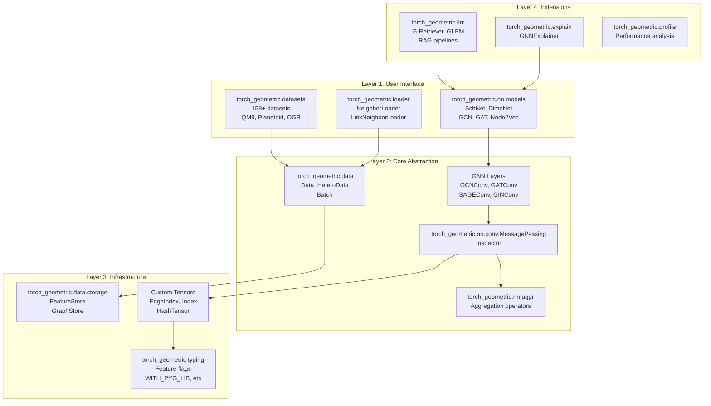
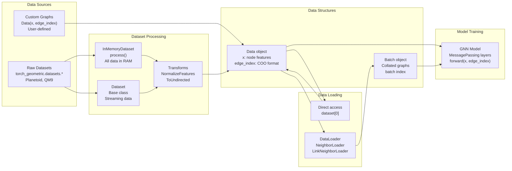
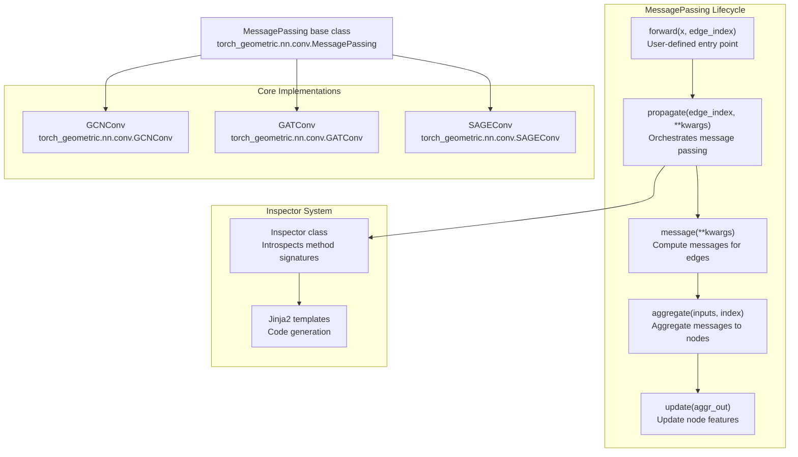

<!-- source: DeepWiki mcp.deepwiki.com · repo pyg-team/pytorch_geometric · page 1 Overview · fetched 2026-10-21 -->

# Overview

Relevant source files

The following files were used as context for generating this wiki page:

- [.github/CONTRIBUTING.md](.github/CONTRIBUTING.md)
- [.github/actions/setup/action.yml](.github/actions/setup/action.yml)
- [CHANGELOG.md](CHANGELOG.md)
- [CITATION.cff](CITATION.cff)
- [README.md](README.md)
- [docker/Dockerfile.xpu](docker/Dockerfile.xpu)
- [docs/requirements.txt](docs/requirements.txt)
- [docs/source/conf.py](docs/source/conf.py)
- [docs/source/index.rst](docs/source/index.rst)
- [docs/source/install/installation.rst](docs/source/install/installation.rst)
- [docs/source/install/quick-start.html](docs/source/install/quick-start.html)
- [docs/source/modules/datasets.rst](docs/source/modules/datasets.rst)
- [docs/source/modules/nn.rst](docs/source/modules/nn.rst)
- [docs/source/notes/colabs.rst](docs/source/notes/colabs.rst)
- [docs/source/notes/installation.rst](docs/source/notes/installation.rst)
- [docs/source/notes/resources.rst](docs/source/notes/resources.rst)
- [pyproject.toml](pyproject.toml)
- [readthedocs.yml](readthedocs.yml)
- [torch_geometric/__init__.py](torch_geometric/__init__.py)
- [torch_geometric/datasets/__init__.py](torch_geometric/datasets/__init__.py)
- [torch_geometric/nn/__init__.py](torch_geometric/nn/__init__.py)
- [torch_geometric/typing.py](torch_geometric/typing.py)

PyTorch Geometric (PyG) is a geometric deep learning library built on PyTorch for creating, training, and deploying Graph Neural Networks (GNNs) and related models for structured data. This page provides a high-level introduction to PyG's architecture, design philosophy, and core components. For installation instructions, see [Installation and Setup](#1.1). For detailed architectural concepts, see [Architecture and Key Concepts](#1.2).

## Purpose and Scope

PyG addresses the challenge of applying deep learning to non-Euclidean data structures including graphs, point clouds, and meshes. The library provides:

- **158+ built-in datasets** spanning molecular, social, citation, and geometric domains.
- **50+ GNN layer implementations** via the `MessagePassing` abstraction.
- **Pre-built models** for molecular property prediction, node/edge/graph classification, and link prediction.
- **Scalable data loaders** for full-batch and mini-batch training on graphs with millions of nodes.
- **Flexible type system** supporting optional high-performance extensions.

The library targets researchers implementing new GNN architectures, practitioners applying GNNs to real-world problems, and anyone working with graph-structured data in PyTorch.

**Sources**: [README.md:23-57](), [pyproject.toml:5-32](), [torch_geometric/datasets/__init__.py:1-212]()

## Library Architecture

PyG follows a four-layer architecture that separates concerns between low-level computation, data management, neural network operations, and high-level models:

### Four-Layer System Architecture

**Layer 1 (User Interface)**: High-level entry points including dataset classes in [torch_geometric/datasets/\_\_init\_\_.py:1-248](), data loaders, and ready-to-use model implementations. Users typically interact with PyG at this layer.

**Layer 2 (Core Abstraction)**: The `Data` and `HeteroData` classes for representing graphs, the `MessagePassing` base class that implements the message passing paradigm, and 50+ convolutional layers in [docs/source/modules/nn.rst:16-29]().

**Layer 3 (Infrastructure)**: Custom tensor types (`EdgeIndex`, `Index`, `HashTensor`) that extend PyTorch tensors with graph-specific metadata, the type system in [torch_geometric/typing.py:12-26]() for managing optional dependencies, and pluggable storage backends.

**Layer 4 (Extensions)**: Cutting-edge features including LLM integration in [CHANGELOG.md:64-64](), explainability methods, and profiling tools.

**Sources**: [README.md:148-161](), [torch_geometric/nn/__init__.py:1-33](), [torch_geometric/datasets/__init__.py:121-248](), [torch_geometric/typing.py:1-113]()

## Data Processing Pipeline

The following diagram illustrates how data flows from raw sources through PyG's processing pipeline to trained models:

**Data Sources**: PyG provides 158+ datasets organized by domain: homogeneous graphs (social networks, citations), heterogeneous graphs (recommendation systems), hypergraphs, and synthetic datasets. See [torch_geometric/datasets/\_\_init\_\_.py:121-245]() for the complete list.

**Dataset Processing**: The `InMemoryDataset` class loads all data into memory, while the base `Dataset` class allows for streaming from disk. Both support `pre_transform` and `pre_filter` functions applied during the processing lifecycle.

**Data Loading**: Small graphs use direct indexing. Large graphs use `NeighborLoader` for neighbor sampling or `LinkNeighborLoader` for link prediction tasks, both producing mini-batches via the `Batch` collation mechanism.

**Data Structures**: `Data` objects store node features in `x`, graph connectivity in `edge_index` (COO format), and optional attributes. `Batch` objects combine multiple graphs by concatenating features and adjusting indices with a `batch` vector.

**Sources**: [README.md:58-113](), [torch_geometric/datasets/__init__.py:1-249](), [docs/source/index.rst:35-47]()

## MessagePassing Framework

The `MessagePassing` class is PyG's core abstraction for implementing GNN layers. All 50+ convolutional layers inherit from this base class:

**Core Methods**: 
- `propagate()`: Main entry point that orchestrates the message passing flow.
- `message()`: Computes messages for each edge, accessing source (`_j`) and target (`_i`) node features.
- `aggregate()`: Combines messages arriving at each node (sum, mean, max, etc.) via [Aggregation System](#4.3) operators.
- `update()`: Final transformation of aggregated messages.

**Inspector and Code Generation**: The `Inspector` class uses Python introspection to automatically collect method arguments and generate optimized code via Jinja2 templates. This enables JIT compilation while maintaining a flexible Python interface.

**Concrete Implementations**: `GCNConv` implements graph convolutional networks, `GATConv` adds attention mechanisms, and `SAGEConv` provides GraphSAGE sampling-based aggregation.

**Sources**: [README.md:114-147](), [docs/source/modules/nn.rst:30-44](), [pyproject.toml:36-36]()

## Domain Applications and Models

PyG serves diverse research domains through specialized datasets and models:

| Domain | Datasets | Pre-built Models | Key Features |
|--------|----------|------------------|--------------|
| **Molecular ML** | `QM9`, `ZINC`, `MoleculeNet` | `SchNet`, `DimeNet`, `ProteinMPNN` | 3D coordinates, atomic numbers |
| **Social Networks** | `Reddit`, `Flickr`, `Facebook` | `Node2Vec`, `GraphSAGE` | Large-scale graphs, scalable loaders |
| **Citations** | `Planetoid` (Cora/Citeseer), `CoraFull` | `GCN`, `GAT`, `GATv2` | Node classification, homophily |
| **Knowledge Graphs** | `FB15k_237`, `WordNet18` | `RGCNConv`, `HGTConv` | Heterogeneous graphs, link prediction |
| **Point Clouds** | `ModelNet`, `ShapeNet`, `FAUST` | `PointNetConv`, `EdgeConv` | 3D geometric data, k-NN graphs |
| **Recommendations** | `MovieLens`, `AmazonBook` | `LightGCN`, `ARLinkPredictor` | Bipartite graphs, user-item interactions |

**Molecular Property Prediction**: Models like `SchNet` and `DimeNet` are designed for quantum chemistry, while `ProteinMPNN` targets structural biology.

**LLM Integration**: The `torch_geometric.llm` module provides tools for combining GNNs with Large Language Models, including RAG pipelines and models like `GRetriever`.

**Sources**: [torch_geometric/datasets/__init__.py:1-212](), [CHANGELOG.md:28-92](), [pyproject.toml:61-75]()

## Core Components Summary

### Data Structures
- **`Data`**: Homogeneous graphs with `x` (node features), `edge_index` (connectivity), and `y` (labels).
- **`HeteroData`**: Heterogeneous graphs with multiple node and edge types.
- **`Batch`**: Collated mini-batches with a `batch` index vector.
- **`EdgeIndex`**: Specialized tensor for graph connectivity with caching for CSR/CSC formats.

For details, see [Data Structures](#2).

### Neural Network Modules
- **`MessagePassing`**: Base class for all GNN layers implementing the message passing paradigm.
- **50+ Convolutional Layers**: `GCNConv`, `GATConv`, `SAGEConv`, `GINConv`, etc.
- **Aggregation Operators**: [Aggregation System](#4.3) base class for sum, mean, max, softmax, etc.
- **Pre-built Models**: `SchNet`, `Node2Vec`, `DeepGraphInfomax`, `TGN`.

For details, see [Message Passing Framework](#4) and [GNN Layers](#5).

### Data Loading
- **`Dataset`**: Abstract base class for datasets with `download()` and `process()` methods.
- **`DataLoader`**: PyTorch-compatible loader with graph-specific collation.
- **`NeighborLoader`**: Mini-batch sampling for large-scale graphs.

For details, see [Datasets](#3) and [Data Loading and Sampling](#3.3).

### Utilities and Extensions
- **Type System**: `torch_geometric.typing` with feature flags for `pyg-lib`, `torch-scatter`, etc.
- **Explainability**: `torch_geometric.explain` for interpreting GNN predictions.
- **Distributed**: Support for multi-GPU and multi-node training.

For details, see [Utilities](#8) and [Advanced Features](#7).

**Sources**: [torch_geometric/__init__.py:1-59](), [torch_geometric/typing.py:1-113](), [README.md:162-251]()

## Version and Compatibility

PyG 2.9.0 (latest) supports:
- **PyTorch**: 1.13 through 2.12+ (including support for `torch.compile`).
- **Python**: 3.10 through 3.14.
- **Optional Extensions**: `pyg-lib` (replaces `torch-cluster` and `torch-spline-conv`), `torch-scatter`, `torch-sparse`.
- **Device Support**: CPU, CUDA, MPS (Apple), XPU (Intel).

**Sources**: [CHANGELOG.md:30-48](), [torch_geometric/typing.py:12-26](), [torch_geometric/__init__.py:34-68]()

---

