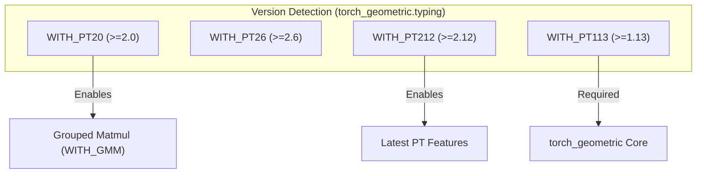
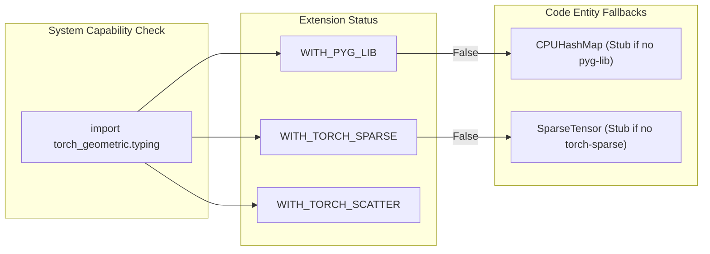

<!-- source: DeepWiki mcp.deepwiki.com · repo pyg-team/pytorch_geometric · page 1.1 Installation and Setup · fetched 2026-10-21 -->

# Installation and Setup

<details>
<summary>Relevant source files</summary>

The following files were used as context for generating this wiki page:

- [.github/CONTRIBUTING.md](.github/CONTRIBUTING.md)
- [.github/actions/setup/action.yml](.github/actions/setup/action.yml)
- [CHANGELOG.md](CHANGELOG.md)
- [CITATION.cff](CITATION.cff)
- [README.md](README.md)
- [benchmark/citation/README.md](benchmark/citation/README.md)
- [benchmark/inference/README.md](benchmark/inference/README.md)
- [benchmark/kernel/README.md](benchmark/kernel/README.md)
- [benchmark/multi_gpu/training/README.md](benchmark/multi_gpu/training/README.md)
- [benchmark/points/README.md](benchmark/points/README.md)
- [benchmark/training/README.md](benchmark/training/README.md)
- [docker/Dockerfile](docker/Dockerfile)
- [docker/Dockerfile.xpu](docker/Dockerfile.xpu)
- [docker/README.md](docker/README.md)
- [docker/singularity](docker/singularity)
- [docs/README.md](docs/README.md)
- [docs/source/install/installation.rst](docs/source/install/installation.rst)
- [docs/source/install/quick-start.html](docs/source/install/quick-start.html)
- [docs/source/notes/installation.rst](docs/source/notes/installation.rst)
- [pyproject.toml](pyproject.toml)
- [torch_geometric/__init__.py](torch_geometric/__init__.py)
- [torch_geometric/datasets/__init__.py](torch_geometric/datasets/__init__.py)
- [torch_geometric/template.py](torch_geometric/template.py)
- [torch_geometric/typing.py](torch_geometric/typing.py)

</details>


This document covers the installation and configuration of PyTorch Geometric (PyG), including system requirements, dependency management, and setup of optional extension packages. PyG has evolved to offer a modular installation experience, where core functionality is decoupled from specialized hardware-accelerated kernels.

## Overview

PyG consists of a core library and several optional extension packages. Since **PyG 2.3**, the library can be used with only PyTorch as a dependency [docs/source/install/installation.rst:19-20](). However, for production-scale workloads and advanced features like heterogeneous GNN operators or specialized sampling, external libraries like `pyg-lib` are highly recommended.

## System Requirements

### Python and PyTorch Versions

PyG targets modern Python environments and aligns closely with the PyTorch release cycle.

| Component | Supported Versions |
|:---|:---|
| **Python** | 3.10 to 3.14 [docs/source/install/installation.rst:4](), [pyproject.toml:13]() |
| **PyTorch** | 1.13.0+ [torch_geometric/__init__.py:61-67](), [docs/source/install/installation.rst:48-53]() |
| **OS** | Linux, macOS, Windows [docs/source/install/quick-start.html:84-88]() |

**Sources**: [docs/source/install/installation.rst:4](), [pyproject.toml:13](), [torch_geometric/__init__.py:61-67]()

### Version Detection Architecture

The library uses `torch_geometric.typing` to dynamically detect the environment capabilities at import time. It sets several internal flags based on the installed PyTorch version.



**Sources**: [torch_geometric/typing.py:12-25]()

## Installation Methods

### 1. Minimal Installation (CPU/GPU)
For users who do not require specialized sparse kernels or advanced sampling:
```bash
pip install torch_geometric
```
**Sources**: [docs/source/install/installation.rst:24]()

### 2. Full Installation with Extension Packages
To unlock the full performance of PyG, especially for large-scale or heterogeneous graphs, install the following extension packages from the official PyG wheels.

```bash
# Example for PyTorch 2.12.0 and CUDA 13.2
pip install pyg_lib torch_scatter torch_sparse -f https://data.pyg.org/whl/torch-2.12.0+cu132.html
```

**Sources**: [docs/source/install/installation.rst:85-89](), [.github/actions/setup/action.yml:103-110]()

### Extension Package Roles

| Package | Role | Key Functionality |
|:---|:---|:---|
| `pyg-lib` | High-performance Kernels | Heterogeneous operators, graph sampling, clustering, `SplineConv` [docs/source/install/installation.rst:31]() |
| `torch-scatter` | Sparse Reductions | Accelerated and efficient scatter operations [docs/source/install/installation.rst:32]() |
| `torch-sparse` | Sparse Tensors | `SparseTensor` support and sparse-sparse/sparse-dense matrix multiplication [docs/source/install/installation.rst:33]() |

> **Note**: `torch-cluster` and `torch-spline-conv` are deprecated and their functionality has been migrated to `pyg-lib>=0.6.0` [CHANGELOG.md:41-42](), [torch_geometric/typing.py:149-163]().

## Dependency Management

PyG categorizes its dependencies to allow for lean installations while supporting advanced use cases via optional extras.

### Core Dependencies
These are automatically installed with `torch-geometric`:
- `aiohttp`, `fsspec`, `requests`: For remote data loading [pyproject.toml:34-40]()
- `jinja2`: For the `MessagePassing` code generation engine [pyproject.toml:36]()
- `numpy`, `psutil`, `tqdm`, `xxhash`: General utilities [pyproject.toml:37-42]()

### Optional Extras
Install these using `pip install torch_geometric[<extra>]`:
- `full`: Includes `scipy`, `scikit-learn`, `ase`, `captum`, `networkx`, `pandas`, `rdkit`, etc. [pyproject.toml:89-114]()
- `rag`: Dependencies for Graph-based Retrieval Augmented Generation (`faiss-cpu`, `transformers`, `openai`) [pyproject.toml:61-75]()
- `graphgym`: For the GraphGym experiment platform [pyproject.toml:46-50]()

**Sources**: [pyproject.toml:33-114]()

## Environment Setup and Hardware Support

### Docker Support
For containerized environments, PyG provides a Dockerfile based on NVIDIA's CUDA images. It includes pre-installed `cugraph` for RAPIDS integration.
```dockerfile
# Snippet from Dockerfile
RUN pip install torch_geometric==2.6.0
RUN pip install cugraph-cu12 cugraph-pyg-cu12 --extra-index-url=https://pypi.nvidia.com
```
**Sources**: [docker/Dockerfile:17-21]()

### Feature Detection and Fallbacks
The `torch_geometric.typing` module acts as the system's "Feature Manager". It checks for the presence of extension packages and provides fallback implementations (stubs) that raise informative errors if a missing feature is accessed.



**Sources**: [torch_geometric/typing.py:46-112](), [torch_geometric/typing.py:165-189]()

### Extension Specific Flags
- `WITH_GMM`: Set if `pyg_lib.ops.grouped_matmul` is available [torch_geometric/typing.py:48]().
- `WITH_METIS`: Set if `pyg_lib.partition` is available for graph clustering [torch_geometric/typing.py:74]().
- `WITH_CUDA_HASH_MAP`: Set if `torch.classes.pyg.CUDAHashMap` is registered [torch_geometric/typing.py:86]().

## Summary of Installation Steps

```mermaid
sequenceDiagram
    participant User
    participant System
    participant PyPI
    participant PyG_WHL as data.pyg.org
    
    User->>System: pip install torch
    System->>User: Verify PT version >= 1.13.0
    User->>PyPI: pip install torch_geometric
    Note over User, PyPI: Core Library Installed
    
    opt Advanced Features
        User->>System: python -c "import torch; print(torch.version.cuda)"
        System->>User: Returns CUDA version (e.g., 12.8)
        User->>PyG_WHL: pip install pyg_lib -f https://data.pyg.org/whl/torch-2.10.0+cu128.html
    end
```

**Sources**: [docs/source/install/installation.rst:43-96](), [torch_geometric/typing.py:1-25]()

---

