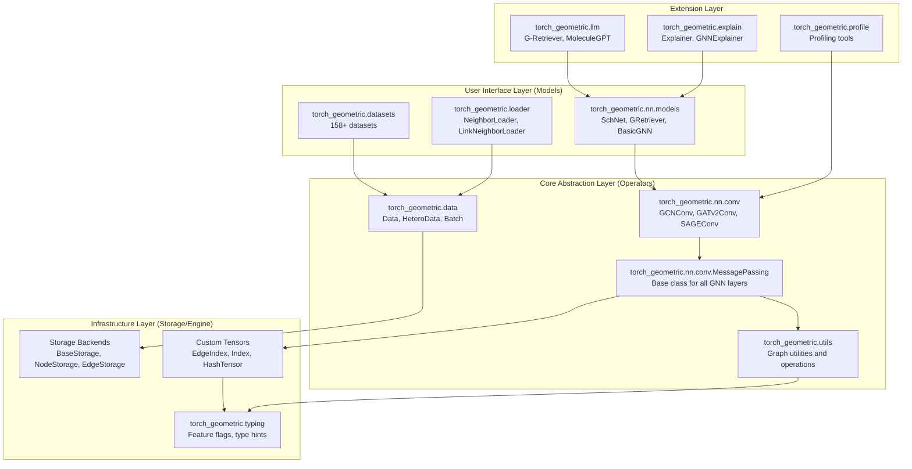
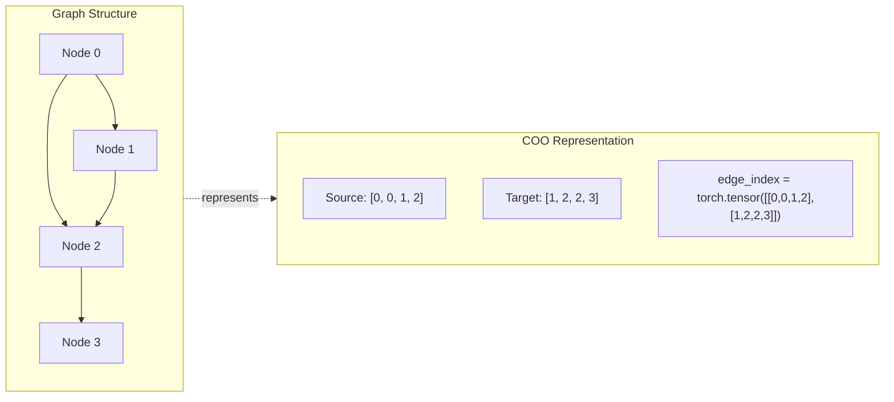
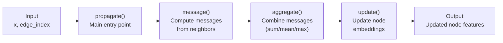
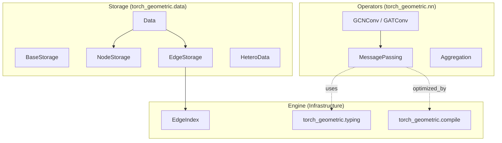
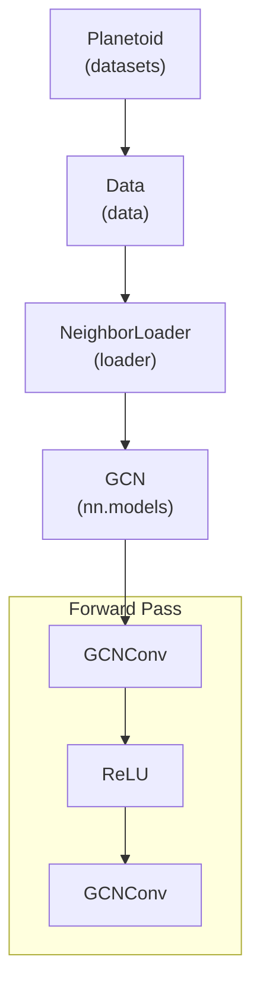

<!-- source: DeepWiki mcp.deepwiki.com · repo pyg-team/pytorch_geometric · page 1.2 Architecture and Key Concepts · fetched 2026-10-21 -->

# Architecture and Key Concepts

Relevant source files

The following files were used as context for generating this wiki page:

- [.github/CONTRIBUTING.md](.github/CONTRIBUTING.md)
- [.github/actions/setup/action.yml](.github/actions/setup/action.yml)
- [CHANGELOG.md](CHANGELOG.md)
- [CITATION.cff](CITATION.cff)
- [README.md](README.md)
- [docker/Dockerfile.xpu](docker/Dockerfile.xpu)
- [docs/source/advanced/batching.rst](docs/source/advanced/batching.rst)
- [docs/source/advanced/graphgym.rst](docs/source/advanced/graphgym.rst)
- [docs/source/advanced/remote.rst](docs/source/advanced/remote.rst)
- [docs/source/advanced/sparse_tensor.rst](docs/source/advanced/sparse_tensor.rst)
- [docs/source/external/resources.rst](docs/source/external/resources.rst)
- [docs/source/get_started/colabs.rst](docs/source/get_started/colabs.rst)
- [docs/source/get_started/introduction.rst](docs/source/get_started/introduction.rst)
- [docs/source/install/installation.rst](docs/source/install/installation.rst)
- [docs/source/install/quick-start.html](docs/source/install/quick-start.html)
- [docs/source/notes/create_dataset.rst](docs/source/notes/create_dataset.rst)
- [docs/source/notes/create_gnn.rst](docs/source/notes/create_gnn.rst)
- [docs/source/notes/graphgym.rst](docs/source/notes/graphgym.rst)
- [docs/source/notes/installation.rst](docs/source/notes/installation.rst)
- [docs/source/notes/introduction.rst](docs/source/notes/introduction.rst)
- [docs/source/notes/jit.rst](docs/source/notes/jit.rst)
- [docs/source/notes/load_csv.rst](docs/source/notes/load_csv.rst)
- [docs/source/notes/sparse_tensor.rst](docs/source/notes/sparse_tensor.rst)
- [docs/source/tutorial/create_dataset.rst](docs/source/tutorial/create_dataset.rst)
- [docs/source/tutorial/explain.rst](docs/source/tutorial/explain.rst)
- [docs/source/tutorial/heterogeneous.rst](docs/source/tutorial/heterogeneous.rst)
- [docs/source/tutorial/load_csv.rst](docs/source/tutorial/load_csv.rst)
- [examples/ogbn_proteins_deepgcn.py](examples/ogbn_proteins_deepgcn.py)
- [pyproject.toml](pyproject.toml)
- [test/nn/conv/test_create_gnn.py](test/nn/conv/test_create_gnn.py)
- [torch_geometric/__init__.py](torch_geometric/__init__.py)
- [torch_geometric/datasets/__init__.py](torch_geometric/datasets/__init__.py)
- [torch_geometric/typing.py](torch_geometric/typing.py)

## Purpose and Scope

This page explains PyTorch Geometric's architectural design, the message passing paradigm that underlies all GNN operations, and core concepts like graph representation, data structures, and tensor operations. Reference is made to the four-layer Engine/Storage/Operators/Models stack which balances ease of use with extensibility and performance.

## Four-Layer Architecture

PyG follows a modular architectural design that separates high-level user interfaces from low-level infrastructure and extensions.

### Architecture Overview

**Sources:** [README.md:14-19](), [README.md:38-39](), [torch_geometric/__init__.py:17-26]()

### Layer Responsibilities

| Layer | Primary Modules | Purpose |
|-------|----------------|---------|
| **Models (UI)** | `torch_geometric.datasets`, `torch_geometric.loader`, `torch_geometric.nn.models` | High-level entry points for 158+ datasets, data loading, and pre-built models like `SchNet` or `DimeNet`. [torch_geometric/datasets/__init__.py:1-119](), [README.md:16-19]() |
| **Operators** | `torch_geometric.data`, `torch_geometric.nn.conv.MessagePassing`, `torch_geometric.nn.conv.*` | Fundamental abstractions: data structures, the `MessagePassing` framework, and 50+ GNN layer implementations. [torch_geometric/nn/conv/test_create_gnn.py:1-20](), [README.md:125-146]() |
| **Storage** | `torch_geometric.data.storage`, `EdgeIndex`, `Index`, `HashTensor` | Specialized tensor types with metadata and caching mechanisms (CSR/CSC). [torch_geometric/__init__.py:8-10](), [torch_geometric/typing.py:166-189]() |
| **Engine (Infrastructure)** | `torch_geometric.typing`, `torch_geometric._compile` | Type system, feature detection for optional packages (`pyg-lib`, `torch-scatter`), and `torch.compile` integration. [torch_geometric/typing.py:1-113](), [torch_geometric/__init__.py:6-7]() |

**Sources:** [README.md:148-160](), [torch_geometric/__init__.py:1-34]()

## Graph Representation

### Edge Index in COO Format

PyG represents graph connectivity using the **Coordinate (COO) format**, where edges are stored as a 2D tensor of shape `[2, num_edges]`. 

**Sources:** [README.md:81-86](), [README.md:136-145]()

### Specialized Tensor Types

PyG introduces custom tensor types to optimize graph operations and provide metadata tracking.

*   **`EdgeIndex`**: Extends `torch.Tensor` to store graph connectivity. It supports metadata like `num_rows`, `num_cols`, and `sort_order`. It automatically caches **CSR** (Compressed Sparse Row) and **CSC** (Compressed Sparse Column) representations to accelerate message passing. [torch_geometric/__init__.py:9](), [torch_geometric/__init__.py:78-80]()
*   **`Index`**: A 1D tensor subclass for indexing that tracks metadata like `is_sorted` and `max_value`. [torch_geometric/__init__.py:8](), [torch_geometric/__init__.py:76-77]()
*   **`HashTensor`**: Enables arbitrary-key indexing, utilizing GPU-accelerated hash maps if `pyg-lib` is available. [torch_geometric/__init__.py:10](), [torch_geometric/typing.py:80-88](), [torch_geometric/typing.py:114-137]()

## The MessagePassing Paradigm

The `MessagePassing` base class is the foundation of all GNN layers in PyG. It implements the paradigm through a sequence of `propagate`, `message`, `aggregate`, and `update` operations.

### MessagePassing Lifecycle

**Sources:** [README.md:125-146](), [docs/source/notes/create_gnn.rst:1-4]()

### Implementing Custom GNN Layers

To create a custom layer, users inherit from `MessagePassing` and define the message-level logic. The library uses an internal `Inspector` to introspect method signatures and determine which arguments to pass during the `propagate` call. [README.md:114-146](), [torch_geometric/nn/conv/test_create_gnn.py:1-20]()

## Data Structures

### Data and HeteroData

PyG provides unified containers for graph data:
*   **`Data`**: For homogeneous graphs. Contains attributes like `x` (node features), `edge_index` (connectivity), and `y` (labels). [README.md:65-89](), [torch_geometric/__init__.py:18]()
*   **`HeteroData`**: For heterogeneous graphs with multiple node and edge types. It stores data in a dictionary-like structure, e.g., `data['paper'].x` or `data['author', 'writes', 'paper'].edge_index`. [CHANGELOG.md:28](), [torch_geometric/__init__.py:18]()

### Batching

The `Batch` class facilitates mini-batching by combining multiple small graphs into a single large disjoint graph. This is achieved by concatenating node features and shifting edge indices appropriately. [torch_geometric/__init__.py:18](), [README.md:26]()

## Type System and Feature Detection

The `torch_geometric.typing` module provides runtime detection of optional dependencies and PyTorch version compatibility.

| Feature Flag | Dependency | Description |
|--------------|------------|-------------|
| `WITH_PYG_LIB` | `pyg-lib` | Enables optimized sampling, clustering, and heterogeneous operators. [torch_geometric/typing.py:46-47]() |
| `WITH_TORCH_SCATTER` | `torch-scatter` | Enables accelerated sparse reductions. [torch_geometric/typing.py:139-140]() |
| `WITH_TORCH_SPARSE` | `torch-sparse` | Provides `SparseTensor` support. [torch_geometric/typing.py:166-168]() |
| `WITH_PT212` | PyTorch >= 2.12 | Tracks PyTorch version for feature enablement. [torch_geometric/typing.py:24]() |

**Sources:** [torch_geometric/typing.py:1-113](), [torch_geometric/__init__.py:61-67]()

## Architecture Flow: Code Entity Mapping

The following diagram bridges high-level concepts to specific code entities within the repository.

**Sources:** [torch_geometric/__init__.py:6-26](), [torch_geometric/typing.py:166-189](), [README.md:148-160]()

## Component Interaction Flow

### Training Pipeline

**Sources:** [README.md:65-108](), [torch_geometric/datasets/__init__.py:6]()

---

