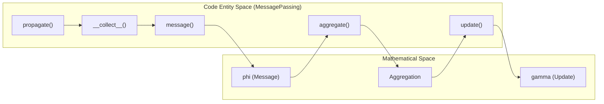

<!-- source: DeepWiki mcp.deepwiki.com · repo pyg-team/pytorch_geometric · page 10 Glossary · fetched 2026-10-21 -->

# Glossary

<details>
<summary>Relevant source files</summary>

The following files were used as context for generating this wiki page:

- [.github/CONTRIBUTING.md](.github/CONTRIBUTING.md)
- [.github/actions/setup/action.yml](.github/actions/setup/action.yml)
- [CHANGELOG.md](CHANGELOG.md)
- [CITATION.cff](CITATION.cff)
- [README.md](README.md)
- [docker/Dockerfile.xpu](docker/Dockerfile.xpu)
- [docs/source/install/installation.rst](docs/source/install/installation.rst)
- [docs/source/install/quick-start.html](docs/source/install/quick-start.html)
- [docs/source/notes/installation.rst](docs/source/notes/installation.rst)
- [pyproject.toml](pyproject.toml)
- [test/data/test_batch.py](test/data/test_batch.py)
- [test/data/test_data.py](test/data/test_data.py)
- [test/data/test_dataset.py](test/data/test_dataset.py)
- [test/data/test_feature_store.py](test/data/test_feature_store.py)
- [test/data/test_graph_store.py](test/data/test_graph_store.py)
- [test/data/test_hetero_data.py](test/data/test_hetero_data.py)
- [test/data/test_storage.py](test/data/test_storage.py)
- [test/loader/test_dataloader.py](test/loader/test_dataloader.py)
- [test/loader/test_link_neighbor_loader.py](test/loader/test_link_neighbor_loader.py)
- [test/loader/test_neighbor_loader.py](test/loader/test_neighbor_loader.py)
- [test/nn/conv/test_message_passing.py](test/nn/conv/test_message_passing.py)
- [test/nn/models/test_rev_gnn.py](test/nn/models/test_rev_gnn.py)
- [test/nn/test_sequential.py](test/nn/test_sequential.py)
- [test/sampler/test_sampler_base.py](test/sampler/test_sampler_base.py)
- [test/sampler/test_sampler_neighbor_sampler.py](test/sampler/test_sampler_neighbor_sampler.py)
- [test/test_edge_index.py](test/test_edge_index.py)
- [test/test_hash_tensor.py](test/test_hash_tensor.py)
- [test/test_index.py](test/test_index.py)
- [test/test_inspector.py](test/test_inspector.py)
- [test/utils/test_loop.py](test/utils/test_loop.py)
- [test/utils/test_sparse.py](test/utils/test_sparse.py)
- [test/utils/test_spmm.py](test/utils/test_spmm.py)
- [torch_geometric/__init__.py](torch_geometric/__init__.py)
- [torch_geometric/data/batch.py](torch_geometric/data/batch.py)
- [torch_geometric/data/collate.py](torch_geometric/data/collate.py)
- [torch_geometric/data/data.py](torch_geometric/data/data.py)
- [torch_geometric/data/dataset.py](torch_geometric/data/dataset.py)
- [torch_geometric/data/feature_store.py](torch_geometric/data/feature_store.py)
- [torch_geometric/data/graph_store.py](torch_geometric/data/graph_store.py)
- [torch_geometric/data/hetero_data.py](torch_geometric/data/hetero_data.py)
- [torch_geometric/data/in_memory_dataset.py](torch_geometric/data/in_memory_dataset.py)
- [torch_geometric/data/separate.py](torch_geometric/data/separate.py)
- [torch_geometric/data/storage.py](torch_geometric/data/storage.py)
- [torch_geometric/datasets/__init__.py](torch_geometric/datasets/__init__.py)
- [torch_geometric/edge_index.py](torch_geometric/edge_index.py)
- [torch_geometric/hash_tensor.py](torch_geometric/hash_tensor.py)
- [torch_geometric/index.py](torch_geometric/index.py)
- [torch_geometric/inspector.py](torch_geometric/inspector.py)
- [torch_geometric/loader/base.py](torch_geometric/loader/base.py)
- [torch_geometric/loader/hgt_loader.py](torch_geometric/loader/hgt_loader.py)
- [torch_geometric/loader/link_loader.py](torch_geometric/loader/link_loader.py)
- [torch_geometric/loader/link_neighbor_loader.py](torch_geometric/loader/link_neighbor_loader.py)
- [torch_geometric/loader/neighbor_loader.py](torch_geometric/loader/neighbor_loader.py)
- [torch_geometric/loader/node_loader.py](torch_geometric/loader/node_loader.py)
- [torch_geometric/loader/utils.py](torch_geometric/loader/utils.py)
- [torch_geometric/nn/conv/collect.jinja](torch_geometric/nn/conv/collect.jinja)
- [torch_geometric/nn/conv/edge_updater.jinja](torch_geometric/nn/conv/edge_updater.jinja)
- [torch_geometric/nn/conv/message_passing.py](torch_geometric/nn/conv/message_passing.py)
- [torch_geometric/nn/conv/propagate.jinja](torch_geometric/nn/conv/propagate.jinja)
- [torch_geometric/nn/models/rev_gnn.py](torch_geometric/nn/models/rev_gnn.py)
- [torch_geometric/nn/sequential.jinja](torch_geometric/nn/sequential.jinja)
- [torch_geometric/nn/sequential.py](torch_geometric/nn/sequential.py)
- [torch_geometric/sampler/__init__.py](torch_geometric/sampler/__init__.py)
- [torch_geometric/sampler/base.py](torch_geometric/sampler/base.py)
- [torch_geometric/sampler/hgt_sampler.py](torch_geometric/sampler/hgt_sampler.py)
- [torch_geometric/sampler/neighbor_sampler.py](torch_geometric/sampler/neighbor_sampler.py)
- [torch_geometric/sampler/utils.py](torch_geometric/sampler/utils.py)
- [torch_geometric/testing/__init__.py](torch_geometric/testing/__init__.py)
- [torch_geometric/testing/decorators.py](torch_geometric/testing/decorators.py)
- [torch_geometric/typing.py](torch_geometric/typing.py)
- [torch_geometric/utils/__init__.py](torch_geometric/utils/__init__.py)
- [torch_geometric/utils/loop.py](torch_geometric/utils/loop.py)
- [torch_geometric/utils/num_nodes.py](torch_geometric/utils/num_nodes.py)
- [torch_geometric/utils/sparse.py](torch_geometric/utils/sparse.py)

</details>


This glossary defines codebase-specific terms, jargon, and domain concepts used throughout the PyTorch Geometric (PyG) library. It serves as a technical reference for onboarding engineers to understand the internal mechanics and nomenclature of the system.

## Core Data Concepts

### Data and HeteroData
The fundamental containers for graph structures. `Data` represents homogeneous graphs, while `HeteroData` represents heterogeneous graphs with multiple node and edge types.
*   **Implementation**: Both inherit from `BaseData` [torch_geometric/data/data.py:48-141](). They manage underlying storage through `NodeStorage`, `EdgeStorage`, and `GlobalStorage` [torch_geometric/data/storage.py:28-33]().
*   **Data Flow**: Attributes assigned to these classes are internally routed to specialized storage objects [torch_geometric/data/storage.py:100-110]().

### Storage (BaseStorage)
A specialized dictionary-like object that holds the actual tensors for nodes, edges, or the global graph.
*   **Implementation**: Inherits from `MutableMapping` [torch_geometric/data/storage.py:54](). It supports attribute-style access (e.g., `storage.x`) and maintains weak references to parent data objects [torch_geometric/data/storage.py:104-105]().
*   **Key Classes**: `NodeStorage` [torch_geometric/data/storage.py:32](), `EdgeStorage` [torch_geometric/data/storage.py:30](), and `GlobalStorage` [torch_geometric/data/storage.py:31]().

### EdgeIndex
A specialized `Tensor` subclass for representing graph connectivity in COO format `[2, num_edges]`.
*   **Implementation**: Defined in `torch_geometric/edge_index.py` [torch_geometric/edge_index.py:22](). It includes caching for sorted states (CSR/CSC) to accelerate operations [torch_geometric/edge_index.py:22]().
*   **Usage**: Used as the primary input for the `propagate` method in `MessagePassing` layers [torch_geometric/nn/conv/message_passing.py:136-152]().

### Logic Mapping: Data to Storage
The following diagram illustrates how the high-level `Data` API interacts with the low-level `Storage` entities.

**Diagram: Data to Storage Mapping**
```mermaid
graph TD
    subgraph "Natural Language / User Space"
        User["User Code: data.x = feat"]
        UserEdge["User Code: data.edge_index = idx"]
    end

    subgraph "Code Entity Space (torch_geometric.data)"
        DataClass["Data Class [data.py]"]
        BaseData["BaseData [data.py]"]
        NodeStore["NodeStorage [storage.py]"]
        EdgeStore["EdgeStorage [storage.py]"]
        Dict["_mapping (Dict) [storage.py]"]
    end

    User -->|__setattr__| DataClass
    UserEdge -->|__setattr__| DataClass
    DataClass --|> BaseData
    DataClass -->|manages| NodeStore
    DataClass -->|manages| EdgeStore
    NodeStore -->|stores 'x'| Dict
    EdgeStore -->|stores 'edge_index'| Dict
```
Sources: [torch_geometric/data/data.py:48-90](), [torch_geometric/data/storage.py:54-110]()

---

## Message Passing Framework

### MessagePassing
The base class for all Graph Neural Network (GNN) layers. It implements the $\phi$ (message), $\bigoplus$ (aggregate), and $\gamma$ (update) functions.
*   **Key Method: `propagate`**: The entry point for the message passing lifecycle [torch_geometric/nn/conv/message_passing.py:136-152]().
*   **Key Method: `message`**: Defines how messages are constructed from node features [torch_geometric/nn/conv/message_passing.py:140]().
*   **Key Method: `aggregate`**: Defines how messages from neighbors are fused (e.g., `sum`, `mean`, `max`) [torch_geometric/nn/conv/message_passing.py:141]().

### Inspector
A utility class used by `MessagePassing` to analyze the signatures of user-defined methods (`message`, `aggregate`, `update`) at runtime.
*   **Implementation**: `Inspector` [torch_geometric/inspector.py:24](). It allows the framework to dynamically determine which tensors need to be "collected" and passed to each method [torch_geometric/nn/conv/message_passing.py:139-144]().

### Message Passing Lifecycle
This diagram maps the mathematical message passing steps to the specific class methods and internal calls.

**Diagram: Message Passing Lifecycle**

Sources: [torch_geometric/nn/conv/message_passing.py:39-152](), [torch_geometric/nn/conv/message_passing.py:136-152]()

---

## Dataset and Loading

### InMemoryDataset
A base class for datasets that fit entirely in CPU memory. It handles the download, process, and caching lifecycle.
*   **Implementation**: `InMemoryDataset` [torch_geometric/data/in_memory_dataset.py:32](). It uses a `collate` mechanism to store multiple graphs in one large contiguous tensor for efficiency [torch_geometric/data/in_memory_dataset.py:145-163]().

### NeighborLoader
A data loader for large-scale graphs that performs neighbor sampling to create mini-batches.
*   **Implementation**: `NeighborLoader` [torch_geometric/loader/neighbor_loader.py:12](). It relies on the `NeighborSampler` to select a subset of the neighborhood for each node in the batch [torch_geometric/sampler/neighbor_sampler.py:12]().

---

## Internal Utilities and Constants

### Feature Flags (WITH_PTXX)
The codebase uses version-specific flags to handle compatibility across different PyTorch versions and optional dependencies.
*   **Implementation**: Defined in `torch_geometric/typing.py` [torch_geometric/typing.py:12-25](). Examples include `WITH_PT20`, `WITH_PT113`, and `WITH_PYG_LIB`.

### Common Abbreviations
| Abbreviation | Full Term | Context |
| :--- | :--- | :--- |
| **COO** | Coordinate Format | The standard format for `edge_index` `[2, E]` [torch_geometric/edge_index.py:22](). |
| **CSR** | Compressed Sparse Row | A sparse matrix format used for efficient row-wise access during aggregation [torch_geometric/utils/sparse.py:33](). |
| **CSC** | Compressed Sparse Column | A sparse matrix format used for efficient column-wise access [torch_geometric/utils/sparse.py:34](). |
| **aggr** | Aggregation | Refers to the reduction operation in `MessagePassing` [torch_geometric/nn/conv/message_passing.py:57](). |

Sources: [torch_geometric/typing.py:1-113](), [torch_geometric/utils/__init__.py:32-35](), [torch_geometric/nn/conv/message_passing.py:57-67]()